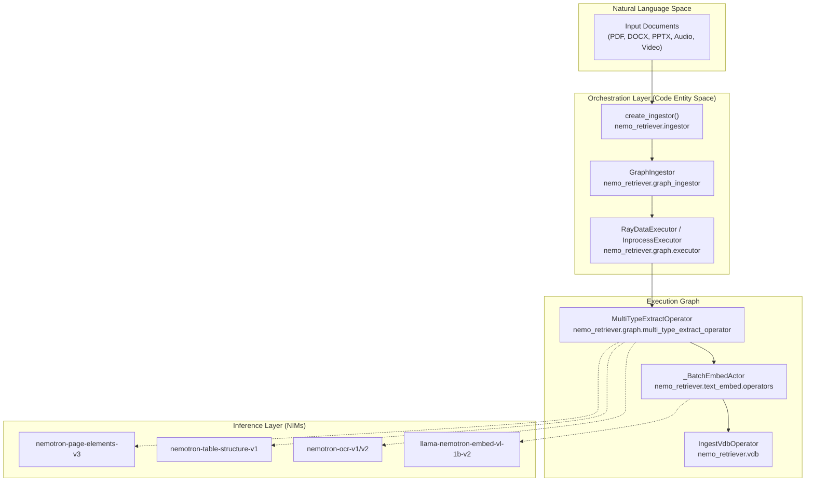
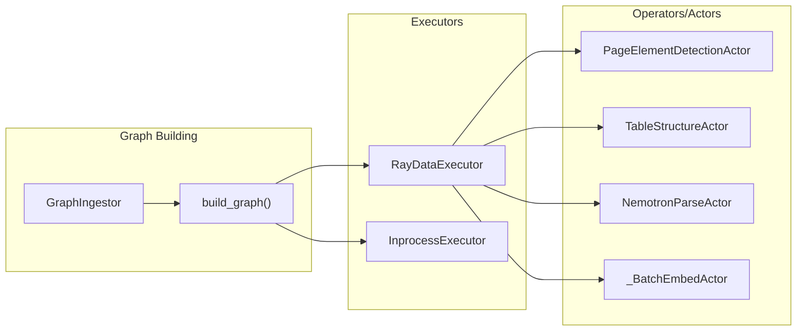

<!-- source: DeepWiki mcp.deepwiki.com · repo NVIDIA/NeMo-Retriever · page 1.1 System Architecture · fetched 2026-10-26 -->

# System Architecture

Relevant source files

The following files were used as context for generating this wiki page:

- [README.md](README.md)
- [docs/docs/extraction/concepts.md](docs/docs/extraction/concepts.md)
- [docs/docs/extraction/deployment-options.md](docs/docs/extraction/deployment-options.md)
- [docs/docs/extraction/faq.md](docs/docs/extraction/faq.md)
- [docs/docs/extraction/getting-started-about.md](docs/docs/extraction/getting-started-about.md)
- [docs/docs/extraction/multimodal-extraction.md](docs/docs/extraction/multimodal-extraction.md)
- [docs/docs/extraction/overview.md](docs/docs/extraction/overview.md)
- [docs/docs/extraction/prerequisites-support-matrix.md](docs/docs/extraction/prerequisites-support-matrix.md)
- [docs/docs/extraction/troubleshoot.md](docs/docs/extraction/troubleshoot.md)
- [docs/mkdocs.yml](docs/mkdocs.yml)
- [nemo_retriever/docs/cli/benchmarking.md](nemo_retriever/docs/cli/benchmarking.md)
- [nemo_retriever/helm/README.md](nemo_retriever/helm/README.md)
- [nemo_retriever/src/nemo_retriever/graph/executor.py](nemo_retriever/src/nemo_retriever/graph/executor.py)
- [nemo_retriever/src/nemo_retriever/graph/ingestor_runtime.py](nemo_retriever/src/nemo_retriever/graph/ingestor_runtime.py)
- [nemo_retriever/src/nemo_retriever/graph/multi_type_extract_operator.py](nemo_retriever/src/nemo_retriever/graph/multi_type_extract_operator.py)
- [nemo_retriever/src/nemo_retriever/graph_ingestor.py](nemo_retriever/src/nemo_retriever/graph_ingestor.py)
- [nemo_retriever/src/nemo_retriever/utils/input_files.py](nemo_retriever/src/nemo_retriever/utils/input_files.py)
- [nemo_retriever/tests/test_ingest_interface.py](nemo_retriever/tests/test_ingest_interface.py)
- [nemo_retriever/tests/test_ingest_plans.py](nemo_retriever/tests/test_ingest_plans.py)
- [nemo_retriever/tests/test_pipeline_graph.py](nemo_retriever/tests/test_pipeline_graph.py)

This document describes the overall system architecture of NeMo Retriever Library, explaining how NVIDIA NIMs, data services, and orchestration layers work together. It covers the graph-based execution model, Ray Data integration, and the primary deployment modes.

---

## Architecture Overview

NeMo Retriever Library (also referred to as **NVIDIA Ingest**) is a multimodal document ingestion system designed for RAG applications. It enables parallelized document splitting, artifact classification (text, tables, charts), extraction via OCR, and embedding generation [README.md:13-20]().

The system bridges "Natural Language Space" (documents, queries) to "Code Entity Space" (graphs, operators, actors) through a lazy, chainable task model [README.md:45-57]().

### High-Level System Components

**Sources:** [README.md:13-61](), [nemo_retriever/src/nemo_retriever/graph_ingestor.py:5-25](), [nemo_retriever/src/nemo_retriever/graph/ingestor_runtime.py:14-43]()

---

## Deployment Modes

The system supports three primary deployment architectures to accommodate different scales and environments.

| Deployment Mode | Description | Primary Use Case |
| :--- | :--- | :--- |
| **Library Mode** | Runs directly in Python for development. Can use local HuggingFace models or remote NIMs [README.md:32-34](). | Small-scale workloads (<100 PDFs), rapid prototyping. |
| **Docker Compose** | Standalone service image for local container validation [docs/docs/extraction/deployment-options.md:14-16](). | Local testing of the full service stack. |
| **Helm / Kubernetes** | Production-level deployment using the NVIDIA NIM Operator to manage GPU resources [nemo_retriever/helm/README.md:1-22](). | Large-scale production RAG pipelines. |

**Sources:** [README.md:26-34](), [docs/docs/extraction/deployment-options.md:9-23](), [nemo_retriever/helm/README.md:13-22]()

---

## Graph-Based Execution Model

The core of NeMo Retriever is a graph-based execution model. Pipelines are constructed lazily as a series of chainable tasks that are eventually compiled into a `Graph` [nemo_retriever/src/nemo_retriever/graph_ingestor.py:5-12]().

### Graph Construction and Execution
The `GraphIngestor` class builds the operator graph using `build_graph` and executes it via an `AbstractExecutor` implementation [nemo_retriever/src/nemo_retriever/graph_ingestor.py:36-38]().

**Sources:** [nemo_retriever/src/nemo_retriever/graph_ingestor.py:114-136](), [nemo_retriever/src/nemo_retriever/graph/ingestor_runtime.py:14-43]()

---

## Ray Data Integration

For production performance, the system utilizes **Ray Data** to parallelize ingestion. This involves actor pools, repartitioning, and GPU fraction allocation [nemo_retriever/src/nemo_retriever/graph/ingestor_runtime.py:85-107]().

### GPU Resource Management
The `batch_tuning_to_node_overrides` function translates `BatchTuningParams` into Ray-specific execution configurations, allowing fine-grained control over GPU fractions (e.g., `gpu_ocr`, `gpu_embed`) [nemo_retriever/src/nemo_retriever/graph/ingestor_runtime.py:75-95]().

### Parallel PDF Processing
For large documents, the system supports **PDF pre-splitting**. This allows a single large PDF to be distributed across multiple Ray workers for simultaneous extraction [docs/docs/extraction/concepts.md:29]().

**Sources:** [nemo_retriever/src/nemo_retriever/graph/ingestor_runtime.py:75-165](), [docs/docs/extraction/concepts.md:21-30]()

---

## NIM and Data Services

The architecture relies on specialized microservices (NIMs) for inference and various data stores for results.

### Core NIMs
The production Helm chart enables four core NIMs by default:
1.  **nemotron-page-elements-v3**: Layout detection [docs/docs/extraction/prerequisites-support-matrix.md:73]().
2.  **nemotron-table-structure-v1**: Table extraction [docs/docs/extraction/prerequisites-support-matrix.md:74]().
3.  **nemotron-ocr-v1**: Image OCR [docs/docs/extraction/prerequisites-support-matrix.md:75]().
4.  **llama-nemotron-embed-vl-1b-v2**: Multimodal embedding [docs/docs/extraction/prerequisites-support-matrix.md:76]().

### Data Infrastructure
*   **LanceDB**: The recommended vector database for local storage, managed via the `IngestVdbOperator` [README.md:56](), [nemo_retriever/src/nemo_retriever/graph/ingestor_runtime.py:40]().
*   **MinIO**: Used for object storage of extracted images and artifacts [nemo_retriever/helm/README.md:75]().
*   **SQLite**: Used in Helm deployments for service state and job persistence [nemo_retriever/helm/README.md:33-35]().

**Sources:** [docs/docs/extraction/prerequisites-support-matrix.md:67-77](), [nemo_retriever/src/nemo_retriever/graph/ingestor_runtime.py:40-43](), [nemo_retriever/helm/README.md:33-35]()

---

