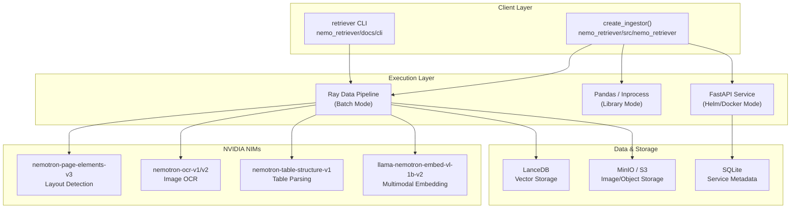
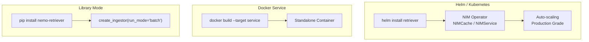
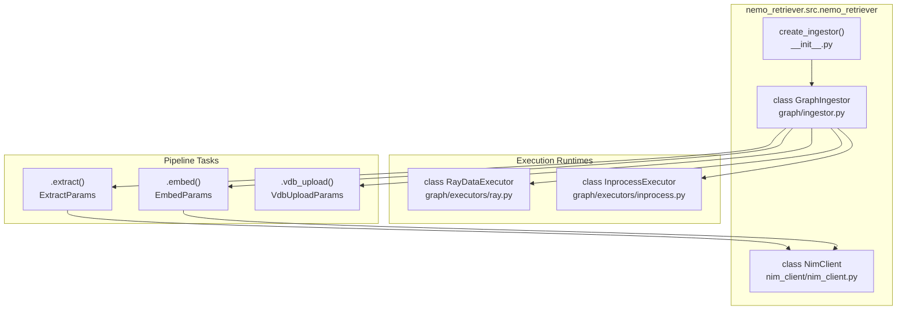

<!-- source: DeepWiki mcp.deepwiki.com · repo NVIDIA/NeMo-Retriever · page 2 Getting Started · fetched 2026-10-26 -->

# Getting Started

Relevant source files

The following files were used as context for generating this wiki page:

- [README.md](README.md)
- [docs/docs/extraction/concepts.md](docs/docs/extraction/concepts.md)
- [docs/docs/extraction/deployment-options.md](docs/docs/extraction/deployment-options.md)
- [docs/docs/extraction/faq.md](docs/docs/extraction/faq.md)
- [docs/docs/extraction/getting-started-about.md](docs/docs/extraction/getting-started-about.md)
- [docs/docs/extraction/multimodal-extraction.md](docs/docs/extraction/multimodal-extraction.md)
- [docs/docs/extraction/overview.md](docs/docs/extraction/overview.md)
- [docs/docs/extraction/prerequisites-support-matrix.md](docs/docs/extraction/prerequisites-support-matrix.md)
- [docs/docs/extraction/troubleshoot.md](docs/docs/extraction/troubleshoot.md)
- [docs/mkdocs.yml](docs/mkdocs.yml)
- [nemo_retriever/docs/cli/benchmarking.md](nemo_retriever/docs/cli/benchmarking.md)
- [nemo_retriever/helm/README.md](nemo_retriever/helm/README.md)

This page guides you through the initial setup and deployment of NeMo Retriever Library (formerly NVIDIA Ingest). It covers prerequisite verification, deployment option selection, and basic system architecture understanding. For detailed hardware specifications, see [Hardware Requirements](#2.2). For deployment instructions, see [Deployment Options](#2.1). For a hands-on tutorial, see [Quick Start Tutorial](#2.3).

## Overview

NeMo Retriever Library is a document ingestion framework that extracts, processes, and stores multimodal content (text, tables, charts, images) from various document formats. The system orchestrates multiple NVIDIA NIM microservices—often through Ray-based pipelines—to perform parallel content extraction, OCR, embedding generation, and vector database upload [README.md:13-20]().

The following diagram shows the core architectural components and their interactions:

**System Component Overview**

Sources: [README.md:22-26](), [nemo_retriever/helm/README.md:1-12](), [docs/docs/extraction/overview.md:8-12](), [docs/docs/extraction/prerequisites-support-matrix.md:67-77]()

## Prerequisites

Before deploying NeMo Retriever Library, verify the following requirements are met:

### Software Requirements

- **Operating System**: Linux (Ubuntu 22.04 or later recommended) [docs/docs/extraction/prerequisites-support-matrix.md:7]().
- **Python**: **3.12** is required. Older versions will fail dependency resolution [docs/docs/extraction/prerequisites-support-matrix.md:9]().
- **CUDA Toolkit**: NVIDIA Driver >= `580`, CUDA >= `13.0` [docs/docs/extraction/prerequisites-support-matrix.md:8]().
- **Media Tools**: `ffmpeg` and `ffprobe` are required for audio/video processing [docs/docs/extraction/prerequisites-support-matrix.md:11-13]().
- **Package Manager**: `uv` is recommended for managing isolated environments [docs/docs/extraction/prerequisites-support-matrix.md:10]().

Sources: [docs/docs/extraction/prerequisites-support-matrix.md:5-20]()

### Hardware Requirements

The minimum hardware configuration depends on your deployment mode and feature requirements:

| Component | Minimum (Core) | Recommended (Production) |
|-----------|---------------|-------------------------|
| **GPU** | 1x A10G (24GB VRAM) | A100, H100, or L40S |
| **System RAM** | 64GB | 256GB |
| **CPU Cores** | 16 cores | 32+ cores |

**Resource Consumption Notes**:
- GPU is required for local HuggingFace inference or self-hosted NIMs [docs/docs/extraction/prerequisites-support-matrix.md:49]().
- GPU is **not** required if using `build.nvidia.com` hosted inference [docs/docs/extraction/prerequisites-support-matrix.md:50]().
- Memory usage scales with document size and can reach full system capacity for large workloads [docs/docs/extraction/prerequisites-support-matrix.md:46-47]().

Sources: [docs/docs/extraction/prerequisites-support-matrix.md:26-52]()

### API Keys

- **NVIDIA_API_KEY**: Required for Library Mode to access hosted NIMs on `build.nvidia.com` [docs/docs/extraction/faq.md:47]().
- **NGC_API_KEY**: Required for self-hosted deployments to pull NIM containers and model weights [docs/docs/extraction/faq.md:40]().
- **HF_ACCESS_TOKEN**: May be required if loading tokenizers or models directly from Hugging Face Hub [docs/docs/extraction/concepts.md:33-34]().

Sources: [docs/docs/extraction/faq.md:38-53](), [docs/docs/extraction/concepts.md:31-34]()

## Deployment Options

NeMo Retriever Library supports three primary deployment architectures:

**Deployment Mode Comparison**

| Feature | Library Mode | Docker Service | Helm (Kubernetes) |
|---------|--------------|----------------|-------------------|
| **Target Use Case** | Dev / Small scale (<100 PDFs) | Standalone validation | Production / Large scale |
| **Scaling** | Single Node | Single Container | Multi-node (Ray/K8s) |
| **Complexity** | Low | Moderate | High |
| **Infrastructure** | Local GPU or Hosted | Local GPU / Docker | K8s + NIM Operator |

Sources: [README.md:26-34](), [docs/docs/extraction/deployment-options.md:5-40](), [nemo_retriever/helm/README.md:1-12]()

### Decision Guide

- **Choose Library Mode** for rapid prototyping, notebooks, or processing fewer than 100 documents using hosted APIs [README.md:32-34]().
- **Choose Docker Service** for local containerized validation before moving to production [docs/docs/extraction/deployment-options.md:14-16]().
- **Choose Helm/Kubernetes** for production-level performance, high availability, and massive document volumes [README.md:26]().

Sources: [README.md:26-34](), [docs/docs/extraction/deployment-options.md:52-75]()

## System Architecture

The following diagram maps high-level concepts to specific code entities within the `nemo_retriever` package:

**Code-Level Component Mapping**

Sources: [README.md:37-61](), [docs/docs/extraction/faq.md:59-63](), [docs/docs/extraction/concepts.md:7-11]()

## Configuration

### Environment Variables
Key variables include:
- `NVIDIA_API_KEY`: For hosted NIM access [docs/docs/extraction/faq.md:47]().
- `INSTALL_FFMPEG`: Set to `true` in Helm or Docker to enable audio/video support at runtime [nemo_retriever/helm/README.md:105-108]().
- `EMBEDDER_BATCH_SIZE`: May need to be set to `3` for certain hardware like RTX 6000 [docs/docs/extraction/troubleshoot.md:90-99]().

Sources: [docs/docs/extraction/faq.md:36-53](), [docs/docs/extraction/troubleshoot.md:90-99](), [nemo_retriever/helm/README.md:104-114]()

### Helm Values
- `nimOperator.<nim_name>.enabled`: Controls which NIMs are deployed by the NIM Operator [docs/docs/extraction/prerequisites-support-matrix.md:69-70]().
- `service.installFfmpeg`: Enables `ffmpeg` installation inside the service pod [nemo_retriever/helm/README.md:109-114]().

Sources: [nemo_retriever/helm/README.md:109-114](), [docs/docs/extraction/prerequisites-support-matrix.md:95-105]()

## Next Steps

1. **Get API Keys**: Obtain your NGC or NVIDIA API key [docs/docs/extraction/getting-started-about.md:7]().
2. **Check Prerequisites**: Verify your GPU and Python environment [docs/docs/extraction/prerequisites-support-matrix.md:1-33]().
3. **Select Deployment**: Choose between [Deployment Options](#2.1).
4. **Quick Start**: Run the [Quick Start Tutorial](#2.3) to process your first PDF.

Sources: [docs/docs/extraction/getting-started-about.md:1-15]()

---

