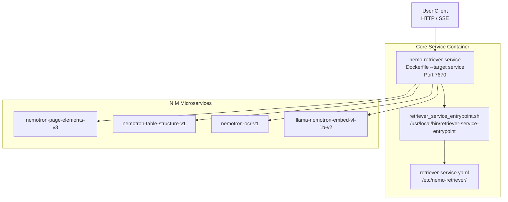

<!-- source: DeepWiki mcp.deepwiki.com · repo NVIDIA/NeMo-Retriever · page 2.1 Deployment Options · fetched 2026-10-26 -->

# Deployment Options

Relevant source files

The following files were used as context for generating this wiki page:

- [.github/workflows/docker-build-arm.yml](.github/workflows/docker-build-arm.yml)
- [.github/workflows/docker-nightly-publish.yml](.github/workflows/docker-nightly-publish.yml)
- [.github/workflows/docker-release-publish.yml](.github/workflows/docker-release-publish.yml)
- [.github/workflows/release-docker.yml](.github/workflows/release-docker.yml)
- [.github/workflows/reusable-docker-build-and-test.yml](.github/workflows/reusable-docker-build-and-test.yml)
- [.github/workflows/reusable-docker-build.yml](.github/workflows/reusable-docker-build.yml)
- [.github/workflows/scheduled-nightly.yml](.github/workflows/scheduled-nightly.yml)
- [Dockerfile](Dockerfile)
- [docs/docs/extraction/deployment-options.md](docs/docs/extraction/deployment-options.md)
- [docs/docs/extraction/faq.md](docs/docs/extraction/faq.md)
- [docs/docs/extraction/multimodal-extraction.md](docs/docs/extraction/multimodal-extraction.md)
- [docs/docs/extraction/prerequisites-support-matrix.md](docs/docs/extraction/prerequisites-support-matrix.md)
- [docs/docs/extraction/troubleshoot.md](docs/docs/extraction/troubleshoot.md)
- [nemo_retriever/docs/cli/benchmarking.md](nemo_retriever/docs/cli/benchmarking.md)
- [nemo_retriever/helm/README.md](nemo_retriever/helm/README.md)

## Purpose and Scope

This page provides an overview of the three deployment architectures available for NeMo Retriever Library and guidance on selecting the appropriate mode for your use case. Each deployment option offers different trade-offs between features, complexity, resource requirements, and scalability.

For detailed setup instructions for each mode, see:
- [Docker Compose Deployment](#2.1.1) for self-hosted containerized environments.
- [Helm/Kubernetes Deployment](#2.1.2) for enterprise production environments using the NIM Operator.
- [Library Mode](#2.1.3) for development, local testing, and small-scale workloads.

## Deployment Architecture Comparison

NeMo Retriever Library supports three distinct deployment architectures, each optimized for different operational requirements:

```mermaid
graph TB
    subgraph "Docker Compose - Self-Hosted"
        DC_User["User Application"]
        DC_Compose["docker-compose.yaml"]
        DC_Runtime["nemo-retriever-service<br/>Port 7670"]
        DC_NIMs["NIM Containers<br/>nemotron-page-elements-v3<br/>nemotron-table-structure-v1<br/>nemotron-ocr-v1<br/>llama-nemotron-embed-vl-1b-v2"]
        DC_GPU["GPU Device<br/>CUDA_VISIBLE_DEVICES"]
        
        DC_User --> DC_Compose
        DC_Compose --> DC_Runtime
        DC_Compose --> DC_NIMs
        DC_NIMs --> DC_GPU
        DC_Runtime --> DC_NIMs
    end
    
    subgraph "Helm/Kubernetes - Production Scale"
        K8s_User["DevOps Team"]
        K8s_Helm["nemo-retriever Helm Chart"]
        K8s_Operator["NIM Operator<br/>NIMService CRDs"]
        K8s_Main["nemo-retriever-service Deployment<br/>CPU/Memory Limits"]
        K8s_NIMs["NIMService Resources<br/>page_elements<br/>table_structure<br/>ocr<br/>vlm_embed"]
        K8s_GPU["GPU Resources<br/>nvidia.com/gpu: 1<br/>MIG Support"]
        
        K8s_User --> K8s_Helm
        K8s_Helm --> K8s_Operator
        K8s_Helm --> K8s_Main
        K8s_Operator --> K8s_NIMs
        K8s_NIMs --> K8s_GPU
        K8s_Main --> K8s_NIMs
    end
    
    subgraph "Library Mode - Development"
        Lib_User["Python Process"]
        Lib_Ingestor["GraphIngestor<br/>run_mode='batch'"]
        Lib_NIMs["Remote NIMs<br/>build.nvidia.com<br/>NVIDIA_API_KEY"]
        Lib_VDB["LanceDB<br/>Local .lance files"]
        
        Lib_User --> Lib_Ingestor
        Lib_Ingestor --> Lib_NIMs
        Lib_Ingestor --> Lib_VDB
    end
```

**Diagram 1: Three Deployment Architectures**

Sources: [nemo_retriever/helm/README.md:1-23](), [docs/docs/extraction/deployment-options.md:5-50](), [docs/docs/extraction/faq.md:45-54]()

## Docker Compose (Self-Hosted)

Docker Compose deployment provides a standalone containerized environment. This is suitable for local validation of the service API and small-scale self-hosted workloads.

### Architecture Components

The `Dockerfile` provides a multi-stage build, where the `service` target is used for the API server [Dockerfile:140-140]().

**Diagram 2: Docker Service Architecture**

The service container runs as the `nemo` user [Dockerfile:165-165]() and exposes port `7670` [Dockerfile:163-163](). It loads configuration from `/etc/nemo-retriever/retriever-service.yaml` [Dockerfile:142-142]().

Sources: [Dockerfile:123-170](), [docs/docs/extraction/deployment-options.md:14-17]()

## Helm/Kubernetes Deployment

Helm deployment is the recommended path for production, leveraging the **NVIDIA NIM Operator** to manage GPU-backed microservices [nemo_retriever/helm/README.md:18-22]().

### NIM Operator Integration

The chart manages `NIMCache` and `NIMService` custom resources [nemo_retriever/helm/README.md:18-19](). By default, it enables:
- `page_elements`: `nemotron-page-elements-v3` [docs/docs/extraction/prerequisites-support-matrix.md:73-73]()
- `table_structure`: `nemotron-table-structure-v1` [docs/docs/extraction/prerequisites-support-matrix.md:74-74]()
- `ocr`: `nemotron-ocr-v1` [docs/docs/extraction/prerequisites-support-matrix.md:75-75]()
- `vlm_embed`: `llama-nemotron-embed-vl-1b-v2` [docs/docs/extraction/prerequisites-support-matrix.md:76-76]()

### Air-Gapped Deployment

For air-gapped environments, users must:
1. Mirror images and models to a private registry [docs/docs/extraction/deployment-options.md:78-80]().
2. Build a custom service image containing `ffmpeg` and `ffprobe` [docs/docs/extraction/deployment-options.md:82-85]().
3. Configure the NIM Operator for air-gap mode [docs/docs/extraction/deployment-options.md:78-80]().

Sources: [nemo_retriever/helm/README.md:1-32](), [docs/docs/extraction/deployment-options.md:18-35](), [docs/docs/extraction/deployment-options.md:76-94]()

## Library Mode

Library mode allows running the ingestion pipeline directly in Python code [docs/docs/extraction/deployment-options.md:9-12](). It is often used with **NVIDIA-hosted NIMs** (build.nvidia.com) to avoid local GPU requirements [docs/docs/extraction/deployment-options.md:50-51]().

### Execution Patterns

- **In-process:** The pipeline runs within the caller's Python process.
- **Batch:** Uses Ray Data for parallel processing [docs/docs/extraction/prerequisites-support-matrix.md:28-29]().
- **LanceDB:** Uses local file-based vector storage [docs/docs/extraction/faq.md:15-15]().

### Authentication

In Library mode, the `NVIDIA_API_KEY` environment variable is used to authenticate with hosted NIMs [docs/docs/extraction/faq.md:47-47](). If using self-hosted NIMs with the library, users set specific endpoint variables like `*_ENDPOINT` [docs/docs/extraction/faq.md:49-51]().

Sources: [docs/docs/extraction/deployment-options.md:9-12](), [docs/docs/extraction/faq.md:45-54](), [docs/docs/extraction/faq.md:64-72]()

## Choosing a Deployment Mode

| Feature | Library Mode | Docker Compose | Helm/Kubernetes |
| :--- | :--- | :--- | :--- |
| **Best For** | Development, Notebooks | Local Testing, Small Service | Production, Enterprise |
| **GPU Requirement** | Optional (can use Cloud) | Required (Local) | Required (Cluster) |
| **Orchestration** | Python / Ray | Docker Compose | K8s / NIM Operator |
| **NIM Location** | Cloud or Remote | Local Containers | Cluster Pods |
| **Scaling** | Process-level | Single Node | Multi-node Autoscaling |
| **Auth Key** | `NVIDIA_API_KEY` | `NGC_API_KEY` | `ngc-secret` (K8s Secret) |

### Hardware Requirements Summary

- **Production:** 256 GB RAM, 32 CPU cores, and NVIDIA GPU with 24 GB+ VRAM (A100, H100, L40S) [docs/docs/extraction/prerequisites-support-matrix.md:36-38]().
- **Software:** Linux (Ubuntu 22.04+), CUDA 13.0+, Python 3.12 [docs/docs/extraction/prerequisites-support-matrix.md:7-9]().
- **Media Dependencies:** `ffmpeg` and `ffprobe` are required for audio/video [docs/docs/extraction/prerequisites-support-matrix.md:11-12]().

Sources: [docs/docs/extraction/prerequisites-support-matrix.md:1-63](), [docs/docs/extraction/deployment-options.md:5-75]()

---

