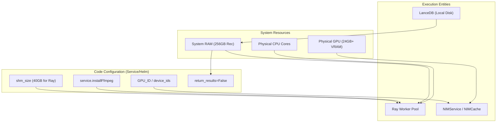
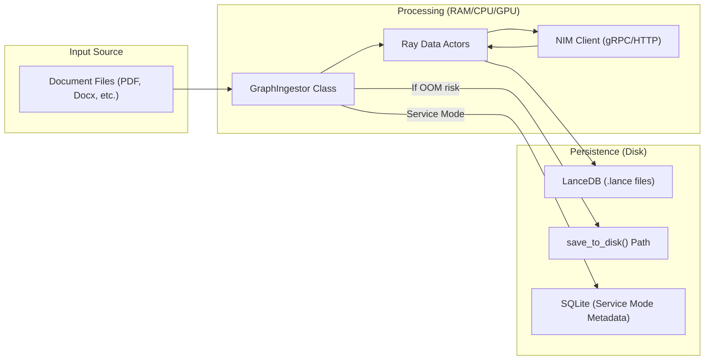

<!-- source: DeepWiki mcp.deepwiki.com · repo NVIDIA/NeMo-Retriever · page 2.2 Hardware Requirements · fetched 2026-10-26 -->

# Hardware Requirements

Relevant source files

The following files were used as context for generating this wiki page:

- [docs/docs/extraction/deployment-options.md](docs/docs/extraction/deployment-options.md)
- [docs/docs/extraction/faq.md](docs/docs/extraction/faq.md)
- [docs/docs/extraction/multimodal-extraction.md](docs/docs/extraction/multimodal-extraction.md)
- [docs/docs/extraction/prerequisites-support-matrix.md](docs/docs/extraction/prerequisites-support-matrix.md)
- [docs/docs/extraction/troubleshoot.md](docs/docs/extraction/troubleshoot.md)
- [nemo_retriever/docs/cli/benchmarking.md](nemo_retriever/docs/cli/benchmarking.md)
- [nemo_retriever/helm/README.md](nemo_retriever/helm/README.md)

This page documents the GPU, CPU, memory, and storage requirements for deploying NeMo Retriever Library. Hardware requirements vary significantly depending on which features are enabled. The core extraction pipeline is designed to consume significant CPU and memory resources to achieve maximal parallelism [docs/docs/extraction/prerequisites-support-matrix.md:28-29]().

---

## Software Requirements

Before deploying, ensure the host environment meets the following specifications:

- **Operating System**: Linux (Ubuntu 22.04 or later recommended) [docs/docs/extraction/prerequisites-support-matrix.md:7-7]().
- **CUDA Stack**: NVIDIA Driver >= `580`, CUDA >= `13.0` [docs/docs/extraction/prerequisites-support-matrix.md:8-8]().
- **Python**: Version `3.12` is required. Older versions will fail dependency resolution [docs/docs/extraction/prerequisites-support-matrix.md:9-9]().
- **Media Dependencies**: `ffmpeg` and `ffprobe` must be on `PATH` for audio/video extraction [docs/docs/extraction/prerequisites-support-matrix.md:11-13]().

Sources: [docs/docs/extraction/prerequisites-support-matrix.md:5-20]()

---

## GPU Requirements

### Supported GPU Hardware and Support Matrix

NeMo Retriever Library extraction core features run on a single A10G or better GPU [docs/docs/extraction/prerequisites-support-matrix.md:65-65]().

| Feature | GPU Requirement | Role |
| :--- | :--- | :--- |
| **Core Extraction** | NVIDIA GPU with >= 24 GB VRAM | Page layout, table structure, OCR, and VLM embedding [docs/docs/extraction/prerequisites-support-matrix.md:38-38](). |
| **Nemotron Parse** | A100 / H100 / L40S | Advanced PDF visual parsing [docs/docs/extraction/prerequisites-support-matrix.md:102-102](). |
| **Audio/Video** | NVIDIA GPU | Parakeet-1-1b-ctc-en-us for transcription [docs/docs/extraction/prerequisites-support-matrix.md:104-104](). |
| **Image Captioning** | NVIDIA GPU | Nemotron-3-Nano-Omni-30B-A3B-Reasoning [docs/docs/extraction/prerequisites-support-matrix.md:103-103](). |

### Default NIM Deployment (Helm)

By default, the production Helm chart enables the following NIM microservices, which are auto-wired into the retriever service [docs/docs/extraction/prerequisites-support-matrix.md:69-70]():

| Helm flag | NIM Image | Role |
| :--- | :--- | :--- |
| `page_elements` | `nemotron-page-elements-v3` | Page layout and element detection [docs/docs/extraction/prerequisites-support-matrix.md:73-73](). |
| `table_structure` | `nemotron-table-structure-v1` | Table structure extraction [docs/docs/extraction/prerequisites-support-matrix.md:74-74](). |
| `ocr` | `nvcr.io/nim/nvidia/nemotron-ocr-v1:1.3.0` | Image OCR [docs/docs/extraction/prerequisites-support-matrix.md:88-88](). |
| `vlm_embed` | `nvcr.io/nim/nvidia/llama-nemotron-embed-vl-1b-v2:1.12.0` | Multimodal (VL) embedding [docs/docs/extraction/prerequisites-support-matrix.md:92-92](). |

Sources: [docs/docs/extraction/prerequisites-support-matrix.md:63-104](), [nemo_retriever/helm/README.md:66-70]()

---

## CPU and Memory Requirements

### Recommended Production Specifications

To achieve maximal parallelism and handle large document volumes, the following specifications are recommended:

- **System Memory**: At least 256 GB RAM [docs/docs/extraction/prerequisites-support-matrix.md:36-36]().
- **CPU Cores**: At least 32 CPU cores [docs/docs/extraction/prerequisites-support-matrix.md:37-37]().
- **GPU**: NVIDIA GPU with at least 24 GB VRAM (e.g., A100, H100, L40S) [docs/docs/extraction/prerequisites-support-matrix.md:38-38]().

### Resource Consumption Dynamics

The pipeline performs runtime allocation based on system capacity [docs/docs/extraction/prerequisites-support-matrix.md:46-46](). Memory usage can reach full system capacity when processing large PDF files or image collections [docs/docs/extraction/prerequisites-support-matrix.md:47-55]().

**Note on GPU usage**:
- A GPU is required for inference using HuggingFace models or local NIMs [docs/docs/extraction/prerequisites-support-matrix.md:49-49]().
- A GPU is **NOT** required if using `build.nvidia.com` hosted inference [docs/docs/extraction/prerequisites-support-matrix.md:50-50]().

Sources: [docs/docs/extraction/prerequisites-support-matrix.md:28-61]()

---

## Resource Virtualization and Management

### GPU Sharing and Partitioning

In production environments (Kubernetes), the NIM Operator supports strategies to optimize GPU utilization [docs/docs/extraction/deployment-options.md:74-74]():

1.  **Time-Slicing**: Multiple NIM workloads share a GPU via time-multiplexing.
2.  **MIG (Multi-Instance GPU)**: Physically partitions supported GPUs (H100/A100) into isolated instances with dedicated compute/memory [docs/docs/extraction/deployment-options.md:74-74]().

### Hardware-to-Code Mapping: Resource Configuration

The following diagram illustrates how hardware resource constraints map to configuration entities in the codebase.

**Hardware Resource Mapping**

Sources: [nemo_retriever/helm/README.md:104-114](), [nemo_retriever/helm/README.md:37-41](), [docs/docs/extraction/prerequisites-support-matrix.md:34-38]()

---

## Storage and Persistence

### Disk Usage Considerations

- **LanceDB**: By default, NeMo Retriever uses LanceDB, which stores vectors as local Lance files on disk [docs/docs/extraction/faq.md:15-15]().
- **System Memory vs. Disk**: By default, the library stores results in system memory. For large datasets, users must use `save_to_disk` to avoid Out-of-Memory (OOM) errors [docs/docs/extraction/troubleshoot.md:79-84]().
- **Media Storage**: If `service.installFfmpeg=true` is set in Helm, the container requires a writable root filesystem [nemo_retriever/helm/README.md:138-143]().

### Data Flow and Storage Diagram

**Ingestion Data Flow and Storage Entities**

Sources: [docs/docs/extraction/faq.md:15-15](), [docs/docs/extraction/troubleshoot.md:83-84](), [nemo_retriever/helm/README.md:33-35]()

---

## Throughput and Scaling

Throughput is highly dependent on content complexity rather than just file size [docs/docs/extraction/multimodal-extraction.md:92-92]().

- **Pages/sec**: Generally the most useful metric for PDF/Document processing [docs/docs/extraction/multimodal-extraction.md:98-98]().
- **Scaling**: For high volumes, increase CPU cores for parallel extraction and utilize multiple GPUs for distributed NIM inference [docs/docs/extraction/prerequisites-support-matrix.md:54-58]().
- **Optimization**: The `return_results` parameter in `ingestor.ingest()` defaults to `True`, which can incur significant system memory costs. Setting it to `False` is recommended for large-scale ingestion [nemo_retriever/helm/README.md:37-41]().

Sources: [docs/docs/extraction/multimodal-extraction.md:91-107](), [nemo_retriever/helm/README.md:37-41]()

---

