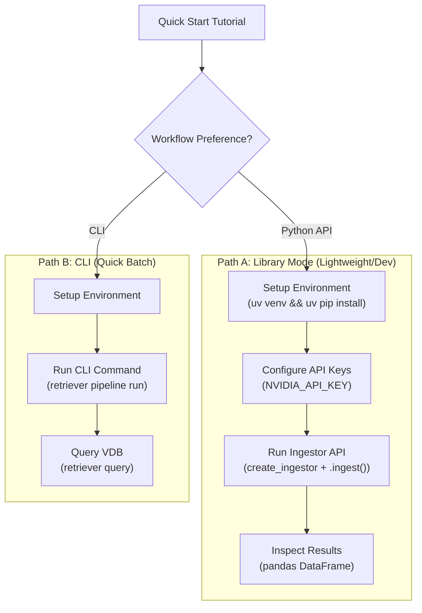
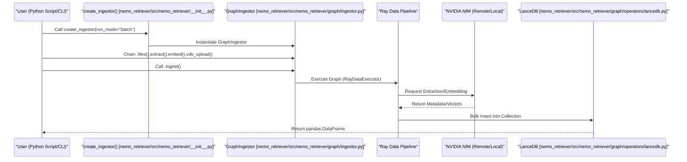

<!-- source: DeepWiki mcp.deepwiki.com · repo NVIDIA/NeMo-Retriever · page 2.3 Quick Start Tutorial · fetched 2026-10-26 -->

# Quick Start Tutorial

<details>
<summary>Relevant source files</summary>

The following files were used as context for generating this wiki page:

- [README.md](README.md)
- [docs/docs/extraction/api-keys.md](docs/docs/extraction/api-keys.md)
- [docs/docs/extraction/audio-video.md](docs/docs/extraction/audio-video.md)
- [docs/docs/extraction/concepts.md](docs/docs/extraction/concepts.md)
- [docs/docs/extraction/getting-started-about.md](docs/docs/extraction/getting-started-about.md)
- [docs/docs/extraction/overview.md](docs/docs/extraction/overview.md)
- [docs/mkdocs.yml](docs/mkdocs.yml)
- [nemo_retriever/README.md](nemo_retriever/README.md)
- [nemo_retriever/docs/cli/README.md](nemo_retriever/docs/cli/README.md)

</details>


This tutorial provides a step-by-step walkthrough for processing your first document with NeMo Retriever Library and querying the results. By the end of this guide, you will have successfully extracted multimodal content (text, tables, charts) from a PDF, stored it in a vector database, and performed a simple retrieval query.

**Scope**: This tutorial focuses on the end-to-end workflow for a single document. For detailed deployment configuration, see **Deployment Options (2.1)**. For comprehensive API usage patterns, see **Ingestor Python API (3.1)**. For production-scale considerations, see **GPU Resource Management (5.2)**.

---

## Prerequisites Verification

Before beginning this tutorial, verify that you have completed the prerequisites:

**For Library Mode Path:**
- Python 3.12+ installed [nemo_retriever/README.md:45]()
- `uv` package manager installed [nemo_retriever/README.md:45]()
- NVIDIA API key from [build.nvidia.com](https://build.nvidia.com) [docs/docs/extraction/api-keys.md:5]()
- CUDA 13.x compatible host (for local GPU inference) [nemo_retriever/README.md:21]()

**For Docker/Helm Path:**
- Access to `nvcr.io` via NGC API Key [docs/docs/extraction/api-keys.md:6]()
- Kubernetes cluster with Helm installed (for production) [README.md:26]()

**Sources:** [nemo_retriever/README.md:17-85](), [docs/docs/extraction/api-keys.md:1-51]()

---

## Tutorial Path Selection

The NeMo Retriever Library supports multiple execution modes. For this quick start, we focus on the **Batch Pipeline** which is the primary intended run mode [nemo_retriever/README.md:90]().



**Decision Criteria:**
- **Library Mode (Python API)**: Best for integration into existing Python applications or notebooks [README.md:34]().
- **CLI**: Best for quick batch processing and command-line automation [nemo_retriever/docs/cli/README.md:1-88]().

**Sources:** [README.md:32-61](), [nemo_retriever/README.md:1-138](), [nemo_retriever/docs/cli/README.md:1-151]()

---

## Path A: Library Mode (Python API)

### Step 1: Setup Environment

Create an isolated environment and install the library. If using local GPUs for inference, use the `[local]` extra [nemo_retriever/README.md:42]().

```bash
# Create and activate environment
uv venv retriever --python 3.12
source retriever/bin/activate

# Install for local GPU inference
uv pip install "nemo-retriever[local]==26.05-RC1"

# OR install for remote NIM inference only
# uv pip install nemo-retriever==26.05-RC1
```

**Sources:** [nemo_retriever/README.md:36-63]()

### Step 2: Configure API Keys

Set your `NVIDIA_API_KEY` to authorize calls to hosted NIMs [docs/docs/extraction/api-keys.md:5]().

```bash
export NVIDIA_API_KEY="nvapi-..."
```

**Sources:** [docs/docs/extraction/api-keys.md:10-24]()

### Step 3: Run the Ingestion Pipeline

Use the fluent `create_ingestor` API to define and execute the pipeline [README.md:38]().

```python
from nemo_retriever import create_ingestor
from pathlib import Path

# 1. Define input
documents = [str(Path("data/multimodal_test.pdf"))]

# 2. Create ingestor (run_mode="batch" is recommended)
ingestor = create_ingestor(run_mode="batch")

# 3. Chain tasks lazily
ingestor = (
  ingestor.files(documents)
  .extract(
    extract_text=True,
    extract_charts=True,
    extract_tables=True
  )
  .embed()
  .vdb_upload() # Uploads to LanceDB by default
)

# 4. Execute the pipeline
chunks = ingestor.ingest() # Returns a pandas.DataFrame
```

**Implementation Detail:** The `create_ingestor` factory instantiates a `GraphIngestor` which manages the underlying Ray Data execution graph [README.md:43-60]().

**Sources:** [README.md:37-61](), [nemo_retriever/README.md:94-116]()

### Step 4: Inspect Results

The results are returned as a `pandas.DataFrame` where each row represents an extracted element (text chunk, table, or chart) [README.md:60]().

```python
# View text from the first chunk
print(chunks.iloc[0]["text"])

# View a markdown-formatted table
print(chunks.iloc[1]["text"])
```

**Sources:** [README.md:65-77]()

---

## Path B: CLI Quick Start

The `retriever` CLI is a multi-subcommand Typer app for managing ingestion and queries [nemo_retriever/docs/cli/README.md:30]().

### Step 1: Ingest a PDF

Run the pipeline locally and write results to LanceDB [nemo_retriever/docs/cli/README.md:74]().

```bash
retriever pipeline run ./data/multimodal_test.pdf \
  --input-type pdf \
  --method pdfium \
  --extract-text --extract-tables --extract-charts \
  --save-intermediate ./processed_docs
```

### Step 2: Query the Results

Query the existing LanceDB table created in the previous step [nemo_retriever/docs/cli/README.md:87]().

```bash
retriever query "What gadgets are mentioned in the document?"
```

**Sources:** [nemo_retriever/docs/cli/README.md:72-88]()

---

## System Data Flow

The following diagram maps the high-level tutorial actions to the internal code entities and data services.

### Tutorial Data Flow (Natural Language to Code)



**Sources:** [README.md:37-61](), [docs/docs/extraction/concepts.md:7-19](), [nemo_retriever/docs/cli/README.md:30-45]()

---

## Key Configuration Options

### Extraction Parameters
The `.extract()` task is the core of the pipeline. It supports multiple methods and content types [docs/docs/extraction/overview.md:18]().

| Parameter | Default | Description |
| :--- | :--- | :--- |
| `extract_method` | `"pdfium"` | Options: `"pdfium"`, `"nemotron_parse"` (requires extra) |
| `extract_text` | `True` | Extract paragraphs and unstructured text |
| `extract_tables` | `True` | Extract and format tables (e.g., to Markdown) |
| `extract_charts` | `True` | Extract chart data and captions |

**Sources:** [README.md:48-54](), [docs/docs/extraction/overview.md:14-24]()

### Vector Database Upload
The `.vdb_upload()` stage manages the persistence of embeddings [docs/docs/extraction/concepts.md:19]().

| Option | Description |
| :--- | :--- |
| `vdb_op` | Database backend (Default: `"lancedb"`) |
| `collection_name` | The name of the table/collection to create/append to |

**Sources:** [docs/docs/extraction/overview.md:5-7](), [docs/docs/extraction/concepts.md:17-19]()

---

## Troubleshooting Quick Check

1.  **Missing CUDA libraries**: If OCR fails with `libcudart.so.13`, ensure CUDA 13.x is installed and `LD_LIBRARY_PATH` includes `/usr/local/cuda/lib64` [nemo_retriever/README.md:24-30]().
2.  **API Key Issues**: Ensure `NVIDIA_API_KEY` is exported if using remote NIMs. Hosted endpoints on `build.nvidia.com` require this key [docs/docs/extraction/api-keys.md:5-12]().
3.  **Multimedia Support**: If processing audio/video, ensure the `[multimedia]` extra and system `ffmpeg` are installed [docs/docs/extraction/audio-video.md:23-39]().

**Sources:** [nemo_retriever/README.md:21-30](), [docs/docs/extraction/api-keys.md:1-24](), [docs/docs/extraction/audio-video.md:1-45]()

---

