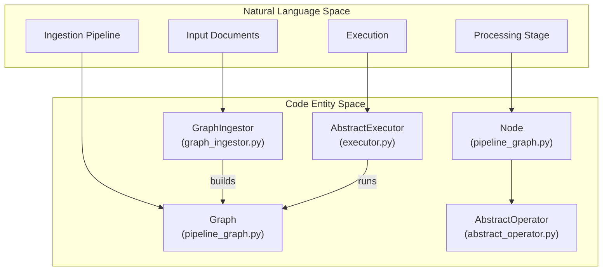
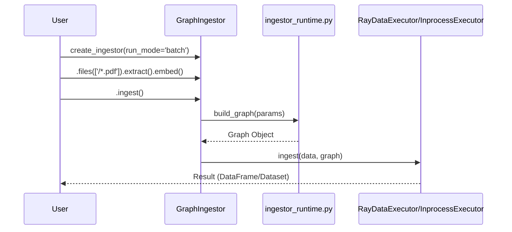

<!-- source: DeepWiki mcp.deepwiki.com · repo NVIDIA/NeMo-Retriever · page 3.1 Ingestor Python API · fetched 2026-10-26 -->

# Ingestor Python API

<details>
<summary>Relevant source files</summary>

The following files were used as context for generating this wiki page:

- [nemo_retriever/src/nemo_retriever/examples/graph_pipeline.py](nemo_retriever/src/nemo_retriever/examples/graph_pipeline.py)
- [nemo_retriever/src/nemo_retriever/graph/__init__.py](nemo_retriever/src/nemo_retriever/graph/__init__.py)
- [nemo_retriever/src/nemo_retriever/graph/executor.py](nemo_retriever/src/nemo_retriever/graph/executor.py)
- [nemo_retriever/src/nemo_retriever/graph/ingestor_runtime.py](nemo_retriever/src/nemo_retriever/graph/ingestor_runtime.py)
- [nemo_retriever/src/nemo_retriever/graph/multi_type_extract_operator.py](nemo_retriever/src/nemo_retriever/graph/multi_type_extract_operator.py)
- [nemo_retriever/src/nemo_retriever/graph/webhook_operator.py](nemo_retriever/src/nemo_retriever/graph/webhook_operator.py)
- [nemo_retriever/src/nemo_retriever/graph_ingestor.py](nemo_retriever/src/nemo_retriever/graph_ingestor.py)
- [nemo_retriever/src/nemo_retriever/ingestor.py](nemo_retriever/src/nemo_retriever/ingestor.py)
- [nemo_retriever/src/nemo_retriever/params/__init__.py](nemo_retriever/src/nemo_retriever/params/__init__.py)
- [nemo_retriever/src/nemo_retriever/utils/input_files.py](nemo_retriever/src/nemo_retriever/utils/input_files.py)
- [nemo_retriever/tests/test_ingest_interface.py](nemo_retriever/tests/test_ingest_interface.py)
- [nemo_retriever/tests/test_ingest_plans.py](nemo_retriever/tests/test_ingest_plans.py)
- [nemo_retriever/tests/test_pipeline_graph.py](nemo_retriever/tests/test_pipeline_graph.py)
- [nemo_retriever/tests/test_webhook_operator.py](nemo_retriever/tests/test_webhook_operator.py)

</details>


## Purpose and Scope

The Ingestor Python API provides a fluent, high-level interface for building and executing document ingestion pipelines. It allows users to define complex multimodal processing workflows—including file loading, extraction, chunking, embedding, and vector database upload—through a builder pattern.

The API supports multiple execution modes:
- **Library Mode (`inprocess`)**: Runs the pipeline directly in the local Python process using pandas. [nemo_retriever/src/nemo_retriever/graph/executor.py:60-68]()
- **Batch Mode (`batch`)**: Executes large-scale distributed pipelines using Ray Data. [nemo_retriever/src/nemo_retriever/graph/executor.py:161-174]()
- **Service Mode (`service`)**: Submits processing requests to a remote FastAPI-based ingestion service. [nemo_retriever/src/nemo_retriever/ingestor.py:58-68]()

This page covers the `GraphIngestor` and `create_ingestor` factory. For details on building pipelines, see [Task Chaining and Pipeline Building](#3.1.1). For details on execution and error handling, see [Job Management and Results](#3.1.2).

---

## Architecture Overview

The Ingestor API translates fluent method calls into an execution graph. In library and batch modes, this graph is composed of `Node` objects containing `AbstractOperator` implementations.

### Natural Language to Code Entity Space

The following diagram maps high-level pipeline concepts to the specific classes and functions in the codebase.

**Pipeline Component Mapping**

**Sources:** [nemo_retriever/src/nemo_retriever/graph_ingestor.py:114-136](), [nemo_retriever/src/nemo_retriever/graph/pipeline_graph.py:16-28](), [nemo_retriever/src/nemo_retriever/graph/executor.py:42-47]()

---

## Core API Entry Points

### create_ingestor Factory
The `create_ingestor` function is the primary entry point for initializing an ingestor based on the desired `run_mode`.

| Run Mode | Implementation | Description |
| :--- | :--- | :--- |
| `inprocess` | `GraphIngestor` | Sequential execution on local CPU/GPU using pandas. |
| `batch` | `GraphIngestor` | Distributed execution using Ray Data actor pools. |
| `service` | `ServiceIngestor` | Proxy that forwards tasks to a remote REST API. |

**Sources:** [nemo_retriever/src/nemo_retriever/ingestor.py:43-83]()

### GraphIngestor Class
`GraphIngestor` implements the fluent builder pattern. It maintains internal state for task parameters (e.g., `ExtractParams`, `EmbedParams`) and constructs the execution `Graph` when `.ingest()` is called.

**Ingestor Internal Flow**

**Sources:** [nemo_retriever/src/nemo_retriever/graph_ingestor.py:15-25](), [nemo_retriever/src/nemo_retriever/graph/ingestor_runtime.py:101-150]()

---

## Configuration and Parameters

The API uses structured dataclasses for configuration, ensuring type safety and validation. These are defined in `nemo_retriever.params`.

| Parameter Class | Purpose |
| :--- | :--- |
| `ExtractParams` | Configures document parsing (OCR, tables, charts). |
| `EmbedParams` | Configures embedding models and NIM endpoints. |
| `VdbUploadParams` | Configures vector database (LanceDB/Milvus) settings. |
| `TextChunkParams` | Defines text splitting and chunking strategies. |
| `BatchTuningParams` | Controls Ray resource allocation (GPU fractions, concurrency). |

**Sources:** [nemo_retriever/src/nemo_retriever/params/models.py:1-37](), [nemo_retriever/src/nemo_retriever/graph_ingestor.py:48-65]()

---

## Basic Usage Pattern

The following example demonstrates the typical fluent pattern for a PDF ingestion pipeline.

```python
from nemo_retriever.ingestor import create_ingestor
from nemo_retriever.params import ExtractParams, EmbedParams

# 1. Initialize the ingestor
ingestor = create_ingestor(run_mode="batch")

# 2. Chain tasks and execute
results = (
    ingestor.files(["/data/manual.pdf"])
    .extract(ExtractParams(method="pdfium_hybrid", extract_tables=True))
    .embed(EmbedParams(model_name="nvidia/llama-nemotron-embed-1b-v2"))
    .ingest()
)
```

### Resource Heuristics
When running in `batch` mode, `GraphIngestor` automatically calculates resource requirements (CPU/GPU) based on the cluster state and the tasks configured. This logic is handled by `batch_tuning_to_node_overrides`.

**Sources:** [nemo_retriever/src/nemo_retriever/graph/ingestor_runtime.py:75-107](), [nemo_retriever/src/nemo_retriever/graph/executor.py:182-194]()

---

## Child Pages

- [Task Chaining and Pipeline Building](#3.1.1) — Detailed documentation on the `.extract()`, `.embed()`, `.vdb_upload()`, and `.udf()` methods.
- [Job Management and Results](#3.1.2) — Covers asynchronous execution, progress tracking, and handling `GraphIngestionError`.

---

