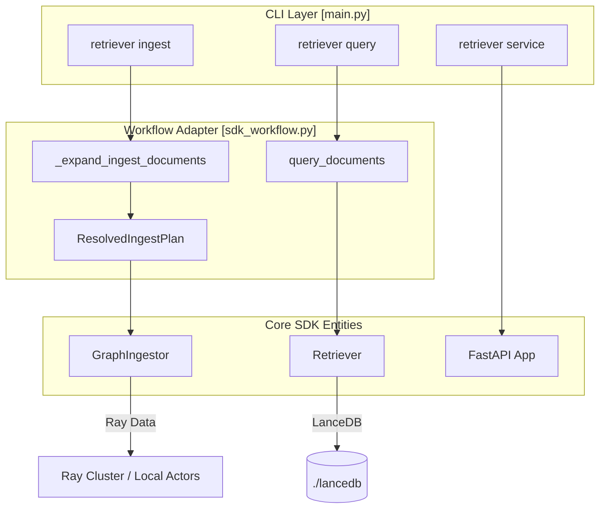
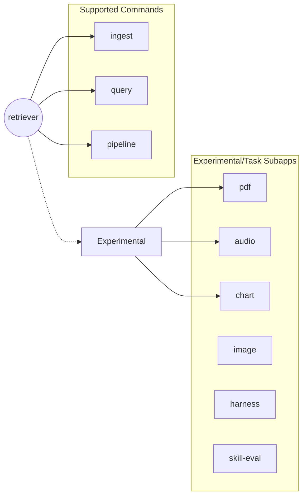

<!-- source: DeepWiki mcp.deepwiki.com · repo NVIDIA/NeMo-Retriever · page 3.2 Command Line Interface · fetched 2026-10-26 -->

# Command Line Interface

<details>
<summary>Relevant source files</summary>

The following files were used as context for generating this wiki page:

- [docs/docs/extraction/audio-video.md](docs/docs/extraction/audio-video.md)
- [nemo_retriever/README.md](nemo_retriever/README.md)
- [nemo_retriever/docs/cli/README.md](nemo_retriever/docs/cli/README.md)
- [nemo_retriever/src/nemo_retriever/adapters/cli/main.py](nemo_retriever/src/nemo_retriever/adapters/cli/main.py)
- [nemo_retriever/src/nemo_retriever/adapters/cli/sdk_workflow.py](nemo_retriever/src/nemo_retriever/adapters/cli/sdk_workflow.py)
- [nemo_retriever/src/nemo_retriever/params/utils.py](nemo_retriever/src/nemo_retriever/params/utils.py)
- [nemo_retriever/src/nemo_retriever/vdb/lancedb_schema.py](nemo_retriever/src/nemo_retriever/vdb/lancedb_schema.py)
- [nemo_retriever/tests/test_params_utils.py](nemo_retriever/tests/test_params_utils.py)
- [nemo_retriever/tests/test_root_cli_workflow.py](nemo_retriever/tests/test_root_cli_workflow.py)
- [nemo_retriever/tests/test_root_query_cli.py](nemo_retriever/tests/test_root_query_cli.py)
- [skills/nemo-retriever/references/cli/ingest.md](skills/nemo-retriever/references/cli/ingest.md)
- [skills/nemo-retriever/references/cli/query.md](skills/nemo-retriever/references/cli/query.md)
- [skills/nemo-retriever/references/setup.md](skills/nemo-retriever/references/setup.md)

</details>


The NeMo Retriever Library provides a comprehensive command-line interface (`retriever`) for document ingestion, querying, and benchmarking. The CLI acts as a wrapper around the `GraphIngestor` and `Retriever` SDK classes, enabling high-performance multimodal processing without requiring Python scripting.

---

## Purpose and Scope

The `retriever` CLI is a multi-subcommand application built with `typer` [nemo_retriever/src/nemo_retriever/adapters/cli/main.py:37](). It is designed to handle both local batch processing (via Ray or in-process pandas) and interaction with remote services.

**Key capabilities include:**
- **Ingestion:** Automated routing of PDF, HTML, text, audio, and video files through extraction and embedding branches into LanceDB [nemo_retriever/src/nemo_retriever/adapters/cli/sdk_workflow.py:12-33]().
- **Querying:** Vector-based search with support for page deduplication, content-type filtering, and reranking [nemo_retriever/src/nemo_retriever/adapters/cli/sdk_workflow.py:255-322]().
- **Pipeline Execution:** Running modular graph-based pipelines for complex document structures [nemo_retriever/docs/cli/README.md:17-18]().
- **Service Management:** Launching the FastAPI-based REST service [nemo_retriever/src/nemo_retriever/adapters/cli/main.py:40-42]().

---

## Architecture and Data Flow

The CLI bridges the gap between the user's shell and the internal Graph/Ray execution model.

### CLI to SDK Mapping


**Sources:** [nemo_retriever/src/nemo_retriever/adapters/cli/main.py:156-230](), [nemo_retriever/src/nemo_retriever/adapters/cli/sdk_workflow.py:116-153]()

---

## Command Reference

### 1. `retriever ingest`
Performs end-to-end ingestion: expansion of file patterns, manifest building, extraction, embedding, and storage.

**Canonical Usage:**
```bash
retriever ingest ./data/*.pdf --table-name my_docs --run-mode batch
```

**Key Flags:**
| Flag | Default | Description |
|------|---------|-------------|
| `documents` | (Required) | One or more files, directories, or globs [nemo_retriever/src/nemo_retriever/adapters/cli/main.py:158](). |
| `--profile` | `auto` | Ingest profile: `auto` (standard) or `fast-text` (skips expensive visual stages) [nemo_retriever/src/nemo_retriever/adapters/cli/main.py:162](). |
| `--run-mode` | `batch` | `batch` (Ray-based scaling) or `inprocess` (local pandas, for debug) [nemo_retriever/src/nemo_retriever/adapters/cli/main.py:169](). |
| `--lancedb-uri` | `lancedb` | Local path or URI for the LanceDB database [nemo_retriever/src/nemo_retriever/adapters/cli/main.py:167](). |
| `--append` | `False` | Append to existing table instead of overwriting [nemo_retriever/src/nemo_retriever/adapters/cli/main.py:221](). |
| `--caption` | `False` | Enable VLM-based captioning for extracted images/charts [nemo_retriever/src/nemo_retriever/adapters/cli/main.py:211](). |

**Implementation Detail:**
The command calls `_expand_ingest_documents` to resolve globs and directories [nemo_retriever/src/nemo_retriever/adapters/cli/sdk_workflow.py:116](), then constructs a `ResolvedIngestPlan` which executes the `GraphIngestor` chain: `.files() -> .extract() -> .embed() -> .vdb_upload() -> .ingest()` [nemo_retriever/tests/test_root_cli_workflow.py:75-81]().

### 2. `retriever query`
Performs vector search against an existing LanceDB table.

**Canonical Usage:**
```bash
retriever query "How do I configure the CLI?" --top-k 5 --page-dedup
```

**Key Flags:**
| Flag | Default | Description |
|------|---------|-------------|
| `QUERY` | (Required) | The natural language query string [skills/nemo-retriever/references/cli/query.md:40](). |
| `--top-k` | `10` | Final number of hits to return [nemo_retriever/src/nemo_retriever/adapters/cli/main.py:254](). |
| `--candidate-k` | None | Pre-deduplication pool size (useful with `--page-dedup`) [nemo_retriever/src/nemo_retriever/adapters/cli/main.py:255](). |
| `--page-dedup` | `False` | If true, returns only the best hit per document page [nemo_retriever/src/nemo_retriever/adapters/cli/main.py:260](). |
| `--content-types` | None | Filter results by type (e.g., `text,table,image`) [nemo_retriever/src/nemo_retriever/adapters/cli/main.py:264](). |
| `--rerank` | `False` | Enable second-stage reranking using a default local model or remote URL [nemo_retriever/src/nemo_retriever/adapters/cli/main.py:284](). |

**Sources:** [nemo_retriever/src/nemo_retriever/adapters/cli/main.py:251-300](), [skills/nemo-retriever/references/cli/query.md:53-63]()

---

## Task-Specific Subcommands (Experimental)

The CLI provides "lazy-loaded" subapps for specific media types. These are primarily for development and modular testing [nemo_retriever/src/nemo_retriever/adapters/cli/main.py:44-62]().



- **`retriever pipeline run`**: Executes a full graph pipeline, allowing for intermediate result saving via `--save-intermediate` [nemo_retriever/docs/cli/README.md:75-81]().
- **`retriever audio extract`**: Specialized entry point for Parakeet ASR workflows [nemo_retriever/docs/cli/README.md:39]().
- **`retriever harness run`**: Orchestrates large-scale benchmarking sweeps [nemo_retriever/docs/cli/README.md:45]().
- **`retriever skill-eval`**: Evaluates coding/agentic skills [nemo_retriever/src/nemo_retriever/adapters/cli/main.py:58]().

**Sources:** [nemo_retriever/src/nemo_retriever/adapters/cli/main.py:47-62](), [nemo_retriever/docs/cli/README.md:10-23]()

---

## Implementation Details

### Result Construction
The CLI standardizes output using the `RetrievalHit` schema [nemo_retriever/src/nemo_retriever/adapters/cli/main.py:32](). When querying, it returns a compact JSON array containing:
- `source`: The file path [nemo_retriever/src/nemo_retriever/adapters/cli/main.py:76]().
- `page_number`: 1-indexed page index [nemo_retriever/src/nemo_retriever/adapters/cli/main.py:77]().
- `text`: The extracted content (or caption for visual elements) [nemo_retriever/src/nemo_retriever/adapters/cli/main.py:78]().

### Logging and Noise Suppression
To ensure a clean CLI experience, the tool silences noisy libraries (vLLM, Transformers, HuggingFace) by default, setting their levels to `ERROR` [nemo_retriever/src/nemo_retriever/adapters/cli/main.py:82-92](). It also uses a `_quiet_capture` context manager to suppress C-level stdout/stderr from libraries unless an exception occurs [nemo_retriever/src/nemo_retriever/adapters/cli/main.py:95-141]().

### Remote Auth
The CLI automatically resolves `NVIDIA_API_KEY` and `NGC_API_KEY` from the environment when `--*-invoke-url` flags are used, facilitating easy transition from local to hosted NIM endpoints [nemo_retriever/src/nemo_retriever/adapters/cli/sdk_workflow.py:42](), [nemo_retriever/docs/cli/README.md:94-107]().

**Sources:** [nemo_retriever/src/nemo_retriever/adapters/cli/main.py:74-93](), [nemo_retriever/src/nemo_retriever/adapters/cli/sdk_workflow.py:220-250]()

---

