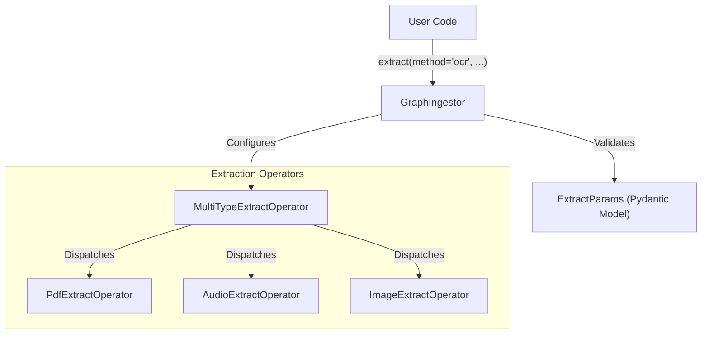
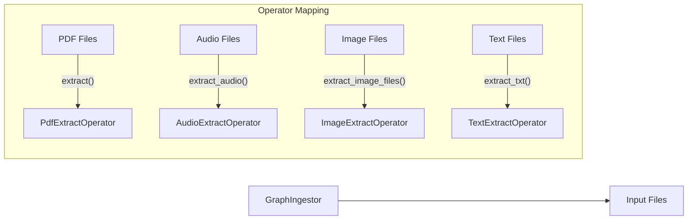

<!-- source: DeepWiki mcp.deepwiki.com · repo NVIDIA/NeMo-Retriever · page 3.3 Extraction Configuration · fetched 2026-10-26 -->

# Extraction Configuration

<details>
<summary>Relevant source files</summary>

The following files were used as context for generating this wiki page:

- [nemo_retriever/src/nemo_retriever/params/models.py](nemo_retriever/src/nemo_retriever/params/models.py)
- [nemo_retriever/src/nemo_retriever/pipeline/__main__.py](nemo_retriever/src/nemo_retriever/pipeline/__main__.py)
- [nemo_retriever/tests/test_graph_pipeline_cli.py](nemo_retriever/tests/test_graph_pipeline_cli.py)
- [nemo_retriever/tests/test_pipeline_helpers.py](nemo_retriever/tests/test_pipeline_helpers.py)

</details>


This page describes how to configure document content extraction in NeMo Retriever Library. Extraction is the process of identifying and extracting structured and unstructured content from documents including text, tables, charts, images, and audio.

For advanced visual parsing with nemotron-parse, see [Advanced Parsing with nemotron-parse](#3.3.1). For audio extraction with RIVA ASR, see [Audio Processing with RIVA ASR](#3.3.2). For broader pipeline configuration including embedding and storage, see [Ingestor Python API](#3.1).

---

## Extraction Overview

Extraction configuration is performed through the `GraphIngestor.extract()` method (or specialized variants like `extract_audio`), which configures the processing graph with specific `ExtractParams`. The extraction stage typically runs after document loading and before enrichment stages like deduplication, captioning, and embedding.

### Extraction Logic Flow



**Sources:** [nemo_retriever/src/nemo_retriever/graph_ingestor.py:112-140](), [nemo_retriever/src/nemo_retriever/params/models.py:202-237]()

---

## Basic Extraction Parameters

The `ExtractParams` class defines the configuration for document extraction. These parameters control which content types are extracted and how they are processed.

| Parameter | Type | Default | Description |
|-----------|------|---------|-------------|
| `method` | `str` | `"pdfium"` | Underlying engine: `pdfium`, `ocr`, `nemotron_parse`, `hybrid`, `unstructured` |
| `extract_text` | `bool` | `True` | Extract text content from pages |
| `extract_images` | `bool` | `False` | Extract embedded images |
| `extract_tables` | `bool` | `False` | Detect and extract table structures |
| `extract_charts` | `bool` | `False` | Detect and extract charts and graphics |
| `extract_infographics` | `bool` | `False` | Extract infographic content |
| `extract_page_as_image` | `bool` | `False` | Treat each page as a single image |

**Example:**

```python
from nemo_retriever.params import ExtractParams

ingestor.extract(
    ExtractParams(
        method="ocr",
        extract_text=True,
        extract_tables=True,
        extract_charts=True
    )
)
```

**Sources:** [nemo_retriever/src/nemo_retriever/params/models.py:202-237](), [nemo_retriever/src/nemo_retriever/pipeline/__main__.py:1015-1035]()

---

## Extraction Methods

The `method` parameter in `ExtractParams` selects the underlying extraction engine. Different methods offer tradeoffs between speed, accuracy, and support for scanned documents.

| Method | Description | Best For |
|--------|-------------|----------|
| `pdfium` | Fast extraction using PDFium library | Native PDFs with embedded text |
| `ocr` | Uses OCR NIMs (e.g., nemotron-ocr) | Scanned PDFs and images |
| `nemotron_parse` | Advanced visual parsing NIM | Complex layouts and high-fidelity extraction |
| `pdfium_hybrid` | Uses PDFium for text and OCR for images | Mixed native/scanned content |
| `audio` | Uses ASR (RIVA or local Parakeet) | Audio/Video files |

**Sources:** [nemo_retriever/src/nemo_retriever/params/models.py:204-204](), [nemo_retriever/src/nemo_retriever/pipeline/__main__.py:158-160]()

---

## Extraction Task Mapping

The `GraphIngestor` maps high-level extraction requests to internal operators based on the input file type and parameters.



**Sources:** [nemo_retriever/src/nemo_retriever/graph_ingestor.py:112-175](), [nemo_retriever/src/nemo_retriever/pipeline/__main__.py:1015-1060]()

---

## Table and Chart Output Formats

When extracting tables and charts, the output format can be controlled using format parameters within `ExtractParams`.

| Parameter | Type | Default | Options |
|-----------|------|---------|---------|
| `table_output_format` | `str` | `"markdown"` | `"markdown"`, `"html"`, `"json"` |
| `chart_output_format` | `str` | `"markdown"` | `"markdown"`, `"html"`, `"json"` |

**Sources:** [nemo_retriever/src/nemo_retriever/params/models.py:228-229]()

---

## Remote NIM Configuration

Most advanced extraction methods (OCR, Table Structure, nemotron-parse) rely on remote NVIDIA NIMs. These are configured via `RemoteInvokeParams` embedded in the extraction configuration.

| Field | Description |
|-------|-------------|
| `invoke_url` | The URL of the NIM endpoint (e.g., `http://localhost:8000/v1`) |
| `api_key` | NVIDIA/NGC API key (auto-resolved from env if not provided) |
| `request_timeout_s` | Timeout for the remote request (default 60s) |

**Sources:** [nemo_retriever/src/nemo_retriever/params/models.py:85-89](), [nemo_retriever/src/nemo_retriever/params/models.py:53-62]()

---

## Audio and Video Extraction

Audio extraction is handled via specialized methods that accept `ASRParams` and `AudioChunkParams`. This process involves demuxing video (if applicable), chunking audio, and transcribing it using RIVA or local models.

- **Audio Extraction:** Uses `extract_audio(params, asr_params)`.
- **Video Extraction:** The pipeline can extract audio tracks and/or video frames for visual processing.

For details, see [Audio Processing with RIVA ASR](#3.3.2).

**Sources:** [nemo_retriever/src/nemo_retriever/graph_ingestor.py:142-156](), [nemo_retriever/src/nemo_retriever/params/models.py:147-191]()

---

## Advanced Parsing with nemotron-parse

The `nemotron_parse` method utilizes the `nemotron-parse` NIM for high-fidelity extraction of complex documents. It is particularly effective for:
- Scanned documents with poor OCR quality.
- Documents with dense tables and charts.
- Layouts that standard PDFium-based parsers fail to reconstruct.

For details, see [Advanced Parsing with nemotron-parse](#3.3.1).

**Sources:** [nemo_retriever/src/nemo_retriever/pipeline/__main__.py:158-160](), [nemo_retriever/src/nemo_retriever/params/models.py:204-204]()

---

## Common Configuration Patterns

### Pattern 1: OCR-based PDF Extraction
Extract text and tables from scanned PDFs using remote NIMs:
```python
ingestor.extract(
    ExtractParams(
        method="ocr",
        extract_text=True,
        extract_tables=True,
        table_output_format="markdown"
    )
)
```

### Pattern 2: Multi-modal Image Extraction
Extract infographics and charts from image files:
```python
ingestor.extract_image_files(
    ExtractParams(
        extract_charts=True,
        extract_infographics=True
    )
)
```

### Pattern 3: Hybrid PDF Extraction
Use native text extraction where possible, falling back to OCR for complex elements:
```python
ingestor.extract(
    ExtractParams(method="pdfium_hybrid")
)
```

**Sources:** [nemo_retriever/src/nemo_retriever/pipeline/__main__.py:1015-1035](), [nemo_retriever/tests/test_graph_pipeline_cli.py:165-172]()

---

