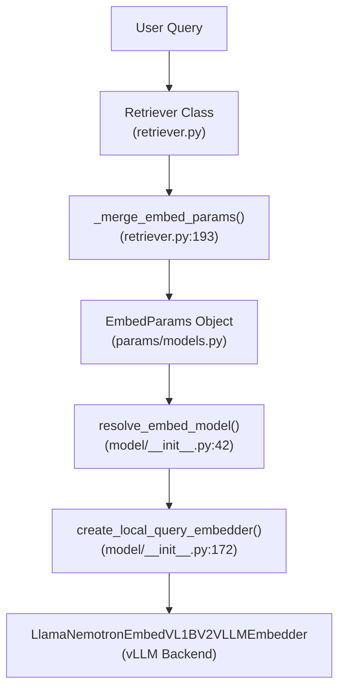
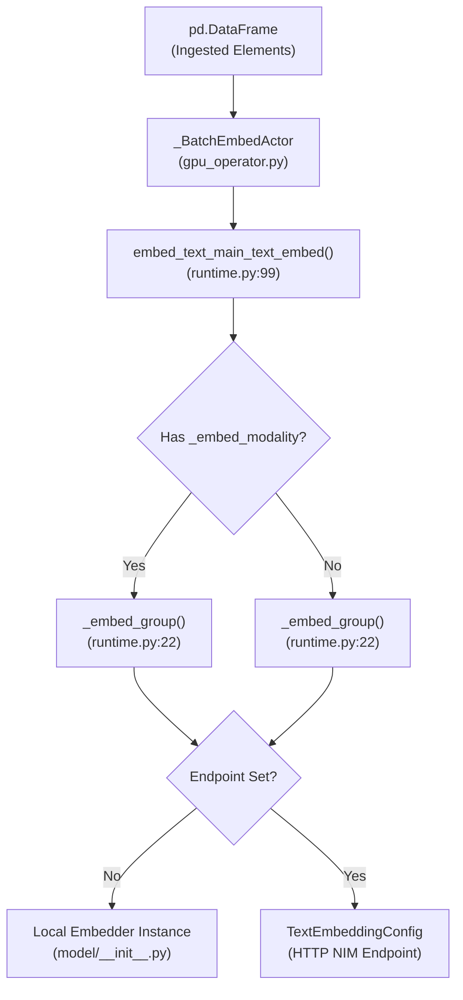

<!-- source: DeepWiki mcp.deepwiki.com · repo NVIDIA/NeMo-Retriever · page 3.4 Embedding Configuration · fetched 2026-10-26 -->

# Embedding Configuration

Relevant source files

The following files were used as context for generating this wiki page:

- [docs/docs/extraction/embedding.md](docs/docs/extraction/embedding.md)
- [nemo_retriever/src/nemo_retriever/model/__init__.py](nemo_retriever/src/nemo_retriever/model/__init__.py)
- [nemo_retriever/src/nemo_retriever/model/local/llama_nemotron_embed_1b_v2_hf_embedder.py](nemo_retriever/src/nemo_retriever/model/local/llama_nemotron_embed_1b_v2_hf_embedder.py)
- [nemo_retriever/src/nemo_retriever/recall/beir.py](nemo_retriever/src/nemo_retriever/recall/beir.py)
- [nemo_retriever/src/nemo_retriever/recall/core.py](nemo_retriever/src/nemo_retriever/recall/core.py)
- [nemo_retriever/src/nemo_retriever/retriever.py](nemo_retriever/src/nemo_retriever/retriever.py)
- [nemo_retriever/src/nemo_retriever/text_embed/gpu_operator.py](nemo_retriever/src/nemo_retriever/text_embed/gpu_operator.py)
- [nemo_retriever/src/nemo_retriever/text_embed/processor.py](nemo_retriever/src/nemo_retriever/text_embed/processor.py)
- [nemo_retriever/src/nemo_retriever/text_embed/runtime.py](nemo_retriever/src/nemo_retriever/text_embed/runtime.py)
- [nemo_retriever/tests/test_beir_evaluation.py](nemo_retriever/tests/test_beir_evaluation.py)
- [nemo_retriever/tests/test_create_local_embedder.py](nemo_retriever/tests/test_create_local_embedder.py)
- [nemo_retriever/tests/test_retriever_queries.py](nemo_retriever/tests/test_retriever_queries.py)

This page documents how to configure embedding generation in the NeMo Retriever Library. It covers the `Retriever` helper for query-time embedding and the graph-based ingestion pipeline for document embedding.

## Overview

Embedding generation converts extracted text, tables, charts, and images into dense vector representations suitable for semantic search. NeMo Retriever supports both text-only and multimodal embedding models, such as `nvidia/llama-nemotron-embed-vl-1b-v2` [nemo_retriever/src/nemo_retriever/model/__init__.py:12-13]().

The library provides two primary ways to interact with embeddings:
1.  **Ingestion (Passage Embedding)**: Configuring the graph pipeline to embed documents during ingestion using `EmbedParams` [nemo_retriever/src/nemo_retriever/params/models.py:27-106]().
2.  **Retrieval (Query Embedding)**: Using the `Retriever` class to embed user queries and search a vector database [nemo_retriever/src/nemo_retriever/retriever.py:161-169]().

Sources: [nemo_retriever/src/nemo_retriever/model/__init__.py:12-13](), [nemo_retriever/src/nemo_retriever/retriever.py:161-169]()

## Retriever Configuration

The `Retriever` class is a high-level helper that orchestrates the `batch embed → VDB retrieve → rerank` flow [nemo_retriever/src/nemo_retriever/retriever.py:161-169](). It accepts `embed_kwargs` which map to `EmbedParams`.

### Local vs. Service Mode
The `run_mode` parameter determines how embeddings are generated:
-   **`local`**: Uses local GPU resources via vLLM or HuggingFace backends [nemo_retriever/src/nemo_retriever/retriever.py:171-172]().
-   **`service`**: Forces HTTP requests to a remote NIM endpoint [nemo_retriever/src/nemo_retriever/retriever.py:171-172]().

### Local Embedder Selection
When running locally, the system selects a backend via `create_local_embedder` [nemo_retriever/src/nemo_retriever/model/__init__.py:62-74]():
-   **vLLM (Default)**: Optimized for performance using `LlamaNemotronEmbedVL1BV2VLLMEmbedder` for multimodal models [nemo_retriever/src/nemo_retriever/model/__init__.py:113-123]().
-   **HuggingFace (HF)**: Used for compatibility or CPU-only environments via `LlamaNemotronEmbedVL1BV2Embedder` [nemo_retriever/src/nemo_retriever/model/__init__.py:102-111]().

Sources: [nemo_retriever/src/nemo_retriever/retriever.py:161-172](), [nemo_retriever/src/nemo_retriever/model/__init__.py:62-123]()

## Ingestion Embedding Configuration

In the ingestion pipeline, embedding is handled by the `_BatchEmbedActor` operator [nemo_retriever/src/nemo_retriever/text_embed/gpu_operator.py:18-19]().

### Modality and Granularity
The multimodal model `Llama Nemotron Embed VL` allows for fine-grained control over how elements are processed [docs/docs/extraction/embedding.md:7-13]():

-   **`embed_modality`**: 
    -   `text`: All content (tables, charts) is treated as plain text [docs/docs/extraction/embedding.md:18-28]().
    -   `text_image`: Captures spatial and structural information by embedding visual elements as images [docs/docs/extraction/embedding.md:36-49]().
    -   `image`: Treats content purely as visual data [docs/docs/extraction/embedding.md:68-71]().
-   **`embed_granularity`**:
    -   `page`: Treats the entire PDF page as a single image [docs/docs/extraction/embedding.md:68-71]().
    -   `element`: (Default) Embeds individual extracted elements (text blocks, tables).

### Per-Element Modality Control
The pipeline supports row-level modality overrides. If a `_embed_modality` column exists in the input DataFrame, the `embed_text_main_text_embed` function groups rows by modality and processes them in batches [nemo_retriever/src/nemo_retriever/text_embed/runtime.py:133-177]().

Sources: [docs/docs/extraction/embedding.md:7-71](), [nemo_retriever/src/nemo_retriever/text_embed/runtime.py:133-177](), [nemo_retriever/src/nemo_retriever/text_embed/gpu_operator.py:18-19]()

## Configuration Flow

The following diagrams illustrate how configuration parameters bridge the gap between user intent and code execution.

### Query Embedding Logic
This diagram shows how the `Retriever` class resolves its configuration to execute a query embedding task.

Sources: [nemo_retriever/src/nemo_retriever/retriever.py:193](), [nemo_retriever/src/nemo_retriever/model/__init__.py:42-172]()

### Ingestion Embedding Pipeline
This diagram shows how document elements are routed through the `_BatchEmbedActor` based on modality configuration.

Sources: [nemo_retriever/src/nemo_retriever/text_embed/gpu_operator.py:18-62](), [nemo_retriever/src/nemo_retriever/text_embed/runtime.py:22-177]()

## NIM vs. Local Model Selection

| Feature | NIM (Remote) | Local Model (Library Mode) |
| :--- | :--- | :--- |
| **Trigger** | Set `embedding_endpoint` or `embed_invoke_url` [nemo_retriever/src/nemo_retriever/text_embed/runtime.py:127](). | Leave endpoint empty; uses GPU locally [nemo_retriever/src/nemo_retriever/text_embed/gpu_operator.py:35-45](). |
| **Backend** | NVIDIA NIM (Inference Microservice) | `vllm` (Performance) or `hf` (Compatibility) [nemo_retriever/src/nemo_retriever/model/__init__.py:96-98](). |
| **Config** | `TextEmbeddingConfig` [nemo_retriever/src/nemo_retriever/text_embed/runtime.py:67](). | `create_local_embedder` [nemo_retriever/src/nemo_retriever/model/__init__.py:62](). |

Sources: [nemo_retriever/src/nemo_retriever/text_embed/runtime.py:67-127](), [nemo_retriever/src/nemo_retriever/text_embed/gpu_operator.py:35-45](), [nemo_retriever/src/nemo_retriever/model/__init__.py:62-98]()

## Child Pages
For deeper technical details on specific embedding strategies, see:
- [Multimodal Embeddings](#3.4.1) — Explains text, image, and text+image embedding modes with `llama-nemotron-embed-vl` models. Covers the VLM embedder and page vs. element granularity.

---

