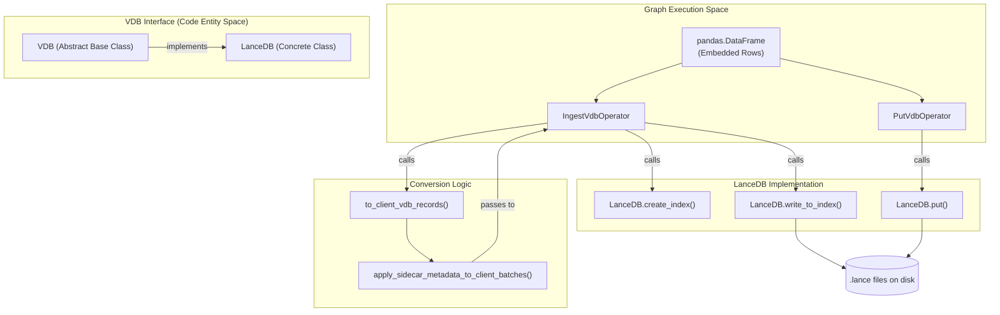
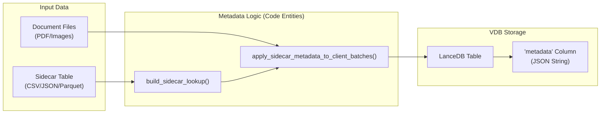

<!-- source: DeepWiki mcp.deepwiki.com · repo NVIDIA/NeMo-Retriever · page 3.5 Vector Database Upload · fetched 2026-10-26 -->

# Vector Database Upload

<details>
<summary>Relevant source files</summary>

The following files were used as context for generating this wiki page:

- [docs/docs/extraction/agentic-retrieval-concept.md](docs/docs/extraction/agentic-retrieval-concept.md)
- [docs/docs/extraction/custom-metadata.md](docs/docs/extraction/custom-metadata.md)
- [docs/docs/extraction/releasenotes.md](docs/docs/extraction/releasenotes.md)
- [docs/docs/extraction/vdbs.md](docs/docs/extraction/vdbs.md)
- [docs/docs/extraction/workflow-agentic-retrieval.md](docs/docs/extraction/workflow-agentic-retrieval.md)
- [docs/docs/extraction/workflow-document-ingestion.md](docs/docs/extraction/workflow-document-ingestion.md)
- [nemo_retriever/src/nemo_retriever/local/stages/stage6_vdb_upload.py](nemo_retriever/src/nemo_retriever/local/stages/stage6_vdb_upload.py)
- [nemo_retriever/src/nemo_retriever/vdb/README.md](nemo_retriever/src/nemo_retriever/vdb/README.md)
- [nemo_retriever/src/nemo_retriever/vdb/__init__.py](nemo_retriever/src/nemo_retriever/vdb/__init__.py)
- [nemo_retriever/src/nemo_retriever/vdb/adt_vdb.py](nemo_retriever/src/nemo_retriever/vdb/adt_vdb.py)
- [nemo_retriever/src/nemo_retriever/vdb/lancedb.py](nemo_retriever/src/nemo_retriever/vdb/lancedb.py)
- [nemo_retriever/src/nemo_retriever/vdb/lancedb_bulk.py](nemo_retriever/src/nemo_retriever/vdb/lancedb_bulk.py)
- [nemo_retriever/src/nemo_retriever/vdb/operators.py](nemo_retriever/src/nemo_retriever/vdb/operators.py)
- [nemo_retriever/src/nemo_retriever/vdb/stage.py](nemo_retriever/src/nemo_retriever/vdb/stage.py)
- [nemo_retriever/tests/test_nv_ingest_vdb_operator.py](nemo_retriever/tests/test_nv_ingest_vdb_operator.py)
- [nemo_retriever/tests/test_sidecar_metadata.py](nemo_retriever/tests/test_sidecar_metadata.py)

</details>


This page describes how to upload extracted and embedded content to vector databases for retrieval. NeMo Retriever Library supports uploading embeddings and metadata primarily to **LanceDB** (the first-party, in-process backend) and provides an interface for custom data stores. The upload process handles dense embeddings and manages the integration of sidecar metadata for filtered retrieval.

For general data storage concepts, including persisting extracted images to object storage, see [MinIO and Object Storage](#4.3). For embedding generation, see [Embedding Configuration](#3.4). For RAG integration examples after upload, see [RAG Integration Examples](#3.6).

---

## Vector Database Overview

NeMo Retriever Library provides a unified interface for vector database operations. **LanceDB** is the primary backend for storing and retrieving extracted embeddings due to its optimized columnar format and embedded runtime.

| Feature | LanceDB |
|---------|---------|
| **Runtime Model** | Embedded (in-process) [docs/docs/extraction/vdbs.md:101-101]() |
| **Index Type** | `IVF_HNSW_SQ` (default) [docs/docs/extraction/vdbs.md:66-66]() |
| **Persistence** | Lance files on disk [docs/docs/extraction/vdbs.md:105-105]() |
| **Hybrid Search** | Dense + FTS/BM25 over text [nemo_retriever/src/nemo_retriever/vdb/README.md:85-85]() |
| **Metadata** | Compact JSON string in `metadata` column [nemo_retriever/src/nemo_retriever/vdb/adt_vdb.py:121-125]() |

**Sources:** [docs/docs/extraction/vdbs.md:40-48](), [nemo_retriever/src/nemo_retriever/vdb/README.md:1-10]()

---

## System Architecture and Code Entities

The following diagram maps the logical data flow to the specific classes and functions in the `nemo_retriever.vdb` package.

### Data Flow: Graph to Vector Store



**Implementation Detail**: `IngestVdbOperator` declares `REQUIRES_GLOBAL_BATCH = True`, forcing the `RayDataExecutor` to repartition the dataset into a single block. This ensures that `VDB.run` (which calls `create_index` and `write_to_index`) processes the entire dataset at once.

**Sources:** [nemo_retriever/src/nemo_retriever/vdb/operators.py:86-131](), [nemo_retriever/src/nemo_retriever/vdb/README.md:24-33](), [nemo_retriever/src/nemo_retriever/vdb/adt_vdb.py:30-100]()

---

## Upload via Ingestor API

### Basic LanceDB Upload

The fluent `Ingestor` API is used to chain the `vdb_upload` task.

```python
from nemo_retriever import create_ingestor

ingestor = (
    create_ingestor(run_mode="batch")
    .files(["data/test.pdf"])
    .extract()
    .embed()
    .vdb_upload(
        vdb_op="lancedb",
        uri="./lancedb_data",
        table_name="nemo-retriever",
        recreate=True
    )
)

results = ingestor.ingest()
```

**Parameters**:
- `vdb_op`: The backend key, currently `"lancedb"`. [nemo_retriever/src/nemo_retriever/vdb/README.md:8-8]()
- `uri`: Path to the LanceDB database directory. [docs/docs/extraction/vdbs.md:64-64]()
- `table_name`: Name of the table (defaults to `"nemo-retriever"`). [nemo_retriever/src/nemo_retriever/vdb/lancedb.py:81-81]()
- `recreate`: If `True`, drops and recreates the table even if it exists. [nemo_retriever/src/nemo_retriever/vdb/adt_vdb.py:71-71]()

**Sources:** [docs/docs/extraction/vdbs.md:52-78](), [nemo_retriever/src/nemo_retriever/vdb/operators.py:26-38]()

---

## Custom Metadata and Sidecar Injection

NeMo Retriever allows attaching per-document metadata during ingestion via a **sidecar metadata table**. This metadata is merged into each chunk's `content_metadata` before upload.

### Sidecar Integration Flow



**Injection Configuration**:
To use sidecar metadata, pass `meta_dataframe`, `meta_source_field`, and `meta_fields` in `vdb_upload`.

```python
import pandas as pd

meta_df = pd.DataFrame({
    "source": ["data/doc1.pdf"],
    "category": ["financial"],
    "priority": [1]
})

ingestor.vdb_upload(
    vdb_op="lancedb",
    uri="./lancedb",
    meta_dataframe=meta_df,
    meta_source_field="source",
    meta_fields=["category", "priority"],
    meta_join_key="auto"
)
```

**Sources:** [docs/docs/extraction/custom-metadata.md:16-27](), [nemo_retriever/src/nemo_retriever/vdb/sidecar_metadata.py:18-23]()

---

## Retrieval and Predicate Pushdown

Retrieval is performed via `RetrieveVdbOperator` or the high-level `Retriever.query` method. LanceDB supports **predicate pushdown** using SQL-like `where` clauses.

### SQL Filter Examples

Because `content_metadata` is stored as a serialized JSON string in the `metadata` column, filters often use `LIKE` predicates:

| Requirement | SQL Predicate (`where` clause) |
|-------------|-------------------------------|
| Filter by Department | `metadata LIKE '%"department":"Engineering"%'` |
| Filter by Page Number | `metadata LIKE '%"page_number": 3%'` |
| Filter by Source | `source LIKE '%doc-a.pdf%'` |

**Sources:** [docs/docs/extraction/custom-metadata.md:113-119](), [nemo_retriever/src/nemo_retriever/vdb/adt_vdb.py:120-125]()

### Programmatic Retrieval

```python
from nemo_retriever.retriever import Retriever

retriever = Retriever(
    vdb_kwargs={"uri": "./lancedb_data", "table_name": "nemo-retriever"},
    embed_kwargs={"model_name": "nvidia/llama-nemotron-embed-1b-v2"}
)

hits = retriever.query(
    "How do I configure VDB upload?",
    top_k=5,
    vdb_kwargs={"where": "metadata LIKE '%\"priority\": 1%'"}
)
```

**Sources:** [docs/docs/extraction/custom-metadata.md:104-119](), [nemo_retriever/src/nemo_retriever/vdb/operators.py:144-168]()

---

## Index Configuration (IVF_HNSW_SQ)

LanceDB uses the `IVF_HNSW_SQ` index by default. This combines:
1. **IVF (Inverted File Index)**: Partitions the vector space into Voronoi cells.
2. **HNSW (Hierarchical Navigable Small World)**: Builds a graph for fast neighbor search within cells.
3. **SQ (Scalar Quantization)**: Compresses vectors to reduce memory footprint.

**Tuning Parameters**:
- `num_partitions`: Number of IVF clusters (centroids). [nemo_retriever/src/nemo_retriever/vdb/lancedb.py:95-114]()
- `num_sub_vectors`: Controls product quantization/quantization levels. [nemo_retriever/src/nemo_retriever/vdb/adt_vdb.py:54-54]()
- `metric`: Distance metric (typically `"L2"` or `"cosine"`). [nemo_retriever/src/nemo_retriever/vdb/lancedb.py:84-84]()

**Sources:** [docs/docs/extraction/vdbs.md:42-48](), [nemo_retriever/src/nemo_retriever/vdb/lancedb.py:89-114]()

---

## Stable-Key Updates (PutVdbOperator)

Unlike the standard `IngestVdbOperator` which often recreates or appends to tables, the `PutVdbOperator` allows for in-place replacement of existing rows based on a stable key (e.g., `"id"`).

- **Requirement**: The underlying VDB implementation must support stable-key puts. `LanceDB` implements this, while the base `VDB` class raises `NotImplementedError`. [nemo_retriever/src/nemo_retriever/vdb/operators.py:172-173]()
- **Behavior**: Rows in the incoming data that match an existing key in the table are replaced. New keys that do not exist in the table will cause a `KeyError`. [nemo_retriever/src/nemo_retriever/vdb/operators.py:142-146]()

**Sources:** [nemo_retriever/src/nemo_retriever/vdb/operators.py:137-176](), [nemo_retriever/src/nemo_retriever/vdb/adt_vdb.py:145-160]()

---

