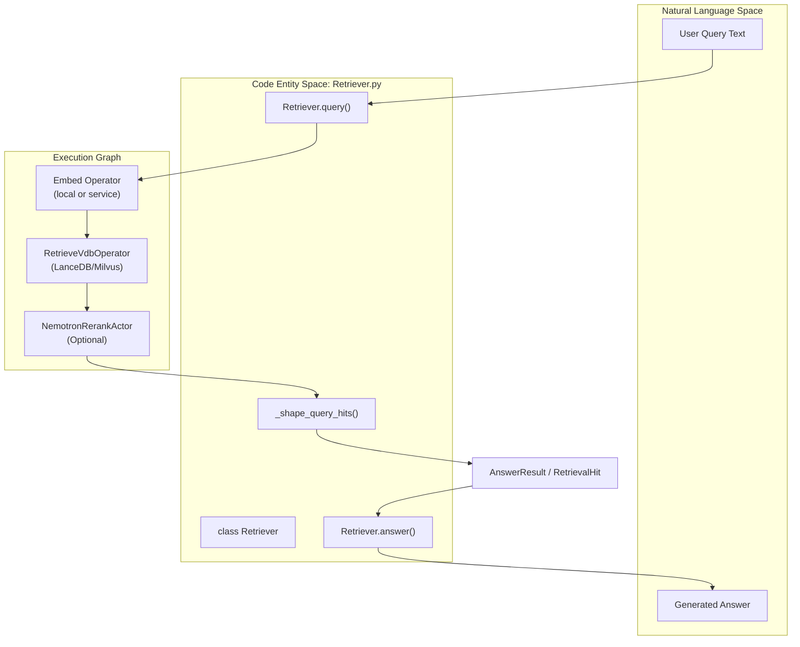
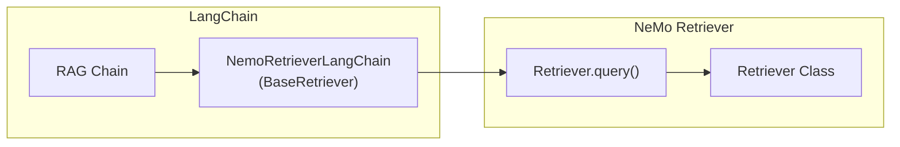

<!-- source: DeepWiki mcp.deepwiki.com · repo NVIDIA/NeMo-Retriever · page 3.6 RAG Integration Examples · fetched 2026-10-26 -->

# RAG Integration Examples

<details>
<summary>Relevant source files</summary>

The following files were used as context for generating this wiki page:

- [docs/docs/extraction/integrations-langchain-llamaindex-haystack.md](docs/docs/extraction/integrations-langchain-llamaindex-haystack.md)
- [docs/docs/extraction/notebooks/index.md](docs/docs/extraction/notebooks/index.md)
- [examples/langchain_multimodal_rag.ipynb](examples/langchain_multimodal_rag.ipynb)
- [examples/llama_index_multimodal_rag.ipynb](examples/llama_index_multimodal_rag.ipynb)
- [nemo_retriever/src/nemo_retriever/model/__init__.py](nemo_retriever/src/nemo_retriever/model/__init__.py)
- [nemo_retriever/src/nemo_retriever/model/local/llama_nemotron_embed_1b_v2_hf_embedder.py](nemo_retriever/src/nemo_retriever/model/local/llama_nemotron_embed_1b_v2_hf_embedder.py)
- [nemo_retriever/src/nemo_retriever/recall/beir.py](nemo_retriever/src/nemo_retriever/recall/beir.py)
- [nemo_retriever/src/nemo_retriever/recall/core.py](nemo_retriever/src/nemo_retriever/recall/core.py)
- [nemo_retriever/src/nemo_retriever/retriever.py](nemo_retriever/src/nemo_retriever/retriever.py)
- [nemo_retriever/src/nemo_retriever/text_embed/gpu_operator.py](nemo_retriever/src/nemo_retriever/text_embed/gpu_operator.py)
- [nemo_retriever/src/nemo_retriever/text_embed/processor.py](nemo_retriever/src/nemo_retriever/text_embed/processor.py)
- [nemo_retriever/src/nemo_retriever/text_embed/runtime.py](nemo_retriever/src/nemo_retriever/text_embed/runtime.py)
- [nemo_retriever/tests/test_beir_evaluation.py](nemo_retriever/tests/test_beir_evaluation.py)
- [nemo_retriever/tests/test_create_local_embedder.py](nemo_retriever/tests/test_create_local_embedder.py)
- [nemo_retriever/tests/test_retriever_queries.py](nemo_retriever/tests/test_retriever_queries.py)

</details>


This page demonstrates integration with LangChain and LlamaIndex for building RAG applications using the NeMo Retriever library. It covers the `Retriever` class, query execution, and the structure of retrieval results.

## Overview: RAG Pipeline Architecture

The NeMo Retriever library provides a high-level `Retriever` class that orchestrates the flow from query text to retrieved document hits. This class handles embedding the query, performing vector database search, and optionally reranking results using Nemotron models.


**Sources**: [nemo_retriever/src/nemo_retriever/retriever.py:161-185](), [nemo_retriever/src/nemo_retriever/retriever.py:346-405]()

---

## The Retriever Class

The `Retriever` class is a graph-based query helper that automates the batch embedding and retrieval process [nemo_retriever/src/nemo_retriever/retriever.py:161-170]().

### Key Functions and Classes

| Entity | Description |
| :--- | :--- |
| `Retriever` | Main interface for local or service-mode retrieval [nemo_retriever/src/nemo_retriever/retriever.py:161](). |
| `Retriever.query` | Executes a single query and returns a list of `RetrievalHit` objects [nemo_retriever/src/nemo_retriever/retriever.py:346](). |
| `Retriever.answer` | Combines retrieval with an LLM client to generate a natural language response [nemo_retriever/src/nemo_retriever/retriever.py:438](). |
| `RetrievalHit` | A dictionary-like structure containing text, metadata, and distance scores [nemo_retriever/src/nemo_retriever/vdb/records.py:21](). |
| `AnswerResult` | Structure containing the final generated answer, retrieved hits, and optional judge scores [nemo_retriever/src/nemo_retriever/llm/types.py:29](). |

### Configuration Parameters
The `Retriever` is configured via three main keyword dictionaries:
*   `embed_kwargs`: Parameters for the embedding stage (e.g., `model_name`, `input_type`) [nemo_retriever/src/nemo_retriever/retriever.py:182]().
*   `vdb_kwargs`: Parameters for the vector database operator (e.g., `uri`, `table_name`) [nemo_retriever/src/nemo_retriever/retriever.py:183]().
*   `rerank_kwargs`: Parameters for the optional reranking stage [nemo_retriever/src/nemo_retriever/retriever.py:184]().

**Sources**: [nemo_retriever/src/nemo_retriever/retriever.py:161-185]()

---

## LangChain Integration

Integrating with LangChain involves wrapping the `Retriever.query` method within a custom `BaseRetriever`.

### Implementation Example
In this pattern, NeMo Retriever handles the multimodal embedding and vector search, while LangChain manages the prompt orchestration.



```python
from langchain_core.retrievers import BaseRetriever
from langchain_core.documents import Document
from nemo_retriever.retriever import Retriever

class NemoRetrieverLangChain(BaseRetriever):
    retriever: Retriever
    top_k: int = 5

    def _get_relevant_documents(self, query: str) -> list[Document]:
        # Call NeMo Retriever's internal query logic
        hits = self.retriever.query(query, top_k=self.top_k)
        return [
            Document(page_content=hit.get("text", ""), metadata=hit) 
            for hit in hits
        ]
```
**Sources**: [examples/langchain_multimodal_rag.ipynb:142-167]()

---

## LlamaIndex Integration

LlamaIndex integration follows a similar adapter pattern, implementing the `BaseRetriever` interface to convert `RetrievalHit` objects into LlamaIndex `NodeWithScore` objects.

### Implementation Example

```python
from llama_index.core.retrievers import BaseRetriever
from llama_index.core.schema import NodeWithScore, TextNode
from nemo_retriever.retriever import Retriever

class NemoRetrieverLlamaIndex(BaseRetriever):
    def __init__(self, retriever: Retriever, top_k: int = 5):
        self._retriever = retriever
        self._top_k = top_k
        super().__init__()

    def _retrieve(self, query_bundle):
        hits = self._retriever.query(query_bundle.query_str, top_k=self._top_k)
        nodes = []
        for hit in hits:
            node = TextNode(text=hit.get("text", ""), metadata=hit)
            nodes.append(NodeWithScore(node=node, score=1.0))
        return nodes
```
**Sources**: [examples/llama_index_multimodal_rag.ipynb:151-177]()

---

## Data Flow: Query to Answer

When `Retriever.query` or `Retriever.answer` is called, the system executes a predefined graph.

1.  **Query Normalization**: Input strings are converted into a `pandas.DataFrame` [nemo_retriever/src/nemo_retriever/retriever.py:313]().
2.  **Embedding**: The `EmbedOperator` generates vectors for the query. If `run_mode="local"`, it uses local HuggingFace or vLLM backends [nemo_retriever/src/nemo_retriever/retriever.py:194-205]().
3.  **Retrieval**: The `RetrieveVdbOperator` performs a similarity search in the configured VDB (e.g., LanceDB) [nemo_retriever/src/nemo_retriever/retriever.py:20]().
4.  **Hit Shaping**: The `_shape_query_hits` function applies query-time filtering (e.g., `content_types`) and page deduplication [nemo_retriever/src/nemo_retriever/retriever.py:106-118]().
5.  **Reranking (Optional)**: If `rerank=True`, hits are passed to the `NemotronRerankActor` to refine the order based on semantic relevance [nemo_retriever/src/nemo_retriever/retriever.py:175-176]().

### Hit Shaping and Filtering
The `_shape_query_hits` function is critical for multimodal RAG, as it allows filtering by content type (text, table, image) at query time [nemo_retriever/src/nemo_retriever/retriever.py:118-136]().

**Sources**: [nemo_retriever/src/nemo_retriever/retriever.py:106-136](), [nemo_retriever/src/nemo_retriever/retriever.py:313-344]()

---

## Evaluation Integration

The library includes specialized retrieval evaluation helpers (BEIR and Recall) that utilize the `Retriever` class to measure performance.

*   **BEIR Evaluation**: Uses `evaluate_lancedb_beir` to run standardized benchmarks against LanceDB collections [nemo_retriever/src/nemo_retriever/recall/beir.py:16]().
*   **Recall Metrics**: Supports multiple match modes including `pdf_page`, `pdf_only`, and `audio_segment` [nemo_retriever/src/nemo_retriever/recall/core.py:44-48]().

**Sources**: [nemo_retriever/src/nemo_retriever/recall/beir.py:1-16](), [nemo_retriever/src/nemo_retriever/recall/core.py:44-48]()

---

