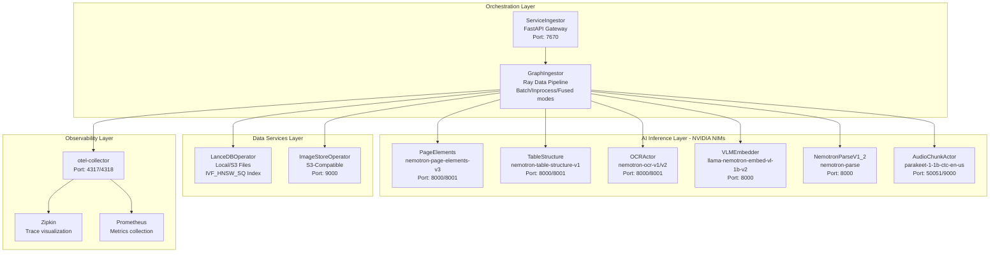
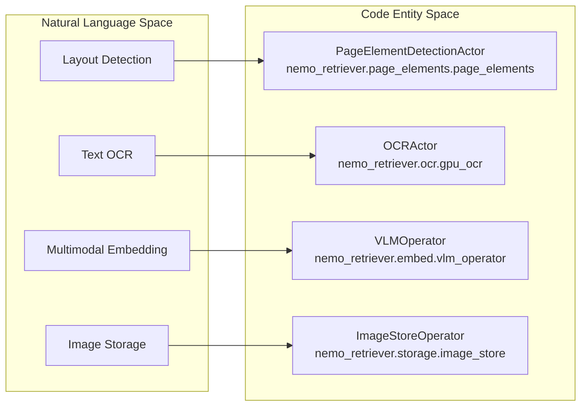

<!-- source: DeepWiki mcp.deepwiki.com · repo NVIDIA/NeMo-Retriever · page 4 Core Components · fetched 2026-10-26 -->

# Core Components

Relevant source files

The following files were used as context for generating this wiki page:

- [docs/docs/extraction/deployment-options.md](docs/docs/extraction/deployment-options.md)
- [docs/docs/extraction/faq.md](docs/docs/extraction/faq.md)
- [docs/docs/extraction/multimodal-extraction.md](docs/docs/extraction/multimodal-extraction.md)
- [docs/docs/extraction/prerequisites-support-matrix.md](docs/docs/extraction/prerequisites-support-matrix.md)
- [docs/docs/extraction/troubleshoot.md](docs/docs/extraction/troubleshoot.md)
- [nemo_retriever/docs/cli/benchmarking.md](nemo_retriever/docs/cli/benchmarking.md)
- [nemo_retriever/helm/README.md](nemo_retriever/helm/README.md)
- [nemo_retriever/src/nemo_retriever/api/__init__.py](nemo_retriever/src/nemo_retriever/api/__init__.py)
- [nemo_retriever/src/nemo_retriever/graph/gpu_operator.py](nemo_retriever/src/nemo_retriever/graph/gpu_operator.py)
- [nemo_retriever/src/nemo_retriever/nim/nim.py](nemo_retriever/src/nemo_retriever/nim/nim.py)
- [nemo_retriever/src/nemo_retriever/ocr/__init__.py](nemo_retriever/src/nemo_retriever/ocr/__init__.py)
- [nemo_retriever/src/nemo_retriever/page_elements/page_elements.py](nemo_retriever/src/nemo_retriever/page_elements/page_elements.py)

## Purpose and Scope

This document provides a technical overview of the major subsystems that comprise NeMo Retriever Library. It describes the architecture, configuration, and interaction patterns between core components including AI inference services (NIMs), data stores, and observability infrastructure.

For detailed deployment instructions, see [Deployment Options](#2.1). For specific component configuration details, refer to the dedicated child pages: 
- [NVIDIA NIMs (Inference Microservices)](#4.1)
- [LanceDB Vector Database](#4.2)
- [MinIO and Object Storage](#4.3)
- [Message Queue and Job Processing](#4.4)
- [Observability Stack](#4.5)

## System Architecture Overview

NeMo Retriever Library is organized into four primary layers: AI Inference, Data Services, Orchestration, and Observability. Each layer consists of multiple containerized microservices that communicate via gRPC, HTTP, and message queues.

### Core Component Architecture

**Sources:** [nemo_retriever/helm/README.md:13-23](), [docs/docs/extraction/prerequisites-support-matrix.md:67-105]()

### Natural Language to Code Entity Mapping

The following diagram bridges system concepts to specific Python classes and actors within the codebase.

**Sources:** [nemo_retriever/src/nemo_retriever/page_elements/page_elements.py:24-42](), [nemo_retriever/src/nemo_retriever/ocr/__init__.py:5-11](), [nemo_retriever/src/nemo_retriever/graph/gpu_operator.py:8-20]()

## Component Categories

### AI Inference Layer (NIMs)

NVIDIA NIMs provide specialized models for document processing. The system uses a `NIMClient` to manage batched concurrent inference.

| NIM Service | Default Model | Role | Protocol |
|-------------|---------------|------|----------|
| `page_elements` | `nemotron-page-elements-v3` | Page layout detection | gRPC/HTTP |
| `table_structure` | `nemotron-table-structure-v1` | Table cell detection | gRPC/HTTP |
| `ocr` | `nemotron-ocr-v1` (Helm) / `v2` (Local) | Image to text | gRPC/HTTP |
| `vlm_embed` | `llama-nemotron-embed-vl-1b-v2` | Multimodal embedding | HTTP |
| `audio` | `parakeet-1-1b-ctc-en-us` | Speech-to-text | gRPC |

**NIM Client Logic:** The `NIMClient` class in `nemo_retriever.nim.nim` manages a `ThreadPoolExecutor` to handle concurrent requests to NIM endpoints, including automatic retries for 429 (rate limited) and 5xx errors [nemo_retriever/src/nemo_retriever/nim/nim.py:165-188]().

For details, see [NVIDIA NIMs (Inference Microservices)](#4.1).

### Data Services Layer

#### LanceDB Vector Database
LanceDB is the primary vector database for storing embeddings and metadata. It uses a columnar format and supports hybrid search with SQL-like predicates.
- **Key Class:** `LanceDBOperator`
- **Index Type:** `IVF_HNSW_SQ`

For details, see [LanceDB Vector Database](#4.2).

#### MinIO Object Storage
MinIO (or any S3-compatible store) is used to persist extracted visual artifacts like cropped images of tables, charts, and infographics.
- **Key Class:** `ImageStoreOperator`
- **Configuration:** `IMAGE_STORAGE_URI` environment variable [docs/docs/extraction/deployment-options.md:82-84]().

For details, see [MinIO and Object Storage](#4.3).

### Orchestration Layer

The system supports multiple execution modes managed by the `GraphIngestor`.

- **Batch Mode:** Uses Ray Data for high-throughput parallel processing [docs/docs/extraction/prerequisites-support-matrix.md:28-31]().
- **Inprocess Mode:** Runs locally for development or small datasets.
- **Service Mode:** Exposes a FastAPI gateway for asynchronous job submission via a message queue.

For details, see [Message Queue and Job Processing](#4.4).

### Observability Layer

NeMo Retriever includes a full observability stack based on OpenTelemetry (OTEL).
- **Tracing:** Exported via OTLP to Zipkin.
- **Metrics:** Scraped by Prometheus, including queue depths and processing latencies.
- **Dashboards:** Visualized in Grafana.

For details, see [Observability Stack](#4.5).

## Hardware and Resource Management

The pipeline is designed for high parallelism and requires significant resources for production workloads.

| Resource | Recommended Specification |
|----------|---------------------------|
| System Memory | At least 256 GB RAM |
| CPU Cores | At least 32 cores |
| GPU | NVIDIA GPU with >= 24 GB VRAM (e.g., A100, H100, L40S) |

**Sources:** [docs/docs/extraction/prerequisites-support-matrix.md:34-39]()

**GPU Sharing:** The system supports sharing GPUs across NIMs via time-slicing or MIG partitions, managed by the NVIDIA NIM Operator in Kubernetes [docs/docs/extraction/deployment-options.md:74-75]().

**Sources:**
- [docs/docs/extraction/prerequisites-support-matrix.md:1-105]()
- [nemo_retriever/src/nemo_retriever/nim/nim.py:165-188]()
- [nemo_retriever/helm/README.md:1-75]()
- [docs/docs/extraction/deployment-options.md:1-94]()

---

