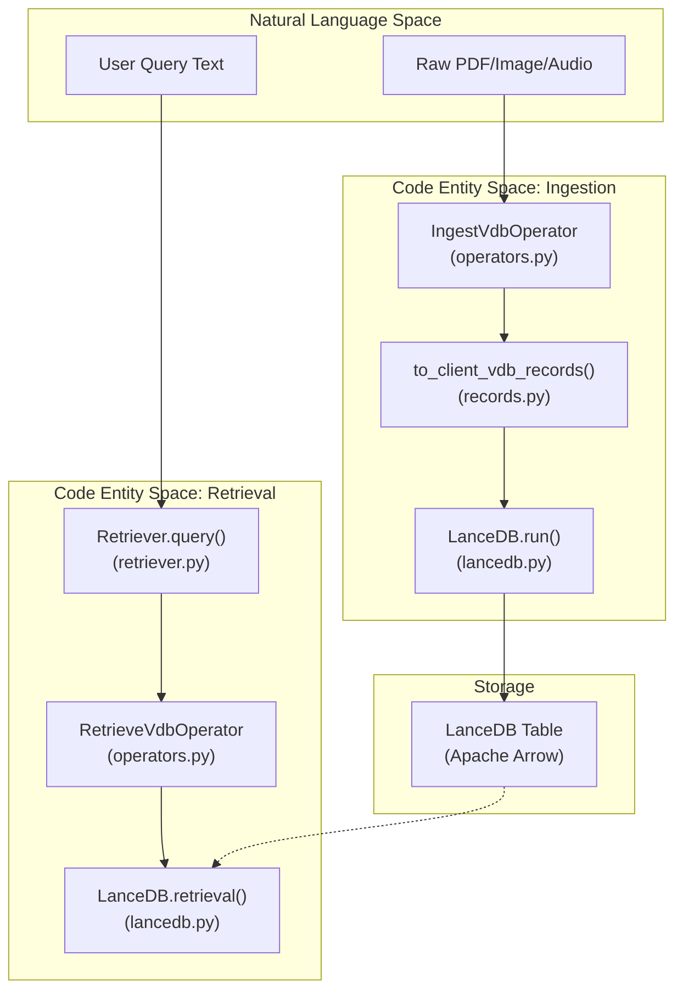
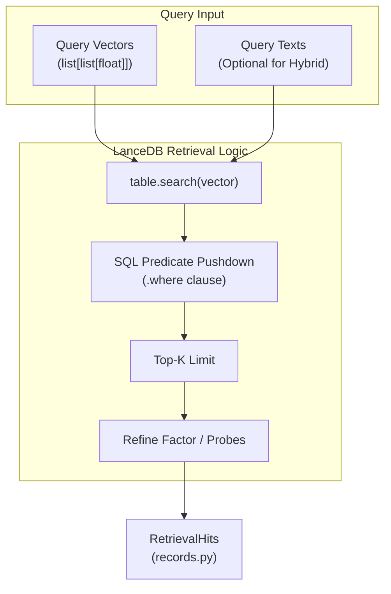

<!-- source: DeepWiki mcp.deepwiki.com · repo NVIDIA/NeMo-Retriever · page 4.2 LanceDB Vector Database · fetched 2026-10-26 -->

# LanceDB Vector Database

Relevant source files

The following files were used as context for generating this wiki page:

- [nemo_retriever/src/nemo_retriever/api/internal/primitives/tracing/tagging.py](nemo_retriever/src/nemo_retriever/api/internal/primitives/tracing/tagging.py)
- [nemo_retriever/src/nemo_retriever/api/util/exception_handlers/converters.py](nemo_retriever/src/nemo_retriever/api/util/exception_handlers/converters.py)
- [nemo_retriever/src/nemo_retriever/api/util/exception_handlers/detectors.py](nemo_retriever/src/nemo_retriever/api/util/exception_handlers/detectors.py)
- [nemo_retriever/src/nemo_retriever/api/util/exception_handlers/pdf.py](nemo_retriever/src/nemo_retriever/api/util/exception_handlers/pdf.py)
- [nemo_retriever/src/nemo_retriever/api/util/image_processing/clustering.py](nemo_retriever/src/nemo_retriever/api/util/image_processing/clustering.py)
- [nemo_retriever/src/nemo_retriever/api/util/image_processing/transforms.py](nemo_retriever/src/nemo_retriever/api/util/image_processing/transforms.py)
- [nemo_retriever/src/nemo_retriever/graph/README.md](nemo_retriever/src/nemo_retriever/graph/README.md)
- [nemo_retriever/src/nemo_retriever/vdb/README.md](nemo_retriever/src/nemo_retriever/vdb/README.md)
- [nemo_retriever/src/nemo_retriever/vdb/__init__.py](nemo_retriever/src/nemo_retriever/vdb/__init__.py)
- [nemo_retriever/src/nemo_retriever/vdb/adt_vdb.py](nemo_retriever/src/nemo_retriever/vdb/adt_vdb.py)
- [nemo_retriever/src/nemo_retriever/vdb/lancedb.py](nemo_retriever/src/nemo_retriever/vdb/lancedb.py)
- [nemo_retriever/src/nemo_retriever/vdb/lancedb_schema.py](nemo_retriever/src/nemo_retriever/vdb/lancedb_schema.py)
- [nemo_retriever/src/nemo_retriever/vdb/operators.py](nemo_retriever/src/nemo_retriever/vdb/operators.py)
- [nemo_retriever/tests/test_lancedb_ivf_partitions.py](nemo_retriever/tests/test_lancedb_ivf_partitions.py)
- [nemo_retriever/tests/test_lancedb_retrieval_where.py](nemo_retriever/tests/test_lancedb_retrieval_where.py)
- [nemo_retriever/tests/test_nv_ingest_vdb_operator.py](nemo_retriever/tests/test_nv_ingest_vdb_operator.py)
- [nemo_retriever/tests/test_root_query_cli.py](nemo_retriever/tests/test_root_query_cli.py)
- [nemo_retriever/tests/test_sidecar_metadata.py](nemo_retriever/tests/test_sidecar_metadata.py)
- [skills/nemo-retriever/references/cli/ingest.md](skills/nemo-retriever/references/cli/ingest.md)
- [skills/nemo-retriever/references/cli/query.md](skills/nemo-retriever/references/cli/query.md)
- [skills/nemo-retriever/references/setup.md](skills/nemo-retriever/references/setup.md)

LanceDB is the default vector database used by NeMo Retriever for storing and retrieving embeddings generated during document ingestion. It provides a columnar storage format with support for dense vector indexing and optional full-text search (FTS) for hybrid retrieval.

**Scope**: This page covers LanceDB-specific integration, schema design, index configuration, and write paths across different execution modes. For general vector database upload configuration, see [Vector Database Upload](#3.5). For details on collection management and reindexing, see [Collection Management](#4.2.1). For hybrid search and predicate pushdown, see [Hybrid Search and Filtered Retrieval](#4.2.2).

---

## Overview

LanceDB serves as a lightweight, local-first alternative to Milvus with these characteristics:

- **Columnar storage**: Uses Apache Arrow format for efficient query performance.
- **Local-first**: Operates on local filesystem by default (`lancedb://path`).
- **Hybrid search**: Optional FTS indexing alongside dense vector search [nemo_retriever/src/nemo_retriever/vdb/lancedb.py:237-245]().
- **Zero-copy**: Arrow-based schema enables efficient data transfer [nemo_retriever/src/nemo_retriever/vdb/lancedb.py:117-126]().

The system integrates LanceDB via the `VDB` abstract interface, allowing it to be used in both ingestion and retrieval pipelines.

**Sources**: [nemo_retriever/src/nemo_retriever/vdb/adt_vdb.py:30-41](), [nemo_retriever/src/nemo_retriever/vdb/lancedb.py:18-20]()

---

## Architecture and Write Paths

NeMo Retriever uses `IngestVdbOperator` to handle the transition from flat processing rows to LanceDB records.

**Write Path Variants**:

1. **IngestVdbOperator**: Adapts flat graph rows into nested record batches expected by the VDB backend [nemo_retriever/src/nemo_retriever/vdb/operators.py:86-131](). It declares `REQUIRES_GLOBAL_BATCH = True` to ensure all data is written in a single pass during Ray execution [nemo_retriever/src/nemo_retriever/vdb/operators.py:91]().
2. **PutVdbOperator**: Performs stable-key in-place replacements of existing rows [nemo_retriever/src/nemo_retriever/vdb/operators.py:137-155](). This requires the backend to implement a specific `put` method [nemo_retriever/src/nemo_retriever/vdb/lancedb.py:441-470]().

**Sources**: [nemo_retriever/src/nemo_retriever/vdb/operators.py:86-180](), [nemo_retriever/src/nemo_retriever/vdb/README.md:12-33]()

---

## Schema Definition

LanceDB tables in NeMo Retriever follow a standardized PyArrow schema to ensure compatibility across extraction types.

| Column | Type | Purpose |
|--------|------|---------|
| `vector` | `list_[float32]` | Dense embedding vector [nemo_retriever/src/nemo_retriever/vdb/lancedb.py:120](). |
| `text` | `string` | Searchable text content (captions, OCR, or chunks) [nemo_retriever/src/nemo_retriever/vdb/lancedb.py:121](). |
| `metadata` | `string` | JSON-serialized content metadata (page numbers, bboxes) [nemo_retriever/src/nemo_retriever/vdb/lancedb.py:122](). |
| `source` | `string` | JSON-serialized source metadata (source_id, path) [nemo_retriever/src/nemo_retriever/vdb/lancedb.py:123](). |
| `id` | `string` | Unique identifier for stable-key updates [nemo_retriever/src/nemo_retriever/vdb/lancedb.py:124](). |

**Key Schema Features**:
- **JSON Serialization**: Complex nested structures like `metadata` and `source` are stored as strings to maintain Arrow compatibility [nemo_retriever/src/nemo_retriever/vdb/lancedb.py:52-66]().
- **Smart Text Selection**: The `_get_text_for_element` helper selects the most relevant text based on `document_type` (e.g., using captions for images instead of base64 data) [nemo_retriever/src/nemo_retriever/vdb/lancedb.py:176-205]().

**Sources**: [nemo_retriever/src/nemo_retriever/vdb/lancedb.py:117-127](), [nemo_retriever/src/nemo_retriever/vdb/lancedb_schema.py:149-195]()

---

## Retrieval and Filtering

Retrieval is handled by `RetrieveVdbOperator`, which wraps the `LanceDB.retrieval` method.

**Predicate Pushdown**:
LanceDB supports SQL-like filtering via the `where` parameter [nemo_retriever/src/nemo_retriever/vdb/lancedb.py:328-333](). Because metadata is stored as JSON strings, users often use `LIKE` patterns:
`metadata LIKE '%"page_number": 3%'` [nemo_retriever/src/nemo_retriever/vdb/adt_vdb.py:120-126]().

For details on advanced filtering and sidecar joins, see [Hybrid Search and Filtered Retrieval](#4.2.2) and [Custom Metadata and Filtering](#4.2.3).

**Sources**: [nemo_retriever/src/nemo_retriever/vdb/lancedb.py:307-439](), [nemo_retriever/src/nemo_retriever/vdb/operators.py:218-250]()

---

## Indexing: IVF_HNSW_SQ

LanceDB uses the `IVF_HNSW_SQ` index for efficient approximate nearest neighbor (ANN) search.

- **IVF (Inverted File)**: Partitions the vector space into clusters. The number of partitions is automatically clamped to `num_rows - 1` for small datasets [nemo_retriever/src/nemo_retriever/vdb/lancedb.py:95-115]().
- **HNSW (Hierarchical Navigable Small World)**: Builds a graph for fast traversal within clusters.
- **SQ (Scalar Quantization)**: Compresses vectors to reduce memory footprint.

Indexing is triggered during the `write_to_index` phase [nemo_retriever/src/nemo_retriever/vdb/lancedb.py:237-254](). If `hybrid=True` is configured, an FTS (Full-Text Search) index is also created on the `text` column [nemo_retriever/src/nemo_retriever/vdb/lancedb.py:256-264]().

**Sources**: [nemo_retriever/src/nemo_retriever/vdb/lancedb.py:89-115](), [nemo_retriever/src/nemo_retriever/vdb/lancedb.py:237-264]()

---

## Configuration

### LanceDB Constructor Kwargs
When initializing via `vdb_op="lancedb"`, the following parameters are common in `vdb_kwargs`:

| Parameter | Default | Description |
|-----------|---------|-------------|
| `uri` | Required | Local path or remote URI for storage [nemo_retriever/src/nemo_retriever/vdb/lancedb.py:124](). |
| `table_name` | `"nemo-retriever"` | Name of the table [nemo_retriever/src/nemo_retriever/vdb/lancedb.py:124](). |
| `vector_dim` | `2048` | Dimension of embedding vectors [nemo_retriever/src/nemo_retriever/vdb/lancedb.py:24](). |
| `hybrid` | `False` | Whether to enable Full-Text Search index [nemo_retriever/src/nemo_retriever/vdb/lancedb.py:256](). |
| `on_bad_vectors` | `"drop"` | Policy for vectors not matching schema (`drop`, `fill`, `null`, `error`) [nemo_retriever/src/nemo_retriever/vdb/lancedb.py:28-50](). |

**Sources**: [nemo_retriever/src/nemo_retriever/vdb/lancedb.py:24-50](), [nemo_retriever/src/nemo_retriever/vdb/README.md:76-87]()

---

## Child Pages
- [Collection Management](#4.2.1) — Detailed guide on LanceDB collection lifecycle, schema construction, and `PutVdbOperator` operations.
- [Hybrid Search and Filtered Retrieval](#4.2.2) — Deep dive into combining dense/lexical search and utilizing SQL predicates for server-side filtering.
- [Custom Metadata and Filtering](#4.2.3) — Instructions for using sidecar files to enrich LanceDB records with external metadata for fine-grained retrieval.

---

