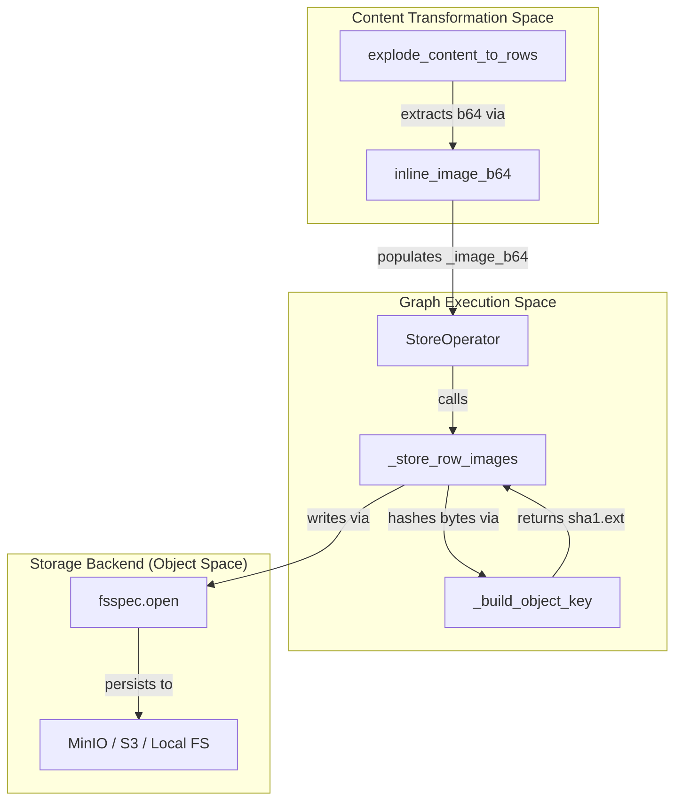
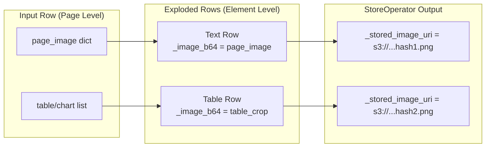

<!-- source: DeepWiki mcp.deepwiki.com · repo NVIDIA/NeMo-Retriever · page 4.3 MinIO and Object Storage · fetched 2026-10-26 -->

# MinIO and Object Storage

Relevant source files

The following files were used as context for generating this wiki page:

- [nemo_retriever/src/nemo_retriever/graph/content_transforms.py](nemo_retriever/src/nemo_retriever/graph/content_transforms.py)
- [nemo_retriever/src/nemo_retriever/graph/store_operator.py](nemo_retriever/src/nemo_retriever/graph/store_operator.py)
- [nemo_retriever/src/nemo_retriever/io/__init__.py](nemo_retriever/src/nemo_retriever/io/__init__.py)
- [nemo_retriever/src/nemo_retriever/io/image_store.py](nemo_retriever/src/nemo_retriever/io/image_store.py)
- [nemo_retriever/src/nemo_retriever/utils/pipeline/content.py](nemo_retriever/src/nemo_retriever/utils/pipeline/content.py)
- [nemo_retriever/src/nemo_retriever/utils/pipeline/embedding.py](nemo_retriever/src/nemo_retriever/utils/pipeline/embedding.py)
- [nemo_retriever/tests/test_io_image_store.py](nemo_retriever/tests/test_io_image_store.py)
- [nemo_retriever/tests/test_store_pipeline_stages.py](nemo_retriever/tests/test_store_pipeline_stages.py)

This page documents the object storage integration in NeMo Retriever, primarily used for persisting extracted images, tables, and charts. It covers the `StoreOperator`, S3/GCS compatibility via `fsspec`, and the internal data flow for multimodal content.

---

## Purpose and Scope

The object storage layer serves as a persistent repository for high-resolution artifacts that are too large for efficient storage within a vector database. While text and embeddings are stored in LanceDB or Milvus, visual elements (images, rendered tables, charts) are offloaded to object storage.

Key features include:
*   **Storage Offloading**: Moves large base64 payloads out of the pipeline to prevent OOM errors and bloated database records.
*   **Multimodal Retrieval**: Stores image-to-URI mappings, allowing RAG applications to retrieve visual context via stored URIs.
*   **S3/GCS Compatibility**: Built on `fsspec` and `upath`, supporting MinIO, AWS S3, Google Cloud Storage, and local filesystems.

---

## Architecture and Data Flow

The storage process typically occurs after document extraction and before vector database upload. The `StoreOperator` consumes base64 image data generated during extraction and replaces it with a persistent URI.

### Code-to-System Mapping

The following diagram bridges the logical storage concepts to the specific classes and functions in the codebase.

**Storage Logic Data Flow**

**Sources:**
* [nemo_retriever/src/nemo_retriever/graph/store_operator.py:147-154]()
* [nemo_retriever/src/nemo_retriever/graph/store_operator.py:98-144]()
* [nemo_retriever/src/nemo_retriever/graph/content_transforms.py:53-153]()
* [nemo_retriever/src/nemo_retriever/io/image_store.py:23-26]()

---

## Core Components

### StoreOperator
The `StoreOperator` is a `CPUOperator` that iterates through a `pandas.DataFrame` and persists any image data found in the `_image_b64` or `page_image` columns.

*   **Deduplication**: It generates a unique object key using a SHA-1 hash of the raw image bytes [nemo_retriever/src/nemo_retriever/graph/store_operator.py:60-62]().
*   **Payload Stripping**: By default, it sets `strip_base64=True`, which clears the `_image_b64` column after a successful write to reduce memory footprint [nemo_retriever/src/nemo_retriever/graph/store_operator.py:133-142]().
*   **URI Generation**: It populates the `_stored_image_uri` column with the final path (e.g., `s3://bucket/hash.png` or `file:///path/hash.png`) [nemo_retriever/src/nemo_retriever/graph/store_operator.py:130-131]().

### Image Store Helpers
The `nemo_retriever.io.image_store` module provides utilities for handling image data across different stages of the pipeline:

| Function | Purpose |
| :--- | :--- |
| `inline_image_b64` | Safely retrieves base64 strings from container dictionaries without reloading URIs [nemo_retriever/src/nemo_retriever/io/image_store.py:23-26](). |
| `load_image_b64_from_uri` | Uses `UPath` to read images back from object storage into base64 for reranking or display [nemo_retriever/src/nemo_retriever/io/image_store.py:29-36](). |
| `render_page_image_b64` | Renders a specific PDF page to base64 using `pypdfium2` for on-the-fly visual extraction [nemo_retriever/src/nemo_retriever/io/image_store.py:39-58](). |

**Sources:**
* [nemo_retriever/src/nemo_retriever/graph/store_operator.py:147-183]()
* [nemo_retriever/src/nemo_retriever/io/image_store.py:1-59]()

---

## Implementation Details

### Image Format Handling
The system supports `png` and `jpeg` formats. The `StoreOperator` "sniffs" the image format by checking the magic bytes of the raw payload [nemo_retriever/src/nemo_retriever/graph/store_operator.py:37-42](). If sniffing fails, it falls back to the format specified in `StoreParams`.

### Content Explosion and Image Routing
During the `explode_content_to_rows` phase, image data is routed as follows:
1.  **Page Images**: Stored in the `page_image` dictionary.
2.  **Extracted Elements**: If a table or chart has its own image, it is placed in `_image_b64`.
3.  **Cropping**: If an element has a bounding box but no dedicated image, the system crops the `page_image_b64` using `_crop_b64_image_by_norm_bbox` [nemo_retriever/src/nemo_retriever/graph/content_transforms.py:127-133]().

**Content-to-Storage Mapping**

**Sources:**
* [nemo_retriever/src/nemo_retriever/graph/content_transforms.py:53-153]()
* [nemo_retriever/src/nemo_retriever/graph/store_operator.py:76-96]()

---

## Configuration Reference

Storage is configured via `StoreParams`, which are passed to the `StoreOperator`.

| Parameter | Type | Default | Description |
| :--- | :--- | :--- | :--- |
| `storage_uri` | `str` | `"stored_images"` | The base URI for storage (e.g., `s3://my-bucket/prefix` or `/tmp/images`). |
| `storage_options` | `dict` | `{}` | Backend-specific options (e.g., `{"key": "...", "secret": "..."}` for S3). |
| `image_format` | `str` | `"png"` | Fallback format if sniffing fails. |
| `strip_base64` | `bool` | `True` | Whether to clear base64 payloads from the DataFrame after storage. |

**Sources:**
* [nemo_retriever/src/nemo_retriever/graph/store_operator.py:173-179]()
* [nemo_retriever/tests/test_store_pipeline_stages.py:142-152]()

---

## Testing and Validation

The storage integration is validated through unit and integration tests:
*   **Round-trip Validation**: `TestLoadImageB64FromUri` ensures that images written to disk can be read back identically [nemo_retriever/tests/test_io_image_store.py:17-30]().
*   **Graph Integration**: `TestStoreOperatorInGraph` verifies that the `StoreOperator` correctly interacts with the `InprocessExecutor`, writes files to the expected paths, and updates the DataFrame columns [nemo_retriever/tests/test_store_pipeline_stages.py:54-71]().
*   **Storage Options**: Tests confirm that `storage_options` are correctly forwarded to `fsspec`, enabling authentication with remote S3 buckets [nemo_retriever/tests/test_store_pipeline_stages.py:120-153]().

**Sources:**
* [nemo_retriever/tests/test_io_image_store.py:1-79]()
* [nemo_retriever/tests/test_store_pipeline_stages.py:1-185]()

---

