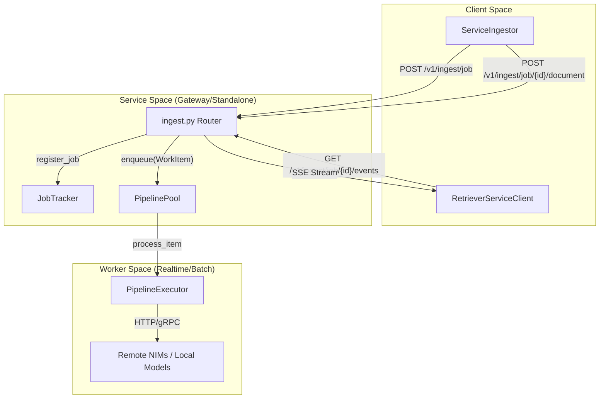
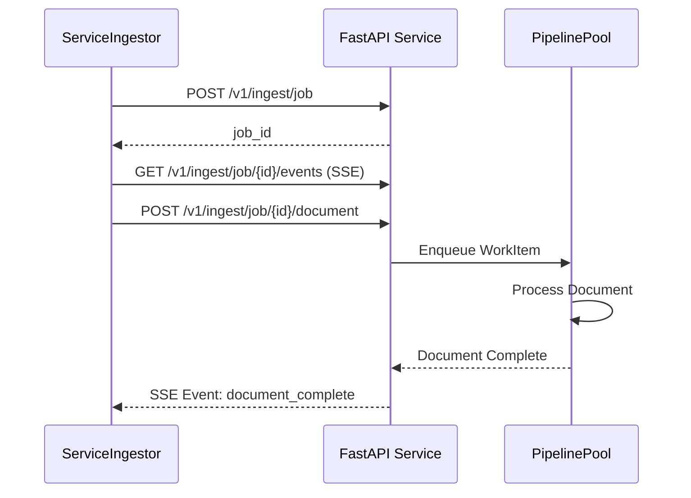

<!-- source: DeepWiki mcp.deepwiki.com · repo NVIDIA/NeMo-Retriever · page 4.4 Message Queue and Job Processing · fetched 2026-10-26 -->

# Message Queue and Job Processing

<details>
<summary>Relevant source files</summary>

The following files were used as context for generating this wiki page:

- [nemo_retriever/helm/Chart.yaml](nemo_retriever/helm/Chart.yaml)
- [nemo_retriever/helm/templates/NOTES.txt](nemo_retriever/helm/templates/NOTES.txt)
- [nemo_retriever/helm/templates/_helpers.tpl](nemo_retriever/helm/templates/_helpers.tpl)
- [nemo_retriever/helm/templates/configmap.yaml](nemo_retriever/helm/templates/configmap.yaml)
- [nemo_retriever/helm/values.yaml](nemo_retriever/helm/values.yaml)
- [nemo_retriever/src/nemo_retriever/adapters/cli/main.py](nemo_retriever/src/nemo_retriever/adapters/cli/main.py)
- [nemo_retriever/src/nemo_retriever/adapters/cli/sdk_workflow.py](nemo_retriever/src/nemo_retriever/adapters/cli/sdk_workflow.py)
- [nemo_retriever/src/nemo_retriever/params/utils.py](nemo_retriever/src/nemo_retriever/params/utils.py)
- [nemo_retriever/src/nemo_retriever/service/client.py](nemo_retriever/src/nemo_retriever/service/client.py)
- [nemo_retriever/src/nemo_retriever/service/config.py](nemo_retriever/src/nemo_retriever/service/config.py)
- [nemo_retriever/src/nemo_retriever/service/retriever-service.yaml](nemo_retriever/src/nemo_retriever/service/retriever-service.yaml)
- [nemo_retriever/src/nemo_retriever/service/routers/ingest.py](nemo_retriever/src/nemo_retriever/service/routers/ingest.py)
- [nemo_retriever/src/nemo_retriever/service/services/pipeline_executor.py](nemo_retriever/src/nemo_retriever/service/services/pipeline_executor.py)
- [nemo_retriever/src/nemo_retriever/service_ingestor.py](nemo_retriever/src/nemo_retriever/service_ingestor.py)
- [nemo_retriever/tests/test_params_utils.py](nemo_retriever/tests/test_params_utils.py)
- [nemo_retriever/tests/test_root_cli_workflow.py](nemo_retriever/tests/test_root_cli_workflow.py)

</details>


This page documents the service-mode architecture of NeMo Retriever, centered around the FastAPI-based `nemo-retriever-service`. It explains the `ServiceIngestor` client, the `PipelineSpec` for cross-boundary configuration, and how jobs are submitted and tracked via job-scoped aggregates.

---

## Overview

In **service run_mode**, the ingestion logic is delegated to a remote FastAPI server. This mode decouples the client SDK from the heavy dependencies (GPU drivers, NIM clients, Ray) required for document processing. The server manages a pool of worker processes that handle the actual execution of the operator graph.

Key components include:
- **`ServiceIngestor`**: The client-side entry point that communicates with the service.
- **`PipelineSpec`**: A Pydantic model representing the full processing pipeline (extraction, embedding, etc.) sent to the server.
- **`JobAggregate`**: A server-side entity that tracks a group of documents submitted together.
- **`PipelinePool`**: An internal server-side worker pool that dispatches work to either `realtime` or `batch` queues.

**Sources:** [nemo_retriever/src/nemo_retriever/service_ingestor.py:5-41](), [nemo_retriever/src/nemo_retriever/service/routers/ingest.py:5-15]()

---

## Service Architecture

The service can be deployed in **standalone** mode (single pod) or **split** mode (Gateway + Realtime Workers + Batch Workers).

### Component Interaction



**Sources:** [nemo_retriever/src/nemo_retriever/service/routers/ingest.py:110-123](), [nemo_retriever/src/nemo_retriever/service/services/pipeline_pool.py:49-53](), [nemo_retriever/src/nemo_retriever/service/client.py:5-11]()

---

## Job Submission and PipelineSpec

When a user calls `.ingest()` on a `ServiceIngestor`, the client builds a `PipelineSpec`. This spec encapsulates all fluent method calls (e.g., `.extract()`, `.embed()`) into a serialized format.

### PipelineSpec Structure

The `PipelineSpec` [nemo_retriever/src/nemo_retriever/service/models/pipeline_spec.py]() includes:
- **`extract`**: Parameters for PDF/Text/Image extraction.
- **`embed`**: Embedding model and endpoint overrides.
- **`vdb_upload`**: Target Vector Database settings.
- **`sinks`**: Remote storage (S3/GCS) or Webhook configurations.

### The Ingestion Flow

1. **Job Creation**: The client calls `POST /v1/ingest/job` to open a job aggregate, specifying the expected number of documents [nemo_retriever/src/nemo_retriever/service/client.py:181-182]().
2. **Document Upload**: Each document is uploaded via `POST /v1/ingest/job/{job_id}/document` [nemo_retriever/src/nemo_retriever/service/client.py:7-8]().
3. **Policy Validation**: The server validates the `PipelineSpec` against a `PipelineOverridesPolicy` [nemo_retriever/src/nemo_retriever/service/policy.py](). This ensures clients cannot override restricted settings (like internal API keys or unauthorized S3 buckets) [nemo_retriever/src/nemo_retriever/service_ingestor.py:35-41]().
4. **Queue Selection**: Documents are routed to the `realtime` pool if they have few pages (default threshold < 5) or the `batch` pool for larger files [nemo_retriever/src/nemo_retriever/service/routers/ingest.py:74-75]().

**Sources:** [nemo_retriever/src/nemo_retriever/service_ingestor.py:15-30](), [nemo_retriever/src/nemo_retriever/service/routers/ingest.py:143-175]()

---

## Job Processing and Tracking

### Job Lifecycle States

Jobs are tracked by the `JobTracker` [nemo_retriever/src/nemo_retriever/service/services/job_tracker.py]().

| State | Description |
| :--- | :--- |
| `created` | Job aggregate opened via API. |
| `started` | First document has entered the pipeline. |
| `finalized` | All documents processed (Success). |
| `partial_success` | Some documents succeeded, others failed. |
| `failed` | The entire job aggregate failed. |

### SSE Event Streaming

The `RetrieverServiceClient` opens a Server-Sent Events (SSE) connection to `GET /v1/ingest/job/{job_id}/events` **before** starting uploads [nemo_retriever/src/nemo_retriever/service/client.py:13-14](). This prevents missing completion events for fast-processing files.



**Sources:** [nemo_retriever/src/nemo_retriever/service/client.py:178-192](), [nemo_retriever/src/nemo_retriever/service/routers/ingest.py:330-350]()

---

## Configuration

The service behavior is controlled via `retriever-service.yaml`.

| Key | Description | Default |
| :--- | :--- | :--- |
| `pipeline.realtime_workers` | Concurrent workers for low-latency tasks. | 8 |
| `pipeline.batch_workers` | Concurrent workers for bulk tasks. | 16 |
| `resources.max_upload_bytes` | Max file size for uploads. | 500MB |
| `nim_endpoints` | URLs for remote NIM microservices. | None |

**Sources:** [nemo_retriever/src/nemo_retriever/service/config.py:129-132](), [nemo_retriever/src/nemo_retriever/service/config.py:87-91]()

### Deployment Topology

The Helm chart supports two topologies via `topology.mode`:
1. **`standalone`**: A single pod handles API requests and processing [nemo_retriever/helm/templates/configmap.yaml:90-93]().
2. **`split`**: Separate pods for `gateway`, `realtime`, and `batch`. The `gateway` proxies requests to worker pods using the `GatewayConfig` [nemo_retriever/src/nemo_retriever/service/config.py:104-109]().

**Sources:** [nemo_retriever/helm/templates/configmap.yaml:105-112](), [nemo_retriever/helm/values.yaml:78-81]()

---

## ServiceIngestor Usage

The `ServiceIngestor` provides a materialized interface (`.ingest()`) and streaming interfaces (`.ingest_stream()`, `.aingest_stream()`) [nemo_retriever/src/nemo_retriever/service_ingestor.py:15-33]().

```python
# Example: Using ServiceIngestor
from nemo_retriever.ingestor import create_ingestor

ingestor = create_ingestor(run_mode="service", base_url="http://retriever:7670")
result = (ingestor
          .files(["doc.pdf"])
          .extract(ocr_enabled=True)
          .ingest())

print(f"Job ID: {result.job_id}")
print(f"DataFrame: {result.dataframe}")
```

**Sources:** [nemo_retriever/src/nemo_retriever/service_ingestor.py:102-137](), [nemo_retriever/src/nemo_retriever/service_ingestor.py:43-59]()

---

