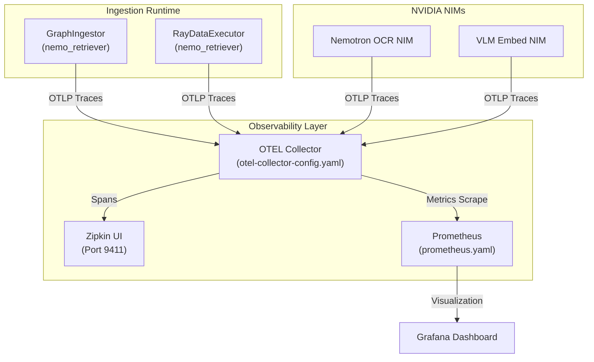
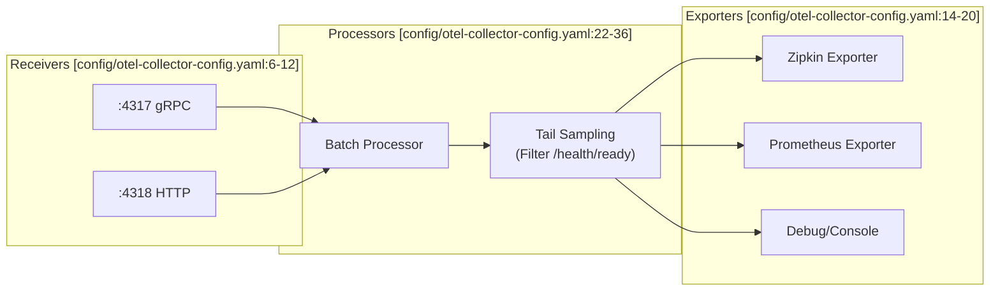

<!-- source: DeepWiki mcp.deepwiki.com · repo NVIDIA/NeMo-Retriever · page 4.5 Observability Stack · fetched 2026-10-26 -->

# Observability Stack

<details>
<summary>Relevant source files</summary>

The following files were used as context for generating this wiki page:

- [config/otel-collector-config.yaml](config/otel-collector-config.yaml)
- [docs/docs/extraction/deployment-options.md](docs/docs/extraction/deployment-options.md)
- [docs/docs/extraction/faq.md](docs/docs/extraction/faq.md)
- [docs/docs/extraction/multimodal-extraction.md](docs/docs/extraction/multimodal-extraction.md)
- [docs/docs/extraction/prerequisites-support-matrix.md](docs/docs/extraction/prerequisites-support-matrix.md)
- [docs/docs/extraction/troubleshoot.md](docs/docs/extraction/troubleshoot.md)
- [nemo_retriever/docs/cli/benchmarking.md](nemo_retriever/docs/cli/benchmarking.md)
- [nemo_retriever/helm/README.md](nemo_retriever/helm/README.md)

</details>


The observability stack for NeMo Retriever Library provides a comprehensive infrastructure for monitoring, debugging, and performance tuning of document ingestion pipelines. It integrates OpenTelemetry (OTEL) for distributed tracing, Prometheus for time-series metrics collection, Zipkin for trace visualization, and Grafana for dashboards.

---

## Overview

The stack is designed to monitor both the orchestration layer (Python API/Service) and the underlying inference microservices (NIMs).

| Component | Role | Implementation |
|-----------|------|----------------|
| **Instrumentation** | Data Generation | OpenTelemetry Python SDK / NIM Native OTEL |
| **Collection** | Aggregation & Routing | OpenTelemetry Collector |
| **Tracing Backend** | Trace Storage & UI | Zipkin |
| **Metrics Backend** | Time-series Storage | Prometheus |
| **Visualization** | Dashboarding | Grafana |

---

## Architecture and Data Flow

The following diagram illustrates how telemetry flows from the processing stages to the storage backends.

### System Telemetry Flow

**Sources:** [config/otel-collector-config.yaml:6-21](), [nemo_retriever/helm/README.md:13-22]()

---

## OpenTelemetry Collector Configuration

The `otel-collector-config.yaml` file defines how the system receives, processes, and exports telemetry. It supports both gRPC and HTTP protocols for receiving data from various library components and NIMs.

### Collector Pipeline
The collector uses a pipeline architecture to handle traces, metrics, and logs.



### Key Configuration Sections
- **Receivers**: Configured to listen on `0.0.0.0:4317` (gRPC) and `0.0.0.0:4318` (HTTP) [config/otel-collector-config.yaml:6-12]().
- **Processors**: Includes a `tail_sampling` policy named `filter_http_url` that explicitly drops traces for the `/health/ready` endpoint to reduce noise [config/otel-collector-config.yaml:24-36]().
- **Exporters**:
    - **Zipkin**: Sends spans to `http://zipkin:9411/api/v2/spans` [config/otel-collector-config.yaml:15-16]().
    - **Prometheus**: Exposes a scrape endpoint at `0.0.0.0:8889` [config/otel-collector-config.yaml:19-20]().
- **Service Extensions**: Enables `zpages` and `health_check` on port `13133` for collector self-monitoring [config/otel-collector-config.yaml:38-44]().

**Sources:** [config/otel-collector-config.yaml:6-69]()

---

## Metrics and Monitoring

The system tracks resource utilization and pipeline health using Prometheus. A critical metric for scaling is the queue depth ratio within the worker pools.

### Key Metrics
- **`nemo_retriever_pool_queue_depth_ratio`**: Monitors the ratio of pending tasks to available worker capacity in Ray actor pools. High ratios indicate bottlenecks in specific stages (e.g., OCR or Embedding).
- **`retriever_benchmark_*`**: The CLI subcommands `retriever benchmark` report per-stage throughput in `rows/sec` [nemo_retriever/docs/cli/benchmarking.md:79-80]().

### Prometheus Scrape Configuration
The `prometheus.yaml` configuration typically includes the OTEL collector as a target. The collector provides a pull-based reader for Prometheus:
```yaml
# Inferred from collector config
telemetry:
  metrics:
    readers:
      - pull:
          exporter:
            prometheus:
              host: "0.0.0.0"
              port: 9988
```
**Sources:** [config/otel-collector-config.yaml:48-55](), [nemo_retriever/docs/cli/benchmarking.md:57-69]()

---

## Distributed Tracing with Zipkin

Tracing allows developers to follow a document through the entire extraction and embedding lifecycle.

### Trace Lifecycle
1. **Entry**: The `GraphIngestor` starts a root span when `ingest()` or `run()` is called.
2. **Operators**: Each operator (e.g., `ExtractOperator`, `EmbedOperator`) creates child spans.
3. **NIM Calls**: Remote calls to NIMs (like `nemotron-ocr-v1`) are instrumented to propagate the trace context, appearing as sub-spans in the Zipkin UI.
4. **Export**: Spans are batched and sent to the OTEL collector, which forwards them to Zipkin [config/otel-collector-config.yaml:57-60]().

### Performance Considerations
- **Tail Sampling**: As defined in the collector config, health checks are filtered out to prevent storage bloat [config/otel-collector-config.yaml:24-36]().
- **Batching**: The `batch` processor is used in all pipelines (traces, metrics, logs) to minimize network overhead [config/otel-collector-config.yaml:63-68]().

---

## Troubleshooting with Observability

The observability stack is the primary tool for resolving common deployment issues:

- **OOM Errors**: Monitoring system memory via Prometheus can help identify when to enable `save_to_disk` for large datasets [docs/docs/extraction/troubleshoot.md:79-84]().
- **Latency Bottlenecks**: Zipkin traces reveal which NIM stage (e.g., `page-elements` vs `ocr`) is consuming the most time.
- **Connectivity**: The OTEL collector logs (set to `debug` level) will show if NIMs are failing to report telemetry due to network issues [config/otel-collector-config.yaml:46-47]().
- **Throughput Drops**: Comparing `pages/sec` metrics against historical baselines helps detect performance degradation caused by complex document content [docs/docs/extraction/multimodal-extraction.md:98-102]().

**Sources:** [docs/docs/extraction/troubleshoot.md:79-84](), [docs/docs/extraction/multimodal-extraction.md:92-102](), [config/otel-collector-config.yaml:46-47]()

---

