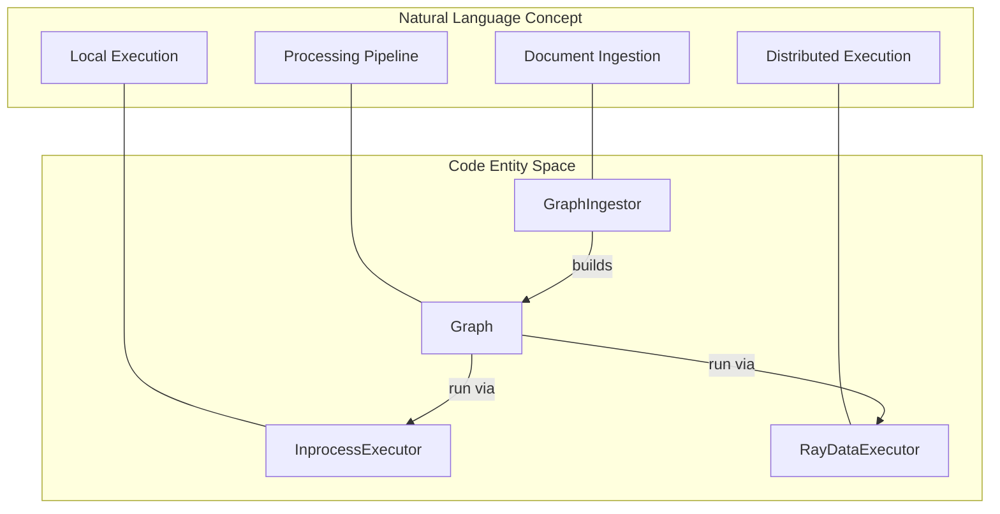
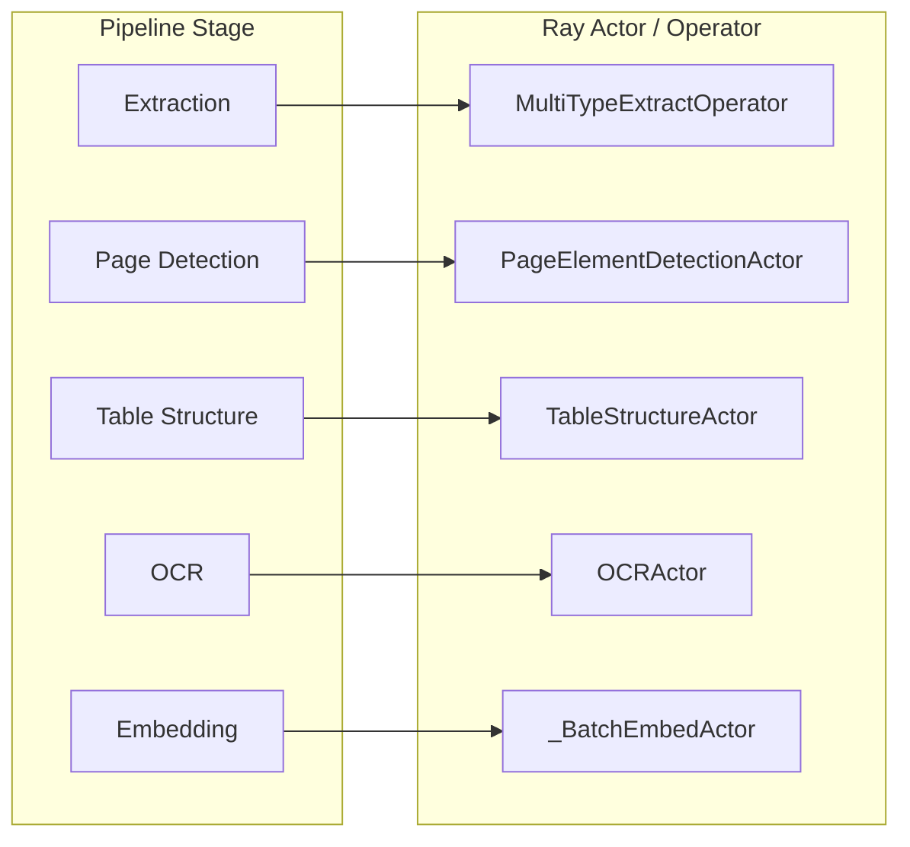

<!-- source: DeepWiki mcp.deepwiki.com · repo NVIDIA/NeMo-Retriever · page 5 Advanced Topics · fetched 2026-10-26 -->

# Advanced Topics

Relevant source files

The following files were used as context for generating this wiki page:

- [nemo_retriever/src/nemo_retriever/graph/executor.py](nemo_retriever/src/nemo_retriever/graph/executor.py)
- [nemo_retriever/src/nemo_retriever/graph/ingestor_runtime.py](nemo_retriever/src/nemo_retriever/graph/ingestor_runtime.py)
- [nemo_retriever/src/nemo_retriever/graph/multi_type_extract_operator.py](nemo_retriever/src/nemo_retriever/graph/multi_type_extract_operator.py)
- [nemo_retriever/src/nemo_retriever/graph_ingestor.py](nemo_retriever/src/nemo_retriever/graph_ingestor.py)
- [nemo_retriever/src/nemo_retriever/utils/input_files.py](nemo_retriever/src/nemo_retriever/utils/input_files.py)
- [nemo_retriever/tests/test_ingest_interface.py](nemo_retriever/tests/test_ingest_interface.py)
- [nemo_retriever/tests/test_ingest_plans.py](nemo_retriever/tests/test_ingest_plans.py)
- [nemo_retriever/tests/test_pipeline_graph.py](nemo_retriever/tests/test_pipeline_graph.py)

This section covers advanced features, specialized configurations, and performance optimization techniques for the NeMo Retriever Library. It focuses on the internal graph execution model, Ray Data integration, GPU resource management, and specialized evaluation frameworks.

For details on the Ray Data-based batch ingestion pipeline, see [NeMo Retriever Batch Pipeline](#5.1). For managing GPU allocation and memory, see [GPU Resource Management](#5.2). For performance and recall testing, see [Benchmarking Harness](#5.3). For RAG quality assessment, see [QA Evaluation Pipeline](#5.4). For structured data workflows, see [Tabular Data and Text-to-SQL](#5.5). For agentic patterns, see [Agentic Retrieval](#5.7).

---

## Execution Modes and Graph Architecture

The NeMo Retriever Library uses a graph-based execution model where processing stages are defined as nodes in a `Graph` [nemo_retriever/src/nemo_retriever/graph/pipeline_graph.py:28-29](). These graphs are executed by an `AbstractExecutor` [nemo_retriever/src/nemo_retriever/graph/executor.py:42-47]().

### Natural Language Space to Code Entity Space: Execution Model

**Sources:** [nemo_retriever/src/nemo_retriever/graph_ingestor.py:5-11](), [nemo_retriever/src/nemo_retriever/graph/executor.py:42-60]()

### Comparison of Execution Modes

The library supports two primary execution modes for library-mode ingestion:

| Mode | Class | Backend | Best For |
| :--- | :--- | :--- | :--- |
| **In-process** | `InprocessExecutor` | Pandas | Development, single-node, small workloads (<100 docs) |
| **Batch** | `RayDataExecutor` | Ray Data | Production, multi-GPU clusters, high-throughput (1000+ docs) |

**Sources:** [nemo_retriever/src/nemo_retriever/graph/executor.py:60-161](), [nemo_retriever/src/nemo_retriever/graph_ingestor.py:18-24]()

---

## Ray Data Pipeline Internals

In `batch` mode, the `RayDataExecutor` [nemo_retriever/src/nemo_retriever/graph/executor.py:161-162]() transforms the `Graph` into a Ray Data pipeline. Each stage is typically a `map_batches` operation using specialized actors.

### Pipeline Stage to Code Actor Mapping

**Sources:** [nemo_retriever/src/nemo_retriever/graph/ingestor_runtime.py:14-47](), [nemo_retriever/src/nemo_retriever/graph/multi_type_extract_operator.py:25-52]()

The `MultiTypeExtractOperator` [nemo_retriever/src/nemo_retriever/graph/multi_type_extract_operator.py:149-166]() is a key component that handles heterogeneous file types (PDF, Image, Audio, Video, Text, HTML) within a single Ray Data stream.

---

## GPU Resource Management and Tuning

Efficient GPU utilization is managed via `BatchTuningParams` [nemo_retriever/src/nemo_retriever/params/__init__.py]() and resource heuristics. The system translates these parameters into Ray `node_overrides` [nemo_retriever/src/nemo_retriever/graph/ingestor_runtime.py:75-84]().

### Resource Allocation Heuristics
The `resolve_requested_plan` function [nemo_retriever/src/nemo_retriever/graph/ingestor_runtime.py:98-107]() calculates optimal actor counts and GPU fractions based on the `ClusterResources` [nemo_retriever/src/nemo_retriever/utils/ray_resource_hueristics.py](). For example:
- **Time-Slicing:** Multiple actors can share a single GPU by setting `num_gpus` to a fraction (e.g., 0.25).
- **MIG:** Hard partitions can be targeted by Ray's resource requirements.

For details on specific GPU model optimizations (A100, L40S, etc.), see [GPU Resource Management](#5.2).

---

## Evaluation and Benchmarking

NeMo Retriever includes specialized frameworks for measuring both performance and quality.

- **Benchmarking Harness:** A CLI-driven system (`retriever-harness`) for measuring throughput and recall [nemo_retriever/src/nemo_retriever/graph_ingestor.py:32-35](). For details, see [Benchmarking Harness](#5.3).
- **QA Evaluation:** An LLM-as-judge framework for measuring RAG answer quality using metrics like `answer_in_context` and `token_f1`. For details, see [QA Evaluation Pipeline](#5.4).
- **Skill Evaluation:** A framework for evaluating coding agents with the `nemo-retriever` skill. For details, see [Skill Evaluation Framework](#5.6).

---

## Agentic and Tabular Retrieval

Beyond standard document RAG, the library supports specialized retrieval patterns:

- **Tabular Data:** Ingesting structured data (SQL, CSV) and performing Text-to-SQL retrieval via DuckDB or Neo4j [nemo_retriever/src/nemo_retriever/graph/multi_type_extract_operator.py:42-45](). For details, see [Tabular Data and Text-to-SQL](#5.5).
- **Agentic Retrieval:** Multi-step retrieval where an LLM agent refines queries or aggregates results using operators like `rrf_aggregator` (Reciprocal Rank Fusion). For details, see [Agentic Retrieval](#5.7).

**Sources:** [nemo_retriever/src/nemo_retriever/graph/ingestor_runtime.py:19-40]()

---

