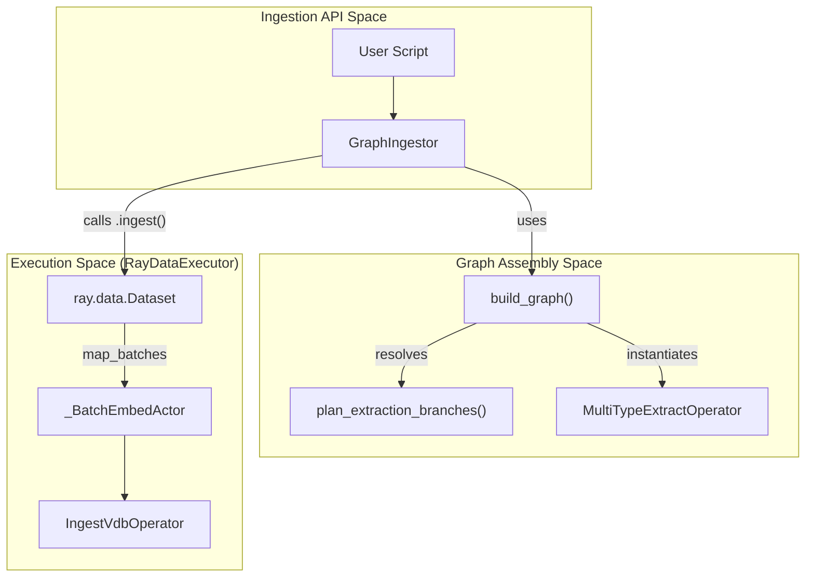
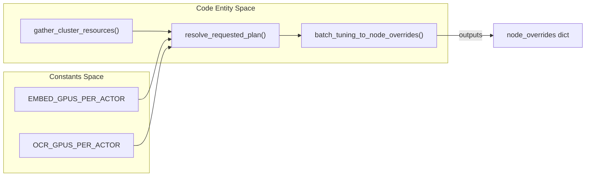

<!-- source: DeepWiki mcp.deepwiki.com · repo NVIDIA/NeMo-Retriever · page 5.1 NeMo Retriever Batch Pipeline · fetched 2026-10-26 -->

# NeMo Retriever Batch Pipeline

Relevant source files

The following files were used as context for generating this wiki page:

- [nemo_retriever/src/nemo_retriever/graph/executor.py](nemo_retriever/src/nemo_retriever/graph/executor.py)
- [nemo_retriever/src/nemo_retriever/graph/ingestor_runtime.py](nemo_retriever/src/nemo_retriever/graph/ingestor_runtime.py)
- [nemo_retriever/src/nemo_retriever/graph/multi_type_extract_operator.py](nemo_retriever/src/nemo_retriever/graph/multi_type_extract_operator.py)
- [nemo_retriever/src/nemo_retriever/graph_ingestor.py](nemo_retriever/src/nemo_retriever/graph_ingestor.py)
- [nemo_retriever/src/nemo_retriever/utils/input_files.py](nemo_retriever/src/nemo_retriever/utils/input_files.py)
- [nemo_retriever/src/nemo_retriever/utils/ray_resource_hueristics.py](nemo_retriever/src/nemo_retriever/utils/ray_resource_hueristics.py)
- [nemo_retriever/tests/test_ingest_interface.py](nemo_retriever/tests/test_ingest_interface.py)
- [nemo_retriever/tests/test_ingest_plans.py](nemo_retriever/tests/test_ingest_plans.py)
- [nemo_retriever/tests/test_pipeline_graph.py](nemo_retriever/tests/test_pipeline_graph.py)
- [nemo_retriever/tests/test_resource_heuristics.py](nemo_retriever/tests/test_resource_heuristics.py)

## Purpose and Scope

The NeMo Retriever Batch Pipeline is a distributed document ingestion system designed for large-scale processing of PDFs, Office documents, text files, HTML, audio, video, and images. It leverages **Ray Data** to orchestrate parallel extraction, detection, OCR, and embedding stages across multiple CPUs and GPUs, enabling high-throughput ingestion of large document collections.

This page covers the core architecture of the batch ingestion pipeline, the `GraphIngestor` class, and the `RayDataExecutor`. For information about other execution modes, see [Execution Modes (Batch/Inprocess/Fused)](#5.1.1). For details on Ray Data internals and distributed processing patterns, see [Ray Data Pipeline Architecture](#5.1.2).

**Key characteristics:**
- **Graph-based Execution**: Pipelines are built as directed graphs of operators.
- **Distributed orchestration**: Utilizes `RayDataExecutor` for multi-node, multi-GPU parallelism [nemo_retriever/src/nemo_retriever/graph/executor.py:161-175]().
- **Resource heuristics**: Automatically calculates optimal GPU fractions and actor counts based on available cluster resources [nemo_retriever/src/nemo_retriever/utils/ray_resource_hueristics.py:18-73]().
- **Multi-modal Support**: Unified extraction for diverse file types via the `MultiTypeExtractOperator` [nemo_retriever/src/nemo_retriever/graph/multi_type_extract_operator.py:149-175]().

---

## System Architecture

The batch pipeline transforms input data through a series of stages defined in a `Graph`. The `GraphIngestor` assembles this graph and delegates execution to an `AbstractExecutor`.

### End-to-End Pipeline Flow (Natural Language to Code Entities)

**Sources:**
- [nemo_retriever/src/nemo_retriever/graph_ingestor.py:18-24]()
- [nemo_retriever/src/nemo_retriever/graph/ingestor_runtime.py:75-107]()
- [nemo_retriever/src/nemo_retriever/graph/executor.py:161-175]()

---

## Core Components

### GraphIngestor
The `GraphIngestor` provides a fluent Python API for building and running ingestion pipelines. It handles the transition from high-level user parameters (like `ExtractParams` or `EmbedParams`) to a concrete execution graph [nemo_retriever/src/nemo_retriever/graph_ingestor.py:15-25]().

- **Input Handling**: Supports file paths, globs, and pandas DataFrames [nemo_retriever/src/nemo_retriever/graph_ingestor.py:67-72]().
- **Graph Construction**: Uses `build_graph` to assemble operators like `PDFSplitActor`, `OCRActor`, and `_BatchEmbedActor` [nemo_retriever/src/nemo_retriever/graph/ingestor_runtime.py:181-193]().
- **Diagnostic Errors**: Raises `GraphIngestionError` with detailed row-level failure information [nemo_retriever/src/nemo_retriever/graph_ingestor.py:114-136]().

### RayDataExecutor
The `RayDataExecutor` is responsible for executing a `Graph` using Ray Data. It linearizes the graph and maps each node to a `map_batches` operation [nemo_retriever/src/nemo_retriever/graph/executor.py:161-175]().

- **Deferred Construction**: Operators are constructed on Ray workers rather than the driver to ensure heavy GPU models are loaded where they are used [nemo_retriever/src/nemo_retriever/graph/executor.py:164-168]().
- **Node Overrides**: Allows per-node resource configuration (e.g., `num_gpus`, `num_cpus`) [nemo_retriever/src/nemo_retriever/graph/executor.py:186-194]().

### MultiTypeExtractOperator
A specialized operator that handles mixed file types (PDF, Image, Text, HTML, Audio, Video) within a single Ray Data batch [nemo_retriever/src/nemo_retriever/graph/multi_type_extract_operator.py:5-7]().

- **Dynamic Routing**: Dispatches rows to the appropriate extraction logic based on file extension [nemo_retriever/src/nemo_retriever/graph/multi_type_extract_operator.py:60-69]().
- **Integrated Pipeline**: Wraps internal actors like `PDFExtractionActor`, `ASRActor`, and `PageElementDetectionActor` [nemo_retriever/src/nemo_retriever/graph/multi_type_extract_operator.py:18-46]().

---

## Resource Planning and Heuristics

The pipeline includes a heuristic engine to calculate resource requirements when explicit overrides are not provided.

### Resource Calculation Flow

**Key Heuristics:**
- **Embedding**: Defaults to 0.5 GPUs per actor, with 2 initial actors per GPU [nemo_retriever/src/nemo_retriever/utils/ray_resource_hueristics.py:19-24]().
- **OCR/Page Elements**: Defaults to 0.1 GPUs per actor, allowing high-density packing on a single GPU [nemo_retriever/src/nemo_retriever/utils/ray_resource_hueristics.py:42-51]().
- **PDF Extraction**: CPU-bound; defaults to 2.0 CPUs per task with 16 parallel tasks [nemo_retriever/src/nemo_retriever/utils/ray_resource_hueristics.py:68-73]().

**Sources:**
- [nemo_retriever/src/nemo_retriever/utils/ray_resource_hueristics.py:18-73]()
- [nemo_retriever/src/nemo_retriever/graph/ingestor_runtime.py:75-107]()

---

## Pipeline Stages and Operators

The pipeline is composed of various specialized actors and operators:

| Stage | Code Entity | Role |
|---|---|---|
| **File Discovery** | `FileListLoaderOperator` | Expands globs into a list of file paths. |
| **Conversion** | `DocToPdfConversionActor` | Converts Office docs to PDF using LibreOffice [nemo_retriever/src/nemo_retriever/graph/ingestor_runtime.py:42](). |
| **Decomposition** | `PDFSplitActor` | Splits multi-page PDFs into individual page rows [nemo_retriever/src/nemo_retriever/graph/ingestor_runtime.py:38](). |
| **Detection** | `PageElementDetectionActor` | Identifies tables, charts, and text regions [nemo_retriever/src/nemo_retriever/graph/ingestor_runtime.py:35](). |
| **OCR** | `OCRActor` | Extracts text from images or complex PDF layouts [nemo_retriever/tests/test_ingest_plans.py:10-11](). |
| **Embedding** | `_BatchEmbedActor` | Generates vector embeddings for text and images [nemo_retriever/src/nemo_retriever/graph/ingestor_runtime.py:26](). |
| **Storage** | `IngestVdbOperator` | Uploads processed data to LanceDB or Milvus [nemo_retriever/src/nemo_retriever/graph/ingestor_runtime.py:40](). |

**Sources:**
- [nemo_retriever/src/nemo_retriever/graph/ingestor_runtime.py:14-47]()
- [nemo_retriever/tests/test_ingest_plans.py:180-188]()

---

## Error Handling and Diagnostics

The `GraphIngestor` implements a robust error collection mechanism. When `error_policy='collect'` is used, the pipeline continues processing and gathers failures into a structured report [nemo_retriever/src/nemo_retriever/graph_ingestor.py:114-136]().

- **Stage Attribution**: Errors are attributed to specific stages (e.g., "OCR", "Embedding") and specific remote NIM URLs if applicable [nemo_retriever/src/nemo_retriever/graph_ingestor.py:95-112]().
- **HTTP Status Tracking**: Captures status codes (e.g., 429 Too Many Requests) to provide troubleshooting advice [nemo_retriever/src/nemo_retriever/graph_ingestor.py:83-84]().

**Sources:**
- [nemo_retriever/src/nemo_retriever/graph_ingestor.py:77-136]()

---

