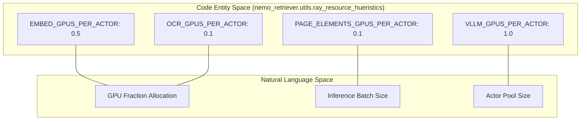
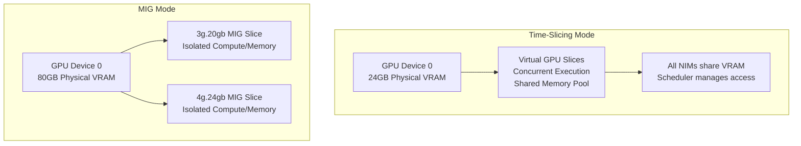
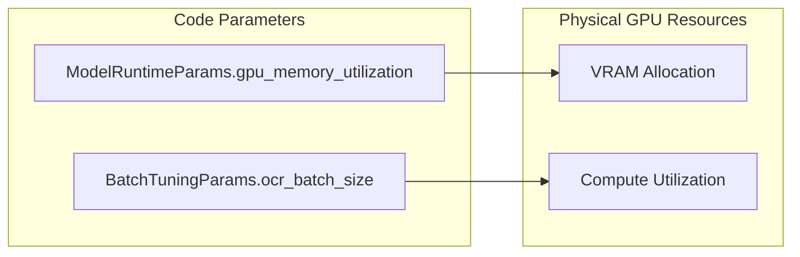

<!-- source: DeepWiki mcp.deepwiki.com · repo NVIDIA/NeMo-Retriever · page 5.2 GPU Resource Management · fetched 2026-10-26 -->

# GPU Resource Management

Relevant source files

The following files were used as context for generating this wiki page:

- [nemo_retriever/src/nemo_retriever/params/models.py](nemo_retriever/src/nemo_retriever/params/models.py)
- [nemo_retriever/src/nemo_retriever/pipeline/__main__.py](nemo_retriever/src/nemo_retriever/pipeline/__main__.py)
- [nemo_retriever/src/nemo_retriever/utils/ray_resource_hueristics.py](nemo_retriever/src/nemo_retriever/utils/ray_resource_hueristics.py)
- [nemo_retriever/tests/test_graph_pipeline_cli.py](nemo_retriever/tests/test_graph_pipeline_cli.py)
- [nemo_retriever/tests/test_pipeline_helpers.py](nemo_retriever/tests/test_pipeline_helpers.py)
- [nemo_retriever/tests/test_resource_heuristics.py](nemo_retriever/tests/test_resource_heuristics.py)

This page documents GPU resource allocation, virtualization, and optimization strategies for deploying NeMo Retriever Library. It covers how to distribute NIMs across GPUs, configure time-slicing and MIG partitioning, and tune memory parameters for different hardware targets.

For information about hardware compatibility and minimum requirements, see [Hardware Requirements](#2.2) Hardware Requirements. For deployment-specific configuration, see [Docker Compose Deployment](#2.1.1) Docker Compose Deployment and [Helm/Kubernetes Deployment](#2.1.2) Helm/Kubernetes Deployment.

---

## Overview

NeMo Retriever Library runs multiple NVIDIA NIM microservices that compete for GPU resources. The system supports two primary deployment strategies:

1.  **Single GPU deployment** (24GB A10G or better) — All core NIMs share GPU 0 through time-slicing or MIG.
2.  **Multi-GPU deployment** — Core NIMs on GPU 0, advanced features (nemotron-parse, RIVA ASR, VLM) on dedicated GPUs.

The core pipeline requires approximately 15.9GB VRAM when all services run concurrently on GPU 0:
*   `page-elements`: ~1896 MiB
*   `graphic-elements`: ~2824 MiB
*   `table-structure`: ~2824 MiB
*   `nemotron-ocr`: ~4546 MiB
*   `llama-nemotron-embed`: ~2492 MiB
*   `milvus` (GPU indexing): ~1438 MiB

**Sources:** [nemo_retriever/src/nemo_retriever/params/models.py:91-99](), [nemo_retriever/src/nemo_retriever/utils/ray_resource_hueristics.py:18-73]()

---

## GPU Allocation and Batch Tuning

When running in `batch` mode via Ray, the system uses `BatchTuningParams` and resource heuristics to manage concurrency and GPU fractions.

### Resource Heuristics and Code Mapping

The system automatically calculates the number of actors and GPU fractions based on available hardware. For example, `EMBED_SINGLE_GPU_GPUS_PER_ACTOR` is set to `0.2` to leave headroom for OCR and page-element actors on a single-GPU node [nemo_retriever/src/nemo_retriever/utils/ray_resource_hueristics.py:26-28]().

### BatchTuningParams

Users can override these heuristics using the `BatchTuningParams` class or CLI flags.

| Parameter | Default (Multi-GPU) | Code Reference |
| :--- | :--- | :--- |
| `ocr_gpus_per_actor` | 0.1 | [nemo_retriever/src/nemo_retriever/utils/ray_resource_hueristics.py:42]() |
| `embed_gpus_per_actor` | 0.5 | [nemo_retriever/src/nemo_retriever/utils/ray_resource_hueristics.py:22-24]() |
| `nemotron_parse_gpus_per_actor`| 1.0 | [nemo_retriever/src/nemo_retriever/utils/ray_resource_hueristics.py:35]() |
| `ocr_batch_size` | 32 | [nemo_retriever/src/nemo_retriever/utils/ray_resource_hueristics.py:43]() |

**Sources:** [nemo_retriever/src/nemo_retriever/params/models.py:75](), [nemo_retriever/src/nemo_retriever/utils/ray_resource_hueristics.py:18-73]()

---

## GPU Allocation Methods

### Time-Slicing vs MIG

For details, see [Time-Slicing vs MIG](#5.2.1) Time-Slicing vs MIG.

| Aspect | Time-Slicing | MIG |
| :--- | :--- | :--- |
| **Isolation** | Shared memory pool, time-multiplexed | Physical partitions with dedicated VRAM |
| **Use Case** | Development, testing, low-concurrency | Production, multi-tenant, guaranteed QoS |
| **GPU Support** | All NVIDIA GPUs | H100, A100, A30 only |

**Sources:** [nemo_retriever/src/nemo_retriever/params/models.py:124](), [nemo_retriever/src/nemo_retriever/utils/ray_resource_hueristics.py:108-137]()

---

## GPU-Specific Optimizations

For details, see [GPU-Specific Optimizations](#5.2.2) GPU-Specific Optimizations.

The system supports hardware-specific overrides to adjust memory utilization and batching for different GPU architectures.

### Memory Optimization Parameters

The `ModelRuntimeParams` class defines standard memory controls for local model execution:
*   `gpu_memory_utilization`: Defaults to `0.45` to allow co-location of multiple models [nemo_retriever/src/nemo_retriever/params/models.py:97]().
*   `enforce_eager`: Can be set to `True` to reduce CUDA graph memory overhead [nemo_retriever/src/nemo_retriever/params/models.py:98]().

### Hardware Overrides

Override files (e.g., `a10g.yaml`, `l40s.yaml`) are used to scale the pipeline to fit specific VRAM constraints. These files adjust:
*   `NIM_TRITON_MAX_BATCH_SIZE`
*   `NIM_TRITON_CUDA_MEMORY_POOL_MB`

**Sources:** [nemo_retriever/src/nemo_retriever/params/models.py:91-99](), [nemo_retriever/src/nemo_retriever/pipeline/__main__.py:112-160]()

---

## Dedicated GPU Requirements

Certain advanced features require dedicated GPUs because they lack fine-grained memory limit controls or consume all available VRAM for KV-caches.

| Service | Dedicated GPU Required | Reason |
| :--- | :--- | :--- |
| `nemotron-parse` | **Yes** | vLLM owns the full GPU for KV-cache management [nemo_retriever/src/nemo_retriever/utils/ray_resource_hueristics.py:35]() |
| `RIVA ASR` | **Yes** | High VRAM footprint for Parakeet models |
| `VLM Captioning` | **Yes** | VLM models typically consume all available VRAM for context |

**Sources:** [nemo_retriever/src/nemo_retriever/utils/ray_resource_hueristics.py:31-36](), [nemo_retriever/src/nemo_retriever/pipeline/__main__.py:126-137]()

---

## Memory Planning

### VRAM Consumption Mapping

### Estimated VRAM Usage (Core Pipeline)

| NIM Service | Default Batch Size | Estimated VRAM |
| :--- | :--- | :--- |
| `page-elements` | 32 | 1896 MiB |
| `graphic-elements` | 32 | 2824 MiB |
| `table-structure` | 32 | 2824 MiB |
| `nemotron-ocr` | 32 | 4546 MiB |
| `llama-nemotron-embed` | 256 (Ray) | 2492 MiB |

**Sources:** [nemo_retriever/src/nemo_retriever/utils/ray_resource_hueristics.py:18-73](), [nemo_retriever/src/nemo_retriever/params/models.py:125]()

---

