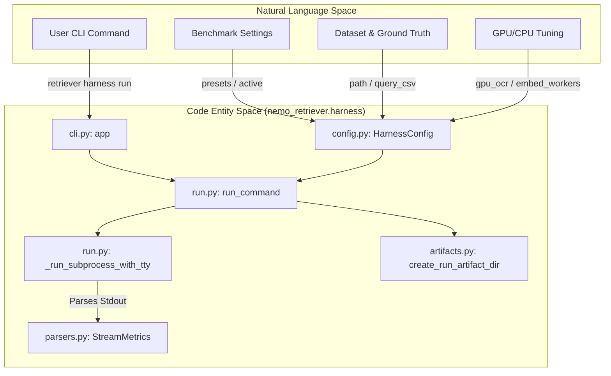
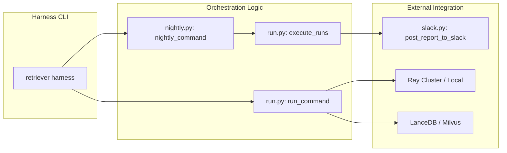

<!-- source: DeepWiki mcp.deepwiki.com · repo NVIDIA/NeMo-Retriever · page 5.3 Benchmarking Harness · fetched 2026-10-26 -->

# Benchmarking Harness

Relevant source files

The following files were used as context for generating this wiki page:

- [nemo_retriever/harness/HANDOFF.md](nemo_retriever/harness/HANDOFF.md)
- [nemo_retriever/harness/nightly_config.yaml](nemo_retriever/harness/nightly_config.yaml)
- [nemo_retriever/harness/test_configs.yaml](nemo_retriever/harness/test_configs.yaml)
- [nemo_retriever/src/nemo_retriever/harness/__init__.py](nemo_retriever/src/nemo_retriever/harness/__init__.py)
- [nemo_retriever/src/nemo_retriever/harness/__main__.py](nemo_retriever/src/nemo_retriever/harness/__main__.py)
- [nemo_retriever/src/nemo_retriever/harness/cli.py](nemo_retriever/src/nemo_retriever/harness/cli.py)
- [nemo_retriever/src/nemo_retriever/harness/config.py](nemo_retriever/src/nemo_retriever/harness/config.py)
- [nemo_retriever/src/nemo_retriever/harness/nightly.py](nemo_retriever/src/nemo_retriever/harness/nightly.py)
- [nemo_retriever/src/nemo_retriever/harness/run.py](nemo_retriever/src/nemo_retriever/harness/run.py)
- [nemo_retriever/tests/test_harness_config.py](nemo_retriever/tests/test_harness_config.py)
- [nemo_retriever/tests/test_harness_run.py](nemo_retriever/tests/test_harness_run.py)

The Benchmarking Harness is a lightweight orchestration system for running repeatable performance and recall evaluations on the NeMo Retriever batch ingestion pipeline. It wraps the core graph execution logic with configuration management, metrics extraction, artifact persistence, and quality gating. The harness is located at [nemo_retriever/src/nemo_retriever/harness/]() and is designed for local GPU hosts and cluster environments.

For details on executing benchmarks, see [Running Benchmarks](#5.3.1). For details on recall metrics and adapters, see [Recall Evaluation](#5.3.2).

**Sources:** [nemo_retriever/harness/HANDOFF.md:4-13](), [nemo_retriever/src/nemo_retriever/harness/run.py:1-24]()

---

## Architecture Overview

The harness bridges high-level user configurations to the low-level execution of document processing graphs.

### Natural Language to Code Entity Space: Execution Flow

This diagram associates high-level benchmark concepts with the specific code entities that implement them.

**Diagram: Mapping User Concepts to Harness Code Entities**

The harness merges YAML presets, dataset definitions, environment variables, and CLI overrides into a `HarnessConfig` dataclass. The execution layer builds a command for the batch pipeline, runs it in a pseudo-terminal to preserve rich progress output, and parses metrics from the stream.

**Sources:** [nemo_retriever/src/nemo_retriever/harness/cli.py:16-21](), [nemo_retriever/src/nemo_retriever/harness/config.py:72-160](), [nemo_retriever/src/nemo_retriever/harness/run.py:354-437]()

---

## Configuration System

The harness uses a hierarchical configuration system defined in [nemo_retriever/src/nemo_retriever/harness/config.py]().

### Configuration Files

1.  **test_configs.yaml**: Defines `active` defaults, named `presets` (tuning profiles), and `datasets` (paths and evaluation modes) [nemo_retriever/harness/test_configs.yaml:1-26]().
2.  **nightly_config.yaml**: Defines a list of runs and Slack reporting settings for automated regression testing [nemo_retriever/harness/nightly_config.yaml:1-35]().

### Tuning Fields

The harness tracks specific numeric parameters used to optimize pipeline performance [nemo_retriever/src/nemo_retriever/harness/config.py:51-68]():

| Category | Fields |
| :--- | :--- |
| **Workers** | `pdf_extract_workers`, `page_elements_workers`, `ocr_workers`, `embed_workers` |
| **Batch Sizes** | `pdf_extract_batch_size`, `ocr_batch_size`, `embed_batch_size` |
| **Resources** | `gpu_page_elements`, `gpu_ocr`, `gpu_embed`, `ocr_cpus_per_actor` |

**Sources:** [nemo_retriever/src/nemo_retriever/harness/config.py:51-68](), [nemo_retriever/harness/test_configs.yaml:29-47]()

---

## CLI and Orchestration

The harness is primarily interacted with via the `retriever harness` subcommand.

### Core Commands

*   **`run`**: Executes a single benchmark for a specific dataset and preset [nemo_retriever/src/nemo_retriever/harness/run.py:515-541]().
*   **`sweep`**: Iterates through a list of runs defined in a configuration file [nemo_retriever/src/nemo_retriever/harness/run.py:543-581]().
*   **`nightly`**: Orchestrates a full session and posts results to Slack [nemo_retriever/src/nemo_retriever/harness/nightly.py:43-60]().
*   **`summary` / `compare`**: Formats and compares results stored in session artifacts [nemo_retriever/src/nemo_retriever/harness/reporting.py:218-261]().

### System Component Association

This diagram shows how the harness CLI interacts with various internal components and external services.

**Diagram: CLI Orchestration and External Integrations**

**Sources:** [nemo_retriever/src/nemo_retriever/harness/cli.py:16-25](), [nemo_retriever/src/nemo_retriever/harness/nightly.py:94-110](), [nemo_retriever/src/nemo_retriever/harness/run.py:486-512]()

---

## Artifacts and Metrics

Each benchmark run produces a set of structured artifacts for post-hoc analysis.

### Result Artifacts
*   **`results.json`**: The authoritative record containing the resolved `test_config`, parsed `metrics`, and `run_metadata` (host, GPU count, driver version) [nemo_retriever/harness/HANDOFF.md:53-58]().
*   **`command.txt`**: A replayable shell command used to invoke the pipeline [nemo_retriever/harness/HANDOFF.md:56]().
*   **`runtime_metrics/`**: Directory containing Ray-level summaries and timeline JSONs [nemo_retriever/harness/HANDOFF.md:57]().

### Metrics Extraction
The harness extracts metrics from the pipeline's output stream. Key metrics include:
*   **Throughput**: `pages_per_sec_ingest` and `rows_per_sec_ingest` [nemo_retriever/src/nemo_retriever/harness/run.py:206-212]().
*   **Quality**: `recall@k` and `ndcg@k` (when evaluation mode is active) [nemo_retriever/src/nemo_retriever/harness/run.py:185-186]().

**Sources:** [nemo_retriever/src/nemo_retriever/harness/run.py:181-223](), [nemo_retriever/harness/HANDOFF.md:51-63]()

---

## Child Pages

For more detailed information on specific harness features, refer to the following pages:

*   [Running Benchmarks](#5.3.1) — Detailed guide for `run` and `sweep` commands, configuration overrides, and managing services via Helm.
*   [Recall Evaluation](#5.3.2) — Deep dive into evaluation modes (`beir`, `audio_recall`), dataset adapters, and matching strategies.

---

