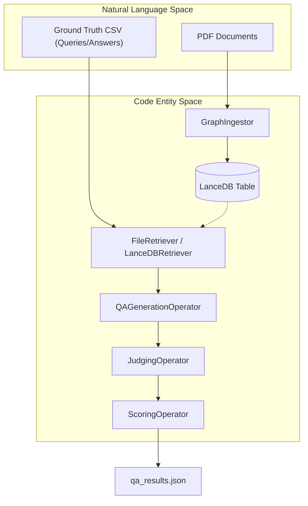
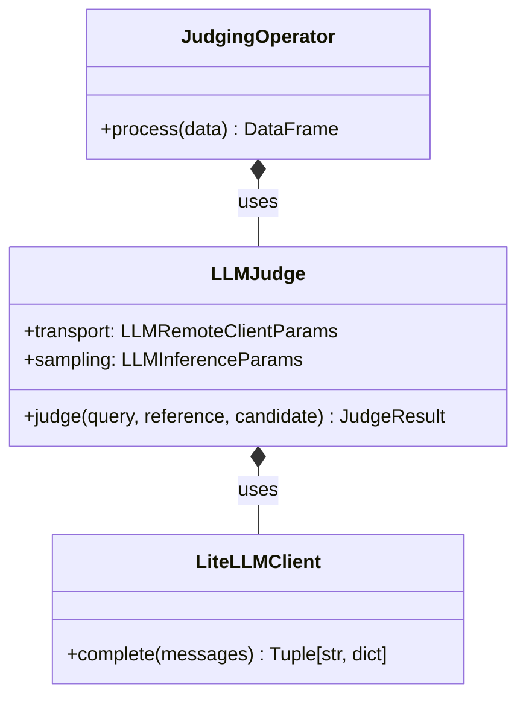

<!-- source: DeepWiki mcp.deepwiki.com · repo NVIDIA/NeMo-Retriever · page 5.4 QA Evaluation Pipeline · fetched 2026-10-26 -->

# QA Evaluation Pipeline

<details>
<summary>Relevant source files</summary>

The following files were used as context for generating this wiki page:

- [examples/nemo_retriever_retriever_query_metadata_filter.ipynb](examples/nemo_retriever_retriever_query_metadata_filter.ipynb)
- [nemo_retriever/examples/eval_sweep.yaml](nemo_retriever/examples/eval_sweep.yaml)
- [nemo_retriever/src/nemo_retriever/api/internal/transform/embed_text.py](nemo_retriever/src/nemo_retriever/api/internal/transform/embed_text.py)
- [nemo_retriever/src/nemo_retriever/evaluation/README.md](nemo_retriever/src/nemo_retriever/evaluation/README.md)
- [nemo_retriever/src/nemo_retriever/evaluation/cli.py](nemo_retriever/src/nemo_retriever/evaluation/cli.py)
- [nemo_retriever/src/nemo_retriever/evaluation/config.py](nemo_retriever/src/nemo_retriever/evaluation/config.py)
- [nemo_retriever/src/nemo_retriever/evaluation/judging.py](nemo_retriever/src/nemo_retriever/evaluation/judging.py)
- [nemo_retriever/src/nemo_retriever/evaluation/runner.py](nemo_retriever/src/nemo_retriever/evaluation/runner.py)
- [nemo_retriever/src/nemo_retriever/llm/clients/judge.py](nemo_retriever/src/nemo_retriever/llm/clients/judge.py)
- [nemo_retriever/src/nemo_retriever/params/chunk_bundle.py](nemo_retriever/src/nemo_retriever/params/chunk_bundle.py)
- [nemo_retriever/src/nemo_retriever/vdb/sidecar_metadata.py](nemo_retriever/src/nemo_retriever/vdb/sidecar_metadata.py)
- [nemo_retriever/tests/test_llm_params.py](nemo_retriever/tests/test_llm_params.py)
- [nemo_retriever/tests/test_src_documentation_snippets.py](nemo_retriever/tests/test_src_documentation_snippets.py)

</details>


The QA Evaluation Pipeline is an LLM-as-judge framework designed to measure the answer quality of Retrieval-Augmented Generation (RAG) systems. It orchestrates context retrieval, answer generation using one or more LLMs, and multi-tier scoring against ground-truth references [nemo_retriever/src/nemo_retriever/evaluation/README.md:1-5]().

## Overview and Data Flow

The pipeline is designed to be plug-and-play, allowing users to swap retrievers, generators, or judges independently [nemo_retriever/src/nemo_retriever/evaluation/README.md:11-12](). It supports two primary modes:
1.  **File Mode**: Reads pre-exported retrieval results from a JSON file [nemo_retriever/src/nemo_retriever/evaluation/README.md:48-49]().
2.  **LanceDB Mode**: Queries a LanceDB vector database live during the evaluation run [nemo_retriever/src/nemo_retriever/evaluation/README.md:7-8]().

### Evaluation Data Flow
The following diagram illustrates the transition from raw documents to the final evaluation metrics.

**RAG Evaluation Data Flow**

**Sources:** [nemo_retriever/src/nemo_retriever/evaluation/README.md:50-70](), [nemo_retriever/src/nemo_retriever/evaluation/runner.py:65-68]()

## Multi-Tier Scoring System

The pipeline evaluates quality across three distinct tiers to provide a comprehensive view of RAG performance:

| Tier | Name | Metric | Implementation |
| :--- | :--- | :--- | :--- |
| **Tier 1** | Retrieval Quality | `answer_in_context` | Checks if the ground-truth answer string exists within the retrieved context chunks [nemo_retriever/src/nemo_retriever/evaluation/cli.py:38-43](). |
| **Tier 2** | Programmatic Quality | `token_f1` | Measures word-level overlap between the generated answer and the reference answer [nemo_retriever/src/nemo_retriever/evaluation/cli.py:45-50](). |
| **Tier 3** | LLM Judge | `judge_score` | A strong LLM (e.g., Nemotron-3.3-Super-49B) scores the answer on a 1-5 scale based on factual accuracy [nemo_retriever/src/nemo_retriever/llm/clients/judge.py:22-52](). |

**Sources:** [nemo_retriever/src/nemo_retriever/evaluation/cli.py:33-64](), [nemo_retriever/src/nemo_retriever/llm/clients/judge.py:8-10]()

## Key Components and Classes

### Evaluation Orchestrators
The pipeline can be executed via two main orchestrators:
*   `QAEvalPipeline`: Handles multi-model sweeps and parallel execution of queries [nemo_retriever/src/nemo_retriever/evaluation/orchestrator.py:22-25]().
*   **Operator Graph**: Uses the `RetrievalLoaderOperator >> QAGenerationOperator >> JudgingOperator >> ScoringOperator` chain for single-model evaluation [nemo_retriever/src/nemo_retriever/evaluation/README.md:46-47]().

### LLM-as-Judge (`LLMJudge`)
The `LLMJudge` class uses a system prompt to break the reference answer into key facts and then checks the candidate answer for those facts [nemo_retriever/src/nemo_retriever/llm/clients/judge.py:22-52](). It handles numeric equivalence and paraphrasing [nemo_retriever/src/nemo_retriever/llm/clients/judge.py:32-37]().

**Judge Class Relationships**

**Sources:** [nemo_retriever/src/nemo_retriever/llm/clients/judge.py:62-88](), [nemo_retriever/src/nemo_retriever/evaluation/judging.py:20-64]()

## Configuration and Execution

### Configuration Schema
The system uses a YAML/JSON configuration to define models and evaluation sweeps. It supports environment variable expansion (e.g., `${NVIDIA_API_KEY}`) [nemo_retriever/src/nemo_retriever/evaluation/config.py:54-56]().

```yaml
models:
  nemotron-super:
    model: "nvidia_nim/nvidia/llama-3.3-nemotron-super-49b-v1.5"
    api_key: "${NVIDIA_API_KEY}"

evaluations:
  - generator: "nemotron-super"
    judge: "nemotron-super"
    runs: 1

execution:
  top_k: 5
  max_workers: 8
```
**Sources:** [nemo_retriever/src/nemo_retriever/evaluation/config.py:21-39](), [nemo_retriever/examples/eval_sweep.yaml:24-62]()

### Running Evaluations via CLI
The `retriever eval run` command is the primary entry point for executing sweeps [nemo_retriever/src/nemo_retriever/evaluation/runner.py:11-12]().

*   **From Config File**: `retriever eval run --config eval_sweep.yaml` [nemo_retriever/examples/eval_sweep.yaml:7]()
*   **From Environment**: `retriever eval run --from-env` (requires `QA_DATASET` and `RETRIEVAL_FILE` or `LANCEDB_URI` to be set) [nemo_retriever/src/nemo_retriever/evaluation/cli.py:130-142]().

### Result Artifacts
Each run produces a timestamped JSON file (e.g., `qa_results_dataset_gen_judge_timestamp.json`) containing:
*   Dataset and retrieval metadata [nemo_retriever/src/nemo_retriever/evaluation/runner.py:159-166]().
*   Aggregated metrics (mean scores, F1, latency) [nemo_retriever/src/nemo_retriever/evaluation/cli.py:45-64]().
*   Per-query results including the generated answer, judge reasoning, and score [nemo_retriever/src/nemo_retriever/evaluation/runner.py:167]().

**Sources:** [nemo_retriever/src/nemo_retriever/evaluation/runner.py:145-171](), [nemo_retriever/src/nemo_retriever/evaluation/cli.py:33-73]()

---

