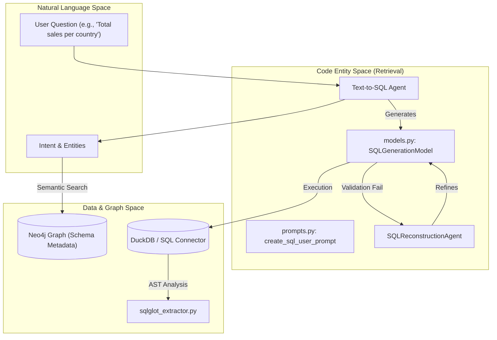
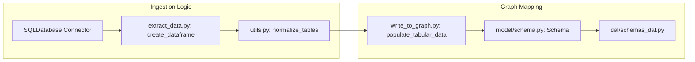

<!-- source: DeepWiki mcp.deepwiki.com · repo NVIDIA/NeMo-Retriever · page 5.5 Tabular Data and Text-to-SQL · fetched 2026-10-26 -->

# Tabular Data and Text-to-SQL

Relevant source files

The following files were used as context for generating this wiki page:

- [nemo_retriever/src/nemo_retriever/graph/tabular_fetch_embeddings_operator.py](nemo_retriever/src/nemo_retriever/graph/tabular_fetch_embeddings_operator.py)
- [nemo_retriever/src/nemo_retriever/graph/tabular_schema_extract_operator.py](nemo_retriever/src/nemo_retriever/graph/tabular_schema_extract_operator.py)
- [nemo_retriever/src/nemo_retriever/tabular_data/ingestion/dal/queries_dal.py](nemo_retriever/src/nemo_retriever/tabular_data/ingestion/dal/queries_dal.py)
- [nemo_retriever/src/nemo_retriever/tabular_data/ingestion/dal/utils_dal.py](nemo_retriever/src/nemo_retriever/tabular_data/ingestion/dal/utils_dal.py)
- [nemo_retriever/src/nemo_retriever/tabular_data/ingestion/extract_data.py](nemo_retriever/src/nemo_retriever/tabular_data/ingestion/extract_data.py)
- [nemo_retriever/src/nemo_retriever/tabular_data/ingestion/model/query.py](nemo_retriever/src/nemo_retriever/tabular_data/ingestion/model/query.py)
- [nemo_retriever/src/nemo_retriever/tabular_data/ingestion/model/reserved_words.py](nemo_retriever/src/nemo_retriever/tabular_data/ingestion/model/reserved_words.py)
- [nemo_retriever/src/nemo_retriever/tabular_data/ingestion/model/schema.py](nemo_retriever/src/nemo_retriever/tabular_data/ingestion/model/schema.py)
- [nemo_retriever/src/nemo_retriever/tabular_data/ingestion/parsers/sqlglot_extractor.py](nemo_retriever/src/nemo_retriever/tabular_data/ingestion/parsers/sqlglot_extractor.py)
- [nemo_retriever/src/nemo_retriever/tabular_data/ingestion/services/queries.py](nemo_retriever/src/nemo_retriever/tabular_data/ingestion/services/queries.py)
- [nemo_retriever/src/nemo_retriever/tabular_data/ingestion/write_to_graph.py](nemo_retriever/src/nemo_retriever/tabular_data/ingestion/write_to_graph.py)
- [nemo_retriever/src/nemo_retriever/tabular_data/retrieval/text_to_sql/agents/response.py](nemo_retriever/src/nemo_retriever/tabular_data/retrieval/text_to_sql/agents/response.py)
- [nemo_retriever/src/nemo_retriever/tabular_data/retrieval/text_to_sql/agents/sql_reconstruction.py](nemo_retriever/src/nemo_retriever/tabular_data/retrieval/text_to_sql/agents/sql_reconstruction.py)
- [nemo_retriever/src/nemo_retriever/tabular_data/retrieval/text_to_sql/models.py](nemo_retriever/src/nemo_retriever/tabular_data/retrieval/text_to_sql/models.py)
- [nemo_retriever/src/nemo_retriever/tabular_data/retrieval/text_to_sql/prompts.py](nemo_retriever/src/nemo_retriever/tabular_data/retrieval/text_to_sql/prompts.py)
- [nemo_retriever/tests/test_sqlglot_extractor.py](nemo_retriever/tests/test_sqlglot_extractor.py)

The **Tabular Data and Text-to-SQL** subsystem provides the infrastructure for ingesting structured relational databases into the NeMo Retriever graph and querying them using natural language. This system bridges the gap between unstructured RAG and structured data by representing database schemas (tables, columns, foreign keys) as a graph in Neo4j and using a multi-agent LangGraph pipeline to generate and validate executable SQL.

### System Overview

The subsystem is divided into two primary workflows:
1.  **Ingestion Pipeline**: Extracts metadata from relational sources (SQLite, DuckDB, Snowflake, etc.), builds a graph representation in Neo4j, and generates embeddings for semantic schema search.
2.  **Text-to-SQL Agent**: A reasoning loop that takes a user question, retrieves relevant schema entities, generates a SQL dialect-specific query, and validates the result.

#### Natural Language to Code Entity Mapping

The following diagram illustrates how natural language concepts are mapped to specific code entities within the tabular subsystem.

**Conceptual Mapping: User Query to Database Execution**

**Sources:** [nemo_retriever/src/nemo_retriever/tabular_data/retrieval/text_to_sql/prompts.py:13-47](), [nemo_retriever/src/nemo_retriever/tabular_data/retrieval/text_to_sql/models.py:78-111](), [nemo_retriever/src/nemo_retriever/tabular_data/retrieval/text_to_sql/agents/sql_reconstruction.py:41-60](), [nemo_retriever/src/nemo_retriever/tabular_data/ingestion/parsers/sqlglot_extractor.py:45-91]()

---

### Tabular Data Ingestion

The ingestion process transforms a physical database schema into a semantic graph. This is handled by specialized operators within the `nemo-retriever` graph pipeline.

*   **Schema Extraction**: The `TabularSchemaExtractOp` uses a `SQLDatabase` connector to pull tables, columns, primary keys, and foreign keys [nemo_retriever/src/nemo_retriever/graph/tabular_schema_extract_operator.py:18-36]().
*   **Graph Population**: Data is written to Neo4j via `store_relational_db_in_neo4j`, which creates `Table` and `Column` nodes and their relationships [nemo_retriever/src/nemo_retriever/tabular_data/ingestion/extract_data.py:57-82]().
*   **Embedding Preparation**: The `TabularFetchEmbeddingsOp` converts the graph nodes into text strings (e.g., combining table descriptions with column lists) to be processed by embedding models for vector search [nemo_retriever/src/nemo_retriever/graph/tabular_fetch_embeddings_operator.py:21-43]().

For details, see [Tabular Data Ingestion](#5.5.1).

**Sources:** [nemo_retriever/src/nemo_retriever/graph/tabular_schema_extract_operator.py:18-71](), [nemo_retriever/src/nemo_retriever/tabular_data/ingestion/write_to_graph.py:31-57](), [nemo_retriever/src/nemo_retriever/graph/tabular_fetch_embeddings_operator.py:73-137]()

---

### Text-to-SQL Agent

The retrieval side uses a LangGraph-based agentic workflow to handle the complexity of SQL generation.

*   **Semantic Retrieval**: Instead of passing the entire schema to the LLM, the system retrieves only the most relevant tables and columns from the vector database.
*   **Structured Generation**: The `SQLGenerationModel` ensures the LLM provides internal reasoning (`thought`), the executable `sql_code`, and a user-facing `explanation` [nemo_retriever/src/nemo_retriever/tabular_data/retrieval/text_to_sql/models.py:78-111]().
*   **Validation & Reconstruction**: If a generated query fails execution or intent validation, the `SQLReconstructionAgent` takes the error feedback and previous attempt to produce a corrected query [nemo_retriever/src/nemo_retriever/tabular_data/retrieval/text_to_sql/agents/sql_reconstruction.py:75-121]().

For details, see [Text-to-SQL Agent](#5.5.2).

**Sources:** [nemo_retriever/src/nemo_retriever/tabular_data/retrieval/text_to_sql/agents/response.py:27-41](), [nemo_retriever/src/nemo_retriever/tabular_data/retrieval/text_to_sql/prompts.py:50-94](), [nemo_retriever/src/nemo_retriever/tabular_data/retrieval/text_to_sql/agents/sql_reconstruction.py:111-130]()

---

### Key Components

| Component | Class/Module | Description |
| :--- | :--- | :--- |
| **SQL Parser** | `sqlglot_extractor.py` | Uses `sqlglot` to parse SQL into ASTs and resolve table/column references [nemo_retriever/src/nemo_retriever/tabular_data/ingestion/parsers/sqlglot_extractor.py:9-23](). |
| **Schema Model** | `Schema` | Orchestrates the DataFrames for tables and columns during ingestion [nemo_retriever/src/nemo_retriever/tabular_data/ingestion/model/schema.py:17-40](). |
| **Ingest Operator** | `TabularSchemaExtractOp` | Graph operator that triggers the extraction and storage of DB metadata [nemo_retriever/src/nemo_retriever/graph/tabular_schema_extract_operator.py:18-36](). |
| **Response Agent** | `ResponseAgent` | Formats the final answer, combining SQL results with markdown explanations [nemo_retriever/src/nemo_retriever/tabular_data/retrieval/text_to_sql/agents/response.py:27-41](). |

**Data Flow: SQL Extraction and Graphing**

**Sources:** [nemo_retriever/src/nemo_retriever/tabular_data/ingestion/extract_data.py:12-38](), [nemo_retriever/src/nemo_retriever/tabular_data/ingestion/write_to_graph.py:31-57](), [nemo_retriever/src/nemo_retriever/tabular_data/ingestion/model/schema.py:17-81]()

---

