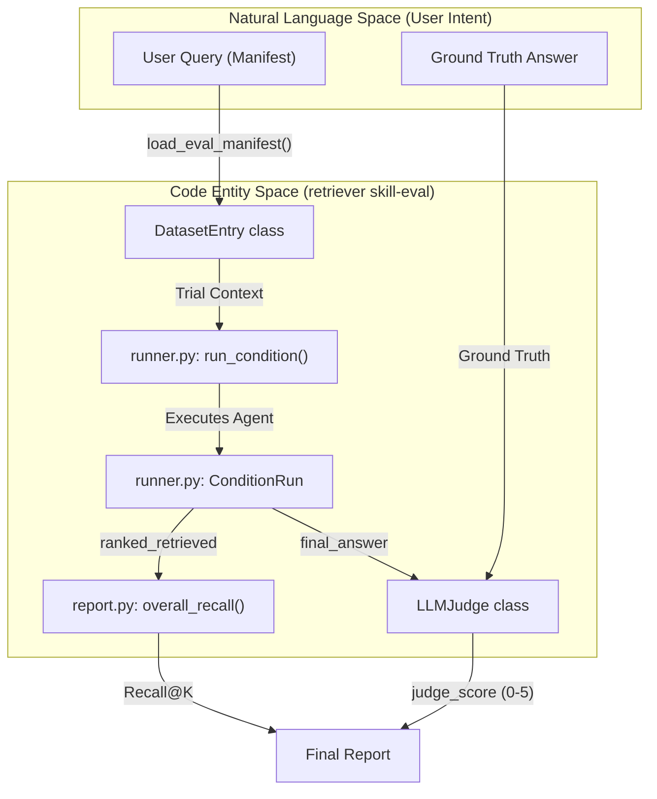
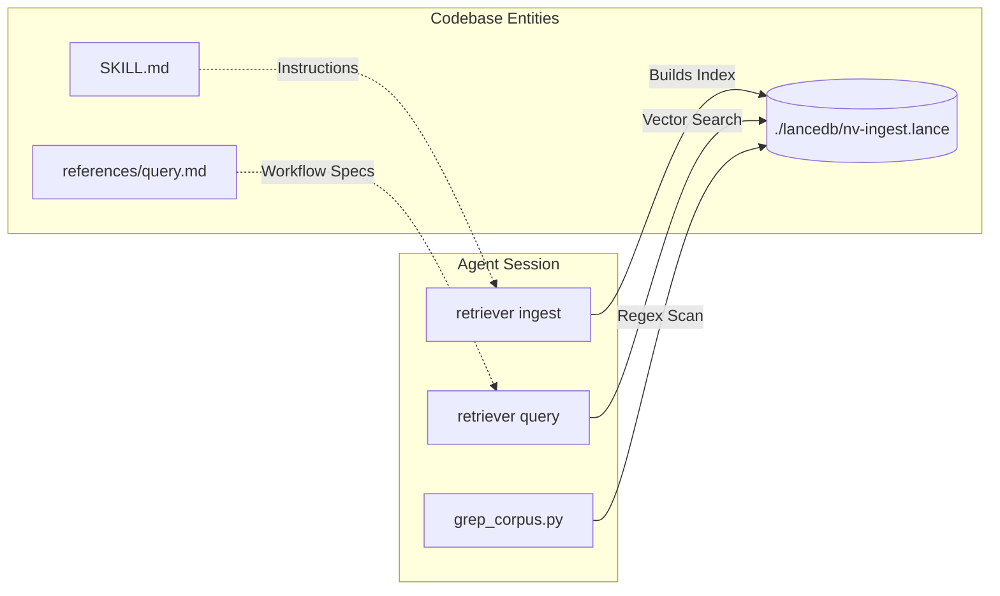

<!-- source: DeepWiki mcp.deepwiki.com · repo NVIDIA/NeMo-Retriever · page 5.6 Skill Evaluation Framework · fetched 2026-10-26 -->

# Skill Evaluation Framework

Relevant source files

The following files were used as context for generating this wiki page:

- [nemo_retriever/src/nemo_retriever/retriever_graph_utils.py](nemo_retriever/src/nemo_retriever/retriever_graph_utils.py)
- [nemo_retriever/src/nemo_retriever/skill_eval/__init__.py](nemo_retriever/src/nemo_retriever/skill_eval/__init__.py)
- [nemo_retriever/src/nemo_retriever/skill_eval/__main__.py](nemo_retriever/src/nemo_retriever/skill_eval/__main__.py)
- [nemo_retriever/src/nemo_retriever/skill_eval/cli.py](nemo_retriever/src/nemo_retriever/skill_eval/cli.py)
- [nemo_retriever/src/nemo_retriever/skill_eval/configs/__init__.py](nemo_retriever/src/nemo_retriever/skill_eval/configs/__init__.py)
- [nemo_retriever/src/nemo_retriever/skill_eval/configs/skill_eval.yaml](nemo_retriever/src/nemo_retriever/skill_eval/configs/skill_eval.yaml)
- [nemo_retriever/src/nemo_retriever/skill_eval/dataset.py](nemo_retriever/src/nemo_retriever/skill_eval/dataset.py)
- [nemo_retriever/src/nemo_retriever/skill_eval/prompts/__init__.py](nemo_retriever/src/nemo_retriever/skill_eval/prompts/__init__.py)
- [nemo_retriever/src/nemo_retriever/skill_eval/prompts/setup_nl.j2](nemo_retriever/src/nemo_retriever/skill_eval/prompts/setup_nl.j2)
- [nemo_retriever/src/nemo_retriever/skill_eval/prompts/setup_slash.j2](nemo_retriever/src/nemo_retriever/skill_eval/prompts/setup_slash.j2)
- [nemo_retriever/src/nemo_retriever/skill_eval/report.py](nemo_retriever/src/nemo_retriever/skill_eval/report.py)
- [nemo_retriever/src/nemo_retriever/skill_eval/runner.py](nemo_retriever/src/nemo_retriever/skill_eval/runner.py)
- [nemo_retriever/src/nemo_retriever/skill_eval/trace_summarizer.py](nemo_retriever/src/nemo_retriever/skill_eval/trace_summarizer.py)
- [nemo_retriever/tests/skill_eval/test_cli.py](nemo_retriever/tests/skill_eval/test_cli.py)
- [skills/nemo-retriever/BENCHMARK.md](skills/nemo-retriever/BENCHMARK.md)
- [skills/nemo-retriever/SKILL.md](skills/nemo-retriever/SKILL.md)
- [skills/nemo-retriever/evals/evals.json](skills/nemo-retriever/evals/evals.json)
- [skills/nemo-retriever/references/query.md](skills/nemo-retriever/references/query.md)
- [skills/nemo-retriever/references/troubleshooting.md](skills/nemo-retriever/references/troubleshooting.md)
- [skills/nemo-retriever/scripts/filename_fast_path.py](skills/nemo-retriever/scripts/filename_fast_path.py)
- [skills/nemo-retriever/scripts/grep_corpus.py](skills/nemo-retriever/scripts/grep_corpus.py)
- [skills/nemo-retriever/skill-card.md](skills/nemo-retriever/skill-card.md)
- [skills/nemo-retriever/skill.oms.sig](skills/nemo-retriever/skill.oms.sig)

The Skill Evaluation Framework (`skill-eval`) is a benchmarking system designed to evaluate the performance, safety, and discoverability of coding agents when equipped with the `nemo-retriever` skill. It compares agent behavior across different conditions to measure the "uplift" provided by the retriever compared to native file-reading or standard RAG implementations.

Sources: `[nemo_retriever/src/nemo_retriever/skill_eval/cli.py:43-43]()`, `[skills/nemo-retriever/BENCHMARK.md:1-32]()`

## Overview of Evaluation Conditions

The framework executes trials across three distinct conditions to isolate the impact of the skill:

| Condition | Name | Description |
| :--- | :--- | :--- |
| **C1** | `c1_base` | **Baseline**: The `retriever` CLI is blocked. The agent must rely on native tools like `Read`, `Grep`, or `find`. |
| **C2** | `c2_retriever` | **Implicit**: The `retriever` CLI is available. The agent is given a Natural Language (NL) prompt and must discover the skill via auto-discovery. |
| **C3** | `c3_retriever_skill` | **Explicit**: The agent is prompted with an explicit `/nemo-retriever` slash command, forcing the use of the skill. |

Sources: `[nemo_retriever/src/nemo_retriever/skill_eval/runner.py:29-30]()`, `[nemo_retriever/src/nemo_retriever/skill_eval/configs/skill_eval.yaml:80-84]()`

## System Architecture and Data Flow

The `skill-eval` system operates by creating sandboxed workdirs for each trial, symlinking dataset PDFs, and spawning agent CLI sessions.

### Skill Evaluation Component Map
This diagram maps the evaluation logic to the code entities responsible for executing trials and scoring results.

Sources: `[nemo_retriever/src/nemo_retriever/skill_eval/dataset.py:33-43]()`, `[nemo_retriever/src/nemo_retriever/skill_eval/runner.py:84-91]()`, `[nemo_retriever/src/nemo_retriever/skill_eval/report.py:32-56]()`

## Implementation Details

### Per-Trial Execution
The `runner.py` module manages the lifecycle of a trial. It creates a `ConditionRun` which encapsulates the scratch paths and results for an agent/condition/domain triplet.

1.  **Sandbox Creation**: `_build_pdf_symlinks` creates a local `./pdfs/` directory within the trial workdir containing symlinks to the source documents. `[nemo_retriever/src/nemo_retriever/skill_eval/runner.py:182-189]()`
2.  **Tool Shimming**: In `c1_base`, the framework writes a shim script that returns exit code 127 if the agent attempts to call `retriever`, forcing it to use other methods. `[nemo_retriever/src/nemo_retriever/skill_eval/runner.py:191-198]()`
3.  **Prompt Rendering**: Prompts are rendered using Jinja2 templates (`trial_user_nl.j2` or `trial_user_slash.j2`) based on the condition. `[nemo_retriever/src/nemo_retriever/skill_eval/runner.py:106-112]()`

### LLM-as-Judge Scoring
The framework uses an LLM (typically Llama-3.3-Nemotron) to grade the `final_answer` produced by the agent against the `ground_truth_answer` from the manifest.

*   **Scale**: 0-5.
*   **Implementation**: Handled by the `LLMJudge` class in `nemo_retriever.llm.clients.judge`.
*   **Configuration**: Defined in the `judge` block of `skill_eval.yaml`.

Sources: `[nemo_retriever/src/nemo_retriever/skill_eval/configs/skill_eval.yaml:103-111]()`, `[nemo_retriever/src/nemo_retriever/skill_eval/cli.py:95-130]()`

## The Skill Card and Metadata
The `SKILL.md` file serves as the "source of truth" for the agent. It defines the tools allowed, the workflow for setup and query turns, and hard limits (e.g., maximum 2 Bash calls per query turn).

### Skill Execution Logic
This diagram shows how the `retriever` CLI interacts with the agent's environment during an evaluation.

Sources: `[skills/nemo-retriever/SKILL.md:10-26]()`, `[skills/nemo-retriever/references/query.md:4-10]()`, `[skills/nemo-retriever/scripts/grep_corpus.py:1-21]()`

## Metrics and Reporting

The `report.py` module aggregates `TrialResult` objects into a final summary. Key metrics include:

*   **Macro-averaged Recall@K**: Measures if the agent successfully retrieved the ground-truth pages. `[nemo_retriever/src/nemo_retriever/skill_eval/report.py:32-56]()`
*   **Success Rate**: Percentage of trials where the agent reached a `final_answer` without crashing. `[nemo_retriever/src/nemo_retriever/skill_eval/report.py:103-103]()`
*   **Skill Fired Rate**: Frequency with which the agent actually invoked the `retriever` CLI. `[nemo_retriever/src/nemo_retriever/skill_eval/report.py:106-108]()`
*   **Token Efficiency**: Mean input/output tokens per query turn. `[nemo_retriever/src/nemo_retriever/skill_eval/report.py:76-79]()`

The results are written to a `session_summary.md` file, which includes a comparison table of performance across agents (e.g., `claude-code`, `codex`) and conditions.

Sources: `[nemo_retriever/src/nemo_retriever/skill_eval/report.py:153-165]()`, `[skills/nemo-retriever/BENCHMARK.md:53-62]()`

---

