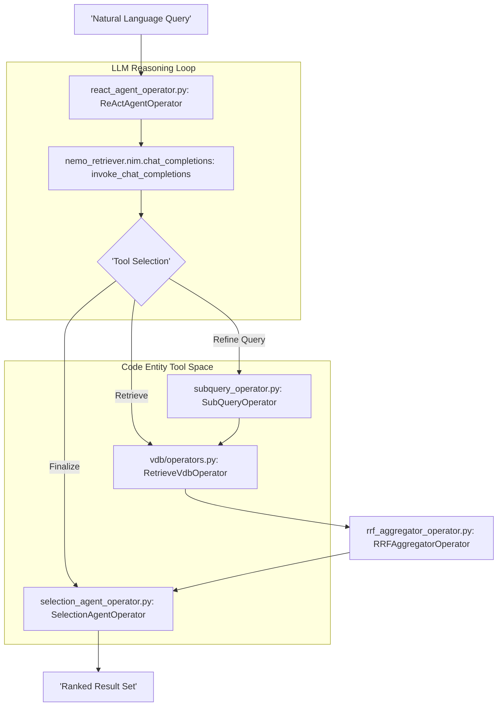
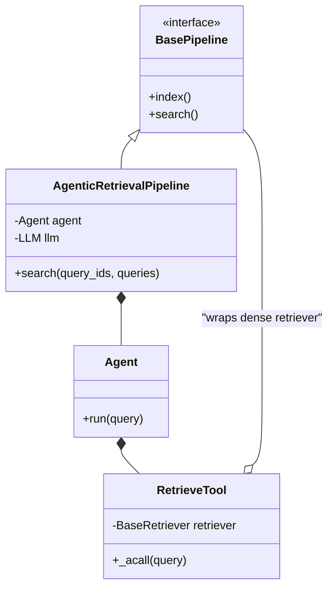

<!-- source: DeepWiki mcp.deepwiki.com · repo NVIDIA/NeMo-Retriever · page 5.7 Agentic Retrieval · fetched 2026-10-26 -->

# Agentic Retrieval

<details>
<summary>Relevant source files</summary>

The following files were used as context for generating this wiki page:

- [docs/docs/extraction/agentic-retrieval-concept.md](docs/docs/extraction/agentic-retrieval-concept.md)
- [docs/docs/extraction/custom-metadata.md](docs/docs/extraction/custom-metadata.md)
- [docs/docs/extraction/releasenotes.md](docs/docs/extraction/releasenotes.md)
- [docs/docs/extraction/vdbs.md](docs/docs/extraction/vdbs.md)
- [docs/docs/extraction/workflow-agentic-retrieval.md](docs/docs/extraction/workflow-agentic-retrieval.md)
- [docs/docs/extraction/workflow-document-ingestion.md](docs/docs/extraction/workflow-document-ingestion.md)
- [nemo_retriever/src/nemo_retriever/graph/react_agent_operator.py](nemo_retriever/src/nemo_retriever/graph/react_agent_operator.py)
- [nemo_retriever/src/nemo_retriever/graph/rrf_aggregator_operator.py](nemo_retriever/src/nemo_retriever/graph/rrf_aggregator_operator.py)
- [nemo_retriever/src/nemo_retriever/graph/selection_agent_operator.py](nemo_retriever/src/nemo_retriever/graph/selection_agent_operator.py)
- [nemo_retriever/src/nemo_retriever/graph/subquery_operator.py](nemo_retriever/src/nemo_retriever/graph/subquery_operator.py)
- [nemo_retriever/src/nemo_retriever/nim/chat_completions.py](nemo_retriever/src/nemo_retriever/nim/chat_completions.py)
- [nemo_retriever/tests/test_agentic_operators.py](nemo_retriever/tests/test_agentic_operators.py)
- [retrieval-bench/README.md](retrieval-bench/README.md)
- [retrieval-bench/src/retrieval_bench/cli/evaluate.py](retrieval-bench/src/retrieval_bench/cli/evaluate.py)
- [retrieval-bench/src/retrieval_bench/pipeline_evaluation/evaluator.py](retrieval-bench/src/retrieval_bench/pipeline_evaluation/evaluator.py)
- [retrieval-bench/src/retrieval_bench/pipelines/agentic.py](retrieval-bench/src/retrieval_bench/pipelines/agentic.py)
- [retrieval-bench/src/retrieval_bench/pipelines/backends.py](retrieval-bench/src/retrieval_bench/pipelines/backends.py)
- [retrieval-bench/src/retrieval_bench/pipelines/dense.py](retrieval-bench/src/retrieval_bench/pipelines/dense.py)
- [retrieval-bench/src/retrieval_bench/singletons/colembed_retriever.py](retrieval-bench/src/retrieval_bench/singletons/colembed_retriever.py)
- [retrieval-bench/src/retrieval_bench/singletons/hf_dense_retriever.py](retrieval-bench/src/retrieval_bench/singletons/hf_dense_retriever.py)
- [retrieval-bench/src/retrieval_bench/singletons/nemotron_colembed_vl_v2_retriever.py](retrieval-bench/src/retrieval_bench/singletons/nemotron_colembed_vl_v2_retriever.py)
- [retrieval-bench/src/retrieval_bench/singletons/nemotron_embed_vl_dense_retriever.py](retrieval-bench/src/retrieval_bench/singletons/nemotron_embed_vl_dense_retriever.py)
- [retrieval-bench/submissions/agentic_retrieval_pipeline.png](retrieval-bench/submissions/agentic_retrieval_pipeline.png)
- [retrieval-bench/submissions/vidore_v3_agentic_pipeline.md](retrieval-bench/submissions/vidore_v3_agentic_pipeline.md)

</details>


**Agentic retrieval** refers to an iterative, tool-driven pattern where an LLM agent queries retrieval systems in a loop to refine results, rather than executing a single static search [docs/docs/extraction/agentic-retrieval-concept.md:1-4](). The NeMo Retriever Library provides the building blocks—including specialized graph operators and evaluation pipelines—to orchestrate these multi-step retrieval workflows.

## System Architecture

The agentic retrieval pattern utilizes a reasoning loop where an LLM planner determines if the current context is sufficient to answer a query or if additional retrieval steps (sub-queries, filters, or reranking) are required [docs/docs/extraction/workflow-agentic-retrieval.md:1-5]().

### Logic Flow: Natural Language to Code Entities

The following diagram bridges the conceptual "Natural Language" reasoning space with the specific code entities in the `nemo_retriever` library.

**Diagram: Agentic Retrieval Execution Flow**

Sources: [nemo_retriever/src/nemo_retriever/graph/react_agent_operator.py:1-50](), [nemo_retriever/src/nemo_retriever/graph/subquery_operator.py:1-30](), [nemo_retriever/src/nemo_retriever/graph/rrf_aggregator_operator.py:1-20](), [nemo_retriever/src/nemo_retriever/nim/chat_completions.py:39-51]()

## Key Graph Operators

The library implements agentic behavior through specialized operators that can be integrated into a `GraphIngestor` or a custom execution graph.

### ReAct Agent Operator
The `react_agent_operator` implements the "Reasoning and Acting" (ReAct) pattern. It uses an LLM to generate thoughts and actions (tool calls) iteratively [nemo_retriever/src/nemo_retriever/graph/react_agent_operator.py:1-10]().
- **Implementation**: It wraps the `NIMClient` to invoke chat completions [nemo_retriever/src/nemo_retriever/nim/chat_completions.py:11-14]().
- **Data Flow**: Accepts a query and a set of tool definitions, returning a trajectory of thoughts and tool outputs [retrieval-bench/src/retrieval_bench/pipelines/agentic.py:127-130]().

### Subquery Operator
The `subquery_operator` is responsible for query decomposition. It takes a complex user query and generates multiple simplified sub-queries to improve recall across diverse document sections [nemo_retriever/src/nemo_retriever/graph/subquery_operator.py:1-20]().

### RRF Aggregator
The `rrf_aggregator` (Reciprocal Rank Fusion) combines results from multiple retrieval steps or sub-queries.
- **Function**: It calculates a fused score for documents that appear in multiple result sets, ensuring that documents ranked highly across different sub-queries are prioritized [nemo_retriever/src/nemo_retriever/graph/rrf_aggregator_operator.py:1-30]().
- **Integration**: Often used as a post-processing step after the `SubQueryOperator` has executed multiple searches [retrieval-bench/src/retrieval_bench/pipelines/agentic.py:144-148]().

Sources: [nemo_retriever/src/nemo_retriever/graph/react_agent_operator.py:1-50](), [nemo_retriever/src/nemo_retriever/graph/subquery_operator.py:1-40](), [nemo_retriever/src/nemo_retriever/graph/rrf_aggregator_operator.py:1-30]()

## Retrieval-Bench Agentic Pipeline

The `retrieval-bench` package provides a reference implementation for evaluating agentic retrieval performance against benchmarks like ViDoRe and BRIGHT [retrieval-bench/src/retrieval_bench/cli/evaluate.py:4-7]().

### Pipeline Components
The agentic pipeline in `retrieval-bench` is defined in `retrieval_bench/pipelines/agentic.py` and uses the following structure:

| Component | Code Entity | Role |
| :--- | :--- | :--- |
| **Agent** | `retrieval_bench.nemo_agentic.agent.Agent` | Manages the loop of thoughts and tool calls [retrieval-bench/src/retrieval_bench/pipelines/agentic.py:40-41](). |
| **LLM Handler** | `retrieval_bench.nemo_agentic.llm_handler.LLM` | Interfaces with OpenAI-compatible APIs for reasoning [retrieval-bench/src/retrieval_bench/pipelines/agentic.py:42-42](). |
| **Retrieve Tool** | `retrieval_bench.pipelines.agentic.RetrieveTool` | Adapts a standard retriever into a tool the agent can call [retrieval-bench/src/retrieval_bench/pipelines/agentic.py:51-59](). |
| **Final Results** | `retrieval_bench.nemo_agentic.tool_helpers.FinalResults` | A terminal tool used by the agent to signal completion [retrieval-bench/src/retrieval_bench/pipelines/agentic.py:43-43](). |

### Execution and Tracing
The pipeline tracks LLM usage (tokens) and provides detailed traces for every query to facilitate debugging of the reasoning chain [retrieval-bench/src/retrieval_bench/pipelines/agentic.py:168-171]().

**Diagram: Retrieval-Bench Class Relationships**

Sources: [retrieval-bench/src/retrieval_bench/pipelines/agentic.py:31-111](), [retrieval-bench/src/retrieval_bench/pipeline_evaluation/evaluator.py:25-42]()

## Usage and Evaluation

To evaluate an agentic pipeline, use the `retrieval-bench` CLI. This requires an LLM model (e.g., via a self-hosted NIM or OpenAI) to serve as the reasoning engine [retrieval-bench/README.md:77-80]().

### CLI Command Example
```bash
retrieval-bench evaluate agentic-retrieval \
  --dataset-name vidore/vidore_v3_hr \
  --backend llama-nemotron-embed-vl-1b-v2 \
  --llm-model your-llm-model \
  --pipeline-args '{"api_key":"os.environ/OPENAI_API_KEY", "base_url":"http://localhost:8000/v1"}'
```
Sources: [retrieval-bench/README.md:88-103]()

### Results Extraction
The pipeline extracts the final ranked document IDs from the agent's trajectory using a fallback hierarchy:
1. Arguments from the `final_results` tool call.
2. Reciprocal Rank Fusion (`rrf_scores`) if multiple tools were used.
3. Selection from a specialized `selection_agent` [retrieval-bench/src/retrieval_bench/pipelines/agentic.py:118-160]().

Sources: [retrieval-bench/src/retrieval_bench/pipelines/agentic.py:118-160](), [retrieval-bench/src/retrieval_bench/cli/evaluate.py:146-160]()

---

