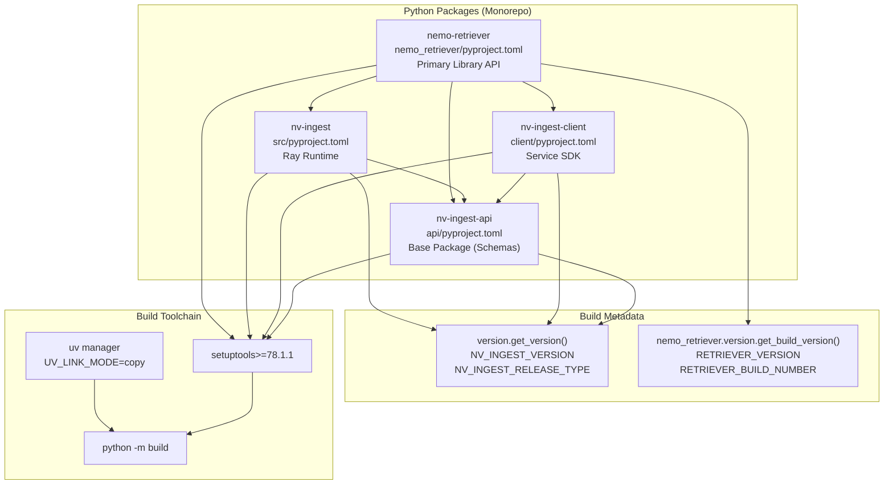
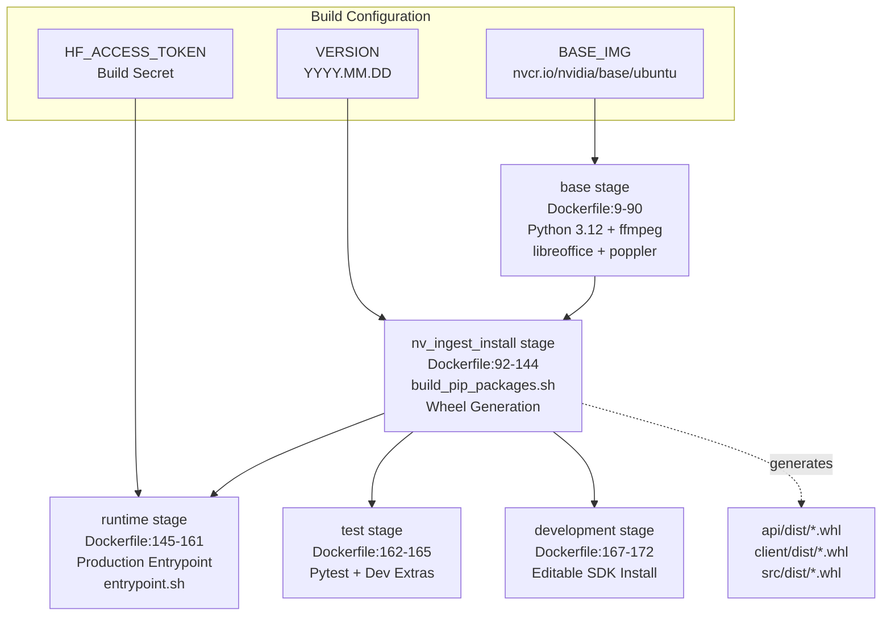
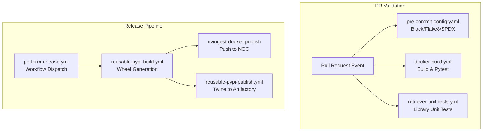

<!-- source: DeepWiki mcp.deepwiki.com · repo NVIDIA/NeMo-Retriever · page 6 Development and Contributing · fetched 2026-10-26 -->

# Development and Contributing

<details>
<summary>Relevant source files</summary>

The following files were used as context for generating this wiki page:

- [.dockerignore](.dockerignore)
- [.github/PULL_REQUEST_TEMPLATE.md](.github/PULL_REQUEST_TEMPLATE.md)
- [.greptile/config.json](.greptile/config.json)
- [.greptile/files.json](.greptile/files.json)
- [CITATION.md](CITATION.md)
- [CONTRIBUTING.md](CONTRIBUTING.md)
- [config/custom_summarization_pipeline.yaml](config/custom_summarization_pipeline.yaml)

</details>


This page provides technical documentation for developers who want to contribute to the NeMo Retriever / NVIDIA Ingest codebase. It covers the development environment, build system, testing infrastructure, and CI/CD workflows.

**Scope**: This page focuses on the development workflow, build processes, and contribution guidelines. For deployment options, see [Deployment Options](#2.1). For detailed subsystem documentation, see the child pages: [Development Environment Setup](#6.1), [Building Docker Images](#6.2), [Python Package Build System](#6.3), [CI/CD Workflows](#6.4), and [Testing](#6.5).

---

## Repository Structure

The repository contains four independently versioned Python packages, each in its own directory. The `nemo_retriever` package is currently the primary focus for library-mode development, while the others provide the foundational service-mode infrastructure.

| Package | Directory | Purpose | Version Source |
|---------|-----------|---------|----------------|
| `nv-ingest-api` | `api/` | Core document processing functions and transforms | `version.get_version()` |
| `nv-ingest-client` | `client/` | Python SDK and CLI for interacting with the service | `version.get_version()` |
| `nv-ingest` | `src/` | Ray-based service runtime and orchestration | `nv_ingest.version.get_version()` |
| `nemo-retriever` | `nemo_retriever/` | Ray Data batch pipeline with local execution modes | `nemo_retriever.version.get_build_version()` |

**Sources**: [src/pyproject.toml:1-84](), [client/pyproject.toml:1-65](), [api/pyproject.toml:1-50](), [nemo_retriever/pyproject.toml:1-115](), [.greptile/config.json:15-15]()

---

## Package Dependency Graph

The package dependency direction is strictly layered to prevent circular imports. `api/` is the base; `client/` and `src/` are parallel mid-level packages; `nemo_retriever/` sits at the top.



**Key Dependency Notes**:
- The `nemo-retriever` package depends on all three other packages as editable local dependencies via `[tool.uv.sources]` [nemo_retriever/pyproject.toml:92-95]().
- **Strict Layering**: `api/` must have no upstream imports. `client/` must never import from `src/`, and vice-versa [.greptile/config.json:51-55]().
- The `uv` package manager is used for fast dependency resolution with `UV_LINK_MODE=copy` [Dockerfile:80]().

**Sources**: [nemo_retriever/pyproject.toml:92-95](), [.greptile/config.json:15-15](), [.greptile/config.json:51-55](), [Dockerfile:77-88]()

---

## Multi-Stage Docker Build Architecture

The repository uses a multi-stage Dockerfile that produces different images for production, testing, and development.



**Stage Purposes**:

| Stage | Target | Purpose | Key Files |
|-------|--------|---------|-----------|
| `base` | Foundation | Install system dependencies (ffmpeg, poppler-utils), create Python 3.12 venv | [Dockerfile:9-90]() |
| `nv_ingest_install` | Build | Compile all wheels using `build_pip_packages.sh` | [Dockerfile:92-144]() |
| `runtime` | Production | Minimal production image with entrypoint and config | [Dockerfile:145-161]() |
| `test` | CI Testing | Runtime + test dependencies for pytest | [Dockerfile:162-165]() |
| `development` | Dev | Editable install for local development workflows | [Dockerfile:167-172]() |

**Key Build Features**:
- **GPL Compliance**: Source code for libraries like `libreoffice` and `libhunspell` is fetched via `apt-get source` to satisfy distribution requirements [Dockerfile:41-75]().
- **Size Optimization**: Ray's Java components (`ray_dist.jar`) are removed to minimize image footprint [Dockerfile:138-141]().
- **Secrets**: HuggingFace tokens are passed via `--secret id=hf_token` during the runtime build to avoid baking credentials into layers [Dockerfile:155-156]().

**Sources**: [Dockerfile:1-187](), [.dockerignore:1-43]()

---

## Contribution Guidelines

External contributions are managed via GitHub Issues and Pull Requests. All contributors must adhere to the following standards:

### Developer Certificate of Origin (DCO)
All commits must be signed off to certify original work or rights to submit.
```bash
git commit --signoff --message "Add feature"
```
**Sources**: [CONTRIBUTING.md:53-71]()

### Code Standards and Patterns
- **Traceability**: Use the `traceable` decorator for pipeline nodes to ensure proper telemetry [CONTRIBUTING.md:15-15]().
- **Error Handling**: Use the node failure decorator (try/except) and avoid bare `except:` blocks [.greptile/config.json:57-61]().
- **Licensing**: Every Python file must include the SPDX license header for NVIDIA [CONTRIBUTING.md:40-42](), [.greptile/config.json:39-44]().
- **Formatting**: Black and Flake8 are enforced via pre-commit hooks with a 120-character line limit [.greptile/config.json:15-15]().

### Architectural Principles
Contributors should follow established design patterns:
- **Single Responsibility Principle (SRP)**: Each module should have one reason to change [CONTRIBUTING.md:26-26]().
- **Dependency Inversion (DIP)**: Depend on abstractions, not concretions [CONTRIBUTING.md:28-28]().
- **Acyclic Dependencies (ADP)**: Package dependency graphs must not contain cycles [CONTRIBUTING.md:31-31]().

**Sources**: [CONTRIBUTING.md:1-115](), [.greptile/config.json:1-110]()

---

## CI/CD Pipeline Overview

The repository implements a comprehensive CI/CD pipeline with separate workflows for PR validation and releases.



**Workflow Concurrency**:
PR workflows use concurrency groups to cancel in-progress builds when new commits are pushed, saving CI resources [.github/workflows/docker-build.yml:14-16]().

**Sources**: [.github/workflows/perform-release.yml:1-516](), [.github/workflows/docker-build.yml:1-61](), [.github/workflows/retriever-unit-tests.yml:1-36]()

---

## Testing Infrastructure

The repository uses `pytest` for unit and integration testing.

| Package | Test Location | Key Features |
|---------|---------------|--------------|
| `nv-ingest-api` | `api/api_tests/` | Schema validation |
| `nv-ingest-client` | `client/client_tests/` | CLI and SDK mocking |
| `nv-ingest` | `tests/service_tests/` | Ray orchestration tests |
| `nemo-retriever` | `nemo_retriever/tests/` | Library mode and Ray Data tests |

**Test Execution**:
- **Randomized Testing**: A custom `pytest` plugin allows running a random subset of tests (e.g., `--random-selection 100`), primarily used for ARM64 emulation builds [tests/conftest.py:1-20]().
- **Mocking**: All external service dependencies (Triton, Redis, Milvus) must be mocked in unit tests [.greptile/config.json:93-97]().
- **Coverage**: PR validation workflows generate XML coverage reports for all main packages [.github/workflows/docker-build.yml:54]().

**Sources**: [tests/conftest.py:1-20](), [.github/workflows/docker-build.yml:52-55](), [nemo_retriever/tests/test_html_convert.py:22-27]()

---

## Next Steps

For detailed information on specific development topics:
- **[Development Environment Setup](#6.1)**: Setting up a local development environment with `uv` and `devcontainers`.
- **[Building Docker Images](#6.2)**: Detailed guide to the multi-stage Docker build process and GPL compliance.
- **[Python Package Build System](#6.3)**: Deep dive into setuptools, PEP 440 versioning, and wheel generation.
- **[CI/CD Workflows](#6.4)**: Comprehensive documentation of GitHub Actions workflows and release coordination.
- **[Testing](#6.5)**: Testing strategies, fixtures, and coverage requirements.

---

