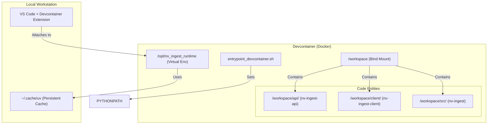
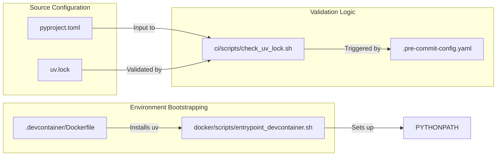

<!-- source: DeepWiki mcp.deepwiki.com · repo NVIDIA/NeMo-Retriever · page 6.1 Development Environment Setup · fetched 2026-10-26 -->

# Development Environment Setup

<details>
<summary>Relevant source files</summary>

The following files were used as context for generating this wiki page:

- [.devcontainer/Dockerfile](.devcontainer/Dockerfile)
- [.devcontainer/README.md](.devcontainer/README.md)
- [.devcontainer/devcontainer.json](.devcontainer/devcontainer.json)
- [.pre-commit-config.yaml](.pre-commit-config.yaml)

</details>


This page provides instructions for setting up a local development environment for contributing to the NeMo Retriever codebase. It covers the recommended **VS Code Devcontainer** workflow, the **uv** package manager, pre-commit hooks, and manual environment configuration.

---

## Development Environment Overview

The NeMo Retriever development environment is designed around `uv` for high-performance dependency management and Docker-based isolation to ensure consistency across different developer machines.

### System Architecture: Local Dev vs. Runtime

The following diagram illustrates how the local development environment maps to the code entities and runtime structures.

**Local Development Entity Mapping**

**Sources:** [.devcontainer/devcontainer.json:36-48](), [.devcontainer/Dockerfile:26-31](), [.devcontainer/README.md:18-32]()

---

## Recommended Setup: VS Code Devcontainer

The quickest way to get started is using the provided Devcontainer configuration. This ensures all system dependencies (like CUDA, `uv`, and specific Python versions) are correctly configured.

### 1. Prerequisites
- **Docker** installed and running.
- **Visual Studio Code** with the **Dev Containers** extension.
- (Optional) NVIDIA Container Toolkit for GPU support.

### 2. Launching the Container
1. Open the repository root in VS Code.
2. A prompt will appear: "Reopen in Container". Click it.
3. If no prompt appears, press `Ctrl+Shift+P`, type `Dev Containers: Rebuild and Reopen in Container`, and press Enter.

### 3. Automatic Configuration
The devcontainer performs several setup steps automatically:
- **Environment Creation**: Creates a Python 3.12 environment at `/opt/nv_ingest_runtime` [[.devcontainer/Dockerfile:27-30]]().
- **Path Configuration**: Sets `PYTHONPATH` to include both core and client source directories [[.devcontainer/devcontainer.json:78-80]]().
- **Extension Installation**: Installs a suite of extensions including Pylance, Black, Flake8, and Nsight for CUDA debugging [[.devcontainer/devcontainer.json:51-67]]().
- **Environment Variables**: Pre-configures default endpoints for NIMs (e.g., `OCR_HTTP_ENDPOINT`, `DEPLOT_HTTP_ENDPOINT`) [[.devcontainer/devcontainer.json:16-35]]().

**Sources:** [.devcontainer/devcontainer.json:1-84](), [.devcontainer/Dockerfile:1-34](), [.devcontainer/README.md:27-32]()

---

## Manual Setup with `uv`

If you prefer to work outside of a container, follow these steps to set up the `retriever_runtime` environment using the `uv` package manager.

### 1. Install `uv`
```bash
curl -LsSf https://astral.sh/uv/install.sh | sh
```
**Sources:** [.devcontainer/Dockerfile:21-21]()

### 2. Create Virtual Environment
The project standardizes on Python 3.12 for the runtime environment.
```bash
uv python install 3.12
uv venv --python 3.12 .venv
source .venv/bin/activate
```
**Sources:** [.devcontainer/Dockerfile:27-28]()

### 3. Install Packages in Editable Mode
To develop across the library components, install the sub-packages in editable mode:
```bash
uv pip install -e api/
uv pip install -e client/
uv pip install -e src/
```

---

## Quality Control: Pre-commit Hooks

To maintain code quality and consistency, the project uses `pre-commit`. These hooks run automatically on every `git commit`.

### Hook Configuration
The project uses several standard and local hooks:
- **Formatting**: `black` with a line length of 120 [[.pre-commit-config.yaml:21-25]]().
- **Linting**: `flake8` with specific ignores for compatibility [[.pre-commit-config.yaml:27-31]]().
- **Dependency Integrity**: A local hook `uv-lock` ensures that `uv.lock` is synchronized with `pyproject.toml` changes [[.pre-commit-config.yaml:33-41]]().

### Setup
```bash
# Install pre-commit
pip install pre-commit

# Install the hooks into your .git directory
pre-commit install

# Manually run against all files
pre-commit run --all-files
```
**Sources:** [.pre-commit-config.yaml:1-41]()

---

## Dependency Flow and Environment Logic

The following diagram bridges the high-level development tasks to the specific script and configuration entities in the codebase.

**Development Logic to Code Entity Mapping**

**Sources:** [.pre-commit-config.yaml:33-41](), [.devcontainer/devcontainer.json:44-48](), [.devcontainer/Dockerfile:21-31]()

---

## Troubleshooting the Dev Environment

### Environment Variable Conflicts
The devcontainer sets several environment variables by default. If you need to override these (e.g., providing your own `NVIDIA_API_KEY`), you should modify the `containerEnv` section in `.devcontainer/devcontainer.json` or export them in your shell within the container.
**Sources:** [.devcontainer/devcontainer.json:16-35]()

### uv Lock Failures
If `pre-commit` fails on the `uv-lock` hook, it means your `uv.lock` file is out of sync with a `pyproject.toml`. Run the following to fix it:
```bash
uv lock
```
**Sources:** [.pre-commit-config.yaml:35-41]()

### PYTHONPATH Issues
If your IDE cannot find imports like `nv_ingest`, ensure your `PYTHONPATH` is set correctly. In the devcontainer, this is handled by `entrypoint_devcontainer.sh`.
```bash
export PYTHONPATH=$(pwd)/src:$(pwd)/client/src
```
**Sources:** [.devcontainer/devcontainer.json:44-48]()

---

