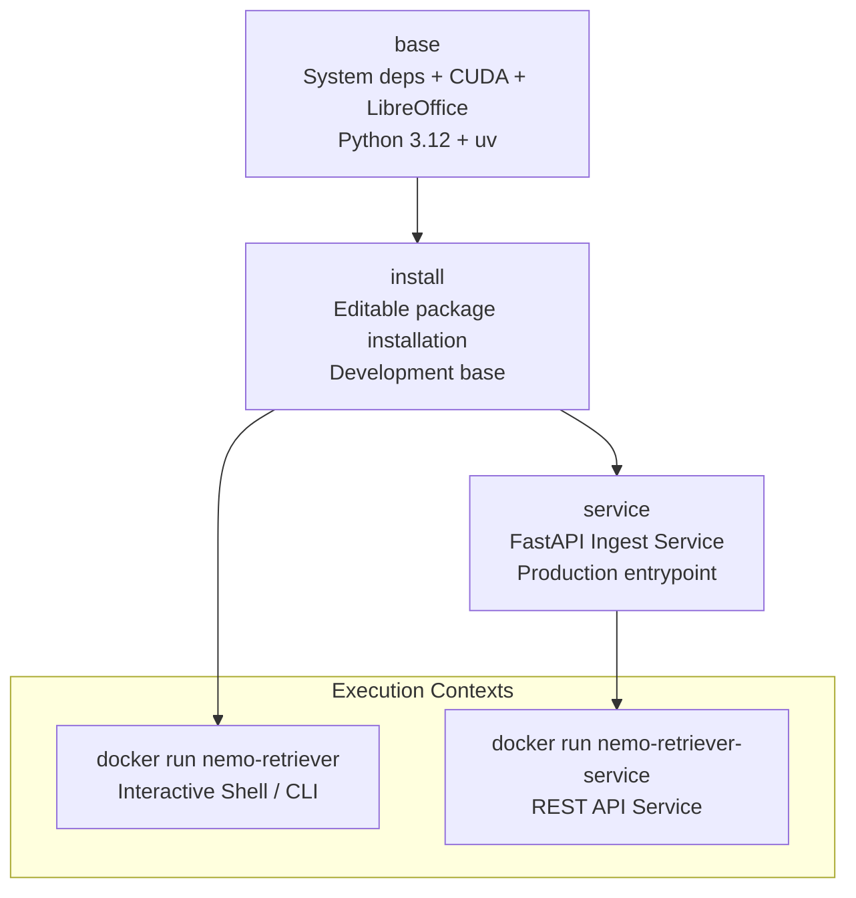
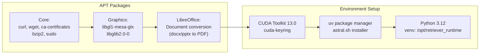
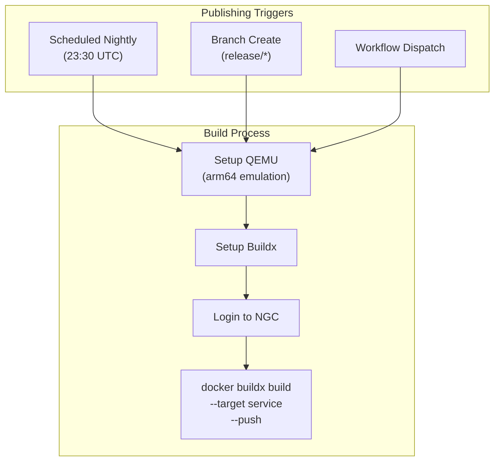

<!-- source: DeepWiki mcp.deepwiki.com · repo NVIDIA/NeMo-Retriever · page 6.2 Building Docker Images · fetched 2026-10-26 -->

# Building Docker Images

<details>
<summary>Relevant source files</summary>

The following files were used as context for generating this wiki page:

- [.github/workflows/docker-build-arm.yml](.github/workflows/docker-build-arm.yml)
- [.github/workflows/docker-nightly-publish.yml](.github/workflows/docker-nightly-publish.yml)
- [.github/workflows/docker-release-publish.yml](.github/workflows/docker-release-publish.yml)
- [.github/workflows/release-docker.yml](.github/workflows/release-docker.yml)
- [.github/workflows/reusable-docker-build-and-test.yml](.github/workflows/reusable-docker-build-and-test.yml)
- [.github/workflows/reusable-docker-build.yml](.github/workflows/reusable-docker-build.yml)
- [.github/workflows/scheduled-nightly.yml](.github/workflows/scheduled-nightly.yml)
- [Dockerfile](Dockerfile)
- [docker/scripts/entrypoint.sh](docker/scripts/entrypoint.sh)
- [docker/scripts/entrypoint_devcontainer.sh](docker/scripts/entrypoint_devcontainer.sh)
- [docker/scripts/entrypoint_source_ext.sh](docker/scripts/entrypoint_source_ext.sh)

</details>


This page documents the Docker image build process for NeMo Retriever / NVIDIA Ingest, including the multi-stage Dockerfile architecture, build arguments, CI/CD integration, and local development workflows.

For information about deploying pre-built images, see [Docker Compose Deployment](). For Python package builds, see [Python Package Build System]().

## Multi-Stage Dockerfile Architecture

The system uses a multi-stage Dockerfile at [Dockerfile:1-170]() that produces multiple image variants. The build is optimized for GPU-accelerated document processing and includes specific dependencies for multimodal data extraction.

### Build Stage Flow



**Sources:** [Dockerfile:15-170]()

### Stage Purposes

| Stage | Target | Purpose | Entry Point |
|-------|--------|---------|-------------|
| `base` | Foundation | System packages, LibreOffice, CUDA 13.0, Python 3.12 venv at `/opt/retriever_runtime` | N/A |
| `install` | Runtime/Dev | Unbuffered Python env, editable install of `nemo_retriever[service]` | `/bin/bash` |
| `service` | Production | Non-root `nemo` user, FastAPI entrypoint, default config deployment | `retriever-service-entrypoint` |

**Sources:** [Dockerfile:15](), [Dockerfile:101](), [Dockerfile:140](), [Dockerfile:167-169]()

## Base Stage Dependencies

The `base` stage [Dockerfile:15-93]() establishes the foundation for GPU-accelerated document processing.

### System Package Installation



**Sources:** [Dockerfile:17-25](), [Dockerfile:52-62](), [Dockerfile:64-75](), [Dockerfile:84-89]()

### LibreOffice and GPL Compliance

The image includes LibreOffice for document conversion [Dockerfile:27-62](). To satisfy GPL licensing requirements and minimize image size, the build:

1. Enables `deb-src` repositories [Dockerfile:52]().
2. Installs specific GPL-licensed libraries (`libltdl7`, `libhunspell-1.7-0`, `libhyphen0`, `libdbus-1-3`) [Dockerfile:28-33]().
3. Downloads source code via `apt-get source` [Dockerfile:58]().
4. Force-removes non-essential packages (e.g., `gnupg`, `gpg-agent`) to reduce the attack surface and size [Dockerfile:35-51](), [Dockerfile:59-61]().

**Sources:** [Dockerfile:27-62]()

### Python Environment and CUDA

The base stage creates a virtual environment at `/opt/retriever_runtime` using `uv` [Dockerfile:70-75](). It also installs the CUDA 13.0 toolkit to support local GPU inference [Dockerfile:84-89]().

Key environment variables:
- `UV_PYTHON_INSTALL_DIR=/opt/uv/python` [Dockerfile:70]()
- `UV_LINK_MODE=copy` - Ensures `uv` copies files instead of hardlinking [Dockerfile:67]()
- `VIRTUAL_ENV=/opt/retriever_runtime` [Dockerfile:109]()

**Sources:** [Dockerfile:64-89](), [Dockerfile:109]()

## Install and Service Stages

### Editable Installation

The `install` stage performs an editable install of the `nemo_retriever` package [Dockerfile:114-117](). This allows developers to mount the host repository over `/workspace` at runtime to reflect code changes without rebuilding the image [Dockerfile:97-100]().

```bash
uv pip install -e "./nemo_retriever[service]"
```

**Sources:** [Dockerfile:114-117]()

### Service Configuration and Security

The `service` stage [Dockerfile:140-170]() prepares the image for production deployment as a FastAPI microservice.

- **User Security**: Creates a non-root `nemo` user (UID/GID 1000) [Dockerfile:152]().
- **Permissions**: Grants the `nemo` user specific `sudo` access to run the FFmpeg installation script [Dockerfile:153-157]().
- **Config Management**: Bundles the default `retriever-service.yaml` into `/etc/nemo-retriever/` [Dockerfile:159-160]().
- **Entrypoint**: Uses `retriever_service_entrypoint.sh` to initialize the environment and start the service [Dockerfile:167-169]().

**Sources:** [Dockerfile:146-169]()

## Build Arguments Reference

| Argument | Default | Purpose |
|----------|---------|---------|
| `BASE_IMG` | `nvcr.io/nvidia/base/ubuntu` | Base image registry [Dockerfile:12]() |
| `BASE_IMG_TAG` | `jammy-20250619` | Base image tag [Dockerfile:13]() |
| `DOWNLOAD_LLAMA_TOKENIZER` | `True` | Flag to pre-download tokenizers during build [Dockerfile:48]() |
| `GIT_COMMIT` | `N/A` | Git SHA for image labeling [Dockerfile:48]() |

**Sources:** [Dockerfile:12-13](), [.github/workflows/docker-nightly-publish.yml:48]()

## CI/CD Integration

The repository uses GitHub Actions to automate image building and publishing across multiple architectures.

### Nightly and Release Publishing

The system supports multi-platform builds (linux/amd64, linux/arm64) using Docker Buildx [Dockerfile:47-48](), [.github/workflows/scheduled-nightly.yml:50-53]().



**Sources:** [.github/workflows/docker-nightly-publish.yml:1-12](), [.github/workflows/docker-release-publish.yml:1-6](), [.github/workflows/scheduled-nightly.yml:1-73]()

### Reusable Workflows

The repository defines reusable workflows for building and testing images to ensure consistency across PR validation and release cycles.

- **`reusable-docker-build-and-test.yml`**: Builds the image and immediately runs `pytest` inside the container [reusable-docker-build-and-test.yml:1-162]().
- **`reusable-docker-build.yml`**: Handles building, optional pushing, and artifact exporting [reusable-docker-build.yml:1-161]().

**Sources:** [.github/workflows/reusable-docker-build-and-test.yml:1-162](), [.github/workflows/reusable-docker-build.yml:1-161]()

## Runtime Environment Scripts

| Script | Purpose |
|--------|---------|
| `retriever_service_entrypoint.sh` | Main service entrypoint; handles config loading and FFmpeg installation [Dockerfile:146](). |
| `retriever_install_ffmpeg.sh` | Installs FFmpeg and ffprobe if `INSTALL_FFMPEG=true` environment variable is set [Dockerfile:147](). |
| `entrypoint_source_ext.sh` | Installs optional dependencies at runtime (Adobe SDK, librosa, memray) [entrypoint_source_ext.sh:10-31](). |
| `entrypoint.sh` | Orchestrates service launch with Gunicorn/Uvicorn and optional memory tracing [entrypoint.sh:78-98](). |

**Sources:** [Dockerfile:146-147](), [docker/scripts/entrypoint_source_ext.sh:10-31](), [docker/scripts/entrypoint.sh:78-98]()

---

