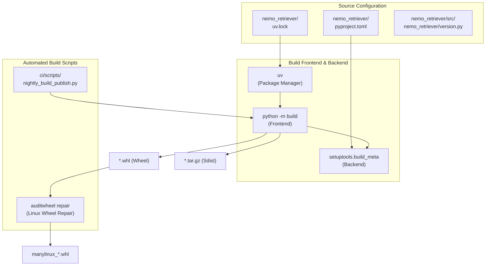
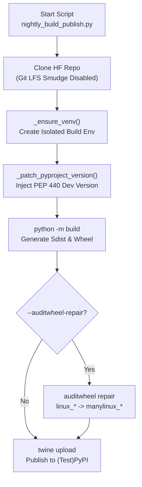

<!-- source: DeepWiki mcp.deepwiki.com · repo NVIDIA/NeMo-Retriever · page 6.3 Python Package Build System · fetched 2026-10-26 -->

# Python Package Build System

Relevant source files

The following files were used as context for generating this wiki page:

- [.github/workflows/huggingface-nightly.yml](.github/workflows/huggingface-nightly.yml)
- [.github/workflows/pypi-nightly-publish.yml](.github/workflows/pypi-nightly-publish.yml)
- [.github/workflows/release-pypi.yml](.github/workflows/release-pypi.yml)
- [.github/workflows/reusable-docker-test.yml](.github/workflows/reusable-docker-test.yml)
- [.github/workflows/reusable-pypi-build.yml](.github/workflows/reusable-pypi-build.yml)
- [.gitignore](.gitignore)
- [ci/scripts/nightly_build_publish.py](ci/scripts/nightly_build_publish.py)
- [ci/tests/test_huggingface_release_workflow.py](ci/tests/test_huggingface_release_workflow.py)
- [nemo_retriever/pyproject.toml](nemo_retriever/pyproject.toml)
- [nemo_retriever/src/nemo_retriever/model/local/nemotron_ocr_v2.py](nemo_retriever/src/nemo_retriever/model/local/nemotron_ocr_v2.py)
- [nemo_retriever/tests/test_nemotron_ocr_v2_nightly.py](nemo_retriever/tests/test_nemotron_ocr_v2_nightly.py)
- [nemo_retriever/uv.lock](nemo_retriever/uv.lock)

This document describes the build system for the Python packages distributed by the NeMo Retriever project, with a focus on the `nemo-retriever` package. It covers build tool configuration using `uv`, dynamic versioning, optional dependency extras, and the automated nightly build/publish scripts.

## Package Overview

The `nemo-retriever` package is the primary entry point for batch processing and library mode. It orchestrates the core document processing logic through a Ray Data-based pipeline.

| Package Name | Directory | Purpose | Primary Users |
|--------------|-----------|---------|---------------|
| `nemo-retriever` | `nemo_retriever/` | Batch pipeline with inprocess/fused execution modes | Research, batch processing, library users |

The build system is designed to produce PEP 517-compliant distributions while managing complex dependencies for both remote NIM services and local GPU-accelerated model inference.

**Sources:** [nemo_retriever/pyproject.toml:18-23](), [nemo_retriever/pyproject.toml:197-199]()

## Build System Architecture

The following diagram illustrates the relationship between the build configuration, the `uv` package manager, and the CI/CD scripts that coordinate releases.

### Build Entity Relationship

**Sources:** [nemo_retriever/pyproject.toml:1-16](), [ci/scripts/nightly_build_publish.py:1-14]()

## Build Backend and Tooling

`nemo-retriever` uses `setuptools` as the build backend and `uv` for dependency management and environment synchronization.

*   **Backend:** Configured via `[build-system]` to use `setuptools>=78.1.1` [nemo_retriever/pyproject.toml:1-3]().
*   **Dependency Management:** The `[tool.uv]` section manages package-specific constraints, such as overriding `fastparquet` to ensure manylinux wheel availability and suppressing `opencv-python` to prevent conflicts with `opencv-python-headless` [nemo_retriever/pyproject.toml:5-16]().
*   **Dynamic Versioning:** The package version is not hardcoded but is calculated at build time by calling `nemo_retriever.version.get_build_version` [nemo_retriever/pyproject.toml:201-202]().

## Dependency Extras and Optional Features

The package provides several "extras" to allow users to install only the dependencies required for their specific environment (e.g., remote service vs. local GPU).

| Extra | Purpose | Key Dependencies |
|-------|---------|------------------|
| `service` | Remote NIM execution via HTTP | `backoff`, `glom`, `librosa` [nemo_retriever/pyproject.toml:90-102]() |
| `local` | Local GPU model inference | `torch`, `vllm`, `transformers`, `nemotron-ocr` [nemo_retriever/pyproject.toml:106-141]() |
| `multimedia` | Audio/ASR and SVG rendering | `soundfile`, `scipy`, `cairosvg` [nemo_retriever/pyproject.toml:146-151]() |
| `tabular` | SQL and Graph backends | `duckdb`, `neo4j`, `langgraph` [nemo_retriever/pyproject.toml:164-169]() |
| `llm` | RAG SDK and evaluation | `litellm` [nemo_retriever/pyproject.toml:183-185]() |
| `all` | Full installation | All above extras [nemo_retriever/pyproject.toml:193-195]() |

**Sources:** [nemo_retriever/pyproject.toml:78-195]()

## Nightly Build and Publish System

The `nightly_build_publish.py` script is a specialized utility used in GitHub Actions to build and publish NVIDIA's open-source packages to PyPI or TestPyPI.

### Nightly Build Logic

### Key Functions in `nightly_build_publish.py`
- `_nightly_suffix()`: Generates a UTC `YYYYMMDD` string (or uses `NIGHTLY_DATE_SUFFIX` env var) to ensure parallel matrix builds (e.g., x86_64 and aarch64) share the same version [ci/scripts/nightly_build_publish.py:77-87]().
- `_pep440_nightly()`: Formats the version string according to PEP 440 (e.g., `1.2.3.dev20250127`) [ci/scripts/nightly_build_publish.py:126-135]().
- `_patch_pyproject_version()`: Performs a regex-based replacement of the `version` field in `pyproject.toml` to inject the calculated nightly or stable version [ci/scripts/nightly_build_publish.py:162-191]().
- `_ensure_venv()`: Creates a local virtual environment to run build tools, avoiding conflicts with the system Python environment [ci/scripts/nightly_build_publish.py:96-123]().

**Sources:** [ci/scripts/nightly_build_publish.py:1-167]()

## CI/CD Workflow Integration

The build system is triggered by several GitHub Actions workflows:

1.  **Hugging Face Nightly:** Runs daily at 03:17 UTC. It uses `nightly_build_publish.py` to build packages like `nemotron-ocr-v2` from their respective Hugging Face repositories [.github/workflows/huggingface-nightly.yml:1-167]().
2.  **PyPI Nightly:** Runs daily at 23:30 UTC. It builds the `nemo-retriever` wheel, injects build metadata into `_build_info.py`, and publishes to TestPyPI [.github/workflows/pypi-nightly-publish.yml:1-152]().
3.  **Reusable PyPI Build:** A shared workflow that standardizes the build process across PRs and releases. It handles `pyproject.toml` overlays and artifact staging [.github/workflows/reusable-pypi-build.yml:1-148]().

### Versioning Logic in CI
The CI environment variables control the version string generated during the build:
- `RETRIEVER_RELEASE_TYPE`: Set to `dev` for nightlies or `release` for stable tags [.github/workflows/pypi-nightly-publish.yml:119]().
- `RETRIEVER_VERSION`: The base version (e.g., `25.4.0`) [.github/workflows/pypi-nightly-publish.yml:120]().
- `RETRIEVER_BUILD_NUMBER`: The GitHub run number [.github/workflows/pypi-nightly-publish.yml:121]().

**Sources:** [.github/workflows/pypi-nightly-publish.yml:105-124](), [.github/workflows/reusable-pypi-build.yml:80-98]()

## Special Build Cases: Nemotron OCR
The `nemotron-ocr` package requires specialized handling because it contains CUDA extensions.
- **Platform Matrix:** Built for both `x86_64` and `aarch64` using `nvidia/cuda:13.0.0-devel-ubuntu24.04` containers [.github/workflows/huggingface-nightly.yml:186-199]().
- **Python ABI:** Built specifically with Python 3.12 to match the runtime requirements [.github/workflows/huggingface-nightly.yml:179-180]().
- **No-Build-Package:** `uv` is configured to treat `nemotron-ocr` as a `no-build-package`, meaning it should always be installed from a pre-built wheel rather than being built from source during environment sync [nemo_retriever/pyproject.toml:8]().

**Sources:** [.github/workflows/huggingface-nightly.yml:175-205](), [nemo_retriever/pyproject.toml:5-8]()

---

