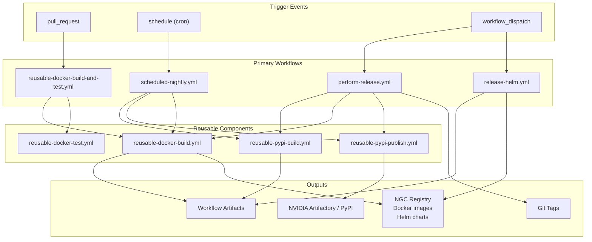
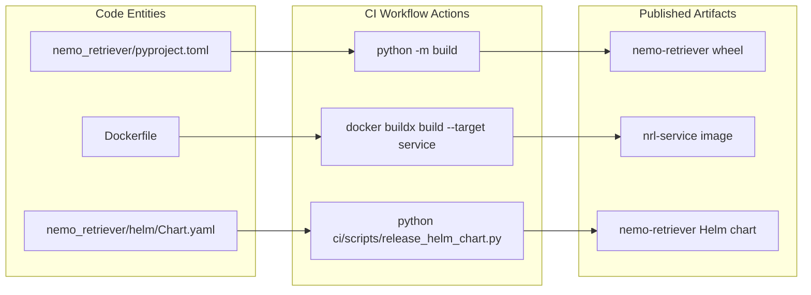

<!-- source: DeepWiki mcp.deepwiki.com · repo NVIDIA/NeMo-Retriever · page 6.4 CI/CD Workflows · fetched 2026-10-26 -->

# CI/CD Workflows

Relevant source files

The following files were used as context for generating this wiki page:

- [.github/workflows/docker-build-arm.yml](.github/workflows/docker-build-arm.yml)
- [.github/workflows/docker-nightly-publish.yml](.github/workflows/docker-nightly-publish.yml)
- [.github/workflows/docker-release-publish.yml](.github/workflows/docker-release-publish.yml)
- [.github/workflows/perform-release.yml](.github/workflows/perform-release.yml)
- [.github/workflows/pypi-nightly-publish.yml](.github/workflows/pypi-nightly-publish.yml)
- [.github/workflows/release-docker.yml](.github/workflows/release-docker.yml)
- [.github/workflows/release-helm.yml](.github/workflows/release-helm.yml)
- [.github/workflows/release-pypi.yml](.github/workflows/release-pypi.yml)
- [.github/workflows/reusable-docker-build-and-test.yml](.github/workflows/reusable-docker-build-and-test.yml)
- [.github/workflows/reusable-docker-build.yml](.github/workflows/reusable-docker-build.yml)
- [.github/workflows/reusable-docker-test.yml](.github/workflows/reusable-docker-test.yml)
- [.github/workflows/reusable-pypi-build.yml](.github/workflows/reusable-pypi-build.yml)
- [.github/workflows/reusable-pypi-publish.yml](.github/workflows/reusable-pypi-publish.yml)
- [.github/workflows/scheduled-nightly.yml](.github/workflows/scheduled-nightly.yml)
- [Dockerfile](Dockerfile)
- [ci/scripts/release_helm_chart.py](ci/scripts/release_helm_chart.py)
- [nemo_retriever/LICENSE](nemo_retriever/LICENSE)

This document describes the GitHub Actions-based continuous integration and continuous deployment (CI/CD) system for the NeMo Retriever codebase. The workflows automate testing, building, and releasing of Python packages, Docker images, and Helm charts.

For information about the Python package build system itself, see [Python Package Build System](#6.3). For details on the release process from a user perspective, see [Release Process](#6.4.2).

## Overview

The CI/CD system is organized into three primary workflow categories:

1.  **Pull Request Validation** - Validates code changes before merge.
2.  **Nightly Builds** - Automated daily builds for Docker images and PyPI wheels.
3.  **Release Workflows** - Coordinates versioned artifact publishing for production releases.

All workflows leverage reusable workflow components to minimize duplication and ensure consistency across build, test, and publish operations.

### Workflow Architecture

**Sources:** [.github/workflows/scheduled-nightly.yml:1-111](), [.github/workflows/perform-release.yml:1-111](), [.github/workflows/reusable-docker-build-and-test.yml:1-67]()

## Pull Request Validation

Pull request validation is centered around the `reusable-docker-build-and-test.yml` workflow. It ensures that every PR can build the containerized environment and pass the test suite.

For details, see [Pull Request Validation](#6.4.1).

### Validation Stages

The validation process follows these high-level steps:
1.  **Docker Build**: Builds the `service` target from the [Dockerfile:140-169]() using `buildx`.
2.  **Test Execution**: Runs `pytest` inside the built container. It supports a `test-selection` strategy of `full` or `random` (useful for slow emulated builds) [.github/workflows/reusable-docker-build-and-test.yml:44-53]().
3.  **Coverage**: Collects coverage data using `--cov=nemo_retriever` and uploads a `coverage.xml` artifact [.github/workflows/reusable-docker-build-and-test.yml:212-215]().

**Sources:** [.github/workflows/reusable-docker-build-and-test.yml:1-247](), [Dockerfile:101-169]()

## Nightly Builds

The system performs automated nightly builds to provide "bleeding edge" artifacts for developers and early testers. These are triggered by a cron schedule at 23:30 UTC [.github/workflows/scheduled-nightly.yml:5-6]().

### Nightly Artifacts
*   **Docker Images**: Multi-platform images (`linux/amd64`, `linux/arm64`) are pushed to the NGC registry with a date-based tag (e.g., `2025.04.15`) [.github/workflows/scheduled-nightly.yml:60-72]().
*   **PyPI Wheels**: Development wheels are built using `reusable-pypi-build.yml` with `release-type: 'dev'` and published to Artifactory [.github/workflows/scheduled-nightly.yml:75-95]().

**Sources:** [.github/workflows/scheduled-nightly.yml:1-111](), [.github/workflows/pypi-nightly-publish.yml:1-40]()

## Release Process

The release process is a strictly controlled manual workflow that coordinates the simultaneous publishing of all system components.

For details, see [Release Process](#6.4.2).

### Release Orchestration

The `perform-release.yml` workflow manages the release lifecycle:

1.  **Determine Version**: Resolves the release version (e.g., `25.05`) and source branch [.github/workflows/perform-release.yml:45-91]().
2.  **Build Phase**: Parallel builds of Python wheels, Docker images, and Helm charts [.github/workflows/perform-release.yml:97-224]().
3.  **Publish Phase**: Sequential publishing to NGC and PyPI. This phase only triggers if all builds in the previous phase succeed [.github/workflows/perform-release.yml:231-353]().

### System Component Mapping

**Sources:** [.github/workflows/perform-release.yml:1-224](), [.github/workflows/reusable-pypi-build.yml:80-98](), [ci/scripts/release_helm_chart.py:1-71]()

## Reusable Components

To maintain consistency, common tasks are encapsulated in reusable workflows:

*   **`reusable-pypi-build.yml`**: Handles `_build_info.py` metadata injection and standardizes the `python -m build` process [.github/workflows/reusable-pypi-build.yml:81-98]().
*   **`reusable-docker-build.yml`**: Manages `buildx` configurations, platform emulation (QEMU), and image sanitization [.github/workflows/reusable-docker-build.yml:1-160]().
*   **`reusable-pypi-publish.yml`**: Centralizes `twine` logic for uploading artifacts to private or public repositories [.github/workflows/reusable-pypi-publish.yml:69-111]().

**Sources:** [.github/workflows/reusable-pypi-build.yml:1-148](), [.github/workflows/reusable-docker-build.yml:1-228](), [.github/workflows/reusable-pypi-publish.yml:1-112]()

---

