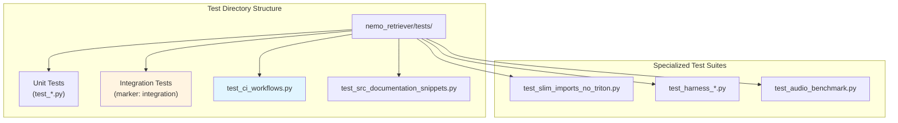
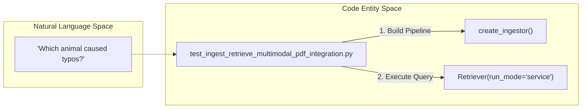

<!-- source: DeepWiki mcp.deepwiki.com · repo NVIDIA/NeMo-Retriever · page 6.5 Testing · fetched 2026-10-26 -->

# Testing

<details>
<summary>Relevant source files</summary>

The following files were used as context for generating this wiki page:

- [.github/workflows/ci-main.yml](.github/workflows/ci-main.yml)
- [.github/workflows/ci-pull-request.yml](.github/workflows/ci-pull-request.yml)
- [.github/workflows/integration-test-library-mode.yml](.github/workflows/integration-test-library-mode.yml)
- [.github/workflows/retriever-unit-tests.yml](.github/workflows/retriever-unit-tests.yml)
- [.github/workflows/reusable-pre-commit.yml](.github/workflows/reusable-pre-commit.yml)
- [examples/nemo_retriever_retriever_query_metadata_filter.ipynb](examples/nemo_retriever_retriever_query_metadata_filter.ipynb)
- [nemo_retriever/src/nemo_retriever/api/internal/transform/embed_text.py](nemo_retriever/src/nemo_retriever/api/internal/transform/embed_text.py)
- [nemo_retriever/src/nemo_retriever/chart/cpu_actor.py](nemo_retriever/src/nemo_retriever/chart/cpu_actor.py)
- [nemo_retriever/src/nemo_retriever/evaluation/README.md](nemo_retriever/src/nemo_retriever/evaluation/README.md)
- [nemo_retriever/src/nemo_retriever/nim/probe.py](nemo_retriever/src/nemo_retriever/nim/probe.py)
- [nemo_retriever/src/nemo_retriever/params/chunk_bundle.py](nemo_retriever/src/nemo_retriever/params/chunk_bundle.py)
- [nemo_retriever/src/nemo_retriever/text_embed/cpu_operator.py](nemo_retriever/src/nemo_retriever/text_embed/cpu_operator.py)
- [nemo_retriever/src/nemo_retriever/vdb/sidecar_metadata.py](nemo_retriever/src/nemo_retriever/vdb/sidecar_metadata.py)
- [nemo_retriever/tests/test_audio_benchmark.py](nemo_retriever/tests/test_audio_benchmark.py)
- [nemo_retriever/tests/test_ci_workflows.py](nemo_retriever/tests/test_ci_workflows.py)
- [nemo_retriever/tests/test_html_convert.py](nemo_retriever/tests/test_html_convert.py)
- [nemo_retriever/tests/test_ingest_retrieve_multimodal_pdf_integration.py](nemo_retriever/tests/test_ingest_retrieve_multimodal_pdf_integration.py)
- [nemo_retriever/tests/test_src_documentation_snippets.py](nemo_retriever/tests/test_src_documentation_snippets.py)
- [nemo_retriever/tests/test_txt_split.py](nemo_retriever/tests/test_txt_split.py)

</details>


This page documents the testing infrastructure for the NeMo Retriever Library (formerly NVIDIA Ingest), including test organization, execution modes, CI/CD workflows, and how to run tests locally. For information about benchmarking and performance evaluation, see [5.3 Benchmarking Harness]().

## Overview

The testing strategy employs multiple approaches to ensure code quality and system reliability:

- **Unit and Integration Tests**: Organized within the `nemo_retriever` package.
- **Docker-based Testing**: Full test suite execution inside containerized environments using the `service` target.
- **Library Mode Integration Tests**: Tests using remote NVIDIA NIMs across Windows, macOS, and Linux without requiring a local Ray cluster.
- **CI/CD Automation**: GitHub Actions workflows for pull requests, main branch, and nightly releases.
- **Workflow Validation**: A specialized `test_ci_workflows.py` validator ensures GitHub Action configurations remain consistent and secure.

## Test Organization

Tests are primarily located in the `nemo_retriever/tests` directory.



**Sources:** [nemo_retriever/tests/test_ci_workflows.py:7-11](), [nemo_retriever/tests/test_src_documentation_snippets.py:41-49](), [.github/workflows/ci-pull-request.yml:44]()

### Test Markers and Selection

Tests are categorized using `pytest` markers. The most significant marker is `integration`, which identifies tests requiring live NIM endpoints or external services.

| Marker | Purpose | Requirements |
|--------|---------|--------------|
| (default) | Unit tests, logic verification, mocked NIMs | None |
| `integration` | End-to-end flow (extract → embed → VDB) | `NVIDIA_API_KEY`, NIM Invoke URLs |

The marker filtering is controlled via the `-m` flag, e.g., `-m "not integration"` to exclude long-running or secret-dependent tests.

**Sources:** [.github/workflows/ci-pull-request.yml:97](), [.github/workflows/integration-test-library-mode.yml:72]()

## Testing Modes

### 1. Docker-based Testing (PR & Main CI)
The primary validation method builds the Docker image and runs the full test suite inside the container. This ensures that the environment matches the production runtime.

**Sources:** [.github/workflows/ci-pull-request.yml:87-100](), [.github/workflows/ci-main.yml:15-27]()

### 2. Library Mode Integration Testing
This mode validates the library's ability to run on local machines (Windows, macOS, Linux) by connecting to remote NVIDIA NIMs.



**Sources:** [nemo_retriever/tests/test_ingest_retrieve_multimodal_pdf_integration.py:64-100](), [.github/workflows/integration-test-library-mode.yml:65-75]()

### 3. Slim Import Contract
A specific test ensures that the core library can be imported without `tritonclient`. This is critical for lightweight API-only deployments where the heavy Triton dependencies are not required.

**Sources:** [.github/workflows/ci-pull-request.yml:22-44]()

## CI/CD Workflow Architecture

The testing pipeline is modularized into reusable workflows to maintain consistency between PRs and the main branch.

### Pull Request Validation
Every PR triggers a suite of checks:
1.  **Pre-commit Checks**: Linting and formatting via `reusable-pre-commit.yml`.
2.  **Slim Import Contract**: Verification of minimal dependencies.
3.  **Library Mode Install**: Installation smoke tests on Windows and macOS.
4.  **Docker Build & Test**: Comprehensive unit test suite execution on Linux (amd64).

**Sources:** [.github/workflows/ci-pull-request.yml:15-122]()

### Workflow Validator (`test_ci_workflows.py`)
To prevent configuration drift, the repository includes tests that parse the YAML workflow files. These tests verify:
- Reusable jobs are correctly linked.
- Legacy or insecure configurations (like hardcoded keys or old registry paths) are removed.
- Dev-mode Docker Compose files are properly feature-scoped.

**Sources:** [nemo_retriever/tests/test_ci_workflows.py:76-203]()

## Documentation Snippet Testing
The library includes a specialized test, `test_src_documentation_snippets.py`, which scans all Markdown files in the `src` directory and all public documentation for Python code blocks.

- **Syntax Validation**: Every ` ```python ` block is parsed using `ast.parse` to ensure it is valid Python code.
- **Contract Enforcement**: Public examples are checked to ensure they do not use unsupported constructor arguments for the `Retriever` class or invalid CLI flags.

**Sources:** [nemo_retriever/tests/test_src_documentation_snippets.py:94-182]()

## Running Tests Locally

### Unit Tests
Run standard unit tests using `uv` for dependency management:
```bash
# Install with dev extras
uv pip install -e "nemo_retriever[all,dev]"

# Run tests
export PYTHONPATH=nemo_retriever/src
python -m pytest nemo_retriever/tests -q -m "not integration"
```
**Sources:** [.github/workflows/retriever-unit-tests.yml:31-36]()

### Integration Tests
Integration tests require an `NVIDIA_API_KEY` and connection to NIMs.
```bash
# Set up environment
export NVIDIA_API_KEY="your_key"
export PAGE_ELEMENTS_INVOKE_URL="https://ai.api.nvidia.com/v1/cv/nvidia/nemotron-page-elements-v3"
# ... set other URLs ...

# Run integration suite
pytest nemo_retriever/tests/test_ingest_retrieve_multimodal_pdf_integration.py -m integration
```
**Sources:** [.github/workflows/integration-test-library-mode.yml:36-44](), [nemo_retriever/tests/test_ingest_retrieve_multimodal_pdf_integration.py:63-75]()

## Key Testing Components

| Class/File | Responsibility |
| :--- | :--- |
| `test_ci_workflows.py` | Validates GitHub Actions YAML and repository structure integrity. |
| `test_src_documentation_snippets.py` | Ensures all documentation examples are syntactically correct and up-to-date. |
| `test_ingest_retrieve_multimodal_pdf_integration.py` | Performs end-to-end multimodal ingestion and retrieval validation. |
| `test_slim_imports_no_triton.py` | Guards the "slim" dependency contract for API-only usage. |
| `reusable-docker-build-and-test.yml` | Standardized containerized test execution environment. |

**Sources:** [nemo_retriever/tests/test_ci_workflows.py:11-13](), [nemo_retriever/tests/test_src_documentation_snippets.py:5-11](), [nemo_retriever/tests/test_ingest_retrieve_multimodal_pdf_integration.py:5-6](), [.github/workflows/ci-pull-request.yml:87-89]()

---

