<!-- source: DeepWiki mcp.deepwiki.com · repo NVIDIA/NeMo-Retriever · page 7 Reference · fetched 2026-10-26 -->

# Reference

Relevant source files

The following files were used as context for generating this wiki page:

- [docs/docs/extraction/nemo-retriever-api-reference.md](docs/docs/extraction/nemo-retriever-api-reference.md)

This page provides comprehensive reference documentation for NeMo Retriever Library's data structures, task schemas, configuration options, and metadata formats. These technical specifications describe the contracts between system components and serve as the authoritative source for understanding how data flows through the ingestion pipeline.

For conceptual explanations and usage patterns, see [User Guide](#3). For deployment configuration, see [Getting Started](#2). For internal implementation details, see [Core Components](#4) and [Advanced Topics](#5).

## Overview

The NeMo Retriever Library system operates through a series of well-defined schemas that govern:

1.  **Job Specifications** - How ingestion jobs are defined and submitted.
2.  **Task Schemas** - Individual processing operations that transform document content.
3.  **Metadata Structures** - Output format for extracted content and processing annotations.
4.  **Configuration Options** - Environment variables, CLI flags, and YAML settings.
5.  **API Contracts** - Request/response formats for client-server communication.

## Data Flow and Schema Transformation

The following diagram illustrates how data transforms as it flows through the system, showing the key schema types at each stage:

### Data Transformation Flow

```mermaid
graph LR
    subgraph "Input Stage"
        Files["Document Files<br/>(PDF, DOCX, etc)"]
        JobSpec["JobSpec<br/>class in job_spec.py"]
    end
    
    subgraph "Client Layer"
        Ingestor["Ingestor API<br/>interface.py"]
        Tasks["Task Objects:<br/>ExtractTask<br/>EmbedTask<br/>SplitTask<br/>etc"]
        BatchJobSpec["BatchJobSpec<br/>groups jobs by type"]
    end
    
    subgraph "Service Layer"
        JobPayload["Job Payload JSON:<br/>job_payload<br/>tasks<br/>tracing_options"]
        TaskSchemas["Task Schemas:<br/>IngestTaskExtractSchema<br/>IngestTaskEmbedSchema<br/>etc"]
    end
    
    subgraph "Processing"
        Pipeline["Ray Pipeline<br/>Stages"]
        Annotations["Processing Annotations<br/>task_result<br/>message"]
    end
    
    subgraph "Output Stage"
        Results["Result JSON:<br/>data<br/>status<br/>description<br/>trace"]
        Metadata["Metadata Structures:<br/>content_metadata<br/>source_metadata<br/>content"]
    end
    
    Files --> JobSpec
    JobSpec --> Ingestor
    Ingestor --> Tasks
    Tasks --> BatchJobSpec
    BatchJobSpec --> JobPayload
    JobPayload --> TaskSchemas
    TaskSchemas --> Pipeline
    Pipeline --> Annotations
    Annotations --> Results
    Results --> Metadata
```

**Sources:**
- [client/src/nv_ingest_client/primitives/jobs/job_spec.py:29-116]()
- [client/src/nv_ingest_client/client/interface.py:206-262]()

## Task Type to Code Entity Mapping

NeMo Retriever Library implements a task-based architecture where each processing operation is represented by a specific task class.

### Task and Schema Mapping

```mermaid
graph TB
    subgraph "Task Classes in primitives/tasks/"
        ExtractTask["ExtractTask<br/>extract.py"]
        TableExtract["TableExtractionTask<br/>table_extraction.py"]
        ChartExtract["ChartExtractionTask<br/>chart_extraction.py"]
        InfographicExtract["InfographicExtractionTask<br/>infographic_extraction.py"]
        OCRExtract["OCRExtractionTask<br/>ocr_extraction.py"]
        AudioExtract["AudioExtractionTask<br/>audio_extraction.py"]
        EmbedTask["EmbedTask<br/>embed.py"]
        SplitTask["SplitTask<br/>split.py"]
        DedupTask["DedupTask<br/>dedup.py"]
        FilterTask["FilterTask<br/>filter.py"]
        CaptionTask["CaptionTask<br/>caption.py"]
        StoreTask["StoreTask<br/>store.py"]
        StoreEmbedTask["StoreEmbedTask<br/>store_embed.py"]
    end
    
    subgraph "Schema Definitions in api/schemas/"
        ExtractSchema["IngestTaskExtractSchema<br/>ingest_job_schema.py"]
        EmbedSchema["IngestTaskEmbedSchema<br/>ingest_job_schema.py"]
        SplitSchema["IngestTaskSplitSchema<br/>ingest_job_schema.py"]
        DedupSchema["IngestTaskDedupSchema<br/>ingest_job_schema.py"]
        FilterSchema["IngestTaskFilterSchema<br/>ingest_job_schema.py"]
        CaptionSchema["IngestTaskCaptionSchema<br/>ingest_job_schema.py"]
        StoreSchema["IngestTaskStoreSchema<br/>ingest_job_schema.py"]
        StoreEmbedSchema["IngestTaskStoreEmbedSchema<br/>ingest_job_schema.py"]
    end
    
    subgraph "Ingestor Fluent API Methods"
        extract_method[".extract()"]
        embed_method[".embed()"]
        split_method[".split()"]
        dedup_method[".dedup()"]
        filter_method[".filter()"]
        caption_method[".caption()"]
        store_method[".store()"]
        store_embed_method[".store_embed()"]
    end
    
    extract_method --> ExtractTask
    extract_method --> TableExtract
    extract_method --> ChartExtract
    extract_method --> InfographicExtract
    extract_method --> OCRExtract
    extract_method --> AudioExtract
    
    embed_method --> EmbedTask
    split_method --> SplitTask
    dedup_method --> DedupTask
    filter_method --> FilterTask
    caption_method --> CaptionTask
    store_method --> StoreTask
    store_embed_method --> StoreEmbedTask
    
    ExtractTask --> ExtractSchema
    EmbedTask --> EmbedSchema
    SplitTask --> SplitSchema
    DedupTask --> DedupSchema
    FilterTask --> FilterSchema
    CaptionTask --> CaptionSchema
    StoreTask --> StoreSchema
    StoreEmbedTask --> StoreEmbedSchema
```

**Sources:**
- [client/src/nv_ingest_client/client/interface.py:833-1108]()

## Detailed References

The following child pages provide exhaustive technical details for each category:

### [Configuration Reference](#7.1)
Complete reference for all configuration options across YAML files (`retriever-service.yaml`, `ingest-config.yaml`), environment variables, and CLI flags. This section covers `ServiceConfig`, logging levels, and resource limits.

### [Task Schema Reference](#7.2)
Documentation for all task and parameter types including `ExtractParams`, `EmbedParams`, `VdbUploadParams`, `CaptionParams`, `ASRParams`, and `BatchTuningParams`. Includes field types and default values.
*Note: Large PDFs are split into page batches before Ray processing. For tuning, use `--pdf-split-batch-size` via CLI or `pdf_split_config` in service mode.* [docs/docs/extraction/nemo-retriever-api-reference.md:3-9]()

### [Metadata Structure Reference](#7.3)
Details the metadata hierarchy for extracted content, including `content_metadata` (page numbers, bounding boxes) and `source_metadata` (filenames, source IDs). Covers the Vector Database (VDB) record schema and how `sidecar_metadata` is merged.

### [Environment Variables](#7.4)
A complete list of environment variables used across the system, such as `NVIDIA_API_KEY`, `NGC_API_KEY`, `HF_ACCESS_TOKEN`, `INGEST_LOG_LEVEL`, and `RETRIEVER_ENABLE_TORCH_TRT`.

### [Troubleshooting Guide](#7.5)
Common issues and solutions, including `GraphIngestionError` status codes, preventing Out-of-Memory (OOM) errors with `save_to_disk`, and managing NIM connectivity issues.

### [API Endpoints Reference](#7.6)
Documentation for REST API endpoints (`/v1/ingest`, `/v1/query`, `/metrics`), gRPC interfaces, and the `PipelineSpec` message format.

**Sources:**
- [docs/docs/extraction/nemo-retriever-api-reference.md:1-19]()

---

