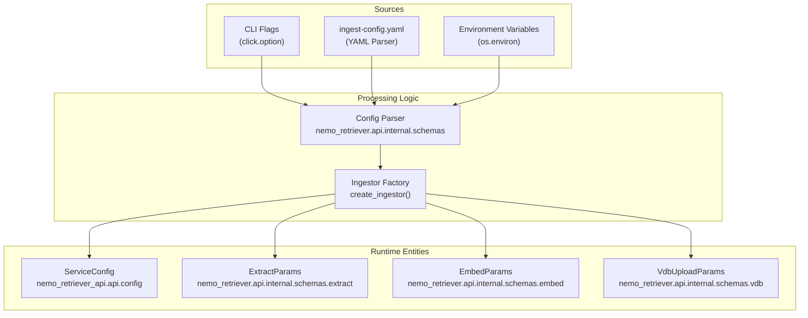
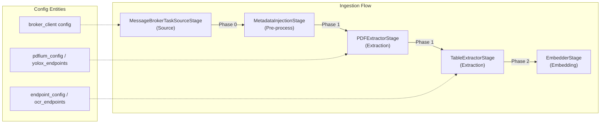

<!-- source: DeepWiki mcp.deepwiki.com · repo NVIDIA/NeMo-Retriever · page 7.1 Configuration Reference · fetched 2026-10-26 -->

# Configuration Reference

Relevant source files

The following files were used as context for generating this wiki page:

- [config/default_pipeline.yaml](config/default_pipeline.yaml)
- [docs/docs/extraction/environment-config.md](docs/docs/extraction/environment-config.md)
- [nemo_retriever/src/nemo_retriever/ingest-config.yaml](nemo_retriever/src/nemo_retriever/ingest-config.yaml)

This page provides a complete reference for all configuration options available in NeMo Retriever Library. It covers YAML configuration files (`ingest-config.yaml`, `retriever-service.yaml`), environment variables, and CLI flags.

---

## Configuration Architecture

NeMo Retriever Library uses a hierarchical configuration system where CLI flags override YAML values, which in turn override environment variable defaults.

**Configuration Flow and Code Entity Mapping**

Sources: [nemo_retriever/src/nemo_retriever/ingest-config.yaml:10-17](), [nemo_retriever/src/nemo_retriever/api/internal/schemas/extract/extract_table_schema.py:119-120]()

---

## Ingest Configuration (`ingest-config.yaml`)

The `ingest-config.yaml` file is the primary configuration source for extraction, embedding, and table processing stages. It is discovered in the following order of precedence:
1. Explicitly passed via `--config`
2. Local directory `./ingest-config.yaml`
3. Home directory `$HOME/.ingest-config.yaml`

### PDF and Page Element Configuration

Controls how PDFs are parsed and which elements (text, tables, charts) are extracted.

| Field | Type | Default | Description |
|-------|------|---------|-------------|
| `pdf.method` | string | `pdfium` | Extraction method: `pdfium`, `pdfium_hybrid`, `ocr`, `nemotron_parse`, `tika`, `unstructured_io`, `adobe`, `llama`. |
| `pdf.render_mode` | string | `fit_to_model` | `full_dpi` (renders at 300 DPI) or `fit_to_model` (renders at 1024x1024 to match NIM). |
| `pdf.extract.text` | bool | `true` | Enable/disable text extraction. |
| `pdf.extract.tables` | bool | `true` | Enable/disable table extraction. |
| `pdf.extract.charts` | bool | `true` | Enable/disable chart extraction. |

Sources: [nemo_retriever/src/nemo_retriever/ingest-config.yaml:19-60]()

### Audio and ASR Configuration

Configures the `audio_asr` and `audio_chunk` stages for multimedia processing.

| Field | Type | Default | Description |
|-------|------|---------|-------------|
| `audio_asr.audio_endpoints` | list | `[null, null]` | List of `[grpc_endpoint, http_endpoint]`. If null, local HF model `nvidia/parakeet-ctc-1.1b` is used. |
| `audio_asr.segment_audio` | bool | `false` | Whether to segment audio before transcription. |
| `audio_chunk.split_interval` | int | `450` | Interval in seconds for audio chunking. |

Sources: [nemo_retriever/src/nemo_retriever/ingest-config.yaml:95-112]()

---

## Environment Variables Reference

Environment variables provide the baseline configuration for authentication, service discovery, and logging.

### General System Variables

| Name | Example | Description |
|------|---------|-------------|
| `HF_ACCESS_TOKEN` | `hf_***` | Token for Hugging Face Hub downloads (e.g., Llama 3.2 tokenizers). |
| `INGEST_LOG_LEVEL` | `INFO` | Verbosity: `DEBUG`, `INFO`, `WARNING`, `ERROR`, `CRITICAL`. |
| `NVIDIA_API_KEY` | `nvapi-***` | API key for NVIDIA-hosted NIMs on build.nvidia.com. |
| `NGC_API_KEY` | `nvapi-***` | Key for NIM microservices to access NGC resources. |
| `OTEL_EXPORTER_OTLP_ENDPOINT` | `http://otel-collector:4317` | Endpoint for sending OpenTelemetry data. |

Sources: [docs/docs/extraction/environment-config.md:7-15]()

### Pipeline & Service Discovery

These variables are frequently used in `default_pipeline.yaml` to dynamically resolve NIM endpoints.

| Name | Default | Description |
|------|---------|-------------|
| `MESSAGE_CLIENT_TYPE` | `redis` | Type of broker (`redis` or `simple`). |
| `YOLOX_GRPC_ENDPOINT` | `page-elements:8001` | gRPC endpoint for page-element detection. |
| `OCR_GRPC_ENDPOINT` | `ocr:8001` | gRPC endpoint for Nemotron OCR. |
| `NEMOTRON_PARSE_HTTP_ENDPOINT` | `http://nemotron-parse:8000/v1/chat/completions` | HTTP endpoint for Nemotron Parse. |

Sources: [config/default_pipeline.yaml:14-16](), [config/default_pipeline.yaml:53-56](), [config/default_pipeline.yaml:60-63]()

---

## Service & Pipeline Configuration (`default_pipeline.yaml`)

The `default_pipeline.yaml` defines the execution graph for the `nv-ingest` service mode. It maps high-level stages to specific Python actors.

**Service Pipeline Execution Graph**

Sources: [config/default_pipeline.yaml:8-12](), [config/default_pipeline.yaml:29-33](), [config/default_pipeline.yaml:46-50](), [config/default_pipeline.yaml:201-205]()

### Resource & Replica Limits

Each stage in the YAML configuration can define its own scaling strategy.

| Stage Field | Strategy | Description |
|-------------|----------|-------------|
| `replicas.min_replicas` | Integer | Minimum worker actors to maintain. |
| `replicas.max_replicas.strategy` | `memory_thresholding` | Scales based on available system memory. |
| `replicas.static_replicas.strategy` | `static` | Fixed number of worker actors. |

Sources: [config/default_pipeline.yaml:71-80](), [config/default_pipeline.yaml:192-200]()

---

## Component-Specific Configuration

### Table Extraction Settings

Table extraction is complex and requires multiple NIM endpoints (YOLOX table-structure and OCR).

| YAML Key (`table:`) | Default | Description |
|---------------------|---------|-------------|
| `max_queue_size` | `1` | Max tasks in the worker queue. |
| `n_workers` | `2` | Number of concurrent extraction workers. |
| `endpoint_config.nim_batch_size` | `2` | Batch size for NIM inference requests. |
| `endpoint_config.yolox_endpoints` | `null` | List of `[grpc, http]` for table-structure. |

Sources: [nemo_retriever/src/nemo_retriever/ingest-config.yaml:126-152]()

### Text & HTML Chunking

Configures how raw text and HTML files are split into chunks for embedding.

| YAML Key (`txt:` / `html:`) | Default | Description |
|-----------------------------|---------|-------------|
| `max_tokens` | `512` | Maximum tokens per chunk. |
| `overlap_tokens` | `0` | Number of overlapping tokens between chunks. |
| `tokenizer_model_id` | `nvidia/llama-nemotron-embed-1b-v2` | Model ID for token counting. |
| `encoding` | `utf-8` | File encoding. |

Sources: [nemo_retriever/src/nemo_retriever/ingest-config.yaml:70-81]()

---

## Implementation Details: Configuration Loading

The system uses a unified loader to merge these disparate sources.

1. **Environment Variable Expansion**: The `default_pipeline.yaml` supports environment variable expansion using the `$VAR|default` syntax (e.g., `$YOLOX_GRPC_ENDPOINT|"page-elements:8001"`). [config/default_pipeline.yaml:54-55]()
2. **Schema Validation**: YAML configurations are parsed into Pydantic-like schemas such as `TableExtractorSchema`. [nemo_retriever/src/nemo_retriever/ingest-config.yaml:119-120]()
3. **CLI Overrides**: The `retriever` CLI tool parses command-line flags which take precedence over all other sources. [nemo_retriever/src/nemo_retriever/ingest-config.yaml:16]()

Sources: [config/default_pipeline.yaml:52-57](), [nemo_retriever/src/nemo_retriever/ingest-config.yaml:10-17]()

---

