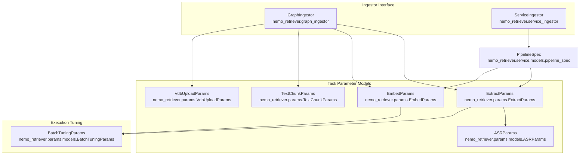
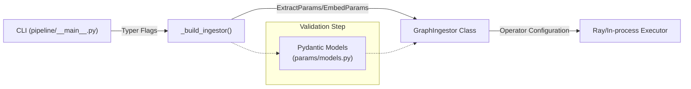

<!-- source: DeepWiki mcp.deepwiki.com · repo NVIDIA/NeMo-Retriever · page 7.2 Task Schema Reference · fetched 2026-10-26 -->

# Task Schema Reference

Relevant source files

The following files were used as context for generating this wiki page:

- [nemo_retriever/src/nemo_retriever/params/models.py](nemo_retriever/src/nemo_retriever/params/models.py)
- [nemo_retriever/src/nemo_retriever/pipeline/__main__.py](nemo_retriever/src/nemo_retriever/pipeline/__main__.py)
- [nemo_retriever/tests/test_graph_pipeline_cli.py](nemo_retriever/tests/test_graph_pipeline_cli.py)
- [nemo_retriever/tests/test_params_models.py](nemo_retriever/tests/test_params_models.py)
- [nemo_retriever/tests/test_pipeline_helpers.py](nemo_retriever/tests/test_pipeline_helpers.py)

This page provides a comprehensive technical reference for the task and parameter schemas used in the NeMo Retriever Library. These schemas define the structure, types, and default values for document processing operations such as extraction, embedding, chunking, and vector database synchronization.

## Overview

The NeMo Retriever Library uses Pydantic models to define and validate processing parameters. These models ensure type safety across different execution modes (In-process, Batch, and Service).

**Key Architectural Features:**
- **Automatic API Key Resolution**: All parameter models inheriting from `_ParamsModel` automatically resolve `api_key` fields from `NVIDIA_API_KEY` or `NGC_API_KEY` environment variables [nemo_retriever/src/nemo_retriever/params/models.py:53-62]().
- **Credential Redaction**: Sensitive fields (API keys, storage secrets) are automatically redacted in `repr()` and `__str__` outputs to prevent leaking credentials in logs [nemo_retriever/src/nemo_retriever/params/models.py:64-74]().
- **Validation Constraints**: Models include field-level validators (e.g., ensuring video FPS is non-zero) and model-level cross-field validation [nemo_retriever/tests/test_params_models.py:13-18]().

## Parameter Entity Relationship

The following diagram illustrates how the core parameter classes relate to the high-level `GraphIngestor` and the `PipelineSpec` used in service deployments.

**Sources:** [nemo_retriever/src/nemo_retriever/params/models.py:35-115](), [nemo_retriever/src/nemo_retriever/pipeline/__main__.py:62-75](), [nemo_retriever/tests/test_pipeline_helpers.py:101-135]()

## Core Task Parameters

### ExtractParams
Configures the document extraction stage, supporting various formats (PDF, HTML, Docx, Audio, Video).

| Field | Type | Default | Description |
| :--- | :--- | :--- | :--- |
| `method` | `str` | `"pdfium"` | Extraction method (e.g., `ocr`, `nemotron_parse`, `pdfium_hybrid`). |
| `extract_text` | `bool` | `True` | Whether to extract plain text. |
| `extract_images` | `bool` | `False` | Whether to extract embedded images. |
| `extract_tables` | `bool` | `False` | Whether to extract tables using structure NIMs. |
| `extract_charts` | `bool` | `False` | Whether to extract charts/graphics. |
| `extract_page_as_image` | `bool` | `False` | Capture the entire page as an image. |
| `api_key` | `Optional[str]` | `None` | API key for remote extraction NIMs. |
| `batch_tuning` | `BatchTuningParams` | `Default` | Resource allocation for Ray actors. |

**Sources:** [nemo_retriever/src/nemo_retriever/pipeline/__main__.py:186](), [nemo_retriever/tests/test_pipeline_helpers.py:106]()

### EmbedParams
Configures the embedding generation stage, supporting multimodal (text/image) inputs.

| Field | Type | Default | Description |
| :--- | :--- | :--- | :--- |
| `model_name` | `Optional[str]` | `None` | Name of the embedding model (e.g., `nvidia/llama-nemotron-embed-1b-v2`). |
| `embed_modality` | `Literal["text", "image", "text_image"]` | `"text"` | Modality of content to embed. |
| `embed_granularity` | `Literal["element", "page"]` | `"element"` | Whether to embed individual chunks or full pages. |
| `invoke_url` | `Optional[str]` | `None` | Endpoint URL for the embedding NIM. |
| `api_key` | `Optional[str]` | `None` | API key for the embedding service. |

**Sources:** [nemo_retriever/src/nemo_retriever/pipeline/__main__.py:67](), [nemo_retriever/tests/test_pipeline_helpers.py:107](), [nemo_retriever/tests/test_graph_pipeline_cli.py:178-179]()

### VdbUploadParams
Controls the synchronization of processed records with a vector database.

| Field | Type | Default | Description |
| :--- | :--- | :--- | :--- |
| `vdb_op` | `str` | `"lancedb"` | The VDB operator key (e.g., `lancedb`, `milvus`). |
| `vdb_kwargs` | `dict` | `{}` | Backend-specific arguments (e.g., `uri`, `table_name`). |
| `vdb_overwrite` | `bool` | `True` | Whether to overwrite existing data in the collection. |

**Sources:** [nemo_retriever/src/nemo_retriever/pipeline/__main__.py:71](), [nemo_retriever/tests/test_graph_pipeline_cli.py:199]()

## Specialized Task Parameters

### ASRParams
Used for Audio-to-Text extraction via RIVA or local Parakeet models.

| Field | Type | Default | Description |
| :--- | :--- | :--- | :--- |
| `audio_infer_protocol` | `str` | `"grpc"` | Protocol for ASR inference. |
| `audio_infer_mode` | `str` | `"auto"` | Online (streaming) vs Offline (batch) mode. |
| `segment_audio` | `bool` | `False` | Whether to segment audio files before processing. |

**Sources:** [nemo_retriever/src/nemo_retriever/params/models.py:173-191]()

### BatchTuningParams
Defines resource constraints and parallelism for Ray-based execution.

| Field | Type | Default | Description |
| :--- | :--- | :--- | :--- |
| `ocr_workers` | `Optional[int]` | `None` | Number of Ray actors for OCR. |
| `ocr_gpus` | `float` | `0.0` | GPU fraction per OCR actor. |
| `embed_workers` | `Optional[int]` | `None` | Number of Ray actors for embedding. |
| `embed_batch_size` | `int` | `1` | Batch size for embedding requests. |

**Sources:** [nemo_retriever/src/nemo_retriever/params/models.py:214-250](), [nemo_retriever/src/nemo_retriever/pipeline/__main__.py:75]()

## Data Flow and Schema Transformation

The following diagram traces how parameters are passed from the CLI through to the internal Ingestor logic and finally to the execution environment.

**Sources:** [nemo_retriever/src/nemo_retriever/pipeline/__main__.py:101-169](), [nemo_retriever/tests/test_pipeline_helpers.py:101-135]()

## Service Mode Schema Restrictions

When running in `--run-mode service`, certain parameters are restricted because the server (Retriever Service) manages its own model endpoints and resource allocations. The following parameters are ignored or overridden by the service's `retriever-service.yaml`:

- **NIM URLs**: `--page-elements-invoke-url`, `--ocr-invoke-url`, `--table-structure-invoke-url`.
- **Resource Tuning**: `--ocr-actors`, `--embed-gpus-per-actor`, `--ray-address`.
- **Local Paths**: `--meta-dataframe` (must be uploaded via the `/v1/ingest/sidecar` endpoint).

**Sources:** [nemo_retriever/src/nemo_retriever/pipeline/__main__.py:112-169]()

---

