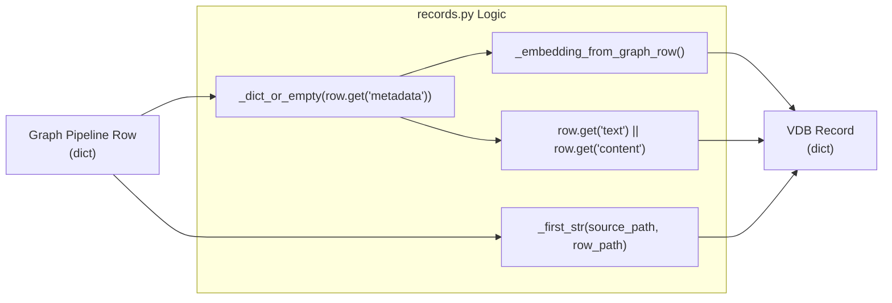

<!-- source: DeepWiki mcp.deepwiki.com · repo NVIDIA/NeMo-Retriever · page 7.3 Metadata Structure Reference · fetched 2026-10-26 -->

# Metadata Structure Reference

Relevant source files

The following files were used as context for generating this wiki page:

- [docs/docs/extraction/content-metadata.md](docs/docs/extraction/content-metadata.md)
- [nemo_retriever/src/nemo_retriever/vdb/records.py](nemo_retriever/src/nemo_retriever/vdb/records.py)

This document provides a comprehensive reference for the metadata hierarchy produced by NeMo Retriever during document ingestion. It describes the structure of metadata attached to each extracted element (text, tables, charts, images, audio) and explains how this metadata is organized, populated, and used in vector database storage and retrieval.

## Overview

Every element extracted from a document in NeMo Retriever carries a rich metadata hierarchy. Metadata can be extracted from a source, generated by models (like VLMs for captions), or provided as sidecar data.

The system distinguishes between two primary entities:
- **Source**: The file being ingested (e.g., PDF, DOCX).
- **Content**: Data extracted from a source, such as a specific paragraph of text or a cropped image of a table.

**Sources:**
- [docs/docs/extraction/content-metadata.md:1-9]()

## Metadata Hierarchy and Schemas

At the implementation level, metadata is structured via the `MetadataSchema`. This schema acts as the primary container for all extracted information, embeddings, and specialized metadata blocks.

### Top-Level Metadata Structure

The following diagram shows the mandatory fields and the relationship between the core `MetadataSchema` and specialized sub-schemas:

```mermaid
graph TB
    MetadataSchema["MetadataSchema"]
    
    MetadataSchema --> Content["content<br/>(Raw Text/Data)"]
    MetadataSchema --> ContentURL["content_url"]
    MetadataSchema --> Embedding["embedding<br/>(Optional[List[float]])"]
    
    MetadataSchema --> SourceMeta["source_metadata<br/>(SourceMetadataSchema)"]
    MetadataSchema --> ContentMeta["content_metadata<br/>(ContentMetadataSchema)"]
    
    MetadataSchema --> AudioMeta["audio_metadata<br/>(AudioMetadataSchema)"]
    MetadataSchema --> TextMeta["text_metadata<br/>(TextMetadataSchema)"]
    MetadataSchema --> ImageMeta["image_metadata<br/>(ImageMetadataSchema)"]
    MetadataSchema --> TableMeta["table_metadata<br/>(TableMetadataSchema)"]
    MetadataSchema --> ChartMeta["chart_metadata<br/>(ChartMetadataSchema)"]

    subgraph "Conditional Visibility"
        AudioMeta
        TextMeta
        ImageMeta
        TableMeta
        ChartMeta
    end
```

| Field | Type | Description |
|-------|------|-------------|
| `content` | `str` | The actual textual content extracted from the source. |
| `content_url` | `str` | URL pointing to the location of the content (e.g., MinIO/S3). |
| `embedding` | `Optional[List[float]]` | Numerical vector representation of the content. |
| `source_metadata` | `SourceMetadataSchema` | Metadata about the original source file. |
| `content_metadata` | `ContentMetadataSchema` | General metadata about the extracted content. |

**Sources:**
- [docs/docs/extraction/content-metadata.md:96-111]()

---

### Source File Metadata (`source_metadata`)

Describes the origin of the content.

| Field | Description | Method |
|-------|-------------|--------|
| `source_name` | Name of the source file. | Extracted |
| `source_id` | ID of the source file (often the path). | Extracted |
| `source_location` | URL or URI to the storage location. | Provided |
| `source_type` | File type (pdf, docx, pptx, etc.). | Extracted |
| `collection_id` | ID of the collection containing the source. | Provided |
| `date_created` | Date the source was created. | Extracted |
| `last_modified` | Date the source was last modified. | Extracted |
| `partition_id` | Offset within a larger set of fragments. | Generated |

**Sources:**
- [docs/docs/extraction/content-metadata.md:11-27]()
- [docs/docs/extraction/content-metadata.md:126-140]()

---

### Content Metadata (`content_metadata`)

Applies to all content types (text, images, tables, etc.) and tracks location and hierarchy.

| Field | Description | Method |
|-------|-------------|--------|
| `type` | `TEXT`, `IMAGE`, `STRUCTURED`, `TABLE`, `CHART`, or `AUDIO`. | Generated |
| `subtype` | Specific type for structured data (e.g., bar chart). | Generated |
| `page_number` | Page index in the source (1-indexed since 26.1.2). | Extracted |
| `location` | Bounding box of the content. | Extracted |
| `hierarchy` | Location or order of content within the source. | Extracted |

**Sources:**
- [docs/docs/extraction/content-metadata.md:29-42]()
- [docs/docs/extraction/content-metadata.md:142-155]()

---

## Type-Specific Metadata

Depending on the `content_metadata.type`, one of the following specialized blocks will be populated.

### Text Metadata
Used when type is `TEXT`. Includes `text_type` (header, body), `keywords`, and `language`.

### Image Metadata
Used when type is `IMAGE`. Includes `image_type` (natural, structured), `caption` (VLM generated), and `image_location`.

### Table Metadata
Used when type is `STRUCTURED` (and subtype is `table`). Includes `table_format` (markdown, html, latex), `table_content`, and `caption`. **Note:** Tables should not be chunked.

**Sources:**
- [docs/docs/extraction/content-metadata.md:44-90]()
- [docs/docs/extraction/content-metadata.md:157-200]()

---

## Vector Database Record Adaptation

When content is prepared for storage in a Vector Database (VDB), the internal `MetadataSchema` is adapted into a record format. This is handled primarily by `nemo_retriever/vdb/records.py`.

### Data Flow: Graph Row to VDB Record

The function `_client_record_from_graph_row` maps the internal processing format to the schema expected by the VDB clients.

**Key Transformation Logic:**
1. **Embedding Extraction**: The system checks `metadata["embedding"]` first. If missing, it looks for the payload in `row["text_embeddings_1b_v2"]`.
2. **Text Normalization**: Content is prioritized from `row["text"]`, then `row["content"]`, then `metadata["content"]`.
3. **Metadata Merging**: `content_metadata` is updated with positional data like `bbox_xyxy_norm` and `stored_image_uri` if present in the graph row.
4. **Source Identification**: `source_id` is derived using a priority list: `metadata["source_path"]` -> `row["path"]` -> `row["source_id"]`.

**Sources:**
- [nemo_retriever/src/nemo_retriever/vdb/records.py:42-46]()
- [nemo_retriever/src/nemo_retriever/vdb/records.py:69-118]()

---

## Retrieval Hit Structure

When querying the system via `Retriever.query`, the results are returned as `RetrievalHit` objects. This structure ensures that metadata is always returned as a native Python dictionary, even if stored as a JSON string in the database.

### RetrievalHit Fields

| Field | Type | Description |
|-------|------|-------------|
| `text` | `str` | The retrieved text content. |
| `metadata` | `dict` | Flattened metadata dictionary. |
| `source_id` | `str` | Unique identifier for the source document. |
| `page_number` | `int \| None` | Page where the hit was found. |
| `bbox_xyxy_norm` | `list[float]` | Normalized bounding box coordinates. |
| `_score` | `float` | Retrieval similarity score. |

**Sources:**
- [nemo_retriever/src/nemo_retriever/vdb/records.py:15-40]()
- [nemo_retriever/src/nemo_retriever/vdb/records.py:155-184]()

## Metadata Merging (Sidecar Data)

NeMo Retriever supports merging external metadata (sidecar metadata) during the ingestion process. This is often used to attach business-specific tags or ACLs to documents.

1. **Input**: A sidecar file (JSON/CSV) or a `meta_dataframe`.
2. **Join**: The `meta_join_key` (usually `source_id` or `filename`) is used to align external rows with extracted content.
3. **Merging**: The `to_client_vdb_records` function ensures that these additional fields are preserved in the `record_metadata` dictionary before final upload to the VDB.

**Sources:**
- [nemo_retriever/src/nemo_retriever/vdb/records.py:112-118]()
- [nemo_retriever/src/nemo_retriever/vdb/records.py:121-140]()

---

