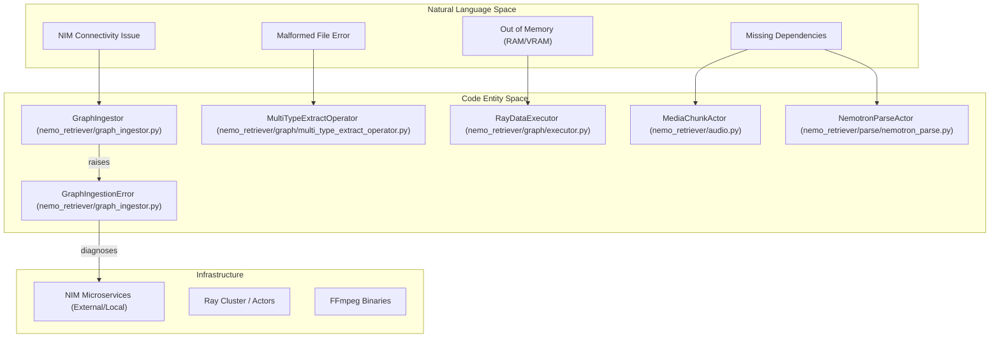

<!-- source: DeepWiki mcp.deepwiki.com · repo NVIDIA/NeMo-Retriever · page 7.5 Troubleshooting Guide · fetched 2026-10-26 -->

# Troubleshooting Guide

<details>
<summary>Relevant source files</summary>

The following files were used as context for generating this wiki page:

- [docs/docs/extraction/deployment-options.md](docs/docs/extraction/deployment-options.md)
- [docs/docs/extraction/faq.md](docs/docs/extraction/faq.md)
- [docs/docs/extraction/multimodal-extraction.md](docs/docs/extraction/multimodal-extraction.md)
- [docs/docs/extraction/prerequisites-support-matrix.md](docs/docs/extraction/prerequisites-support-matrix.md)
- [docs/docs/extraction/troubleshoot.md](docs/docs/extraction/troubleshoot.md)
- [nemo_retriever/docs/cli/benchmarking.md](nemo_retriever/docs/cli/benchmarking.md)
- [nemo_retriever/helm/README.md](nemo_retriever/helm/README.md)
- [nemo_retriever/src/nemo_retriever/graph/executor.py](nemo_retriever/src/nemo_retriever/graph/executor.py)
- [nemo_retriever/src/nemo_retriever/graph/ingestor_runtime.py](nemo_retriever/src/nemo_retriever/graph/ingestor_runtime.py)
- [nemo_retriever/src/nemo_retriever/graph/multi_type_extract_operator.py](nemo_retriever/src/nemo_retriever/graph/multi_type_extract_operator.py)
- [nemo_retriever/src/nemo_retriever/graph_ingestor.py](nemo_retriever/src/nemo_retriever/graph_ingestor.py)
- [nemo_retriever/src/nemo_retriever/utils/input_files.py](nemo_retriever/src/nemo_retriever/utils/input_files.py)
- [nemo_retriever/tests/test_ingest_interface.py](nemo_retriever/tests/test_ingest_interface.py)
- [nemo_retriever/tests/test_ingest_plans.py](nemo_retriever/tests/test_ingest_plans.py)
- [nemo_retriever/tests/test_pipeline_graph.py](nemo_retriever/tests/test_pipeline_graph.py)

</details>


This guide provides solutions to common issues encountered when deploying, configuring, and operating the NeMo Retriever Library. It covers deployment failures, runtime errors, performance bottlenecks, and debugging techniques for both library and service modes.

## System Failure Points and Data Flow

The following diagram maps high-level failure types to the specific code entities and infrastructure components involved in the ingestion process.

### Ingestion Error Flow Diagram

**Sources:** [nemo_retriever/src/nemo_retriever/graph_ingestor.py:114-137](), [nemo_retriever/src/nemo_retriever/graph/multi_type_extract_operator.py:149-166](), [nemo_retriever/src/nemo_retriever/graph/executor.py:161-175]()

---

## Connectivity and Inference Errors

When using remote NIM endpoints, the system may encounter row-level connection or inference errors. By default, the `GraphIngestor` raises a `GraphIngestionError` to make these failures visible to the caller.

### GraphIngestionError Handling
The `GraphIngestionError` includes a `stage_diagnostics` mapping that attributes errors to specific NIM URLs and HTTP status codes [nemo_retriever/src/nemo_retriever/graph_ingestor.py:114-137]().

| HTTP Status | Interpretation | Recommended Action |
| :--- | :--- | :--- |
| **401/403** | Unauthorized / Forbidden | Verify `NVIDIA_API_KEY` or `NGC_API_KEY` [docs/docs/extraction/faq.md:36-53](). |
| **404** | Not Found | Check if the `invoke_url` for the stage (e.g., `ocr_invoke_url`) is correct [nemo_retriever/src/nemo_retriever/graph_ingestor.py:107-112](). |
| **429** | Too Many Requests | Rate limit exceeded. The system performs automatic retries based on `ExtractParams.remote_retry` settings [nemo_retriever/src/nemo_retriever/graph/ingestor_runtime.py:63-72](). |
| **500/503** | NIM Server Error | Check the logs of the specific NIM container (e.g., `nemotron-ocr-v1`) [nemo_retriever/helm/README.md:130-136](). |

**Solution:** To prevent the pipeline from halting on partial failures, pass `error_policy="collect"` to `create_ingestor` or `GraphIngestor`. This returns the error payloads within the result DataFrame instead of raising an exception [docs/docs/extraction/faq.md:53]().

**Sources:** [nemo_retriever/src/nemo_retriever/graph_ingestor.py:95-137](), [docs/docs/extraction/faq.md:49-53](), [nemo_retriever/src/nemo_retriever/graph/ingestor_runtime.py:63-72]()

---

## Resource and Memory Issues

### Out-of-Memory (OOM) on Large Datasets
Processing thousands of documents can exhaust system RAM because results are stored in memory by default [docs/docs/extraction/troubleshoot.md:77-81]().

**Solution:**
Use the `.save_to_disk()` method in the fluent API to write results incrementally to storage [docs/docs/extraction/troubleshoot.md:83-85]().
```python
ingestor = (
    create_ingestor(run_mode="batch")
    .files(["/data/*.pdf"])
    .extract()
    .save_to_disk("./output_dir") # Prevents RAM exhaustion
    .ingest()
)
```

### GPU Memory Contention
The `RayDataExecutor` uses heuristics to allocate GPU fractions to actors. If a local model fails to load, verify the `num_gpus` allocation in `node_overrides` [nemo_retriever/src/nemo_retriever/graph/executor.py:186-194]().

**Solution:** Adjust `BatchTuningParams` (e.g., `gpu_ocr`, `gpu_embed`) to fine-tune the GPU fraction per actor [nemo_retriever/src/nemo_retriever/graph/ingestor_runtime.py:75-107]().

**Sources:** [docs/docs/extraction/troubleshoot.md:77-85](), [nemo_retriever/src/nemo_retriever/graph/executor.py:186-194](), [nemo_retriever/src/nemo_retriever/graph/ingestor_runtime.py:75-107]()

---

## Dependency and Environment Issues

### Missing FFmpeg in Air-Gapped Environments
Audio and video extraction require `ffmpeg` and `ffprobe` binaries on the system `PATH` [docs/docs/extraction/prerequisites-support-matrix.md:11-13]().

**Symptom:** `RuntimeError: MediaChunkActor requires media dependencies; missing: ffmpeg, ffprobe` [nemo_retriever/helm/README.md:133-134]().

**Solutions:**
1. **Standard Deployment:** Set `service.installFfmpeg=true` in Helm or use `-e INSTALL_FFMPEG=true` with Docker [nemo_retriever/helm/README.md:109-114]().
2. **Air-Gapped:** You cannot use `installFfmpeg=true` because it requires internet access to Ubuntu repos [nemo_retriever/helm/README.md:138-143](). You must build a custom image:
```dockerfile
FROM nvcr.io/nim/nvidia/nemo-retriever-service:latest
USER root
RUN apt-get update && apt-get install -y --no-install-recommends ffmpeg
USER nemo
```

### Nemotron Parse Dependencies
Using `extract_method="nemotron_parse"` requires the `open_clip` module, which is not in the base install [docs/docs/extraction/troubleshoot.md:103-112]().

**Solution:** Install the extra: `pip install "nemo-retriever[nemotron-parse]"` [docs/docs/extraction/troubleshoot.md:115-117]().

**Sources:** [docs/docs/extraction/prerequisites-support-matrix.md:11-20](), [nemo_retriever/helm/README.md:120-143](), [docs/docs/extraction/troubleshoot.md:103-117]()

---

## OS Level Limits

### Process and File Descriptor Limits
High-parallelism workloads on large Ray clusters can hit OS limits [docs/docs/extraction/troubleshoot.md:61-64]().

| Error Message | Limit to Adjust | Recommended Value |
| :--- | :--- | :--- |
| `can't start new thread` | `ulimit -u` (max processes) | `10000` [docs/docs/extraction/troubleshoot.md:72]() |
| `too many open files` | `ulimit -n` (open files) | `10000` [docs/docs/extraction/troubleshoot.md:145]() |

**Sources:** [docs/docs/extraction/troubleshoot.md:61-73](), [docs/docs/extraction/troubleshoot.md:134-146]()

---

## Component Association Map

This diagram bridges the conceptual "Natural Language" issues to the specific "Code Entities" responsible for them.

### Entity Relationship Diagram
```mermaid
classDiagram
    class IngestorIssue {
        <<Concept>>
        "Missing FFmpeg"
        "NIM Timeout"
        "OOM Error"
    }

    class MediaChunkActor {
        <<CodeEntity>>
        asr_params
        audio_chunk_params
    }

    class GraphIngestor {
        <<CodeEntity>>
        ingest()
        save_to_disk()
    }

    class RayDataExecutor {
        <<CodeEntity>>
        node_overrides
        num_gpus
    }

    IngestorIssue --|> MediaChunkActor : "Dependency failure in"
    IngestorIssue --|> GraphIngestor : "Managed via"
    IngestorIssue --|> RayDataExecutor : "Resource failure in"

    style MediaChunkActor stroke-width:2px
    style GraphIngestor stroke-width:2px
    style RayDataExecutor stroke-width:2px
```
**Sources:** [nemo_retriever/src/nemo_retriever/graph_ingestor.py:15-25](), [nemo_retriever/src/nemo_retriever/graph/multi_type_extract_operator.py:18-19](), [nemo_retriever/src/nemo_retriever/graph/executor.py:161-175]()

---

