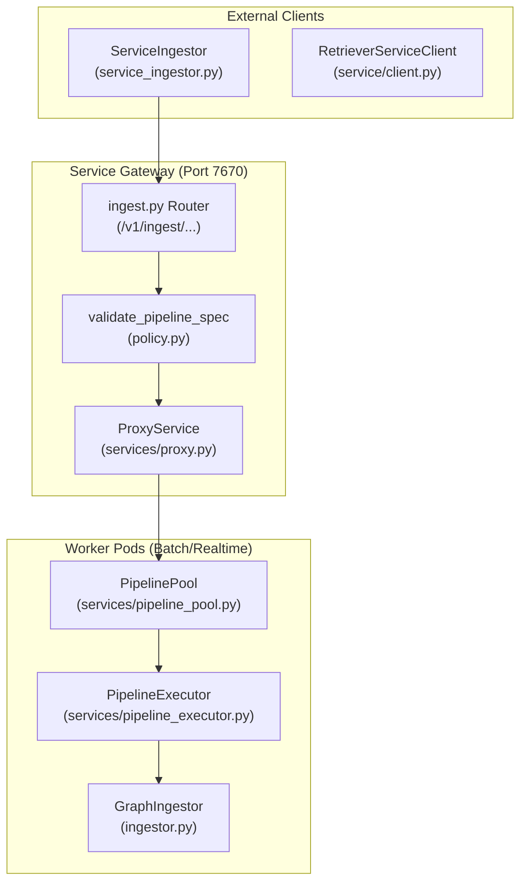
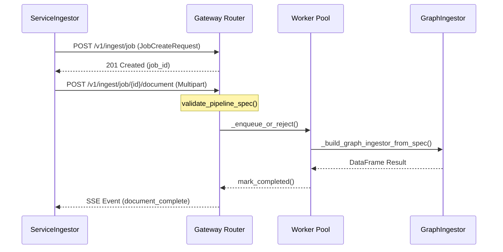

<!-- source: DeepWiki mcp.deepwiki.com · repo NVIDIA/NeMo-Retriever · page 7.6 API Endpoints Reference · fetched 2026-10-26 -->

# API Endpoints Reference

Relevant source files

The following files were used as context for generating this wiki page:

- [docs/docs/extraction/nemo-retriever-api-reference.md](docs/docs/extraction/nemo-retriever-api-reference.md)
- [docs/scripts/generate_openapi_docs.py](docs/scripts/generate_openapi_docs.py)
- [docs/sphinx_docs/source/openapi.rst](docs/sphinx_docs/source/openapi.rst)
- [nemo_retriever/helm/Chart.yaml](nemo_retriever/helm/Chart.yaml)
- [nemo_retriever/helm/templates/NOTES.txt](nemo_retriever/helm/templates/NOTES.txt)
- [nemo_retriever/helm/templates/_helpers.tpl](nemo_retriever/helm/templates/_helpers.tpl)
- [nemo_retriever/helm/templates/configmap.yaml](nemo_retriever/helm/templates/configmap.yaml)
- [nemo_retriever/helm/values.yaml](nemo_retriever/helm/values.yaml)
- [nemo_retriever/src/nemo_retriever/service/client.py](nemo_retriever/src/nemo_retriever/service/client.py)
- [nemo_retriever/src/nemo_retriever/service/config.py](nemo_retriever/src/nemo_retriever/service/config.py)
- [nemo_retriever/src/nemo_retriever/service/retriever-service.yaml](nemo_retriever/src/nemo_retriever/service/retriever-service.yaml)
- [nemo_retriever/src/nemo_retriever/service/routers/ingest.py](nemo_retriever/src/nemo_retriever/service/routers/ingest.py)
- [nemo_retriever/src/nemo_retriever/service/services/pipeline_executor.py](nemo_retriever/src/nemo_retriever/service/services/pipeline_executor.py)
- [nemo_retriever/src/nemo_retriever/service_ingestor.py](nemo_retriever/src/nemo_retriever/service_ingestor.py)

This page documents the REST API endpoints, gRPC interfaces, and message formats used across the NeMo Retriever system. This reference covers the FastAPI service application, NVIDIA NIM microservice endpoints, and the `PipelineSpec` message format used for job submission.

The NeMo Retriever service provides a unified gateway for multimodal document ingestion, supporting standalone, gateway, and worker (realtime/batch) roles [nemo_retriever/src/nemo_retriever/service/config.py:18-18]().

---

## System API Architecture

The NeMo Retriever service exposes multiple API surfaces across different components. The architecture supports a split-mode deployment where a **gateway** routes requests to specialized **realtime** or **batch** worker pods [nemo_retriever/src/nemo_retriever/service/routers/ingest.py:7-15]().

### Service API Components

| Component | Role | File Path |
|-----------|------|-----------|
| `FastAPI App` | Main entry point for REST requests | [nemo_retriever/src/nemo_retriever/service/app.py]() |
| `JobTracker` | Tracks document completion across jobs | [nemo_retriever/src/nemo_retriever/service/services/job_tracker.py]() |
| `PipelinePool` | Manages local worker pools for ingestion | [nemo_retriever/src/nemo_retriever/service/services/pipeline_pool.py]() |
| `Proxy` | Forwards requests from gateway to workers | [nemo_retriever/src/nemo_retriever/service/services/proxy.py]() |

### Code-to-System Mapping

The following diagram bridges the high-level system components to the specific Python entities that implement them.

**System Component to Code Entity Mapping**

**Sources:**
- [nemo_retriever/src/nemo_retriever/service_ingestor.py:1-68]()
- [nemo_retriever/src/nemo_retriever/service/routers/ingest.py:1-83]()
- [nemo_retriever/src/nemo_retriever/service/services/pipeline_executor.py:5-19]()

---

## Main Runtime REST API (Port 7670)

The service exposes the primary HTTP REST API on port 7670 [nemo_retriever/src/nemo_retriever/service/config.py:25-25]().

### Ingestion Endpoints

The ingestion API is built around a "Job" abstraction. A job is a logical container for multiple documents [nemo_retriever/src/nemo_retriever/service/routers/ingest.py:143-154]().

| Method | Endpoint | Description |
|--------|----------|-------------|
| `POST` | `/v1/ingest/job` | Create a new job aggregate [nemo_retriever/src/nemo_retriever/service/client.py:187-187]() |
| `POST` | `/v1/ingest/job/{job_id}/document` | Upload a document to an existing job [nemo_retriever/src/nemo_retriever/service/client.py:182-182]() |
| `GET` | `/v1/ingest/job/{job_id}/events` | SSE stream for job and document status [nemo_retriever/src/nemo_retriever/service/client.py:183-183]() |
| `POST` | `/v1/ingest/sidecar` | Upload sidecar metadata for joining [nemo_retriever/src/nemo_retriever/service/routers/ingest.py:43-43]() |
| `GET` | `/v1/ingest/status/{doc_id}` | Fetch processed rows for a document [nemo_retriever/src/nemo_retriever/service/routers/ingest.py:201-201]() |

### Health and Monitoring

| Method | Endpoint | Description |
|--------|----------|-------------|
| `GET` | `/v1/health` | Liveness and readiness probe [nemo_retriever/helm/values.yaml:147-147]() |
| `GET` | `/v1/ingest/metrics` | Prometheus metrics endpoint [nemo_retriever/helm/templates/NOTES.txt:43-43]() |

**Sources:**
- [nemo_retriever/src/nemo_retriever/service/routers/ingest.py:28-60]()
- [nemo_retriever/src/nemo_retriever/service/client.py:7-11]()
- [nemo_retriever/helm/values.yaml:142-172]()

---

## Message Formats and Schemas

### PipelineSpec

The `PipelineSpec` is the core configuration object that travels with every ingestion request. It defines the parameters for extraction, embedding, and storage [nemo_retriever/src/nemo_retriever/service_ingestor.py:35-41]().

The server validates this spec against a `PipelineOverridesPolicy` to ensure clients cannot redirect sensitive endpoints (like `invoke_url` or `api_key`) [nemo_retriever/src/nemo_retriever/service/policy.py:45-45]().

**Pipeline Execution Flow**

**Sources:**
- [nemo_retriever/src/nemo_retriever/service/models/pipeline_spec.py:32-32]()
- [nemo_retriever/src/nemo_retriever/service/policy.py:1-50]()
- [nemo_retriever/src/nemo_retriever/service/services/pipeline_executor.py:205-214]()

### Server-Owned Configuration

Certain parameters are strictly **server-owned** and cannot be overridden by clients via the `PipelineSpec`, regardless of policy settings [nemo_retriever/src/nemo_retriever/service/services/pipeline_executor.py:186-202]().

| Stage | Protected Keys |
|-------|----------------|
| **Extract** | `invoke_url`, `api_key`, `page_elements_invoke_url`, `ocr_invoke_url` [nemo_retriever/src/nemo_retriever/service/services/pipeline_executor.py:158-168]() |
| **Embed** | `embed_invoke_url`, `api_key`, `embed_model_name` [nemo_retriever/src/nemo_retriever/service/services/pipeline_executor.py:169-175]() |
| **Caption** | `endpoint_url`, `api_key`, `model_name` [nemo_retriever/src/nemo_retriever/service/services/pipeline_executor.py:179-183]() |

---

## NVIDIA NIM Microservice Interfaces

The service orchestrates document processing by calling remote NIM endpoints. These are configured in the `nim_endpoints` section of `retriever-service.yaml` [nemo_retriever/src/nemo_retriever/service/retriever-service.yaml:32-50]().

| NIM Service | Protocol | Default Path |
|-------------|----------|--------------|
| `page_elements` | HTTP | `/v1/infer` [nemo_retriever/helm/templates/configmap.yaml:11-11]() |
| `table_structure` | HTTP | `/v1/infer` [nemo_retriever/helm/templates/configmap.yaml:12-12]() |
| `ocr` | HTTP | `/v1/infer` [nemo_retriever/helm/templates/configmap.yaml:13-13]() |
| `vlm_embed` | HTTP | `/v1/embeddings` [nemo_retriever/helm/templates/configmap.yaml:14-14]() |
| `caption` (Omni) | HTTP | `/v1/chat/completions` [nemo_retriever/helm/templates/configmap.yaml:15-15]() |
| `audio` (Parakeet) | gRPC | (Port 50051) [nemo_retriever/src/nemo_retriever/service/retriever-service.yaml:40-43]() |

**Sources:**
- [nemo_retriever/src/nemo_retriever/service/config.py:36-78]()
- [nemo_retriever/helm/templates/configmap.yaml:1-22]()

---

## Internal Service Communication

### VectorDB Write API

The service provides an internal endpoint for worker processes to write embeddings to the vector database service [nemo_retriever/src/nemo_retriever/service/services/pipeline_executor.py:124-140]().

*   **Endpoint:** `POST {vectordb_url}/internal/vectordb/write` [nemo_retriever/src/nemo_retriever/service/services/pipeline_executor.py:133-133]()
*   **Payload:** `{"rows": [...]}` [nemo_retriever/src/nemo_retriever/service/services/pipeline_executor.py:134-134]()

### Gateway Proxying

When in `gateway` mode, the service uses an `httpx` connection pool to forward ingestion requests to backend worker pods [nemo_retriever/src/nemo_retriever/service/config.py:104-118]().

*   **Realtime URL:** `http://nemo-retriever-realtime:7670` [nemo_retriever/src/nemo_retriever/service/config.py:113-113]()
*   **Batch URL:** `http://nemo-retriever-batch:7670` [nemo_retriever/src/nemo_retriever/service/config.py:114-114]()

**Sources:**
- [nemo_retriever/src/nemo_retriever/service/services/pipeline_executor.py:124-156]()
- [nemo_retriever/src/nemo_retriever/service/config.py:104-118]()

---

