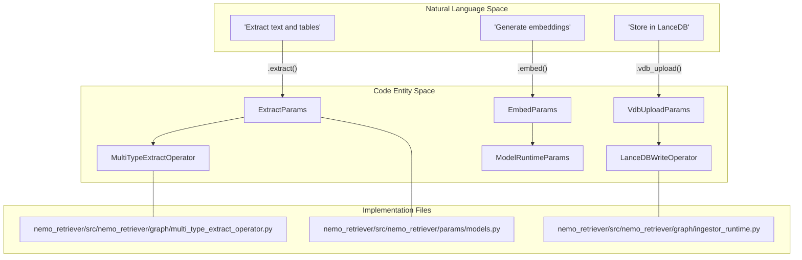
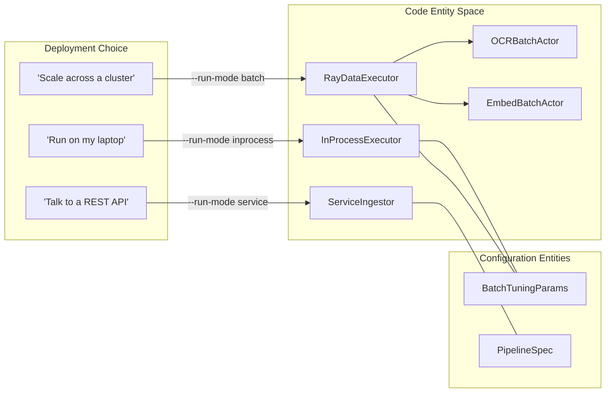

<!-- source: DeepWiki mcp.deepwiki.com · repo NVIDIA/NeMo-Retriever · page 8 Glossary · fetched 2026-10-26 -->

# Glossary

Relevant source files

The following files were used as context for generating this wiki page:

- [README.md](README.md)
- [docs/docs/extraction/audio-video.md](docs/docs/extraction/audio-video.md)
- [docs/docs/extraction/concepts.md](docs/docs/extraction/concepts.md)
- [docs/docs/extraction/deployment-options.md](docs/docs/extraction/deployment-options.md)
- [docs/docs/extraction/faq.md](docs/docs/extraction/faq.md)
- [docs/docs/extraction/getting-started-about.md](docs/docs/extraction/getting-started-about.md)
- [docs/docs/extraction/multimodal-extraction.md](docs/docs/extraction/multimodal-extraction.md)
- [docs/docs/extraction/overview.md](docs/docs/extraction/overview.md)
- [docs/docs/extraction/prerequisites-support-matrix.md](docs/docs/extraction/prerequisites-support-matrix.md)
- [docs/docs/extraction/troubleshoot.md](docs/docs/extraction/troubleshoot.md)
- [docs/mkdocs.yml](docs/mkdocs.yml)
- [nemo_retriever/README.md](nemo_retriever/README.md)
- [nemo_retriever/docs/cli/README.md](nemo_retriever/docs/cli/README.md)
- [nemo_retriever/docs/cli/benchmarking.md](nemo_retriever/docs/cli/benchmarking.md)
- [nemo_retriever/helm/README.md](nemo_retriever/helm/README.md)
- [nemo_retriever/src/nemo_retriever/graph/executor.py](nemo_retriever/src/nemo_retriever/graph/executor.py)
- [nemo_retriever/src/nemo_retriever/graph/ingestor_runtime.py](nemo_retriever/src/nemo_retriever/graph/ingestor_runtime.py)
- [nemo_retriever/src/nemo_retriever/graph/multi_type_extract_operator.py](nemo_retriever/src/nemo_retriever/graph/multi_type_extract_operator.py)
- [nemo_retriever/src/nemo_retriever/graph_ingestor.py](nemo_retriever/src/nemo_retriever/graph_ingestor.py)
- [nemo_retriever/src/nemo_retriever/params/models.py](nemo_retriever/src/nemo_retriever/params/models.py)
- [nemo_retriever/src/nemo_retriever/pipeline/__main__.py](nemo_retriever/src/nemo_retriever/pipeline/__main__.py)
- [nemo_retriever/src/nemo_retriever/utils/input_files.py](nemo_retriever/src/nemo_retriever/utils/input_files.py)
- [nemo_retriever/tests/test_graph_pipeline_cli.py](nemo_retriever/tests/test_graph_pipeline_cli.py)
- [nemo_retriever/tests/test_ingest_interface.py](nemo_retriever/tests/test_ingest_interface.py)
- [nemo_retriever/tests/test_ingest_plans.py](nemo_retriever/tests/test_ingest_plans.py)
- [nemo_retriever/tests/test_pipeline_graph.py](nemo_retriever/tests/test_pipeline_graph.py)
- [nemo_retriever/tests/test_pipeline_helpers.py](nemo_retriever/tests/test_pipeline_helpers.py)

This glossary defines technical terms, domain-specific jargon, and implementation-specific concepts used throughout the NeMo Retriever Library (NRL). It serves as a reference for onboarding engineers to understand the mapping between high-level RAG concepts and their specific implementations in the codebase.

## Core Concepts

### NVIDIA Ingest (NRL)
The internal and technical name for the NeMo Retriever Library extraction framework. It is a scalable system for document content and metadata extraction, supporting multimodal inputs including PDFs, HTML, Word, PowerPoint, audio, video, and images [README.md:13-18]().

### GraphIngestor
The primary user-facing class used to build and execute ingestion pipelines. It uses a lazy, chainable API to define tasks (extract, embed, etc.) before execution [nemo_retriever/src/nemo_retriever/graph_ingestor.py:1-20](). It supports three execution modes: `inprocess`, `batch`, and `service` [nemo_retriever/src/nemo_retriever/params/models.py:20-20]().

### NIM (NVIDIA Inference Microservice)
Specialized AI model containers used for document processing tasks. NRL interacts with NIMs for layout detection, OCR, and embedding [README.md:15-16]().
*   **nemotron-page-elements-v3**: Detects layout elements like titles, text blocks, tables, and charts [docs/docs/extraction/prerequisites-support-matrix.md:73-73]().
*   **nemotron-ocr-v1/v2**: Performs Optical Character Recognition on images and PDF regions [docs/docs/extraction/prerequisites-support-matrix.md:75-75]().
*   **llama-nemotron-embed-vl**: Generates multimodal embeddings for text and images [docs/docs/extraction/prerequisites-support-matrix.md:76-76]().

---

## Technical Terms & Jargon

### Artifact Classification
The process of identifying specific regions within a document page as text, tables, charts, or infographics [README.md:20-20](). This is primarily handled by the `page-elements` NIM.

### Sidecar Metadata
Custom metadata provided in external files (CSV, JSON, Parquet) that is merged into each chunk's `content_metadata` during ingestion [nemo_retriever/src/nemo_retriever/pipeline/__main__.py:39-44]().

### Run Mode
The execution environment for the pipeline:
*   **In-process**: Runs everything in the local Python process (pandas-based) [nemo_retriever/src/nemo_retriever/pipeline/__main__.py:16-20]().
*   **Batch**: Uses **Ray Data** for distributed, parallel processing across multiple CPU/GPU nodes [nemo_retriever/src/nemo_retriever/pipeline/__main__.py:11-15]().
*   **Service**: Delegates execution to a remote FastAPI-based retriever service [nemo_retriever/src/nemo_retriever/pipeline/__main__.py:21-25]().

### VDB Operator
An abstraction for different vector database backends. The default is `lancedb`, which stores vectors as local Lance files on disk [nemo_retriever/src/nemo_retriever/pipeline/__main__.py:83-83]().

---

## Data Flow & Architecture

The following diagram illustrates the transition from high-level "Natural Language" tasks to the specific "Code Entities" that handle them.

### Diagram 1: Task to Code Mapping
"This diagram shows how user-defined tasks in the GraphIngestor API map to internal Operator and Parameter classes."

**Sources:** [nemo_retriever/src/nemo_retriever/params/models.py:1-130](), [nemo_retriever/src/nemo_retriever/pipeline/__main__.py:62-75](), [nemo_retriever/src/nemo_retriever/graph_ingestor.py:1-50]().

---

### Diagram 2: Execution Mode Logic
"This diagram bridges the deployment concept to the specific Executor and Actor entities used in the codebase."

**Sources:** [nemo_retriever/src/nemo_retriever/params/models.py:20-20](), [nemo_retriever/src/nemo_retriever/pipeline/__main__.py:11-25](), [nemo_retriever/src/nemo_retriever/graph/executor.py:1-100]().

---

## Table of Key Parameters

| Parameter Class | Purpose | Key Fields | Code Pointer |
|:---|:---|:---|:---|
| `ExtractParams` | Configures document parsing | `extract_text`, `extract_tables`, `extract_method` | [nemo_retriever/src/nemo_retriever/params/models.py:198-210]() |
| `EmbedParams` | Configures vector generation | `embed_model_name`, `embed_modality`, `embed_granularity` | [nemo_retriever/src/nemo_retriever/params/models.py:240-255]() |
| `VdbUploadParams` | Configures VDB storage | `vdb_op`, `collection_name`, `vdb_kwargs` | [nemo_retriever/src/nemo_retriever/params/models.py:260-275]() |
| `BatchTuningParams` | Controls Ray resource allocation | `ocr_actors`, `embed_batch_size`, `gpu_fraction` | [nemo_retriever/src/nemo_retriever/params/models.py:75-75]() |
| `ASRParams` | Configures audio transcription | `audio_endpoints`, `audio_infer_mode`, `segment_audio` | [nemo_retriever/src/nemo_retriever/params/models.py:173-191]() |

---

## Domain Concepts

### PDFium vs Nemotron Parse
*   **pdfium**: The default, fast CPU-based library for extracting text and elements from native PDFs [docs/docs/extraction/multimodal-extraction.md:27-27]().
*   **nemotron-parse**: A high-accuracy, GPU-backed deep learning model for complex layouts and scanned documents [docs/docs/extraction/faq.md:32-34]().

### Multimodal Embedding
The ability to represent both text and images in the same vector space using models like `llama-nemotron-embed-vl`. This allows for cross-modal retrieval (e.g., searching for images using text queries) [docs/docs/extraction/multimodal-extraction.md:74-76]().

### Recall Evaluation
The process of measuring the quality of the retrieval system, typically using metrics like `recall@k` and `ndcg@k`. The codebase includes a `retriever-harness` for running these benchmarks [nemo_retriever/docs/cli/README.md:41-41]().

**Sources:**
* [README.md:13-20]()
* [nemo_retriever/src/nemo_retriever/params/models.py:20-210]()
* [nemo_retriever/src/nemo_retriever/pipeline/__main__.py:11-83]()
* [docs/docs/extraction/prerequisites-support-matrix.md:73-104]()
* [docs/docs/extraction/multimodal-extraction.md:27-76]()