# Page: Overview

# Overview

<details>
<summary>Relevant source files</summary>

The following files were used as context for generating this wiki page:

- [README.md](README.md)
- [docs/docs/extraction/audio-video.md](docs/docs/extraction/audio-video.md)
- [docs/docs/extraction/concepts.md](docs/docs/extraction/concepts.md)
- [docs/docs/extraction/getting-started-about.md](docs/docs/extraction/getting-started-about.md)
- [docs/docs/extraction/overview.md](docs/docs/extraction/overview.md)
- [docs/docs/index.md](docs/docs/index.md)
- [docs/mkdocs.yml](docs/mkdocs.yml)
- [nemo_retriever/README.md](nemo_retriever/README.md)
- [nemo_retriever/docs/cli/README.md](nemo_retriever/docs/cli/README.md)

</details>


This page introduces the **NeMo Retriever Library** (also referred to as **NVIDIA Ingest**), a scalable, performance-oriented framework for document content and metadata extraction. It is designed to find, contextualize, and extract text, tables, charts, and infographics for use in downstream generative and retrieval-augmented generation (RAG) applications. [README.md:13-18](), [docs/docs/extraction/overview.md:1-4]().

For detailed information on the system's inner workings, see:
- **[System Architecture](#1.1)** — Deep dive into the graph-based execution model, Ray Data integration, and deployment orchestration.
- **[Package Structure](#1.2)** — Documentation of the Python packages (`nemo-retriever`, `nemo-retriever-api`, etc.) and their relationships.

---

## Purpose and Scope

NeMo Retriever Library enables the parallelization of document processing by splitting files into pages where artifacts are classified, extracted, and contextualized through optical character recognition (OCR) into a well-defined JSON schema. [README.md:20-21]().

**Key Capabilities:**
- **Multimodal Extraction:** Supports PDFs, HTML, Word docs, Powerpoint, audio, video, and images. [docs/docs/extraction/overview.md:3-4]().
- **Flexible Inference:** Supports both NVIDIA NIM microservices (hosted or self-hosted) and local GPU inference using Hugging Face models. [nemo_retriever/README.md:5-7]().
- **Chainable Task Pipeline:** Uses a fluent Python API to chain tasks like `.files()`, `.extract()`, `.embed()`, and `.vdb_upload()`. [README.md:46-57]().
- **Vector Database Integration:** Manages embedding computation and storage in LanceDB. [README.md:20-21]().

**Sources:** [README.md:13-57](), [docs/docs/extraction/overview.md:1-21](), [nemo_retriever/README.md:1-7]().

---

## High-Level Architecture

The system bridges high-level user requests to low-level GPU-accelerated microservices and distributed processing frameworks.

### System Context Diagram
This diagram illustrates how the system components interact, mapping Natural Language concepts to the underlying code entities.

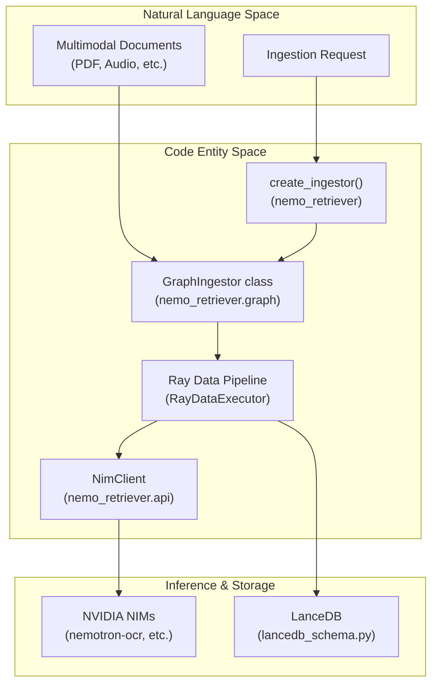

**Sources:** [README.md:38-43](), [nemo_retriever/README.md:100-116](), [docs/docs/extraction/concepts.md:7-11]().

---

## Typical Use and Workflow

NeMo Retriever Library does not run a single static pipeline. Instead, users configure **tasks** such as parsing, chunking, and embedding per job. [docs/docs/extraction/concepts.md:9-11]().

### Workflow to Code Mapping
This diagram shows the relationship between pipeline stages and the code-level parameters/classes that control them.

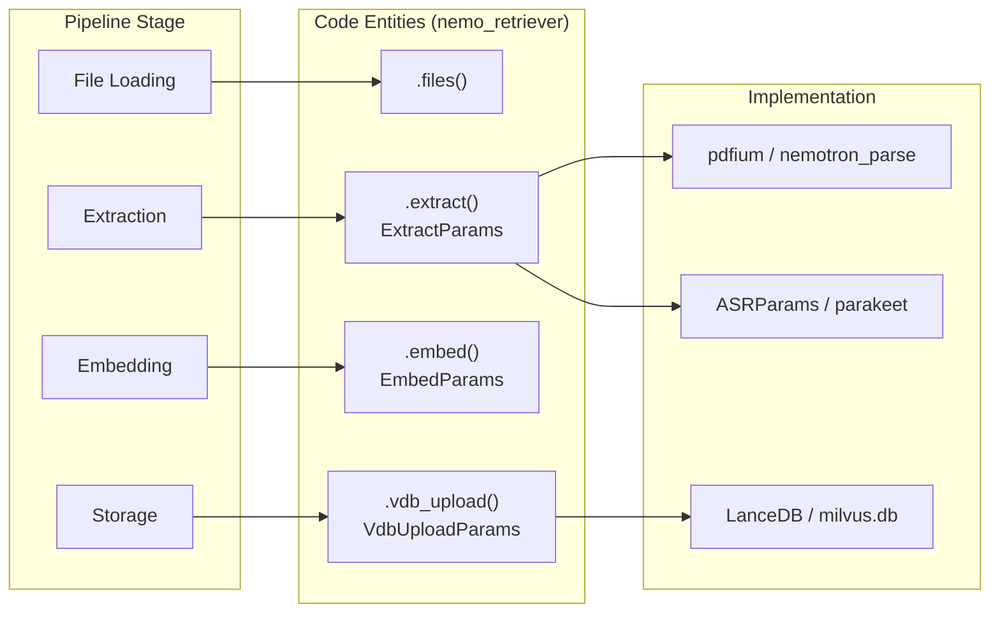

**Sources:** [README.md:46-57](), [docs/docs/extraction/concepts.md:21-30](), [docs/docs/extraction/audio-video.md:81-96]().

---

## Deployment Modes

NeMo Retriever Library supports three primary deployment modes to accommodate different scales and environments: [docs/docs/extraction/concepts.md:35-41]().

| Mode | Description | Primary Use Case |
| :--- | :--- | :--- |
| **Library Mode** | Runs within local Python processes without containers. Supports local GPU (Hugging Face) or remote NIMs. | Development and small-scale workloads (<100 PDFs). |
| **Docker Compose** | Standalone service-image builds and local containerized runs. | Testing and standalone server deployments. |
| **Helm / Kubernetes** | Orchestrates the retriever service and NIM workloads using the NIM Operator. | Production-level performance and scalability. |

**Sources:** [README.md:26-34](), [nemo_retriever/README.md:5-16](), [docs/docs/extraction/concepts.md:35-41]().

---

## Supported File Types

The library supports a wide array of media types for extraction: [docs/docs/extraction/overview.md:24-45]().

*   **Documents:** `pdf`, `docx`, `pptx`, `html`, `txt`, `md`.
*   **Images:** `png`, `jpeg`, `tiff`, `bmp`, `svg`.
*   **Audio/Video:** `mp3`, `wav`, `mp4`, `mov`, `mkv`, `avi`.
*   **Structured/Code:** `json`, `sh`.

**Sources:** [docs/docs/extraction/overview.md:24-45](), [docs/docs/extraction/audio-video.md:16-20]().

---

# Page: System Architecture

# System Architecture

<details>
<summary>Relevant source files</summary>

The following files were used as context for generating this wiki page:

- [README.md](README.md)
- [docs/docs/extraction/concepts.md](docs/docs/extraction/concepts.md)
- [docs/docs/extraction/deployment-options.md](docs/docs/extraction/deployment-options.md)
- [docs/docs/extraction/faq.md](docs/docs/extraction/faq.md)
- [docs/docs/extraction/getting-started-about.md](docs/docs/extraction/getting-started-about.md)
- [docs/docs/extraction/multimodal-extraction.md](docs/docs/extraction/multimodal-extraction.md)
- [docs/docs/extraction/overview.md](docs/docs/extraction/overview.md)
- [docs/docs/extraction/prerequisites-support-matrix.md](docs/docs/extraction/prerequisites-support-matrix.md)
- [docs/docs/extraction/troubleshoot.md](docs/docs/extraction/troubleshoot.md)
- [docs/mkdocs.yml](docs/mkdocs.yml)
- [nemo_retriever/docs/cli/benchmarking.md](nemo_retriever/docs/cli/benchmarking.md)
- [nemo_retriever/helm/README.md](nemo_retriever/helm/README.md)
- [nemo_retriever/src/nemo_retriever/graph/executor.py](nemo_retriever/src/nemo_retriever/graph/executor.py)
- [nemo_retriever/src/nemo_retriever/graph/ingestor_runtime.py](nemo_retriever/src/nemo_retriever/graph/ingestor_runtime.py)
- [nemo_retriever/src/nemo_retriever/graph/multi_type_extract_operator.py](nemo_retriever/src/nemo_retriever/graph/multi_type_extract_operator.py)
- [nemo_retriever/src/nemo_retriever/graph_ingestor.py](nemo_retriever/src/nemo_retriever/graph_ingestor.py)
- [nemo_retriever/src/nemo_retriever/utils/input_files.py](nemo_retriever/src/nemo_retriever/utils/input_files.py)
- [nemo_retriever/tests/test_ingest_interface.py](nemo_retriever/tests/test_ingest_interface.py)
- [nemo_retriever/tests/test_ingest_plans.py](nemo_retriever/tests/test_ingest_plans.py)
- [nemo_retriever/tests/test_pipeline_graph.py](nemo_retriever/tests/test_pipeline_graph.py)

</details>


This document describes the overall system architecture of NeMo Retriever Library, explaining how NVIDIA NIMs, data services, and orchestration layers work together. It covers the graph-based execution model, Ray Data integration, and the primary deployment modes.

---

## Architecture Overview

NeMo Retriever Library (also referred to as **NVIDIA Ingest**) is a multimodal document ingestion system designed for RAG applications. It enables parallelized document splitting, artifact classification (text, tables, charts), extraction via OCR, and embedding generation [README.md:13-20]().

The system bridges "Natural Language Space" (documents, queries) to "Code Entity Space" (graphs, operators, actors) through a lazy, chainable task model [README.md:45-57]().

### High-Level System Components

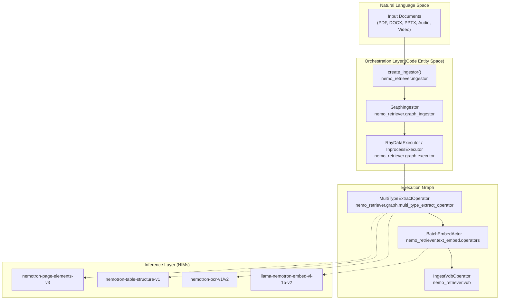
**Sources:** [README.md:13-61](), [nemo_retriever/src/nemo_retriever/graph_ingestor.py:5-25](), [nemo_retriever/src/nemo_retriever/graph/ingestor_runtime.py:14-43]()

---

## Deployment Modes

The system supports three primary deployment architectures to accommodate different scales and environments.

| Deployment Mode | Description | Primary Use Case |
| :--- | :--- | :--- |
| **Library Mode** | Runs directly in Python for development. Can use local HuggingFace models or remote NIMs [README.md:32-34](). | Small-scale workloads (<100 PDFs), rapid prototyping. |
| **Docker Compose** | Standalone service image for local container validation [docs/docs/extraction/deployment-options.md:14-16](). | Local testing of the full service stack. |
| **Helm / Kubernetes** | Production-level deployment using the NVIDIA NIM Operator to manage GPU resources [nemo_retriever/helm/README.md:1-22](). | Large-scale production RAG pipelines. |

**Sources:** [README.md:26-34](), [docs/docs/extraction/deployment-options.md:9-23](), [nemo_retriever/helm/README.md:13-22]()

---

## Graph-Based Execution Model

The core of NeMo Retriever is a graph-based execution model. Pipelines are constructed lazily as a series of chainable tasks that are eventually compiled into a `Graph` [nemo_retriever/src/nemo_retriever/graph_ingestor.py:5-12]().

### Graph Construction and Execution
The `GraphIngestor` class builds the operator graph using `build_graph` and executes it via an `AbstractExecutor` implementation [nemo_retriever/src/nemo_retriever/graph_ingestor.py:36-38]().

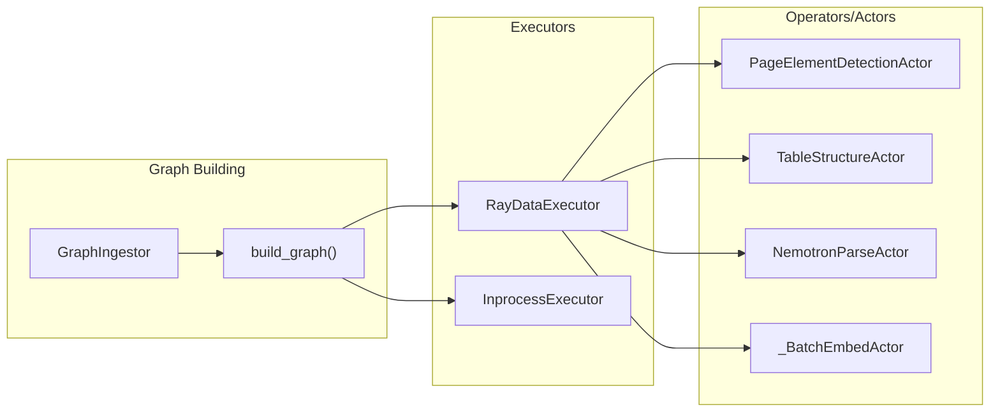
**Sources:** [nemo_retriever/src/nemo_retriever/graph_ingestor.py:114-136](), [nemo_retriever/src/nemo_retriever/graph/ingestor_runtime.py:14-43]()

---

## Ray Data Integration

For production performance, the system utilizes **Ray Data** to parallelize ingestion. This involves actor pools, repartitioning, and GPU fraction allocation [nemo_retriever/src/nemo_retriever/graph/ingestor_runtime.py:85-107]().

### GPU Resource Management
The `batch_tuning_to_node_overrides` function translates `BatchTuningParams` into Ray-specific execution configurations, allowing fine-grained control over GPU fractions (e.g., `gpu_ocr`, `gpu_embed`) [nemo_retriever/src/nemo_retriever/graph/ingestor_runtime.py:75-95]().

### Parallel PDF Processing
For large documents, the system supports **PDF pre-splitting**. This allows a single large PDF to be distributed across multiple Ray workers for simultaneous extraction [docs/docs/extraction/concepts.md:29]().

**Sources:** [nemo_retriever/src/nemo_retriever/graph/ingestor_runtime.py:75-165](), [docs/docs/extraction/concepts.md:21-30]()

---

## NIM and Data Services

The architecture relies on specialized microservices (NIMs) for inference and various data stores for results.

### Core NIMs
The production Helm chart enables four core NIMs by default:
1.  **nemotron-page-elements-v3**: Layout detection [docs/docs/extraction/prerequisites-support-matrix.md:73]().
2.  **nemotron-table-structure-v1**: Table extraction [docs/docs/extraction/prerequisites-support-matrix.md:74]().
3.  **nemotron-ocr-v1**: Image OCR [docs/docs/extraction/prerequisites-support-matrix.md:75]().
4.  **llama-nemotron-embed-vl-1b-v2**: Multimodal embedding [docs/docs/extraction/prerequisites-support-matrix.md:76]().

### Data Infrastructure
*   **LanceDB**: The recommended vector database for local storage, managed via the `IngestVdbOperator` [README.md:56](), [nemo_retriever/src/nemo_retriever/graph/ingestor_runtime.py:40]().
*   **MinIO**: Used for object storage of extracted images and artifacts [nemo_retriever/helm/README.md:75]().
*   **SQLite**: Used in Helm deployments for service state and job persistence [nemo_retriever/helm/README.md:33-35]().

**Sources:** [docs/docs/extraction/prerequisites-support-matrix.md:67-77](), [nemo_retriever/src/nemo_retriever/graph/ingestor_runtime.py:40-43](), [nemo_retriever/helm/README.md:33-35]()

---

# Page: Package Structure

# Package Structure

<details>
<summary>Relevant source files</summary>

The following files were used as context for generating this wiki page:

- [.github/workflows/huggingface-nightly.yml](.github/workflows/huggingface-nightly.yml)
- [.gitignore](.gitignore)
- [ci/scripts/nightly_build_publish.py](ci/scripts/nightly_build_publish.py)
- [ci/tests/test_huggingface_release_workflow.py](ci/tests/test_huggingface_release_workflow.py)
- [docker/scripts/post_build_triggers.py](docker/scripts/post_build_triggers.py)
- [nemo_retriever/pyproject.toml](nemo_retriever/pyproject.toml)
- [nemo_retriever/src/nemo_retriever/__init__.py](nemo_retriever/src/nemo_retriever/__init__.py)
- [nemo_retriever/src/nemo_retriever/examples/graph_pipeline.py](nemo_retriever/src/nemo_retriever/examples/graph_pipeline.py)
- [nemo_retriever/src/nemo_retriever/graph/__init__.py](nemo_retriever/src/nemo_retriever/graph/__init__.py)
- [nemo_retriever/src/nemo_retriever/graph/webhook_operator.py](nemo_retriever/src/nemo_retriever/graph/webhook_operator.py)
- [nemo_retriever/src/nemo_retriever/ingestor.py](nemo_retriever/src/nemo_retriever/ingestor.py)
- [nemo_retriever/src/nemo_retriever/model/local/llama_nemotron_embed_1b_v2_embedder.py](nemo_retriever/src/nemo_retriever/model/local/llama_nemotron_embed_1b_v2_embedder.py)
- [nemo_retriever/src/nemo_retriever/model/local/nemotron_ocr_v2.py](nemo_retriever/src/nemo_retriever/model/local/nemotron_ocr_v2.py)
- [nemo_retriever/src/nemo_retriever/model/local/nemotron_parse_v1_2.py](nemo_retriever/src/nemo_retriever/model/local/nemotron_parse_v1_2.py)
- [nemo_retriever/src/nemo_retriever/params/__init__.py](nemo_retriever/src/nemo_retriever/params/__init__.py)
- [nemo_retriever/src/nemo_retriever/text_embed/vllm.py](nemo_retriever/src/nemo_retriever/text_embed/vllm.py)
- [nemo_retriever/src/nemo_retriever/txt/split.py](nemo_retriever/src/nemo_retriever/txt/split.py)
- [nemo_retriever/tests/test_nemotron_ocr_v2_nightly.py](nemo_retriever/tests/test_nemotron_ocr_v2_nightly.py)
- [nemo_retriever/tests/test_vllm_embed.py](nemo_retriever/tests/test_vllm_embed.py)
- [nemo_retriever/tests/test_webhook_operator.py](nemo_retriever/tests/test_webhook_operator.py)
- [nemo_retriever/uv.lock](nemo_retriever/uv.lock)

</details>


This document describes the Python packages that compose the NeMo Retriever Library system, their relationships, directory organization, and build/release architecture.

## Overview

The NeMo Retriever system is organized into three primary internal packages and integrates several specialized NVIDIA NIM model packages. The `nemo-retriever` package acts as the high-level entry point, providing the `GraphIngestor` and the `retriever` CLI.

| Package | Directory | PyPI Name | Purpose |
|---------|-----------|-----------|---------|
| API | `api/` | `nv-ingest-api` | Core document processing functions and task definitions. |
| Client | `client/` | `nv-ingest-client` | Python SDK and CLI tools for job submission and result retrieval. |
| Service | `src/` | `nv-ingest` | Ray-based microservice runtime and orchestration layer. |
| Retriever | `nemo_retriever/` | `nemo-retriever` | High-level batch/in-process pipeline with local NIM execution capabilities. |

**Sources:** [nemo_retriever/pyproject.toml:19-76](), [nemo_retriever/src/nemo_retriever/ingestor.py:5-14]()

## Package Dependency Graph

The following diagram illustrates how the `nemo-retriever` package aggregates the core ingestion logic and provides interfaces for both local and remote execution.

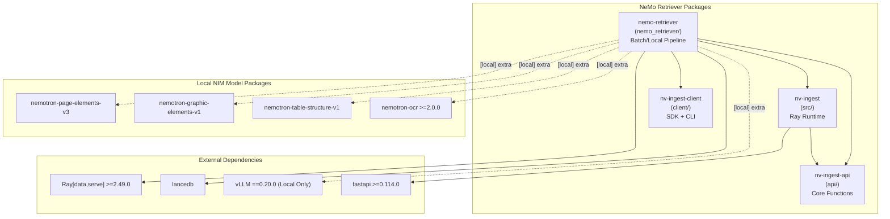

The `nemo-retriever` package uses `uv` workspace sources to depend on the other three internal packages during development [nemo_retriever/pyproject.toml:204-208](). It provides several "extras" to keep the core installation lightweight, such as `[local]` for GPU-accelerated inference and `[multimedia]` for audio/video processing [nemo_retriever/pyproject.toml:106-151]().

**Sources:** [nemo_retriever/pyproject.toml:78-195](), [nemo_retriever/src/nemo_retriever/ingestor.py:58-83]()

## Source Layout and Key Modules

The `nemo_retriever` package is structured to support multiple execution modes (run modes) and a wide variety of document modalities.

### Execution Entry Points
The system-facing interface is defined in `nemo_retriever.ingestor` [nemo_retriever/src/nemo_retriever/ingestor.py:1-83](). The `create_ingestor` factory function instantiates either a `GraphIngestor` (for `inprocess` or `batch` modes) or a `ServiceIngestor` (for remote `service` mode) [nemo_retriever/src/nemo_retriever/ingestor.py:43-83]().

### Local Model Wrappers
For `run_mode='inprocess'` or `run_mode='batch'`, the system can invoke models locally without a remote NIM endpoint. These are housed in `nemo_retriever.model.local`:
* **`NemotronOCRV2`**: Wraps the `nemotron_ocr` package for local text detection and recognition [nemo_retriever/src/nemo_retriever/model/local/nemotron_ocr_v2.py:21-37]().
* **`LlamaNemotronEmbed1BV2Embedder`**: Uses vLLM's pooling runner for high-throughput local text embedding [nemo_retriever/src/nemo_retriever/model/local/llama_nemotron_embed_1b_v2_embedder.py:24-45]().
* **`NemotronParseV1_2`**: Local implementation of the visual document parser [nemo_retriever/src/nemo_retriever/model/local/nemotron_parse_v1_2.py:1-10]().

### Configuration and Parameters
All pipeline stages are configured using Pydantic models defined in `nemo_retriever.params`. This ensures type safety across the library and API boundaries.
* **`ExtractParams`**: Configuration for document parsing (OCR, tables, etc.) [nemo_retriever/src/nemo_retriever/params/models.py:13]().
* **`EmbedParams`**: Configuration for text and multimodal embedding [nemo_retriever/src/nemo_retriever/params/models.py:12]().
* **`VdbUploadParams`**: Settings for LanceDB or Milvus ingestion [nemo_retriever/src/nemo_retriever/params/models.py:34]().

**Sources:** [nemo_retriever/src/nemo_retriever/params/__init__.py:1-78](), [nemo_retriever/src/nemo_retriever/ingestor.py:21-30]()

## Code Entity Relationship Diagram

This diagram maps natural language system concepts to their specific code implementations and locations.

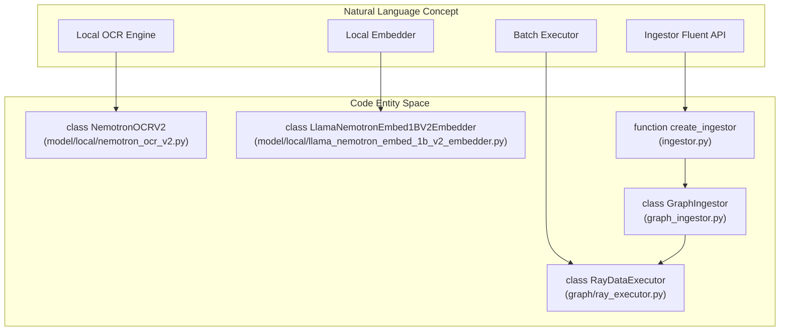

**Sources:** [nemo_retriever/src/nemo_retriever/ingestor.py:43-83](), [nemo_retriever/src/nemo_retriever/model/local/nemotron_ocr_v2.py:21](), [nemo_retriever/src/nemo_retriever/model/local/llama_nemotron_embed_1b_v2_embedder.py:24]()

## Build and Release System

The library uses a specialized build system to manage nightly releases and local GPU dependencies.

### Versioning and Build Logic
The `nemo-retriever` version is dynamic, calculated via `nemo_retriever.version.get_build_version` [nemo_retriever/pyproject.toml:202](). For nightly builds, the `nightly_build_publish.py` script patches PEP 440 dev versions into `pyproject.toml` using a UTC timestamp suffix [ci/scripts/nightly_build_publish.py:77-88]().

### Dependency Management
The system relies on `uv` for dependency resolution [nemo_retriever/pyproject.toml:5-16](). It includes specific overrides to handle platform-specific wheel availability, such as constraining `fastparquet` and suppressing `opencv-python` in favor of `opencv-python-headless` [nemo_retriever/pyproject.toml:10-16]().

### Nightly Workflows
The `.github/workflows/huggingface-nightly.yml` workflow coordinates the building of the core library and specialized NIM packages like `nemotron-ocr-v2` [.github/workflows/huggingface-nightly.yml:1-197]().
* **`build_ocr_cuda`**: Specifically builds the OCR package on `x86_64` and `aarch64` runners to ensure CUDA extension compatibility [.github/workflows/huggingface-nightly.yml:175-193]().
* **`nightly_coordinate`**: Generates a synchronized timestamp suffix so all packages in a single run share the same version [.github/workflows/huggingface-nightly.yml:52-80]().

**Sources:** [ci/scripts/nightly_build_publish.py:126-160](), [nemo_retriever/pyproject.toml:1-8]()

## CLI Entry Points

The `nemo-retriever` package exposes two primary CLI tools:

| Command | Entry Point | Purpose |
|---------|-------------|---------|
| `retriever` | `nemo_retriever.__main__:main` | Primary CLI for running ingestion pipelines and managing services. |
| `retriever-harness` | `nemo_retriever.harness:main` | Benchmarking and evaluation tool for testing recall and performance. |

**Sources:** [nemo_retriever/pyproject.toml:198-199](), [nemo_retriever/src/nemo_retriever/examples/graph_pipeline.py:34-45]()

---

# Page: Getting Started

# Getting Started

<details>
<summary>Relevant source files</summary>

The following files were used as context for generating this wiki page:

- [README.md](README.md)
- [docs/docs/extraction/concepts.md](docs/docs/extraction/concepts.md)
- [docs/docs/extraction/deployment-options.md](docs/docs/extraction/deployment-options.md)
- [docs/docs/extraction/faq.md](docs/docs/extraction/faq.md)
- [docs/docs/extraction/getting-started-about.md](docs/docs/extraction/getting-started-about.md)
- [docs/docs/extraction/multimodal-extraction.md](docs/docs/extraction/multimodal-extraction.md)
- [docs/docs/extraction/overview.md](docs/docs/extraction/overview.md)
- [docs/docs/extraction/prerequisites-support-matrix.md](docs/docs/extraction/prerequisites-support-matrix.md)
- [docs/docs/extraction/troubleshoot.md](docs/docs/extraction/troubleshoot.md)
- [docs/mkdocs.yml](docs/mkdocs.yml)
- [nemo_retriever/docs/cli/benchmarking.md](nemo_retriever/docs/cli/benchmarking.md)
- [nemo_retriever/helm/README.md](nemo_retriever/helm/README.md)

</details>


This page guides you through the initial setup and deployment of NeMo Retriever Library (formerly NVIDIA Ingest). It covers prerequisite verification, deployment option selection, and basic system architecture understanding. For detailed hardware specifications, see [Hardware Requirements](#2.2). For deployment instructions, see [Deployment Options](#2.1). For a hands-on tutorial, see [Quick Start Tutorial](#2.3).

## Overview

NeMo Retriever Library is a document ingestion framework that extracts, processes, and stores multimodal content (text, tables, charts, images) from various document formats. The system orchestrates multiple NVIDIA NIM microservices—often through Ray-based pipelines—to perform parallel content extraction, OCR, embedding generation, and vector database upload [README.md:13-20]().

The following diagram shows the core architectural components and their interactions:

**System Component Overview**

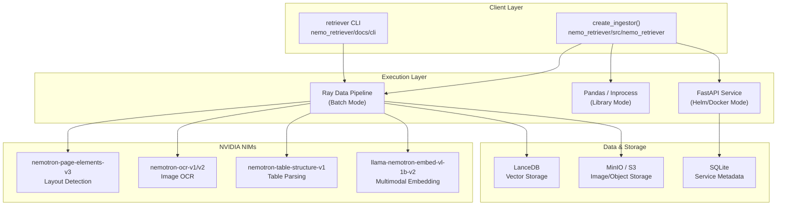

Sources: [README.md:22-26](), [nemo_retriever/helm/README.md:1-12](), [docs/docs/extraction/overview.md:8-12](), [docs/docs/extraction/prerequisites-support-matrix.md:67-77]()

## Prerequisites

Before deploying NeMo Retriever Library, verify the following requirements are met:

### Software Requirements

- **Operating System**: Linux (Ubuntu 22.04 or later recommended) [docs/docs/extraction/prerequisites-support-matrix.md:7]().
- **Python**: **3.12** is required. Older versions will fail dependency resolution [docs/docs/extraction/prerequisites-support-matrix.md:9]().
- **CUDA Toolkit**: NVIDIA Driver >= `580`, CUDA >= `13.0` [docs/docs/extraction/prerequisites-support-matrix.md:8]().
- **Media Tools**: `ffmpeg` and `ffprobe` are required for audio/video processing [docs/docs/extraction/prerequisites-support-matrix.md:11-13]().
- **Package Manager**: `uv` is recommended for managing isolated environments [docs/docs/extraction/prerequisites-support-matrix.md:10]().

Sources: [docs/docs/extraction/prerequisites-support-matrix.md:5-20]()

### Hardware Requirements

The minimum hardware configuration depends on your deployment mode and feature requirements:

| Component | Minimum (Core) | Recommended (Production) |
|-----------|---------------|-------------------------|
| **GPU** | 1x A10G (24GB VRAM) | A100, H100, or L40S |
| **System RAM** | 64GB | 256GB |
| **CPU Cores** | 16 cores | 32+ cores |

**Resource Consumption Notes**:
- GPU is required for local HuggingFace inference or self-hosted NIMs [docs/docs/extraction/prerequisites-support-matrix.md:49]().
- GPU is **not** required if using `build.nvidia.com` hosted inference [docs/docs/extraction/prerequisites-support-matrix.md:50]().
- Memory usage scales with document size and can reach full system capacity for large workloads [docs/docs/extraction/prerequisites-support-matrix.md:46-47]().

Sources: [docs/docs/extraction/prerequisites-support-matrix.md:26-52]()

### API Keys

- **NVIDIA_API_KEY**: Required for Library Mode to access hosted NIMs on `build.nvidia.com` [docs/docs/extraction/faq.md:47]().
- **NGC_API_KEY**: Required for self-hosted deployments to pull NIM containers and model weights [docs/docs/extraction/faq.md:40]().
- **HF_ACCESS_TOKEN**: May be required if loading tokenizers or models directly from Hugging Face Hub [docs/docs/extraction/concepts.md:33-34]().

Sources: [docs/docs/extraction/faq.md:38-53](), [docs/docs/extraction/concepts.md:31-34]()

## Deployment Options

NeMo Retriever Library supports three primary deployment architectures:

**Deployment Mode Comparison**

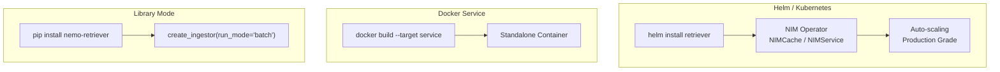

| Feature | Library Mode | Docker Service | Helm (Kubernetes) |
|---------|--------------|----------------|-------------------|
| **Target Use Case** | Dev / Small scale (<100 PDFs) | Standalone validation | Production / Large scale |
| **Scaling** | Single Node | Single Container | Multi-node (Ray/K8s) |
| **Complexity** | Low | Moderate | High |
| **Infrastructure** | Local GPU or Hosted | Local GPU / Docker | K8s + NIM Operator |

Sources: [README.md:26-34](), [docs/docs/extraction/deployment-options.md:5-40](), [nemo_retriever/helm/README.md:1-12]()

### Decision Guide

- **Choose Library Mode** for rapid prototyping, notebooks, or processing fewer than 100 documents using hosted APIs [README.md:32-34]().
- **Choose Docker Service** for local containerized validation before moving to production [docs/docs/extraction/deployment-options.md:14-16]().
- **Choose Helm/Kubernetes** for production-level performance, high availability, and massive document volumes [README.md:26]().

Sources: [README.md:26-34](), [docs/docs/extraction/deployment-options.md:52-75]()

## System Architecture

The following diagram maps high-level concepts to specific code entities within the `nemo_retriever` package:

**Code-Level Component Mapping**

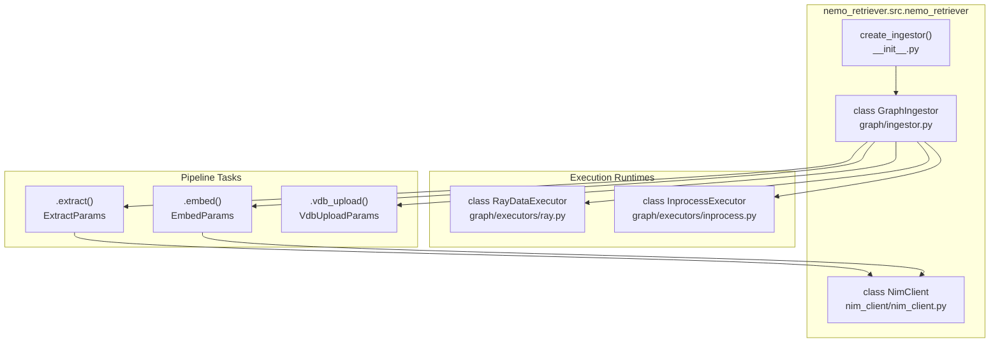

Sources: [README.md:37-61](), [docs/docs/extraction/faq.md:59-63](), [docs/docs/extraction/concepts.md:7-11]()

## Configuration

### Environment Variables
Key variables include:
- `NVIDIA_API_KEY`: For hosted NIM access [docs/docs/extraction/faq.md:47]().
- `INSTALL_FFMPEG`: Set to `true` in Helm or Docker to enable audio/video support at runtime [nemo_retriever/helm/README.md:105-108]().
- `EMBEDDER_BATCH_SIZE`: May need to be set to `3` for certain hardware like RTX 6000 [docs/docs/extraction/troubleshoot.md:90-99]().

Sources: [docs/docs/extraction/faq.md:36-53](), [docs/docs/extraction/troubleshoot.md:90-99](), [nemo_retriever/helm/README.md:104-114]()

### Helm Values
- `nimOperator.<nim_name>.enabled`: Controls which NIMs are deployed by the NIM Operator [docs/docs/extraction/prerequisites-support-matrix.md:69-70]().
- `service.installFfmpeg`: Enables `ffmpeg` installation inside the service pod [nemo_retriever/helm/README.md:109-114]().

Sources: [nemo_retriever/helm/README.md:109-114](), [docs/docs/extraction/prerequisites-support-matrix.md:95-105]()

## Next Steps

1. **Get API Keys**: Obtain your NGC or NVIDIA API key [docs/docs/extraction/getting-started-about.md:7]().
2. **Check Prerequisites**: Verify your GPU and Python environment [docs/docs/extraction/prerequisites-support-matrix.md:1-33]().
3. **Select Deployment**: Choose between [Deployment Options](#2.1).
4. **Quick Start**: Run the [Quick Start Tutorial](#2.3) to process your first PDF.

Sources: [docs/docs/extraction/getting-started-about.md:1-15]()

---

# Page: Deployment Options

# Deployment Options

<details>
<summary>Relevant source files</summary>

The following files were used as context for generating this wiki page:

- [.github/workflows/docker-build-arm.yml](.github/workflows/docker-build-arm.yml)
- [.github/workflows/docker-nightly-publish.yml](.github/workflows/docker-nightly-publish.yml)
- [.github/workflows/docker-release-publish.yml](.github/workflows/docker-release-publish.yml)
- [.github/workflows/release-docker.yml](.github/workflows/release-docker.yml)
- [.github/workflows/reusable-docker-build-and-test.yml](.github/workflows/reusable-docker-build-and-test.yml)
- [.github/workflows/reusable-docker-build.yml](.github/workflows/reusable-docker-build.yml)
- [.github/workflows/scheduled-nightly.yml](.github/workflows/scheduled-nightly.yml)
- [Dockerfile](Dockerfile)
- [docs/docs/extraction/deployment-options.md](docs/docs/extraction/deployment-options.md)
- [docs/docs/extraction/faq.md](docs/docs/extraction/faq.md)
- [docs/docs/extraction/multimodal-extraction.md](docs/docs/extraction/multimodal-extraction.md)
- [docs/docs/extraction/prerequisites-support-matrix.md](docs/docs/extraction/prerequisites-support-matrix.md)
- [docs/docs/extraction/troubleshoot.md](docs/docs/extraction/troubleshoot.md)
- [nemo_retriever/docs/cli/benchmarking.md](nemo_retriever/docs/cli/benchmarking.md)
- [nemo_retriever/helm/README.md](nemo_retriever/helm/README.md)

</details>


## Purpose and Scope

This page provides an overview of the three deployment architectures available for NeMo Retriever Library and guidance on selecting the appropriate mode for your use case. Each deployment option offers different trade-offs between features, complexity, resource requirements, and scalability.

For detailed setup instructions for each mode, see:
- [Docker Compose Deployment](#2.1.1) for self-hosted containerized environments.
- [Helm/Kubernetes Deployment](#2.1.2) for enterprise production environments using the NIM Operator.
- [Library Mode](#2.1.3) for development, local testing, and small-scale workloads.

## Deployment Architecture Comparison

NeMo Retriever Library supports three distinct deployment architectures, each optimized for different operational requirements:

```mermaid
graph TB
    subgraph "Docker Compose - Self-Hosted"
        DC_User["User Application"]
        DC_Compose["docker-compose.yaml"]
        DC_Runtime["nemo-retriever-service<br/>Port 7670"]
        DC_NIMs["NIM Containers<br/>nemotron-page-elements-v3<br/>nemotron-table-structure-v1<br/>nemotron-ocr-v1<br/>llama-nemotron-embed-vl-1b-v2"]
        DC_GPU["GPU Device<br/>CUDA_VISIBLE_DEVICES"]
        
        DC_User --> DC_Compose
        DC_Compose --> DC_Runtime
        DC_Compose --> DC_NIMs
        DC_NIMs --> DC_GPU
        DC_Runtime --> DC_NIMs
    end
    
    subgraph "Helm/Kubernetes - Production Scale"
        K8s_User["DevOps Team"]
        K8s_Helm["nemo-retriever Helm Chart"]
        K8s_Operator["NIM Operator<br/>NIMService CRDs"]
        K8s_Main["nemo-retriever-service Deployment<br/>CPU/Memory Limits"]
        K8s_NIMs["NIMService Resources<br/>page_elements<br/>table_structure<br/>ocr<br/>vlm_embed"]
        K8s_GPU["GPU Resources<br/>nvidia.com/gpu: 1<br/>MIG Support"]
        
        K8s_User --> K8s_Helm
        K8s_Helm --> K8s_Operator
        K8s_Helm --> K8s_Main
        K8s_Operator --> K8s_NIMs
        K8s_NIMs --> K8s_GPU
        K8s_Main --> K8s_NIMs
    end
    
    subgraph "Library Mode - Development"
        Lib_User["Python Process"]
        Lib_Ingestor["GraphIngestor<br/>run_mode='batch'"]
        Lib_NIMs["Remote NIMs<br/>build.nvidia.com<br/>NVIDIA_API_KEY"]
        Lib_VDB["LanceDB<br/>Local .lance files"]
        
        Lib_User --> Lib_Ingestor
        Lib_Ingestor --> Lib_NIMs
        Lib_Ingestor --> Lib_VDB
    end
```

**Diagram 1: Three Deployment Architectures**

Sources: [nemo_retriever/helm/README.md:1-23](), [docs/docs/extraction/deployment-options.md:5-50](), [docs/docs/extraction/faq.md:45-54]()

## Docker Compose (Self-Hosted)

Docker Compose deployment provides a standalone containerized environment. This is suitable for local validation of the service API and small-scale self-hosted workloads.

### Architecture Components

The `Dockerfile` provides a multi-stage build, where the `service` target is used for the API server [Dockerfile:140-140]().

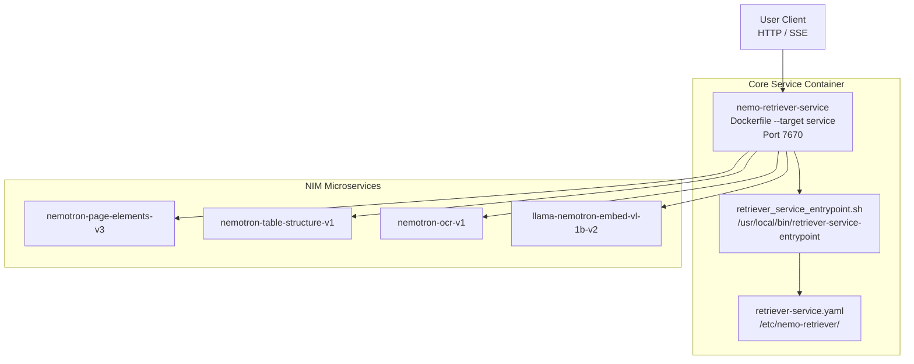

**Diagram 2: Docker Service Architecture**

The service container runs as the `nemo` user [Dockerfile:165-165]() and exposes port `7670` [Dockerfile:163-163](). It loads configuration from `/etc/nemo-retriever/retriever-service.yaml` [Dockerfile:142-142]().

Sources: [Dockerfile:123-170](), [docs/docs/extraction/deployment-options.md:14-17]()

## Helm/Kubernetes Deployment

Helm deployment is the recommended path for production, leveraging the **NVIDIA NIM Operator** to manage GPU-backed microservices [nemo_retriever/helm/README.md:18-22]().

### NIM Operator Integration

The chart manages `NIMCache` and `NIMService` custom resources [nemo_retriever/helm/README.md:18-19](). By default, it enables:
- `page_elements`: `nemotron-page-elements-v3` [docs/docs/extraction/prerequisites-support-matrix.md:73-73]()
- `table_structure`: `nemotron-table-structure-v1` [docs/docs/extraction/prerequisites-support-matrix.md:74-74]()
- `ocr`: `nemotron-ocr-v1` [docs/docs/extraction/prerequisites-support-matrix.md:75-75]()
- `vlm_embed`: `llama-nemotron-embed-vl-1b-v2` [docs/docs/extraction/prerequisites-support-matrix.md:76-76]()

### Air-Gapped Deployment

For air-gapped environments, users must:
1. Mirror images and models to a private registry [docs/docs/extraction/deployment-options.md:78-80]().
2. Build a custom service image containing `ffmpeg` and `ffprobe` [docs/docs/extraction/deployment-options.md:82-85]().
3. Configure the NIM Operator for air-gap mode [docs/docs/extraction/deployment-options.md:78-80]().

Sources: [nemo_retriever/helm/README.md:1-32](), [docs/docs/extraction/deployment-options.md:18-35](), [docs/docs/extraction/deployment-options.md:76-94]()

## Library Mode

Library mode allows running the ingestion pipeline directly in Python code [docs/docs/extraction/deployment-options.md:9-12](). It is often used with **NVIDIA-hosted NIMs** (build.nvidia.com) to avoid local GPU requirements [docs/docs/extraction/deployment-options.md:50-51]().

### Execution Patterns

- **In-process:** The pipeline runs within the caller's Python process.
- **Batch:** Uses Ray Data for parallel processing [docs/docs/extraction/prerequisites-support-matrix.md:28-29]().
- **LanceDB:** Uses local file-based vector storage [docs/docs/extraction/faq.md:15-15]().

### Authentication

In Library mode, the `NVIDIA_API_KEY` environment variable is used to authenticate with hosted NIMs [docs/docs/extraction/faq.md:47-47](). If using self-hosted NIMs with the library, users set specific endpoint variables like `*_ENDPOINT` [docs/docs/extraction/faq.md:49-51]().

Sources: [docs/docs/extraction/deployment-options.md:9-12](), [docs/docs/extraction/faq.md:45-54](), [docs/docs/extraction/faq.md:64-72]()

## Choosing a Deployment Mode

| Feature | Library Mode | Docker Compose | Helm/Kubernetes |
| :--- | :--- | :--- | :--- |
| **Best For** | Development, Notebooks | Local Testing, Small Service | Production, Enterprise |
| **GPU Requirement** | Optional (can use Cloud) | Required (Local) | Required (Cluster) |
| **Orchestration** | Python / Ray | Docker Compose | K8s / NIM Operator |
| **NIM Location** | Cloud or Remote | Local Containers | Cluster Pods |
| **Scaling** | Process-level | Single Node | Multi-node Autoscaling |
| **Auth Key** | `NVIDIA_API_KEY` | `NGC_API_KEY` | `ngc-secret` (K8s Secret) |

### Hardware Requirements Summary

- **Production:** 256 GB RAM, 32 CPU cores, and NVIDIA GPU with 24 GB+ VRAM (A100, H100, L40S) [docs/docs/extraction/prerequisites-support-matrix.md:36-38]().
- **Software:** Linux (Ubuntu 22.04+), CUDA 13.0+, Python 3.12 [docs/docs/extraction/prerequisites-support-matrix.md:7-9]().
- **Media Dependencies:** `ffmpeg` and `ffprobe` are required for audio/video [docs/docs/extraction/prerequisites-support-matrix.md:11-12]().

Sources: [docs/docs/extraction/prerequisites-support-matrix.md:1-63](), [docs/docs/extraction/deployment-options.md:5-75]()

---

# Page: Docker Compose Deployment

# Docker Compose Deployment

<details>
<summary>Relevant source files</summary>

The following files were used as context for generating this wiki page:

- [.github/workflows/docker-build-arm.yml](.github/workflows/docker-build-arm.yml)
- [.github/workflows/docker-nightly-publish.yml](.github/workflows/docker-nightly-publish.yml)
- [.github/workflows/docker-release-publish.yml](.github/workflows/docker-release-publish.yml)
- [.github/workflows/release-docker.yml](.github/workflows/release-docker.yml)
- [.github/workflows/reusable-docker-build-and-test.yml](.github/workflows/reusable-docker-build-and-test.yml)
- [.github/workflows/reusable-docker-build.yml](.github/workflows/reusable-docker-build.yml)
- [.github/workflows/scheduled-nightly.yml](.github/workflows/scheduled-nightly.yml)
- [Dockerfile](Dockerfile)
- [docker/scripts/entrypoint.sh](docker/scripts/entrypoint.sh)
- [docker/scripts/entrypoint_devcontainer.sh](docker/scripts/entrypoint_devcontainer.sh)
- [docker/scripts/entrypoint_source_ext.sh](docker/scripts/entrypoint_source_ext.sh)

</details>


This page provides detailed technical documentation for deploying NeMo Retriever Library using Docker Compose. This deployment mode offers a self-hosted, production-ready setup with all NIM microservices running locally in containers.

For information about alternative deployment methods, see [Helm/Kubernetes Deployment](#2.1.2) and [Library Mode](#2.1.3). For general guidance on choosing a deployment option, see [Deployment Options](#2.1).

## Overview

The Docker Compose deployment orchestrates multiple containerized services to create a complete document ingestion pipeline. The architecture is centered around a Ray-based runtime that manages document processing tasks and communicates with specialized NVIDIA NIMs.

- **Core runtime**: Container running the Ray-based pipeline orchestrator and the FastAPI service.
- **NVIDIA NIMs**: Specialized AI microservices for document processing (page-elements, table-structure, ocr, embedding).
- **Data services**: Redis message queue, Milvus vector database, and MinIO object storage.
- **Observability**: OpenTelemetry collector, Zipkin, Prometheus, and Grafana.

This deployment mode is recommended for production workloads requiring full control over infrastructure and the ability to run entirely on-premises.

**Sources:** [Dockerfile:123-140](), [docker/scripts/retriever_service_entrypoint.sh:1-20]()

## Service Architecture

The following diagram shows the containerized services and their communication patterns, associating system components with their code-level entrypoints and configurations.

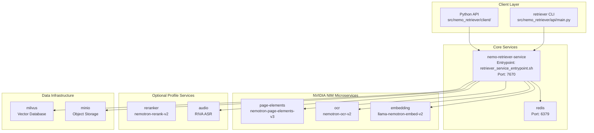

**Sources:** [Dockerfile:140-170](), [docker/scripts/entrypoint.sh:78-98](), [docker/scripts/retriever_service_entrypoint.sh:1-20]()

## Dockerfile and Build Stages

The NeMo Retriever Library uses a multi-stage Dockerfile to optimize image size and security.

### Multi-Stage Build Flow

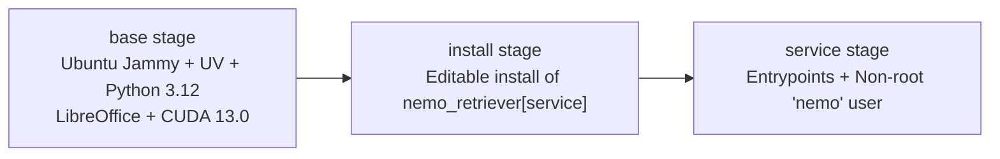

### Key Stages Implementation

| Stage | Purpose | Key Operations |
|-------|---------|----------------|
| `base` | Foundation | Installs system deps: `bzip2`, `curl`, `libreoffice`, and `cuda-toolkit-13-0`. Sets up `uv` for fast Python management. [Dockerfile:15-89]() |
| `install` | Package Setup | Performs an editable install of `nemo_retriever[service]` into `/opt/retriever_runtime`. [Dockerfile:101-118]() |
| `service` | Runtime | Configures the `nemo` user, sets the `NEMO_RETRIEVER_SERVICE_CONFIG` path, and copies entrypoint scripts. [Dockerfile:140-170]() |

**Sources:** [Dockerfile:15-170]()

## Profile System

Docker Compose profiles allow selective activation of optional features. While the base configuration provides core extraction and embedding, additional profiles enable retrieval and multimedia capabilities.

### Profile Activation

| Profile | Purpose | Services Enabled |
|---------|---------|------------------|
| Core (Default) | Document extraction and embedding | `nemo-retriever-service`, `redis`, `ocr`, `embedding` |
| `retrieval` | Persistent vector storage | `milvus`, `minio`, `etcd` |
| `audio` | Multimedia support | `riva-asr`, `audio-processing-worker` |

**Sources:** [Dockerfile:123-140](), [docker/scripts/entrypoint_source_ext.sh:20-24]()

## GPU Configuration

The deployment relies on NVIDIA Container Toolkit to expose GPUs to the services.

### Resource Allocation

All GPU-enabled NIM services and the Milvus vector database require GPU reservations. The `GPU_ID` environment variable is typically used to assign services to specific hardware.

- **NIM Services**: Require dedicated VRAM for model weights and inference buffers.
- **Milvus**: Uses GPU for IVF_HNSW_SQ index acceleration.
- **Runtime**: Generally runs on CPU (`CUDA_VISIBLE_DEVICES=-1`) but can leverage GPU if `RETRIEVER_ENABLE_TORCH_TRT` is enabled for local model optimization.

**Sources:** [Dockerfile:84-88](), [docker/scripts/entrypoint.sh:91-97]()

## Entrypoints and Container Lifecycle

The container lifecycle is managed by specialized shell scripts that handle environment preparation and service orchestration.

### `retriever-service-entrypoint`
Located at `/usr/local/bin/retriever-service-entrypoint` [Dockerfile:146](), this script is the primary entrypoint for the service image. It ensures the environment is correctly initialized before starting the FastAPI app via `retriever service start`.

### `entrypoint.sh`
This script handles the dual-launch of the API and the worker process [docker/scripts/entrypoint.sh:78-98]():
1. **Gunicorn Launch**: Starts the FastAPI app at `nv_ingest.api.main:app` with 32 workers [docker/scripts/entrypoint.sh:80-88]().
2. **Microservice Entrypoint**: Launches `microservice_entrypoint.py` which initializes the Ray runtime [docker/scripts/entrypoint.sh:93-96]().

### Dynamic Dependency Installation
The system supports just-in-time installation of optional dependencies via `entrypoint_source_ext.sh` [docker/scripts/entrypoint_source_ext.sh:1-31]():
- **Adobe SDK**: Installed if `INSTALL_ADOBE_SDK=true` [docker/scripts/entrypoint_source_ext.sh:10-18]().
- **Audio Deps**: `librosa` is installed via `uv pip` if missing [docker/scripts/entrypoint_source_ext.sh:20-24]().
- **Memory Tracing**: `memray` is installed if `MEM_TRACE` is set [docker/scripts/entrypoint_source_ext.sh:27-30]().

**Sources:** [docker/scripts/entrypoint.sh:1-98](), [docker/scripts/entrypoint_source_ext.sh:1-31](), [Dockerfile:146-169]()

## Environment Variables

Key variables for Docker Compose deployment:

| Variable | Default | Purpose |
|----------|---------|---------|
| `NEMO_RETRIEVER_SERVICE_CONFIG` | `/etc/nemo-retriever/retriever-service.yaml` | Path to the service configuration file. [Dockerfile:142]() |
| `INGEST_LOG_LEVEL` | `info` | Controls logging verbosity. [docker/scripts/entrypoint.sh:50]() |
| `INGEST_MEM_TRACE` | `false` | Enables memory profiling with `memray`. [docker/scripts/entrypoint.sh:35-43]() |
| `INSTALL_FFMPEG` | `false` | Triggers runtime installation of ffmpeg. [Dockerfile:7]() |

**Sources:** [Dockerfile:142](), [docker/scripts/entrypoint.sh:35-65]()

## Override Files

To adapt the deployment to different hardware or use cases, Docker Compose override files are used. These typically modify:
- **Replica Counts**: Increasing workers for high-throughput nodes.
- **GPU IDs**: Mapping services to specific GPUs on multi-GPU systems.
- **Volume Mounts**: Mapping local document directories to `/workspace/data` in the container [Dockerfile:9-10]().

**Sources:** [Dockerfile:6-10](), [Dockerfile:97-100]()

---

# Page: Helm/Kubernetes Deployment

# Helm/Kubernetes Deployment

<details>
<summary>Relevant source files</summary>

The following files were used as context for generating this wiki page:

- [docs/docs/extraction/deployment-options.md](docs/docs/extraction/deployment-options.md)
- [docs/docs/extraction/faq.md](docs/docs/extraction/faq.md)
- [docs/docs/extraction/multimodal-extraction.md](docs/docs/extraction/multimodal-extraction.md)
- [docs/docs/extraction/prerequisites-support-matrix.md](docs/docs/extraction/prerequisites-support-matrix.md)
- [docs/docs/extraction/troubleshoot.md](docs/docs/extraction/troubleshoot.md)
- [nemo_retriever/docs/cli/benchmarking.md](nemo_retriever/docs/cli/benchmarking.md)
- [nemo_retriever/helm/Chart.yaml](nemo_retriever/helm/Chart.yaml)
- [nemo_retriever/helm/README.md](nemo_retriever/helm/README.md)
- [nemo_retriever/helm/templates/NOTES.txt](nemo_retriever/helm/templates/NOTES.txt)
- [nemo_retriever/helm/templates/_helpers.tpl](nemo_retriever/helm/templates/_helpers.tpl)
- [nemo_retriever/helm/templates/configmap.yaml](nemo_retriever/helm/templates/configmap.yaml)
- [nemo_retriever/helm/templates/deployment.yaml](nemo_retriever/helm/templates/deployment.yaml)
- [nemo_retriever/helm/templates/hpa.yaml](nemo_retriever/helm/templates/hpa.yaml)
- [nemo_retriever/helm/templates/servicemonitor.yaml](nemo_retriever/helm/templates/servicemonitor.yaml)
- [nemo_retriever/helm/values.yaml](nemo_retriever/helm/values.yaml)
- [nemo_retriever/src/nemo_retriever/service/app.py](nemo_retriever/src/nemo_retriever/service/app.py)
- [nemo_retriever/src/nemo_retriever/service/client.py](nemo_retriever/src/nemo_retriever/service/client.py)
- [nemo_retriever/src/nemo_retriever/service/config.py](nemo_retriever/src/nemo_retriever/service/config.py)
- [nemo_retriever/src/nemo_retriever/service/models/requests.py](nemo_retriever/src/nemo_retriever/service/models/requests.py)
- [nemo_retriever/src/nemo_retriever/service/retriever-service.yaml](nemo_retriever/src/nemo_retriever/service/retriever-service.yaml)
- [nemo_retriever/src/nemo_retriever/service/routers/ingest.py](nemo_retriever/src/nemo_retriever/service/routers/ingest.py)
- [nemo_retriever/src/nemo_retriever/service/services/pipeline_executor.py](nemo_retriever/src/nemo_retriever/service/services/pipeline_executor.py)
- [nemo_retriever/src/nemo_retriever/service_ingestor.py](nemo_retriever/src/nemo_retriever/service_ingestor.py)

</details>


## Purpose and Scope

This page describes how to deploy the NeMo Retriever Library in **service mode** on Kubernetes using Helm charts and the NVIDIA NIM Operator. This deployment method is designed for production environments requiring scalability, high availability, and enterprise-grade orchestration.

For Docker-based local deployments, see [Docker Compose Deployment](2.1.1). For development and small-scale workloads, see [Library Mode](2.1.3). For comparing all deployment options, see [Deployment Options](2.1).

## Overview

The Helm-based Kubernetes deployment leverages the **NVIDIA NIM Operator** to manage NIM microservices as custom resources (`NIMCache` and `NIMService`). This approach provides:

- **Declarative NIM management**: NIMs are defined as Kubernetes custom resources from the `apps.nvidia.com/v1alpha1` API group [nemo_retriever/helm/values.yaml:5-10]().
- **Automatic model caching**: Managed `NIMCache` resources for model storage [nemo_retriever/helm/README.md:18-20]().
- **GPU resource isolation**: Support for time-slicing and MIG partitioning [docs/docs/extraction/deployment-options.md:74-75]().
- **Multi-pod topology**: Support for splitting the service into `gateway`, `realtime`, and `batch` roles for better resource isolation [nemo_retriever/helm/README.md:15-17]().

The Helm chart deploys:
- **The Service**: A FastAPI server built from the `service` target of the Dockerfile [nemo_retriever/helm/README.md:15-17]().
- **The NIMs**: Optional GPU-backed microservices (page-elements, table-structure, OCR, and VLM embed by default) [nemo_retriever/helm/README.md:5-7]().
- **Persistence**: SQLite on a single `ReadWriteOnce` PVC [nemo_retriever/helm/README.md:33-34]().

**Sources:** [nemo_retriever/helm/README.md:1-43](), [nemo_retriever/helm/values.yaml:1-11]()

## Deployment Architecture

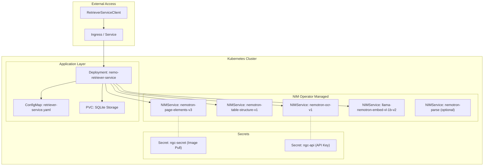

**Title:** Helm Deployment Resource Architecture

The chart auto-wires operator-managed Service URLs into the `retriever-service.yaml` configuration when the operator CRDs are present [nemo_retriever/helm/README.md:20-23]().

**Sources:** [nemo_retriever/helm/README.md:15-32](), [nemo_retriever/helm/templates/configmap.yaml:1-16](), [nemo_retriever/helm/values.yaml:21-64]()

## Prerequisites

### Required Software
- **Linux OS**: Ubuntu 22.04 or later recommended [docs/docs/extraction/prerequisites-support-matrix.md:7]().
- **NVIDIA Driver**: >= 580 [docs/docs/extraction/prerequisites-support-matrix.md:8]().
- **NVIDIA NIM Operator**: Must be installed to reconcile `NIMService` templates [nemo_retriever/helm/README.md:24-27]().
- **FFmpeg**: Required for audio/video extraction. Can be installed at runtime by setting `service.installFfmpeg=true` [nemo_retriever/helm/README.md:104-114]().

### Hardware Requirements
- **System Memory**: At least 256 GB RAM [docs/docs/extraction/prerequisites-support-matrix.md:36]().
- **CPU Cores**: At least 32 cores [docs/docs/extraction/prerequisites-support-matrix.md:37]().
- **GPU**: NVIDIA GPU with at least 24 GB VRAM (A100, H100, L40S) [docs/docs/extraction/prerequisites-support-matrix.md:38]().

**Sources:** [docs/docs/extraction/prerequisites-support-matrix.md:5-40](), [nemo_retriever/helm/README.md:24-27]()

## Installation and Configuration

### 1. Secrets Management
The chart can provision or reference existing secrets for NGC access:
- `ngcImagePullSecret`: Used for pulling images from `nvcr.io` [nemo_retriever/helm/values.yaml:34-40]().
- `ngcApiSecret`: Source for `NGC_API_KEY` and `NVIDIA_API_KEY` [nemo_retriever/helm/values.yaml:50-54]().

### 2. Service Configuration (`retriever-service.yaml`)
The `ConfigMap` template renders the `retriever-service.yaml` file used by the FastAPI app [nemo_retriever/helm/templates/configmap.yaml:1-3]().

| Key | Mapping in `configmap.yaml` | Default NIM Service Name |
|-----|-----------------------------|--------------------------|
| `page_elements` | `page_elements_invoke_url` | `nemotron-page-elements-v3` |
| `table_structure` | `table_structure_invoke_url` | `nemotron-table-structure-v1` |
| `ocr` | `ocr_invoke_url` | `nemotron-ocr-v1` |
| `vlm_embed` | `embed_invoke_url` | `llama-nemotron-embed-vl-1b-v2` |

**Sources:** [nemo_retriever/helm/templates/configmap.yaml:1-22](), [nemo_retriever/helm/values.yaml:34-58]()

### 3. Split Topology Deployment
For high-volume production, the chart supports a split topology via `topology.mode: split`. This deploys three separate roles [nemo_retriever/helm/templates/configmap.yaml:105-112]():
- **Gateway**: Routes requests to realtime or batch pods [nemo_retriever/src/nemo_retriever/service/config.py:104-117]().
- **Realtime**: Optimized for low-latency page processing [nemo_retriever/src/nemo_retriever/service/config.py:129-130]().
- **Batch**: Optimized for bulk document processing [nemo_retriever/src/nemo_retriever/service/config.py:131-132]().

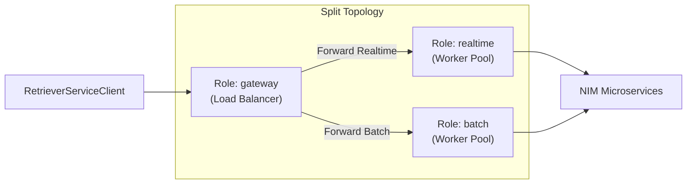

**Title:** Split Topology Data Flow

**Sources:** [nemo_retriever/helm/templates/configmap.yaml:105-131](), [nemo_retriever/src/nemo_retriever/service/config.py:18-117]()

## GPU Profile Selection and Management

### Time-Slicing vs MIG
- **Time-Slicing**: Allows multiple NIM workloads to share a single GPU. Recommended for development or when GPU resources are constrained [docs/docs/extraction/deployment-options.md:74-75]().
- **MIG (Multi-Instance GPU)**: Provides hardware-level isolation. Recommended for production to ensure deterministic performance [docs/docs/extraction/deployment-options.md:74-75]().

### Resource Requests
In `values.yaml`, resources are tuned based on worker counts. Each worker process consumes RAM proportional to the batch size [nemo_retriever/helm/values.yaml:123-132]().

```yaml
service:
  resources:
    requests:
      cpu: "16"
      memory: "16Gi"
    limits:
      cpu: "96"
      memory: "96Gi"
```

**Sources:** [nemo_retriever/helm/values.yaml:123-132](), [docs/docs/extraction/deployment-options.md:74-75]()

## Scaling and Autoscaling

### Horizontal Pod Autoscaler (HPA)
The chart includes HPA scaffolding (`hpa.yaml`). However, replicas must currently stay at **1** while the persistence layer uses SQLite (ReadWriteOnce PVC) [nemo_retriever/helm/README.md:33-36](). Multi-replica support is planned for the PostgreSQL backend migration [nemo_retriever/helm/README.md:33-36]().

### Worker Pool Tuning
Worker pools are configured in `retriever-service.yaml` under the `pipeline` section [nemo_retriever/helm/templates/configmap.yaml:59-63]():
- `realtime_workers`: Concurrent workers for low-latency tasks [nemo_retriever/src/nemo_retriever/service/config.py:129]().
- `batch_workers`: Concurrent workers for bulk processing [nemo_retriever/src/nemo_retriever/service/config.py:131]().

**Sources:** [nemo_retriever/helm/README.md:33-36](), [nemo_retriever/src/nemo_retriever/service/config.py:119-134]()

## Air-gapped Deployment

For disconnected environments:
1. Mirror images and models into a private registry [docs/docs/extraction/deployment-options.md:78-80]().
2. Set `service.installFfmpeg=false` (as it requires internet access for `apt-get`) [nemo_retriever/helm/README.md:145-148]().
3. Build a custom service image containing `ffmpeg` and `ffprobe` binaries [nemo_retriever/helm/README.md:149-156]().
4. Configure the NIM Operator for air-gap mode [docs/docs/extraction/deployment-options.md:78-80]().

**Sources:** [docs/docs/extraction/deployment-options.md:76-84](), [nemo_retriever/helm/README.md:145-156]()

---

# Page: Library Mode

# Library Mode

<details>
<summary>Relevant source files</summary>

The following files were used as context for generating this wiki page:

- [examples/launch_libmode_and_run_ingestor.py](examples/launch_libmode_and_run_ingestor.py)
- [examples/launch_libmode_service.py](examples/launch_libmode_service.py)
- [nemo_retriever/src/nemo_retriever/examples/graph_pipeline.py](nemo_retriever/src/nemo_retriever/examples/graph_pipeline.py)
- [nemo_retriever/src/nemo_retriever/graph/__init__.py](nemo_retriever/src/nemo_retriever/graph/__init__.py)
- [nemo_retriever/src/nemo_retriever/graph/webhook_operator.py](nemo_retriever/src/nemo_retriever/graph/webhook_operator.py)
- [nemo_retriever/src/nemo_retriever/ingestor.py](nemo_retriever/src/nemo_retriever/ingestor.py)
- [nemo_retriever/src/nemo_retriever/params/__init__.py](nemo_retriever/src/nemo_retriever/params/__init__.py)
- [nemo_retriever/tests/test_webhook_operator.py](nemo_retriever/tests/test_webhook_operator.py)

</details>


Library Mode provides a lightweight deployment option for running the NeMo Retriever Library pipeline directly in a Python process. It is designed for local development, experimentation, and small-scale workloads processing document collections. This mode allows developers to build and execute ingestion pipelines without requiring full Docker container orchestration or local NIM infrastructure.

For production deployments or processing large document collections, see [Docker Compose Deployment](#2.1.1) or [Helm/Kubernetes Deployment](#2.1.2).

---

## Overview of Execution Modes

The NeMo Retriever library supports different execution modes through its `create_ingestor` factory. Library Mode specifically refers to the use of `inprocess` and `batch` run modes within a local Python environment.

| Run Mode | Class | Implementation Detail |
| :--- | :--- | :--- |
| `inprocess` | `GraphIngestor` | Executes the graph using the `InprocessExecutor`. Optimized for single-node, low-latency processing using standard Python/Pandas logic. |
| `batch` | `GraphIngestor` | Executes the graph using the `RayDataExecutor`. Leverages Ray Data for parallelizing tasks across available CPU/GPU resources on a local machine or cluster. |
| `service` | `ServiceIngestor` | Communicates with a remote ingestion service via REST API. |

**Sources:** [nemo_retriever/src/nemo_retriever/ingestor.py:43-83](), [nemo_retriever/src/nemo_retriever/graph/__init__.py:13-13]()

---

## Architecture and Data Flow

Library Mode operates by constructing a directed acyclic graph (DAG) of processing operators. The user interacts with the `Ingestor` interface to define the pipeline, which is then materialized into a `Graph` and executed by an `AbstractExecutor`.

### Code Entity Space Mapping

The following diagram bridges the high-level pipeline concepts to the specific classes and functions implemented in the codebase.

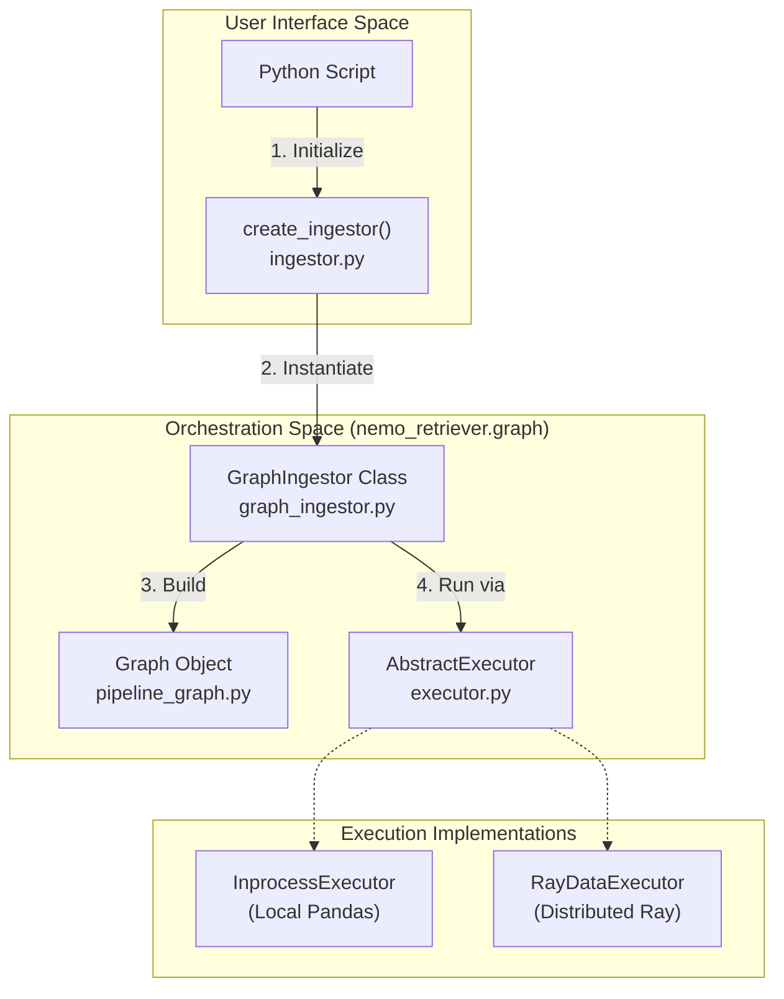

**Sources:** [nemo_retriever/src/nemo_retriever/ingestor.py:73-83](), [nemo_retriever/src/nemo_retriever/graph/__init__.py:9-17]()

---

## Running the Pipeline

Library Mode supports both synchronous and asynchronous execution patterns. It can be invoked via the Python API or through the `retriever pipeline run` CLI subcommand.

### Pattern 1: Python API (Fluent Interface)

The `Ingestor` class provides a fluent API for chaining tasks.

```python
from nemo_retriever.ingestor import create_ingestor

# 1. Create the ingestor instance
ingestor = create_ingestor(run_mode="inprocess")

# 2. Configure the pipeline (Fluent API)
ingestor.files("./data/sample.pdf") \
    .extract(extract_text=True, extract_tables=True) \
    .embed(model_name="nvidia/llama-nemotron-embed-1b-v2") \
    .vdb_upload(milvus_uri="milvus.db")

# 3. Execute synchronously
results = ingestor.ingest()
```

**Sources:** [nemo_retriever/src/nemo_retriever/ingestor.py:104-191](), [nemo_retriever/src/nemo_retriever/ingestor.py:73-83]()

### Pattern 2: Persistent Subprocess Service

For development environments where you want to keep a pipeline running to accept multiple requests, the library provides a utility to launch the pipeline in a separate subprocess.

```python
# Based on examples/launch_libmode_service.py
from nv_ingest.framework.orchestration.ray.util.pipeline.pipeline_runners import run_pipeline

# Start pipeline and block until interrupted
run_pipeline(
    block=True,
    disable_dynamic_scaling=True,
    run_in_subprocess=True,
)
```

**Sources:** [examples/launch_libmode_service.py:21-33](), [examples/launch_libmode_and_run_ingestor.py:61-87]()

---

## Message Broker and Clients

In Library Mode, the system often uses a `SimpleBroker` for communication between the client and the pipeline, typically listening on port `7671`.

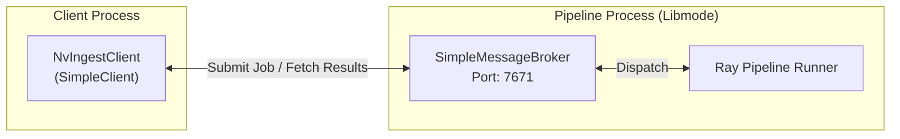

**Sources:** [examples/launch_libmode_and_run_ingestor.py:30-32](), [examples/launch_libmode_and_run_ingestor.py:71-75]()

---

## Configuration and Parameters

Pipeline stages are configured using Pydantic models defined in `nemo_retriever.params`. These models ensure type safety and validation for extraction, embedding, and storage tasks.

| Parameter Class | Purpose | Key Fields |
| :--- | :--- | :--- |
| `ExtractParams` | Document parsing | `extract_method`, `extract_text`, `extract_tables` |
| `EmbedParams` | Vector generation | `model_name`, `embed_modality`, `batch_size` |
| `VdbUploadParams` | Vector DB storage | `collection_name`, `milvus_uri`, `dense_dim` |
| `WebhookParams` | External notification | `endpoint_url`, `headers`, `timeout_s` |

**Sources:** [nemo_retriever/src/nemo_retriever/params/models.py:1-77](), [nemo_retriever/src/nemo_retriever/graph/webhook_operator.py:68-74]()

---

## Advanced Library Features

### Webhook Notifications
The `WebhookNotifyOperator` allows the pipeline to POST results to an external HTTP endpoint as a side-effect. This is useful for integrating the library into larger event-driven architectures without requiring a full service deployment.

```python
# Example configuration via the ingestor
ingestor.webhook(
    endpoint_url="https://api.example.com/ingest-webhook",
    headers={"Authorization": "Bearer token"},
    columns=["content", "metadata"]
)
```

**Sources:** [nemo_retriever/src/nemo_retriever/graph/webhook_operator.py:58-74](), [nemo_retriever/src/nemo_retriever/graph/webhook_operator.py:108-134]()

### UDF (User Defined Functions)
Users can inject custom logic into the graph using the `udf` method, which instantiates a `UDFOperator`. This allows for custom filtering, metadata enrichment, or data transformation between standard stages.

**Sources:** [nemo_retriever/src/nemo_retriever/ingestor.py:176-186](), [nemo_retriever/src/nemo_retriever/graph/__init__.py:12-12]()

---

# Page: Hardware Requirements

# Hardware Requirements

<details>
<summary>Relevant source files</summary>

The following files were used as context for generating this wiki page:

- [docs/docs/extraction/deployment-options.md](docs/docs/extraction/deployment-options.md)
- [docs/docs/extraction/faq.md](docs/docs/extraction/faq.md)
- [docs/docs/extraction/multimodal-extraction.md](docs/docs/extraction/multimodal-extraction.md)
- [docs/docs/extraction/prerequisites-support-matrix.md](docs/docs/extraction/prerequisites-support-matrix.md)
- [docs/docs/extraction/troubleshoot.md](docs/docs/extraction/troubleshoot.md)
- [nemo_retriever/docs/cli/benchmarking.md](nemo_retriever/docs/cli/benchmarking.md)
- [nemo_retriever/helm/README.md](nemo_retriever/helm/README.md)

</details>


This page documents the GPU, CPU, memory, and storage requirements for deploying NeMo Retriever Library. Hardware requirements vary significantly depending on which features are enabled. The core extraction pipeline is designed to consume significant CPU and memory resources to achieve maximal parallelism [docs/docs/extraction/prerequisites-support-matrix.md:28-29]().

---

## Software Requirements

Before deploying, ensure the host environment meets the following specifications:

- **Operating System**: Linux (Ubuntu 22.04 or later recommended) [docs/docs/extraction/prerequisites-support-matrix.md:7-7]().
- **CUDA Stack**: NVIDIA Driver >= `580`, CUDA >= `13.0` [docs/docs/extraction/prerequisites-support-matrix.md:8-8]().
- **Python**: Version `3.12` is required. Older versions will fail dependency resolution [docs/docs/extraction/prerequisites-support-matrix.md:9-9]().
- **Media Dependencies**: `ffmpeg` and `ffprobe` must be on `PATH` for audio/video extraction [docs/docs/extraction/prerequisites-support-matrix.md:11-13]().

Sources: [docs/docs/extraction/prerequisites-support-matrix.md:5-20]()

---

## GPU Requirements

### Supported GPU Hardware and Support Matrix

NeMo Retriever Library extraction core features run on a single A10G or better GPU [docs/docs/extraction/prerequisites-support-matrix.md:65-65]().

| Feature | GPU Requirement | Role |
| :--- | :--- | :--- |
| **Core Extraction** | NVIDIA GPU with >= 24 GB VRAM | Page layout, table structure, OCR, and VLM embedding [docs/docs/extraction/prerequisites-support-matrix.md:38-38](). |
| **Nemotron Parse** | A100 / H100 / L40S | Advanced PDF visual parsing [docs/docs/extraction/prerequisites-support-matrix.md:102-102](). |
| **Audio/Video** | NVIDIA GPU | Parakeet-1-1b-ctc-en-us for transcription [docs/docs/extraction/prerequisites-support-matrix.md:104-104](). |
| **Image Captioning** | NVIDIA GPU | Nemotron-3-Nano-Omni-30B-A3B-Reasoning [docs/docs/extraction/prerequisites-support-matrix.md:103-103](). |

### Default NIM Deployment (Helm)

By default, the production Helm chart enables the following NIM microservices, which are auto-wired into the retriever service [docs/docs/extraction/prerequisites-support-matrix.md:69-70]():

| Helm flag | NIM Image | Role |
| :--- | :--- | :--- |
| `page_elements` | `nemotron-page-elements-v3` | Page layout and element detection [docs/docs/extraction/prerequisites-support-matrix.md:73-73](). |
| `table_structure` | `nemotron-table-structure-v1` | Table structure extraction [docs/docs/extraction/prerequisites-support-matrix.md:74-74](). |
| `ocr` | `nvcr.io/nim/nvidia/nemotron-ocr-v1:1.3.0` | Image OCR [docs/docs/extraction/prerequisites-support-matrix.md:88-88](). |
| `vlm_embed` | `nvcr.io/nim/nvidia/llama-nemotron-embed-vl-1b-v2:1.12.0` | Multimodal (VL) embedding [docs/docs/extraction/prerequisites-support-matrix.md:92-92](). |

Sources: [docs/docs/extraction/prerequisites-support-matrix.md:63-104](), [nemo_retriever/helm/README.md:66-70]()

---

## CPU and Memory Requirements

### Recommended Production Specifications

To achieve maximal parallelism and handle large document volumes, the following specifications are recommended:

- **System Memory**: At least 256 GB RAM [docs/docs/extraction/prerequisites-support-matrix.md:36-36]().
- **CPU Cores**: At least 32 CPU cores [docs/docs/extraction/prerequisites-support-matrix.md:37-37]().
- **GPU**: NVIDIA GPU with at least 24 GB VRAM (e.g., A100, H100, L40S) [docs/docs/extraction/prerequisites-support-matrix.md:38-38]().

### Resource Consumption Dynamics

The pipeline performs runtime allocation based on system capacity [docs/docs/extraction/prerequisites-support-matrix.md:46-46](). Memory usage can reach full system capacity when processing large PDF files or image collections [docs/docs/extraction/prerequisites-support-matrix.md:47-55]().

**Note on GPU usage**:
- A GPU is required for inference using HuggingFace models or local NIMs [docs/docs/extraction/prerequisites-support-matrix.md:49-49]().
- A GPU is **NOT** required if using `build.nvidia.com` hosted inference [docs/docs/extraction/prerequisites-support-matrix.md:50-50]().

Sources: [docs/docs/extraction/prerequisites-support-matrix.md:28-61]()

---

## Resource Virtualization and Management

### GPU Sharing and Partitioning

In production environments (Kubernetes), the NIM Operator supports strategies to optimize GPU utilization [docs/docs/extraction/deployment-options.md:74-74]():

1.  **Time-Slicing**: Multiple NIM workloads share a GPU via time-multiplexing.
2.  **MIG (Multi-Instance GPU)**: Physically partitions supported GPUs (H100/A100) into isolated instances with dedicated compute/memory [docs/docs/extraction/deployment-options.md:74-74]().

### Hardware-to-Code Mapping: Resource Configuration

The following diagram illustrates how hardware resource constraints map to configuration entities in the codebase.

**Hardware Resource Mapping**
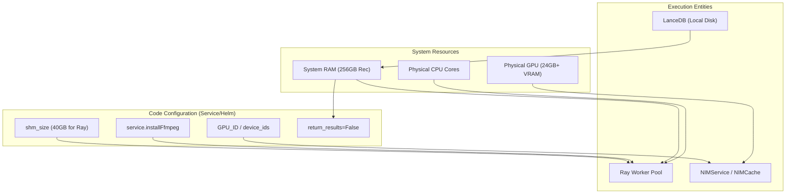

Sources: [nemo_retriever/helm/README.md:104-114](), [nemo_retriever/helm/README.md:37-41](), [docs/docs/extraction/prerequisites-support-matrix.md:34-38]()

---

## Storage and Persistence

### Disk Usage Considerations

- **LanceDB**: By default, NeMo Retriever uses LanceDB, which stores vectors as local Lance files on disk [docs/docs/extraction/faq.md:15-15]().
- **System Memory vs. Disk**: By default, the library stores results in system memory. For large datasets, users must use `save_to_disk` to avoid Out-of-Memory (OOM) errors [docs/docs/extraction/troubleshoot.md:79-84]().
- **Media Storage**: If `service.installFfmpeg=true` is set in Helm, the container requires a writable root filesystem [nemo_retriever/helm/README.md:138-143]().

### Data Flow and Storage Diagram

**Ingestion Data Flow and Storage Entities**
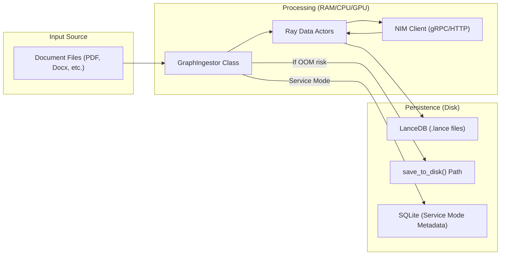

Sources: [docs/docs/extraction/faq.md:15-15](), [docs/docs/extraction/troubleshoot.md:83-84](), [nemo_retriever/helm/README.md:33-35]()

---

## Throughput and Scaling

Throughput is highly dependent on content complexity rather than just file size [docs/docs/extraction/multimodal-extraction.md:92-92]().

- **Pages/sec**: Generally the most useful metric for PDF/Document processing [docs/docs/extraction/multimodal-extraction.md:98-98]().
- **Scaling**: For high volumes, increase CPU cores for parallel extraction and utilize multiple GPUs for distributed NIM inference [docs/docs/extraction/prerequisites-support-matrix.md:54-58]().
- **Optimization**: The `return_results` parameter in `ingestor.ingest()` defaults to `True`, which can incur significant system memory costs. Setting it to `False` is recommended for large-scale ingestion [nemo_retriever/helm/README.md:37-41]().

Sources: [docs/docs/extraction/multimodal-extraction.md:91-107](), [nemo_retriever/helm/README.md:37-41]()

---

# Page: Quick Start Tutorial

# Quick Start Tutorial

<details>
<summary>Relevant source files</summary>

The following files were used as context for generating this wiki page:

- [README.md](README.md)
- [docs/docs/extraction/api-keys.md](docs/docs/extraction/api-keys.md)
- [docs/docs/extraction/audio-video.md](docs/docs/extraction/audio-video.md)
- [docs/docs/extraction/concepts.md](docs/docs/extraction/concepts.md)
- [docs/docs/extraction/getting-started-about.md](docs/docs/extraction/getting-started-about.md)
- [docs/docs/extraction/overview.md](docs/docs/extraction/overview.md)
- [docs/mkdocs.yml](docs/mkdocs.yml)
- [nemo_retriever/README.md](nemo_retriever/README.md)
- [nemo_retriever/docs/cli/README.md](nemo_retriever/docs/cli/README.md)

</details>


This tutorial provides a step-by-step walkthrough for processing your first document with NeMo Retriever Library and querying the results. By the end of this guide, you will have successfully extracted multimodal content (text, tables, charts) from a PDF, stored it in a vector database, and performed a simple retrieval query.

**Scope**: This tutorial focuses on the end-to-end workflow for a single document. For detailed deployment configuration, see **Deployment Options (2.1)**. For comprehensive API usage patterns, see **Ingestor Python API (3.1)**. For production-scale considerations, see **GPU Resource Management (5.2)**.

---

## Prerequisites Verification

Before beginning this tutorial, verify that you have completed the prerequisites:

**For Library Mode Path:**
- Python 3.12+ installed [nemo_retriever/README.md:45]()
- `uv` package manager installed [nemo_retriever/README.md:45]()
- NVIDIA API key from [build.nvidia.com](https://build.nvidia.com) [docs/docs/extraction/api-keys.md:5]()
- CUDA 13.x compatible host (for local GPU inference) [nemo_retriever/README.md:21]()

**For Docker/Helm Path:**
- Access to `nvcr.io` via NGC API Key [docs/docs/extraction/api-keys.md:6]()
- Kubernetes cluster with Helm installed (for production) [README.md:26]()

**Sources:** [nemo_retriever/README.md:17-85](), [docs/docs/extraction/api-keys.md:1-51]()

---

## Tutorial Path Selection

The NeMo Retriever Library supports multiple execution modes. For this quick start, we focus on the **Batch Pipeline** which is the primary intended run mode [nemo_retriever/README.md:90]().

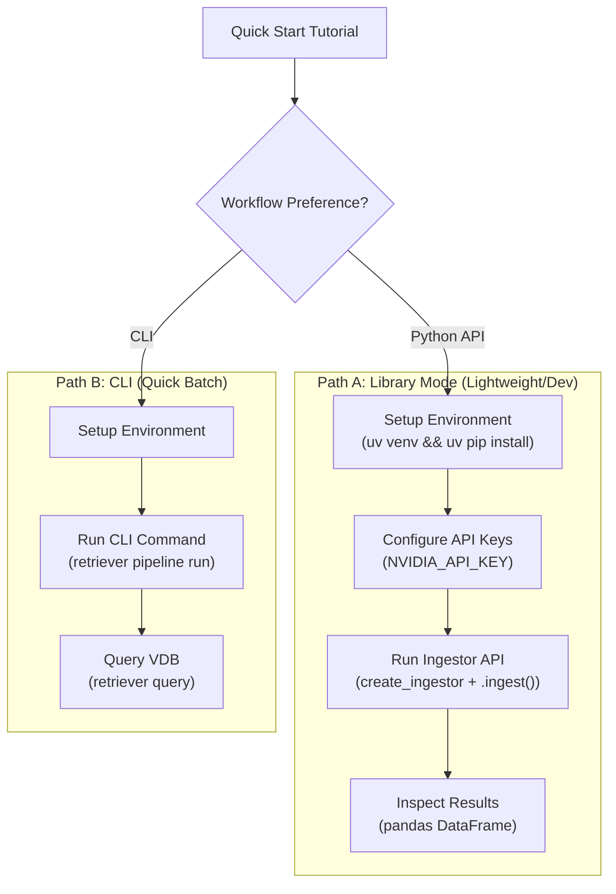

**Decision Criteria:**
- **Library Mode (Python API)**: Best for integration into existing Python applications or notebooks [README.md:34]().
- **CLI**: Best for quick batch processing and command-line automation [nemo_retriever/docs/cli/README.md:1-88]().

**Sources:** [README.md:32-61](), [nemo_retriever/README.md:1-138](), [nemo_retriever/docs/cli/README.md:1-151]()

---

## Path A: Library Mode (Python API)

### Step 1: Setup Environment

Create an isolated environment and install the library. If using local GPUs for inference, use the `[local]` extra [nemo_retriever/README.md:42]().

```bash
# Create and activate environment
uv venv retriever --python 3.12
source retriever/bin/activate

# Install for local GPU inference
uv pip install "nemo-retriever[local]==26.05-RC1"

# OR install for remote NIM inference only
# uv pip install nemo-retriever==26.05-RC1
```

**Sources:** [nemo_retriever/README.md:36-63]()

### Step 2: Configure API Keys

Set your `NVIDIA_API_KEY` to authorize calls to hosted NIMs [docs/docs/extraction/api-keys.md:5]().

```bash
export NVIDIA_API_KEY="nvapi-..."
```

**Sources:** [docs/docs/extraction/api-keys.md:10-24]()

### Step 3: Run the Ingestion Pipeline

Use the fluent `create_ingestor` API to define and execute the pipeline [README.md:38]().

```python
from nemo_retriever import create_ingestor
from pathlib import Path

# 1. Define input
documents = [str(Path("data/multimodal_test.pdf"))]

# 2. Create ingestor (run_mode="batch" is recommended)
ingestor = create_ingestor(run_mode="batch")

# 3. Chain tasks lazily
ingestor = (
  ingestor.files(documents)
  .extract(
    extract_text=True,
    extract_charts=True,
    extract_tables=True
  )
  .embed()
  .vdb_upload() # Uploads to LanceDB by default
)

# 4. Execute the pipeline
chunks = ingestor.ingest() # Returns a pandas.DataFrame
```

**Implementation Detail:** The `create_ingestor` factory instantiates a `GraphIngestor` which manages the underlying Ray Data execution graph [README.md:43-60]().

**Sources:** [README.md:37-61](), [nemo_retriever/README.md:94-116]()

### Step 4: Inspect Results

The results are returned as a `pandas.DataFrame` where each row represents an extracted element (text chunk, table, or chart) [README.md:60]().

```python
# View text from the first chunk
print(chunks.iloc[0]["text"])

# View a markdown-formatted table
print(chunks.iloc[1]["text"])
```

**Sources:** [README.md:65-77]()

---

## Path B: CLI Quick Start

The `retriever` CLI is a multi-subcommand Typer app for managing ingestion and queries [nemo_retriever/docs/cli/README.md:30]().

### Step 1: Ingest a PDF

Run the pipeline locally and write results to LanceDB [nemo_retriever/docs/cli/README.md:74]().

```bash
retriever pipeline run ./data/multimodal_test.pdf \
  --input-type pdf \
  --method pdfium \
  --extract-text --extract-tables --extract-charts \
  --save-intermediate ./processed_docs
```

### Step 2: Query the Results

Query the existing LanceDB table created in the previous step [nemo_retriever/docs/cli/README.md:87]().

```bash
retriever query "What gadgets are mentioned in the document?"
```

**Sources:** [nemo_retriever/docs/cli/README.md:72-88]()

---

## System Data Flow

The following diagram maps the high-level tutorial actions to the internal code entities and data services.

### Tutorial Data Flow (Natural Language to Code)

```mermaid
sequenceDiagram
    participant User as "User (Python Script/CLI)"
    participant CI as "create_ingestor() [nemo_retriever/src/nemo_retriever/__init__.py]"
    participant GI as "GraphIngestor [nemo_retriever/src/nemo_retriever/graph/ingestor.py]"
    participant Ray as "Ray Data Pipeline"
    participant NIM as "NVIDIA NIM (Remote/Local)"
    participant VDB as "LanceDB [nemo_retriever/src/nemo_retriever/graph/operators/lancedb.py]"

    User->>CI: Call create_ingestor(run_mode="batch")
    CI->>GI: Instantiate GraphIngestor
    User->>GI: Chain .files().extract().embed().vdb_upload()
    User->>GI: Call .ingest()
    GI->>Ray: Execute Graph (RayDataExecutor)
    Ray->>NIM: Request Extraction/Embedding
    NIM-->>Ray: Return Metadata/Vectors
    Ray->>VDB: Bulk Insert into Collection
    VDB-->>User: Return pandas.DataFrame
```

**Sources:** [README.md:37-61](), [docs/docs/extraction/concepts.md:7-19](), [nemo_retriever/docs/cli/README.md:30-45]()

---

## Key Configuration Options

### Extraction Parameters
The `.extract()` task is the core of the pipeline. It supports multiple methods and content types [docs/docs/extraction/overview.md:18]().

| Parameter | Default | Description |
| :--- | :--- | :--- |
| `extract_method` | `"pdfium"` | Options: `"pdfium"`, `"nemotron_parse"` (requires extra) |
| `extract_text` | `True` | Extract paragraphs and unstructured text |
| `extract_tables` | `True` | Extract and format tables (e.g., to Markdown) |
| `extract_charts` | `True` | Extract chart data and captions |

**Sources:** [README.md:48-54](), [docs/docs/extraction/overview.md:14-24]()

### Vector Database Upload
The `.vdb_upload()` stage manages the persistence of embeddings [docs/docs/extraction/concepts.md:19]().

| Option | Description |
| :--- | :--- |
| `vdb_op` | Database backend (Default: `"lancedb"`) |
| `collection_name` | The name of the table/collection to create/append to |

**Sources:** [docs/docs/extraction/overview.md:5-7](), [docs/docs/extraction/concepts.md:17-19]()

---

## Troubleshooting Quick Check

1.  **Missing CUDA libraries**: If OCR fails with `libcudart.so.13`, ensure CUDA 13.x is installed and `LD_LIBRARY_PATH` includes `/usr/local/cuda/lib64` [nemo_retriever/README.md:24-30]().
2.  **API Key Issues**: Ensure `NVIDIA_API_KEY` is exported if using remote NIMs. Hosted endpoints on `build.nvidia.com` require this key [docs/docs/extraction/api-keys.md:5-12]().
3.  **Multimedia Support**: If processing audio/video, ensure the `[multimedia]` extra and system `ffmpeg` are installed [docs/docs/extraction/audio-video.md:23-39]().

**Sources:** [nemo_retriever/README.md:21-30](), [docs/docs/extraction/api-keys.md:1-24](), [docs/docs/extraction/audio-video.md:1-45]()

---

# Page: User Guide

# User Guide

<details>
<summary>Relevant source files</summary>

The following files were used as context for generating this wiki page:

- [README.md](README.md)
- [docs/docs/extraction/audio-video.md](docs/docs/extraction/audio-video.md)
- [docs/docs/extraction/concepts.md](docs/docs/extraction/concepts.md)
- [docs/docs/extraction/getting-started-about.md](docs/docs/extraction/getting-started-about.md)
- [docs/docs/extraction/overview.md](docs/docs/extraction/overview.md)
- [docs/mkdocs.yml](docs/mkdocs.yml)
- [nemo_retriever/README.md](nemo_retriever/README.md)
- [nemo_retriever/docs/cli/README.md](nemo_retriever/docs/cli/README.md)

</details>


This guide explains how to use NeMo Retriever Library to process documents and extract multimodal content for RAG applications. It covers the primary user-facing interfaces—the Python API and command-line tools—and demonstrates the core workflow for submitting jobs, configuring extraction tasks, and retrieving results.

For deployment instructions and initial setup, see [Getting Started](#2). For advanced features like batch pipelines and GPU optimization, see [Advanced Topics](#5).

---

## Overview of User Interfaces

NeMo Retriever Library provides two primary interfaces for document processing:

1. **Python API**: The `Ingestor` class provides a fluent, chainable interface for building document processing pipelines programmatically. It supports `run_mode="batch"` for local Ray-based scaling and `run_mode="service"` for remote API calls. [README.md:32-61]()
2. **Command-Line Interface (CLI)**: The `retriever` command enables quick document processing from the terminal, replacing legacy ingestion-service tools. [nemo_retriever/docs/cli/README.md:1-34]()

Both interfaces submit jobs to the underlying service layer or local Ray-based execution graph and retrieve structured results containing extracted text, tables, charts, images, and embeddings. [docs/docs/extraction/concepts.md:5-16]()

---

## Core User Workflow

```mermaid
graph LR
    subgraph "User Space"
        Files["Document Files<br/>PDF/DOCX/Audio/Video"]
        UserCode["User Code<br/>Python or CLI"]
    end
    
    subgraph "Client Layer"
        Ingestor["GraphIngestor<br/>nemo_retriever/src/nemo_retriever/ingestor.py"]
        CLI["retriever CLI<br/>nemo_retriever/src/nemo_retriever/cli/main.py"]
    end
    
    subgraph "Execution Layer"
        RayData["Ray Data Pipeline<br/>batch_pipeline.py"]
        REST["FastAPI Service<br/>/v1/ingest"]
    end
    
    subgraph "Processing NIMs"
        Parse["nemotron-parse"]
        OCR["nemotron-ocr"]
        Embed["llama-nemotron-embed"]
        ASR["parakeet-ctc (RIVA)"]
    end
    
    subgraph "Storage"
        LDB["LanceDB<br/>Vector Database"]
        S3["Object Storage<br/>MinIO/S3"]
    end
    
    Files --> UserCode
    UserCode --> Ingestor
    UserCode --> CLI
    Ingestor --> RayData
    CLI --> RayData
    RayData --> Parse
    RayData --> OCR
    RayData --> Embed
    RayData --> ASR
    Parse --> LDB
    OCR --> LDB
    Embed --> LDB
    ASR --> LDB
    Parse --> S3
```

**Figure 1: High-Level User Workflow**

The typical workflow follows these stages:

1. **Configure Pipeline**: User code creates an `Ingestor` instance via `create_ingestor()` and chains task methods (`.extract()`, `.embed()`, etc.). [README.md:37-57]()
2. **Submit Jobs**: The `.ingest()` method executes the pipeline (locally via Ray or remotely via API). [README.md:59-61]()
3. **Process**: The system orchestrates NIMs or local models to extract, detect, and embed content. [docs/docs/extraction/overview.md:1-20]()
4. **Store**: Results are optionally uploaded to LanceDB and object storage. [docs/docs/extraction/concepts.md:17-20]()
5. **Retrieve**: The client receives a `pandas.DataFrame` or `Ray Dataset` containing extracted content and metadata. [docs/docs/extraction/concepts.md:13-16]()

**Sources:** [README.md:32-61](), [docs/docs/extraction/overview.md:1-20](), [docs/docs/extraction/concepts.md:5-20]()

---

## Task Chaining and Pipeline Building

The `Ingestor` implements a fluent interface where each method returns a modified ingestor instance, allowing for lazy definition of tasks. [README.md:45-57]()

### Ingestor Method to Code Entity Mapping

```mermaid
graph TB
    subgraph "Fluent API (nemo_retriever/ingestor.py)"
        Files[".files(paths)"]
        Extract[".extract(**kwargs)"]
        Embed[".embed(**kwargs)"]
        VdbUpload[".vdb_upload(**kwargs)"]
        Ingest[".ingest()"]
    end
    
    subgraph "Internal Operators (nemo_retriever/graph/)"
        ExtractOp["MultiTypeExtractOperator<br/>operators/extract.py"]
        EmbedOp["EmbeddingOperator<br/>operators/embed.py"]
        VdbOp["LanceDBOperator<br/>operators/lancedb.py"]
    end
    
    subgraph "Parameters (nemo_retriever/params/)"
        ExtractParams["ExtractParams"]
        EmbedParams["EmbedParams"]
        VdbParams["VdbUploadParams"]
    end
    
    Files --> Ingest
    Extract --> ExtractParams
    ExtractParams --> ExtractOp
    Embed --> EmbedParams
    EmbedParams --> EmbedOp
    VdbUpload --> VdbParams
    VdbParams --> VdbOp
    Ingest --> RayExecutor["RayDataExecutor<br/>executors/ray.py"]
```

**Figure 2: API Methods to Internal Operators**

**Key Methods:**

| Method | Purpose | Key Parameters | Detail Link |
|--------|---------|----------------|-------------|
| `.files(paths)` | Specify input files | `List[str]` or glob patterns | [Ingestor Python API](#3.1) |
| `.extract(...)` | Configure parsing | `extract_text`, `extract_tables`, `extract_method` | [Extraction Configuration](#3.3) |
| `.embed(...)` | Configure vectors | `model_name`, `embed_modality` | [Embedding Configuration](#3.4) |
| `.vdb_upload(...)` | Vector DB storage | `vdb_op='lancedb'`, `collection_name` | [Vector Database Upload](#3.5) |
| `.ingest()` | Execute pipeline | N/A (returns DataFrame) | [Ingestor Python API](#3.1) |

**Sources:** [README.md:46-61](), [nemo_retriever/README.md:94-116](), [docs/docs/extraction/concepts.md:21-30]()

---

## Command-Line Interface (CLI)

The `retriever` CLI provides a Typer-based interface for running pipelines and querying results. It replaces the legacy `ingestion-service` CLI. [nemo_retriever/docs/cli/README.md:27-34]()

### CLI Command Structure

| Subcommand | Purpose | Primary Use Case |
|------------|---------|------------------|
| `retriever ingest` | Ingest docs to LanceDB | Quick start and simple local indexing. |
| `retriever pipeline run` | Run full graph pipeline | Batch processing with fine-grained control. |
| `retriever query` | Search LanceDB | Testing retrieval and recall. |
| `retriever eval run` | Run QA evaluation | Measuring RAG quality with LLM-as-judge. |

**Example Command:**
```bash
retriever pipeline run ./data/multimodal_test.pdf \
  --input-type pdf \
  --method pdfium \
  --extract-text --extract-tables --extract-charts \
  --store-images-uri ./processed_docs/images
```
[nemo_retriever/docs/cli/README.md:74-81]()

For details, see [Command Line Interface](#3.2).

---

## Core Configuration Topics

### Extraction and Parsing
NeMo Retriever supports multiple extraction methods per document type. For example, PDFs can use standard `pdfium` or the advanced `nemotron_parse` NIM for complex layouts. [docs/docs/extraction/overview.md:14-20]()
For details, see [Extraction Configuration](#3.3).

### Multimodal Embeddings
The system can compute embeddings for text, images, or combined text+image elements using `llama-nemotron-embed` models. [docs/docs/extraction/concepts.md:17-20]()
For details, see [Embedding Configuration](#3.4).

### Vector Database Upload
Extracted elements and their embeddings are stored in LanceDB by default. The system supports metadata sidecars for filtered retrieval. [README.md:20-21](), [docs/docs/extraction/overview.md:5-7]()
For details, see [Vector Database Upload](#3.5).

### RAG Integration
The library integrates with LangChain and LlamaIndex, allowing the ingested content to be used directly in generative AI applications. [docs/docs/extraction/overview.md:53-54]()
For details, see [RAG Integration Examples](#3.6).

---

## Next Steps

- **[Ingestor Python API](#3.1)** — Document the fluent Ingestor API for configuring and executing ingestion pipelines.
- **[Command Line Interface](#3.2)** — Document the retriever CLI commands and options.
- **[Extraction Configuration](#3.3)** — Guide for configuring document extraction across different formats.
- **[Embedding Configuration](#3.4)** — Document embedding generation and modality control.
- **[Vector Database Upload](#3.5)** — Guide for uploading embeddings to LanceDB or Milvus.
- **[RAG Integration Examples](#3.6)** — Demonstrate integration with popular LLM frameworks.

**Sources:** [docs/mkdocs.yml:75-120](), [nemo_retriever/docs/cli/README.md:50-59]()

---

# Page: Ingestor Python API

# Ingestor Python API

<details>
<summary>Relevant source files</summary>

The following files were used as context for generating this wiki page:

- [nemo_retriever/src/nemo_retriever/examples/graph_pipeline.py](nemo_retriever/src/nemo_retriever/examples/graph_pipeline.py)
- [nemo_retriever/src/nemo_retriever/graph/__init__.py](nemo_retriever/src/nemo_retriever/graph/__init__.py)
- [nemo_retriever/src/nemo_retriever/graph/executor.py](nemo_retriever/src/nemo_retriever/graph/executor.py)
- [nemo_retriever/src/nemo_retriever/graph/ingestor_runtime.py](nemo_retriever/src/nemo_retriever/graph/ingestor_runtime.py)
- [nemo_retriever/src/nemo_retriever/graph/multi_type_extract_operator.py](nemo_retriever/src/nemo_retriever/graph/multi_type_extract_operator.py)
- [nemo_retriever/src/nemo_retriever/graph/webhook_operator.py](nemo_retriever/src/nemo_retriever/graph/webhook_operator.py)
- [nemo_retriever/src/nemo_retriever/graph_ingestor.py](nemo_retriever/src/nemo_retriever/graph_ingestor.py)
- [nemo_retriever/src/nemo_retriever/ingestor.py](nemo_retriever/src/nemo_retriever/ingestor.py)
- [nemo_retriever/src/nemo_retriever/params/__init__.py](nemo_retriever/src/nemo_retriever/params/__init__.py)
- [nemo_retriever/src/nemo_retriever/utils/input_files.py](nemo_retriever/src/nemo_retriever/utils/input_files.py)
- [nemo_retriever/tests/test_ingest_interface.py](nemo_retriever/tests/test_ingest_interface.py)
- [nemo_retriever/tests/test_ingest_plans.py](nemo_retriever/tests/test_ingest_plans.py)
- [nemo_retriever/tests/test_pipeline_graph.py](nemo_retriever/tests/test_pipeline_graph.py)
- [nemo_retriever/tests/test_webhook_operator.py](nemo_retriever/tests/test_webhook_operator.py)

</details>


## Purpose and Scope

The Ingestor Python API provides a fluent, high-level interface for building and executing document ingestion pipelines. It allows users to define complex multimodal processing workflows—including file loading, extraction, chunking, embedding, and vector database upload—through a builder pattern.

The API supports multiple execution modes:
- **Library Mode (`inprocess`)**: Runs the pipeline directly in the local Python process using pandas. [nemo_retriever/src/nemo_retriever/graph/executor.py:60-68]()
- **Batch Mode (`batch`)**: Executes large-scale distributed pipelines using Ray Data. [nemo_retriever/src/nemo_retriever/graph/executor.py:161-174]()
- **Service Mode (`service`)**: Submits processing requests to a remote FastAPI-based ingestion service. [nemo_retriever/src/nemo_retriever/ingestor.py:58-68]()

This page covers the `GraphIngestor` and `create_ingestor` factory. For details on building pipelines, see [Task Chaining and Pipeline Building](#3.1.1). For details on execution and error handling, see [Job Management and Results](#3.1.2).

---

## Architecture Overview

The Ingestor API translates fluent method calls into an execution graph. In library and batch modes, this graph is composed of `Node` objects containing `AbstractOperator` implementations.

### Natural Language to Code Entity Space

The following diagram maps high-level pipeline concepts to the specific classes and functions in the codebase.

**Pipeline Component Mapping**
```mermaid
graph TB
    subgraph "Natural Language Space"
        Input["Input Documents"]
        Pipeline["Ingestion Pipeline"]
        Stage["Processing Stage"]
        Run["Execution"]
    end
    
    subgraph "Code Entity Space"
        GraphIngestor["GraphIngestor<br/>(graph_ingestor.py)"]
        Graph["Graph<br/>(pipeline_graph.py)"]
        Node["Node<br/>(pipeline_graph.py)"]
        Operator["AbstractOperator<br/>(abstract_operator.py)"]
        Executor["AbstractExecutor<br/>(executor.py)"]
    end
    
    Input --> GraphIngestor
    Pipeline --> Graph
    Stage --> Node
    Node --> Operator
    Run --> Executor
    
    GraphIngestor --"builds"--> Graph
    Executor --"runs"--> Graph
```
**Sources:** [nemo_retriever/src/nemo_retriever/graph_ingestor.py:114-136](), [nemo_retriever/src/nemo_retriever/graph/pipeline_graph.py:16-28](), [nemo_retriever/src/nemo_retriever/graph/executor.py:42-47]()

---

## Core API Entry Points

### create_ingestor Factory
The `create_ingestor` function is the primary entry point for initializing an ingestor based on the desired `run_mode`.

| Run Mode | Implementation | Description |
| :--- | :--- | :--- |
| `inprocess` | `GraphIngestor` | Sequential execution on local CPU/GPU using pandas. |
| `batch` | `GraphIngestor` | Distributed execution using Ray Data actor pools. |
| `service` | `ServiceIngestor` | Proxy that forwards tasks to a remote REST API. |

**Sources:** [nemo_retriever/src/nemo_retriever/ingestor.py:43-83]()

### GraphIngestor Class
`GraphIngestor` implements the fluent builder pattern. It maintains internal state for task parameters (e.g., `ExtractParams`, `EmbedParams`) and constructs the execution `Graph` when `.ingest()` is called.

**Ingestor Internal Flow**
```mermaid
sequenceDiagram
    participant User
    participant GI as GraphIngestor
    participant Runtime as ingestor_runtime.py
    participant Exec as RayDataExecutor/InprocessExecutor
    
    User->>GI: create_ingestor(run_mode='batch')
    User->>GI: .files(['/*.pdf']).extract().embed()
    User->>GI: .ingest()
    GI->>Runtime: build_graph(params)
    Runtime-->>GI: Graph Object
    GI->>Exec: ingest(data, graph)
    Exec-->>User: Result (DataFrame/Dataset)
```
**Sources:** [nemo_retriever/src/nemo_retriever/graph_ingestor.py:15-25](), [nemo_retriever/src/nemo_retriever/graph/ingestor_runtime.py:101-150]()

---

## Configuration and Parameters

The API uses structured dataclasses for configuration, ensuring type safety and validation. These are defined in `nemo_retriever.params`.

| Parameter Class | Purpose |
| :--- | :--- |
| `ExtractParams` | Configures document parsing (OCR, tables, charts). |
| `EmbedParams` | Configures embedding models and NIM endpoints. |
| `VdbUploadParams` | Configures vector database (LanceDB/Milvus) settings. |
| `TextChunkParams` | Defines text splitting and chunking strategies. |
| `BatchTuningParams` | Controls Ray resource allocation (GPU fractions, concurrency). |

**Sources:** [nemo_retriever/src/nemo_retriever/params/models.py:1-37](), [nemo_retriever/src/nemo_retriever/graph_ingestor.py:48-65]()

---

## Basic Usage Pattern

The following example demonstrates the typical fluent pattern for a PDF ingestion pipeline.

```python
from nemo_retriever.ingestor import create_ingestor
from nemo_retriever.params import ExtractParams, EmbedParams

# 1. Initialize the ingestor
ingestor = create_ingestor(run_mode="batch")

# 2. Chain tasks and execute
results = (
    ingestor.files(["/data/manual.pdf"])
    .extract(ExtractParams(method="pdfium_hybrid", extract_tables=True))
    .embed(EmbedParams(model_name="nvidia/llama-nemotron-embed-1b-v2"))
    .ingest()
)
```

### Resource Heuristics
When running in `batch` mode, `GraphIngestor` automatically calculates resource requirements (CPU/GPU) based on the cluster state and the tasks configured. This logic is handled by `batch_tuning_to_node_overrides`.

**Sources:** [nemo_retriever/src/nemo_retriever/graph/ingestor_runtime.py:75-107](), [nemo_retriever/src/nemo_retriever/graph/executor.py:182-194]()

---

## Child Pages

- [Task Chaining and Pipeline Building](#3.1.1) — Detailed documentation on the `.extract()`, `.embed()`, `.vdb_upload()`, and `.udf()` methods.
- [Job Management and Results](#3.1.2) — Covers asynchronous execution, progress tracking, and handling `GraphIngestionError`.

---

# Page: Task Chaining and Pipeline Building

# Task Chaining and Pipeline Building

<details>
<summary>Relevant source files</summary>

The following files were used as context for generating this wiki page:

- [nemo_retriever/src/nemo_retriever/adapters/cli/main.py](nemo_retriever/src/nemo_retriever/adapters/cli/main.py)
- [nemo_retriever/src/nemo_retriever/adapters/cli/sdk_workflow.py](nemo_retriever/src/nemo_retriever/adapters/cli/sdk_workflow.py)
- [nemo_retriever/src/nemo_retriever/graph/executor.py](nemo_retriever/src/nemo_retriever/graph/executor.py)
- [nemo_retriever/src/nemo_retriever/graph/ingestor_runtime.py](nemo_retriever/src/nemo_retriever/graph/ingestor_runtime.py)
- [nemo_retriever/src/nemo_retriever/graph/multi_type_extract_operator.py](nemo_retriever/src/nemo_retriever/graph/multi_type_extract_operator.py)
- [nemo_retriever/src/nemo_retriever/graph_ingestor.py](nemo_retriever/src/nemo_retriever/graph_ingestor.py)
- [nemo_retriever/src/nemo_retriever/params/utils.py](nemo_retriever/src/nemo_retriever/params/utils.py)
- [nemo_retriever/src/nemo_retriever/utils/input_files.py](nemo_retriever/src/nemo_retriever/utils/input_files.py)
- [nemo_retriever/tests/test_ingest_interface.py](nemo_retriever/tests/test_ingest_interface.py)
- [nemo_retriever/tests/test_ingest_plans.py](nemo_retriever/tests/test_ingest_plans.py)
- [nemo_retriever/tests/test_params_utils.py](nemo_retriever/tests/test_params_utils.py)
- [nemo_retriever/tests/test_pipeline_graph.py](nemo_retriever/tests/test_pipeline_graph.py)
- [nemo_retriever/tests/test_root_cli_workflow.py](nemo_retriever/tests/test_root_cli_workflow.py)

</details>


This page explains how to use the `GraphIngestor` fluent API to build document processing pipelines by chaining tasks together. It covers the underlying graph operator model, execution modes, and the use of custom operators.

## Purpose and Scope

The NeMo Retriever Library (specifically within the NVIDIA Ingest framework) provides a declarative, chainable interface for building document ingestion pipelines. Rather than manually constructing complex execution graphs, you use the `GraphIngestor` class to build pipelines by chaining method calls like `.files().extract().embed().vdb_upload()`. This page documents:

- The `GraphIngestor` fluent API and task methods.
- The Graph operator model (CPU, GPU, and Archetype operators).
- Execution modes: Batch (Ray-based) and Inprocess (Pandas-based).
- Task expansion and resource heuristics.
- Using `UDFOperator` for custom processing stages.

## The GraphIngestor Interface

The `GraphIngestor` class provides a fluent interface where each method returns `self`, enabling continuous chaining. It serves as a builder that eventually materializes a `Graph` object composed of `Node` entities.

```mermaid
graph TB
    User["User Code"]
    GI["GraphIngestor<br/>nemo_retriever/src/nemo_retriever/graph_ingestor.py"]
    
    User --> GI
    
    subgraph "Chaining Methods (returns self)"
        Files[".files()"]
        Extract[".extract()"]
        Embed[".embed()"]
        VDB[".vdb_upload()"]
        Caption[".caption()"]
        Store[".store()"]
    end
    
    GI --> Files
    GI --> Extract
    GI --> Embed
    GI --> VDB
    
    subgraph "Execution"
        Ingest[".ingest()"]
        Executor["AbstractExecutor<br/>(RayDataExecutor / InprocessExecutor)"]
    end
    
    GI --> Ingest
    Ingest --> Executor
```

**Sources:**
- [nemo_retriever/src/nemo_retriever/graph_ingestor.py:15-25]()
- [nemo_retriever/src/nemo_retriever/graph_ingestor.py:94-138]()

## Task Method Reference

The following table lists the primary task methods available on the `GraphIngestor` class.

| Method | Purpose | Key Parameters |
|--------|---------|----------------|
| `.files(paths)` | Defines input file patterns/globs | `paths`: list of strings |
| `.extract(params)` | Configures document extraction | `ExtractParams` (method, extract_text, etc.) |
| `.embed(params)` | Configures embedding generation | `EmbedParams` (model_name, invoke_url) |
| `.vdb_upload(params)`| Configures vector database sink | `VdbUploadParams` (uri, table_name) |
| `.caption(params)` | Configures image captioning | `CaptionParams` |
| `.store(params)` | Configures object storage (MinIO) | `StoreParams` |
| `.udf(op_class, **kwargs)`| Adds a custom operator | `op_class`: Class deriving from `AbstractOperator` |

**Sources:**
- [nemo_retriever/src/nemo_retriever/graph_ingestor.py:18-24]()
- [nemo_retriever/src/nemo_retriever/graph_ingestor.py:48-65]()

## Pipeline Graph Model

When `.ingest()` is called, the `GraphIngestor` builds a `Graph` consisting of `Node` objects. Each `Node` wraps an `operator_class` and its `operator_kwargs`.

### Operator Types
The system uses three main operator archetypes to handle different hardware requirements:

1.  **CPUOperator**: Optimized for CPU-bound tasks (e.g., text splitting).
2.  **GPUOperator**: Designed for local GPU inference, requesting a specific GPU fraction.
3.  **ArchetypeOperator**: A "meta-operator" that resolves to either a `CPUOperator` or `GPUOperator` at runtime based on the presence of a remote NIM endpoint or local GPU availability.

```mermaid
graph TD
    subgraph "Code Entity Space"
        AO["ArchetypeOperator<br/>nemo_retriever/src/nemo_retriever/graph/operator_archetype.py"]
        CPUOp["CPUOperator<br/>nemo_retriever/src/nemo_retriever/graph/cpu_operator.py"]
        GPUOp["GPUOperator<br/>nemo_retriever/src/nemo_retriever/graph/gpu_operator.py"]
        Res["resolve_graph()<br/>nemo_retriever/src/nemo_retriever/graph/operator_resolution.py"]
    end

    AO -->|"Resolves to"| Res
    Res --> CPUOp
    Res --> GPUOp
```

**Sources:**
- [nemo_retriever/src/nemo_retriever/graph/operator_archetype.py:1-20]()
- [nemo_retriever/src/nemo_retriever/graph/operator_resolution.py:17-30]()
- [nemo_retriever/src/nemo_retriever/graph/pipeline_graph.py:28-45]()

## Execution Modes

Pipelines can be executed in two primary modes via `AbstractExecutor` implementations:

### 1. Batch Mode (`RayDataExecutor`)
The default for production. It builds a Ray Data pipeline where each `Node` becomes a `map_batches` stage. Heavy GPU models are loaded on Ray workers using deferred construction (`fn_constructor_kwargs`) to prevent serialization issues.

### 2. Inprocess Mode (`InprocessExecutor`)
Used for local debugging and CI. It runs the graph sequentially on Pandas DataFrames without Ray. It only supports linear (single-root) graphs.

**Sources:**
- [nemo_retriever/src/nemo_retriever/graph/executor.py:42-58]()
- [nemo_retriever/src/nemo_retriever/graph/executor.py:60-141]()
- [nemo_retriever/src/nemo_retriever/graph/executor.py:161-195]()

## Automatic Task Expansion and Resource Heuristics

The `MultiTypeExtractOperator` is a key component that handles mixed file types (PDF, Images, Audio, Video, HTML, Text). It automatically routes files to the appropriate sub-actors (e.g., `PDFExtractionActor`, `ASRActor`).

### Resource Overrides
The `batch_tuning_to_node_overrides` function calculates optimal Ray resource allocations (CPUs/GPUs) for each stage based on:
- `BatchTuningParams` provided in the task parameters.
- Cluster resource heuristics (available GPUs/CPUs).
- Whether remote NIM endpoints are configured (which offloads GPU requirements).

```mermaid
graph LR
    Params["ExtractParams / EmbedParams"]
    Tuning["BatchTuningParams"]
    Heuristics["batch_tuning_to_node_overrides()"]
    RayOverrides["Ray Node Overrides"]

    Params --> Tuning
    Tuning --> Heuristics
    Heuristics --> RayOverrides
```

**Sources:**
- [nemo_retriever/src/nemo_retriever/graph/ingestor_runtime.py:75-120]()
- [nemo_retriever/src/nemo_retriever/graph/multi_type_extract_operator.py:149-175]()

## Custom Stages with UDFOperator

To extend the pipeline with custom logic, use the `UDFOperator`. This allows you to wrap a Python function or a class and insert it into the graph.

```python
from nemo_retriever.graph import UDFOperator
from nemo_retriever.graph_ingestor import GraphIngestor

def custom_logic(df):
    df["custom_field"] = df["text"].apply(lambda x: x.upper())
    return df

ingestor = (
    GraphIngestor(run_mode="batch")
    .files(["/data/*.txt"])
    .extract()
    .udf(UDFOperator, func=custom_logic) # Insert custom stage
    .ingest()
)
```

**Sources:**
- [nemo_retriever/src/nemo_retriever/graph/ingestor_runtime.py:19-25]()
- [nemo_retriever/tests/test_pipeline_graph.py:15-28]()

## Error Handling: GraphIngestionError

When a pipeline is executed with `error_policy='collect'`, row-level errors from remote NIMs or local operators are captured. If significant failures occur, `GraphIngestor` raises a `GraphIngestionError` which includes:
- Structured row-level error records.
- Diagnostic info mapping columns to specific NIM endpoints.
- A troubleshooting footer with HTTP status codes and suggested actions.

**Sources:**
- [nemo_retriever/src/nemo_retriever/graph_ingestor.py:114-138]()
- [nemo_retriever/src/nemo_retriever/graph_ingestor.py:151-193]()

---

# Page: Job Management and Results

# Job Management and Results

<details>
<summary>Relevant source files</summary>

The following files were used as context for generating this wiki page:

- [nemo_retriever/src/nemo_retriever/graph/executor.py](nemo_retriever/src/nemo_retriever/graph/executor.py)
- [nemo_retriever/src/nemo_retriever/graph/ingestor_runtime.py](nemo_retriever/src/nemo_retriever/graph/ingestor_runtime.py)
- [nemo_retriever/src/nemo_retriever/graph/multi_type_extract_operator.py](nemo_retriever/src/nemo_retriever/graph/multi_type_extract_operator.py)
- [nemo_retriever/src/nemo_retriever/graph_ingestor.py](nemo_retriever/src/nemo_retriever/graph_ingestor.py)
- [nemo_retriever/src/nemo_retriever/io/dataframe.py](nemo_retriever/src/nemo_retriever/io/dataframe.py)
- [nemo_retriever/src/nemo_retriever/io/markdown.py](nemo_retriever/src/nemo_retriever/io/markdown.py)
- [nemo_retriever/src/nemo_retriever/utils/input_files.py](nemo_retriever/src/nemo_retriever/utils/input_files.py)
- [nemo_retriever/tests/test_ingest_interface.py](nemo_retriever/tests/test_ingest_interface.py)
- [nemo_retriever/tests/test_ingest_plans.py](nemo_retriever/tests/test_ingest_plans.py)
- [nemo_retriever/tests/test_io_dataframe.py](nemo_retriever/tests/test_io_dataframe.py)
- [nemo_retriever/tests/test_io_markdown.py](nemo_retriever/tests/test_io_markdown.py)
- [nemo_retriever/tests/test_pipeline_graph.py](nemo_retriever/tests/test_pipeline_graph.py)

</details>


This page documents how to submit, monitor, and retrieve results from ingestion jobs using the `GraphIngestor` and high-level `Ingestor` APIs. It covers execution modes, error policies, result persistence, and the structured handling of ingestion errors.

---

## Job Submission and Execution Modes

The `GraphIngestor` supports three primary execution modes defined by the `run_mode` parameter: `batch`, `inprocess`, and `service`.

### Execution Flow Overview

The following diagram maps the high-level job submission to the underlying code entities:

```mermaid
graph TB
    subgraph "Natural Language Space"
        UserCode["User Submission"]
        JobConfig["Job Configuration"]
        ResultHandling["Result Retrieval"]
    end

    subgraph "Code Entity Space"
        GI["GraphIngestor (graph_ingestor.py)"]
        RDExec["RayDataExecutor (executor.py)"]
        IPExec["InprocessExecutor (executor.py)"]
        BPlan["IngestExecutionPlan (ingest_plans.py)"]
        MT["MultiTypeExtractOperator (multi_type_extract_operator.py)"]
    end

    UserCode --> GI
    GI -->|"build_graph()"| BPlan
    GI -->|"ingest()"| RDExec
    GI -->|"ingest()"| IPExec
    RDExec --> MT
    IPExec --> MT
    MT --> ResultHandling
```
**Sources:** [nemo_retriever/src/nemo_retriever/graph_ingestor.py:18-36](), [nemo_retriever/src/nemo_retriever/graph/executor.py:42-194]()

### Synchronous Execution with `ingest()`

The `ingest()` method triggers the execution of the built graph against the provided input files or dataframes.

```python
results = (
    GraphIngestor(run_mode="batch")
    .files(["/data/*.pdf"])
    .extract()
    .ingest()
)
```

**Key Execution Behaviors:**
- **Batch Mode**: Uses `RayDataExecutor` to build a Ray Data pipeline. It leverages `map_batches` for parallel processing on Ray workers [nemo_retriever/src/nemo_retriever/graph/executor.py:161-194]().
- **In-process Mode**: Uses `InprocessExecutor` to run the graph sequentially on pandas DataFrames within the local process [nemo_retriever/src/nemo_retriever/graph/executor.py:60-126]().
- **Progress Monitoring**: Both executors support progress tracking via `tqdm` [nemo_retriever/src/nemo_retriever/graph/executor.py:132-140]().

---

## Error Management and Policies

The system provides structured error handling to manage row-level failures during large-scale ingestion.

### Error Policy: `collect`

When `error_policy='collect'` is set in the `GraphIngestor`, the pipeline does not immediately terminate on a row failure. Instead, it captures the error metadata and continues processing other rows.

**Key Error Structures:**
- **`GraphIngestionError`**: A specialized exception raised when ingestion stages report structured row-level errors [nemo_retriever/src/nemo_retriever/graph_ingestor.py:114-138]().
- **`_StageDiagnostic`**: Internal class used to attribute errors to specific NIM endpoints, status codes, and stage names [nemo_retriever/src/nemo_retriever/graph_ingestor.py:95-112]().

### Error Diagnostic Flow

```mermaid
graph TD
    Node["Operator Node (e.g., _BatchEmbedActor)"]
    Error["Row-level Exception"]
    Policy{"error_policy == 'collect'?"}
    Record["_normalize_stage_error_record"]
    Raise["raise GraphIngestionError"]

    Node --> Error
    Error --> Policy
    Policy -->|"Yes"| Record
    Record -->|"Final Collection"| Raise
    Policy -->|"No"| Stop["Immediate Pipeline Stop"]
```
**Sources:** [nemo_retriever/src/nemo_retriever/graph_ingestor.py:139-150](), [nemo_retriever/src/nemo_retriever/graph_ingestor.py:151-193]()

---

## Result Retrieval and Persistence

### Disk-Based Result Storage

To prevent memory exhaustion (OOM) during massive ingestion runs, the system supports saving intermediate or final results to disk.

- **`save_to_disk`**: When enabled, the `StoreOperator` writes data to local or object storage (S3/MinIO) [nemo_retriever/src/nemo_retriever/graph/ingestor_runtime.py:19-24]().
- **Format Support**: Results are typically stored as `.parquet`, `.jsonl`, or `.json` [nemo_retriever/src/nemo_retriever/io/dataframe.py:90-107]().

### Result Loading and Conversion

The `nemo_retriever.io` module provides utilities for reading and converting results:

| Function | Description | Source |
| :--- | :--- | :--- |
| `read_dataframe` | Loads Parquet or JSON results into a pandas DataFrame. | [io/dataframe.py:61-88]() |
| `to_markdown` | Renders document extraction results into a single Markdown string. | [io/markdown.py:65-70]() |
| `to_markdown_by_page` | Renders results grouped by page number. | [io/markdown.py:45-62]() |

**Sources:** [nemo_retriever/src/nemo_retriever/io/dataframe.py:61-88](), [nemo_retriever/src/nemo_retriever/io/markdown.py:45-70]()

---

## Job Tuning and Resource Management

Resource allocation for jobs is managed through `BatchTuningParams` and translated into executor-specific overrides.

### Heuristic Resource Allocation

The `batch_tuning_to_node_overrides` function translates high-level tuning parameters into specific Ray resource requirements:

1.  **GPU Fractions**: Allocates partial GPUs to actors (e.g., `gpu_ocr`, `gpu_embed`) to maximize throughput [nemo_retriever/src/nemo_retriever/graph/ingestor_runtime.py:122-130]().
2.  **Concurrency**: Caps extraction concurrency based on available cluster CPU/GPU budgets [nemo_retriever/src/nemo_retriever/graph/ingestor_runtime.py:92-95]().
3.  **Batch Sizes**: Configures `target_num_rows_per_block` for Ray Data to optimize GPU utilization [nemo_retriever/src/nemo_retriever/graph/ingestor_runtime.py:150-154]().

**Sources:** [nemo_retriever/src/nemo_retriever/graph/ingestor_runtime.py:75-165](), [nemo_retriever/src/nemo_retriever/utils/ray_resource_hueristics.py:26-31]()

### Execution Plan Mapping

```mermaid
graph LR
    Plan["IngestExecutionPlan (ingest_plans.py)"]
    Tuning["BatchTuningParams (params.py)"]
    Overrides["node_overrides (executor.py)"]
    Ray["Ray Data Pipeline"]

    Plan --> Overrides
    Tuning --> Overrides
    Overrides --> Ray
```
**Sources:** [nemo_retriever/src/nemo_retriever/ingest_plans.py:43-55](), [nemo_retriever/src/nemo_retriever/graph/executor.py:186-194]()

---

# Page: Command Line Interface

# Command Line Interface

<details>
<summary>Relevant source files</summary>

The following files were used as context for generating this wiki page:

- [docs/docs/extraction/audio-video.md](docs/docs/extraction/audio-video.md)
- [nemo_retriever/README.md](nemo_retriever/README.md)
- [nemo_retriever/docs/cli/README.md](nemo_retriever/docs/cli/README.md)
- [nemo_retriever/src/nemo_retriever/adapters/cli/main.py](nemo_retriever/src/nemo_retriever/adapters/cli/main.py)
- [nemo_retriever/src/nemo_retriever/adapters/cli/sdk_workflow.py](nemo_retriever/src/nemo_retriever/adapters/cli/sdk_workflow.py)
- [nemo_retriever/src/nemo_retriever/params/utils.py](nemo_retriever/src/nemo_retriever/params/utils.py)
- [nemo_retriever/src/nemo_retriever/vdb/lancedb_schema.py](nemo_retriever/src/nemo_retriever/vdb/lancedb_schema.py)
- [nemo_retriever/tests/test_params_utils.py](nemo_retriever/tests/test_params_utils.py)
- [nemo_retriever/tests/test_root_cli_workflow.py](nemo_retriever/tests/test_root_cli_workflow.py)
- [nemo_retriever/tests/test_root_query_cli.py](nemo_retriever/tests/test_root_query_cli.py)
- [skills/nemo-retriever/references/cli/ingest.md](skills/nemo-retriever/references/cli/ingest.md)
- [skills/nemo-retriever/references/cli/query.md](skills/nemo-retriever/references/cli/query.md)
- [skills/nemo-retriever/references/setup.md](skills/nemo-retriever/references/setup.md)

</details>


The NeMo Retriever Library provides a comprehensive command-line interface (`retriever`) for document ingestion, querying, and benchmarking. The CLI acts as a wrapper around the `GraphIngestor` and `Retriever` SDK classes, enabling high-performance multimodal processing without requiring Python scripting.

---

## Purpose and Scope

The `retriever` CLI is a multi-subcommand application built with `typer` [nemo_retriever/src/nemo_retriever/adapters/cli/main.py:37](). It is designed to handle both local batch processing (via Ray or in-process pandas) and interaction with remote services.

**Key capabilities include:**
- **Ingestion:** Automated routing of PDF, HTML, text, audio, and video files through extraction and embedding branches into LanceDB [nemo_retriever/src/nemo_retriever/adapters/cli/sdk_workflow.py:12-33]().
- **Querying:** Vector-based search with support for page deduplication, content-type filtering, and reranking [nemo_retriever/src/nemo_retriever/adapters/cli/sdk_workflow.py:255-322]().
- **Pipeline Execution:** Running modular graph-based pipelines for complex document structures [nemo_retriever/docs/cli/README.md:17-18]().
- **Service Management:** Launching the FastAPI-based REST service [nemo_retriever/src/nemo_retriever/adapters/cli/main.py:40-42]().

---

## Architecture and Data Flow

The CLI bridges the gap between the user's shell and the internal Graph/Ray execution model.

### CLI to SDK Mapping

```mermaid
graph TB
    subgraph "CLI Layer [main.py]"
        CLI_INGEST["retriever ingest"]
        CLI_QUERY["retriever query"]
        CLI_SERVICE["retriever service"]
    end
    
    subgraph "Workflow Adapter [sdk_workflow.py]"
        PLANNER["_expand_ingest_documents"]
        RESOLVER["ResolvedIngestPlan"]
        RET_WRAPPER["query_documents"]
    end
    
    subgraph "Core SDK Entities"
        GI["GraphIngestor"]
        R["Retriever"]
        SVC["FastAPI App"]
    end

    CLI_INGEST --> PLANNER
    PLANNER --> RESOLVER
    RESOLVER --> GI
    CLI_QUERY --> RET_WRAPPER
    RET_WRAPPER --> R
    CLI_SERVICE --> SVC

    GI -->|Ray Data| Ray["Ray Cluster / Local Actors"]
    R -->|LanceDB| VDB[("./lancedb")]
```
**Sources:** [nemo_retriever/src/nemo_retriever/adapters/cli/main.py:156-230](), [nemo_retriever/src/nemo_retriever/adapters/cli/sdk_workflow.py:116-153]()

---

## Command Reference

### 1. `retriever ingest`
Performs end-to-end ingestion: expansion of file patterns, manifest building, extraction, embedding, and storage.

**Canonical Usage:**
```bash
retriever ingest ./data/*.pdf --table-name my_docs --run-mode batch
```

**Key Flags:**
| Flag | Default | Description |
|------|---------|-------------|
| `documents` | (Required) | One or more files, directories, or globs [nemo_retriever/src/nemo_retriever/adapters/cli/main.py:158](). |
| `--profile` | `auto` | Ingest profile: `auto` (standard) or `fast-text` (skips expensive visual stages) [nemo_retriever/src/nemo_retriever/adapters/cli/main.py:162](). |
| `--run-mode` | `batch` | `batch` (Ray-based scaling) or `inprocess` (local pandas, for debug) [nemo_retriever/src/nemo_retriever/adapters/cli/main.py:169](). |
| `--lancedb-uri` | `lancedb` | Local path or URI for the LanceDB database [nemo_retriever/src/nemo_retriever/adapters/cli/main.py:167](). |
| `--append` | `False` | Append to existing table instead of overwriting [nemo_retriever/src/nemo_retriever/adapters/cli/main.py:221](). |
| `--caption` | `False` | Enable VLM-based captioning for extracted images/charts [nemo_retriever/src/nemo_retriever/adapters/cli/main.py:211](). |

**Implementation Detail:**
The command calls `_expand_ingest_documents` to resolve globs and directories [nemo_retriever/src/nemo_retriever/adapters/cli/sdk_workflow.py:116](), then constructs a `ResolvedIngestPlan` which executes the `GraphIngestor` chain: `.files() -> .extract() -> .embed() -> .vdb_upload() -> .ingest()` [nemo_retriever/tests/test_root_cli_workflow.py:75-81]().

### 2. `retriever query`
Performs vector search against an existing LanceDB table.

**Canonical Usage:**
```bash
retriever query "How do I configure the CLI?" --top-k 5 --page-dedup
```

**Key Flags:**
| Flag | Default | Description |
|------|---------|-------------|
| `QUERY` | (Required) | The natural language query string [skills/nemo-retriever/references/cli/query.md:40](). |
| `--top-k` | `10` | Final number of hits to return [nemo_retriever/src/nemo_retriever/adapters/cli/main.py:254](). |
| `--candidate-k` | None | Pre-deduplication pool size (useful with `--page-dedup`) [nemo_retriever/src/nemo_retriever/adapters/cli/main.py:255](). |
| `--page-dedup` | `False` | If true, returns only the best hit per document page [nemo_retriever/src/nemo_retriever/adapters/cli/main.py:260](). |
| `--content-types` | None | Filter results by type (e.g., `text,table,image`) [nemo_retriever/src/nemo_retriever/adapters/cli/main.py:264](). |
| `--rerank` | `False` | Enable second-stage reranking using a default local model or remote URL [nemo_retriever/src/nemo_retriever/adapters/cli/main.py:284](). |

**Sources:** [nemo_retriever/src/nemo_retriever/adapters/cli/main.py:251-300](), [skills/nemo-retriever/references/cli/query.md:53-63]()

---

## Task-Specific Subcommands (Experimental)

The CLI provides "lazy-loaded" subapps for specific media types. These are primarily for development and modular testing [nemo_retriever/src/nemo_retriever/adapters/cli/main.py:44-62]().

```mermaid
graph LR
    subgraph "Supported Commands"
        INGEST["ingest"]
        QUERY["query"]
        PIPELINE["pipeline"]
    end

    subgraph "Experimental/Task Subapps"
        PDF["pdf"]
        AUDIO["audio"]
        CHART["chart"]
        IMAGE["image"]
        HESS["harness"]
        SKILL["skill-eval"]
    end

    CLI((retriever)) --> INGEST
    CLI --> QUERY
    CLI --> PIPELINE
    CLI -.-> Experimental
    Experimental --> PDF
    Experimental --> AUDIO
    Experimental --> CHART
```

- **`retriever pipeline run`**: Executes a full graph pipeline, allowing for intermediate result saving via `--save-intermediate` [nemo_retriever/docs/cli/README.md:75-81]().
- **`retriever audio extract`**: Specialized entry point for Parakeet ASR workflows [nemo_retriever/docs/cli/README.md:39]().
- **`retriever harness run`**: Orchestrates large-scale benchmarking sweeps [nemo_retriever/docs/cli/README.md:45]().
- **`retriever skill-eval`**: Evaluates coding/agentic skills [nemo_retriever/src/nemo_retriever/adapters/cli/main.py:58]().

**Sources:** [nemo_retriever/src/nemo_retriever/adapters/cli/main.py:47-62](), [nemo_retriever/docs/cli/README.md:10-23]()

---

## Implementation Details

### Result Construction
The CLI standardizes output using the `RetrievalHit` schema [nemo_retriever/src/nemo_retriever/adapters/cli/main.py:32](). When querying, it returns a compact JSON array containing:
- `source`: The file path [nemo_retriever/src/nemo_retriever/adapters/cli/main.py:76]().
- `page_number`: 1-indexed page index [nemo_retriever/src/nemo_retriever/adapters/cli/main.py:77]().
- `text`: The extracted content (or caption for visual elements) [nemo_retriever/src/nemo_retriever/adapters/cli/main.py:78]().

### Logging and Noise Suppression
To ensure a clean CLI experience, the tool silences noisy libraries (vLLM, Transformers, HuggingFace) by default, setting their levels to `ERROR` [nemo_retriever/src/nemo_retriever/adapters/cli/main.py:82-92](). It also uses a `_quiet_capture` context manager to suppress C-level stdout/stderr from libraries unless an exception occurs [nemo_retriever/src/nemo_retriever/adapters/cli/main.py:95-141]().

### Remote Auth
The CLI automatically resolves `NVIDIA_API_KEY` and `NGC_API_KEY` from the environment when `--*-invoke-url` flags are used, facilitating easy transition from local to hosted NIM endpoints [nemo_retriever/src/nemo_retriever/adapters/cli/sdk_workflow.py:42](), [nemo_retriever/docs/cli/README.md:94-107]().

**Sources:** [nemo_retriever/src/nemo_retriever/adapters/cli/main.py:74-93](), [nemo_retriever/src/nemo_retriever/adapters/cli/sdk_workflow.py:220-250]()

---

# Page: Extraction Configuration

# Extraction Configuration

<details>
<summary>Relevant source files</summary>

The following files were used as context for generating this wiki page:

- [nemo_retriever/src/nemo_retriever/params/models.py](nemo_retriever/src/nemo_retriever/params/models.py)
- [nemo_retriever/src/nemo_retriever/pipeline/__main__.py](nemo_retriever/src/nemo_retriever/pipeline/__main__.py)
- [nemo_retriever/tests/test_graph_pipeline_cli.py](nemo_retriever/tests/test_graph_pipeline_cli.py)
- [nemo_retriever/tests/test_pipeline_helpers.py](nemo_retriever/tests/test_pipeline_helpers.py)

</details>


This page describes how to configure document content extraction in NeMo Retriever Library. Extraction is the process of identifying and extracting structured and unstructured content from documents including text, tables, charts, images, and audio.

For advanced visual parsing with nemotron-parse, see [Advanced Parsing with nemotron-parse](#3.3.1). For audio extraction with RIVA ASR, see [Audio Processing with RIVA ASR](#3.3.2). For broader pipeline configuration including embedding and storage, see [Ingestor Python API](#3.1).

---

## Extraction Overview

Extraction configuration is performed through the `GraphIngestor.extract()` method (or specialized variants like `extract_audio`), which configures the processing graph with specific `ExtractParams`. The extraction stage typically runs after document loading and before enrichment stages like deduplication, captioning, and embedding.

### Extraction Logic Flow

```mermaid
graph TB
    User["User Code"]
    Ingestor["GraphIngestor"]
    ExtractParams["ExtractParams (Pydantic Model)"]
    
    subgraph "Extraction Operators"
        MultiTypeOp["MultiTypeExtractOperator"]
        PdfOp["PdfExtractOperator"]
        AudioOp["AudioExtractOperator"]
        ImageOp["ImageExtractOperator"]
    end

    User -->|"extract(method='ocr', ...)"| Ingestor
    Ingestor -->|"Validates"| ExtractParams
    Ingestor -->|"Configures"| MultiTypeOp
    MultiTypeOp -->|"Dispatches"| PdfOp
    MultiTypeOp -->|"Dispatches"| AudioOp
    MultiTypeOp -->|"Dispatches"| ImageOp
```

**Sources:** [nemo_retriever/src/nemo_retriever/graph_ingestor.py:112-140](), [nemo_retriever/src/nemo_retriever/params/models.py:202-237]()

---

## Basic Extraction Parameters

The `ExtractParams` class defines the configuration for document extraction. These parameters control which content types are extracted and how they are processed.

| Parameter | Type | Default | Description |
|-----------|------|---------|-------------|
| `method` | `str` | `"pdfium"` | Underlying engine: `pdfium`, `ocr`, `nemotron_parse`, `hybrid`, `unstructured` |
| `extract_text` | `bool` | `True` | Extract text content from pages |
| `extract_images` | `bool` | `False` | Extract embedded images |
| `extract_tables` | `bool` | `False` | Detect and extract table structures |
| `extract_charts` | `bool` | `False` | Detect and extract charts and graphics |
| `extract_infographics` | `bool` | `False` | Extract infographic content |
| `extract_page_as_image` | `bool` | `False` | Treat each page as a single image |

**Example:**

```python
from nemo_retriever.params import ExtractParams

ingestor.extract(
    ExtractParams(
        method="ocr",
        extract_text=True,
        extract_tables=True,
        extract_charts=True
    )
)
```

**Sources:** [nemo_retriever/src/nemo_retriever/params/models.py:202-237](), [nemo_retriever/src/nemo_retriever/pipeline/__main__.py:1015-1035]()

---

## Extraction Methods

The `method` parameter in `ExtractParams` selects the underlying extraction engine. Different methods offer tradeoffs between speed, accuracy, and support for scanned documents.

| Method | Description | Best For |
|--------|-------------|----------|
| `pdfium` | Fast extraction using PDFium library | Native PDFs with embedded text |
| `ocr` | Uses OCR NIMs (e.g., nemotron-ocr) | Scanned PDFs and images |
| `nemotron_parse` | Advanced visual parsing NIM | Complex layouts and high-fidelity extraction |
| `pdfium_hybrid` | Uses PDFium for text and OCR for images | Mixed native/scanned content |
| `audio` | Uses ASR (RIVA or local Parakeet) | Audio/Video files |

**Sources:** [nemo_retriever/src/nemo_retriever/params/models.py:204-204](), [nemo_retriever/src/nemo_retriever/pipeline/__main__.py:158-160]()

---

## Extraction Task Mapping

The `GraphIngestor` maps high-level extraction requests to internal operators based on the input file type and parameters.

```mermaid
graph LR
    Input["Input Files"]
    Ingestor["GraphIngestor"]
    
    subgraph "Operator Mapping"
        PDF["PDF Files"] -->|"extract()"| PDFOp["PdfExtractOperator"]
        Audio["Audio Files"] -->|"extract_audio()"| ASR["AudioExtractOperator"]
        Images["Image Files"] -->|"extract_image_files()"| ImgOp["ImageExtractOperator"]
        Text["Text Files"] -->|"extract_txt()"| TxtOp["TextExtractOperator"]
    end
    
    Ingestor --> Input
```

**Sources:** [nemo_retriever/src/nemo_retriever/graph_ingestor.py:112-175](), [nemo_retriever/src/nemo_retriever/pipeline/__main__.py:1015-1060]()

---

## Table and Chart Output Formats

When extracting tables and charts, the output format can be controlled using format parameters within `ExtractParams`.

| Parameter | Type | Default | Options |
|-----------|------|---------|---------|
| `table_output_format` | `str` | `"markdown"` | `"markdown"`, `"html"`, `"json"` |
| `chart_output_format` | `str` | `"markdown"` | `"markdown"`, `"html"`, `"json"` |

**Sources:** [nemo_retriever/src/nemo_retriever/params/models.py:228-229]()

---

## Remote NIM Configuration

Most advanced extraction methods (OCR, Table Structure, nemotron-parse) rely on remote NVIDIA NIMs. These are configured via `RemoteInvokeParams` embedded in the extraction configuration.

| Field | Description |
|-------|-------------|
| `invoke_url` | The URL of the NIM endpoint (e.g., `http://localhost:8000/v1`) |
| `api_key` | NVIDIA/NGC API key (auto-resolved from env if not provided) |
| `request_timeout_s` | Timeout for the remote request (default 60s) |

**Sources:** [nemo_retriever/src/nemo_retriever/params/models.py:85-89](), [nemo_retriever/src/nemo_retriever/params/models.py:53-62]()

---

## Audio and Video Extraction

Audio extraction is handled via specialized methods that accept `ASRParams` and `AudioChunkParams`. This process involves demuxing video (if applicable), chunking audio, and transcribing it using RIVA or local models.

- **Audio Extraction:** Uses `extract_audio(params, asr_params)`.
- **Video Extraction:** The pipeline can extract audio tracks and/or video frames for visual processing.

For details, see [Audio Processing with RIVA ASR](#3.3.2).

**Sources:** [nemo_retriever/src/nemo_retriever/graph_ingestor.py:142-156](), [nemo_retriever/src/nemo_retriever/params/models.py:147-191]()

---

## Advanced Parsing with nemotron-parse

The `nemotron_parse` method utilizes the `nemotron-parse` NIM for high-fidelity extraction of complex documents. It is particularly effective for:
- Scanned documents with poor OCR quality.
- Documents with dense tables and charts.
- Layouts that standard PDFium-based parsers fail to reconstruct.

For details, see [Advanced Parsing with nemotron-parse](#3.3.1).

**Sources:** [nemo_retriever/src/nemo_retriever/pipeline/__main__.py:158-160](), [nemo_retriever/src/nemo_retriever/params/models.py:204-204]()

---

## Common Configuration Patterns

### Pattern 1: OCR-based PDF Extraction
Extract text and tables from scanned PDFs using remote NIMs:
```python
ingestor.extract(
    ExtractParams(
        method="ocr",
        extract_text=True,
        extract_tables=True,
        table_output_format="markdown"
    )
)
```

### Pattern 2: Multi-modal Image Extraction
Extract infographics and charts from image files:
```python
ingestor.extract_image_files(
    ExtractParams(
        extract_charts=True,
        extract_infographics=True
    )
)
```

### Pattern 3: Hybrid PDF Extraction
Use native text extraction where possible, falling back to OCR for complex elements:
```python
ingestor.extract(
    ExtractParams(method="pdfium_hybrid")
)
```

**Sources:** [nemo_retriever/src/nemo_retriever/pipeline/__main__.py:1015-1035](), [nemo_retriever/tests/test_graph_pipeline_cli.py:165-172]()

---

# Page: Advanced Parsing with nemotron-parse

# Advanced Parsing with nemotron-parse

<details>
<summary>Relevant source files</summary>

The following files were used as context for generating this wiki page:

- [docker/scripts/post_build_triggers.py](docker/scripts/post_build_triggers.py)
- [nemo_retriever/src/nemo_retriever/__init__.py](nemo_retriever/src/nemo_retriever/__init__.py)
- [nemo_retriever/src/nemo_retriever/chart/gpu_actor.py](nemo_retriever/src/nemo_retriever/chart/gpu_actor.py)
- [nemo_retriever/src/nemo_retriever/model/local/llama_nemotron_embed_1b_v2_embedder.py](nemo_retriever/src/nemo_retriever/model/local/llama_nemotron_embed_1b_v2_embedder.py)
- [nemo_retriever/src/nemo_retriever/model/local/nemotron_parse_v1_2.py](nemo_retriever/src/nemo_retriever/model/local/nemotron_parse_v1_2.py)
- [nemo_retriever/src/nemo_retriever/ocr/ocr.py](nemo_retriever/src/nemo_retriever/ocr/ocr.py)
- [nemo_retriever/src/nemo_retriever/parse/nemotron_parse.py](nemo_retriever/src/nemo_retriever/parse/nemotron_parse.py)
- [nemo_retriever/src/nemo_retriever/pdf/extract.py](nemo_retriever/src/nemo_retriever/pdf/extract.py)
- [nemo_retriever/src/nemo_retriever/pdf/split.py](nemo_retriever/src/nemo_retriever/pdf/split.py)
- [nemo_retriever/src/nemo_retriever/table/gpu_actor.py](nemo_retriever/src/nemo_retriever/table/gpu_actor.py)
- [nemo_retriever/src/nemo_retriever/text_embed/vllm.py](nemo_retriever/src/nemo_retriever/text_embed/vllm.py)
- [nemo_retriever/src/nemo_retriever/txt/split.py](nemo_retriever/src/nemo_retriever/txt/split.py)
- [nemo_retriever/src/nemo_retriever/utils/convert/to_pdf.py](nemo_retriever/src/nemo_retriever/utils/convert/to_pdf.py)
- [nemo_retriever/tests/test_actor_operators.py](nemo_retriever/tests/test_actor_operators.py)
- [nemo_retriever/tests/test_doc_to_pdf_actor.py](nemo_retriever/tests/test_doc_to_pdf_actor.py)
- [nemo_retriever/tests/test_pdf_render_scale.py](nemo_retriever/tests/test_pdf_render_scale.py)
- [nemo_retriever/tests/test_vllm_embed.py](nemo_retriever/tests/test_vllm_embed.py)

</details>


## Purpose and Scope

This page documents the `nemotron-parse` NIM and its local model implementation for advanced visual parsing of scanned documents and complex layouts. It covers the `NemotronParseV1_2` local model, the `pdfium_hybrid` extraction mode, and the transition from multi-stage detection/OCR to single-pass visual parsing.

## Overview

The `nemotron-parse` NIM provides state-of-the-art visual parsing capabilities for documents where standard text extraction methods fall short. It uses vision-language model (VLM) technology to understand document structure in a single pass.

### Key Capabilities
- **Scanned PDFs**: Processes physical page scans where text is embedded in images.
- **Complex Layouts**: Handles multi-column formats, mixed text-image compositions, and forms.
- **Unified Extraction**: Replaces the separate `page-elements` (detection) and `nemotron-ocr` (recognition) stages with a single vision-to-markdown pass [nemo_retriever/src/nemo_retriever/parse/nemotron_parse.py:5-11]().

## Extraction Pipeline Comparison

The system supports two primary paths for PDF processing. The choice is governed by the `extract_method` parameter.

| Feature | Standard (pdfium) | Advanced (nemotron-parse) |
| :--- | :--- | :--- |
| **Model** | `pdfium` + `nemotron-ocr` | `nvidia/nemotron-parse-v1.2` |
| **Input Type** | Born-digital PDFs / Text layer | Full page rasterization |
| **Processing** | Multi-stage (Detect -> Crop -> OCR) | Single-pass (Image -> Markdown) |
| **Local Wrapper** | `NemotronOCRV2` | `NemotronParseV12` |

### System Data Flow: Advanced Parsing

```mermaid
graph TD
    subgraph "Input Layer"
        PDF["PDF File"]
    end

    subgraph "PDF Extraction [nemo_retriever/src/nemo_retriever/pdf/extract.py]"
        PDFIUM["pdf_extraction()"]
        SCANNED{"is_scanned_page()"}
        RENDER["_render_page_to_base64()"]
    end

    subgraph "Nemotron Parse Stage [nemo_retriever/src/nemo_retriever/parse/nemotron_parse.py]"
        NP_ACTOR["NemotronParseActor"]
        INVOKE["invoke_image_inference_batches()"]
        ROUTE["_route_parsed_elements()"]
    end

    subgraph "Output Channels"
        TEXT["Page Text"]
        TABLES["Tables (Markdown)"]
        CHARTS["Charts"]
        INFOS["Infographics"]
    end

    PDF --> PDFIUM
    PDFIUM --> SCANNED
    SCANNED -- "extract_method='nemotron_parse'" --> RENDER
    RENDER --> NP_ACTOR
    NP_ACTOR --> INVOKE
    INVOKE --> ROUTE
    ROUTE --> TEXT
    ROUTE --> TABLES
    ROUTE --> CHARTS
    ROUTE --> INFOS
```
**Sources:** [nemo_retriever/src/nemo_retriever/pdf/extract.py:198-213](), [nemo_retriever/src/nemo_retriever/parse/nemotron_parse.py:109-147]()

## Local Model: NemotronParseV12

The `NemotronParseV12` class is a local wrapper for the `nvidia/NVIDIA-Nemotron-Parse-v1.2` model, backed by the **vLLM** engine [nemo_retriever/src/nemo_retriever/model/local/nemotron_parse_v1_2.py:59-68]().

### Implementation Details
- **Engine**: Uses vLLM's offline `LLM` engine to avoid `transformers` cache-API incompatibilities [nemo_retriever/src/nemo_retriever/model/local/nemotron_parse_v1_2.py:65-67]().
- **Task Prompt**: Uses a specialized prompt to trigger bbox detection, class prediction, and markdown output: `</s><s><predict_bbox><predict_classes><output_markdown><predict_no_text_in_pic>` [nemo_retriever/src/nemo_retriever/model/local/nemotron_parse_v1_2.py:70]().
- **Precision**: Defaults to `bfloat16` [nemo_retriever/src/nemo_retriever/model/local/nemotron_parse_v1_2.py:110]().
- **Batching**: Supports batched inference via `invoke_batch()` [nemo_retriever/src/nemo_retriever/model/local/nemotron_parse_v1_2.py:184]().

### Visual Element Routing
The model output is parsed and routed to specific pipeline channels based on class labels [nemo_retriever/src/nemo_retriever/parse/nemotron_parse.py:54-59]():
- `Table` -> `table` channel (converted to Markdown)
- `Chart` -> `chart` channel
- `Picture`/`Infographic` -> `infographic` channel
- Other classes (Title, Text, Formula) -> Concatenated into `page_text` [nemo_retriever/src/nemo_retriever/parse/nemotron_parse.py:142-146]().

**Sources:** [nemo_retriever/src/nemo_retriever/model/local/nemotron_parse_v1_2.py:59-122](), [nemo_retriever/src/nemo_retriever/parse/nemotron_parse.py:54-59]()

## pdfium_hybrid Mode

The `pdfium_hybrid` mode (default in `pdf_extraction`) provides a fallback mechanism [nemo_retriever/src/nemo_retriever/pdf/extract.py:209]().

### Behavior
1. **Text Check**: The system first attempts to extract native text using `pdfium`.
2. **Heuristic**: It checks if the page is "scanned" (e.g., contains a single large image covering the page) using `is_scanned_page` [nemo_retriever/src/nemo_retriever/pdf/extract.py:21]().
3. **Branching**:
    - If native text is found and the page is not scanned, it uses standard extraction.
    - If the page appears scanned or lacks a text layer, it triggers the visual parsing pipeline (OCR or Nemotron Parse) [nemo_retriever/src/nemo_retriever/pdf/extract.py:240-260]().

**Sources:** [nemo_retriever/src/nemo_retriever/pdf/extract.py:18-22](), [nemo_retriever/src/nemo_retriever/pdf/extract.py:198-213]()

## Advanced Parsing Actor Architecture

The `NemotronParseActor` implements the `ArchetypeOperator` pattern, allowing it to switch between local GPU inference and remote NIM calls.

```mermaid
classDiagram
    class AbstractOperator {
        <<interface>>
        +process(data)
    }
    class ArchetypeOperator {
        +prefers_cpu_variant()
        +gpu_variant_class()
    }
    class NemotronParseActor {
        +__init__(invoke_url, api_key)
    }
    class NemotronParseGPUActor {
        -NemotronParseV12 model
        +process(batch_df)
    }
    class NemotronParseCPUActor {
        -NIMClient client
        +process(batch_df)
    }

    AbstractOperator <|-- ArchetypeOperator
    ArchetypeOperator <|-- NemotronParseActor
    NemotronParseActor ..> NemotronParseGPUActor : resolves to
    NemotronParseActor ..> NemotronParseCPUActor : resolves to
```

### Variant Selection Logic
- **Remote (CPU Variant)**: Triggered if `invoke_url` or `nemotron_parse_invoke_url` is provided [nemo_retriever/src/nemo_retriever/ocr/ocr.py:73-75](). It uses `NIMClient` to perform HTTP/gRPC requests [nemo_retriever/src/nemo_retriever/parse/nemotron_parse.py:36]().
- **Local (GPU Variant)**: Loads the `NemotronParseV12` model into VRAM for in-process inference [nemo_retriever/src/nemo_retriever/model/local/nemotron_parse_v1_2.py:106-114]().

**Sources:** [nemo_retriever/src/nemo_retriever/ocr/ocr.py:67-141](), [nemo_retriever/src/nemo_retriever/parse/nemotron_parse.py:31-38]()

## Configuration and Tuning

### Resource Management
Advanced parsing is computationally expensive. The following parameters in `ExtractParams` or CLI flags control execution:

| Parameter | Code Reference | Description |
| :--- | :--- | :--- |
| `gpu_memory_utilization` | [nemotron_parse_v1_2.py:78]() | Fraction of GPU memory reserved by vLLM (Default: 0.8). |
| `max_tokens` | [nemotron_parse_v1_2.py:80]() | Maximum output length for the generated markdown (Default: 9000). |
| `render_mode` | [extract.py:49]() | `fit_to_model` (resizes to 1024x1024) or `full_dpi`. |
| `dpi` | [extract.py:206]() | Rasterization resolution (Default: 200). |

### Error Handling
If a page fails during parsing, the `NemotronParseActor` catches the exception and returns an error payload containing the stage name and traceback, preventing the entire batch job from failing [nemo_retriever/src/nemo_retriever/parse/nemotron_parse.py:67-76]().

**Sources:** [nemo_retriever/src/nemo_retriever/model/local/nemotron_parse_v1_2.py:72-81](), [nemo_retriever/src/nemo_retriever/parse/nemotron_parse.py:67-76](), [nemo_retriever/src/nemo_retriever/pdf/extract.py:49-50]()

---

# Page: Audio Processing with RIVA ASR

# Audio Processing with RIVA ASR

<details>
<summary>Relevant source files</summary>

The following files were used as context for generating this wiki page:

- [docs/docs/extraction/audio-video.md](docs/docs/extraction/audio-video.md)
- [nemo_retriever/README.md](nemo_retriever/README.md)
- [nemo_retriever/docs/cli/README.md](nemo_retriever/docs/cli/README.md)
- [nemo_retriever/src/nemo_retriever/audio/__init__.py](nemo_retriever/src/nemo_retriever/audio/__init__.py)
- [nemo_retriever/src/nemo_retriever/audio/asr_actor.py](nemo_retriever/src/nemo_retriever/audio/asr_actor.py)
- [nemo_retriever/src/nemo_retriever/audio/chunk_actor.py](nemo_retriever/src/nemo_retriever/audio/chunk_actor.py)
- [nemo_retriever/src/nemo_retriever/audio/media_interface.py](nemo_retriever/src/nemo_retriever/audio/media_interface.py)
- [nemo_retriever/src/nemo_retriever/audio/stage.py](nemo_retriever/src/nemo_retriever/audio/stage.py)
- [nemo_retriever/src/nemo_retriever/model/local/llama_nemotron_embed_vl_1b_v2_embedder.py](nemo_retriever/src/nemo_retriever/model/local/llama_nemotron_embed_vl_1b_v2_embedder.py)
- [nemo_retriever/src/nemo_retriever/model/local/parakeet_ctc_1_1b_asr.py](nemo_retriever/src/nemo_retriever/model/local/parakeet_ctc_1_1b_asr.py)
- [nemo_retriever/src/nemo_retriever/video/frame_actor.py](nemo_retriever/src/nemo_retriever/video/frame_actor.py)
- [nemo_retriever/tests/__init__.py](nemo_retriever/tests/__init__.py)
- [nemo_retriever/tests/test_asr_actor.py](nemo_retriever/tests/test_asr_actor.py)
- [nemo_retriever/tests/test_audio_chunk_actor.py](nemo_retriever/tests/test_audio_chunk_actor.py)
- [nemo_retriever/tests/test_audio_pipeline_batch.py](nemo_retriever/tests/test_audio_pipeline_batch.py)
- [nemo_retriever/tests/test_audio_stage.py](nemo_retriever/tests/test_audio_stage.py)
- [nemo_retriever/tests/test_readme_video_pipeline_example.py](nemo_retriever/tests/test_readme_video_pipeline_example.py)
- [nemo_retriever/tests/test_video_frame_actor.py](nemo_retriever/tests/test_video_frame_actor.py)
- [nemo_retriever/tests/test_video_pipeline_batch.py](nemo_retriever/tests/test_video_pipeline_batch.py)

</details>


## Purpose and Scope

This document covers audio and video speech-to-text processing in the NeMo Retriever Library. It details the use of the NVIDIA RIVA ASR (Automatic Speech Recognition) NIM microservice and local Parakeet models. Key topics include configuration via `ASRParams`, audio chunking with `AudioChunkActor`, and the multimedia dependencies required for processing.

---

## Overview

NeMo Retriever Library supports extracting speech-to-text transcriptions from audio and video files. This enables Retrieval Augmented Generation (RAG) over spoken content by transcribing audio into text segments, which are then embedded and indexed.

**Supported File Types:**
- **Audio:** `mp3`, `wav` [docs/docs/extraction/audio-video.md:18-18]()
- **Video:** `mp4`, `mov`, `mkv`, `avi` (transcribes the audio track) [docs/docs/extraction/audio-video.md:19-19]()

The library provides two primary execution paths for ASR:
1.  **Remote NIM/NVCF:** Calls a RIVA/Parakeet NIM via gRPC (e.g., `parakeet-1-1b-ctc-en-us`). [nemo_retriever/src/nemo_retriever/audio/asr_actor.py:10-13]()
2.  **Local GPU Inference:** Loads `nvidia/parakeet-ctc-1.1b` locally via Hugging Face Transformers. [nemo_retriever/src/nemo_retriever/audio/asr_actor.py:14-15]()

**Sources:**
- [docs/docs/extraction/audio-video.md:1-21]()
- [nemo_retriever/src/nemo_retriever/audio/asr_actor.py:5-22]()

---

## System Architecture and Data Flow

Audio processing is orchestrated through a graph of operators. For multimedia files, the pipeline typically starts with a splitting stage before ASR transcription.

### Audio/Video Extraction Flow

The following diagram bridges the high-level multimedia ingestion concepts to the specific code entities that handle them.

```mermaid
graph TB
    subgraph "Natural Language Space"
        Input["Multimedia Files<br/>(MP3, WAV, MP4)"]
    end

    subgraph "Code Entity Space: Orchestration"
        GraphIngestor["GraphIngestor<br/>.extract_audio()"]
        MultiTypeOp["MultiTypeExtractOperator<br/>_run_video_pipeline()"]
    end

    subgraph "Code Entity Space: Processing Actors"
        VideoSplit["VideoSplitActor<br/>Extracts audio/frames"]
        MediaChunk["MediaChunkActor<br/>Chunks audio by time/size"]
        ASRArchetype["ASRActor (Archetype)<br/>Routes to CPU/GPU variant"]
    end

    subgraph "Code Entity Space: Inference"
        ASRCPUActor["ASRCPUActor<br/>RIVA gRPC Client"]
        ASRGPUActor["ASRGPUActor<br/>Local Parakeet Model"]
    end

    Input --> GraphIngestor
    GraphIngestor --> MultiTypeOp
    MultiTypeOp --> VideoSplit
    VideoSplit --> MediaChunk
    MediaChunk --> ASRArchetype
    ASRArchetype --> ASRCPUActor
    ASRArchetype --> ASRGPUActor
```

**Sources:**
- [nemo_retriever/src/nemo_retriever/audio/asr_actor.py:5-22]()
- [nemo_retriever/tests/test_video_pipeline_batch.py:26-62]()
- [nemo_retriever/tests/test_readme_video_pipeline_example.py:92-120]()

---

## Core Components

### 1. ASRActor (Archetype)
The `ASRActor` is a `Ray Data` archetype that resolves to one of two hardware-specific variants:
- **`ASRCPUActor`**: Remote-only. It calls Parakeet/Riva via gRPC. It defaults to the public NVCF endpoint (`grpc.nvcf.nvidia.com:443`) if no endpoint is provided. [nemo_retriever/src/nemo_retriever/audio/asr_actor.py:10-13]()
- **`ASRGPUActor`**: Local-only. It loads the `nvidia/parakeet-ctc-1.1b` model using Hugging Face. [nemo_retriever/src/nemo_retriever/audio/asr_actor.py:14-15]()

### 2. ASRParams
Configuration for the ASR stage is handled by `ASRParams`. This includes endpoints, authentication tokens, and segmentation settings.

| Parameter | Purpose |
| :--- | :--- |
| `audio_endpoints` | Tuple of (gRPC, HTTP) endpoints. [nemo_retriever/src/nemo_retriever/audio/asr_actor.py:160-165]() |
| `segment_audio` | If `True`, enables punctuation-bounded (remote) or silence-gap (local) segmentation. [nemo_retriever/src/nemo_retriever/audio/asr_actor.py:18-21]() |
| `auth_token` | API key for hosted services (e.g., `NVIDIA_API_KEY`). [nemo_retriever/src/nemo_retriever/audio/asr_actor.py:148-150]() |
| `function_id` | NVCF function ID for hosted inference. [nemo_retriever/src/nemo_retriever/audio/asr_actor.py:149-150]() |

### 3. Audio Segmentation
When `segment_audio=True` is enabled, the pipeline produces one extracted element for each sentence-like segment.
- **Remote NIM:** Uses punctuation-bounded segments returned by the service. [nemo_retriever/src/nemo_retriever/audio/asr_actor.py:18-21]()
- **Local Model:** Uses silence-gap detection from CTC frame timestamps. [nemo_retriever/src/nemo_retriever/model/local/parakeet_ctc_1_1b_asr.py:8-10]()

**Sources:**
- [nemo_retriever/src/nemo_retriever/audio/asr_actor.py:5-22]()
- [nemo_retriever/src/nemo_retriever/model/local/parakeet_ctc_1_1b_asr.py:5-13]()
- [docs/docs/extraction/audio-video.md:93-95]()

---

## Multimedia Dependencies

Audio and video processing require specific system and Python dependencies.

### Installation
The `multimedia` extra is required for audio decoding and resampling.
```bash
pip install "nemo-retriever[multimedia]"
```
For local GPU inference, combine with the `local` extra:
```bash
pip install "nemo-retriever[local,multimedia]"
```
**Sources:**
- [nemo_retriever/README.md:120-125]()
- [docs/docs/extraction/audio-video.md:23-29]()

### System Requirements
The library uses `ffmpeg-python` as a wrapper but requires the system `ffmpeg` and `ffprobe` binaries to be on the `PATH`. [docs/docs/extraction/audio-video.md:31-35]()

| Dependency | Code Reference |
| :--- | :--- |
| `ffmpeg` | `is_ffmpeg_cli_available()` [nemo_retriever/src/nemo_retriever/audio/media_interface.py:47-49]() |
| `ffprobe` | `is_ffprobe_cli_available()` [nemo_retriever/src/nemo_retriever/audio/media_interface.py:52-54]() |
| `ffmpeg-python` | `is_ffmpeg_python_available()` [nemo_retriever/src/nemo_retriever/audio/media_interface.py:42-44]() |

**Sources:**
- [nemo_retriever/src/nemo_retriever/audio/media_interface.py:37-64]()
- [docs/docs/extraction/audio-video.md:37-39]()

---

## Local Model Implementation

The local ASR implementation uses `nvidia/parakeet-ctc-1.1b`.

### Technical Details
- **Sampling Rate:** 16,000 Hz mono. [nemo_retriever/src/nemo_retriever/model/local/parakeet_ctc_1_1b_asr.py:33-33]()
- **Decoding:** Greedy CTC decoding with word-level timestamps. [nemo_retriever/src/nemo_retriever/model/local/parakeet_ctc_1_1b_asr.py:8-10]()
- **Precision:** Uses `bfloat16` on GPU for ~2x faster forward passes and reduced memory usage. [nemo_retriever/src/nemo_retriever/model/local/parakeet_ctc_1_1b_asr.py:135-139]()
- **Chunking:** Internal time-windowed chunking (default 240s) keeps passes under the 400s ceiling of the encoder. [nemo_retriever/src/nemo_retriever/model/local/parakeet_ctc_1_1b_asr.py:10-11]() [nemo_retriever/src/nemo_retriever/model/local/parakeet_ctc_1_1b_asr.py:45-45]()

### Data Handling
If the input audio is not in a supported format (like MP3), the local model uses a subprocess to call `ffmpeg` and convert it to a 16k mono WAV file before processing. [nemo_retriever/src/nemo_retriever/model/local/parakeet_ctc_1_1b_asr.py:79-105]()

**Sources:**
- [nemo_retriever/src/nemo_retriever/model/local/parakeet_ctc_1_1b_asr.py:5-47]()
- [nemo_retriever/src/nemo_retriever/model/local/parakeet_ctc_1_1b_asr.py:120-139]()

---

## Python API Usage

### Remote NIM Example
```python
from nemo_retriever import create_ingestor
from nemo_retriever.params import ASRParams

ingestor = (
    create_ingestor(run_mode="batch")
    .files("./data/*.wav")
    .extract_audio(
        asr_params=ASRParams(segment_audio=True),
    )
)
```
**Sources:**
- [docs/docs/extraction/audio-video.md:83-89]()

### Local GPU Example
To use local inference, ensure `audio_endpoints` is empty and the `[local]` extra is installed.
```python
from nemo_retriever import create_ingestor
from nemo_retriever.params import ASRParams

ingestor = (
    create_ingestor(run_mode="batch")
    .files("./data/*.wav")
    .extract_audio(
        asr_params=ASRParams(audio_endpoints=(None, None)),
    )
)
```
**Sources:**
- [nemo_retriever/src/nemo_retriever/audio/asr_actor.py:151-155]()
- [nemo_retriever/tests/test_audio_pipeline_batch.py:138-145]()

---

## Video and Audio-Visual Fusion

For video files, the pipeline can extract both audio transcriptions and video frames (via OCR).

### Video Pipeline Components
- **`VideoSplitActor`**: Demuxes video into an audio track and individual frames. [nemo_retriever/src/nemo_retriever/video/frame_actor.py:32-32]() [nemo_retriever/tests/test_readme_video_pipeline_example.py:170-177]()
- **`AudioVisualFuser`**: Pairs audio utterances with the most representative concurrent video frame. [nemo_retriever/tests/test_readme_video_pipeline_example.py:117-117]() [nemo_retriever/tests/test_video_pipeline_batch.py:146-147]()

### Implementation Logic
The `MultiTypeExtractOperator` manages the video branch, ensuring that if `audio_only=True` is set in `AudioChunkParams`, the visual branch (OCR and fuser) is stripped from the graph. [nemo_retriever/tests/test_readme_video_pipeline_example.py:127-158]()

**Sources:**
- [nemo_retriever/tests/test_video_pipeline_batch.py:5-23]()
- [nemo_retriever/tests/test_readme_video_pipeline_example.py:5-37]()
- [nemo_retriever/src/nemo_retriever/video/frame_actor.py:5-33]()

---

# Page: Embedding Configuration

# Embedding Configuration

<details>
<summary>Relevant source files</summary>

The following files were used as context for generating this wiki page:

- [docs/docs/extraction/embedding.md](docs/docs/extraction/embedding.md)
- [nemo_retriever/src/nemo_retriever/model/__init__.py](nemo_retriever/src/nemo_retriever/model/__init__.py)
- [nemo_retriever/src/nemo_retriever/model/local/llama_nemotron_embed_1b_v2_hf_embedder.py](nemo_retriever/src/nemo_retriever/model/local/llama_nemotron_embed_1b_v2_hf_embedder.py)
- [nemo_retriever/src/nemo_retriever/recall/beir.py](nemo_retriever/src/nemo_retriever/recall/beir.py)
- [nemo_retriever/src/nemo_retriever/recall/core.py](nemo_retriever/src/nemo_retriever/recall/core.py)
- [nemo_retriever/src/nemo_retriever/retriever.py](nemo_retriever/src/nemo_retriever/retriever.py)
- [nemo_retriever/src/nemo_retriever/text_embed/gpu_operator.py](nemo_retriever/src/nemo_retriever/text_embed/gpu_operator.py)
- [nemo_retriever/src/nemo_retriever/text_embed/processor.py](nemo_retriever/src/nemo_retriever/text_embed/processor.py)
- [nemo_retriever/src/nemo_retriever/text_embed/runtime.py](nemo_retriever/src/nemo_retriever/text_embed/runtime.py)
- [nemo_retriever/tests/test_beir_evaluation.py](nemo_retriever/tests/test_beir_evaluation.py)
- [nemo_retriever/tests/test_create_local_embedder.py](nemo_retriever/tests/test_create_local_embedder.py)
- [nemo_retriever/tests/test_retriever_queries.py](nemo_retriever/tests/test_retriever_queries.py)

</details>


This page documents how to configure embedding generation in the NeMo Retriever Library. It covers the `Retriever` helper for query-time embedding and the graph-based ingestion pipeline for document embedding.

## Overview

Embedding generation converts extracted text, tables, charts, and images into dense vector representations suitable for semantic search. NeMo Retriever supports both text-only and multimodal embedding models, such as `nvidia/llama-nemotron-embed-vl-1b-v2` [nemo_retriever/src/nemo_retriever/model/__init__.py:12-13]().

The library provides two primary ways to interact with embeddings:
1.  **Ingestion (Passage Embedding)**: Configuring the graph pipeline to embed documents during ingestion using `EmbedParams` [nemo_retriever/src/nemo_retriever/params/models.py:27-106]().
2.  **Retrieval (Query Embedding)**: Using the `Retriever` class to embed user queries and search a vector database [nemo_retriever/src/nemo_retriever/retriever.py:161-169]().

Sources: [nemo_retriever/src/nemo_retriever/model/__init__.py:12-13](), [nemo_retriever/src/nemo_retriever/retriever.py:161-169]()

## Retriever Configuration

The `Retriever` class is a high-level helper that orchestrates the `batch embed → VDB retrieve → rerank` flow [nemo_retriever/src/nemo_retriever/retriever.py:161-169](). It accepts `embed_kwargs` which map to `EmbedParams`.

### Local vs. Service Mode
The `run_mode` parameter determines how embeddings are generated:
-   **`local`**: Uses local GPU resources via vLLM or HuggingFace backends [nemo_retriever/src/nemo_retriever/retriever.py:171-172]().
-   **`service`**: Forces HTTP requests to a remote NIM endpoint [nemo_retriever/src/nemo_retriever/retriever.py:171-172]().

### Local Embedder Selection
When running locally, the system selects a backend via `create_local_embedder` [nemo_retriever/src/nemo_retriever/model/__init__.py:62-74]():
-   **vLLM (Default)**: Optimized for performance using `LlamaNemotronEmbedVL1BV2VLLMEmbedder` for multimodal models [nemo_retriever/src/nemo_retriever/model/__init__.py:113-123]().
-   **HuggingFace (HF)**: Used for compatibility or CPU-only environments via `LlamaNemotronEmbedVL1BV2Embedder` [nemo_retriever/src/nemo_retriever/model/__init__.py:102-111]().

Sources: [nemo_retriever/src/nemo_retriever/retriever.py:161-172](), [nemo_retriever/src/nemo_retriever/model/__init__.py:62-123]()

## Ingestion Embedding Configuration

In the ingestion pipeline, embedding is handled by the `_BatchEmbedActor` operator [nemo_retriever/src/nemo_retriever/text_embed/gpu_operator.py:18-19]().

### Modality and Granularity
The multimodal model `Llama Nemotron Embed VL` allows for fine-grained control over how elements are processed [docs/docs/extraction/embedding.md:7-13]():

-   **`embed_modality`**: 
    -   `text`: All content (tables, charts) is treated as plain text [docs/docs/extraction/embedding.md:18-28]().
    -   `text_image`: Captures spatial and structural information by embedding visual elements as images [docs/docs/extraction/embedding.md:36-49]().
    -   `image`: Treats content purely as visual data [docs/docs/extraction/embedding.md:68-71]().
-   **`embed_granularity`**:
    -   `page`: Treats the entire PDF page as a single image [docs/docs/extraction/embedding.md:68-71]().
    -   `element`: (Default) Embeds individual extracted elements (text blocks, tables).

### Per-Element Modality Control
The pipeline supports row-level modality overrides. If a `_embed_modality` column exists in the input DataFrame, the `embed_text_main_text_embed` function groups rows by modality and processes them in batches [nemo_retriever/src/nemo_retriever/text_embed/runtime.py:133-177]().

Sources: [docs/docs/extraction/embedding.md:7-71](), [nemo_retriever/src/nemo_retriever/text_embed/runtime.py:133-177](), [nemo_retriever/src/nemo_retriever/text_embed/gpu_operator.py:18-19]()

## Configuration Flow

The following diagrams illustrate how configuration parameters bridge the gap between user intent and code execution.

### Query Embedding Logic
This diagram shows how the `Retriever` class resolves its configuration to execute a query embedding task.

```mermaid
graph TD
    User["User Query"] --> Retriever["Retriever Class<br/>(retriever.py)"]
    Retriever --> MergeParams["_merge_embed_params()<br/>(retriever.py:193)"]
    MergeParams --> EmbedParams["EmbedParams Object<br/>(params/models.py)"]
    EmbedParams --> Resolve["resolve_embed_model()<br/>(model/__init__.py:42)"]
    Resolve --> Factory["create_local_query_embedder()<br/>(model/__init__.py:172)"]
    Factory --> Backend["LlamaNemotronEmbedVL1BV2VLLMEmbedder<br/>(vLLM Backend)"]
```
Sources: [nemo_retriever/src/nemo_retriever/retriever.py:193](), [nemo_retriever/src/nemo_retriever/model/__init__.py:42-172]()

### Ingestion Embedding Pipeline
This diagram shows how document elements are routed through the `_BatchEmbedActor` based on modality configuration.

```mermaid
graph TD
    DF["pd.DataFrame<br/>(Ingested Elements)"] --> Actor["_BatchEmbedActor<br/>(gpu_operator.py)"]
    Actor --> Runtime["embed_text_main_text_embed()<br/>(runtime.py:99)"]
    Runtime --> Grouping{"Has _embed_modality?"}
    Grouping -- "Yes" --> Grouped["_embed_group()<br/>(runtime.py:22)"]
    Grouping -- "No" --> Single["_embed_group()<br/>(runtime.py:22)"]
    Grouped --> LocalOrRemote{"Endpoint Set?"}
    Single --> LocalOrRemote
    LocalOrRemote -- "No" --> Local["Local Embedder Instance<br/>(model/__init__.py)"]
    LocalOrRemote -- "Yes" --> Remote["TextEmbeddingConfig<br/>(HTTP NIM Endpoint)"]
```
Sources: [nemo_retriever/src/nemo_retriever/text_embed/gpu_operator.py:18-62](), [nemo_retriever/src/nemo_retriever/text_embed/runtime.py:22-177]()

## NIM vs. Local Model Selection

| Feature | NIM (Remote) | Local Model (Library Mode) |
| :--- | :--- | :--- |
| **Trigger** | Set `embedding_endpoint` or `embed_invoke_url` [nemo_retriever/src/nemo_retriever/text_embed/runtime.py:127](). | Leave endpoint empty; uses GPU locally [nemo_retriever/src/nemo_retriever/text_embed/gpu_operator.py:35-45](). |
| **Backend** | NVIDIA NIM (Inference Microservice) | `vllm` (Performance) or `hf` (Compatibility) [nemo_retriever/src/nemo_retriever/model/__init__.py:96-98](). |
| **Config** | `TextEmbeddingConfig` [nemo_retriever/src/nemo_retriever/text_embed/runtime.py:67](). | `create_local_embedder` [nemo_retriever/src/nemo_retriever/model/__init__.py:62](). |

Sources: [nemo_retriever/src/nemo_retriever/text_embed/runtime.py:67-127](), [nemo_retriever/src/nemo_retriever/text_embed/gpu_operator.py:35-45](), [nemo_retriever/src/nemo_retriever/model/__init__.py:62-98]()

## Child Pages
For deeper technical details on specific embedding strategies, see:
- [Multimodal Embeddings](#3.4.1) — Explains text, image, and text+image embedding modes with `llama-nemotron-embed-vl` models. Covers the VLM embedder and page vs. element granularity.

---

# Page: Multimodal Embeddings

# Multimodal Embeddings

<details>
<summary>Relevant source files</summary>

The following files were used as context for generating this wiki page:

- [docker/scripts/post_build_triggers.py](docker/scripts/post_build_triggers.py)
- [nemo_retriever/src/nemo_retriever/__init__.py](nemo_retriever/src/nemo_retriever/__init__.py)
- [nemo_retriever/src/nemo_retriever/audio/__init__.py](nemo_retriever/src/nemo_retriever/audio/__init__.py)
- [nemo_retriever/src/nemo_retriever/audio/asr_actor.py](nemo_retriever/src/nemo_retriever/audio/asr_actor.py)
- [nemo_retriever/src/nemo_retriever/audio/chunk_actor.py](nemo_retriever/src/nemo_retriever/audio/chunk_actor.py)
- [nemo_retriever/src/nemo_retriever/model/local/llama_nemotron_embed_1b_v2_embedder.py](nemo_retriever/src/nemo_retriever/model/local/llama_nemotron_embed_1b_v2_embedder.py)
- [nemo_retriever/src/nemo_retriever/model/local/llama_nemotron_embed_vl_1b_v2_embedder.py](nemo_retriever/src/nemo_retriever/model/local/llama_nemotron_embed_vl_1b_v2_embedder.py)
- [nemo_retriever/src/nemo_retriever/model/local/nemotron_parse_v1_2.py](nemo_retriever/src/nemo_retriever/model/local/nemotron_parse_v1_2.py)
- [nemo_retriever/src/nemo_retriever/model/local/parakeet_ctc_1_1b_asr.py](nemo_retriever/src/nemo_retriever/model/local/parakeet_ctc_1_1b_asr.py)
- [nemo_retriever/src/nemo_retriever/text_embed/vllm.py](nemo_retriever/src/nemo_retriever/text_embed/vllm.py)
- [nemo_retriever/src/nemo_retriever/txt/split.py](nemo_retriever/src/nemo_retriever/txt/split.py)
- [nemo_retriever/tests/test_audio_pipeline_batch.py](nemo_retriever/tests/test_audio_pipeline_batch.py)
- [nemo_retriever/tests/test_multimodal_embed.py](nemo_retriever/tests/test_multimodal_embed.py)
- [nemo_retriever/tests/test_vllm_embed.py](nemo_retriever/tests/test_vllm_embed.py)

</details>


This page documents the multimodal embedding capabilities in NeMo Retriever Library, specifically the support for embedding documents using text, image, or combined text+image modalities. This feature enables higher-quality retrieval by leveraging both semantic and visual information from extracted content.

## Overview

NeMo Retriever Library supports three distinct embedding modalities when using vision-language embedding models:

- **`text`** – Embeds content as plain text only, capturing semantic meaning.
- **`image`** – Embeds content as an image, preserving visual layout and spatial relationships.
- **`text_image`** – Embeds paired text and image together, combining semantic depth with visual context.

These modalities are applied on a per-element basis, allowing different content types (text paragraphs, tables, charts, images, audio transcriptions) to be embedded using the most appropriate representation. The system primarily uses the `llama-nemotron-embed-vl` model family for these operations [nemo_retriever/src/nemo_retriever/model/local/llama_nemotron_embed_vl_1b_v2_embedder.py:37-44]().

**Sources:** [nemo_retriever/src/nemo_retriever/model/local/llama_nemotron_embed_vl_1b_v2_embedder.py:37-44]()

---

## Embedding Modalities

### Text Modality
The `text` modality embeds content as plain text. In local execution mode, this is handled by the `LlamaNemotronEmbedVL1BV2Embedder.embed` method, which prepends a "passage: " prefix to document texts before encoding [nemo_retriever/src/nemo_retriever/model/local/llama_nemotron_embed_vl_1b_v2_embedder.py:107-121]().

### Image Modality
The `image` modality embeds content as an image. Images are typically passed as base64-encoded strings and converted to PIL images for processing [nemo_retriever/src/nemo_retriever/model/local/llama_nemotron_embed_vl_1b_v2_embedder.py:24-34](). The local embedder uses `encode_documents(images=...)` to generate these vectors [nemo_retriever/src/nemo_retriever/model/local/llama_nemotron_embed_vl_1b_v2_embedder.py:136-149]().

### Text+Image Modality
The `text_image` modality combines text and image representations. This is particularly effective for tables and charts where the visual layout is as important as the textual data. The local embedder manages this via `embed_text_image`, which pairs text sequences with corresponding base64 image sequences [nemo_retriever/src/nemo_retriever/model/local/llama_nemotron_embed_vl_1b_v2_embedder.py:151-171]().

**Sources:** [nemo_retriever/src/nemo_retriever/model/local/llama_nemotron_embed_vl_1b_v2_embedder.py:24-171]()

---

## VLM Embedder Implementation

The core implementation for local multimodal embeddings resides in the `LlamaNemotronEmbedVL1BV2Embedder` class. Unlike standard text-only embedders that use a simple forward pass, this VLM-based embedder leverages specific methods provided by the underlying model for different query and document types.

### Code Entity Space: Local VLM Embedder

```mermaid
graph TD
    subgraph "nemo_retriever.model.local"
        VLM["LlamaNemotronEmbedVL1BV2Embedder"]
        VLM -->|"_ensure_loaded()"| Load["transformers.AutoModel"]
        VLM -->|"embed()"| DocText["encode_documents(texts=...)"]
        VLM -->|"embed_queries()"| QueryText["encode_queries(texts=...)"]
        VLM -->|"embed_images()"| DocImg["encode_documents(images=...)"]
        VLM -->|"embed_text_image()"| DocBoth["encode_documents(texts=..., images=...)"]
    end

    subgraph "Modality Logic"
        DocText --- T["Modality: text"]
        DocImg --- I["Modality: image"]
        DocBoth --- TI["Modality: text_image"]
    end
```

**Key Implementation Details:**
- **Model Loading:** The model is loaded with `trust_remote_code=True` and `torch.bfloat16`. It attempts to use `flash_attention_2` if available on GPU [nemo_retriever/src/nemo_retriever/model/local/llama_nemotron_embed_vl_1b_v2_embedder.py:74-85]().
- **Normalization:** All output vectors are L2-normalized using `_l2_normalize` before being returned [nemo_retriever/src/nemo_retriever/model/local/llama_nemotron_embed_vl_1b_v2_embedder.py:18-21]().
- **Context Window:** The embedder adjusts `p_max_length` based on the modality (e.g., 8192 for text, 10240 for text+image) to optimize the context window [nemo_retriever/src/nemo_retriever/model/local/llama_nemotron_embed_vl_1b_v2_embedder.py:101-105]().

**Sources:** [nemo_retriever/src/nemo_retriever/model/local/llama_nemotron_embed_vl_1b_v2_embedder.py:18-105]()

---

## Page vs Element Granularity

Multimodal embedding can be performed at two levels of granularity:

1.  **Element Granularity:** Each individual element (a single table, a specific image, a paragraph) is embedded independently. This is the default behavior when processing extracted document elements.
2.  **Page Granularity:** The entire page is treated as a single multimodal unit. This often involves aggregating all text from a page and pairing it with a full-page image.

### Data Flow: Page Content Aggregation

```mermaid
sequenceDiagram
    participant P as Pipeline
    participant CA as Content Aggregator
    participant VL as LlamaNemotronEmbedVL1BV2Embedder
    
    P->>CA: Send Extracted Elements (Text, Tables, Images)
    Note over CA: Group by page_number
    CA->>CA: Concatenate Text from all Elements
    CA->>P: Return Page-Level Prompt Dicts
    P->>VL: Call embed_text_image(page_texts, page_images)
    VL->>P: Return Page Embeddings
```

**Sources:** [nemo_retriever/src/nemo_retriever/text_embed/vllm.py:151-166]()

---

## local vLLM Integration

For high-throughput embedding, the system integrates with **vLLM**'s pooling runner. This allows for batched inference without the overhead of an HTTP server.

### Code Entity Space: vLLM Embedding Flow

| Class/Function | File Path | Role |
| :--- | :--- | :--- |
| `create_vllm_llm` | [nemo_retriever/src/nemo_retriever/text_embed/vllm.py:27]() | Initializes vLLM engine with `runner="pooling"` and `attention_backend="FLASH_ATTN"`. |
| `embed_with_vllm_llm` | [nemo_retriever/src/nemo_retriever/text_embed/vllm.py:90]() | Handles batched text embedding with optional normalization and prefixing. |
| `embed_multimodal_with_vllm_llm` | [nemo_retriever/src/nemo_retriever/text_embed/vllm.py:151]() | Processes multimodal prompt dicts containing both text and PIL images. |
| `LlamaNemotronEmbed1BV2Embedder` | [nemo_retriever/src/nemo_retriever/model/local/llama_nemotron_embed_1b_v2_embedder.py:24]() | Local wrapper for text-only embedding via vLLM. |

**vLLM Configuration:**
- **Dtype:** `bfloat16` is used by default [nemo_retriever/src/nemo_retriever/text_embed/vllm.py:23]().
- **Memory:** `gpu_memory_utilization` defaults to 0.45 to allow co-location with other models [nemo_retriever/src/nemo_retriever/text_embed/vllm.py:35]().
- **Pooling:** Uses `MEAN` pooling type for sequence embeddings [nemo_retriever/src/nemo_retriever/text_embed/vllm.py:57-60]().

**Sources:** [nemo_retriever/src/nemo_retriever/text_embed/vllm.py:23-166](), [nemo_retriever/src/nemo_retriever/model/local/llama_nemotron_embed_1b_v2_embedder.py:24-45]()

---

## Audio and Text Granularity

While multimodal embeddings focus on Vision-Language, the system also handles other modalities like Audio via ASR (Automatic Speech Recognition).

- **Audio Granularity:** Audio can be embedded as a single transcription or fanned out into punctuation-delimited segments when `segment_audio=True` is configured in `ASRParams` [nemo_retriever/src/nemo_retriever/audio/asr_actor.py:17-22]().
- **Text Granularity:** Long text files are split into chunks using `split_text_by_tokens`. The default tokenizer is `nvidia/llama-nemotron-embed-1b-v2` with a max token limit of 1024 [nemo_retriever/src/nemo_retriever/txt/split.py:20-22]().

**Sources:** [nemo_retriever/src/nemo_retriever/audio/asr_actor.py:17-22](), [nemo_retriever/src/nemo_retriever/txt/split.py:20-22]()

---

# Page: Vector Database Upload

# Vector Database Upload

<details>
<summary>Relevant source files</summary>

The following files were used as context for generating this wiki page:

- [docs/docs/extraction/agentic-retrieval-concept.md](docs/docs/extraction/agentic-retrieval-concept.md)
- [docs/docs/extraction/custom-metadata.md](docs/docs/extraction/custom-metadata.md)
- [docs/docs/extraction/releasenotes.md](docs/docs/extraction/releasenotes.md)
- [docs/docs/extraction/vdbs.md](docs/docs/extraction/vdbs.md)
- [docs/docs/extraction/workflow-agentic-retrieval.md](docs/docs/extraction/workflow-agentic-retrieval.md)
- [docs/docs/extraction/workflow-document-ingestion.md](docs/docs/extraction/workflow-document-ingestion.md)
- [nemo_retriever/src/nemo_retriever/local/stages/stage6_vdb_upload.py](nemo_retriever/src/nemo_retriever/local/stages/stage6_vdb_upload.py)
- [nemo_retriever/src/nemo_retriever/vdb/README.md](nemo_retriever/src/nemo_retriever/vdb/README.md)
- [nemo_retriever/src/nemo_retriever/vdb/__init__.py](nemo_retriever/src/nemo_retriever/vdb/__init__.py)
- [nemo_retriever/src/nemo_retriever/vdb/adt_vdb.py](nemo_retriever/src/nemo_retriever/vdb/adt_vdb.py)
- [nemo_retriever/src/nemo_retriever/vdb/lancedb.py](nemo_retriever/src/nemo_retriever/vdb/lancedb.py)
- [nemo_retriever/src/nemo_retriever/vdb/lancedb_bulk.py](nemo_retriever/src/nemo_retriever/vdb/lancedb_bulk.py)
- [nemo_retriever/src/nemo_retriever/vdb/operators.py](nemo_retriever/src/nemo_retriever/vdb/operators.py)
- [nemo_retriever/src/nemo_retriever/vdb/stage.py](nemo_retriever/src/nemo_retriever/vdb/stage.py)
- [nemo_retriever/tests/test_nv_ingest_vdb_operator.py](nemo_retriever/tests/test_nv_ingest_vdb_operator.py)
- [nemo_retriever/tests/test_sidecar_metadata.py](nemo_retriever/tests/test_sidecar_metadata.py)

</details>


This page describes how to upload extracted and embedded content to vector databases for retrieval. NeMo Retriever Library supports uploading embeddings and metadata primarily to **LanceDB** (the first-party, in-process backend) and provides an interface for custom data stores. The upload process handles dense embeddings and manages the integration of sidecar metadata for filtered retrieval.

For general data storage concepts, including persisting extracted images to object storage, see [MinIO and Object Storage](#4.3). For embedding generation, see [Embedding Configuration](#3.4). For RAG integration examples after upload, see [RAG Integration Examples](#3.6).

---

## Vector Database Overview

NeMo Retriever Library provides a unified interface for vector database operations. **LanceDB** is the primary backend for storing and retrieving extracted embeddings due to its optimized columnar format and embedded runtime.

| Feature | LanceDB |
|---------|---------|
| **Runtime Model** | Embedded (in-process) [docs/docs/extraction/vdbs.md:101-101]() |
| **Index Type** | `IVF_HNSW_SQ` (default) [docs/docs/extraction/vdbs.md:66-66]() |
| **Persistence** | Lance files on disk [docs/docs/extraction/vdbs.md:105-105]() |
| **Hybrid Search** | Dense + FTS/BM25 over text [nemo_retriever/src/nemo_retriever/vdb/README.md:85-85]() |
| **Metadata** | Compact JSON string in `metadata` column [nemo_retriever/src/nemo_retriever/vdb/adt_vdb.py:121-125]() |

**Sources:** [docs/docs/extraction/vdbs.md:40-48](), [nemo_retriever/src/nemo_retriever/vdb/README.md:1-10]()

---

## System Architecture and Code Entities

The following diagram maps the logical data flow to the specific classes and functions in the `nemo_retriever.vdb` package.

### Data Flow: Graph to Vector Store

```mermaid
graph TB
    subgraph "Graph Execution Space"
        InputDF["pandas.DataFrame<br/>(Embedded Rows)"]
        IngestOp["IngestVdbOperator"]
        PutOp["PutVdbOperator"]
    end
    
    subgraph "Conversion Logic"
        RecordConv["to_client_vdb_records()"]
        SidecarApply["apply_sidecar_metadata_to_client_batches()"]
    end
    
    subgraph "VDB Interface (Code Entity Space)"
        VDB_ABC["VDB (Abstract Base Class)"]
        LanceDB_Class["LanceDB (Concrete Class)"]
        
        VDB_ABC -- implements --> LanceDB_Class
    end
    
    subgraph "LanceDB Implementation"
        CreateIndex["LanceDB.create_index()"]
        WriteIndex["LanceDB.write_to_index()"]
        PutRow["LanceDB.put()"]
    end

    InputDF --> IngestOp
    IngestOp -- calls --> RecordConv
    RecordConv --> SidecarApply
    SidecarApply -- passes to --> IngestOp
    IngestOp -- calls --> CreateIndex
    IngestOp -- calls --> WriteIndex
    
    InputDF --> PutOp
    PutOp -- calls --> PutRow
    
    WriteIndex --> Storage[(".lance files on disk")]
    PutRow --> Storage
```

**Implementation Detail**: `IngestVdbOperator` declares `REQUIRES_GLOBAL_BATCH = True`, forcing the `RayDataExecutor` to repartition the dataset into a single block. This ensures that `VDB.run` (which calls `create_index` and `write_to_index`) processes the entire dataset at once.

**Sources:** [nemo_retriever/src/nemo_retriever/vdb/operators.py:86-131](), [nemo_retriever/src/nemo_retriever/vdb/README.md:24-33](), [nemo_retriever/src/nemo_retriever/vdb/adt_vdb.py:30-100]()

---

## Upload via Ingestor API

### Basic LanceDB Upload

The fluent `Ingestor` API is used to chain the `vdb_upload` task.

```python
from nemo_retriever import create_ingestor

ingestor = (
    create_ingestor(run_mode="batch")
    .files(["data/test.pdf"])
    .extract()
    .embed()
    .vdb_upload(
        vdb_op="lancedb",
        uri="./lancedb_data",
        table_name="nemo-retriever",
        recreate=True
    )
)

results = ingestor.ingest()
```

**Parameters**:
- `vdb_op`: The backend key, currently `"lancedb"`. [nemo_retriever/src/nemo_retriever/vdb/README.md:8-8]()
- `uri`: Path to the LanceDB database directory. [docs/docs/extraction/vdbs.md:64-64]()
- `table_name`: Name of the table (defaults to `"nemo-retriever"`). [nemo_retriever/src/nemo_retriever/vdb/lancedb.py:81-81]()
- `recreate`: If `True`, drops and recreates the table even if it exists. [nemo_retriever/src/nemo_retriever/vdb/adt_vdb.py:71-71]()

**Sources:** [docs/docs/extraction/vdbs.md:52-78](), [nemo_retriever/src/nemo_retriever/vdb/operators.py:26-38]()

---

## Custom Metadata and Sidecar Injection

NeMo Retriever allows attaching per-document metadata during ingestion via a **sidecar metadata table**. This metadata is merged into each chunk's `content_metadata` before upload.

### Sidecar Integration Flow

```mermaid
graph LR
    subgraph "Input Data"
        Docs["Document Files<br/>(PDF/Images)"]
        Sidecar["Sidecar Table<br/>(CSV/JSON/Parquet)"]
    end
    
    subgraph "Metadata Logic (Code Entities)"
        Lookup["build_sidecar_lookup()"]
        Join["apply_sidecar_metadata_to_client_batches()"]
    end
    
    subgraph "VDB Storage"
        LanceDB["LanceDB Table"]
        MetaCol["'metadata' Column<br/>(JSON String)"]
    end
    
    Sidecar --> Lookup
    Docs --> Join
    Lookup --> Join
    Join --> LanceDB
    LanceDB --> MetaCol
```

**Injection Configuration**:
To use sidecar metadata, pass `meta_dataframe`, `meta_source_field`, and `meta_fields` in `vdb_upload`.

```python
import pandas as pd

meta_df = pd.DataFrame({
    "source": ["data/doc1.pdf"],
    "category": ["financial"],
    "priority": [1]
})

ingestor.vdb_upload(
    vdb_op="lancedb",
    uri="./lancedb",
    meta_dataframe=meta_df,
    meta_source_field="source",
    meta_fields=["category", "priority"],
    meta_join_key="auto"
)
```

**Sources:** [docs/docs/extraction/custom-metadata.md:16-27](), [nemo_retriever/src/nemo_retriever/vdb/sidecar_metadata.py:18-23]()

---

## Retrieval and Predicate Pushdown

Retrieval is performed via `RetrieveVdbOperator` or the high-level `Retriever.query` method. LanceDB supports **predicate pushdown** using SQL-like `where` clauses.

### SQL Filter Examples

Because `content_metadata` is stored as a serialized JSON string in the `metadata` column, filters often use `LIKE` predicates:

| Requirement | SQL Predicate (`where` clause) |
|-------------|-------------------------------|
| Filter by Department | `metadata LIKE '%"department":"Engineering"%'` |
| Filter by Page Number | `metadata LIKE '%"page_number": 3%'` |
| Filter by Source | `source LIKE '%doc-a.pdf%'` |

**Sources:** [docs/docs/extraction/custom-metadata.md:113-119](), [nemo_retriever/src/nemo_retriever/vdb/adt_vdb.py:120-125]()

### Programmatic Retrieval

```python
from nemo_retriever.retriever import Retriever

retriever = Retriever(
    vdb_kwargs={"uri": "./lancedb_data", "table_name": "nemo-retriever"},
    embed_kwargs={"model_name": "nvidia/llama-nemotron-embed-1b-v2"}
)

hits = retriever.query(
    "How do I configure VDB upload?",
    top_k=5,
    vdb_kwargs={"where": "metadata LIKE '%\"priority\": 1%'"}
)
```

**Sources:** [docs/docs/extraction/custom-metadata.md:104-119](), [nemo_retriever/src/nemo_retriever/vdb/operators.py:144-168]()

---

## Index Configuration (IVF_HNSW_SQ)

LanceDB uses the `IVF_HNSW_SQ` index by default. This combines:
1. **IVF (Inverted File Index)**: Partitions the vector space into Voronoi cells.
2. **HNSW (Hierarchical Navigable Small World)**: Builds a graph for fast neighbor search within cells.
3. **SQ (Scalar Quantization)**: Compresses vectors to reduce memory footprint.

**Tuning Parameters**:
- `num_partitions`: Number of IVF clusters (centroids). [nemo_retriever/src/nemo_retriever/vdb/lancedb.py:95-114]()
- `num_sub_vectors`: Controls product quantization/quantization levels. [nemo_retriever/src/nemo_retriever/vdb/adt_vdb.py:54-54]()
- `metric`: Distance metric (typically `"L2"` or `"cosine"`). [nemo_retriever/src/nemo_retriever/vdb/lancedb.py:84-84]()

**Sources:** [docs/docs/extraction/vdbs.md:42-48](), [nemo_retriever/src/nemo_retriever/vdb/lancedb.py:89-114]()

---

## Stable-Key Updates (PutVdbOperator)

Unlike the standard `IngestVdbOperator` which often recreates or appends to tables, the `PutVdbOperator` allows for in-place replacement of existing rows based on a stable key (e.g., `"id"`).

- **Requirement**: The underlying VDB implementation must support stable-key puts. `LanceDB` implements this, while the base `VDB` class raises `NotImplementedError`. [nemo_retriever/src/nemo_retriever/vdb/operators.py:172-173]()
- **Behavior**: Rows in the incoming data that match an existing key in the table are replaced. New keys that do not exist in the table will cause a `KeyError`. [nemo_retriever/src/nemo_retriever/vdb/operators.py:142-146]()

**Sources:** [nemo_retriever/src/nemo_retriever/vdb/operators.py:137-176](), [nemo_retriever/src/nemo_retriever/vdb/adt_vdb.py:145-160]()

---

# Page: RAG Integration Examples

# RAG Integration Examples

<details>
<summary>Relevant source files</summary>

The following files were used as context for generating this wiki page:

- [docs/docs/extraction/integrations-langchain-llamaindex-haystack.md](docs/docs/extraction/integrations-langchain-llamaindex-haystack.md)
- [docs/docs/extraction/notebooks/index.md](docs/docs/extraction/notebooks/index.md)
- [examples/langchain_multimodal_rag.ipynb](examples/langchain_multimodal_rag.ipynb)
- [examples/llama_index_multimodal_rag.ipynb](examples/llama_index_multimodal_rag.ipynb)
- [nemo_retriever/src/nemo_retriever/model/__init__.py](nemo_retriever/src/nemo_retriever/model/__init__.py)
- [nemo_retriever/src/nemo_retriever/model/local/llama_nemotron_embed_1b_v2_hf_embedder.py](nemo_retriever/src/nemo_retriever/model/local/llama_nemotron_embed_1b_v2_hf_embedder.py)
- [nemo_retriever/src/nemo_retriever/recall/beir.py](nemo_retriever/src/nemo_retriever/recall/beir.py)
- [nemo_retriever/src/nemo_retriever/recall/core.py](nemo_retriever/src/nemo_retriever/recall/core.py)
- [nemo_retriever/src/nemo_retriever/retriever.py](nemo_retriever/src/nemo_retriever/retriever.py)
- [nemo_retriever/src/nemo_retriever/text_embed/gpu_operator.py](nemo_retriever/src/nemo_retriever/text_embed/gpu_operator.py)
- [nemo_retriever/src/nemo_retriever/text_embed/processor.py](nemo_retriever/src/nemo_retriever/text_embed/processor.py)
- [nemo_retriever/src/nemo_retriever/text_embed/runtime.py](nemo_retriever/src/nemo_retriever/text_embed/runtime.py)
- [nemo_retriever/tests/test_beir_evaluation.py](nemo_retriever/tests/test_beir_evaluation.py)
- [nemo_retriever/tests/test_create_local_embedder.py](nemo_retriever/tests/test_create_local_embedder.py)
- [nemo_retriever/tests/test_retriever_queries.py](nemo_retriever/tests/test_retriever_queries.py)

</details>


This page demonstrates integration with LangChain and LlamaIndex for building RAG applications using the NeMo Retriever library. It covers the `Retriever` class, query execution, and the structure of retrieval results.

## Overview: RAG Pipeline Architecture

The NeMo Retriever library provides a high-level `Retriever` class that orchestrates the flow from query text to retrieved document hits. This class handles embedding the query, performing vector database search, and optionally reranking results using Nemotron models.

```mermaid
graph TB
    subgraph "Natural Language Space"
        UserQuery["User Query Text"]
        Answer["Generated Answer"]
    end

    subgraph "Code Entity Space: Retriever.py"
        RetrieverClass["class Retriever"]
        RetrieverQuery["Retriever.query()"]
        RetrieverAnswer["Retriever.answer()"]
        ShapeHits["_shape_query_hits()"]
    end

    subgraph "Execution Graph"
        EmbedOp["Embed Operator<br/>(local or service)"]
        VdbOp["RetrieveVdbOperator<br/>(LanceDB/Milvus)"]
        RerankOp["NemotronRerankActor<br/>(Optional)"]
    end

    UserQuery --> RetrieverQuery
    RetrieverQuery --> EmbedOp
    EmbedOp --> VdbOp
    VdbOp --> RerankOp
    RerankOp --> ShapeHits
    ShapeHits --> AnswerResult["AnswerResult / RetrievalHit"]
    AnswerResult --> RetrieverAnswer
    RetrieverAnswer --> Answer
```
**Sources**: [nemo_retriever/src/nemo_retriever/retriever.py:161-185](), [nemo_retriever/src/nemo_retriever/retriever.py:346-405]()

---

## The Retriever Class

The `Retriever` class is a graph-based query helper that automates the batch embedding and retrieval process [nemo_retriever/src/nemo_retriever/retriever.py:161-170]().

### Key Functions and Classes

| Entity | Description |
| :--- | :--- |
| `Retriever` | Main interface for local or service-mode retrieval [nemo_retriever/src/nemo_retriever/retriever.py:161](). |
| `Retriever.query` | Executes a single query and returns a list of `RetrievalHit` objects [nemo_retriever/src/nemo_retriever/retriever.py:346](). |
| `Retriever.answer` | Combines retrieval with an LLM client to generate a natural language response [nemo_retriever/src/nemo_retriever/retriever.py:438](). |
| `RetrievalHit` | A dictionary-like structure containing text, metadata, and distance scores [nemo_retriever/src/nemo_retriever/vdb/records.py:21](). |
| `AnswerResult` | Structure containing the final generated answer, retrieved hits, and optional judge scores [nemo_retriever/src/nemo_retriever/llm/types.py:29](). |

### Configuration Parameters
The `Retriever` is configured via three main keyword dictionaries:
*   `embed_kwargs`: Parameters for the embedding stage (e.g., `model_name`, `input_type`) [nemo_retriever/src/nemo_retriever/retriever.py:182]().
*   `vdb_kwargs`: Parameters for the vector database operator (e.g., `uri`, `table_name`) [nemo_retriever/src/nemo_retriever/retriever.py:183]().
*   `rerank_kwargs`: Parameters for the optional reranking stage [nemo_retriever/src/nemo_retriever/retriever.py:184]().

**Sources**: [nemo_retriever/src/nemo_retriever/retriever.py:161-185]()

---

## LangChain Integration

Integrating with LangChain involves wrapping the `Retriever.query` method within a custom `BaseRetriever`.

### Implementation Example
In this pattern, NeMo Retriever handles the multimodal embedding and vector search, while LangChain manages the prompt orchestration.

```mermaid
graph LR
    subgraph "LangChain"
        LCRetriever["NemoRetrieverLangChain<br/>(BaseRetriever)"]
        Chain["RAG Chain"]
    end

    subgraph "NeMo Retriever"
        NMR["Retriever Class"]
        NMRQuery["Retriever.query()"]
    end

    Chain --> LCRetriever
    LCRetriever --> NMRQuery
    NMRQuery --> NMR
```

```python
from langchain_core.retrievers import BaseRetriever
from langchain_core.documents import Document
from nemo_retriever.retriever import Retriever

class NemoRetrieverLangChain(BaseRetriever):
    retriever: Retriever
    top_k: int = 5

    def _get_relevant_documents(self, query: str) -> list[Document]:
        # Call NeMo Retriever's internal query logic
        hits = self.retriever.query(query, top_k=self.top_k)
        return [
            Document(page_content=hit.get("text", ""), metadata=hit) 
            for hit in hits
        ]
```
**Sources**: [examples/langchain_multimodal_rag.ipynb:142-167]()

---

## LlamaIndex Integration

LlamaIndex integration follows a similar adapter pattern, implementing the `BaseRetriever` interface to convert `RetrievalHit` objects into LlamaIndex `NodeWithScore` objects.

### Implementation Example

```python
from llama_index.core.retrievers import BaseRetriever
from llama_index.core.schema import NodeWithScore, TextNode
from nemo_retriever.retriever import Retriever

class NemoRetrieverLlamaIndex(BaseRetriever):
    def __init__(self, retriever: Retriever, top_k: int = 5):
        self._retriever = retriever
        self._top_k = top_k
        super().__init__()

    def _retrieve(self, query_bundle):
        hits = self._retriever.query(query_bundle.query_str, top_k=self._top_k)
        nodes = []
        for hit in hits:
            node = TextNode(text=hit.get("text", ""), metadata=hit)
            nodes.append(NodeWithScore(node=node, score=1.0))
        return nodes
```
**Sources**: [examples/llama_index_multimodal_rag.ipynb:151-177]()

---

## Data Flow: Query to Answer

When `Retriever.query` or `Retriever.answer` is called, the system executes a predefined graph.

1.  **Query Normalization**: Input strings are converted into a `pandas.DataFrame` [nemo_retriever/src/nemo_retriever/retriever.py:313]().
2.  **Embedding**: The `EmbedOperator` generates vectors for the query. If `run_mode="local"`, it uses local HuggingFace or vLLM backends [nemo_retriever/src/nemo_retriever/retriever.py:194-205]().
3.  **Retrieval**: The `RetrieveVdbOperator` performs a similarity search in the configured VDB (e.g., LanceDB) [nemo_retriever/src/nemo_retriever/retriever.py:20]().
4.  **Hit Shaping**: The `_shape_query_hits` function applies query-time filtering (e.g., `content_types`) and page deduplication [nemo_retriever/src/nemo_retriever/retriever.py:106-118]().
5.  **Reranking (Optional)**: If `rerank=True`, hits are passed to the `NemotronRerankActor` to refine the order based on semantic relevance [nemo_retriever/src/nemo_retriever/retriever.py:175-176]().

### Hit Shaping and Filtering
The `_shape_query_hits` function is critical for multimodal RAG, as it allows filtering by content type (text, table, image) at query time [nemo_retriever/src/nemo_retriever/retriever.py:118-136]().

**Sources**: [nemo_retriever/src/nemo_retriever/retriever.py:106-136](), [nemo_retriever/src/nemo_retriever/retriever.py:313-344]()

---

## Evaluation Integration

The library includes specialized retrieval evaluation helpers (BEIR and Recall) that utilize the `Retriever` class to measure performance.

*   **BEIR Evaluation**: Uses `evaluate_lancedb_beir` to run standardized benchmarks against LanceDB collections [nemo_retriever/src/nemo_retriever/recall/beir.py:16]().
*   **Recall Metrics**: Supports multiple match modes including `pdf_page`, `pdf_only`, and `audio_segment` [nemo_retriever/src/nemo_retriever/recall/core.py:44-48]().

**Sources**: [nemo_retriever/src/nemo_retriever/recall/beir.py:1-16](), [nemo_retriever/src/nemo_retriever/recall/core.py:44-48]()

---

# Page: Core Components

# Core Components

<details>
<summary>Relevant source files</summary>

The following files were used as context for generating this wiki page:

- [docs/docs/extraction/deployment-options.md](docs/docs/extraction/deployment-options.md)
- [docs/docs/extraction/faq.md](docs/docs/extraction/faq.md)
- [docs/docs/extraction/multimodal-extraction.md](docs/docs/extraction/multimodal-extraction.md)
- [docs/docs/extraction/prerequisites-support-matrix.md](docs/docs/extraction/prerequisites-support-matrix.md)
- [docs/docs/extraction/troubleshoot.md](docs/docs/extraction/troubleshoot.md)
- [nemo_retriever/docs/cli/benchmarking.md](nemo_retriever/docs/cli/benchmarking.md)
- [nemo_retriever/helm/README.md](nemo_retriever/helm/README.md)
- [nemo_retriever/src/nemo_retriever/api/__init__.py](nemo_retriever/src/nemo_retriever/api/__init__.py)
- [nemo_retriever/src/nemo_retriever/graph/gpu_operator.py](nemo_retriever/src/nemo_retriever/graph/gpu_operator.py)
- [nemo_retriever/src/nemo_retriever/nim/nim.py](nemo_retriever/src/nemo_retriever/nim/nim.py)
- [nemo_retriever/src/nemo_retriever/ocr/__init__.py](nemo_retriever/src/nemo_retriever/ocr/__init__.py)
- [nemo_retriever/src/nemo_retriever/page_elements/page_elements.py](nemo_retriever/src/nemo_retriever/page_elements/page_elements.py)

</details>


## Purpose and Scope

This document provides a technical overview of the major subsystems that comprise NeMo Retriever Library. It describes the architecture, configuration, and interaction patterns between core components including AI inference services (NIMs), data stores, and observability infrastructure.

For detailed deployment instructions, see [Deployment Options](#2.1). For specific component configuration details, refer to the dedicated child pages: 
- [NVIDIA NIMs (Inference Microservices)](#4.1)
- [LanceDB Vector Database](#4.2)
- [MinIO and Object Storage](#4.3)
- [Message Queue and Job Processing](#4.4)
- [Observability Stack](#4.5)

## System Architecture Overview

NeMo Retriever Library is organized into four primary layers: AI Inference, Data Services, Orchestration, and Observability. Each layer consists of multiple containerized microservices that communicate via gRPC, HTTP, and message queues.

### Core Component Architecture

```mermaid
graph TB
    subgraph "AI Inference Layer - NVIDIA NIMs"
        PageElements["PageElements<br/>nemotron-page-elements-v3<br/>Port: 8000/8001"]
        TableStructure["TableStructure<br/>nemotron-table-structure-v1<br/>Port: 8000/8001"]
        OCR["OCRActor<br/>nemotron-ocr-v1/v2<br/>Port: 8000/8001"]
        VLM["VLMEmbedder<br/>llama-nemotron-embed-vl-1b-v2<br/>Port: 8000"]
        NemotronParse["NemotronParseV1_2<br/>nemotron-parse<br/>Port: 8000"]
        Audio["AudioChunkActor<br/>parakeet-1-1b-ctc-en-us<br/>Port: 50051/9000"]
    end
    
    subgraph "Orchestration Layer"
        GraphIngestor["GraphIngestor<br/>Ray Data Pipeline<br/>Batch/Inprocess/Fused modes"]
        ServiceIngestor["ServiceIngestor<br/>FastAPI Gateway<br/>Port: 7670"]
    end
    
    subgraph "Data Services Layer"
        LanceDB["LanceDBOperator<br/>Local/S3 Files<br/>IVF_HNSW_SQ Index"]
        MinIO["ImageStoreOperator<br/>S3-Compatible<br/>Port: 9000"]
    end
    
    subgraph "Observability Layer"
        OtelCollector["otel-collector<br/>Port: 4317/4318"]
        Zipkin["Zipkin<br/>Trace visualization"]
        Prometheus["Prometheus<br/>Metrics collection"]
    end
    
    ServiceIngestor --> GraphIngestor
    GraphIngestor --> PageElements
    GraphIngestor --> TableStructure
    GraphIngestor --> OCR
    GraphIngestor --> VLM
    GraphIngestor --> NemotronParse
    GraphIngestor --> Audio
    GraphIngestor --> LanceDB
    GraphIngestor --> MinIO
    GraphIngestor --> OtelCollector
    
    OtelCollector --> Zipkin
    OtelCollector --> Prometheus
```

**Sources:** [nemo_retriever/helm/README.md:13-23](), [docs/docs/extraction/prerequisites-support-matrix.md:67-105]()

### Natural Language to Code Entity Mapping

The following diagram bridges system concepts to specific Python classes and actors within the codebase.

```mermaid
graph LR
    subgraph "Natural Language Space"
        Layout["Layout Detection"]
        TextOCR["Text OCR"]
        Embed["Multimodal Embedding"]
        Store["Image Storage"]
    end

    subgraph "Code Entity Space"
        PageElementsActor["PageElementDetectionActor<br/>nemo_retriever.page_elements.page_elements"]
        OCRActor["OCRActor<br/>nemo_retriever.ocr.gpu_ocr"]
        VLMOperator["VLMOperator<br/>nemo_retriever.embed.vlm_operator"]
        ImageStore["ImageStoreOperator<br/>nemo_retriever.storage.image_store"]
    end

    Layout --> PageElementsActor
    TextOCR --> OCRActor
    Embed --> VLMOperator
    Store --> ImageStore
```

**Sources:** [nemo_retriever/src/nemo_retriever/page_elements/page_elements.py:24-42](), [nemo_retriever/src/nemo_retriever/ocr/__init__.py:5-11](), [nemo_retriever/src/nemo_retriever/graph/gpu_operator.py:8-20]()

## Component Categories

### AI Inference Layer (NIMs)

NVIDIA NIMs provide specialized models for document processing. The system uses a `NIMClient` to manage batched concurrent inference.

| NIM Service | Default Model | Role | Protocol |
|-------------|---------------|------|----------|
| `page_elements` | `nemotron-page-elements-v3` | Page layout detection | gRPC/HTTP |
| `table_structure` | `nemotron-table-structure-v1` | Table cell detection | gRPC/HTTP |
| `ocr` | `nemotron-ocr-v1` (Helm) / `v2` (Local) | Image to text | gRPC/HTTP |
| `vlm_embed` | `llama-nemotron-embed-vl-1b-v2` | Multimodal embedding | HTTP |
| `audio` | `parakeet-1-1b-ctc-en-us` | Speech-to-text | gRPC |

**NIM Client Logic:** The `NIMClient` class in `nemo_retriever.nim.nim` manages a `ThreadPoolExecutor` to handle concurrent requests to NIM endpoints, including automatic retries for 429 (rate limited) and 5xx errors [nemo_retriever/src/nemo_retriever/nim/nim.py:165-188]().

For details, see [NVIDIA NIMs (Inference Microservices)](#4.1).

### Data Services Layer

#### LanceDB Vector Database
LanceDB is the primary vector database for storing embeddings and metadata. It uses a columnar format and supports hybrid search with SQL-like predicates.
- **Key Class:** `LanceDBOperator`
- **Index Type:** `IVF_HNSW_SQ`

For details, see [LanceDB Vector Database](#4.2).

#### MinIO Object Storage
MinIO (or any S3-compatible store) is used to persist extracted visual artifacts like cropped images of tables, charts, and infographics.
- **Key Class:** `ImageStoreOperator`
- **Configuration:** `IMAGE_STORAGE_URI` environment variable [docs/docs/extraction/deployment-options.md:82-84]().

For details, see [MinIO and Object Storage](#4.3).

### Orchestration Layer

The system supports multiple execution modes managed by the `GraphIngestor`.

- **Batch Mode:** Uses Ray Data for high-throughput parallel processing [docs/docs/extraction/prerequisites-support-matrix.md:28-31]().
- **Inprocess Mode:** Runs locally for development or small datasets.
- **Service Mode:** Exposes a FastAPI gateway for asynchronous job submission via a message queue.

For details, see [Message Queue and Job Processing](#4.4).

### Observability Layer

NeMo Retriever includes a full observability stack based on OpenTelemetry (OTEL).
- **Tracing:** Exported via OTLP to Zipkin.
- **Metrics:** Scraped by Prometheus, including queue depths and processing latencies.
- **Dashboards:** Visualized in Grafana.

For details, see [Observability Stack](#4.5).

## Hardware and Resource Management

The pipeline is designed for high parallelism and requires significant resources for production workloads.

| Resource | Recommended Specification |
|----------|---------------------------|
| System Memory | At least 256 GB RAM |
| CPU Cores | At least 32 cores |
| GPU | NVIDIA GPU with >= 24 GB VRAM (e.g., A100, H100, L40S) |

**Sources:** [docs/docs/extraction/prerequisites-support-matrix.md:34-39]()

**GPU Sharing:** The system supports sharing GPUs across NIMs via time-slicing or MIG partitions, managed by the NVIDIA NIM Operator in Kubernetes [docs/docs/extraction/deployment-options.md:74-75]().

**Sources:**
- [docs/docs/extraction/prerequisites-support-matrix.md:1-105]()
- [nemo_retriever/src/nemo_retriever/nim/nim.py:165-188]()
- [nemo_retriever/helm/README.md:1-75]()
- [docs/docs/extraction/deployment-options.md:1-94]()

---

# Page: NVIDIA NIMs (Inference Microservices)

# NVIDIA NIMs (Inference Microservices)

<details>
<summary>Relevant source files</summary>

The following files were used as context for generating this wiki page:

- [docs/docs/extraction/nimclient.md](docs/docs/extraction/nimclient.md)
- [nemo_retriever/src/nemo_retriever/api/__init__.py](nemo_retriever/src/nemo_retriever/api/__init__.py)
- [nemo_retriever/src/nemo_retriever/api/internal/primitives/nim/default_values.py](nemo_retriever/src/nemo_retriever/api/internal/primitives/nim/default_values.py)
- [nemo_retriever/src/nemo_retriever/api/internal/primitives/nim/model_interface/ocr.py](nemo_retriever/src/nemo_retriever/api/internal/primitives/nim/model_interface/ocr.py)
- [nemo_retriever/src/nemo_retriever/api/internal/primitives/nim/model_interface/yolox.py](nemo_retriever/src/nemo_retriever/api/internal/primitives/nim/model_interface/yolox.py)
- [nemo_retriever/src/nemo_retriever/api/internal/primitives/nim/nim_client.py](nemo_retriever/src/nemo_retriever/api/internal/primitives/nim/nim_client.py)
- [nemo_retriever/src/nemo_retriever/api/util/pdf/pdfium.py](nemo_retriever/src/nemo_retriever/api/util/pdf/pdfium.py)
- [nemo_retriever/src/nemo_retriever/graph/gpu_operator.py](nemo_retriever/src/nemo_retriever/graph/gpu_operator.py)
- [nemo_retriever/src/nemo_retriever/nim/nim.py](nemo_retriever/src/nemo_retriever/nim/nim.py)
- [nemo_retriever/src/nemo_retriever/ocr/__init__.py](nemo_retriever/src/nemo_retriever/ocr/__init__.py)
- [nemo_retriever/src/nemo_retriever/page_elements/page_elements.py](nemo_retriever/src/nemo_retriever/page_elements/page_elements.py)
- [nemo_retriever/tests/test_slim_imports_no_triton.py](nemo_retriever/tests/test_slim_imports_no_triton.py)

</details>


This page describes the NVIDIA Inference Microservices (NIMs) that power the document processing capabilities of NeMo Retriever Library. NIMs are containerized AI models optimized for production deployment, providing specialized capabilities for extraction, embedding, and captioning tasks.

For details on specific NIM categories, see [Document Processing NIMs](#4.1.1) and [Embedding and Reranking NIMs](#4.1.2).

---

## Overview

NVIDIA NIMs are pre-packaged, optimized inference containers that encapsulate state-of-the-art AI models with production-ready inference servers. In the NeMo Retriever architecture, NIMs serve as the specialized processing engines that analyze documents, extract structured content, generate embeddings, and perform other AI-powered transformations.

Each NIM is deployed as an independent microservice that exposes standardized APIs (HTTP and gRPC) for inference requests. The main `nv-ingest-ms-runtime` service orchestrates calls to these NIMs as part of the document processing pipeline.

**Key Characteristics:**

- **Containerized**: Each NIM runs in its own Docker/Kubernetes container with all dependencies bundled.
- **GPU-Accelerated**: NIMs leverage NVIDIA GPUs via the Triton Inference Server backend.
- **Unified Client Interface**: The system uses a specialized `NimClient` to abstract communication details.
- **Scalable**: Support dynamic batching, concurrent requests, and horizontal scaling.

---

## NIM Client Architecture

The interaction between the NeMo Retriever Library and NIMs is managed by the `NimClient` and `ModelInterface` abstractions. This architecture allows the system to support multiple protocols and model types through a consistent interface.

**Figure 1: NIM Client Architecture and Entity Mapping**

```mermaid
graph TD
    subgraph "Code Entity Space (nemo_retriever/api/internal/primitives/nim/)"
        NC["NimClient Class<br/>nim_client.py"]
        MI["ModelInterface (Abstract)<br/>model_interface/"]
        OCR_MI["OCRModelInterfaceBase<br/>model_interface/ocr.py"]
        YOLOX_MI["YoloxModelInterfaceBase<br/>model_interface/yolox.py"]
    end

    subgraph "Inference Protocol Space"
        GRPC["gRPC (Triton)<br/>Port 8001"]
        HTTP["HTTP/REST<br/>Port 8000"]
    end

    subgraph "NIM Microservices (Remote/Local)"
        NIM_OCR["nemotron-ocr-v1"]
        NIM_PAGE["nemotron-page-elements-v3"]
    end

    NC -->|Uses| MI
    MI <|-- OCR_MI
    MI <|-- YOLOX_MI

    NC -->|tritonclient.grpc| GRPC
    NC -->|requests| HTTP

    GRPC --> NIM_OCR
    HTTP --> NIM_PAGE
```

**Sources:** [nemo_retriever/src/nemo_retriever/api/internal/primitives/nim/nim_client.py:47-135](), [docs/docs/extraction/nimclient.md:6-12](), [nemo_retriever/src/nemo_retriever/api/internal/primitives/nim/model_interface/ocr.py:33-45]()

### NimClient and ModelInterface
The `NimClient` handles the low-level communication (retries, timeouts, protocol selection), while the `ModelInterface` implementation defines how data is prepared, formatted for the specific model, and parsed upon return.
- **NimClient**: Manages `ThreadPoolExecutor` for concurrent requests and handles `429` (Rate Limit) backoff [nemo_retriever/src/nemo_retriever/api/internal/primitives/nim/nim_client.py:52-96]().
- **ModelInterface**: Provides methods like `format_input` and `parse_output` to translate between internal Python objects and NIM-specific payloads [docs/docs/extraction/nimclient.md:61-83]().

---

## NIM Selection Logic: Remote vs. Local Inference

The library dynamically selects between remote NIM microservices and local GPU inference based on the provided configuration (specifically the `invoke_url`).

**Figure 2: Inference Routing Logic**

```mermaid
graph TD
    subgraph "Code Entity Space"
        AO["ArchetypeOperator<br/>operator_archetype.py"]
        PEA["PageElementDetectionActor<br/>page_elements.py"]
        CPU_A["PageElementDetectionCPUActor<br/>(Remote NIM Client)"]
        GPU_A["PageElementDetectionGPUActor<br/>(Local Model Loading)"]
    end

    Input["Config: page_elements_invoke_url"] --> PEA
    PEA -->|Check URL| AO
    AO -->|URL exists?| Choice{Decision}
    
    Choice -->|Yes: Remote| CPU_A
    Choice -->|No: Local| GPU_A

    CPU_A -->|Invoke| NIM["NVIDIA NIM (Remote)"]
    GPU_A -->|Load| Torch["Local Torch/TRT Model"]
```

**Sources:** [nemo_retriever/src/nemo_retriever/page_elements/page_elements.py:24-42](), [nemo_retriever/src/nemo_retriever/graph/gpu_operator.py:8-20]()

**Selection Mechanism:**
- **Remote NIM**: Triggered if an `invoke_url` is provided in the operator keywords. The system routes the task to a "CPU" variant actor (e.g., `PageElementDetectionCPUActor`) which acts as a client to the remote microservice [nemo_retriever/src/nemo_retriever/page_elements/page_elements.py:27-36]().
- **Local Inference**: If no URL is provided, the system defaults to a `GPUOperator` variant (e.g., `PageElementDetectionGPUActor`) which loads the model directly into local GPU memory using Torch or TensorRT [nemo_retriever/src/nemo_retriever/page_elements/page_elements.py:38-42]().

---

## Core NIMs Catalog

The following table lists the primary NIMs used in NeMo Retriever Library:

| NIM Name | Purpose | Model Interface Class | Protocol Preference |
|----------|---------|-----------------------|---------------------|
| **nemotron-page-elements-v3** | Detects page elements (text, tables, charts) | `YoloxModelInterfaceBase` | gRPC [nemo_retriever/src/nemo_retriever/api/internal/primitives/nim/model_interface/yolox.py:112-115]() |
| **nemotron-ocr-v1** | Optical Character Recognition | `OCRModelInterfaceBase` | gRPC/HTTP [nemo_retriever/src/nemo_retriever/api/internal/primitives/nim/model_interface/ocr.py:33-45]() |
| **nemotron-table-structure-v1** | Analyzes table cells and rows | `YoloxModelInterfaceBase` | gRPC |
| **llama-nemotron-embed** | Text and multimodal embeddings | `EmbeddingModelInterface` | HTTP |

---

## Communication Protocols and Batching

### HTTP and gRPC
NIMs support both HTTP and gRPC. gRPC is generally preferred for high-throughput image processing (like OCR and Page Detection) because it avoids the overhead of large JSON payloads.
- **gRPC**: Uses `tritonclient.grpc` to communicate with the Triton Inference Server inside the NIM [nemo_retriever/src/nemo_retriever/api/internal/primitives/nim/nim_client.py:101-112]().
- **HTTP**: Uses the `requests` library for RESTful communication, often used for embedding and VLM models [nemo_retriever/src/nemo_retriever/api/internal/primitives/nim/nim_client.py:113-122]().

### Dynamic Batching
The `NimClient` implements a dynamic batching mechanism to optimize GPU utilization. It collects multiple individual inference requests and groups them into a single batch before sending them to the NIM, respecting a `dynamic_batch_timeout` and `max_batch_size` [nemo_retriever/src/nemo_retriever/api/internal/primitives/nim/nim_client.py:125-135]().

**Sources:** [nemo_retriever/src/nemo_retriever/api/internal/primitives/nim/nim_client.py:125-168](), [nemo_retriever/src/nemo_retriever/nim/nim.py:178-190]()

---

## Summary

NVIDIA NIMs provide the specialized intelligence required for complex document ingestion. By abstracting these services through a unified `NimClient` and providing a fallback to local inference, NeMo Retriever ensures flexibility across different deployment environments.

For details on specific NIM categories and their usage, see:
- [Document Processing NIMs](#4.1.1) — Details on Page Elements, Table Structure, and OCR NIMs.
- [Embedding and Reranking NIMs](#4.1.2) — Details on Embedding and Reranking microservices.

**Sources:** [docs/docs/extraction/nimclient.md:1-41](), [nemo_retriever/src/nemo_retriever/api/internal/primitives/nim/nim_client.py:1-135](), [nemo_retriever/src/nemo_retriever/page_elements/page_elements.py:1-57]()

---

# Page: Document Processing NIMs

# Document Processing NIMs

<details>
<summary>Relevant source files</summary>

The following files were used as context for generating this wiki page:

- [.github/workflows/huggingface-nightly.yml](.github/workflows/huggingface-nightly.yml)
- [.gitignore](.gitignore)
- [ci/scripts/nightly_build_publish.py](ci/scripts/nightly_build_publish.py)
- [ci/tests/test_huggingface_release_workflow.py](ci/tests/test_huggingface_release_workflow.py)
- [nemo_retriever/pyproject.toml](nemo_retriever/pyproject.toml)
- [nemo_retriever/src/nemo_retriever/chart/chart_detection.py](nemo_retriever/src/nemo_retriever/chart/chart_detection.py)
- [nemo_retriever/src/nemo_retriever/harness/runner.py](nemo_retriever/src/nemo_retriever/harness/runner.py)
- [nemo_retriever/src/nemo_retriever/model/local/nemotron_graphic_elements_v1.py](nemo_retriever/src/nemo_retriever/model/local/nemotron_graphic_elements_v1.py)
- [nemo_retriever/src/nemo_retriever/model/local/nemotron_ocr_v1.py](nemo_retriever/src/nemo_retriever/model/local/nemotron_ocr_v1.py)
- [nemo_retriever/src/nemo_retriever/model/local/nemotron_ocr_v2.py](nemo_retriever/src/nemo_retriever/model/local/nemotron_ocr_v2.py)
- [nemo_retriever/src/nemo_retriever/model/local/nemotron_page_elements_v3.py](nemo_retriever/src/nemo_retriever/model/local/nemotron_page_elements_v3.py)
- [nemo_retriever/src/nemo_retriever/model/local/nemotron_rerank_v2.py](nemo_retriever/src/nemo_retriever/model/local/nemotron_rerank_v2.py)
- [nemo_retriever/src/nemo_retriever/model/local/nemotron_table_structure_v1.py](nemo_retriever/src/nemo_retriever/model/local/nemotron_table_structure_v1.py)
- [nemo_retriever/src/nemo_retriever/ocr/ocr.py](nemo_retriever/src/nemo_retriever/ocr/ocr.py)
- [nemo_retriever/src/nemo_retriever/pdf/extract.py](nemo_retriever/src/nemo_retriever/pdf/extract.py)
- [nemo_retriever/src/nemo_retriever/pdf/split.py](nemo_retriever/src/nemo_retriever/pdf/split.py)
- [nemo_retriever/src/nemo_retriever/table/__init__.py](nemo_retriever/src/nemo_retriever/table/__init__.py)
- [nemo_retriever/src/nemo_retriever/table/commands.py](nemo_retriever/src/nemo_retriever/table/commands.py)
- [nemo_retriever/src/nemo_retriever/table/config.py](nemo_retriever/src/nemo_retriever/table/config.py)
- [nemo_retriever/src/nemo_retriever/table/cpu_actor.py](nemo_retriever/src/nemo_retriever/table/cpu_actor.py)
- [nemo_retriever/src/nemo_retriever/table/table_detection.py](nemo_retriever/src/nemo_retriever/table/table_detection.py)
- [nemo_retriever/src/nemo_retriever/utils/convert/to_pdf.py](nemo_retriever/src/nemo_retriever/utils/convert/to_pdf.py)
- [nemo_retriever/src/nemo_retriever/utils/table_and_chart.py](nemo_retriever/src/nemo_retriever/utils/table_and_chart.py)
- [nemo_retriever/tests/test_doc_to_pdf_actor.py](nemo_retriever/tests/test_doc_to_pdf_actor.py)
- [nemo_retriever/tests/test_nemotron_ocr_v2_nightly.py](nemo_retriever/tests/test_nemotron_ocr_v2_nightly.py)
- [nemo_retriever/tests/test_operator_flags_and_cpu_actors.py](nemo_retriever/tests/test_operator_flags_and_cpu_actors.py)
- [nemo_retriever/tests/test_pdf_render_scale.py](nemo_retriever/tests/test_pdf_render_scale.py)
- [nemo_retriever/tests/test_table_structure.py](nemo_retriever/tests/test_table_structure.py)
- [nemo_retriever/uv.lock](nemo_retriever/uv.lock)

</details>


## Purpose and Scope

This page documents the NVIDIA Inference Microservices (NIMs) used for document content extraction and processing in NeMo Retriever. These specialized AI models handle detecting, extracting, and understanding various document elements including text, tables, charts, images, and audio.

The document processing NIMs are containerized microservices that expose HTTP and gRPC APIs for inference. They can be deployed locally via Docker Compose, on Kubernetes via Helm charts, or accessed as cloud-hosted endpoints on `build.nvidia.com`. For local development and low-latency on-box inference, the library provides Python wrappers that interact directly with these models or their remote endpoints.

---

## Document Processing NIM Architecture

The following diagram bridges the high-level document processing components with their corresponding code entities and NIM endpoints:

### System Component to Code Entity Mapping

```mermaid
graph TB
    subgraph "Ingestor Logic (Code Space)"
        ExtractParams["ExtractParams<br/>(nemo_retriever/params.py)"]
        OCRActor["OCRActor Archetype<br/>(nemo_retriever/ocr/ocr.py)"]
        TableActor["TableStructureActor<br/>(nemo_retriever/table/table_detection.py)"]
        PageActor["PageElementDetectionActor<br/>(nemo_retriever/page_elements/page_elements.py)"]
    end
    
    subgraph "NIM Client Interfaces"
        NIMClient["NIMClient<br/>(nemo_retriever/nim/nim.py)"]
        LocalWrapper["NemotronOCRV2 Wrapper<br/>(nemo_retriever/model/local/nemotron_ocr_v2.py)"]
    end

    subgraph "Inference Services (NIM Space)"
        PageElementsNIM["nemotron-page-elements-v3<br/>Port: 8000"]
        TableStructureNIM["nemotron-table-structure-v1<br/>Port: 8006"]
        OCRNIM["nemotron-ocr-v1/v2<br/>Port: 8009"]
    end

    ExtractParams --> OCRActor
    ExtractParams --> TableActor
    ExtractParams --> PageActor

    OCRActor --> NIMClient
    OCRActor --> LocalWrapper
    
    NIMClient --> OCRNIM
    LocalWrapper --> OCRNIM
    
    PageActor --> PageElementsNIM
    TableActor --> TableStructureNIM
```

**Sources:** [nemo_retriever/src/nemo_retriever/ocr/ocr.py:61-142](), [nemo_retriever/src/nemo_retriever/table/cpu_actor.py:23-65](), [nemo_retriever/src/nemo_retriever/model/local/nemotron_ocr_v2.py:21-37]()

---

## Core Detection NIMs

The core detection NIMs form the primary extraction pipeline. In the NeMo Retriever library, these are accessed via `ArchetypeOperator` classes which dynamically select between `GPUVariant` (local model) and `CPUVariant` (remote NIM) based on configuration [nemo_retriever/src/nemo_retriever/ocr/ocr.py:72-88]().

### page-elements (nemotron-page-elements-v3)

**Purpose:** Detects and classifies page elements as text, tables, charts, or infographics using YOLOX object detection.

**Implementation:**
- **Archetype:** `PageElementDetectionActor` [nemo_retriever/src/nemo_retriever/page_elements/page_elements.py:93]().
- **Local Model Wrapper:** `NemotronPageElementsV3` [nemo_retriever/src/nemo_retriever/model/local/nemotron_page_elements_v3.py:16]().
- **Default Remote URL:** `https://ai.api.nvidia.com/v1/cv/nvidia/nemotron-page-elements-v3` [nemo_retriever/src/nemo_retriever/page_elements/cpu_actor.py:31]().

**Key Configuration:**
- **Batch Size:** 32 (default).
- **VRAM Usage:** ~1896 MiB.
- **Protocol:** Supports both HTTP and gRPC.

### table-structure (nemotron-table-structure-v1)

**Purpose:** Detects table structure including rows, columns, and cells to preserve table formatting and convert to Markdown or HTML.

**Implementation:**
- **Archetype:** `TableStructureActor` [nemo_retriever/src/nemo_retriever/table/table_detection.py:94]().
- **Local Model Wrapper:** `NemotronTableStructureV1` [nemo_retriever/src/nemo_retriever/model/local/nemotron_table_structure_v1.py:16]().
- **CPU Actor:** `TableStructureCPUActor` handles remote NIM calls via `NIMClient` [nemo_retriever/src/nemo_retriever/table/cpu_actor.py:23-65]().

**Output Formats:**
- Markdown (default), HTML, or CSV.

### ocr (nemotron-ocr-v1/v2)

**Purpose:** Performs optical character recognition (OCR) to extract text from images. NeMo Retriever now supports **Nemotron OCR v2**, which integrates text detection, transcription, and layout analysis [nemo_retriever/src/nemo_retriever/model/local/nemotron_ocr_v2.py:25-28]().

**Implementation:**
- **Archetype:** `OCRActor` [nemo_retriever/src/nemo_retriever/ocr/ocr.py:67]().
- **Local Model Wrapper (v2):** `NemotronOCRV2` [nemo_retriever/src/nemo_retriever/model/local/nemotron_ocr_v2.py:21]().
- **TensorRT Optimization:** Supports best-effort TensorRT compilation for the detector submodule if `RETRIEVER_ENABLE_TORCH_TRT` is set [nemo_retriever/src/nemo_retriever/model/local/nemotron_ocr_v2.py:74-82]().

**Sources:** [nemo_retriever/src/nemo_retriever/ocr/ocr.py:101-112](), [nemo_retriever/src/nemo_retriever/model/local/nemotron_ocr_v2.py:39-52](), [nemo_retriever/src/nemo_retriever/table/cpu_actor.py:31-46]()

---

## Advanced Processing NIMs

### nemotron-parse

**Purpose:** Provides state-of-the-art text and table extraction for scanned documents and complex layouts using advanced visual parsing. It can operate in a `pdfium_hybrid` mode where it combines standard PDF text extraction with visual layout analysis [nemo_retriever/src/nemo_retriever/pdf/extract.py:209-211]().

**Implementation:**
- **Archetype:** `NemotronParseActor` [nemo_retriever/src/nemo_retriever/ocr/ocr.py:139-141]().
- **Extraction Logic:** Triggered when `extract_method="nemotron_parse"` is specified in `ExtractParams`.

### Audio Transcription (parakeet-1-1b-ctc-en-us)

**Purpose:** Transcribes speech from audio files (MP3, WAV) to text using NVIDIA RIVA ASR.

**Implementation:**
- **Archetype:** `ASRActor` [nemo_retriever/tests/test_operator_flags_and_cpu_actors.py:89]().
- **CPU Actor:** `ASRCPUActor` targets the public NVCF Parakeet endpoint by default [nemo_retriever/pyproject.toml:73-75]().

**Sources:** [nemo_retriever/src/nemo_retriever/pdf/extract.py:198-212](), [nemo_retriever/tests/test_operator_flags_and_cpu_actors.py:65-81]()

---

## Data Flow: Document to Extracted Elements

The following diagram illustrates the data flow through the `pdf_extraction` function and its interaction with various actors:

```mermaid
sequenceDiagram
    participant P as PDF Extraction Logic
    participant PE as PageElementDetectionActor
    participant TS as TableStructureActor
    participant OCR as OCRActor

    P->>P: Render PDF Page to Base64 (pdfium)
    P->>PE: Detect Elements (YOLOX)
    PE-->>P: Bounding Boxes (Tables, Charts, Text)
    
    rect rgb(240, 240, 240)
        Note right of P: For each Table Box
        P->>TS: Extract Structure
        TS->>OCR: Recognize Cell Text
        OCR-->>TS: Text Content
        TS-->>P: Markdown/HTML Table
    end

    P->>OCR: Recognize Remaining Page Text
    OCR-->>P: Raw Text Content
```

**Sources:** [nemo_retriever/src/nemo_retriever/pdf/extract.py:77-147](), [nemo_retriever/src/nemo_retriever/ocr/ocr.py:51-58](), [nemo_retriever/src/nemo_retriever/table/cpu_actor.py:93-107]()

---

## Local Model Wrapper Implementation Details

The library provides local wrappers (e.g., `NemotronOCRV2`) that allow running these models directly on a GPU without a full NIM container deployment.

### NemotronOCRV2 Local Wrapper
- **Language Support:** Supports `en`, `multi`, and `v1` (legacy) modes [nemo_retriever/src/nemo_retriever/model/local/nemotron_ocr_v2.py:39-40]().
- **Inference:** Uses the `nemotron_ocr.inference.pipeline_v2` module [nemo_retriever/src/nemo_retriever/model/local/nemotron_ocr_v2.py:56]().
- **Preprocessing:** Handles `torch.Tensor`, `np.ndarray`, `base64` strings, and file paths [nemo_retriever/src/nemo_retriever/model/local/nemotron_ocr_v2.py:177-191]().
- **TensorRT:** If `RETRIEVER_ENABLE_TORCH_TRT` is enabled, it attempts to compile the detector backbone (RegNetX-8GF) for optimized performance [nemo_retriever/src/nemo_retriever/model/local/nemotron_ocr_v2.py:74-110]().

### Dependency Management
Local model support is provided via the `[local]` extra in `pyproject.toml`, which includes:
- `nemotron-page-elements-v3`
- `nemotron-graphic-elements-v1`
- `nemotron-table-structure-v1`
- `nemotron-ocr` (v2.0.0+)

**Sources:** [nemo_retriever/src/nemo_retriever/model/local/nemotron_ocr_v2.py:21-77](), [nemo_retriever/pyproject.toml:106-131](), [nemo_retriever/tests/test_nemotron_ocr_v2_nightly.py:75-81]()

---

## Deployment and Configuration Reference

### Common NIM Environment Variables

| Variable | Purpose | Default Value |
|----------|---------|---------------|
| `NVIDIA_API_KEY` | Authentication for hosted endpoints | Required for Cloud |
| `RETRIEVER_ENABLE_TORCH_TRT` | Enable TensorRT compilation for local models | `false` |
| `OCR_INVOKE_URL` | Endpoint for remote OCR NIM | Cloud URL |
| `TABLE_STRUCTURE_INVOKE_URL`| Endpoint for remote Table Structure NIM | Cloud URL |

### Error Handling in Actors
The actors are designed to be resilient. For example, `TableStructureCPUActor` catches `BaseException` during its call and returns a payload containing error metadata instead of crashing the pipeline [nemo_retriever/src/nemo_retriever/table/cpu_actor.py:112-143](). Similarly, `pdf_extraction` uses `_error_record` to capture per-page failures [nemo_retriever/src/nemo_retriever/pdf/extract.py:150-186]().

**Sources:** [nemo_retriever/src/nemo_retriever/table/cpu_actor.py:31-60](), [nemo_retriever/src/nemo_retriever/pdf/extract.py:150-186](), [nemo_retriever/src/nemo_retriever/model/local/nemotron_ocr_v2.py:74-77]()

---

# Page: Embedding and Reranking NIMs

# Embedding and Reranking NIMs

<details>
<summary>Relevant source files</summary>

The following files were used as context for generating this wiki page:

- [nemo_retriever/src/nemo_retriever/model/__init__.py](nemo_retriever/src/nemo_retriever/model/__init__.py)
- [nemo_retriever/src/nemo_retriever/model/local/__init__.py](nemo_retriever/src/nemo_retriever/model/local/__init__.py)
- [nemo_retriever/src/nemo_retriever/model/local/llama_nemotron_embed_1b_v2_hf_embedder.py](nemo_retriever/src/nemo_retriever/model/local/llama_nemotron_embed_1b_v2_hf_embedder.py)
- [nemo_retriever/src/nemo_retriever/model/local/nemotron_rerank_vl_v2.py](nemo_retriever/src/nemo_retriever/model/local/nemotron_rerank_vl_v2.py)
- [nemo_retriever/src/nemo_retriever/model/local/nemotron_rerank_vl_v2_hf.py](nemo_retriever/src/nemo_retriever/model/local/nemotron_rerank_vl_v2_hf.py)
- [nemo_retriever/src/nemo_retriever/pdf/stage.py](nemo_retriever/src/nemo_retriever/pdf/stage.py)
- [nemo_retriever/src/nemo_retriever/recall/beir.py](nemo_retriever/src/nemo_retriever/recall/beir.py)
- [nemo_retriever/src/nemo_retriever/recall/core.py](nemo_retriever/src/nemo_retriever/recall/core.py)
- [nemo_retriever/src/nemo_retriever/rerank/__init__.py](nemo_retriever/src/nemo_retriever/rerank/__init__.py)
- [nemo_retriever/src/nemo_retriever/rerank/rerank.py](nemo_retriever/src/nemo_retriever/rerank/rerank.py)
- [nemo_retriever/src/nemo_retriever/retriever.py](nemo_retriever/src/nemo_retriever/retriever.py)
- [nemo_retriever/src/nemo_retriever/text_embed/gpu_operator.py](nemo_retriever/src/nemo_retriever/text_embed/gpu_operator.py)
- [nemo_retriever/src/nemo_retriever/text_embed/processor.py](nemo_retriever/src/nemo_retriever/text_embed/processor.py)
- [nemo_retriever/src/nemo_retriever/text_embed/runtime.py](nemo_retriever/src/nemo_retriever/text_embed/runtime.py)
- [nemo_retriever/src/nemo_retriever/utils/benchmark/audio_extract_actor.py](nemo_retriever/src/nemo_retriever/utils/benchmark/audio_extract_actor.py)
- [nemo_retriever/src/nemo_retriever/utils/hf_model_registry.py](nemo_retriever/src/nemo_retriever/utils/hf_model_registry.py)
- [nemo_retriever/tests/test_beir_evaluation.py](nemo_retriever/tests/test_beir_evaluation.py)
- [nemo_retriever/tests/test_create_local_embedder.py](nemo_retriever/tests/test_create_local_embedder.py)
- [nemo_retriever/tests/test_hf_model_registry.py](nemo_retriever/tests/test_hf_model_registry.py)
- [nemo_retriever/tests/test_nemotron_rerank_v2.py](nemo_retriever/tests/test_nemotron_rerank_v2.py)
- [nemo_retriever/tests/test_nemotron_rerank_vl_v2.py](nemo_retriever/tests/test_nemotron_rerank_vl_v2.py)
- [nemo_retriever/tests/test_retriever_queries.py](nemo_retriever/tests/test_retriever_queries.py)

</details>


This page documents the embedding and reranking NVIDIA Inference Microservices (NIMs) used by NeMo Retriever for generating vector representations and re-ranking search results. It covers the `llama-nemotron-embed` models, reranker NIMs, the Hugging Face model registry, and the `text_embed` runtime.

## Overview

NeMo Retriever utilizes specialized models for the semantic representation and refinement of document content:

*   **Embedding NIMs**: Generate dense vector representations (embeddings) of text, images, and multimodal content. These are used for initial retrieval from vector databases like LanceDB.
*   **Reranking NIMs**: Refine initial retrieval results by re-scoring candidate documents against a query, significantly improving precision for RAG applications.

The system supports both remote NIM execution via HTTP/gRPC endpoints and local execution using Hugging Face or vLLM backends.

---

## Supported Models and Registry

NeMo Retriever maintains a central registry of pinned Hugging Face model revisions to ensure reproducibility and immutable snapshots.

| Model ID | Purpose | Modalities |
| :--- | :--- | :--- |
| `nvidia/llama-nemotron-embed-1b-v2` | Text Embedding | Text |
| `nvidia/llama-nemotron-embed-vl-1b-v2` | Multimodal Embedding | Text, Image |
| `nvidia/llama-nemotron-rerank-1b-v2` | Text Reranking | Text |
| `nvidia/llama-nemotron-rerank-vl-1b-v2` | Multimodal Reranking | Text, Image |

**Sources:** [nemo_retriever/src/nemo_retriever/utils/hf_model_registry.py:26-47](), [nemo_retriever/src/nemo_retriever/model/__init__.py:12-29]()

---

## Embedding Configuration and Runtime

The embedding process is managed by the `text_embed` runtime, which handles modality grouping, batching, and inference execution.

### Embedding Data Flow

The following diagram illustrates how the `Retriever` class interacts with the embedding runtime and models.

**Diagram: Embedding Execution Flow**
```mermaid
graph TD
    subgraph "Natural Language Space"
        UserQuery["User Query (String)"]
    end

    subgraph "Code Entity Space"
        RetrieverClass["Retriever Class<br/>(nemo_retriever.retriever)"]
        MergeParams["_merge_embed_params()"]
        EmbedMain["embed_text_main_text_embed()"]
        EmbedGroup["_embed_group()"]
        CreateLocal["create_local_embedder()"]
    end

    subgraph "Inference Space"
        LocalEmbedder["Local Embedder Instance<br/>(vLLM or HF)"]
        RemoteNIM["Remote NIM Endpoint<br/>(POST /v1/embeddings)"]
    end

    UserQuery --> RetrieverClass
    RetrieverClass --> MergeParams
    MergeParams --> EmbedMain
    EmbedMain --> EmbedGroup
    
    EmbedGroup -- "Local Path" --> CreateLocal
    CreateLocal --> LocalEmbedder
    EmbedGroup -- "Remote Path" --> RemoteNIM
    
    LocalEmbedder --> Vectors["Embeddings (List[float])"]
    RemoteNIM --> Vectors
```
**Sources:** [nemo_retriever/src/nemo_retriever/retriever.py:161-210](), [nemo_retriever/src/nemo_retriever/text_embed/runtime.py:99-154]()

### Local vs. Remote Execution
The system can resolve embedding requests in two ways:
1.  **Remote NIM**: Calls an external microservice via `endpoint_url`. The `_embed_group` function configures a `TextEmbeddingConfig` to point to this service [nemo_retriever/src/nemo_retriever/text_embed/runtime.py:67-81]().
2.  **Local Model**: If no endpoint is provided, `create_local_embedder` is invoked to load models using either the `vllm` or `hf` (Hugging Face) backend [nemo_retriever/src/nemo_retriever/model/__init__.py:62-95]().

### Multimodal Embedding
The `llama-nemotron-embed-vl-1b-v2` model supports text, image, and `text_image` modalities. The runtime groups input data by modality using the `_embed_modality` column in the input DataFrame to ensure correct processing [nemo_retriever/src/nemo_retriever/text_embed/runtime.py:133-154]().

---

## Reranking NIMs

Reranking is the second stage of the retrieval pipeline. It re-evaluates the top-K results from the vector database to provide a more accurate ranking.

### Reranker Implementation

The `NemotronRerankActor` and `rerank_hits` function facilitate this process.

**Diagram: Reranking Logic and Entity Mapping**
```mermaid
graph TD
    subgraph "Retrieval Pipeline"
        Hits["Initial Hits<br/>(List[Dict])"]
    end

    subgraph "Code Entity Space"
        RerankHits["rerank_hits()<br/>(nemo_retriever.rerank.rerank)"]
        EndpointHelper["_rerank_via_endpoint()"]
        RerankActor["NemotronRerankActor<br/>(Ray Data Actor)"]
        LocalRerank["NemotronRerankV2<br/>(nemo_retriever.model.local)"]
    end

    subgraph "Model Space"
        NIM_Rerank["NIM /v1/ranking"]
        HF_Rerank["HF Local Weights"]
    end

    Hits --> RerankHits
    RerankHits -- "remote_url set" --> EndpointHelper
    RerankHits -- "local execution" --> LocalRerank
    
    EndpointHelper --> NIM_Rerank
    LocalRerank --> HF_Rerank
    
    NIM_Rerank --> ScoredHits["Scored & Sorted Hits<br/>(_rerank_score field)"]
    HF_Rerank --> ScoredHits
```
**Sources:** [nemo_retriever/src/nemo_retriever/rerank/rerank.py:172-207](), [nemo_retriever/src/nemo_retriever/model/local/nemotron_rerank_v2.py:115-136]()

### Key Functions and Classes

*   **`rerank_hits`**: The primary interface for reranking a list of dictionary "hits". It sorts results by the calculated `logit` score [nemo_retriever/src/nemo_retriever/rerank/rerank.py:172-185]().
*   **`_rerank_via_endpoint`**: Formats a POST request to the NIM `/v1/ranking` endpoint. It supports multimodal inputs by including `image` base64 strings in the passages payload [nemo_retriever/src/nemo_retriever/rerank/rerank.py:92-154]().
*   **`NemotronRerankV2` / `NemotronRerankVLV2`**: Local implementations that use `transformers` or `vLLM` to score query-passage pairs [nemo_retriever/src/nemo_retriever/model/local/__init__.py:53-60]().

### Prompt Templating
For local text reranking, the model uses a specific prompt template to format the input:
`"question:{query} passage:{passage}"`
This ensures the cross-attention mechanism correctly identifies the relationship between the user query and the retrieved document [nemo_retriever/src/nemo_retriever/model/local/nemotron_rerank_v2.py:103-108]().

---

## Integration with Retriever

The `Retriever` class orchestrates the entire flow. When `rerank=True` is passed to the `Retriever` constructor, it automatically inflates the initial retrieval `top_k` (often by a `refine_factor`) to ensure the reranker has a sufficient candidate pool to re-score [nemo_retriever/src/nemo_retriever/retriever.py:161-176]().

### Hit Shaping
After reranking or retrieval, the `_shape_query_hits` function applies final filters:
*   **Page Deduplication**: Ensures only the most relevant hit from a specific page is returned [nemo_retriever/src/nemo_retriever/retriever.py:127-132]().
*   **Content Type Filtering**: Filters hits based on an allowlist (e.g., only "text" or "table") [nemo_retriever/src/nemo_retriever/retriever.py:123-126]().

**Sources:** [nemo_retriever/src/nemo_retriever/retriever.py:106-136](), [nemo_retriever/tests/test_retriever_queries.py:90-96]()

---

# Page: LanceDB Vector Database

# LanceDB Vector Database

<details>
<summary>Relevant source files</summary>

The following files were used as context for generating this wiki page:

- [nemo_retriever/src/nemo_retriever/api/internal/primitives/tracing/tagging.py](nemo_retriever/src/nemo_retriever/api/internal/primitives/tracing/tagging.py)
- [nemo_retriever/src/nemo_retriever/api/util/exception_handlers/converters.py](nemo_retriever/src/nemo_retriever/api/util/exception_handlers/converters.py)
- [nemo_retriever/src/nemo_retriever/api/util/exception_handlers/detectors.py](nemo_retriever/src/nemo_retriever/api/util/exception_handlers/detectors.py)
- [nemo_retriever/src/nemo_retriever/api/util/exception_handlers/pdf.py](nemo_retriever/src/nemo_retriever/api/util/exception_handlers/pdf.py)
- [nemo_retriever/src/nemo_retriever/api/util/image_processing/clustering.py](nemo_retriever/src/nemo_retriever/api/util/image_processing/clustering.py)
- [nemo_retriever/src/nemo_retriever/api/util/image_processing/transforms.py](nemo_retriever/src/nemo_retriever/api/util/image_processing/transforms.py)
- [nemo_retriever/src/nemo_retriever/graph/README.md](nemo_retriever/src/nemo_retriever/graph/README.md)
- [nemo_retriever/src/nemo_retriever/vdb/README.md](nemo_retriever/src/nemo_retriever/vdb/README.md)
- [nemo_retriever/src/nemo_retriever/vdb/__init__.py](nemo_retriever/src/nemo_retriever/vdb/__init__.py)
- [nemo_retriever/src/nemo_retriever/vdb/adt_vdb.py](nemo_retriever/src/nemo_retriever/vdb/adt_vdb.py)
- [nemo_retriever/src/nemo_retriever/vdb/lancedb.py](nemo_retriever/src/nemo_retriever/vdb/lancedb.py)
- [nemo_retriever/src/nemo_retriever/vdb/lancedb_schema.py](nemo_retriever/src/nemo_retriever/vdb/lancedb_schema.py)
- [nemo_retriever/src/nemo_retriever/vdb/operators.py](nemo_retriever/src/nemo_retriever/vdb/operators.py)
- [nemo_retriever/tests/test_lancedb_ivf_partitions.py](nemo_retriever/tests/test_lancedb_ivf_partitions.py)
- [nemo_retriever/tests/test_lancedb_retrieval_where.py](nemo_retriever/tests/test_lancedb_retrieval_where.py)
- [nemo_retriever/tests/test_nv_ingest_vdb_operator.py](nemo_retriever/tests/test_nv_ingest_vdb_operator.py)
- [nemo_retriever/tests/test_root_query_cli.py](nemo_retriever/tests/test_root_query_cli.py)
- [nemo_retriever/tests/test_sidecar_metadata.py](nemo_retriever/tests/test_sidecar_metadata.py)
- [skills/nemo-retriever/references/cli/ingest.md](skills/nemo-retriever/references/cli/ingest.md)
- [skills/nemo-retriever/references/cli/query.md](skills/nemo-retriever/references/cli/query.md)
- [skills/nemo-retriever/references/setup.md](skills/nemo-retriever/references/setup.md)

</details>


LanceDB is the default vector database used by NeMo Retriever for storing and retrieving embeddings generated during document ingestion. It provides a columnar storage format with support for dense vector indexing and optional full-text search (FTS) for hybrid retrieval.

**Scope**: This page covers LanceDB-specific integration, schema design, index configuration, and write paths across different execution modes. For general vector database upload configuration, see [Vector Database Upload](#3.5). For details on collection management and reindexing, see [Collection Management](#4.2.1). For hybrid search and predicate pushdown, see [Hybrid Search and Filtered Retrieval](#4.2.2).

---

## Overview

LanceDB serves as a lightweight, local-first alternative to Milvus with these characteristics:

- **Columnar storage**: Uses Apache Arrow format for efficient query performance.
- **Local-first**: Operates on local filesystem by default (`lancedb://path`).
- **Hybrid search**: Optional FTS indexing alongside dense vector search [nemo_retriever/src/nemo_retriever/vdb/lancedb.py:237-245]().
- **Zero-copy**: Arrow-based schema enables efficient data transfer [nemo_retriever/src/nemo_retriever/vdb/lancedb.py:117-126]().

The system integrates LanceDB via the `VDB` abstract interface, allowing it to be used in both ingestion and retrieval pipelines.

**Sources**: [nemo_retriever/src/nemo_retriever/vdb/adt_vdb.py:30-41](), [nemo_retriever/src/nemo_retriever/vdb/lancedb.py:18-20]()

---

## Architecture and Write Paths

NeMo Retriever uses `IngestVdbOperator` to handle the transition from flat processing rows to LanceDB records.

```mermaid
graph TB
    subgraph "Natural Language Space"
        UserQuery["User Query Text"]
        RawDocs["Raw PDF/Image/Audio"]
    end

    subgraph "Code Entity Space: Ingestion"
        IngestOp["IngestVdbOperator<br/>(operators.py)"]
        ToClientRecords["to_client_vdb_records()<br/>(records.py)"]
        LanceDB_Run["LanceDB.run()<br/>(lancedb.py)"]
        
        RawDocs --> IngestOp
        IngestOp --> ToClientRecords
        ToClientRecords --> LanceDB_Run
    end

    subgraph "Code Entity Space: Retrieval"
        RetrieverClass["Retriever.query()<br/>(retriever.py)"]
        RetrieveOp["RetrieveVdbOperator<br/>(operators.py)"]
        LanceDB_Retrieval["LanceDB.retrieval()<br/>(lancedb.py)"]
        
        UserQuery --> RetrieverClass
        RetrieverClass --> RetrieveOp
        RetrieveOp --> LanceDB_Retrieval
    end

    subgraph "Storage"
        LDB_Table["LanceDB Table<br/>(Apache Arrow)"]
        LanceDB_Run --> LDB_Table
        LDB_Table -.-> LanceDB_Retrieval
    end
```

**Write Path Variants**:

1. **IngestVdbOperator**: Adapts flat graph rows into nested record batches expected by the VDB backend [nemo_retriever/src/nemo_retriever/vdb/operators.py:86-131](). It declares `REQUIRES_GLOBAL_BATCH = True` to ensure all data is written in a single pass during Ray execution [nemo_retriever/src/nemo_retriever/vdb/operators.py:91]().
2. **PutVdbOperator**: Performs stable-key in-place replacements of existing rows [nemo_retriever/src/nemo_retriever/vdb/operators.py:137-155](). This requires the backend to implement a specific `put` method [nemo_retriever/src/nemo_retriever/vdb/lancedb.py:441-470]().

**Sources**: [nemo_retriever/src/nemo_retriever/vdb/operators.py:86-180](), [nemo_retriever/src/nemo_retriever/vdb/README.md:12-33]()

---

## Schema Definition

LanceDB tables in NeMo Retriever follow a standardized PyArrow schema to ensure compatibility across extraction types.

| Column | Type | Purpose |
|--------|------|---------|
| `vector` | `list_[float32]` | Dense embedding vector [nemo_retriever/src/nemo_retriever/vdb/lancedb.py:120](). |
| `text` | `string` | Searchable text content (captions, OCR, or chunks) [nemo_retriever/src/nemo_retriever/vdb/lancedb.py:121](). |
| `metadata` | `string` | JSON-serialized content metadata (page numbers, bboxes) [nemo_retriever/src/nemo_retriever/vdb/lancedb.py:122](). |
| `source` | `string` | JSON-serialized source metadata (source_id, path) [nemo_retriever/src/nemo_retriever/vdb/lancedb.py:123](). |
| `id` | `string` | Unique identifier for stable-key updates [nemo_retriever/src/nemo_retriever/vdb/lancedb.py:124](). |

**Key Schema Features**:
- **JSON Serialization**: Complex nested structures like `metadata` and `source` are stored as strings to maintain Arrow compatibility [nemo_retriever/src/nemo_retriever/vdb/lancedb.py:52-66]().
- **Smart Text Selection**: The `_get_text_for_element` helper selects the most relevant text based on `document_type` (e.g., using captions for images instead of base64 data) [nemo_retriever/src/nemo_retriever/vdb/lancedb.py:176-205]().

**Sources**: [nemo_retriever/src/nemo_retriever/vdb/lancedb.py:117-127](), [nemo_retriever/src/nemo_retriever/vdb/lancedb_schema.py:149-195]()

---

## Retrieval and Filtering

Retrieval is handled by `RetrieveVdbOperator`, which wraps the `LanceDB.retrieval` method.

```mermaid
graph TD
    subgraph "Query Input"
        Vec["Query Vectors<br/>(list[list[float]])"]
        Txt["Query Texts<br/>(Optional for Hybrid)"]
    end

    subgraph "LanceDB Retrieval Logic"
        Search["table.search(vector)"]
        Where["SQL Predicate Pushdown<br/>(.where clause)"]
        Limit["Top-K Limit"]
        Refine["Refine Factor / Probes"]
    end

    Vec --> Search
    Txt --> Search
    Search --> Where
    Where --> Limit
    Limit --> Refine
    Refine --> Hits["RetrievalHits<br/>(records.py)"]
```

**Predicate Pushdown**:
LanceDB supports SQL-like filtering via the `where` parameter [nemo_retriever/src/nemo_retriever/vdb/lancedb.py:328-333](). Because metadata is stored as JSON strings, users often use `LIKE` patterns:
`metadata LIKE '%"page_number": 3%'` [nemo_retriever/src/nemo_retriever/vdb/adt_vdb.py:120-126]().

For details on advanced filtering and sidecar joins, see [Hybrid Search and Filtered Retrieval](#4.2.2) and [Custom Metadata and Filtering](#4.2.3).

**Sources**: [nemo_retriever/src/nemo_retriever/vdb/lancedb.py:307-439](), [nemo_retriever/src/nemo_retriever/vdb/operators.py:218-250]()

---

## Indexing: IVF_HNSW_SQ

LanceDB uses the `IVF_HNSW_SQ` index for efficient approximate nearest neighbor (ANN) search.

- **IVF (Inverted File)**: Partitions the vector space into clusters. The number of partitions is automatically clamped to `num_rows - 1` for small datasets [nemo_retriever/src/nemo_retriever/vdb/lancedb.py:95-115]().
- **HNSW (Hierarchical Navigable Small World)**: Builds a graph for fast traversal within clusters.
- **SQ (Scalar Quantization)**: Compresses vectors to reduce memory footprint.

Indexing is triggered during the `write_to_index` phase [nemo_retriever/src/nemo_retriever/vdb/lancedb.py:237-254](). If `hybrid=True` is configured, an FTS (Full-Text Search) index is also created on the `text` column [nemo_retriever/src/nemo_retriever/vdb/lancedb.py:256-264]().

**Sources**: [nemo_retriever/src/nemo_retriever/vdb/lancedb.py:89-115](), [nemo_retriever/src/nemo_retriever/vdb/lancedb.py:237-264]()

---

## Configuration

### LanceDB Constructor Kwargs
When initializing via `vdb_op="lancedb"`, the following parameters are common in `vdb_kwargs`:

| Parameter | Default | Description |
|-----------|---------|-------------|
| `uri` | Required | Local path or remote URI for storage [nemo_retriever/src/nemo_retriever/vdb/lancedb.py:124](). |
| `table_name` | `"nemo-retriever"` | Name of the table [nemo_retriever/src/nemo_retriever/vdb/lancedb.py:124](). |
| `vector_dim` | `2048` | Dimension of embedding vectors [nemo_retriever/src/nemo_retriever/vdb/lancedb.py:24](). |
| `hybrid` | `False` | Whether to enable Full-Text Search index [nemo_retriever/src/nemo_retriever/vdb/lancedb.py:256](). |
| `on_bad_vectors` | `"drop"` | Policy for vectors not matching schema (`drop`, `fill`, `null`, `error`) [nemo_retriever/src/nemo_retriever/vdb/lancedb.py:28-50](). |

**Sources**: [nemo_retriever/src/nemo_retriever/vdb/lancedb.py:24-50](), [nemo_retriever/src/nemo_retriever/vdb/README.md:76-87]()

---

## Child Pages
- [Collection Management](#4.2.1) — Detailed guide on LanceDB collection lifecycle, schema construction, and `PutVdbOperator` operations.
- [Hybrid Search and Filtered Retrieval](#4.2.2) — Deep dive into combining dense/lexical search and utilizing SQL predicates for server-side filtering.
- [Custom Metadata and Filtering](#4.2.3) — Instructions for using sidecar files to enrich LanceDB records with external metadata for fine-grained retrieval.

---

# Page: Collection Management

# Collection Management

<details>
<summary>Relevant source files</summary>

The following files were used as context for generating this wiki page:

- [nemo_retriever/src/nemo_retriever/local/stages/stage6_vdb_upload.py](nemo_retriever/src/nemo_retriever/local/stages/stage6_vdb_upload.py)
- [nemo_retriever/src/nemo_retriever/vdb/README.md](nemo_retriever/src/nemo_retriever/vdb/README.md)
- [nemo_retriever/src/nemo_retriever/vdb/__init__.py](nemo_retriever/src/nemo_retriever/vdb/__init__.py)
- [nemo_retriever/src/nemo_retriever/vdb/adt_vdb.py](nemo_retriever/src/nemo_retriever/vdb/adt_vdb.py)
- [nemo_retriever/src/nemo_retriever/vdb/lancedb.py](nemo_retriever/src/nemo_retriever/vdb/lancedb.py)
- [nemo_retriever/src/nemo_retriever/vdb/lancedb_bulk.py](nemo_retriever/src/nemo_retriever/vdb/lancedb_bulk.py)
- [nemo_retriever/src/nemo_retriever/vdb/operators.py](nemo_retriever/src/nemo_retriever/vdb/operators.py)
- [nemo_retriever/src/nemo_retriever/vdb/records.py](nemo_retriever/src/nemo_retriever/vdb/records.py)
- [nemo_retriever/src/nemo_retriever/vdb/stage.py](nemo_retriever/src/nemo_retriever/vdb/stage.py)
- [nemo_retriever/tests/test_nv_ingest_vdb_operator.py](nemo_retriever/tests/test_nv_ingest_vdb_operator.py)
- [nemo_retriever/tests/test_sidecar_metadata.py](nemo_retriever/tests/test_sidecar_metadata.py)

</details>


This page documents the management of LanceDB collections within NeMo Retriever, including collection creation, schema definitions, metadata tracking, and bulk ingestion operations. LanceDB serves as the default vector database for the multimodal document ingestion system, providing efficient storage for embeddings and document metadata.

For details on retrieval logic, see [Hybrid Search and Filtered Retrieval](#4.2.2). For attaching external metadata, see [Custom Metadata and Filtering](#4.2.3).

## LanceDB Collection Lifecycle

Collections in LanceDB are managed through the `LanceDB` wrapper class, which implements the abstract `VDB` interface. The lifecycle typically involves connecting to a URI, defining a schema, creating a table, and building indices.

### Table Creation and Schema

LanceDB tables are created with a standardized schema designed to accommodate multimodal elements (text, tables, images, audio) and their associated metadata. The schema is defined in `nemo_retriever/vdb/lancedb.py`.

[nemo_retriever/src/nemo_retriever/vdb/lancedb.py:117-126]()

The standard schema consists of the following fields:

| Field | Type | Description |
| :--- | :--- | :--- |
| `vector` | `FixedSizeList(float32)` | The embedding vector (default dimension 2048). |
| `text` | `string` | Searchable content (text, table content, or image captions). |
| `metadata` | `string` | JSON-serialized content metadata (page numbers, bounding boxes). |
| `source` | `string` | JSON-serialized source metadata (filenames, source IDs). |
| `id` | `string` | Unique identifier for the row. |

```mermaid
graph TD
    A["Graph Rows (DataFrames)"] --> B["to_client_vdb_records()"]
    B --> C["NRL Record Batches"]
    C --> D["LanceDB.run()"]
    D --> E["_create_lancedb_results()"]
    E --> F["LanceDB Table"]
    
    subgraph "LanceDB Schema"
        F --> F1["vector: float32[dim]"]
        F --> F2["text: string"]
        F --> F3["metadata: string (JSON)"]
        F --> F4["source: string (JSON)"]
        F --> F5["id: string"]
    end
```
**Diagram: Data Flow from Pipeline to LanceDB Schema**

Sources: [nemo_retriever/src/nemo_retriever/vdb/lancedb.py:117-126](), [nemo_retriever/src/nemo_retriever/vdb/records.py:69-118]()

### Ingestion Operators

The system uses specialized operators to bridge the gap between the ingestion pipeline's flat DataFrames and the nested records expected by the VDB backends.

1.  **`IngestVdbOperator`**: The primary operator for bulk ingestion. It converts pipeline rows into record batches and calls `VDB.run()`.
    [nemo_retriever/src/nemo_retriever/vdb/operators.py:86-135]()
2.  **`PutVdbOperator`**: A specialized operator for in-place updates of existing rows based on a stable key (e.g., `id`). It ensures that existing rows are replaced rather than appended.
    [nemo_retriever/src/nemo_retriever/vdb/operators.py:137-184]()

```mermaid
graph LR
    subgraph "Natural Language Space"
        Doc["Document Elements"]
    end

    subgraph "Code Entity Space"
        Op["IngestVdbOperator"]
        VDB_Int["VDB (Interface)"]
        LDB["LanceDB (Concrete)"]
        Records["to_client_vdb_records()"]
    end

    Doc --> Op
    Op --> Records
    Records --> VDB_Int
    VDB_Int --> LDB
    LDB -->|"db.create_table()"| Storage["LanceDB Storage"]
```
**Diagram: System Name to Code Entity Mapping (Ingestion)**

Sources: [nemo_retriever/src/nemo_retriever/vdb/operators.py:86-184](), [nemo_retriever/src/nemo_retriever/vdb/README.md:12-36]()

## Indexing and Performance

LanceDB supports both vector indices for similarity search and Full-Text Search (FTS) indices for lexical search.

### Vector Indexing (IVF_HNSW_SQ)

By default, the system builds an `IVF_HNSW_SQ` index for dense vectors. This combines Inverted File Indexing (IVF) for partitioning, Hierarchical Navigable Small Worlds (HNSW) for graph-based search, and Scalar Quantization (SQ) for memory efficiency.

[nemo_retriever/src/nemo_retriever/vdb/lancedb.py:257-285]()

Key parameters for index tuning include:
*   **`num_partitions`**: Number of IVF partitions (K-means centroids).
*   **`num_sub_vectors`**: Number of sub-vectors for Product Quantization.
*   **`metric`**: Distance metric (default: `l2`).

### Full-Text Search (FTS)

When `hybrid=True` is passed to the LanceDB configuration, an FTS index is built over the `text` column using Tantivy. This enables BM25-based keyword search alongside vector search.

[nemo_retriever/src/nemo_retriever/vdb/lancedb_bulk.py:120-128]()

Sources: [nemo_retriever/src/nemo_retriever/vdb/lancedb.py:257-285](), [nemo_retriever/src/nemo_retriever/vdb/lancedb_bulk.py:107-132]()

## Metadata Tracking and Sidecar Merging

NeMo Retriever implements a "sidecar" metadata pattern that allows users to attach external metadata (e.g., from a CSV or Parquet file) to document elements during the ingestion process without modifying the original extraction logic.

### Sidecar Metadata Merging

The `IngestVdbOperator` uses `sidecar_metadata.py` to join external data onto the records before they hit the database.

[nemo_retriever/src/nemo_retriever/vdb/operators.py:100-112]()

1.  **`materialize_sidecar_dataframe`**: Loads the metadata from a file path or DataFrame.
2.  **`build_sidecar_lookup`**: Creates a hash map keyed by a join field (e.g., `source_id`).
3.  **`apply_sidecar_metadata_to_client_batches`**: Iterates through ingestion batches and merges the metadata into the `content_metadata` field of each record.

```mermaid
graph TB
    subgraph "Sidecar Input"
        CSV["metadata.csv"]
    end

    subgraph "Code Entities"
        Join["apply_sidecar_metadata_to_client_batches"]
        Lookup["build_sidecar_lookup"]
        Op["IngestVdbOperator"]
    end

    CSV --> Lookup
    Lookup --> Join
    Op -->|"Raw Records"| Join
    Join -->|"Enriched Records"| VDB["VDB.run()"]
```
**Diagram: Sidecar Metadata Join Flow**

Sources: [nemo_retriever/src/nemo_retriever/vdb/sidecar_metadata.py:18-23](), [nemo_retriever/src/nemo_retriever/vdb/operators.py:122-131]()

## Bulk Ingestion and Reindexing

For large-scale data loading, the `lancedb_bulk` module provides utilities to ingest directories of pre-computed embeddings.

### Directory Ingestion

The `write_text_embeddings_dir_to_lancedb` function scans a directory for `*.text_embeddings.json` files and uploads them in bulk. This is often used in "Library Mode" or multi-stage local pipelines.

[nemo_retriever/src/nemo_retriever/vdb/lancedb_bulk.py:165-215]()

### Text Reconstruction

During reindexing or bulk writes, the system must extract searchable text from various document types. The `_get_text_for_element` function handles this logic:

[nemo_retriever/src/nemo_retriever/vdb/lancedb.py:176-205]()

*   **Text**: Uses `metadata.content`.
*   **Structured (Tables)**: Uses `table_metadata.table_content`.
*   **Images**: Uses `image_metadata.caption` or `image_metadata.text` (for page images).
*   **Audio**: Uses `audio_metadata.audio_transcript`.

Sources: [nemo_retriever/src/nemo_retriever/vdb/lancedb_bulk.py:165-215](), [nemo_retriever/src/nemo_retriever/vdb/lancedb.py:176-205]()

---

# Page: Hybrid Search and Filtered Retrieval

# Hybrid Search and Filtered Retrieval

<details>
<summary>Relevant source files</summary>

The following files were used as context for generating this wiki page:

- [docs/docs/extraction/agentic-retrieval-concept.md](docs/docs/extraction/agentic-retrieval-concept.md)
- [docs/docs/extraction/custom-metadata.md](docs/docs/extraction/custom-metadata.md)
- [docs/docs/extraction/releasenotes.md](docs/docs/extraction/releasenotes.md)
- [docs/docs/extraction/vdbs.md](docs/docs/extraction/vdbs.md)
- [docs/docs/extraction/workflow-agentic-retrieval.md](docs/docs/extraction/workflow-agentic-retrieval.md)
- [docs/docs/extraction/workflow-document-ingestion.md](docs/docs/extraction/workflow-document-ingestion.md)
- [examples/nemo_retriever_retriever_query_metadata_filter.ipynb](examples/nemo_retriever_retriever_query_metadata_filter.ipynb)
- [nemo_retriever/src/nemo_retriever/api/internal/primitives/tracing/tagging.py](nemo_retriever/src/nemo_retriever/api/internal/primitives/tracing/tagging.py)
- [nemo_retriever/src/nemo_retriever/api/internal/transform/embed_text.py](nemo_retriever/src/nemo_retriever/api/internal/transform/embed_text.py)
- [nemo_retriever/src/nemo_retriever/api/util/exception_handlers/converters.py](nemo_retriever/src/nemo_retriever/api/util/exception_handlers/converters.py)
- [nemo_retriever/src/nemo_retriever/api/util/exception_handlers/detectors.py](nemo_retriever/src/nemo_retriever/api/util/exception_handlers/detectors.py)
- [nemo_retriever/src/nemo_retriever/api/util/exception_handlers/pdf.py](nemo_retriever/src/nemo_retriever/api/util/exception_handlers/pdf.py)
- [nemo_retriever/src/nemo_retriever/api/util/image_processing/clustering.py](nemo_retriever/src/nemo_retriever/api/util/image_processing/clustering.py)
- [nemo_retriever/src/nemo_retriever/api/util/image_processing/transforms.py](nemo_retriever/src/nemo_retriever/api/util/image_processing/transforms.py)
- [nemo_retriever/src/nemo_retriever/evaluation/README.md](nemo_retriever/src/nemo_retriever/evaluation/README.md)
- [nemo_retriever/src/nemo_retriever/graph/README.md](nemo_retriever/src/nemo_retriever/graph/README.md)
- [nemo_retriever/src/nemo_retriever/params/chunk_bundle.py](nemo_retriever/src/nemo_retriever/params/chunk_bundle.py)
- [nemo_retriever/src/nemo_retriever/vdb/sidecar_metadata.py](nemo_retriever/src/nemo_retriever/vdb/sidecar_metadata.py)
- [nemo_retriever/tests/test_lancedb_ivf_partitions.py](nemo_retriever/tests/test_lancedb_ivf_partitions.py)
- [nemo_retriever/tests/test_lancedb_retrieval_where.py](nemo_retriever/tests/test_lancedb_retrieval_where.py)
- [nemo_retriever/tests/test_src_documentation_snippets.py](nemo_retriever/tests/test_src_documentation_snippets.py)

</details>


## Purpose and Scope

This page documents the hybrid search and metadata filtering capabilities within the NeMo Retriever Library, primarily focusing on the **LanceDB** integration. It explains how to combine semantic search with SQL-based predicate pushdown, join sidecar metadata during ingestion, and apply fine-grained filtering on retrieved results.

For collection management and schema details, see [Collection Management](4.2.1). For broader pipeline concepts, see [Key Concepts](3.1).

## Overview

NeMo Retriever uses **LanceDB** as its first-party vector database backend due to its low-latency characteristics and embedded (in-process) runtime [[docs/docs/extraction/vdbs.md:23-26](), [docs/docs/extraction/vdbs.md:40-48]()]. Hybrid search and filtered retrieval in this ecosystem leverage three main mechanisms:

| Mechanism | Implementation | Level | Purpose |
| :--- | :--- | :--- | :--- |
| **Hybrid Search** | Vector + FTS (BM25) | Database | Combines semantic meaning with keyword matching. |
| **Predicate Pushdown** | SQL `WHERE` clause | Database | Filters records *before* vector ranking using SQL predicates. |
| **Content Filtering** | `filter_hits_by_content_metadata` | Client-side | Post-retrieval filtering using arbitrary Python logic on parsed JSON. |

### Data Flow: Natural Language to Code Entity Space

The following diagram illustrates how a natural language query with filters is translated into code entities within the `nemo_retriever` library.

```mermaid
graph TD
    subgraph "Natural Language Space"
        UserQuery["'Find Q4 revenue'"]
        FilterReq["'Only Engineering dept'"]
    end

    subgraph "Code Entity Space (nemo_retriever.retriever)"
        RetrieverObj["Retriever.query()<br/>[nemo_retriever/retriever.py]"]
        Embedder["Embedder NIM / Local<br/>(llama-nemotron-embed-1b-v2)"]
    end

    subgraph "Vector DB Space (nemo_retriever.vdb)"
        LanceDBOp["LanceDB.retrieval()<br/>[nemo_retriever/vdb/lancedb.py]"]
        SQLPredicate["WHERE metadata LIKE '%Engineering%'"]
        VectorSearch["Table.search(query_vector)"]
    end

    UserQuery --> RetrieverObj
    FilterReq --> RetrieverObj
    RetrieverObj --> Embedder
    Embedder --> LanceDBOp
    RetrieverObj --> SQLPredicate
    SQLPredicate --> LanceDBOp
    LanceDBOp --> VectorSearch
```
**Sources:** [docs/docs/extraction/custom-metadata.md:103-119](), [nemo_retriever/src/nemo_retriever/vdb/lancedb.py:382-415]()

## Sidecar Metadata Joins

During ingestion, users can attach external metadata (e.g., from a CSV or JSON) to documents. This is handled by the `vdb_upload` task using **sidecar metadata tables** [[docs/docs/extraction/custom-metadata.md:16-18]()].

### Metadata Merging Process
1. **Load**: The `load_meta_dataframe` function reads CSV, JSON, or Parquet files into a `pandas.DataFrame` [[nemo_retriever/src/nemo_retriever/vdb/sidecar_metadata.py:69-83]()].
2. **Lookup**: `build_sidecar_lookup` creates a mapping between a source identifier (path or basename) and the metadata row [[nemo_retriever/src/nemo_retriever/vdb/sidecar_metadata.py:115-121]()].
3. **Apply**: `apply_sidecar_metadata_to_client_batches` iterates through chunks and merges selected columns into the `content_metadata` field of each record [[nemo_retriever/src/nemo_retriever/vdb/sidecar_metadata.py:143-156]()].

```mermaid
graph LR
    subgraph "Ingestion Pipeline"
        Docs["Document Chunks"]
        Sidecar["Sidecar DataFrame<br/>(CSV/JSON/PQ)"]
        Joiner["apply_sidecar_metadata_to_client_batches"]
        FinalRec["LanceDB Record<br/>(vector, text, metadata)"]
    end

    Docs --> Joiner
    Sidecar --> Joiner
    Joiner --> FinalRec
```
**Sources:** [nemo_retriever/src/nemo_retriever/vdb/sidecar_metadata.py:143-187]()

## Hybrid Search (Dense + Sparse)

LanceDB supports hybrid search by combining vector similarity with Full-Text Search (FTS) using BM25. 

- **Ingestion**: Setting `hybrid=True` in `LanceDB.run()` triggers the creation of a Full-Text Search index on the `text` column [[nemo_retriever/tests/test_lancedb_retrieval_where.py:126-160]()].
- **Retrieval**: When `hybrid=True` is passed to `LanceDB.retrieval()`, the system requires `query_texts` alongside query vectors. It executes a reranked search combining both scores [[nemo_retriever/tests/test_lancedb_retrieval_where.py:108-120](), [nemo_retriever/tests/test_lancedb_retrieval_where.py:185-191]()].

## Filtered Retrieval

### 1. Predicate Pushdown (SQL WHERE)
LanceDB stores metadata as a compact JSON string in a column named `metadata`. Users can pass a SQL-like `where` clause to `Retriever.query` or `LanceDB.retrieval` to filter results at the database level [[docs/docs/extraction/custom-metadata.md:75-78](), [examples/nemo_retriever_retriever_query_metadata_filter.ipynb:14-15]()].

**Example Predicate:**
```python
hits = retriever.query(
    "quarterly revenue",
    vdb_kwargs={"where": "metadata LIKE '%\"department\":\"Finance\"%'"}
)
```
**Sources:** [docs/docs/extraction/custom-metadata.md:113-119]()

### 2. Client-Side Content Filtering
For complex logic that cannot be expressed in SQL, the library provides `filter_hits_by_content_metadata`. This function parses the JSON `metadata` column for each hit and applies a Python filter [[examples/nemo_retriever_retriever_query_metadata_filter.ipynb:15](), [nemo_retriever/src/nemo_retriever/vdb/helpers.py:21-35]()].

| Feature | SQL `where` (Pushdown) | Client-side `filter_hits` |
| :--- | :--- | :--- |
| **Performance** | High (reduces data scanned) | Lower (filters after retrieval) |
| **Complexity** | Limited to SQL syntax | Full Python power |
| **Recall Impact** | May reduce recall if top_k is small | Does not affect ANN ranking |

**Sources:** [docs/docs/extraction/custom-metadata.md:75-84]()

## Key Classes and Functions

- `LanceDB`: The main vector database operator. `retrieval()` handles both vector and hybrid search with `where` predicates [[nemo_retriever/src/nemo_retriever/vdb/lancedb.py:44](), [nemo_retriever/src/nemo_retriever/vdb/lancedb.py:382]()].
- `Retriever`: High-level interface that orchestrates embedding and querying [[nemo_retriever/src/nemo_retriever/retriever.py:34]()].
- `apply_sidecar_metadata_to_client_batches`: Merges external data into document chunks [[nemo_retriever/src/nemo_retriever/vdb/sidecar_metadata.py:143]()].
- `filter_hits_by_content_metadata`: Utility for post-retrieval filtering [[nemo_retriever/src/nemo_retriever/vdb/helpers.py:21]()].

**Sources:** [nemo_retriever/src/nemo_retriever/vdb/lancedb.py:44-415](), [nemo_retriever/src/nemo_retriever/vdb/sidecar_metadata.py:143-187]()

---

# Page: Custom Metadata and Filtering

# Custom Metadata and Filtering

<details>
<summary>Relevant source files</summary>

The following files were used as context for generating this wiki page:

- [docs/docs/extraction/agentic-retrieval-concept.md](docs/docs/extraction/agentic-retrieval-concept.md)
- [docs/docs/extraction/custom-metadata.md](docs/docs/extraction/custom-metadata.md)
- [docs/docs/extraction/releasenotes.md](docs/docs/extraction/releasenotes.md)
- [docs/docs/extraction/vdbs.md](docs/docs/extraction/vdbs.md)
- [docs/docs/extraction/workflow-agentic-retrieval.md](docs/docs/extraction/workflow-agentic-retrieval.md)
- [docs/docs/extraction/workflow-document-ingestion.md](docs/docs/extraction/workflow-document-ingestion.md)
- [examples/nemo_retriever_retriever_query_metadata_filter.ipynb](examples/nemo_retriever_retriever_query_metadata_filter.ipynb)
- [nemo_retriever/src/nemo_retriever/api/internal/transform/embed_text.py](nemo_retriever/src/nemo_retriever/api/internal/transform/embed_text.py)
- [nemo_retriever/src/nemo_retriever/evaluation/README.md](nemo_retriever/src/nemo_retriever/evaluation/README.md)
- [nemo_retriever/src/nemo_retriever/params/chunk_bundle.py](nemo_retriever/src/nemo_retriever/params/chunk_bundle.py)
- [nemo_retriever/src/nemo_retriever/vdb/sidecar_metadata.py](nemo_retriever/src/nemo_retriever/vdb/sidecar_metadata.py)
- [nemo_retriever/tests/test_src_documentation_snippets.py](nemo_retriever/tests/test_src_documentation_snippets.py)

</details>


This page describes how to attach custom metadata to documents during ingestion and use that metadata to filter retrieval results. Custom metadata allows you to enrich ingested content with domain-specific attributes (e.g., document classification, access control flags, business units) that can later be used to narrow search results.

For general RAG integration patterns, see [RAG Integration Examples](#3.6). For vector database configuration and schema details, see [LanceDB Vector Database](#4.2) and [Collection Management](#4.2.1).

---

## Overview

The NeMo Retriever ingestion pipeline supports attaching arbitrary custom metadata fields to documents before they are embedded and uploaded to the vector database. This metadata is stored alongside the document content and embeddings, and can be used in filtered searches to retrieve only documents matching specific criteria.

**Key capabilities:**
- Attach metadata from external sources (CSV, JSON, Parquet files or pandas DataFrames) [[nemo_retriever/src/nemo_retriever/vdb/sidecar_metadata.py:69-83]()]
- Metadata is stored in LanceDB's `metadata` column as a compact JSON string [[docs/docs/extraction/custom-metadata.md:125-129]()]
- Filter searches using SQL predicates (predicate pushdown) on metadata fields [[docs/docs/extraction/custom-metadata.md:75-79]()]
- Supports multiple data types: strings, numbers, booleans, and lists [[nemo_retriever/src/nemo_retriever/vdb/sidecar_metadata.py:29-56]()]

**Sources:** [docs/docs/extraction/custom-metadata.md:1-13](), [nemo_retriever/src/nemo_retriever/vdb/sidecar_metadata.py:5-10]()

---

## Metadata Attachment Architecture

The following diagram shows how custom metadata flows through the ingestion pipeline into LanceDB:

```mermaid
graph TB
    subgraph "Metadata Source"
        MetaFile["Metadata File<br/>(CSV/JSON/Parquet)"]
        MetaDF["pandas DataFrame"]
    end
    
    subgraph "Ingestion Pipeline"
        IngestorAPI["GraphIngestor<br/>.vdb_upload()"]
        SidecarLoader["load_meta_dataframe()<br/>sidecar_metadata.py:69"]
        ApplySidecar["apply_sidecar_metadata_to_client_batches()<br/>sidecar_metadata.py:143"]
    end
    
    subgraph "Document Processing"
        Elements["Extracted Elements<br/>(text, tables, images)"]
        EnrichedElements["Elements + content_metadata"]
    end
    
    subgraph "LanceDB Storage"
        Table["LanceDB Table"]
        MetadataCol["'metadata' column<br/>(JSON string)"]
    end
    
    MetaFile --> SidecarLoader
    SidecarLoader --> MetaDF
    MetaDF --> IngestorAPI
    IngestorAPI --> ApplySidecar
    Elements --> ApplySidecar
    ApplySidecar --> EnrichedElements
    EnrichedElements --> Table
    Table --> MetadataCol
```

**Sources:** [nemo_retriever/src/nemo_retriever/vdb/sidecar_metadata.py:69-83](), [nemo_retriever/src/nemo_retriever/vdb/sidecar_metadata.py:143-187](), [docs/docs/extraction/custom-metadata.md:16-26]()

---

## Attaching Metadata During Ingestion

### Metadata File Format

Custom metadata must be provided as a pandas DataFrame or a file that can be read into a DataFrame. Supported file formats:

| Format | Extension | Reader Function |
|--------|-----------|-----------------|
| JSON | `.json`, `.ndjson` | `pd.read_json` |
| CSV | `.csv` | `pd.read_csv` |
| Parquet | `.parquet`, `.pq` | `pd.read_parquet` |

The metadata file/DataFrame must include a **source field** that identifies each document and one or more **metadata fields** containing the custom attributes.

**Example metadata DataFrame:**

```python
import pandas as pd

meta_df = pd.DataFrame({
    "source": ["data/woods_frost.pdf", "data/multimodal_test.pdf"],
    "meta_a": ["alpha", "bravo"],
    "meta_b": [10, 20],
    "department": ["Engineering", "Sales"]
})
```

**Sources:** [nemo_retriever/src/nemo_retriever/vdb/sidecar_metadata.py:69-83](), [docs/docs/extraction/custom-metadata.md:28-38]()

---

### Required Parameters for Metadata Upload

When calling `.vdb_upload()`, three parameters are required to enable metadata attachment:

| Parameter | Type | Description |
|-----------|------|-------------|
| `meta_dataframe` | `str` or `pd.DataFrame` | Path to metadata file or DataFrame object |
| `meta_source_field` | `str` | Column name used to match documents to metadata rows |
| `meta_fields` | `list[str]` | List of column names to attach to `content_metadata` |

**Optional Parameter:**
- `meta_join_key`: Controls matching logic. Options: `auto` (default: try full path then basename), `source_id` (full path), or `source_name` (basename only). [[docs/docs/extraction/custom-metadata.md:26-26]()]

**Example usage (Python API):**

```python
from nemo_retriever import create_ingestor

ingestor = (
    create_ingestor(run_mode="batch")
    .files(["data/woods_frost.pdf"])
    .extract(extract_text=True)
    .embed()
    .vdb_upload(
        vdb_op="lancedb",
        uri="./lancedb_data",
        table_name="nemo-retriever",
        meta_dataframe=meta_df,
        meta_source_field="source",
        meta_fields=["meta_a", "meta_b", "department"]
    )
)
```

**Service Mode Ingestion:**
When using the Retriever Service, use the `/v1/ingest/sidecar` endpoint to upload the metadata file first, then pass the resulting `sidecar_id` as `meta_dataframe_id` in the ingestion request. [[docs/docs/extraction/custom-metadata.md:123-123]()]

**Sources:** [docs/docs/extraction/custom-metadata.md:16-58](), [nemo_retriever/src/nemo_retriever/vdb/sidecar_metadata.py:124-140]()

---

## Metadata Processing Pipeline

The following diagram shows the code flow for metadata attachment within `apply_sidecar_metadata_to_client_batches`:

```mermaid
graph TB
    Start["apply_sidecar_metadata_to_client_batches()<br/>sidecar_metadata.py:143"]
    
    BuildLookup["build_sidecar_lookup()<br/>sidecar_metadata.py:115"]
    
    ResolveKeys["_resolve_join_keys()<br/>sidecar_metadata.py:124"]
    
    MatchRow["lookup.get(key)"]
    
    TypeConvert["normalize_sidecar_cell_value()<br/>sidecar_metadata.py:29"]
    
    AttachToElement["Merge into<br/>content_metadata"]
    
    ToVDB["Upload to LanceDB<br/>'metadata' column"]
    
    Start --> BuildLookup
    BuildLookup --> ResolveKeys
    ResolveKeys --> MatchRow
    MatchRow --> TypeConvert
    TypeConvert --> AttachToElement
    AttachToElement --> ToVDB
```

**Key implementation details:**

1. **Canonical Lookup:** Document paths are normalized via `_canonical_lookup_key` (absolute paths and normalized slashes) to ensure consistent matching between the metadata table and extracted element sources. [[nemo_retriever/src/nemo_retriever/vdb/sidecar_metadata.py:59-67]()]
2. **Type Normalization:** `normalize_sidecar_cell_value` converts numpy types to native Python types and parses string-encoded lists using `ast.literal_eval`. [[nemo_retriever/src/nemo_retriever/vdb/sidecar_metadata.py:29-56]()]
3. **Join Strategy:** The `meta_join_key` strategy determines if the lookup uses the full `source_id` or the file's `source_name`. [[nemo_retriever/src/nemo_retriever/vdb/sidecar_metadata.py:124-140]()]

**Sources:** [nemo_retriever/src/nemo_retriever/vdb/sidecar_metadata.py:143-187](), [nemo_retriever/src/nemo_retriever/vdb/sidecar_metadata.py:29-56]()

---

## Filtered Retrieval

### Filter Expression Syntax (SQL Pushdown)

LanceDB supports **predicate pushdown** using SQL-like syntax. Filters are applied on the `metadata` column, which contains the serialized JSON of `content_metadata`.

| Operator | Description | Example |
|----------|-------------|---------|
| `LIKE` | String matching | `metadata LIKE '%"department":"Engineering"%'` |
| `=` | Equality | `metadata = '{"category":"alpha"}'` (Requires exact match) |
| `AND`, `OR` | Logical operators | `metadata LIKE '%"meta_b":10%' AND metadata LIKE '%"alpha"%'` |

**Sources:** [docs/docs/extraction/custom-metadata.md:104-118](), [examples/nemo_retriever_retriever_query_metadata_filter.ipynb:12-15]()

---

### Using Filters in Retrieval

Filters can be applied server-side (database pushdown) or client-side (post-retrieval).

```mermaid
graph LR
    Query["User Query"]
    
    RetrieverQuery["Retriever.query()"]
    
    WhereParam["vdb_kwargs={'where': ...}"]
    
    LanceDB["LanceDB .where()"]
    
    ClientFilter["filter_hits_by_content_metadata()"]
    
    Results["Filtered Results"]
    
    Query --> RetrieverQuery
    WhereParam --> RetrieverQuery
    RetrieverQuery --> LanceDB
    LanceDB --> ClientFilter
    ClientFilter --> Results
```

**Example: Server-Side Filter (Pushdown)**
This is the most efficient method as it narrows results inside the database.

```python
from nemo_retriever.retriever import Retriever

retriever = Retriever(
    vdb_kwargs={"uri": "./lancedb_data", "table_name": "nemo-retriever"},
    embed_kwargs={"model_name": "nvidia/llama-nemotron-embed-1b-v2"}
)

hits = retriever.query(
    "What are the project requirements?",
    top_k=5,
    vdb_kwargs={"where": "metadata LIKE '%\"department\":\"Engineering\"%'"}
)
```

**Example: Client-Side Filter**
Useful for complex Python logic that cannot be expressed in SQL.

```python
from nemo_retriever.vdb import filter_hits_by_content_metadata

# Post-process hits in Python
filtered_hits = filter_hits_by_content_metadata(
    hits, 
    lambda meta: meta.get("meta_b", 0) > 15
)
```

**Sources:** [docs/docs/extraction/custom-metadata.md:104-118](), [examples/nemo_retriever_retriever_query_metadata_filter.ipynb:12-15](), [nemo_retriever/src/nemo_retriever/vdb/sidecar_metadata.py:143-187]()

---

## Data Type Support and Conversions

The `normalize_sidecar_cell_value` function handles type conversions to ensure compatibility with JSON serialization and vector DB storage:

| Input Type | Output Type | Conversion Logic |
|------------|-------------|------------------|
| `np.int32`, `np.int64` | `int` | Native Python cast |
| `np.float32`, `np.float64` | `float` | Native Python cast |
| `np.bool_` | `bool` | Native Python cast |
| `pd.isna()`, `None`, `""` | `None` | Nullified for JSON |
| `"[1, 2, 3]"` (string) | `list` | `ast.literal_eval()` |

**Sources:** [nemo_retriever/src/nemo_retriever/vdb/sidecar_metadata.py:29-56]()

---

## Best Practices

- **Plan Metadata Schema:** Ensure the columns you intend to filter on are included in `meta_fields` during ingestion. [[docs/docs/extraction/custom-metadata.md:62-66]()]
- **Use Canonical Paths:** When using `meta_join_key="source_id"`, ensure the `meta_source_field` in your DataFrame contains absolute paths that match the system environment. [[nemo_retriever/src/nemo_retriever/vdb/sidecar_metadata.py:59-67]()]
- **Predicate Performance:** For large collections, use `where` clauses (server-side) rather than client-side filtering to maintain low latency. [[docs/docs/extraction/custom-metadata.md:68-68]()]
- **Validate Joins:** If metadata is missing from chunks, verify that the `source` column in your metadata table matches the paths provided to `.files()`. [[docs/docs/extraction/custom-metadata.md:69-70]()]

**Sources:** [docs/docs/extraction/custom-metadata.md:62-72](), [nemo_retriever/src/nemo_retriever/vdb/sidecar_metadata.py:171-180]()

---

# Page: MinIO and Object Storage

# MinIO and Object Storage

<details>
<summary>Relevant source files</summary>

The following files were used as context for generating this wiki page:

- [nemo_retriever/src/nemo_retriever/graph/content_transforms.py](nemo_retriever/src/nemo_retriever/graph/content_transforms.py)
- [nemo_retriever/src/nemo_retriever/graph/store_operator.py](nemo_retriever/src/nemo_retriever/graph/store_operator.py)
- [nemo_retriever/src/nemo_retriever/io/__init__.py](nemo_retriever/src/nemo_retriever/io/__init__.py)
- [nemo_retriever/src/nemo_retriever/io/image_store.py](nemo_retriever/src/nemo_retriever/io/image_store.py)
- [nemo_retriever/src/nemo_retriever/utils/pipeline/content.py](nemo_retriever/src/nemo_retriever/utils/pipeline/content.py)
- [nemo_retriever/src/nemo_retriever/utils/pipeline/embedding.py](nemo_retriever/src/nemo_retriever/utils/pipeline/embedding.py)
- [nemo_retriever/tests/test_io_image_store.py](nemo_retriever/tests/test_io_image_store.py)
- [nemo_retriever/tests/test_store_pipeline_stages.py](nemo_retriever/tests/test_store_pipeline_stages.py)

</details>


This page documents the object storage integration in NeMo Retriever, primarily used for persisting extracted images, tables, and charts. It covers the `StoreOperator`, S3/GCS compatibility via `fsspec`, and the internal data flow for multimodal content.

---

## Purpose and Scope

The object storage layer serves as a persistent repository for high-resolution artifacts that are too large for efficient storage within a vector database. While text and embeddings are stored in LanceDB or Milvus, visual elements (images, rendered tables, charts) are offloaded to object storage.

Key features include:
*   **Storage Offloading**: Moves large base64 payloads out of the pipeline to prevent OOM errors and bloated database records.
*   **Multimodal Retrieval**: Stores image-to-URI mappings, allowing RAG applications to retrieve visual context via stored URIs.
*   **S3/GCS Compatibility**: Built on `fsspec` and `upath`, supporting MinIO, AWS S3, Google Cloud Storage, and local filesystems.

---

## Architecture and Data Flow

The storage process typically occurs after document extraction and before vector database upload. The `StoreOperator` consumes base64 image data generated during extraction and replaces it with a persistent URI.

### Code-to-System Mapping

The following diagram bridges the logical storage concepts to the specific classes and functions in the codebase.

**Storage Logic Data Flow**

```mermaid
graph TD
    subgraph "Content Transformation Space"
        E["explode_content_to_rows"]
        I["inline_image_b64"]
    end

    subgraph "Graph Execution Space"
        SO["StoreOperator"]
        SRI["_store_row_images"]
        BK["_build_object_key"]
    end

    subgraph "Storage Backend (Object Space)"
        FS["fsspec.open"]
        M["MinIO / S3 / Local FS"]
    end

    E -- "extracts b64 via" --> I
    I -- "populates _image_b64" --> SO
    SO -- "calls" --> SRI
    SRI -- "hashes bytes via" --> BK
    BK -- "returns sha1.ext" --> SRI
    SRI -- "writes via" --> FS
    FS -- "persists to" --> M
```

**Sources:**
* [nemo_retriever/src/nemo_retriever/graph/store_operator.py:147-154]()
* [nemo_retriever/src/nemo_retriever/graph/store_operator.py:98-144]()
* [nemo_retriever/src/nemo_retriever/graph/content_transforms.py:53-153]()
* [nemo_retriever/src/nemo_retriever/io/image_store.py:23-26]()

---

## Core Components

### StoreOperator
The `StoreOperator` is a `CPUOperator` that iterates through a `pandas.DataFrame` and persists any image data found in the `_image_b64` or `page_image` columns.

*   **Deduplication**: It generates a unique object key using a SHA-1 hash of the raw image bytes [nemo_retriever/src/nemo_retriever/graph/store_operator.py:60-62]().
*   **Payload Stripping**: By default, it sets `strip_base64=True`, which clears the `_image_b64` column after a successful write to reduce memory footprint [nemo_retriever/src/nemo_retriever/graph/store_operator.py:133-142]().
*   **URI Generation**: It populates the `_stored_image_uri` column with the final path (e.g., `s3://bucket/hash.png` or `file:///path/hash.png`) [nemo_retriever/src/nemo_retriever/graph/store_operator.py:130-131]().

### Image Store Helpers
The `nemo_retriever.io.image_store` module provides utilities for handling image data across different stages of the pipeline:

| Function | Purpose |
| :--- | :--- |
| `inline_image_b64` | Safely retrieves base64 strings from container dictionaries without reloading URIs [nemo_retriever/src/nemo_retriever/io/image_store.py:23-26](). |
| `load_image_b64_from_uri` | Uses `UPath` to read images back from object storage into base64 for reranking or display [nemo_retriever/src/nemo_retriever/io/image_store.py:29-36](). |
| `render_page_image_b64` | Renders a specific PDF page to base64 using `pypdfium2` for on-the-fly visual extraction [nemo_retriever/src/nemo_retriever/io/image_store.py:39-58](). |

**Sources:**
* [nemo_retriever/src/nemo_retriever/graph/store_operator.py:147-183]()
* [nemo_retriever/src/nemo_retriever/io/image_store.py:1-59]()

---

## Implementation Details

### Image Format Handling
The system supports `png` and `jpeg` formats. The `StoreOperator` "sniffs" the image format by checking the magic bytes of the raw payload [nemo_retriever/src/nemo_retriever/graph/store_operator.py:37-42](). If sniffing fails, it falls back to the format specified in `StoreParams`.

### Content Explosion and Image Routing
During the `explode_content_to_rows` phase, image data is routed as follows:
1.  **Page Images**: Stored in the `page_image` dictionary.
2.  **Extracted Elements**: If a table or chart has its own image, it is placed in `_image_b64`.
3.  **Cropping**: If an element has a bounding box but no dedicated image, the system crops the `page_image_b64` using `_crop_b64_image_by_norm_bbox` [nemo_retriever/src/nemo_retriever/graph/content_transforms.py:127-133]().

**Content-to-Storage Mapping**

```mermaid
graph LR
    subgraph "Input Row (Page Level)"
        PI["page_image dict"]
        TC["table/chart list"]
    end

    subgraph "Exploded Rows (Element Level)"
        R1["Text Row<br/>_image_b64 = page_image"]
        R2["Table Row<br/>_image_b64 = table_crop"]
    end

    subgraph "StoreOperator Output"
        U1["_stored_image_uri = s3://...hash1.png"]
        U2["_stored_image_uri = s3://...hash2.png"]
    end

    PI --> R1
    TC --> R2
    R1 --> U1
    R2 --> U2
```

**Sources:**
* [nemo_retriever/src/nemo_retriever/graph/content_transforms.py:53-153]()
* [nemo_retriever/src/nemo_retriever/graph/store_operator.py:76-96]()

---

## Configuration Reference

Storage is configured via `StoreParams`, which are passed to the `StoreOperator`.

| Parameter | Type | Default | Description |
| :--- | :--- | :--- | :--- |
| `storage_uri` | `str` | `"stored_images"` | The base URI for storage (e.g., `s3://my-bucket/prefix` or `/tmp/images`). |
| `storage_options` | `dict` | `{}` | Backend-specific options (e.g., `{"key": "...", "secret": "..."}` for S3). |
| `image_format` | `str` | `"png"` | Fallback format if sniffing fails. |
| `strip_base64` | `bool` | `True` | Whether to clear base64 payloads from the DataFrame after storage. |

**Sources:**
* [nemo_retriever/src/nemo_retriever/graph/store_operator.py:173-179]()
* [nemo_retriever/tests/test_store_pipeline_stages.py:142-152]()

---

## Testing and Validation

The storage integration is validated through unit and integration tests:
*   **Round-trip Validation**: `TestLoadImageB64FromUri` ensures that images written to disk can be read back identically [nemo_retriever/tests/test_io_image_store.py:17-30]().
*   **Graph Integration**: `TestStoreOperatorInGraph` verifies that the `StoreOperator` correctly interacts with the `InprocessExecutor`, writes files to the expected paths, and updates the DataFrame columns [nemo_retriever/tests/test_store_pipeline_stages.py:54-71]().
*   **Storage Options**: Tests confirm that `storage_options` are correctly forwarded to `fsspec`, enabling authentication with remote S3 buckets [nemo_retriever/tests/test_store_pipeline_stages.py:120-153]().

**Sources:**
* [nemo_retriever/tests/test_io_image_store.py:1-79]()
* [nemo_retriever/tests/test_store_pipeline_stages.py:1-185]()

---

# Page: Message Queue and Job Processing

# Message Queue and Job Processing

<details>
<summary>Relevant source files</summary>

The following files were used as context for generating this wiki page:

- [nemo_retriever/helm/Chart.yaml](nemo_retriever/helm/Chart.yaml)
- [nemo_retriever/helm/templates/NOTES.txt](nemo_retriever/helm/templates/NOTES.txt)
- [nemo_retriever/helm/templates/_helpers.tpl](nemo_retriever/helm/templates/_helpers.tpl)
- [nemo_retriever/helm/templates/configmap.yaml](nemo_retriever/helm/templates/configmap.yaml)
- [nemo_retriever/helm/values.yaml](nemo_retriever/helm/values.yaml)
- [nemo_retriever/src/nemo_retriever/adapters/cli/main.py](nemo_retriever/src/nemo_retriever/adapters/cli/main.py)
- [nemo_retriever/src/nemo_retriever/adapters/cli/sdk_workflow.py](nemo_retriever/src/nemo_retriever/adapters/cli/sdk_workflow.py)
- [nemo_retriever/src/nemo_retriever/params/utils.py](nemo_retriever/src/nemo_retriever/params/utils.py)
- [nemo_retriever/src/nemo_retriever/service/client.py](nemo_retriever/src/nemo_retriever/service/client.py)
- [nemo_retriever/src/nemo_retriever/service/config.py](nemo_retriever/src/nemo_retriever/service/config.py)
- [nemo_retriever/src/nemo_retriever/service/retriever-service.yaml](nemo_retriever/src/nemo_retriever/service/retriever-service.yaml)
- [nemo_retriever/src/nemo_retriever/service/routers/ingest.py](nemo_retriever/src/nemo_retriever/service/routers/ingest.py)
- [nemo_retriever/src/nemo_retriever/service/services/pipeline_executor.py](nemo_retriever/src/nemo_retriever/service/services/pipeline_executor.py)
- [nemo_retriever/src/nemo_retriever/service_ingestor.py](nemo_retriever/src/nemo_retriever/service_ingestor.py)
- [nemo_retriever/tests/test_params_utils.py](nemo_retriever/tests/test_params_utils.py)
- [nemo_retriever/tests/test_root_cli_workflow.py](nemo_retriever/tests/test_root_cli_workflow.py)

</details>


This page documents the service-mode architecture of NeMo Retriever, centered around the FastAPI-based `nemo-retriever-service`. It explains the `ServiceIngestor` client, the `PipelineSpec` for cross-boundary configuration, and how jobs are submitted and tracked via job-scoped aggregates.

---

## Overview

In **service run_mode**, the ingestion logic is delegated to a remote FastAPI server. This mode decouples the client SDK from the heavy dependencies (GPU drivers, NIM clients, Ray) required for document processing. The server manages a pool of worker processes that handle the actual execution of the operator graph.

Key components include:
- **`ServiceIngestor`**: The client-side entry point that communicates with the service.
- **`PipelineSpec`**: A Pydantic model representing the full processing pipeline (extraction, embedding, etc.) sent to the server.
- **`JobAggregate`**: A server-side entity that tracks a group of documents submitted together.
- **`PipelinePool`**: An internal server-side worker pool that dispatches work to either `realtime` or `batch` queues.

**Sources:** [nemo_retriever/src/nemo_retriever/service_ingestor.py:5-41](), [nemo_retriever/src/nemo_retriever/service/routers/ingest.py:5-15]()

---

## Service Architecture

The service can be deployed in **standalone** mode (single pod) or **split** mode (Gateway + Realtime Workers + Batch Workers).

### Component Interaction

```mermaid
graph TB
    subgraph "Client Space"
        SI["ServiceIngestor"]
        RSC["RetrieverServiceClient"]
    end

    subgraph "Service Space (Gateway/Standalone)"
        Router["ingest.py Router"]
        JT["JobTracker"]
        PP["PipelinePool"]
    end

    subgraph "Worker Space (Realtime/Batch)"
        PE["PipelineExecutor"]
        NIM["Remote NIMs / Local Models"]
    end

    SI -->|"POST /v1/ingest/job"| Router
    Router -->|"register_job"| JT
    SI -->|"POST /v1/ingest/job/{id}/document"| Router
    Router -->|"enqueue(WorkItem)"| PP
    PP -->|"process_item"| PE
    PE -->|"HTTP/gRPC"| NIM
    RSC -->|"GET /v1/ingest/job/{id}/events"| Router
    Router -->|"SSE Stream"| RSC
```

**Sources:** [nemo_retriever/src/nemo_retriever/service/routers/ingest.py:110-123](), [nemo_retriever/src/nemo_retriever/service/services/pipeline_pool.py:49-53](), [nemo_retriever/src/nemo_retriever/service/client.py:5-11]()

---

## Job Submission and PipelineSpec

When a user calls `.ingest()` on a `ServiceIngestor`, the client builds a `PipelineSpec`. This spec encapsulates all fluent method calls (e.g., `.extract()`, `.embed()`) into a serialized format.

### PipelineSpec Structure

The `PipelineSpec` [nemo_retriever/src/nemo_retriever/service/models/pipeline_spec.py]() includes:
- **`extract`**: Parameters for PDF/Text/Image extraction.
- **`embed`**: Embedding model and endpoint overrides.
- **`vdb_upload`**: Target Vector Database settings.
- **`sinks`**: Remote storage (S3/GCS) or Webhook configurations.

### The Ingestion Flow

1. **Job Creation**: The client calls `POST /v1/ingest/job` to open a job aggregate, specifying the expected number of documents [nemo_retriever/src/nemo_retriever/service/client.py:181-182]().
2. **Document Upload**: Each document is uploaded via `POST /v1/ingest/job/{job_id}/document` [nemo_retriever/src/nemo_retriever/service/client.py:7-8]().
3. **Policy Validation**: The server validates the `PipelineSpec` against a `PipelineOverridesPolicy` [nemo_retriever/src/nemo_retriever/service/policy.py](). This ensures clients cannot override restricted settings (like internal API keys or unauthorized S3 buckets) [nemo_retriever/src/nemo_retriever/service_ingestor.py:35-41]().
4. **Queue Selection**: Documents are routed to the `realtime` pool if they have few pages (default threshold < 5) or the `batch` pool for larger files [nemo_retriever/src/nemo_retriever/service/routers/ingest.py:74-75]().

**Sources:** [nemo_retriever/src/nemo_retriever/service_ingestor.py:15-30](), [nemo_retriever/src/nemo_retriever/service/routers/ingest.py:143-175]()

---

## Job Processing and Tracking

### Job Lifecycle States

Jobs are tracked by the `JobTracker` [nemo_retriever/src/nemo_retriever/service/services/job_tracker.py]().

| State | Description |
| :--- | :--- |
| `created` | Job aggregate opened via API. |
| `started` | First document has entered the pipeline. |
| `finalized` | All documents processed (Success). |
| `partial_success` | Some documents succeeded, others failed. |
| `failed` | The entire job aggregate failed. |

### SSE Event Streaming

The `RetrieverServiceClient` opens a Server-Sent Events (SSE) connection to `GET /v1/ingest/job/{job_id}/events` **before** starting uploads [nemo_retriever/src/nemo_retriever/service/client.py:13-14](). This prevents missing completion events for fast-processing files.

```mermaid
sequenceDiagram
    participant Client as ServiceIngestor
    participant Svc as FastAPI Service
    participant Pool as PipelinePool

    Client->>Svc: POST /v1/ingest/job
    Svc-->>Client: job_id
    Client->>Svc: GET /v1/ingest/job/{id}/events (SSE)
    Client->>Svc: POST /v1/ingest/job/{id}/document
    Svc->>Pool: Enqueue WorkItem
    Pool->>Pool: Process Document
    Pool-->>Svc: Document Complete
    Svc-->>Client: SSE Event: document_complete
```

**Sources:** [nemo_retriever/src/nemo_retriever/service/client.py:178-192](), [nemo_retriever/src/nemo_retriever/service/routers/ingest.py:330-350]()

---

## Configuration

The service behavior is controlled via `retriever-service.yaml`.

| Key | Description | Default |
| :--- | :--- | :--- |
| `pipeline.realtime_workers` | Concurrent workers for low-latency tasks. | 8 |
| `pipeline.batch_workers` | Concurrent workers for bulk tasks. | 16 |
| `resources.max_upload_bytes` | Max file size for uploads. | 500MB |
| `nim_endpoints` | URLs for remote NIM microservices. | None |

**Sources:** [nemo_retriever/src/nemo_retriever/service/config.py:129-132](), [nemo_retriever/src/nemo_retriever/service/config.py:87-91]()

### Deployment Topology

The Helm chart supports two topologies via `topology.mode`:
1. **`standalone`**: A single pod handles API requests and processing [nemo_retriever/helm/templates/configmap.yaml:90-93]().
2. **`split`**: Separate pods for `gateway`, `realtime`, and `batch`. The `gateway` proxies requests to worker pods using the `GatewayConfig` [nemo_retriever/src/nemo_retriever/service/config.py:104-109]().

**Sources:** [nemo_retriever/helm/templates/configmap.yaml:105-112](), [nemo_retriever/helm/values.yaml:78-81]()

---

## ServiceIngestor Usage

The `ServiceIngestor` provides a materialized interface (`.ingest()`) and streaming interfaces (`.ingest_stream()`, `.aingest_stream()`) [nemo_retriever/src/nemo_retriever/service_ingestor.py:15-33]().

```python
# Example: Using ServiceIngestor
from nemo_retriever.ingestor import create_ingestor

ingestor = create_ingestor(run_mode="service", base_url="http://retriever:7670")
result = (ingestor
          .files(["doc.pdf"])
          .extract(ocr_enabled=True)
          .ingest())

print(f"Job ID: {result.job_id}")
print(f"DataFrame: {result.dataframe}")
```

**Sources:** [nemo_retriever/src/nemo_retriever/service_ingestor.py:102-137](), [nemo_retriever/src/nemo_retriever/service_ingestor.py:43-59]()

---

# Page: Observability Stack

# Observability Stack

<details>
<summary>Relevant source files</summary>

The following files were used as context for generating this wiki page:

- [config/otel-collector-config.yaml](config/otel-collector-config.yaml)
- [docs/docs/extraction/deployment-options.md](docs/docs/extraction/deployment-options.md)
- [docs/docs/extraction/faq.md](docs/docs/extraction/faq.md)
- [docs/docs/extraction/multimodal-extraction.md](docs/docs/extraction/multimodal-extraction.md)
- [docs/docs/extraction/prerequisites-support-matrix.md](docs/docs/extraction/prerequisites-support-matrix.md)
- [docs/docs/extraction/troubleshoot.md](docs/docs/extraction/troubleshoot.md)
- [nemo_retriever/docs/cli/benchmarking.md](nemo_retriever/docs/cli/benchmarking.md)
- [nemo_retriever/helm/README.md](nemo_retriever/helm/README.md)

</details>


The observability stack for NeMo Retriever Library provides a comprehensive infrastructure for monitoring, debugging, and performance tuning of document ingestion pipelines. It integrates OpenTelemetry (OTEL) for distributed tracing, Prometheus for time-series metrics collection, Zipkin for trace visualization, and Grafana for dashboards.

---

## Overview

The stack is designed to monitor both the orchestration layer (Python API/Service) and the underlying inference microservices (NIMs).

| Component | Role | Implementation |
|-----------|------|----------------|
| **Instrumentation** | Data Generation | OpenTelemetry Python SDK / NIM Native OTEL |
| **Collection** | Aggregation & Routing | OpenTelemetry Collector |
| **Tracing Backend** | Trace Storage & UI | Zipkin |
| **Metrics Backend** | Time-series Storage | Prometheus |
| **Visualization** | Dashboarding | Grafana |

---

## Architecture and Data Flow

The following diagram illustrates how telemetry flows from the processing stages to the storage backends.

### System Telemetry Flow
```mermaid
graph TD
    subgraph "Ingestion Runtime"
        Graph["GraphIngestor<br/>(nemo_retriever)"]
        Executor["RayDataExecutor<br/>(nemo_retriever)"]
    end

    subgraph "NVIDIA NIMs"
        OCR["Nemotron OCR NIM"]
        Embed["VLM Embed NIM"]
    end

    subgraph "Observability Layer"
        OTEL["OTEL Collector<br/>(otel-collector-config.yaml)"]
        Zipkin["Zipkin UI<br/>(Port 9411)"]
        Prom["Prometheus<br/>(prometheus.yaml)"]
    end

    Graph -->|"OTLP Traces"| OTEL
    Executor -->|"OTLP Traces"| OTEL
    OCR -->|"OTLP Traces"| OTEL
    Embed -->|"OTLP Traces"| OTEL

    OTEL -->|"Spans"| Zipkin
    OTEL -->|"Metrics Scrape"| Prom
    Prom -->|"Visualization"| Grafana["Grafana Dashboard"]
```
**Sources:** [config/otel-collector-config.yaml:6-21](), [nemo_retriever/helm/README.md:13-22]()

---

## OpenTelemetry Collector Configuration

The `otel-collector-config.yaml` file defines how the system receives, processes, and exports telemetry. It supports both gRPC and HTTP protocols for receiving data from various library components and NIMs.

### Collector Pipeline
The collector uses a pipeline architecture to handle traces, metrics, and logs.

```mermaid
graph LR
    subgraph "Receivers [config/otel-collector-config.yaml:6-12]"
        GRPC[":4317 gRPC"]
        HTTP[":4318 HTTP"]
    end

    subgraph "Processors [config/otel-collector-config.yaml:22-36]"
        Batch["Batch Processor"]
        Tail["Tail Sampling<br/>(Filter /health/ready)"]
    end

    subgraph "Exporters [config/otel-collector-config.yaml:14-20]"
        ZipExp["Zipkin Exporter"]
        PromExp["Prometheus Exporter"]
        Debug["Debug/Console"]
    end

    GRPC --> Batch
    HTTP --> Batch
    Batch --> Tail
    Tail --> ZipExp
    Tail --> PromExp
    Tail --> Debug
```

### Key Configuration Sections
- **Receivers**: Configured to listen on `0.0.0.0:4317` (gRPC) and `0.0.0.0:4318` (HTTP) [config/otel-collector-config.yaml:6-12]().
- **Processors**: Includes a `tail_sampling` policy named `filter_http_url` that explicitly drops traces for the `/health/ready` endpoint to reduce noise [config/otel-collector-config.yaml:24-36]().
- **Exporters**:
    - **Zipkin**: Sends spans to `http://zipkin:9411/api/v2/spans` [config/otel-collector-config.yaml:15-16]().
    - **Prometheus**: Exposes a scrape endpoint at `0.0.0.0:8889` [config/otel-collector-config.yaml:19-20]().
- **Service Extensions**: Enables `zpages` and `health_check` on port `13133` for collector self-monitoring [config/otel-collector-config.yaml:38-44]().

**Sources:** [config/otel-collector-config.yaml:6-69]()

---

## Metrics and Monitoring

The system tracks resource utilization and pipeline health using Prometheus. A critical metric for scaling is the queue depth ratio within the worker pools.

### Key Metrics
- **`nemo_retriever_pool_queue_depth_ratio`**: Monitors the ratio of pending tasks to available worker capacity in Ray actor pools. High ratios indicate bottlenecks in specific stages (e.g., OCR or Embedding).
- **`retriever_benchmark_*`**: The CLI subcommands `retriever benchmark` report per-stage throughput in `rows/sec` [nemo_retriever/docs/cli/benchmarking.md:79-80]().

### Prometheus Scrape Configuration
The `prometheus.yaml` configuration typically includes the OTEL collector as a target. The collector provides a pull-based reader for Prometheus:
```yaml
# Inferred from collector config
telemetry:
  metrics:
    readers:
      - pull:
          exporter:
            prometheus:
              host: "0.0.0.0"
              port: 9988
```
**Sources:** [config/otel-collector-config.yaml:48-55](), [nemo_retriever/docs/cli/benchmarking.md:57-69]()

---

## Distributed Tracing with Zipkin

Tracing allows developers to follow a document through the entire extraction and embedding lifecycle.

### Trace Lifecycle
1. **Entry**: The `GraphIngestor` starts a root span when `ingest()` or `run()` is called.
2. **Operators**: Each operator (e.g., `ExtractOperator`, `EmbedOperator`) creates child spans.
3. **NIM Calls**: Remote calls to NIMs (like `nemotron-ocr-v1`) are instrumented to propagate the trace context, appearing as sub-spans in the Zipkin UI.
4. **Export**: Spans are batched and sent to the OTEL collector, which forwards them to Zipkin [config/otel-collector-config.yaml:57-60]().

### Performance Considerations
- **Tail Sampling**: As defined in the collector config, health checks are filtered out to prevent storage bloat [config/otel-collector-config.yaml:24-36]().
- **Batching**: The `batch` processor is used in all pipelines (traces, metrics, logs) to minimize network overhead [config/otel-collector-config.yaml:63-68]().

---

## Troubleshooting with Observability

The observability stack is the primary tool for resolving common deployment issues:

- **OOM Errors**: Monitoring system memory via Prometheus can help identify when to enable `save_to_disk` for large datasets [docs/docs/extraction/troubleshoot.md:79-84]().
- **Latency Bottlenecks**: Zipkin traces reveal which NIM stage (e.g., `page-elements` vs `ocr`) is consuming the most time.
- **Connectivity**: The OTEL collector logs (set to `debug` level) will show if NIMs are failing to report telemetry due to network issues [config/otel-collector-config.yaml:46-47]().
- **Throughput Drops**: Comparing `pages/sec` metrics against historical baselines helps detect performance degradation caused by complex document content [docs/docs/extraction/multimodal-extraction.md:98-102]().

**Sources:** [docs/docs/extraction/troubleshoot.md:79-84](), [docs/docs/extraction/multimodal-extraction.md:92-102](), [config/otel-collector-config.yaml:46-47]()

---

# Page: Advanced Topics

# Advanced Topics

<details>
<summary>Relevant source files</summary>

The following files were used as context for generating this wiki page:

- [nemo_retriever/src/nemo_retriever/graph/executor.py](nemo_retriever/src/nemo_retriever/graph/executor.py)
- [nemo_retriever/src/nemo_retriever/graph/ingestor_runtime.py](nemo_retriever/src/nemo_retriever/graph/ingestor_runtime.py)
- [nemo_retriever/src/nemo_retriever/graph/multi_type_extract_operator.py](nemo_retriever/src/nemo_retriever/graph/multi_type_extract_operator.py)
- [nemo_retriever/src/nemo_retriever/graph_ingestor.py](nemo_retriever/src/nemo_retriever/graph_ingestor.py)
- [nemo_retriever/src/nemo_retriever/utils/input_files.py](nemo_retriever/src/nemo_retriever/utils/input_files.py)
- [nemo_retriever/tests/test_ingest_interface.py](nemo_retriever/tests/test_ingest_interface.py)
- [nemo_retriever/tests/test_ingest_plans.py](nemo_retriever/tests/test_ingest_plans.py)
- [nemo_retriever/tests/test_pipeline_graph.py](nemo_retriever/tests/test_pipeline_graph.py)

</details>


This section covers advanced features, specialized configurations, and performance optimization techniques for the NeMo Retriever Library. It focuses on the internal graph execution model, Ray Data integration, GPU resource management, and specialized evaluation frameworks.

For details on the Ray Data-based batch ingestion pipeline, see [NeMo Retriever Batch Pipeline](#5.1). For managing GPU allocation and memory, see [GPU Resource Management](#5.2). For performance and recall testing, see [Benchmarking Harness](#5.3). For RAG quality assessment, see [QA Evaluation Pipeline](#5.4). For structured data workflows, see [Tabular Data and Text-to-SQL](#5.5). For agentic patterns, see [Agentic Retrieval](#5.7).

---

## Execution Modes and Graph Architecture

The NeMo Retriever Library uses a graph-based execution model where processing stages are defined as nodes in a `Graph` [nemo_retriever/src/nemo_retriever/graph/pipeline_graph.py:28-29](). These graphs are executed by an `AbstractExecutor` [nemo_retriever/src/nemo_retriever/graph/executor.py:42-47]().

### Natural Language Space to Code Entity Space: Execution Model

```mermaid
graph TD
    subgraph "Natural Language Concept"
        A["Document Ingestion"]
        B["Processing Pipeline"]
        C["Local Execution"]
        D["Distributed Execution"]
    end

    subgraph "Code Entity Space"
        A1["GraphIngestor"]
        B1["Graph"]
        C1["InprocessExecutor"]
        D1["RayDataExecutor"]
    end

    A --- A1
    B --- B1
    C --- C1
    D --- D1

    A1 -->|builds| B1
    B1 -->|run via| C1
    B1 -->|run via| D1
```
**Sources:** [nemo_retriever/src/nemo_retriever/graph_ingestor.py:5-11](), [nemo_retriever/src/nemo_retriever/graph/executor.py:42-60]()

### Comparison of Execution Modes

The library supports two primary execution modes for library-mode ingestion:

| Mode | Class | Backend | Best For |
| :--- | :--- | :--- | :--- |
| **In-process** | `InprocessExecutor` | Pandas | Development, single-node, small workloads (<100 docs) |
| **Batch** | `RayDataExecutor` | Ray Data | Production, multi-GPU clusters, high-throughput (1000+ docs) |

**Sources:** [nemo_retriever/src/nemo_retriever/graph/executor.py:60-161](), [nemo_retriever/src/nemo_retriever/graph_ingestor.py:18-24]()

---

## Ray Data Pipeline Internals

In `batch` mode, the `RayDataExecutor` [nemo_retriever/src/nemo_retriever/graph/executor.py:161-162]() transforms the `Graph` into a Ray Data pipeline. Each stage is typically a `map_batches` operation using specialized actors.

### Pipeline Stage to Code Actor Mapping

```mermaid
graph LR
    subgraph "Pipeline Stage"
        E["Extraction"]
        P["Page Detection"]
        T["Table Structure"]
        O["OCR"]
        EM["Embedding"]
    end

    subgraph "Ray Actor / Operator"
        E1["MultiTypeExtractOperator"]
        P1["PageElementDetectionActor"]
        T1["TableStructureActor"]
        O1["OCRActor"]
        EM1["_BatchEmbedActor"]
    end

    E --> E1
    P --> P1
    T --> T1
    O --> O1
    EM --> EM1
```
**Sources:** [nemo_retriever/src/nemo_retriever/graph/ingestor_runtime.py:14-47](), [nemo_retriever/src/nemo_retriever/graph/multi_type_extract_operator.py:25-52]()

The `MultiTypeExtractOperator` [nemo_retriever/src/nemo_retriever/graph/multi_type_extract_operator.py:149-166]() is a key component that handles heterogeneous file types (PDF, Image, Audio, Video, Text, HTML) within a single Ray Data stream.

---

## GPU Resource Management and Tuning

Efficient GPU utilization is managed via `BatchTuningParams` [nemo_retriever/src/nemo_retriever/params/__init__.py]() and resource heuristics. The system translates these parameters into Ray `node_overrides` [nemo_retriever/src/nemo_retriever/graph/ingestor_runtime.py:75-84]().

### Resource Allocation Heuristics
The `resolve_requested_plan` function [nemo_retriever/src/nemo_retriever/graph/ingestor_runtime.py:98-107]() calculates optimal actor counts and GPU fractions based on the `ClusterResources` [nemo_retriever/src/nemo_retriever/utils/ray_resource_hueristics.py](). For example:
- **Time-Slicing:** Multiple actors can share a single GPU by setting `num_gpus` to a fraction (e.g., 0.25).
- **MIG:** Hard partitions can be targeted by Ray's resource requirements.

For details on specific GPU model optimizations (A100, L40S, etc.), see [GPU Resource Management](#5.2).

---

## Evaluation and Benchmarking

NeMo Retriever includes specialized frameworks for measuring both performance and quality.

- **Benchmarking Harness:** A CLI-driven system (`retriever-harness`) for measuring throughput and recall [nemo_retriever/src/nemo_retriever/graph_ingestor.py:32-35](). For details, see [Benchmarking Harness](#5.3).
- **QA Evaluation:** An LLM-as-judge framework for measuring RAG answer quality using metrics like `answer_in_context` and `token_f1`. For details, see [QA Evaluation Pipeline](#5.4).
- **Skill Evaluation:** A framework for evaluating coding agents with the `nemo-retriever` skill. For details, see [Skill Evaluation Framework](#5.6).

---

## Agentic and Tabular Retrieval

Beyond standard document RAG, the library supports specialized retrieval patterns:

- **Tabular Data:** Ingesting structured data (SQL, CSV) and performing Text-to-SQL retrieval via DuckDB or Neo4j [nemo_retriever/src/nemo_retriever/graph/multi_type_extract_operator.py:42-45](). For details, see [Tabular Data and Text-to-SQL](#5.5).
- **Agentic Retrieval:** Multi-step retrieval where an LLM agent refines queries or aggregates results using operators like `rrf_aggregator` (Reciprocal Rank Fusion). For details, see [Agentic Retrieval](#5.7).

**Sources:** [nemo_retriever/src/nemo_retriever/graph/ingestor_runtime.py:19-40]()

---

# Page: NeMo Retriever Batch Pipeline

# NeMo Retriever Batch Pipeline

<details>
<summary>Relevant source files</summary>

The following files were used as context for generating this wiki page:

- [nemo_retriever/src/nemo_retriever/graph/executor.py](nemo_retriever/src/nemo_retriever/graph/executor.py)
- [nemo_retriever/src/nemo_retriever/graph/ingestor_runtime.py](nemo_retriever/src/nemo_retriever/graph/ingestor_runtime.py)
- [nemo_retriever/src/nemo_retriever/graph/multi_type_extract_operator.py](nemo_retriever/src/nemo_retriever/graph/multi_type_extract_operator.py)
- [nemo_retriever/src/nemo_retriever/graph_ingestor.py](nemo_retriever/src/nemo_retriever/graph_ingestor.py)
- [nemo_retriever/src/nemo_retriever/utils/input_files.py](nemo_retriever/src/nemo_retriever/utils/input_files.py)
- [nemo_retriever/src/nemo_retriever/utils/ray_resource_hueristics.py](nemo_retriever/src/nemo_retriever/utils/ray_resource_hueristics.py)
- [nemo_retriever/tests/test_ingest_interface.py](nemo_retriever/tests/test_ingest_interface.py)
- [nemo_retriever/tests/test_ingest_plans.py](nemo_retriever/tests/test_ingest_plans.py)
- [nemo_retriever/tests/test_pipeline_graph.py](nemo_retriever/tests/test_pipeline_graph.py)
- [nemo_retriever/tests/test_resource_heuristics.py](nemo_retriever/tests/test_resource_heuristics.py)

</details>


## Purpose and Scope

The NeMo Retriever Batch Pipeline is a distributed document ingestion system designed for large-scale processing of PDFs, Office documents, text files, HTML, audio, video, and images. It leverages **Ray Data** to orchestrate parallel extraction, detection, OCR, and embedding stages across multiple CPUs and GPUs, enabling high-throughput ingestion of large document collections.

This page covers the core architecture of the batch ingestion pipeline, the `GraphIngestor` class, and the `RayDataExecutor`. For information about other execution modes, see [Execution Modes (Batch/Inprocess/Fused)](#5.1.1). For details on Ray Data internals and distributed processing patterns, see [Ray Data Pipeline Architecture](#5.1.2).

**Key characteristics:**
- **Graph-based Execution**: Pipelines are built as directed graphs of operators.
- **Distributed orchestration**: Utilizes `RayDataExecutor` for multi-node, multi-GPU parallelism [nemo_retriever/src/nemo_retriever/graph/executor.py:161-175]().
- **Resource heuristics**: Automatically calculates optimal GPU fractions and actor counts based on available cluster resources [nemo_retriever/src/nemo_retriever/utils/ray_resource_hueristics.py:18-73]().
- **Multi-modal Support**: Unified extraction for diverse file types via the `MultiTypeExtractOperator` [nemo_retriever/src/nemo_retriever/graph/multi_type_extract_operator.py:149-175]().

---

## System Architecture

The batch pipeline transforms input data through a series of stages defined in a `Graph`. The `GraphIngestor` assembles this graph and delegates execution to an `AbstractExecutor`.

### End-to-End Pipeline Flow (Natural Language to Code Entities)

```mermaid
graph TB
    subgraph "Ingestion API Space"
        UserCode["User Script"]
        GI["GraphIngestor"]
    end
    
    subgraph "Graph Assembly Space"
        BuildGraph["build_graph()"]
        Plan["plan_extraction_branches()"]
        MTEO["MultiTypeExtractOperator"]
    end
    
    subgraph "Execution Space (RayDataExecutor)"
        RD["ray.data.Dataset"]
        BatchEmbed["_BatchEmbedActor"]
        VdbOp["IngestVdbOperator"]
    end

    UserCode --> GI
    GI -- "uses" --> BuildGraph
    BuildGraph -- "resolves" --> Plan
    BuildGraph -- "instantiates" --> MTEO
    GI -- "calls .ingest()" --> RD
    RD -- "map_batches" --> BatchEmbed
    BatchEmbed --> VdbOp
```

**Sources:**
- [nemo_retriever/src/nemo_retriever/graph_ingestor.py:18-24]()
- [nemo_retriever/src/nemo_retriever/graph/ingestor_runtime.py:75-107]()
- [nemo_retriever/src/nemo_retriever/graph/executor.py:161-175]()

---

## Core Components

### GraphIngestor
The `GraphIngestor` provides a fluent Python API for building and running ingestion pipelines. It handles the transition from high-level user parameters (like `ExtractParams` or `EmbedParams`) to a concrete execution graph [nemo_retriever/src/nemo_retriever/graph_ingestor.py:15-25]().

- **Input Handling**: Supports file paths, globs, and pandas DataFrames [nemo_retriever/src/nemo_retriever/graph_ingestor.py:67-72]().
- **Graph Construction**: Uses `build_graph` to assemble operators like `PDFSplitActor`, `OCRActor`, and `_BatchEmbedActor` [nemo_retriever/src/nemo_retriever/graph/ingestor_runtime.py:181-193]().
- **Diagnostic Errors**: Raises `GraphIngestionError` with detailed row-level failure information [nemo_retriever/src/nemo_retriever/graph_ingestor.py:114-136]().

### RayDataExecutor
The `RayDataExecutor` is responsible for executing a `Graph` using Ray Data. It linearizes the graph and maps each node to a `map_batches` operation [nemo_retriever/src/nemo_retriever/graph/executor.py:161-175]().

- **Deferred Construction**: Operators are constructed on Ray workers rather than the driver to ensure heavy GPU models are loaded where they are used [nemo_retriever/src/nemo_retriever/graph/executor.py:164-168]().
- **Node Overrides**: Allows per-node resource configuration (e.g., `num_gpus`, `num_cpus`) [nemo_retriever/src/nemo_retriever/graph/executor.py:186-194]().

### MultiTypeExtractOperator
A specialized operator that handles mixed file types (PDF, Image, Text, HTML, Audio, Video) within a single Ray Data batch [nemo_retriever/src/nemo_retriever/graph/multi_type_extract_operator.py:5-7]().

- **Dynamic Routing**: Dispatches rows to the appropriate extraction logic based on file extension [nemo_retriever/src/nemo_retriever/graph/multi_type_extract_operator.py:60-69]().
- **Integrated Pipeline**: Wraps internal actors like `PDFExtractionActor`, `ASRActor`, and `PageElementDetectionActor` [nemo_retriever/src/nemo_retriever/graph/multi_type_extract_operator.py:18-46]().

---

## Resource Planning and Heuristics

The pipeline includes a heuristic engine to calculate resource requirements when explicit overrides are not provided.

### Resource Calculation Flow

```mermaid
graph LR
    subgraph "Code Entity Space"
        GCR["gather_cluster_resources()"]
        RRP["resolve_requested_plan()"]
        BTNO["batch_tuning_to_node_overrides()"]
    end

    subgraph "Constants Space"
        EMBED_GPUS["EMBED_GPUS_PER_ACTOR"]
        OCR_GPUS["OCR_GPUS_PER_ACTOR"]
    end

    GCR --> RRP
    EMBED_GPUS --> RRP
    OCR_GPUS --> RRP
    RRP --> BTNO
    BTNO -- "outputs" --> Overrides["node_overrides dict"]
```

**Key Heuristics:**
- **Embedding**: Defaults to 0.5 GPUs per actor, with 2 initial actors per GPU [nemo_retriever/src/nemo_retriever/utils/ray_resource_hueristics.py:19-24]().
- **OCR/Page Elements**: Defaults to 0.1 GPUs per actor, allowing high-density packing on a single GPU [nemo_retriever/src/nemo_retriever/utils/ray_resource_hueristics.py:42-51]().
- **PDF Extraction**: CPU-bound; defaults to 2.0 CPUs per task with 16 parallel tasks [nemo_retriever/src/nemo_retriever/utils/ray_resource_hueristics.py:68-73]().

**Sources:**
- [nemo_retriever/src/nemo_retriever/utils/ray_resource_hueristics.py:18-73]()
- [nemo_retriever/src/nemo_retriever/graph/ingestor_runtime.py:75-107]()

---

## Pipeline Stages and Operators

The pipeline is composed of various specialized actors and operators:

| Stage | Code Entity | Role |
|---|---|---|
| **File Discovery** | `FileListLoaderOperator` | Expands globs into a list of file paths. |
| **Conversion** | `DocToPdfConversionActor` | Converts Office docs to PDF using LibreOffice [nemo_retriever/src/nemo_retriever/graph/ingestor_runtime.py:42](). |
| **Decomposition** | `PDFSplitActor` | Splits multi-page PDFs into individual page rows [nemo_retriever/src/nemo_retriever/graph/ingestor_runtime.py:38](). |
| **Detection** | `PageElementDetectionActor` | Identifies tables, charts, and text regions [nemo_retriever/src/nemo_retriever/graph/ingestor_runtime.py:35](). |
| **OCR** | `OCRActor` | Extracts text from images or complex PDF layouts [nemo_retriever/tests/test_ingest_plans.py:10-11](). |
| **Embedding** | `_BatchEmbedActor` | Generates vector embeddings for text and images [nemo_retriever/src/nemo_retriever/graph/ingestor_runtime.py:26](). |
| **Storage** | `IngestVdbOperator` | Uploads processed data to LanceDB or Milvus [nemo_retriever/src/nemo_retriever/graph/ingestor_runtime.py:40](). |

**Sources:**
- [nemo_retriever/src/nemo_retriever/graph/ingestor_runtime.py:14-47]()
- [nemo_retriever/tests/test_ingest_plans.py:180-188]()

---

## Error Handling and Diagnostics

The `GraphIngestor` implements a robust error collection mechanism. When `error_policy='collect'` is used, the pipeline continues processing and gathers failures into a structured report [nemo_retriever/src/nemo_retriever/graph_ingestor.py:114-136]().

- **Stage Attribution**: Errors are attributed to specific stages (e.g., "OCR", "Embedding") and specific remote NIM URLs if applicable [nemo_retriever/src/nemo_retriever/graph_ingestor.py:95-112]().
- **HTTP Status Tracking**: Captures status codes (e.g., 429 Too Many Requests) to provide troubleshooting advice [nemo_retriever/src/nemo_retriever/graph_ingestor.py:83-84]().

**Sources:**
- [nemo_retriever/src/nemo_retriever/graph_ingestor.py:77-136]()

---

# Page: Execution Modes (Batch/Inprocess/Fused)

# Execution Modes (Batch/Inprocess/Fused)

<details>
<summary>Relevant source files</summary>

The following files were used as context for generating this wiki page:

- [nemo_retriever/src/nemo_retriever/graph/executor.py](nemo_retriever/src/nemo_retriever/graph/executor.py)
- [nemo_retriever/src/nemo_retriever/graph/ingestor_runtime.py](nemo_retriever/src/nemo_retriever/graph/ingestor_runtime.py)
- [nemo_retriever/src/nemo_retriever/graph/multi_type_extract_operator.py](nemo_retriever/src/nemo_retriever/graph/multi_type_extract_operator.py)
- [nemo_retriever/src/nemo_retriever/graph_ingestor.py](nemo_retriever/src/nemo_retriever/graph_ingestor.py)
- [nemo_retriever/src/nemo_retriever/params/models.py](nemo_retriever/src/nemo_retriever/params/models.py)
- [nemo_retriever/src/nemo_retriever/pipeline/__main__.py](nemo_retriever/src/nemo_retriever/pipeline/__main__.py)
- [nemo_retriever/src/nemo_retriever/utils/input_files.py](nemo_retriever/src/nemo_retriever/utils/input_files.py)
- [nemo_retriever/tests/test_graph_pipeline_cli.py](nemo_retriever/tests/test_graph_pipeline_cli.py)
- [nemo_retriever/tests/test_ingest_interface.py](nemo_retriever/tests/test_ingest_interface.py)
- [nemo_retriever/tests/test_ingest_plans.py](nemo_retriever/tests/test_ingest_plans.py)
- [nemo_retriever/tests/test_pipeline_graph.py](nemo_retriever/tests/test_pipeline_graph.py)
- [nemo_retriever/tests/test_pipeline_helpers.py](nemo_retriever/tests/test_pipeline_helpers.py)

</details>


## Purpose and Scope

This page documents the three execution modes available in the `nemo-retriever` library: **batch**, **inprocess**, and **service**. These modes determine how the document ingestion pipeline executes—whether distributed across a Ray cluster, running locally in a single Python process, or delegating execution to a remote service. Understanding these modes helps you choose the right deployment strategy based on workload size, infrastructure availability, and performance requirements.

The core of this execution logic resides in the `GraphIngestor` class [nemo_retriever/src/nemo_retriever/graph_ingestor.py:60](), which uses different `AbstractExecutor` implementations to run processing graphs.

---

## Execution Mode Overview

The library defines execution modes via the `IngestorRunMode` type in [nemo_retriever/src/nemo_retriever/params/models.py:20]():

```python
IngestorRunMode = Literal["inprocess", "batch", "service"]
```

Each mode implements the same fluent API but uses different execution strategies internally. The mode is selected when creating an ingestor:

```python
from nemo_retriever import create_ingestor

# Batch mode (Ray Data pipeline, distributed execution)
ingestor = create_ingestor(run_mode="batch")

# In-process mode (Local Python, pandas-based)
ingestor = create_ingestor(run_mode="inprocess")

# Service mode (Delegate to a remote retriever-service)
ingestor = create_ingestor(run_mode="service")
```

**Sources:**
[nemo_retriever/src/nemo_retriever/params/models.py:20]()
[nemo_retriever/src/nemo_retriever/graph_ingestor.py:19]()

---

## Batch Mode (Ray Data)

### Overview
Batch mode uses **Ray Data** to orchestrate a multi-stage distributed pipeline. It is designed for **large-scale production workloads** (thousands of documents) and multi-GPU clusters. It uses the `RayDataExecutor` [nemo_retriever/src/nemo_retriever/graph/executor.py:161]() to build a pipeline where each node in the graph becomes a `map_batches` stage.

### Pipeline Architecture (Batch Mode)

The following diagram shows how the `GraphIngestor` maps to `RayDataExecutor` and the underlying Ray actors.

```mermaid
graph TB
    subgraph "Natural Language Space"
        Input["Document Files"]
        Proc["Process Batch"]
        Store["Vector DB"]
    end

    subgraph "Code Entity Space"
        GI["GraphIngestor(run_mode='batch')<br/>graph_ingestor.py"]
        RDE["RayDataExecutor<br/>executor.py:161"]
        
        subgraph "Ray Data Pipeline"
            MTE["MultiTypeExtractOperator<br/>multi_type_extract_operator.py"]
            BEA["_BatchEmbedActor<br/>ingestor_runtime.py:26"]
            VDB["IngestVdbOperator<br/>vdb.py"]
        end
    end

    Input --> GI
    GI --> RDE
    RDE --> MTE
    MTE --> BEA
    BEA --> VDB
    VDB --> Store
```

**Sources:**
[nemo_retriever/src/nemo_retriever/graph/executor.py:161-195]()
[nemo_retriever/src/nemo_retriever/graph/multi_type_extract_operator.py:149]()
[nemo_retriever/src/nemo_retriever/graph/ingestor_runtime.py:38-40]()

### Key Characteristics
| Aspect | Batch Mode Behavior |
|--------|-------------------|
| **Execution Framework** | Ray Data (`ray.data.Dataset`) |
| **Parallelism** | Distributed across Ray cluster; Actor/Task pools |
| **Resource Planning** | Automatic heuristics in `batch_tuning_to_node_overrides` [nemo_retriever/src/nemo_retriever/graph/ingestor_runtime.py:75]() |
| **Best For** | Production, large datasets, multi-GPU clusters |

---

## In-process Mode (Pandas)

### Overview
In-process mode runs the entire pipeline in a **single Python process** using pandas DataFrames. It uses the `InprocessExecutor` [nemo_retriever/src/nemo_retriever/graph/executor.py:60](). This mode avoids Ray entirely, making it suitable for development and debugging.

### Pipeline Architecture (In-process Mode)

```mermaid
graph TB
    subgraph "Natural Language Space"
        Files["Local Files"]
        Seq["Sequential Execution"]
    end

    subgraph "Code Entity Space"
        GI["GraphIngestor(run_mode='inprocess')<br/>graph_ingestor.py"]
        IPE["InprocessExecutor<br/>executor.py:60"]
        
        subgraph "Sequential Loop"
            Op1["Operator.run(df)"]
            Op2["Operator.run(df)"]
        end
    end

    Files --> GI
    GI --> IPE
    IPE --> Op1
    Op1 --> Op2
```

**Sources:**
[nemo_retriever/src/nemo_retriever/graph/executor.py:60-125]()
[nemo_retriever/src/nemo_retriever/graph_ingestor.py:36]()

### Key Characteristics
| Aspect | In-process Mode Behavior |
|--------|------------------------|
| **Execution Framework** | Local Python, sequential pandas operations |
| **Parallelism** | None (Single-threaded execution of operators) |
| **Linearity** | Supports single-root, no fan-out graphs only [nemo_retriever/src/nemo_retriever/graph/executor.py:67]() |
| **Best For** | Local testing, unit tests, small datasets (< 10 docs) |

---

## Service Mode (Remote API)

### Overview
Service mode delegates execution to a running `retriever-service` instance via REST APIs. Instead of running operators locally, it serializes the pipeline request into a `PipelineSpec` and submits it to the service's `/v1/ingest` endpoint.

### Data Flow (Service Mode)

```mermaid
graph LR
    subgraph "Client Side"
        CLI["retriever pipeline run<br/>--run-mode service"]
        SI["ServiceIngestor<br/>service_ingestor.py"]
    end

    subgraph "Network"
        API["POST /v1/ingest"]
    end

    subgraph "Server Side (Retriever Service)"
        FastAPI["FastAPI App"]
        Worker["GraphIngestor(run_mode='batch')"]
    end

    CLI --> SI
    SI --> API
    API --> FastAPI
    FastAPI --> Worker
```

**Sources:**
[nemo_retriever/src/nemo_retriever/pipeline/__main__.py:101-111]()
[nemo_retriever/src/nemo_retriever/params/models.py:106]()

### Key Characteristics
| Aspect | Service Mode Behavior |
|--------|----------------------|
| **Execution Framework** | Client-Server (REST) |
| **Local Resources** | Minimal (only file reading and upload) |
| **Incompatible Flags** | Many local-tuning flags (e.g., `--ocr-actors`) are ignored [nemo_retriever/src/nemo_retriever/pipeline/__main__.py:112-161]() |
| **Best For** | Thin clients, Kubernetes deployments, shared infrastructure |

---

## Comparison Summary

| Feature | Inprocess | Batch | Service |
| :--- | :--- | :--- | :--- |
| **Executor Class** | `InprocessExecutor` | `RayDataExecutor` | N/A (Remote Delegation) |
| **Infrastructure** | Local machine | Ray Cluster | Remote Service |
| **Data Format** | `pandas.DataFrame` | `ray.data.Dataset` | JSON/Multipart API |
| **GPU Usage** | Local (sequential) | Distributed (parallel) | Remote |
| **Complexity** | Low | High | Medium |

### Execution Parameters
Execution is controlled by `IngestExecuteParams` [nemo_retriever/src/nemo_retriever/params/models.py:116](), which includes:
* `parallel`: Whether to run in parallel (mostly for batch/service) [nemo_retriever/src/nemo_retriever/params/models.py:122]().
* `save_to_disk`: Whether to persist intermediate results [nemo_retriever/src/nemo_retriever/params/models.py:119]().
* `max_workers`: Limit for concurrency [nemo_retriever/src/nemo_retriever/params/models.py:123]().

**Sources:**
[nemo_retriever/src/nemo_retriever/params/models.py:116-128]()
[nemo_retriever/src/nemo_retriever/graph/executor.py:42-58]()

---

# Page: Ray Data Pipeline Architecture

# Ray Data Pipeline Architecture

<details>
<summary>Relevant source files</summary>

The following files were used as context for generating this wiki page:

- [nemo_retriever/src/nemo_retriever/graph/executor.py](nemo_retriever/src/nemo_retriever/graph/executor.py)
- [nemo_retriever/src/nemo_retriever/graph/ingestor_runtime.py](nemo_retriever/src/nemo_retriever/graph/ingestor_runtime.py)
- [nemo_retriever/src/nemo_retriever/graph/multi_type_extract_operator.py](nemo_retriever/src/nemo_retriever/graph/multi_type_extract_operator.py)
- [nemo_retriever/src/nemo_retriever/graph_ingestor.py](nemo_retriever/src/nemo_retriever/graph_ingestor.py)
- [nemo_retriever/src/nemo_retriever/utils/input_files.py](nemo_retriever/src/nemo_retriever/utils/input_files.py)
- [nemo_retriever/src/nemo_retriever/utils/ray_resource_hueristics.py](nemo_retriever/src/nemo_retriever/utils/ray_resource_hueristics.py)
- [nemo_retriever/tests/test_ingest_interface.py](nemo_retriever/tests/test_ingest_interface.py)
- [nemo_retriever/tests/test_ingest_plans.py](nemo_retriever/tests/test_ingest_plans.py)
- [nemo_retriever/tests/test_pipeline_graph.py](nemo_retriever/tests/test_pipeline_graph.py)
- [nemo_retriever/tests/test_resource_heuristics.py](nemo_retriever/tests/test_resource_heuristics.py)

</details>


## Purpose and Scope

This page documents the Ray Data pipeline architecture used by the **batch** execution mode in `nemo-retriever`. The batch mode orchestrates distributed document processing across multiple workers using [Ray Data](https://docs.ray.io/en/latest/data/data.html) for scalable parallel execution. The architecture manages CPU-intensive extraction stages and GPU-intensive model inference stages through a sequence of `map_batches()` transformations with explicit resource allocation, actor pools, and repartitioning.

The pipeline is primarily built using the `GraphIngestor` class [nemo_retriever/src/nemo_retriever/graph_ingestor.py:114-136](), which constructs a `Graph` [nemo_retriever/src/nemo_retriever/graph/pipeline_graph.py:16-116]() and executes it via the `RayDataExecutor` [nemo_retriever/src/nemo_retriever/graph/executor.py:161-195]().

## Ray Data Execution Model

The `RayDataExecutor` takes a directed acyclic graph (DAG) of operators and maps it to a Ray Data pipeline. Each `Node` in the graph corresponds to a `map_batches` stage in Ray Data [nemo_retriever/src/nemo_retriever/graph/executor.py:207-251]().

### Pipeline Execution Flow

The following diagram maps the high-level ingestion logic to specific code entities and Ray Data transformations:

**Natural Language to Code Entity Space: Ray Data Execution**

```mermaid
graph TB
    subgraph "Natural Language: Pipeline Definition"
        Define["User defines pipeline via GraphIngestor"]
        Chain["Chains .files().extract().embed()"]
    end

    subgraph "Code Entity Space: Graph Construction"
        GI["GraphIngestor (graph_ingestor.py)"]
        BG["build_graph() (ingestor_runtime.py)"]
        PG["Graph (pipeline_graph.py)"]
        Node["Node (pipeline_graph.py)"]
        
        Define --> GI
        GI --> BG
        BG --> PG
        PG --> Node
    end

    subgraph "Code Entity Space: Ray Data Materialization"
        RDE["RayDataExecutor (executor.py)"]
        MB["map_batches() (Ray Data)"]
        AO["AbstractOperator (abstract_operator.py)"]
        
        Node --> RDE
        RDE --> MB
        MB --> AO
    end

    subgraph "Natural Language: Execution"
        Run["Ray schedules Actors/Tasks"]
        Batch["Process DataFrames in parallel"]
        Run --> Batch
    end
    
    AO --> Run
```

**Sources:** [nemo_retriever/src/nemo_retriever/graph_ingestor.py:18-24](), [nemo_retriever/src/nemo_retriever/graph/executor.py:207-251](), [nemo_retriever/src/nemo_retriever/graph/pipeline_graph.py:16-116]()

## Pipeline Stages and Distributed Processing

The batch pipeline is composed of several specialized operators. For multi-modal or mixed-file workloads, the `MultiTypeExtractOperator` acts as a central dispatcher [nemo_retriever/src/nemo_retriever/graph/multi_type_extract_operator.py:149-174]().

### The MultiTypeExtractOperator Dispatcher

The `MultiTypeExtractOperator` determines which specialized actor to use based on file extension [nemo_retriever/src/nemo_retriever/graph/multi_type_extract_operator.py:60-69]().

| File Type | Extension Mapping | Internal Actor |
| :--- | :--- | :--- |
| **PDF/DOC** | `.pdf`, `.docx`, `.pptx` | `PDFExtractionActor`, `DocToPdfConversionActor` |
| **Text** | `.txt` | `TextChunkActor` |
| **HTML** | `.html` | `HtmlSplitActor` |
| **Audio** | `.mp3`, `.wav`, `.m4a` | `ASRActor`, `MediaChunkActor` |
| **Video** | `.mp4`, `.mov`, `.mkv` | `VideoFrameActor`, `AudioVisualFuser` |

**Sources:** [nemo_retriever/src/nemo_retriever/graph/multi_type_extract_operator.py:60-69](), [nemo_retriever/src/nemo_retriever/graph/multi_type_extract_operator.py:18-53]()

### Distributed Architecture Diagram

This diagram illustrates how the `RayDataExecutor` distributes different processing stages across Ray worker pools.

```mermaid
graph TB
    subgraph "Input"
        DS["Dataset[bytes, path]"]
    end

    subgraph "CPU Worker Pool (TaskPool)"
        MTEO["MultiTypeExtractOperator<br/>(CPU-bound branch)"]
        PDF["PDFExtractionActor"]
        TXT["TextChunkActor"]
    end

    subgraph "GPU Worker Pool (ActorPool)"
        direction TB
        subgraph "Extraction/OCR Actors"
            PEA["PageElementDetectionActor"]
            OA["OCRActor"]
            NPA["NemotronParseActor"]
        end
        
        subgraph "Embedding Actors"
            EA["_BatchEmbedActor"]
        end
    end

    subgraph "Storage / Sink"
        VDB["IngestVdbOperator<br/>(LanceDB/Milvus)"]
    end

    DS --> MTEO
    MTEO --> PDF
    MTEO --> TXT
    PDF --> PEA
    PEA --> OA
    OA --> EA
    NPA --> EA
    EA --> VDB
```

**Sources:** [nemo_retriever/src/nemo_retriever/graph/executor.py:207-251](), [nemo_retriever/src/nemo_retriever/graph/ingestor_runtime.py:14-47](), [nemo_retriever/src/nemo_retriever/graph/multi_type_extract_operator.py:149-174]()

## Resource Heuristics and Node Overrides

The system automatically calculates optimal Ray resource requirements (CPUs, GPUs, batch sizes) based on the cluster's hardware.

### Resource Heuristics

The `nemo_retriever.utils.ray_resource_hueristics` module defines baseline constants for various actors:

*   **Embedding**: `EMBED_GPUS_PER_ACTOR = 0.5`, `EMBED_BATCH_SIZE = 256` [nemo_retriever/src/nemo_retriever/utils/ray_resource_hueristics.py:22-29]()
*   **OCR**: `OCR_GPUS_PER_ACTOR = 0.1`, `OCR_BATCH_SIZE = 32` [nemo_retriever/src/nemo_retriever/utils/ray_resource_hueristics.py:42-43]()
*   **Nemotron Parse**: `VLLM_GPUS_PER_ACTOR = 1.0`, `NEMOTRON_PARSE_BATCH_SIZE = 64` [nemo_retriever/src/nemo_retriever/utils/ray_resource_hueristics.py:35-36]()

### batch_tuning_to_node_overrides

The `batch_tuning_to_node_overrides` function [nemo_retriever/src/nemo_retriever/graph/ingestor_runtime.py:75-107]() translates user-provided `BatchTuningParams` into Ray-specific `node_overrides`. These overrides are passed to the `RayDataExecutor` to control:
1.  `num_cpus` / `num_gpus` per actor.
2.  `batch_size` for `map_batches`.
3.  Concurrency (number of actors in the pool).

For example, if a cluster has no GPUs, the system automatically detects this via `gather_cluster_resources` and adjusts the plan to allow CPU-only execution where possible [nemo_retriever/src/nemo_retriever/graph/ingestor_runtime.py:96-107]().

**Sources:** [nemo_retriever/src/nemo_retriever/utils/ray_resource_hueristics.py:18-73](), [nemo_retriever/src/nemo_retriever/graph/ingestor_runtime.py:75-130]()

## Repartitioning and Data Flow

Ray Data pipelines are optimized by repartitioning data blocks to match the expected batch size of downstream GPU models.

1.  **Block Management**: The `RayDataExecutor` sets `target_num_rows_per_block` in the `node_overrides` for stages like embedding [nemo_retriever/src/nemo_retriever/graph/ingestor_runtime.py:153-154]().
2.  **Content Reshaping**: Multimodal extraction often results in "nested" data (e.g., one page containing multiple tables and text blocks). The pipeline uses `explode_content_to_rows` [nemo_retriever/src/nemo_retriever/graph/content_transforms.py:23]() to flatten these into individual rows before embedding, ensuring each row corresponds to one vector [nemo_retriever/src/nemo_retriever/graph/ingestor_runtime.py:20-24]().

### Repartitioning Logic Table

| Stage | Batch Size Control | Resource Key |
| :--- | :--- | :--- |
| **PDF Extract** | `pdf_extract_batch_size` | `num_cpus` |
| **OCR / Detection** | `ocr_batch_size` | `num_gpus` (fractional) |
| **Embedding** | `embed_batch_size` | `num_gpus` (fractional) |
| **Nemotron Parse** | `nemotron_parse_batch_size`| `num_gpus` (dedicated 1.0) |

**Sources:** [nemo_retriever/src/nemo_retriever/graph/ingestor_runtime.py:148-154](), [nemo_retriever/src/nemo_retriever/utils/ray_resource_hueristics.py:18-73]()

## GPU Fraction Allocation

To maximize GPU utilization, multiple actors can share a single GPU by using fractional resource requests. This is particularly common for lightweight NIMs like OCR or Page Elements.

*   **Fractional Request**: The `OCR_GPUS_PER_ACTOR` is set to `0.1` by default [nemo_retriever/src/nemo_retriever/utils/ray_resource_hueristics.py:42](), allowing up to 10 OCR actors to reside on a single GPU.
*   **Dedicated Request**: Heavy models like Nemotron Parse (using vLLM) require `1.0` GPU to manage KV-caches and continuous batching [nemo_retriever/src/nemo_retriever/utils/ray_resource_hueristics.py:35]().

**Sources:** [nemo_retriever/src/nemo_retriever/utils/ray_resource_hueristics.py:31-52](), [nemo_retriever/src/nemo_retriever/graph/executor.py:37-39]()

---

# Page: GPU Resource Management

# GPU Resource Management

<details>
<summary>Relevant source files</summary>

The following files were used as context for generating this wiki page:

- [nemo_retriever/src/nemo_retriever/params/models.py](nemo_retriever/src/nemo_retriever/params/models.py)
- [nemo_retriever/src/nemo_retriever/pipeline/__main__.py](nemo_retriever/src/nemo_retriever/pipeline/__main__.py)
- [nemo_retriever/src/nemo_retriever/utils/ray_resource_hueristics.py](nemo_retriever/src/nemo_retriever/utils/ray_resource_hueristics.py)
- [nemo_retriever/tests/test_graph_pipeline_cli.py](nemo_retriever/tests/test_graph_pipeline_cli.py)
- [nemo_retriever/tests/test_pipeline_helpers.py](nemo_retriever/tests/test_pipeline_helpers.py)
- [nemo_retriever/tests/test_resource_heuristics.py](nemo_retriever/tests/test_resource_heuristics.py)

</details>


This page documents GPU resource allocation, virtualization, and optimization strategies for deploying NeMo Retriever Library. It covers how to distribute NIMs across GPUs, configure time-slicing and MIG partitioning, and tune memory parameters for different hardware targets.

For information about hardware compatibility and minimum requirements, see [Hardware Requirements](#2.2) Hardware Requirements. For deployment-specific configuration, see [Docker Compose Deployment](#2.1.1) Docker Compose Deployment and [Helm/Kubernetes Deployment](#2.1.2) Helm/Kubernetes Deployment.

---

## Overview

NeMo Retriever Library runs multiple NVIDIA NIM microservices that compete for GPU resources. The system supports two primary deployment strategies:

1.  **Single GPU deployment** (24GB A10G or better) — All core NIMs share GPU 0 through time-slicing or MIG.
2.  **Multi-GPU deployment** — Core NIMs on GPU 0, advanced features (nemotron-parse, RIVA ASR, VLM) on dedicated GPUs.

The core pipeline requires approximately 15.9GB VRAM when all services run concurrently on GPU 0:
*   `page-elements`: ~1896 MiB
*   `graphic-elements`: ~2824 MiB
*   `table-structure`: ~2824 MiB
*   `nemotron-ocr`: ~4546 MiB
*   `llama-nemotron-embed`: ~2492 MiB
*   `milvus` (GPU indexing): ~1438 MiB

**Sources:** [nemo_retriever/src/nemo_retriever/params/models.py:91-99](), [nemo_retriever/src/nemo_retriever/utils/ray_resource_hueristics.py:18-73]()

---

## GPU Allocation and Batch Tuning

When running in `batch` mode via Ray, the system uses `BatchTuningParams` and resource heuristics to manage concurrency and GPU fractions.

### Resource Heuristics and Code Mapping

```mermaid
graph TD
    subgraph Code_Entities["Code Entity Space (nemo_retriever.utils.ray_resource_hueristics)"]
        RH_EMBED["EMBED_GPUS_PER_ACTOR: 0.5"]
        RH_OCR["OCR_GPUS_PER_ACTOR: 0.1"]
        RH_PAGE["PAGE_ELEMENTS_GPUS_PER_ACTOR: 0.1"]
        RH_PARSE["VLLM_GPUS_PER_ACTOR: 1.0"]
    end

    subgraph Natural_Language["Natural Language Space"]
        GPU_Frac["GPU Fraction Allocation"]
        Batch_Size["Inference Batch Size"]
        Worker_Count["Actor Pool Size"]
    end

    RH_EMBED --- GPU_Frac
    RH_OCR --- GPU_Frac
    RH_PARSE --- Worker_Count
    RH_PAGE --- Batch_Size
```

The system automatically calculates the number of actors and GPU fractions based on available hardware. For example, `EMBED_SINGLE_GPU_GPUS_PER_ACTOR` is set to `0.2` to leave headroom for OCR and page-element actors on a single-GPU node [nemo_retriever/src/nemo_retriever/utils/ray_resource_hueristics.py:26-28]().

### BatchTuningParams

Users can override these heuristics using the `BatchTuningParams` class or CLI flags.

| Parameter | Default (Multi-GPU) | Code Reference |
| :--- | :--- | :--- |
| `ocr_gpus_per_actor` | 0.1 | [nemo_retriever/src/nemo_retriever/utils/ray_resource_hueristics.py:42]() |
| `embed_gpus_per_actor` | 0.5 | [nemo_retriever/src/nemo_retriever/utils/ray_resource_hueristics.py:22-24]() |
| `nemotron_parse_gpus_per_actor`| 1.0 | [nemo_retriever/src/nemo_retriever/utils/ray_resource_hueristics.py:35]() |
| `ocr_batch_size` | 32 | [nemo_retriever/src/nemo_retriever/utils/ray_resource_hueristics.py:43]() |

**Sources:** [nemo_retriever/src/nemo_retriever/params/models.py:75](), [nemo_retriever/src/nemo_retriever/utils/ray_resource_hueristics.py:18-73]()

---

## GPU Allocation Methods

### Time-Slicing vs MIG

For details, see [Time-Slicing vs MIG](#5.2.1) Time-Slicing vs MIG.

```mermaid
graph TB
    subgraph TimeSlicing["Time-Slicing Mode"]
        TS_GPU["GPU Device 0<br/>24GB Physical VRAM"]
        TS_Virtual["Virtual GPU Slices<br/>Concurrent Execution<br/>Shared Memory Pool"]
        TS_NIMs["All NIMs share VRAM<br/>Scheduler manages access"]
        
        TS_GPU --> TS_Virtual
        TS_Virtual --> TS_NIMs
    end
    
    subgraph MIG_Mode["MIG Mode"]
        MIG_GPU["GPU Device 0<br/>80GB Physical VRAM"]
        MIG_3g["3g.20gb MIG Slice<br/>Isolated Compute/Memory"]
        MIG_4g["4g.24gb MIG Slice<br/>Isolated Compute/Memory"]
        
        MIG_GPU --> MIG_3g
        MIG_GPU --> MIG_4g
    end
```

| Aspect | Time-Slicing | MIG |
| :--- | :--- | :--- |
| **Isolation** | Shared memory pool, time-multiplexed | Physical partitions with dedicated VRAM |
| **Use Case** | Development, testing, low-concurrency | Production, multi-tenant, guaranteed QoS |
| **GPU Support** | All NVIDIA GPUs | H100, A100, A30 only |

**Sources:** [nemo_retriever/src/nemo_retriever/params/models.py:124](), [nemo_retriever/src/nemo_retriever/utils/ray_resource_hueristics.py:108-137]()

---

## GPU-Specific Optimizations

For details, see [GPU-Specific Optimizations](#5.2.2) GPU-Specific Optimizations.

The system supports hardware-specific overrides to adjust memory utilization and batching for different GPU architectures.

### Memory Optimization Parameters

The `ModelRuntimeParams` class defines standard memory controls for local model execution:
*   `gpu_memory_utilization`: Defaults to `0.45` to allow co-location of multiple models [nemo_retriever/src/nemo_retriever/params/models.py:97]().
*   `enforce_eager`: Can be set to `True` to reduce CUDA graph memory overhead [nemo_retriever/src/nemo_retriever/params/models.py:98]().

### Hardware Overrides

Override files (e.g., `a10g.yaml`, `l40s.yaml`) are used to scale the pipeline to fit specific VRAM constraints. These files adjust:
*   `NIM_TRITON_MAX_BATCH_SIZE`
*   `NIM_TRITON_CUDA_MEMORY_POOL_MB`

**Sources:** [nemo_retriever/src/nemo_retriever/params/models.py:91-99](), [nemo_retriever/src/nemo_retriever/pipeline/__main__.py:112-160]()

---

## Dedicated GPU Requirements

Certain advanced features require dedicated GPUs because they lack fine-grained memory limit controls or consume all available VRAM for KV-caches.

| Service | Dedicated GPU Required | Reason |
| :--- | :--- | :--- |
| `nemotron-parse` | **Yes** | vLLM owns the full GPU for KV-cache management [nemo_retriever/src/nemo_retriever/utils/ray_resource_hueristics.py:35]() |
| `RIVA ASR` | **Yes** | High VRAM footprint for Parakeet models |
| `VLM Captioning` | **Yes** | VLM models typically consume all available VRAM for context |

**Sources:** [nemo_retriever/src/nemo_retriever/utils/ray_resource_hueristics.py:31-36](), [nemo_retriever/src/nemo_retriever/pipeline/__main__.py:126-137]()

---

## Memory Planning

### VRAM Consumption Mapping

```mermaid
graph LR
    subgraph Code_Params["Code Parameters"]
        EmbedMem["ModelRuntimeParams.gpu_memory_utilization"]
        BatchTuning["BatchTuningParams.ocr_batch_size"]
    end

    subgraph GPU_Resources["Physical GPU Resources"]
        VRAM_Alloc["VRAM Allocation"]
        Compute_Util["Compute Utilization"]
    end

    EmbedMem --> VRAM_Alloc
    BatchTuning --> Compute_Util
```

### Estimated VRAM Usage (Core Pipeline)

| NIM Service | Default Batch Size | Estimated VRAM |
| :--- | :--- | :--- |
| `page-elements` | 32 | 1896 MiB |
| `graphic-elements` | 32 | 2824 MiB |
| `table-structure` | 32 | 2824 MiB |
| `nemotron-ocr` | 32 | 4546 MiB |
| `llama-nemotron-embed` | 256 (Ray) | 2492 MiB |

**Sources:** [nemo_retriever/src/nemo_retriever/utils/ray_resource_hueristics.py:18-73](), [nemo_retriever/src/nemo_retriever/params/models.py:125]()

---

# Page: Time-Slicing vs MIG

# Time-Slicing vs MIG

<details>
<summary>Relevant source files</summary>

The following files were used as context for generating this wiki page:

- [docs/docs/extraction/deployment-options.md](docs/docs/extraction/deployment-options.md)
- [docs/docs/extraction/faq.md](docs/docs/extraction/faq.md)
- [docs/docs/extraction/multimodal-extraction.md](docs/docs/extraction/multimodal-extraction.md)
- [docs/docs/extraction/prerequisites-support-matrix.md](docs/docs/extraction/prerequisites-support-matrix.md)
- [docs/docs/extraction/troubleshoot.md](docs/docs/extraction/troubleshoot.md)
- [nemo_retriever/docs/cli/benchmarking.md](nemo_retriever/docs/cli/benchmarking.md)
- [nemo_retriever/helm/Chart.yaml](nemo_retriever/helm/Chart.yaml)
- [nemo_retriever/helm/README.md](nemo_retriever/helm/README.md)
- [nemo_retriever/helm/templates/NOTES.txt](nemo_retriever/helm/templates/NOTES.txt)
- [nemo_retriever/helm/templates/_helpers.tpl](nemo_retriever/helm/templates/_helpers.tpl)
- [nemo_retriever/helm/templates/configmap.yaml](nemo_retriever/helm/templates/configmap.yaml)
- [nemo_retriever/helm/values.yaml](nemo_retriever/helm/values.yaml)
- [nemo_retriever/src/nemo_retriever/service/client.py](nemo_retriever/src/nemo_retriever/service/client.py)
- [nemo_retriever/src/nemo_retriever/service/config.py](nemo_retriever/src/nemo_retriever/service/config.py)
- [nemo_retriever/src/nemo_retriever/service/retriever-service.yaml](nemo_retriever/src/nemo_retriever/service/retriever-service.yaml)
- [nemo_retriever/src/nemo_retriever/service/routers/ingest.py](nemo_retriever/src/nemo_retriever/service/routers/ingest.py)
- [nemo_retriever/src/nemo_retriever/service/services/pipeline_executor.py](nemo_retriever/src/nemo_retriever/service/services/pipeline_executor.py)
- [nemo_retriever/src/nemo_retriever/service_ingestor.py](nemo_retriever/src/nemo_retriever/service_ingestor.py)

</details>


## Purpose and Scope

This document explains the two GPU virtualization strategies available for deploying NeMo Retriever Library: **Time-Slicing** and **Multi-Instance GPU (MIG)**. It covers the technical differences, configuration procedures, and decision criteria for choosing between them.

For general GPU resource management concepts and hardware-specific optimizations, see [GPU Resource Management](#5.2). For tuning specific GPU models, see [GPU-Specific Optimizations](#5.2.2).

---

## Overview

NeMo Retriever Library requires multiple NVIDIA NIM microservices to run concurrently on GPU hardware. Two strategies enable sharing GPU resources across these services:

- **Time-Slicing**: Software-based virtual GPU sharing where containers execute sequentially on the same physical GPU.
- **MIG (Multi-Instance GPU)**: Hardware-based partitioning that creates isolated GPU instances with dedicated compute and memory.

**Sources:** [nemo_retriever/helm/README.md:144-260](), [docs/docs/extraction/deployment-options.md:64-74]()

---

## Time-Slicing

### Concept

Time-slicing allows multiple processes to share a single physical GPU by rapidly switching between them. The NVIDIA GPU Operator exposes a single GPU as multiple virtual GPU resources (typically 16) that Kubernetes can schedule independently.

#### Time-Slicing Architecture

```mermaid
graph TB
    subgraph "Physical Hardware"
        GPU0["GPU Device 0<br/>24GB VRAM<br/>Physical Resource"]
    end
    
    subgraph "GPU Operator Time-Slicing Config"
        TSConfig["time-slicing-config.yaml<br/>ConfigMap"]
        Policy["ClusterPolicy<br/>devicePlugin.config"]
        TSConfig --> Policy
    end
    
    subgraph "Kubernetes Scheduler View"
        VirtGPU1["nvidia.com/gpu: 1"]
        VirtGPU2["nvidia.com/gpu: 1"]
        VirtGPU3["nvidia.com/gpu: 1"]
        VirtGPUn["nvidia.com/gpu: 1<br/>...<br/>(up to 16 total)"]
    end
    
    subgraph "NIM Containers Running Concurrently"
        PageElem["nemotron-page-elements-v3<br/>~1896 MiB"]
        TableStruct["nemotron-table-structure-v1<br/>~2824 MiB"]
        OCR["nemotron-ocr-v1<br/>~4546 MiB"]
        Embed["llama-nemotron-embed-vl-1b-v2<br/>~2492 MiB"]
    end
    
    GPU0 --> Policy
    Policy --> VirtGPU1
    Policy --> VirtGPU2
    Policy --> VirtGPU3
    Policy --> VirtGPUn
    
    VirtGPU1 --> PageElem
    VirtGPU2 --> TableStruct
    VirtGPU3 --> OCR
    VirtGPUn --> Embed
```

**Sources:** [nemo_retriever/helm/README.md:144-195](), [docs/docs/extraction/prerequisites-support-matrix.md:67-77]()

### Configuration for Kubernetes

The time-slicing setup requires three steps:

1. **Install NVIDIA GPU Operator**
   The operator is a prerequisite for managing GPU resources in the cluster. [nemo_retriever/helm/README.md:24-32]()

2. **Apply Time-Slicing ConfigMap**
   Define the virtual GPU count (typically 16).

3. **Patch ClusterPolicy**
   Instruct the GPU Operator to use the time-slicing configuration.

**Sources:** [nemo_retriever/helm/README.md:146-195]()

### Configuration for Docker Compose

Docker Compose deployments typically use environment variables to select physical GPUs. All core NIM services default to the first available GPU. [docs/docs/extraction/prerequisites-support-matrix.md:63-65]()

### Limitations

- **No Memory Isolation**: All processes share the same VRAM pool. One service can cause OOM errors for others. [docs/docs/extraction/troubleshoot.md:77-85]()
- **No Performance Guarantees**: Execution is serialized. Concurrent requests compete for GPU cycles.
- **Development-Oriented**: Best suited for development and testing where hardware might be limited (e.g., single A10G). [docs/docs/extraction/prerequisites-support-matrix.md:63-65]()

---

## MIG (Multi-Instance GPU)

### Concept

MIG is a hardware feature on supported NVIDIA GPUs (A100, H100, etc.) that partitions a single GPU into multiple isolated instances. Each instance has dedicated compute resources, memory, and fault isolation.

#### MIG Architecture

```mermaid
graph TB
    subgraph "Physical GPU Hardware"
        GPUH100["H100 GPU<br/>80GB VRAM<br/>Physical Partitioning"]
    end
    
    subgraph "MIG Configuration"
        MIGConfig["nv-ingest-mig-config.yaml<br/>ConfigMap"]
        MIGStrategy["ClusterPolicy<br/>mig.strategy: mixed"]
        MIGManager["migManager.config.name:<br/>nv-ingest-mig-config"]
        
        MIGConfig --> MIGStrategy
        MIGConfig --> MIGManager
    end
    
    subgraph "MIG Instances - GPU 0"
        Instance1["MIG Instance 1<br/>3g.20gb<br/>Dedicated SM + 20GB"]
        Instance2["MIG Instance 2<br/>3g.20gb<br/>Dedicated SM + 20GB"]
        Instance3["MIG Instance 3<br/>4g.24gb<br/>Dedicated SM + 24GB"]
    end
    
    subgraph "Pod Resource Requests"
        Pod1["page_elements Pod<br/>nvidia.com/mig-3g.20gb: 1"]
        Pod2["table_structure Pod<br/>nvidia.com/mig-3g.20gb: 1"]
        Pod3["ocr Pod<br/>nvidia.com/mig-4g.24gb: 1"]
    end
    
    GPUH100 --> MIGStrategy
    MIGStrategy --> Instance1
    MIGStrategy --> Instance2
    MIGStrategy --> Instance3
    
    Instance1 --> Pod1
    Instance2 --> Pod2
    Instance3 --> Pod3
```

**Sources:** [nemo_retriever/helm/README.md:196-260](), [docs/docs/extraction/deployment-options.md:64-74]()

### Supported GPUs

Only certain NVIDIA GPUs support MIG. High-end datacenter GPUs like the A100 and H100 are required for hardware-level partitioning. [docs/docs/extraction/deployment-options.md:64-74]()

### Configuration for Kubernetes

MIG setup involves applying a ConfigMap to the GPU Operator and labeling nodes to trigger the `nvidia-mig-manager`.

1. **Create MIG ConfigMap**: Defines the desired partitions (e.g., `3g.20gb`).
2. **Set MIG Strategy**: Set to `mixed` for heterogeneous partitions.
3. **Configure MIG Manager**: Link the ConfigMap to the operator.
4. **Label Nodes**: Trigger the re-partitioning of the physical GPU.

**Sources:** [nemo_retriever/helm/README.md:219-260]()

### Resource Requests in Helm Values

When using MIG, pods must request specific MIG profiles instead of generic GPUs. This is configured in the `resources` section of the Helm values for each NIM.

**Sources:** [nemo_retriever/helm/README.md:257-260](), [nemo_retriever/helm/values.yaml:126-133]()

---

## Comparison

### Time-Slicing vs MIG Configuration Flow

```mermaid
graph LR
    subgraph "Time-Slicing Setup"
        TS1["Install GPU Operator"]
        TS2["Apply time-slicing-config.yaml"]
        TS3["Patch ClusterPolicy<br/>devicePlugin.config"]
        TS4["Kubernetes sees<br/>16 virtual GPUs"]
        
        TS1 --> TS2
        TS2 --> TS3
        TS3 --> TS4
    end
    
    subgraph "MIG Setup"
        MIG1["Install GPU Operator"]
        MIG2["Apply nv-ingest-mig-config.yaml"]
        MIG3["Patch ClusterPolicy<br/>mig.strategy=mixed"]
        MIG4["Patch ClusterPolicy<br/>migManager.config"]
        MIG5["Label nodes with<br/>mig.config profile"]
        MIG6["Kubernetes sees<br/>MIG instances as<br/>nvidia.com/mig-*"]
        
        MIG1 --> MIG2
        MIG2 --> MIG3
        MIG3 --> MIG4
        MIG4 --> MIG5
        MIG5 --> MIG6
    end
```

**Sources:** [nemo_retriever/helm/README.md:144-260]()

### Feature Comparison Table

| Feature | Time-Slicing | MIG |
|---------|-------------|-----|
| **Hardware Requirements** | Any NVIDIA GPU | A100, H100, H200 only |
| **Isolation** | Software-based, no isolation | Hardware-based, complete isolation |
| **Memory Allocation** | Shared VRAM pool | Dedicated VRAM per instance |
| **Performance** | Sequential execution | Parallel execution |
| **Configuration Complexity** | Simple | Complex |
| **Fault Isolation** | One OOM affects all containers | Faults isolated to individual instances |
| **Use Case** | Development, single-GPU testing | Production, multi-tenant |
| **Kubernetes Scheduling** | `nvidia.com/gpu: 1` | `nvidia.com/mig-*: 1` |

**Sources:** [nemo_retriever/helm/README.md:144-260](), [docs/docs/extraction/deployment-options.md:64-74](), [docs/docs/extraction/prerequisites-support-matrix.md:34-39]()

---

## Decision Criteria

### When to Use Time-Slicing

**Recommended for:**
- Development and testing environments. [docs/docs/extraction/prerequisites-support-matrix.md:63-65]()
- Single-GPU deployments on models like A10G or L40S. [docs/docs/extraction/prerequisites-support-matrix.md:34-39]()
- Running the full pipeline where hardware does not support MIG.
- Scenarios where simplicity is more important than strict resource isolation.

### When to Use MIG

**Recommended for:**
- Production Kubernetes deployments on A100/H100 hardware. [docs/docs/extraction/deployment-options.md:64-74]()
- Multi-tenant environments requiring fault isolation.
- High-throughput scenarios with concurrent workloads.
- Environments where predictable performance is critical.

### Advanced Features and Dedicated GPUs

Certain NIMs or extraction methods require **dedicated GPUs** or specific resource allocations regardless of the virtualization strategy:

| NIM / Feature | Requirement | Reason |
|---------------|-------------|--------|
| `nemotron-parse` | Dedicated/Large GPU | Complex PDF parsing logic. [docs/docs/extraction/prerequisites-support-matrix.md:102]() |
| `audio` (Parakeet) | Dedicated/Large GPU | High VRAM requirement for ASR. [docs/docs/extraction/prerequisites-support-matrix.md:104]() |
| `nemotron-3-nano-omni` | Dedicated/Large GPU | Large reasoning model. [docs/docs/extraction/prerequisites-support-matrix.md:103]() |

**Sources:** [docs/docs/extraction/prerequisites-support-matrix.md:95-104](), [nemo_retriever/helm/templates/configmap.yaml:18-22]()

---

## Troubleshooting

### OOM Errors on Shared GPU
When running multiple NIMs on a single GPU via time-slicing, memory contention is common.
- **Symptom**: `ValueError: Configured max_batch_size is larger than the model's supported max_batch_size`.
- **Solution**: Adjust `EMBEDDER_BATCH_SIZE` or similar environment variables in the service configuration. [docs/docs/extraction/troubleshoot.md:88-99]()

### Service Connection Failures
In Kubernetes, ensuring the retriever service is co-located with the NIMs can reduce latency.
- **Optimization**: Use `podAffinity` to schedule the `nemo-retriever` pod on nodes with NIM labels. [nemo_retriever/helm/values.yaml:88-103]()

**Sources:** [docs/docs/extraction/troubleshoot.md:88-99](), [nemo_retriever/helm/values.yaml:88-103](), [nemo_retriever/helm/README.md:144-260]()

---

# Page: GPU-Specific Optimizations

# GPU-Specific Optimizations

<details>
<summary>Relevant source files</summary>

The following files were used as context for generating this wiki page:

- [.github/workflows/huggingface-nightly.yml](.github/workflows/huggingface-nightly.yml)
- [.gitignore](.gitignore)
- [ci/scripts/nightly_build_publish.py](ci/scripts/nightly_build_publish.py)
- [ci/tests/test_huggingface_release_workflow.py](ci/tests/test_huggingface_release_workflow.py)
- [nemo_retriever/harness/examples/managed-helm-nrl-26.05.yaml](nemo_retriever/harness/examples/managed-helm-nrl-26.05.yaml)
- [nemo_retriever/harness/helm-profiles/all-optional.yaml](nemo_retriever/harness/helm-profiles/all-optional.yaml)
- [nemo_retriever/harness/helm-profiles/audio-video.yaml](nemo_retriever/harness/helm-profiles/audio-video.yaml)
- [nemo_retriever/harness/helm-profiles/core.yaml](nemo_retriever/harness/helm-profiles/core.yaml)
- [nemo_retriever/harness/helm-profiles/no-nims-external.yaml](nemo_retriever/harness/helm-profiles/no-nims-external.yaml)
- [nemo_retriever/harness/helm-profiles/split.yaml](nemo_retriever/harness/helm-profiles/split.yaml)
- [nemo_retriever/pyproject.toml](nemo_retriever/pyproject.toml)
- [nemo_retriever/src/nemo_retriever/harness/helm_manager.py](nemo_retriever/src/nemo_retriever/harness/helm_manager.py)
- [nemo_retriever/src/nemo_retriever/model/local/nemotron_ocr_v2.py](nemo_retriever/src/nemo_retriever/model/local/nemotron_ocr_v2.py)
- [nemo_retriever/tests/test_harness_helm_manager.py](nemo_retriever/tests/test_harness_helm_manager.py)
- [nemo_retriever/tests/test_nemotron_ocr_v2_nightly.py](nemo_retriever/tests/test_nemotron_ocr_v2_nightly.py)
- [nemo_retriever/uv.lock](nemo_retriever/uv.lock)

</details>


## Purpose and Scope

This document covers hardware-specific configuration tuning for deploying the NeMo Retriever Library on different GPU models. It explains how to use GPU selection, override files, and tunable parameters to optimize throughput and memory usage. Additionally, it documents specialized local model optimizations, such as **TensorRT compilation** for `NemotronOCRV2` and integration with `torch_tensorrt`.

For information about GPU virtualization strategies (time-slicing vs MIG), see [Time-Slicing vs MIG](5.2.1). For general GPU resource management concepts, see [GPU Resource Management](5.2).

---

## GPU Selection and Assignment

### The GPU_ID Environment Variable

NeMo Retriever uses the `GPU_ID` environment variable to control which physical GPU device runs the NIM microservices in Docker Compose environments. By default, all core NIMs share GPU 0.

**Setting GPU_ID in Docker Compose:**

```bash
# Run all NIMs on GPU 0 (default)
GPU_ID=0 docker compose --profile retrieval up

# Run all NIMs on GPU 1
GPU_ID=1 docker compose --profile retrieval up
```

### Multi-GPU Configurations

For advanced features requiring dedicated GPUs (audio, nemotron-parse, VLM), you must manually edit `docker-compose.yaml` to assign different `device_ids` to specific services. This prevents VRAM contention between the core pipeline and advanced NIMs that lack fine-grained memory controls.

```yaml
# Example: Run audio NIM on GPU 1
audio:
  deploy:
    resources:
      reservations:
        devices:
          - driver: nvidia
            device_ids: ["1"]  # Dedicated GPU for heavy audio processing
            capabilities: [gpu]
```

---

## Local Model Optimizations

When running in `local` mode (GPU-backed inference without remote NIMs), the system applies specific optimizations to the underlying models.

### NemotronOCRV2 TensorRT Compilation

The `NemotronOCRV2` class, used for local optical character recognition, includes a best-effort compilation path using `torch_tensorrt`. This targets the text detector submodule to improve region localization latency.

**Implementation Details:**
- **Trigger:** Enabled via the environment variable `RETRIEVER_ENABLE_TORCH_TRT=true` [nemo_retriever/src/nemo_retriever/model/local/nemotron_ocr_v2.py:74-74]().
- **Target:** Compiles the `detector` (RegNetX-8GF backbone) using `torch_tensorrt.compile` [nemo_retriever/src/nemo_retriever/model/local/nemotron_ocr_v2.py:91-108]().
- **Precision:** Uses `torch.float16` with a fixed input shape of `(1, 3, 1024, 1024)` [nemo_retriever/src/nemo_retriever/model/local/nemotron_ocr_v2.py:96-103]().
- **Fallback:** If compilation fails or `torch_tensorrt` is missing, it falls back to eager PyTorch [nemo_retriever/src/nemo_retriever/model/local/nemotron_ocr_v2.py:81-86]().

### Data Flow for Local OCR Optimization

The following diagram illustrates how the `NemotronOCRV2` wrapper manages the lifecycle of the local model and its TensorRT optimization.

**Title: Local OCR Optimization and Execution Flow**
```mermaid
graph TD
    subgraph "Initialization [NemotronOCRV2.__init__]"
        Init["__init__(lang, model_dir)"] --> Load["Load nemotron_ocr.inference.pipeline_v2"]
        Load --> TRT_Check{"RETRIEVER_ENABLE_TORCH_TRT == 'true'?"}
        TRT_Check -- "Yes" --> Compile["_maybe_compile_submodules()"]
        TRT_Check -- "No" --> Ready["Model Ready (Eager)"]
        Compile --> TRT_Compile["torch_tensorrt.compile(detector)"]
        TRT_Compile --> Ready
    end

    subgraph "Execution [NemotronOCRV2.invoke]"
        Input["Input (Tensor/Path/B64)"] --> Conv["_tensor_to_png_b64 (if Tensor)"]
        Conv --> Invoke["self._model.invoke(data)"]
        Invoke --> Output["OCR Results (JSON/Text)"]
    end

    Init -.-> [nemo_retriever/src/nemo_retriever/model/local/nemotron_ocr_v2.py:41-73]()
    Compile -.-> [nemo_retriever/src/nemo_retriever/model/local/nemotron_ocr_v2.py:78-110]()
    Invoke -.-> [nemo_retriever/src/nemo_retriever/model/local/nemotron_ocr_v2.py:177-200]()
```
**Sources:** [nemo_retriever/src/nemo_retriever/model/local/nemotron_ocr_v2.py:41-110](), [nemo_retriever/src/nemo_retriever/model/local/nemotron_ocr_v2.py:177-200]()

---

## Hardware-Specific Override Files

NeMo Retriever provides Docker Compose override files that adjust batch sizes, memory pools, and concurrency settings for specific GPU models. These files reduce VRAM usage to fit the core pipeline within hardware constraints.

| Override File | Target Hardware | VRAM | Purpose |
|--------------|----------------|------|---------|
| `a10g.yaml` | A10G | 24GB | Minimal core pipeline configuration |
| `a100-40gb.yaml` | A100 40GB | 40GB | Core + limited advanced features |
| `l40s.yaml` | L40S | 48GB | Core + most advanced features |

### Applying Overrides
```bash
# A10G deployment (24GB VRAM)
docker compose -f docker-compose.yaml -f a10g.yaml --profile retrieval up
```

---

## Tunable Parameters

### NIM Batch Size and Memory Pools
Batch size controls concurrency, while memory pools pre-allocate VRAM for Triton.

| Variable | Service | Default | Description |
|----------|---------|---------|-------------|
| `NIM_TRITON_MAX_BATCH_SIZE` | Multiple | 32 | Global batch limit for NIMs |
| `NIM_TRITON_CUDA_MEMORY_POOL_MB` | Multiple | 2048 | VRAM pre-allocation per NIM |

### Threading and Parallelism
OpenMP and CPU thread settings are critical for pre-processing stages.

- `OCR_OMP_NUM_THREADS`: Controls OpenMP parallelism for OCR (Default: 8).
- `PAGE_ELEMENTS_CPU_THREADS_PRE_PROCESSOR`: Parallelism for layout detection pre-processing.

---

## Helm and Managed Service Tuning

In Kubernetes environments, GPU-specific optimizations are managed via Helm values and the NIM Operator.

### GPU Resource Requests
The `HelmServiceManager` class handles the orchestration of these settings in benchmarking and production scenarios [nemo_retriever/src/nemo_retriever/harness/helm_manager.py:13-14]().

**Title: Helm Service Optimization Orchestration**
```mermaid
graph LR
    subgraph "Config Space"
        HarnessConfig["HarnessConfig (preset, helm_set)"]
    end

    subgraph "Execution Space"
        Manager["HelmServiceManager"]
        Upgrade["build_upgrade_command()"]
        Poll["_poll_http_200()"]
    end

    subgraph "Kubernetes Space"
        Chart["nemo-retriever Helm Chart"]
        NimOp["NIM Operator"]
        GpuRes["nvidia.com/gpu limits"]
    end

    HarnessConfig --> Manager
    Manager --> Upgrade
    Upgrade -- "helm upgrade --set" --> Chart
    Chart --> NimOp
    NimOp --> GpuRes
    Manager --> Poll
    Poll -- "Check /v1/health" --> Chart

    Manager -.-> [nemo_retriever/src/nemo_retriever/harness/helm_manager.py:51-51]()
    Upgrade -.-> [nemo_retriever/src/nemo_retriever/harness/helm_manager.py:116-160]()
```
**Sources:** [nemo_retriever/src/nemo_retriever/harness/helm_manager.py:13-160](), [nemo_retriever/harness/examples/managed-helm-nrl-26.05.yaml:31-45]()

### Managed GPU Profiles
Standardized profiles (e.g., `dgx_8gpu`) are used in benchmark configurations to ensure consistent resource allocation across large-scale hardware [nemo_retriever/harness/examples/managed-helm-nrl-26.05.yaml:46-48]().

---

## Dependency Requirements for Local Optimization

To utilize local GPU optimizations, the `local` extra must be installed. This includes `torch`, `torchvision`, and the specialized `nemotron-ocr` package [nemo_retriever/pyproject.toml:106-141]().

**Local Optimization Stack:**
- **`torch`**: Version 2.11.0 (CUDA-enabled) [nemo_retriever/pyproject.toml:113]()
- **`nemotron-ocr`**: Version >= 2.0.0.dev0, required for `NemotronOCRV2` [nemo_retriever/pyproject.toml:130]()
- **`vllm`**: Version 0.20.0 for LLM-based optimizations [nemo_retriever/pyproject.toml:137]()
- **`flashinfer`**: Required for high-performance attention kernels [nemo_retriever/pyproject.toml:139-140]()

**Sources:** [nemo_retriever/pyproject.toml:106-141](), [nemo_retriever/src/nemo_retriever/model/local/nemotron_ocr_v2.py:55-65]()

---

# Page: Benchmarking Harness

# Benchmarking Harness

<details>
<summary>Relevant source files</summary>

The following files were used as context for generating this wiki page:

- [nemo_retriever/harness/HANDOFF.md](nemo_retriever/harness/HANDOFF.md)
- [nemo_retriever/harness/nightly_config.yaml](nemo_retriever/harness/nightly_config.yaml)
- [nemo_retriever/harness/test_configs.yaml](nemo_retriever/harness/test_configs.yaml)
- [nemo_retriever/src/nemo_retriever/harness/__init__.py](nemo_retriever/src/nemo_retriever/harness/__init__.py)
- [nemo_retriever/src/nemo_retriever/harness/__main__.py](nemo_retriever/src/nemo_retriever/harness/__main__.py)
- [nemo_retriever/src/nemo_retriever/harness/cli.py](nemo_retriever/src/nemo_retriever/harness/cli.py)
- [nemo_retriever/src/nemo_retriever/harness/config.py](nemo_retriever/src/nemo_retriever/harness/config.py)
- [nemo_retriever/src/nemo_retriever/harness/nightly.py](nemo_retriever/src/nemo_retriever/harness/nightly.py)
- [nemo_retriever/src/nemo_retriever/harness/run.py](nemo_retriever/src/nemo_retriever/harness/run.py)
- [nemo_retriever/tests/test_harness_config.py](nemo_retriever/tests/test_harness_config.py)
- [nemo_retriever/tests/test_harness_run.py](nemo_retriever/tests/test_harness_run.py)

</details>


The Benchmarking Harness is a lightweight orchestration system for running repeatable performance and recall evaluations on the NeMo Retriever batch ingestion pipeline. It wraps the core graph execution logic with configuration management, metrics extraction, artifact persistence, and quality gating. The harness is located at [nemo_retriever/src/nemo_retriever/harness/]() and is designed for local GPU hosts and cluster environments.

For details on executing benchmarks, see [Running Benchmarks](#5.3.1). For details on recall metrics and adapters, see [Recall Evaluation](#5.3.2).

**Sources:** [nemo_retriever/harness/HANDOFF.md:4-13](), [nemo_retriever/src/nemo_retriever/harness/run.py:1-24]()

---

## Architecture Overview

The harness bridges high-level user configurations to the low-level execution of document processing graphs.

### Natural Language to Code Entity Space: Execution Flow

This diagram associates high-level benchmark concepts with the specific code entities that implement them.

```mermaid
graph TB
    subgraph "Natural Language Space"
        User["User CLI Command"]
        BenchmarkConfig["Benchmark Settings"]
        DatasetDef["Dataset & Ground Truth"]
        Tuning["GPU/CPU Tuning"]
    end

    subgraph "Code Entity Space (nemo_retriever.harness)"
        CLI["cli.py: app"]
        HarnessConfig["config.py: HarnessConfig"]
        RunPy["run.py: run_command"]
        Subprocess["run.py: _run_subprocess_with_tty"]
        Artifacts["artifacts.py: create_run_artifact_dir"]
        Metrics["parsers.py: StreamMetrics"]
    end

    User -- "retriever harness run" --> CLI
    BenchmarkConfig -- "presets / active" --> HarnessConfig
    DatasetDef -- "path / query_csv" --> HarnessConfig
    Tuning -- "gpu_ocr / embed_workers" --> HarnessConfig
    
    CLI --> RunPy
    HarnessConfig --> RunPy
    RunPy --> Artifacts
    RunPy --> Subprocess
    Subprocess -- "Parses Stdout" --> Metrics
```

**Diagram: Mapping User Concepts to Harness Code Entities**

The harness merges YAML presets, dataset definitions, environment variables, and CLI overrides into a `HarnessConfig` dataclass. The execution layer builds a command for the batch pipeline, runs it in a pseudo-terminal to preserve rich progress output, and parses metrics from the stream.

**Sources:** [nemo_retriever/src/nemo_retriever/harness/cli.py:16-21](), [nemo_retriever/src/nemo_retriever/harness/config.py:72-160](), [nemo_retriever/src/nemo_retriever/harness/run.py:354-437]()

---

## Configuration System

The harness uses a hierarchical configuration system defined in [nemo_retriever/src/nemo_retriever/harness/config.py]().

### Configuration Files

1.  **test_configs.yaml**: Defines `active` defaults, named `presets` (tuning profiles), and `datasets` (paths and evaluation modes) [nemo_retriever/harness/test_configs.yaml:1-26]().
2.  **nightly_config.yaml**: Defines a list of runs and Slack reporting settings for automated regression testing [nemo_retriever/harness/nightly_config.yaml:1-35]().

### Tuning Fields

The harness tracks specific numeric parameters used to optimize pipeline performance [nemo_retriever/src/nemo_retriever/harness/config.py:51-68]():

| Category | Fields |
| :--- | :--- |
| **Workers** | `pdf_extract_workers`, `page_elements_workers`, `ocr_workers`, `embed_workers` |
| **Batch Sizes** | `pdf_extract_batch_size`, `ocr_batch_size`, `embed_batch_size` |
| **Resources** | `gpu_page_elements`, `gpu_ocr`, `gpu_embed`, `ocr_cpus_per_actor` |

**Sources:** [nemo_retriever/src/nemo_retriever/harness/config.py:51-68](), [nemo_retriever/harness/test_configs.yaml:29-47]()

---

## CLI and Orchestration

The harness is primarily interacted with via the `retriever harness` subcommand.

### Core Commands

*   **`run`**: Executes a single benchmark for a specific dataset and preset [nemo_retriever/src/nemo_retriever/harness/run.py:515-541]().
*   **`sweep`**: Iterates through a list of runs defined in a configuration file [nemo_retriever/src/nemo_retriever/harness/run.py:543-581]().
*   **`nightly`**: Orchestrates a full session and posts results to Slack [nemo_retriever/src/nemo_retriever/harness/nightly.py:43-60]().
*   **`summary` / `compare`**: Formats and compares results stored in session artifacts [nemo_retriever/src/nemo_retriever/harness/reporting.py:218-261]().

### System Component Association

This diagram shows how the harness CLI interacts with various internal components and external services.

```mermaid
graph LR
    subgraph "Harness CLI"
        HCLI["retriever harness"]
    end

    subgraph "Orchestration Logic"
        RunCmd["run.py: run_command"]
        NightlyCmd["nightly.py: nightly_command"]
        Execute["run.py: execute_runs"]
    end

    subgraph "External Integration"
        Slack["slack.py: post_report_to_slack"]
        Ray["Ray Cluster / Local"]
        VDB["LanceDB / Milvus"]
    end

    HCLI --> RunCmd
    HCLI --> NightlyCmd
    NightlyCmd --> Execute
    Execute --> Slack
    RunCmd --> Ray
    RunCmd --> VDB
```

**Diagram: CLI Orchestration and External Integrations**

**Sources:** [nemo_retriever/src/nemo_retriever/harness/cli.py:16-25](), [nemo_retriever/src/nemo_retriever/harness/nightly.py:94-110](), [nemo_retriever/src/nemo_retriever/harness/run.py:486-512]()

---

## Artifacts and Metrics

Each benchmark run produces a set of structured artifacts for post-hoc analysis.

### Result Artifacts
*   **`results.json`**: The authoritative record containing the resolved `test_config`, parsed `metrics`, and `run_metadata` (host, GPU count, driver version) [nemo_retriever/harness/HANDOFF.md:53-58]().
*   **`command.txt`**: A replayable shell command used to invoke the pipeline [nemo_retriever/harness/HANDOFF.md:56]().
*   **`runtime_metrics/`**: Directory containing Ray-level summaries and timeline JSONs [nemo_retriever/harness/HANDOFF.md:57]().

### Metrics Extraction
The harness extracts metrics from the pipeline's output stream. Key metrics include:
*   **Throughput**: `pages_per_sec_ingest` and `rows_per_sec_ingest` [nemo_retriever/src/nemo_retriever/harness/run.py:206-212]().
*   **Quality**: `recall@k` and `ndcg@k` (when evaluation mode is active) [nemo_retriever/src/nemo_retriever/harness/run.py:185-186]().

**Sources:** [nemo_retriever/src/nemo_retriever/harness/run.py:181-223](), [nemo_retriever/harness/HANDOFF.md:51-63]()

---

## Child Pages

For more detailed information on specific harness features, refer to the following pages:

*   [Running Benchmarks](#5.3.1) — Detailed guide for `run` and `sweep` commands, configuration overrides, and managing services via Helm.
*   [Recall Evaluation](#5.3.2) — Deep dive into evaluation modes (`beir`, `audio_recall`), dataset adapters, and matching strategies.

---

# Page: Running Benchmarks

# Running Benchmarks

<details>
<summary>Relevant source files</summary>

The following files were used as context for generating this wiki page:

- [nemo_retriever/harness/HANDOFF.md](nemo_retriever/harness/HANDOFF.md)
- [nemo_retriever/harness/examples/managed-helm-nrl-26.05.yaml](nemo_retriever/harness/examples/managed-helm-nrl-26.05.yaml)
- [nemo_retriever/harness/helm-profiles/all-optional.yaml](nemo_retriever/harness/helm-profiles/all-optional.yaml)
- [nemo_retriever/harness/helm-profiles/audio-video.yaml](nemo_retriever/harness/helm-profiles/audio-video.yaml)
- [nemo_retriever/harness/helm-profiles/core.yaml](nemo_retriever/harness/helm-profiles/core.yaml)
- [nemo_retriever/harness/helm-profiles/no-nims-external.yaml](nemo_retriever/harness/helm-profiles/no-nims-external.yaml)
- [nemo_retriever/harness/helm-profiles/split.yaml](nemo_retriever/harness/helm-profiles/split.yaml)
- [nemo_retriever/harness/test_configs.yaml](nemo_retriever/harness/test_configs.yaml)
- [nemo_retriever/harness/vidore_sweep.yaml](nemo_retriever/harness/vidore_sweep.yaml)
- [nemo_retriever/src/nemo_retriever/harness/artifacts.py](nemo_retriever/src/nemo_retriever/harness/artifacts.py)
- [nemo_retriever/src/nemo_retriever/harness/config.py](nemo_retriever/src/nemo_retriever/harness/config.py)
- [nemo_retriever/src/nemo_retriever/harness/helm_manager.py](nemo_retriever/src/nemo_retriever/harness/helm_manager.py)
- [nemo_retriever/src/nemo_retriever/harness/parsers.py](nemo_retriever/src/nemo_retriever/harness/parsers.py)
- [nemo_retriever/src/nemo_retriever/harness/run.py](nemo_retriever/src/nemo_retriever/harness/run.py)
- [nemo_retriever/src/nemo_retriever/utils/detection_summary.py](nemo_retriever/src/nemo_retriever/utils/detection_summary.py)
- [nemo_retriever/tests/test_detection_summary.py](nemo_retriever/tests/test_detection_summary.py)
- [nemo_retriever/tests/test_harness_config.py](nemo_retriever/tests/test_harness_config.py)
- [nemo_retriever/tests/test_harness_helm_manager.py](nemo_retriever/tests/test_harness_helm_manager.py)
- [nemo_retriever/tests/test_harness_run.py](nemo_retriever/tests/test_harness_run.py)

</details>


This page documents how to execute benchmark runs using the NeMo Retriever Library harness. The harness provides a CLI-driven workflow for running single benchmarks, sweeps (multiple runs in sequence), and nightly sessions with automated Slack reporting.

For information about recall evaluation metrics and adapters, see [Recall Evaluation](#5.3.2). For the overall harness architecture and artifact structure, see [Benchmarking Harness](#5.3).

## Benchmark Execution Modes

The harness supports three execution modes, each designed for different use cases:

```mermaid
graph LR
    subgraph "Single Run"
        RunCLI["retriever harness run<br/>--dataset jp20<br/>--preset single_gpu"]
        RunEntry["_run_entry()"]
        RunSingle["_run_single()"]
        RunArtifacts["Artifact Dir:<br/>jp20_20260305_120000/"]
    end
    
    subgraph "Sweep"
        SweepCLI["retriever harness sweep<br/>--runs-config nightly_config.yaml"]
        LoadRuns["load_runs_config()"]
        ExecuteRuns["execute_runs()"]
        SweepSession["Session Dir:<br/>sweep_20260305_120000/<br/>├─ run_001/<br/>├─ run_002/<br/>└─ session_summary.json"]
    end
    
    subgraph "Nightly"
        NightlyCLI["retriever harness nightly<br/>--runs-config nightly_config.yaml"]
        LoadNightly["load_nightly_config()"]
        ExecuteNightly["execute_runs()"]
        PostSlack["post_report_to_slack()"]
        NightlySession["Session Dir:<br/>nightly_20260305_120000/<br/>└─ session_summary.json"]
    end
    
    RunCLI --> RunEntry
    RunEntry --> RunSingle
    RunSingle --> RunArtifacts
    
    SweepCLI --> LoadRuns
    LoadRuns --> ExecuteRuns
    ExecuteRuns --> SweepSession
    
    NightlyCLI --> LoadNightly
    LoadNightly --> ExecuteNightly
    ExecuteNightly --> NightlySession
    ExecuteNightly --> PostSlack
```

**Sources:**
- [nemo_retriever/src/nemo_retriever/harness/run.py:515-582]()
- [nemo_retriever/harness/HANDOFF.md:40-49]()

## Single Run Command

Execute a single benchmark run with `retriever harness run`. This mode creates a standalone artifact directory and does not write session-level summaries.

### Basic Usage

```bash
# Run with preset dataset from test_configs.yaml
retriever harness run --dataset jp20 --preset single_gpu

# Run with direct dataset path
retriever harness run --dataset /datasets/nv-ingest/bo767 --preset single_gpu

# Add tags for tracking
retriever harness run --dataset jp20 --preset single_gpu --tag nightly --tag candidate

# Override specific tuning parameters
retriever harness run --dataset jp20 --preset single_gpu --override gpu_embed=0.5
```

**Sources:**
- [nemo_retriever/harness/HANDOFF.md:40-43]()
- [nemo_retriever/src/nemo_retriever/harness/run.py:515-541]()

### Command Options

The following table shows all available options for the `run` command:

| Option | Type | Description |
|--------|------|-------------|
| `--dataset` | string | Required. Dataset name from config or direct path |
| `--preset` | string | Preset name (e.g., `single_gpu`, `dgx_8gpu`) |
| `--config` | path | Path to harness test config YAML (default: `test_configs.yaml`) |
| `--run-name` | string | Optional label for the run artifact directory |
| `--override` | KEY=VALUE | Override tuning values. Repeatable |
| `--tag` | string | Run tag persisted in artifacts. Repeatable |
| `--recall-required` / `--no-recall-required` | flag | Override recall gating for this run |

**Sources:**
- [nemo_retriever/src/nemo_retriever/harness/run.py:515-541]()
- [nemo_retriever/tests/test_harness_run.py:155-171]()

### Run Execution Flow

The following diagram shows the internal flow when executing a single benchmark run:

```mermaid
graph TB
    CLI["run_command()"]
    Entry["_run_entry()"]
    LoadConfig["load_harness_config()"]
    MergeConfig["Merge: YAML → sweep → CLI → env"]
    ValidateConfig["cfg.validate()"]
    CreateArtifactDir["create_run_artifact_dir()"]
    BuildCommand["_build_command()"]
    CommandList["['python', '-m', 'nemo_retriever.examples.graph_pipeline', ...]"]
    RunSubprocess["_run_subprocess_with_tty()"]
    PTY["pty.openpty()<br/>Ray rich progress"]
    ParseMetrics["StreamMetrics.consume()"]
    CollectMetadata["_collect_run_metadata()<br/>host, gpu_count, cuda_driver"]
    EvaluateOutcome["_evaluate_run_outcome()"]
    WriteResults["write_json(results.json)"]
    
    CLI --> Entry
    Entry --> LoadConfig
    LoadConfig --> MergeConfig
    MergeConfig --> ValidateConfig
    ValidateConfig --> CreateArtifactDir
    CreateArtifactDir --> BuildCommand
    BuildCommand --> CommandList
    CommandList --> RunSubprocess
    RunSubprocess --> PTY
    PTY --> ParseMetrics
    ParseMetrics --> CollectMetadata
    CollectMetadata --> EvaluateOutcome
    EvaluateOutcome --> WriteResults
```

**Sources:**
- [nemo_retriever/src/nemo_retriever/harness/run.py:440-484]()
- [nemo_retriever/src/nemo_retriever/harness/run.py:354-437]()
- [nemo_retriever/src/nemo_retriever/harness/run.py:300-352]()

## Sweep Command

Execute multiple benchmark runs in sequence with `retriever harness sweep`. This mode creates a session directory containing individual run directories and a consolidated `session_summary.json`.

### Basic Usage

```bash
# Run all benchmarks defined in nightly_config.yaml
retriever harness sweep --runs-config nemo_retriever/harness/nightly_config.yaml

# Force a preset for all runs in the sweep
retriever harness sweep --runs-config nightly_config.yaml --preset single_gpu

# Add session tags
retriever harness sweep --runs-config nightly_config.yaml --tag nightly

# Dry run to preview the execution plan
retriever harness sweep --runs-config nightly_config.yaml --dry-run
```

**Sources:**
- [nemo_retriever/harness/HANDOFF.md:44-45]()
- [nemo_retriever/src/nemo_retriever/harness/run.py:543-582]()

### Sweep Configuration File

The sweep runs are defined in a YAML file with the following structure:

```yaml
# nemo_retriever/harness/nightly_config.yaml
preset: dgx_8gpu

runs:
  - name: jp20_dgx_8gpu
    dataset: jp20
  
  - name: bo20_dgx_8gpu
    dataset: bo20
  
  - name: earnings_dgx_8gpu
    dataset: earnings
    overrides:
      gpu_embed: 0.5
```

Each run entry supports:
- `name`: Run identifier used for the artifact directory name
- `dataset`: Dataset name or path
- `preset`: Override the top-level preset for this run
- `overrides`: Dictionary of tuning parameter overrides
- `recall_required`: Override recall gating for this run

**Sources:**
- [nemo_retriever/src/nemo_retriever/harness/config.py:328-339]()

### Sweep Execution Flow

```mermaid
graph TB
    SweepCLI["sweep_command()"]
    LoadRuns["load_runs_config()"]
    RunsList["[{name: 'r1', dataset: 'jp20'}, ...]"]
    CreateSession["create_session_dir()<br/>sweep_20260305_120000/"]
    LoopRuns["for run in runs"]
    RunEntry["_run_entry()<br/>run_name from config"]
    ArtifactDir["session_dir / run_name"]
    RunSingle["_run_single()"]
    AppendResult["run_results.append()"]
    WriteSession["write_session_summary()"]
    SessionJSON["session_summary.json"]
    
    SweepCLI --> LoadRuns
    LoadRuns --> RunsList
    RunsList --> CreateSession
    CreateSession --> LoopRuns
    LoopRuns --> RunEntry
    RunEntry --> ArtifactDir
    ArtifactDir --> RunSingle
    RunSingle --> AppendResult
    AppendResult --> LoopRuns
    LoopRuns --> WriteSession
    WriteSession --> SessionJSON
```

**Sources:**
- [nemo_retriever/src/nemo_retriever/harness/run.py:486-513]()
- [nemo_retriever/src/nemo_retriever/harness/run.py:543-582]()

## Helm Service Management

The harness includes a `HelmServiceManager` for benchmarks running in `service` mode where the harness manages the lifecycle of the NeMo Retriever service on Kubernetes.

### Managed Service Workflow

When `manage_service: true` and `run_mode: service` are configured, the harness performs the following steps:

1.  **Upgrade/Install**: Deploys the service using `helm upgrade --install` with the specified chart and values.
2.  **Service Discovery**: Resolves the main service name (falling back to a gateway if necessary).
3.  **Readiness Polling**: Polls the `/v1/health` endpoint until the service is ready.
4.  **Port Forwarding**: Establies a local port forward to the service.
5.  **Execution**: Executes the benchmark against the local forwarded port.
6.  **Teardown**: Stops port forwarding and uninstalls the Helm release (unless `keep_up: true`).

```mermaid
graph TD
    Harness["HarnessConfig<br/>manage_service=true"]
    HSM["HelmServiceManager"]
    HelmInstall["helm upgrade --install"]
    PollHealth["_poll_http_200(/v1/health)"]
    PortForward["kubectl port-forward"]
    RunBench["Execute Benchmark<br/>(service mode)"]
    Stop["HSM.stop()"]
    HelmUninstall["helm uninstall"]

    Harness --> HSM
    HSM --> HelmInstall
    HelmInstall --> PollHealth
    PollHealth --> PortForward
    PortForward --> RunBench
    RunBench --> Stop
    Stop --> HelmUninstall
```

**Sources:**
- [nemo_retriever/src/nemo_retriever/harness/helm_manager.py:1-200]()
- [nemo_retriever/tests/test_harness_helm_manager.py:49-144]()

### Helm Configuration Parameters

Key fields in `HarnessConfig` for Helm management:

| Parameter | Default | Description |
|-----------|---------|-------------|
| `helm_chart` | None | Path or name of the Helm chart |
| `helm_release` | "nemo-retriever-harness" | Name of the Helm release |
| `helm_namespace` | None | Kubernetes namespace |
| `helm_values_file` | None | Path to a YAML values file |
| `helm_set` | {} | Dictionary of `--set` overrides |
| `helm_service_local_port` | 7670 | Local port for port-forwarding |

**Sources:**
- [nemo_retriever/src/nemo_retriever/harness/config.py:121-136]()
- [nemo_retriever/harness/examples/managed-helm-nrl-26.05.yaml:26-44]()

## Configuration System

The harness uses a multi-layer configuration system with a well-defined precedence order.

### Configuration Precedence

```mermaid
graph LR
    YAML["YAML Config<br/>test_configs.yaml"]
    Active["active: section"]
    Datasets["datasets: section"]
    Presets["presets: section"]
    Sweep["Sweep Overrides<br/>runs: overrides:"]
    CLI["CLI Overrides<br/>--override KEY=VALUE"]
    Env["Environment Variables<br/>HARNESS_*"]
    Final["Final HarnessConfig"]
    
    YAML --> Active
    YAML --> Datasets
    YAML --> Presets
    Active --> Merged["Merged Dict"]
    Datasets --> Merged
    Presets --> Merged
    Merged --> Sweep
    Sweep --> CLI
    CLI --> Env
    Env --> Final
    
    Note1["Lowest Precedence"]
    Note2["Highest Precedence"]
    YAML -.-> Note1
    Env -.-> Note2
```

**Sources:**
- [nemo_retriever/src/nemo_retriever/harness/config.py:244-325]()
- [nemo_retriever/tests/test_harness_config.py:51-76]()

### Tuning Parameters

The following tuning parameters can be overridden in presets or via CLI:

| Parameter | Default | Description |
|-----------|---------|-------------|
| `pdf_extract_workers` | 8 | Number of parallel PDF extraction tasks |
| `page_elements_workers` | 3 | Number of page-elements actors |
| `ocr_workers` | 3 | Number of OCR actors |
| `embed_workers` | 3 | Number of embedding actors |
| `gpu_page_elements` | 0.1 | GPU fraction per page-elements actor |
| `gpu_ocr` | 0.1 | GPU fraction per OCR actor |
| `gpu_embed` | 0.25 | GPU fraction per embedding actor |

**Sources:**
- [nemo_retriever/src/nemo_retriever/harness/config.py:51-68]()
- [nemo_retriever/harness/test_configs.yaml:28-45]()

## Artifact Structure

The harness generates structured artifacts for every run and session.

### Run Artifacts (results.json)

The `results.json` file is the authoritative record of a benchmark run, containing:

- **test_config**: The resolved `HarnessConfig` used for the run.
- **metrics**: Comprehensive flat dictionary of all collected metrics.
- **summary_metrics**: A curated subset of metrics for high-level reporting (pages, ingest timing, recall).
- **run_metadata**: Host info, GPU count, CUDA driver, and library versions.
- **failure_reason**: If the run failed, a string identifier for the failure (e.g., `missing_recall_metrics`).

**Sources:**
- [nemo_retriever/harness/HANDOFF.md:52-67]()
- [nemo_retriever/src/nemo_retriever/harness/run.py:390-437]()
- [nemo_retriever/tests/test_harness_run.py:64-77]()

### Detection Summary

The harness computes a deduped detection summary by reading metadata from the resulting LanceDB table or DataFrame. This provides insights into the quantity of elements (tables, charts, infographics) extracted.

- **Implementation**: `compute_detection_summary` in `nemo_retriever.utils.detection_summary`.
- **Deduplication**: Uses `(source_id, page_number)` as a key to ensure exploded rows don't double-count detections.
- **Output**: Written to a detection summary file (often hidden or in the artifact dir) and printed to stdout.

**Sources:**
- [nemo_retriever/src/nemo_retriever/utils/detection_summary.py:32-100]()
- [nemo_retriever/src/nemo_retriever/utils/detection_summary.py:157-162]()

## Pass/Fail Gating

The harness enforces pass/fail gating based on subprocess exit codes and recall requirements.

### Outcome Evaluation

```mermaid
graph TD
    Start["_evaluate_run_outcome()"]
    CheckRC["process_rc != 0?"]
    CheckRecallReq["recall_required?"]
    CheckRecallData["recall_metrics empty?"]
    
    FailRC["return_code = process_rc<br/>reason = 'subprocess_exit_N'<br/>success = false"]
    FailRecall["return_code = 98<br/>reason = 'missing_recall_metrics'<br/>success = false"]
    Pass["return_code = 0<br/>reason = ''<br/>success = true"]
    
    Start --> CheckRC
    CheckRC -->|yes| FailRC
    CheckRC -->|no| CheckRecallReq
    CheckRecallReq -->|yes| CheckRecallData
    CheckRecallReq -->|no| Pass
    CheckRecallData -->|yes| FailRecall
    CheckRecallData -->|no| Pass
```

**Sources:**
- [nemo_retriever/src/nemo_retriever/harness/run.py:269-298]()
- [nemo_retriever/tests/test_harness_run.py:29-61]()

### Recall-Required Behavior

When `recall_required: true` is set for a dataset:
1. The run must complete successfully (exit code 0).
2. Recall metrics must be present in the output (parsed via `StreamMetrics` or read from a summary JSON).
3. If recall metrics are missing despite being required, the harness returns code `98` (`missing_recall_metrics`).
4. If BEIR metrics are required but missing, the harness returns code `97` (`missing_beir_metrics`).

**Sources:**
- [nemo_retriever/src/nemo_retriever/harness/run.py:280-290]()
- [nemo_retriever/tests/test_harness_run.py:36-49]()

---

# Page: Recall Evaluation

# Recall Evaluation

<details>
<summary>Relevant source files</summary>

The following files were used as context for generating this wiki page:

- [data/bo767_query_gt.csv](data/bo767_query_gt.csv)
- [evaluation/bo10k_ids.txt](evaluation/bo10k_ids.txt)
- [evaluation/bo767_ids.txt](evaluation/bo767_ids.txt)
- [evaluation/bo767_recall.ipynb](evaluation/bo767_recall.ipynb)
- [evaluation/digital_corpora_download.ipynb](evaluation/digital_corpora_download.ipynb)
- [nemo_retriever/src/nemo_retriever/graph/beir_eval.py](nemo_retriever/src/nemo_retriever/graph/beir_eval.py)
- [nemo_retriever/src/nemo_retriever/graph/recall_eval.py](nemo_retriever/src/nemo_retriever/graph/recall_eval.py)
- [nemo_retriever/src/nemo_retriever/harness/history.py](nemo_retriever/src/nemo_retriever/harness/history.py)
- [nemo_retriever/src/nemo_retriever/harness/portal/app.py](nemo_retriever/src/nemo_retriever/harness/portal/app.py)
- [nemo_retriever/src/nemo_retriever/harness/portal/static/views/datasets.jsx](nemo_retriever/src/nemo_retriever/harness/portal/static/views/datasets.jsx)
- [nemo_retriever/src/nemo_retriever/model/__init__.py](nemo_retriever/src/nemo_retriever/model/__init__.py)
- [nemo_retriever/src/nemo_retriever/model/local/llama_nemotron_embed_1b_v2_hf_embedder.py](nemo_retriever/src/nemo_retriever/model/local/llama_nemotron_embed_1b_v2_hf_embedder.py)
- [nemo_retriever/src/nemo_retriever/recall/beir.py](nemo_retriever/src/nemo_retriever/recall/beir.py)
- [nemo_retriever/src/nemo_retriever/recall/core.py](nemo_retriever/src/nemo_retriever/recall/core.py)
- [nemo_retriever/src/nemo_retriever/retriever.py](nemo_retriever/src/nemo_retriever/retriever.py)
- [nemo_retriever/src/nemo_retriever/text_embed/gpu_operator.py](nemo_retriever/src/nemo_retriever/text_embed/gpu_operator.py)
- [nemo_retriever/src/nemo_retriever/text_embed/processor.py](nemo_retriever/src/nemo_retriever/text_embed/processor.py)
- [nemo_retriever/src/nemo_retriever/text_embed/runtime.py](nemo_retriever/src/nemo_retriever/text_embed/runtime.py)
- [nemo_retriever/tests/test_beir_evaluation.py](nemo_retriever/tests/test_beir_evaluation.py)
- [nemo_retriever/tests/test_create_local_embedder.py](nemo_retriever/tests/test_create_local_embedder.py)
- [nemo_retriever/tests/test_retriever_queries.py](nemo_retriever/tests/test_retriever_queries.py)

</details>


Recall evaluation measures the quality of retrieval in the NeMo Retriever Library by comparing search results against ground truth query-answer pairs. This system enables automated quality assessment during benchmarking and provides pass/fail gating for production pipelines.

For information about running benchmarks that use recall evaluation, see [Running Benchmarks](#5.3.1). For broader context on the benchmarking harness architecture, see [Benchmarking Harness](#5.3).

## Purpose and Scope

Recall evaluation in the harness validates that ingested documents can be successfully retrieved when queried. The system:

- Loads ground truth query-answer pairs from CSV, JSON, or BEIR-style datasets [nemo_retriever/src/nemo_retriever/recall/beir.py:45-71]().
- Executes searches against the populated LanceDB vector database using the `Retriever` helper [nemo_retriever/src/nemo_retriever/retriever.py:161-188]().
- Computes recall@k metrics (recall@1, recall@3, recall@5, recall@10) and NDCG@k [nemo_retriever/src/nemo_retriever/recall/core.py:34-34]().
- Normalizes different dataset formats via recall adapters and match modes [nemo_retriever/src/nemo_retriever/recall/core.py:44-48]().
- Supports multimodal recall (text, image, audio) and reranking validation [nemo_retriever/src/nemo_retriever/recall/core.py:50-55]().
- Enforces quality gates by failing runs when recall metrics are missing or below thresholds [nemo_retriever/src/nemo_retriever/harness/run.py:269-277]().

**Sources:** [nemo_retriever/src/nemo_retriever/recall/core.py:1-55](), [nemo_retriever/src/nemo_retriever/harness/run.py:269-277]()

## Recall Evaluation Architecture

```mermaid
graph TB
    subgraph "Query Ground Truth Sources"
        QueryCSV["Query CSV Files<br/>(query,pdf_page)"]
        BEIR["BEIR Datasets<br/>(bo767, bo10k, financebench)"]
        AudioJSON["Audio Ground Truth<br/>(media_id, start, end)"]
    end
    
    subgraph "Normalization & Adapters"
        BeirLoader["load_beir_dataset()<br/>beir.py"]
        AudioNorm["_normalize_audio_query_df()<br/>core.py"]
        RecallConfig["RecallConfig<br/>core.py"]
    end
    
    subgraph "Retrieval Execution"
        RetrieverClass["Retriever helper<br/>retriever.py"]
        Embedder["Local/Remote Embedder<br/>text_embed/runtime.py"]
        VdbOp["RetrieveVdbOperator<br/>vdb/operators.py"]
    end
    
    subgraph "Metrics Computation"
        RecallCore["evaluate_recall_lancedb()<br/>core.py"]
        BeirEval["evaluate_lancedb_beir()<br/>beir.py"]
        Metrics["Recall@k, NDCG@k,<br/>MRR, Audio Recall"]
    end
    
    QueryCSV --> RecallConfig
    BEIR --> BeirLoader
    AudioJSON --> AudioNorm
    
    BeirLoader --> BeirEval
    RecallConfig --> RecallCore
    
    RecallCore --> RetrieverClass
    BeirEval --> RetrieverClass
    
    RetrieverClass --> Embedder
    RetrieverClass --> VdbOp
    
    VdbOp --> Metrics
    Metrics --> FinalResults["results.json / stdout"]
```

**Sources:** [nemo_retriever/src/nemo_retriever/recall/core.py:24-55](), [nemo_retriever/src/nemo_retriever/recall/beir.py:149-181](), [nemo_retriever/src/nemo_retriever/retriever.py:161-188]()

## Recall Match Modes

The library supports multiple granularities for determining if a retrieval hit matches the ground truth.

| Match Mode | Granularity | Logic | File Reference |
|------------|-------------|-------|----------------|
| `pdf_page` | Page-level | Matches `{pdf_basename}_{page_number}` | [nemo_retriever/src/nemo_retriever/recall/core.py:48]() |
| `pdf_only` | Document-level | Matches `{pdf_basename}` only | [nemo_retriever/src/nemo_retriever/recall/core.py:46]() |
| `audio_segment` | Temporal | Matches `media_id` + time overlap within tolerance | [nemo_retriever/src/nemo_retriever/recall/core.py:47]() |

### Audio Recall Matching
For `audio_segment` mode, a hit is considered correct if the retrieved segment's `media_id` matches and its time range (start/end) is within `audio_match_tolerance_secs` (default 2.0s) of the golden segment [nemo_retriever/src/nemo_retriever/recall/core.py:18-18](). The system uses an encoded key format: `media_id\tstart\tend` [nemo_retriever/src/nemo_retriever/recall/core.py:96-97]().

**Sources:** [nemo_retriever/src/nemo_retriever/recall/core.py:18-105]()

## BEIR Evaluation Framework

The library includes a specialized BEIR (Benchmarking IR) implementation optimized for LanceDB. It supports several "first-class" datasets with pre-defined configurations [nemo_retriever/src/nemo_retriever/recall/beir.py:45-71]().

### Supported BEIR Datasets
- **bo767**: Business reports, page-level matching [nemo_retriever/src/nemo_retriever/recall/beir.py:46-50]().
- **bo10k**: Large scale digital corpora, page-level [nemo_retriever/src/nemo_retriever/recall/beir.py:51-55]().
- **financebench**: Financial questions, document-level matching [nemo_retriever/src/nemo_retriever/recall/beir.py:66-70]().
- **vidore_hf**: Visual document retrieval via HuggingFace [nemo_retriever/src/nemo_retriever/recall/beir.py:87-92]().

### BEIR Data Flow
The `evaluate_lancedb_beir` function performs the following steps:
1. Resolves dataset options (loader, path, doc_id field) [nemo_retriever/src/nemo_retriever/recall/beir.py:74-102]().
2. Loads queries and QRELs (query-relevance mappings) [nemo_retriever/src/nemo_retriever/recall/beir.py:17-17]().
3. Initializes a `Retriever` to execute batch queries against LanceDB [nemo_retriever/src/nemo_retriever/recall/beir.py:16-16]().
4. Computes metrics including `NDCG@k`, `Recall@k`, `Precision@k`, and `MAP` [nemo_retriever/src/nemo_retriever/recall/beir.py:15-15]().

**Sources:** [nemo_retriever/src/nemo_retriever/recall/beir.py:1-102](), [evaluation/bo767_recall.ipynb:82-94]()

## Core Implementation Details

### The Retriever Helper
The `Retriever` class in `nemo_retriever/src/nemo_retriever/retriever.py` is the primary interface for recall evaluation. It handles:
- **Embedding**: Converting text queries to vectors using local (HF/vLLM) or remote (NIM) models [nemo_retriever/src/nemo_retriever/retriever.py:193-205]().
- **VDB Search**: Executing the search via `RetrieveVdbOperator` [nemo_retriever/src/nemo_retriever/retriever.py:20-20]().
- **Reranking**: Optionally applying a second-stage reranker (e.g., Nemotron Rerank) to improve top-k quality [nemo_retriever/src/nemo_retriever/retriever.py:166-166]().
- **Deduplication**: Applying `page_dedup` to ensure unique pages are returned [nemo_retriever/src/nemo_retriever/retriever.py:110-110]().

### Metrics Computation Logic
Metrics are computed by comparing retrieved `RetrievalHit` objects against ground truth. 
- **Recall@k**: Is the golden document ID present in the top-k results?
- **Hit Shaping**: Before evaluation, hits are filtered by `content_types` and truncated to `top_k` [nemo_retriever/src/nemo_retriever/retriever.py:106-136]().

**Sources:** [nemo_retriever/src/nemo_retriever/retriever.py:106-188](), [nemo_retriever/src/nemo_retriever/recall/core.py:33-34]()

## Recall Evaluation in the CLI

Recall evaluation can be triggered via the `retriever pipeline run` command using the `--evaluation-mode` flag.

```bash
retriever pipeline run /path/to/docs \
  --vdb-kwargs-json '{"uri":"./lancedb","table_name":"eval_table"}' \
  --evaluation-mode beir \
  --beir-dataset-name bo767 \
  --quiet
```

This command automatically:
1. Ingests the documents into the specified LanceDB table.
2. Resolves the BEIR ground truth for "bo767".
3. Executes the retrieval and prints the recall metrics.

**Sources:** [evaluation/bo767_recall.ipynb:34-40](), [nemo_retriever/src/nemo_retriever/harness/portal/app.py:41-41]()

## Recall Configuration Schema

The `RecallConfig` class defines the parameters for a recall run:

| Parameter | Type | Default | Description |
|-----------|------|---------|-------------|
| `vdb_op` | `str` | `"lancedb"` | The vector database operator to use. |
| `match_mode` | `str` | `"pdf_page"` | Granularity: `pdf_page`, `pdf_only`, or `audio_segment`. |
| `ks` | `Sequence[int]` | `(1, 3, 5, 10)` | The 'k' values for recall computation. |
| `query_embedder` | `str` | `VL_EMBED_MODEL` | The model used for query embedding. |
| `reranker` | `Optional[str]` | `None` | Optional reranker model name. |
| `audio_match_tolerance_secs` | `float` | `2.0` | Tolerance for temporal audio matching. |

**Sources:** [nemo_retriever/src/nemo_retriever/recall/core.py:24-55]()

## Results and Metrics Extraction

Metrics are typically logged to stdout in a format that the benchmarking harness can parse:

```text
INFO:nemo_retriever.recall.beir:Metrics: {'NDCG@1': 0.82, 'Recall@5': 0.94, 'Recall@10': 0.96}
```

The harness parser extracts these values and stores them in the final `results.json` for performance tracking [nemo_retriever/src/nemo_retriever/harness/run.py:371-373]().

**Sources:** [nemo_retriever/src/nemo_retriever/harness/run.py:371-373](), [nemo_retriever/src/nemo_retriever/recall/beir.py:18-18]()

---

# Page: QA Evaluation Pipeline

# QA Evaluation Pipeline

<details>
<summary>Relevant source files</summary>

The following files were used as context for generating this wiki page:

- [examples/nemo_retriever_retriever_query_metadata_filter.ipynb](examples/nemo_retriever_retriever_query_metadata_filter.ipynb)
- [nemo_retriever/examples/eval_sweep.yaml](nemo_retriever/examples/eval_sweep.yaml)
- [nemo_retriever/src/nemo_retriever/api/internal/transform/embed_text.py](nemo_retriever/src/nemo_retriever/api/internal/transform/embed_text.py)
- [nemo_retriever/src/nemo_retriever/evaluation/README.md](nemo_retriever/src/nemo_retriever/evaluation/README.md)
- [nemo_retriever/src/nemo_retriever/evaluation/cli.py](nemo_retriever/src/nemo_retriever/evaluation/cli.py)
- [nemo_retriever/src/nemo_retriever/evaluation/config.py](nemo_retriever/src/nemo_retriever/evaluation/config.py)
- [nemo_retriever/src/nemo_retriever/evaluation/judging.py](nemo_retriever/src/nemo_retriever/evaluation/judging.py)
- [nemo_retriever/src/nemo_retriever/evaluation/runner.py](nemo_retriever/src/nemo_retriever/evaluation/runner.py)
- [nemo_retriever/src/nemo_retriever/llm/clients/judge.py](nemo_retriever/src/nemo_retriever/llm/clients/judge.py)
- [nemo_retriever/src/nemo_retriever/params/chunk_bundle.py](nemo_retriever/src/nemo_retriever/params/chunk_bundle.py)
- [nemo_retriever/src/nemo_retriever/vdb/sidecar_metadata.py](nemo_retriever/src/nemo_retriever/vdb/sidecar_metadata.py)
- [nemo_retriever/tests/test_llm_params.py](nemo_retriever/tests/test_llm_params.py)
- [nemo_retriever/tests/test_src_documentation_snippets.py](nemo_retriever/tests/test_src_documentation_snippets.py)

</details>


The QA Evaluation Pipeline is an LLM-as-judge framework designed to measure the answer quality of Retrieval-Augmented Generation (RAG) systems. It orchestrates context retrieval, answer generation using one or more LLMs, and multi-tier scoring against ground-truth references [nemo_retriever/src/nemo_retriever/evaluation/README.md:1-5]().

## Overview and Data Flow

The pipeline is designed to be plug-and-play, allowing users to swap retrievers, generators, or judges independently [nemo_retriever/src/nemo_retriever/evaluation/README.md:11-12](). It supports two primary modes:
1.  **File Mode**: Reads pre-exported retrieval results from a JSON file [nemo_retriever/src/nemo_retriever/evaluation/README.md:48-49]().
2.  **LanceDB Mode**: Queries a LanceDB vector database live during the evaluation run [nemo_retriever/src/nemo_retriever/evaluation/README.md:7-8]().

### Evaluation Data Flow
The following diagram illustrates the transition from raw documents to the final evaluation metrics.

**RAG Evaluation Data Flow**
```mermaid
graph TD
    subgraph "Natural Language Space"
        A["PDF Documents"]
        B["Ground Truth CSV (Queries/Answers)"]
    end

    subgraph "Code Entity Space"
        C["GraphIngestor"]
        D[("LanceDB Table")]
        E["FileRetriever / LanceDBRetriever"]
        F["QAGenerationOperator"]
        G["JudgingOperator"]
        H["ScoringOperator"]
    end

    A --> C
    C --> D
    B --> E
    D -.-> E
    E --> F
    F --> G
    G --> H
    H --> I["qa_results.json"]
```
**Sources:** [nemo_retriever/src/nemo_retriever/evaluation/README.md:50-70](), [nemo_retriever/src/nemo_retriever/evaluation/runner.py:65-68]()

## Multi-Tier Scoring System

The pipeline evaluates quality across three distinct tiers to provide a comprehensive view of RAG performance:

| Tier | Name | Metric | Implementation |
| :--- | :--- | :--- | :--- |
| **Tier 1** | Retrieval Quality | `answer_in_context` | Checks if the ground-truth answer string exists within the retrieved context chunks [nemo_retriever/src/nemo_retriever/evaluation/cli.py:38-43](). |
| **Tier 2** | Programmatic Quality | `token_f1` | Measures word-level overlap between the generated answer and the reference answer [nemo_retriever/src/nemo_retriever/evaluation/cli.py:45-50](). |
| **Tier 3** | LLM Judge | `judge_score` | A strong LLM (e.g., Nemotron-3.3-Super-49B) scores the answer on a 1-5 scale based on factual accuracy [nemo_retriever/src/nemo_retriever/llm/clients/judge.py:22-52](). |

**Sources:** [nemo_retriever/src/nemo_retriever/evaluation/cli.py:33-64](), [nemo_retriever/src/nemo_retriever/llm/clients/judge.py:8-10]()

## Key Components and Classes

### Evaluation Orchestrators
The pipeline can be executed via two main orchestrators:
*   `QAEvalPipeline`: Handles multi-model sweeps and parallel execution of queries [nemo_retriever/src/nemo_retriever/evaluation/orchestrator.py:22-25]().
*   **Operator Graph**: Uses the `RetrievalLoaderOperator >> QAGenerationOperator >> JudgingOperator >> ScoringOperator` chain for single-model evaluation [nemo_retriever/src/nemo_retriever/evaluation/README.md:46-47]().

### LLM-as-Judge (`LLMJudge`)
The `LLMJudge` class uses a system prompt to break the reference answer into key facts and then checks the candidate answer for those facts [nemo_retriever/src/nemo_retriever/llm/clients/judge.py:22-52](). It handles numeric equivalence and paraphrasing [nemo_retriever/src/nemo_retriever/llm/clients/judge.py:32-37]().

**Judge Class Relationships**
```mermaid
classDiagram
    class LLMJudge {
        +transport: LLMRemoteClientParams
        +sampling: LLMInferenceParams
        +judge(query, reference, candidate) JudgeResult
    }
    class LiteLLMClient {
        +complete(messages) Tuple[str, dict]
    }
    class JudgingOperator {
        +process(data) DataFrame
    }
    
    JudgingOperator *-- LLMJudge : uses
    LLMJudge *-- LiteLLMClient : uses
```
**Sources:** [nemo_retriever/src/nemo_retriever/llm/clients/judge.py:62-88](), [nemo_retriever/src/nemo_retriever/evaluation/judging.py:20-64]()

## Configuration and Execution

### Configuration Schema
The system uses a YAML/JSON configuration to define models and evaluation sweeps. It supports environment variable expansion (e.g., `${NVIDIA_API_KEY}`) [nemo_retriever/src/nemo_retriever/evaluation/config.py:54-56]().

```yaml
models:
  nemotron-super:
    model: "nvidia_nim/nvidia/llama-3.3-nemotron-super-49b-v1.5"
    api_key: "${NVIDIA_API_KEY}"

evaluations:
  - generator: "nemotron-super"
    judge: "nemotron-super"
    runs: 1

execution:
  top_k: 5
  max_workers: 8
```
**Sources:** [nemo_retriever/src/nemo_retriever/evaluation/config.py:21-39](), [nemo_retriever/examples/eval_sweep.yaml:24-62]()

### Running Evaluations via CLI
The `retriever eval run` command is the primary entry point for executing sweeps [nemo_retriever/src/nemo_retriever/evaluation/runner.py:11-12]().

*   **From Config File**: `retriever eval run --config eval_sweep.yaml` [nemo_retriever/examples/eval_sweep.yaml:7]()
*   **From Environment**: `retriever eval run --from-env` (requires `QA_DATASET` and `RETRIEVAL_FILE` or `LANCEDB_URI` to be set) [nemo_retriever/src/nemo_retriever/evaluation/cli.py:130-142]().

### Result Artifacts
Each run produces a timestamped JSON file (e.g., `qa_results_dataset_gen_judge_timestamp.json`) containing:
*   Dataset and retrieval metadata [nemo_retriever/src/nemo_retriever/evaluation/runner.py:159-166]().
*   Aggregated metrics (mean scores, F1, latency) [nemo_retriever/src/nemo_retriever/evaluation/cli.py:45-64]().
*   Per-query results including the generated answer, judge reasoning, and score [nemo_retriever/src/nemo_retriever/evaluation/runner.py:167]().

**Sources:** [nemo_retriever/src/nemo_retriever/evaluation/runner.py:145-171](), [nemo_retriever/src/nemo_retriever/evaluation/cli.py:33-73]()

---

# Page: Tabular Data and Text-to-SQL

# Tabular Data and Text-to-SQL

<details>
<summary>Relevant source files</summary>

The following files were used as context for generating this wiki page:

- [nemo_retriever/src/nemo_retriever/graph/tabular_fetch_embeddings_operator.py](nemo_retriever/src/nemo_retriever/graph/tabular_fetch_embeddings_operator.py)
- [nemo_retriever/src/nemo_retriever/graph/tabular_schema_extract_operator.py](nemo_retriever/src/nemo_retriever/graph/tabular_schema_extract_operator.py)
- [nemo_retriever/src/nemo_retriever/tabular_data/ingestion/dal/queries_dal.py](nemo_retriever/src/nemo_retriever/tabular_data/ingestion/dal/queries_dal.py)
- [nemo_retriever/src/nemo_retriever/tabular_data/ingestion/dal/utils_dal.py](nemo_retriever/src/nemo_retriever/tabular_data/ingestion/dal/utils_dal.py)
- [nemo_retriever/src/nemo_retriever/tabular_data/ingestion/extract_data.py](nemo_retriever/src/nemo_retriever/tabular_data/ingestion/extract_data.py)
- [nemo_retriever/src/nemo_retriever/tabular_data/ingestion/model/query.py](nemo_retriever/src/nemo_retriever/tabular_data/ingestion/model/query.py)
- [nemo_retriever/src/nemo_retriever/tabular_data/ingestion/model/reserved_words.py](nemo_retriever/src/nemo_retriever/tabular_data/ingestion/model/reserved_words.py)
- [nemo_retriever/src/nemo_retriever/tabular_data/ingestion/model/schema.py](nemo_retriever/src/nemo_retriever/tabular_data/ingestion/model/schema.py)
- [nemo_retriever/src/nemo_retriever/tabular_data/ingestion/parsers/sqlglot_extractor.py](nemo_retriever/src/nemo_retriever/tabular_data/ingestion/parsers/sqlglot_extractor.py)
- [nemo_retriever/src/nemo_retriever/tabular_data/ingestion/services/queries.py](nemo_retriever/src/nemo_retriever/tabular_data/ingestion/services/queries.py)
- [nemo_retriever/src/nemo_retriever/tabular_data/ingestion/write_to_graph.py](nemo_retriever/src/nemo_retriever/tabular_data/ingestion/write_to_graph.py)
- [nemo_retriever/src/nemo_retriever/tabular_data/retrieval/text_to_sql/agents/response.py](nemo_retriever/src/nemo_retriever/tabular_data/retrieval/text_to_sql/agents/response.py)
- [nemo_retriever/src/nemo_retriever/tabular_data/retrieval/text_to_sql/agents/sql_reconstruction.py](nemo_retriever/src/nemo_retriever/tabular_data/retrieval/text_to_sql/agents/sql_reconstruction.py)
- [nemo_retriever/src/nemo_retriever/tabular_data/retrieval/text_to_sql/models.py](nemo_retriever/src/nemo_retriever/tabular_data/retrieval/text_to_sql/models.py)
- [nemo_retriever/src/nemo_retriever/tabular_data/retrieval/text_to_sql/prompts.py](nemo_retriever/src/nemo_retriever/tabular_data/retrieval/text_to_sql/prompts.py)
- [nemo_retriever/tests/test_sqlglot_extractor.py](nemo_retriever/tests/test_sqlglot_extractor.py)

</details>


The **Tabular Data and Text-to-SQL** subsystem provides the infrastructure for ingesting structured relational databases into the NeMo Retriever graph and querying them using natural language. This system bridges the gap between unstructured RAG and structured data by representing database schemas (tables, columns, foreign keys) as a graph in Neo4j and using a multi-agent LangGraph pipeline to generate and validate executable SQL.

### System Overview

The subsystem is divided into two primary workflows:
1.  **Ingestion Pipeline**: Extracts metadata from relational sources (SQLite, DuckDB, Snowflake, etc.), builds a graph representation in Neo4j, and generates embeddings for semantic schema search.
2.  **Text-to-SQL Agent**: A reasoning loop that takes a user question, retrieves relevant schema entities, generates a SQL dialect-specific query, and validates the result.

#### Natural Language to Code Entity Mapping

The following diagram illustrates how natural language concepts are mapped to specific code entities within the tabular subsystem.

**Conceptual Mapping: User Query to Database Execution**
```mermaid
graph TD
    subgraph "Natural Language Space"
        UserQ["User Question (e.g., 'Total sales per country')"]
        Intent["Intent & Entities"]
    end

    subgraph "Code Entity Space (Retrieval)"
        Agent["Text-to-SQL Agent"]
        Prompt["prompts.py: create_sql_user_prompt"]
        Model["models.py: SQLGenerationModel"]
        Recon["SQLReconstructionAgent"]
    end

    subgraph "Data & Graph Space"
        Neo4j[("Neo4j Graph (Schema Metadata)")]
        DuckDB[("DuckDB / SQL Connector")]
        Extractor["sqlglot_extractor.py"]
    end

    UserQ --> Agent
    Agent --> Intent
    Intent -- "Semantic Search" --> Neo4j
    Agent -- "Generates" --> Model
    Model -- "Validation Fail" --> Recon
    Recon -- "Refines" --> Model
    Model -- "Execution" --> DuckDB
    DuckDB -- "AST Analysis" --> Extractor
```
**Sources:** [nemo_retriever/src/nemo_retriever/tabular_data/retrieval/text_to_sql/prompts.py:13-47](), [nemo_retriever/src/nemo_retriever/tabular_data/retrieval/text_to_sql/models.py:78-111](), [nemo_retriever/src/nemo_retriever/tabular_data/retrieval/text_to_sql/agents/sql_reconstruction.py:41-60](), [nemo_retriever/src/nemo_retriever/tabular_data/ingestion/parsers/sqlglot_extractor.py:45-91]()

---

### Tabular Data Ingestion

The ingestion process transforms a physical database schema into a semantic graph. This is handled by specialized operators within the `nemo-retriever` graph pipeline.

*   **Schema Extraction**: The `TabularSchemaExtractOp` uses a `SQLDatabase` connector to pull tables, columns, primary keys, and foreign keys [nemo_retriever/src/nemo_retriever/graph/tabular_schema_extract_operator.py:18-36]().
*   **Graph Population**: Data is written to Neo4j via `store_relational_db_in_neo4j`, which creates `Table` and `Column` nodes and their relationships [nemo_retriever/src/nemo_retriever/tabular_data/ingestion/extract_data.py:57-82]().
*   **Embedding Preparation**: The `TabularFetchEmbeddingsOp` converts the graph nodes into text strings (e.g., combining table descriptions with column lists) to be processed by embedding models for vector search [nemo_retriever/src/nemo_retriever/graph/tabular_fetch_embeddings_operator.py:21-43]().

For details, see [Tabular Data Ingestion](#5.5.1).

**Sources:** [nemo_retriever/src/nemo_retriever/graph/tabular_schema_extract_operator.py:18-71](), [nemo_retriever/src/nemo_retriever/tabular_data/ingestion/write_to_graph.py:31-57](), [nemo_retriever/src/nemo_retriever/graph/tabular_fetch_embeddings_operator.py:73-137]()

---

### Text-to-SQL Agent

The retrieval side uses a LangGraph-based agentic workflow to handle the complexity of SQL generation.

*   **Semantic Retrieval**: Instead of passing the entire schema to the LLM, the system retrieves only the most relevant tables and columns from the vector database.
*   **Structured Generation**: The `SQLGenerationModel` ensures the LLM provides internal reasoning (`thought`), the executable `sql_code`, and a user-facing `explanation` [nemo_retriever/src/nemo_retriever/tabular_data/retrieval/text_to_sql/models.py:78-111]().
*   **Validation & Reconstruction**: If a generated query fails execution or intent validation, the `SQLReconstructionAgent` takes the error feedback and previous attempt to produce a corrected query [nemo_retriever/src/nemo_retriever/tabular_data/retrieval/text_to_sql/agents/sql_reconstruction.py:75-121]().

For details, see [Text-to-SQL Agent](#5.5.2).

**Sources:** [nemo_retriever/src/nemo_retriever/tabular_data/retrieval/text_to_sql/agents/response.py:27-41](), [nemo_retriever/src/nemo_retriever/tabular_data/retrieval/text_to_sql/prompts.py:50-94](), [nemo_retriever/src/nemo_retriever/tabular_data/retrieval/text_to_sql/agents/sql_reconstruction.py:111-130]()

---

### Key Components

| Component | Class/Module | Description |
| :--- | :--- | :--- |
| **SQL Parser** | `sqlglot_extractor.py` | Uses `sqlglot` to parse SQL into ASTs and resolve table/column references [nemo_retriever/src/nemo_retriever/tabular_data/ingestion/parsers/sqlglot_extractor.py:9-23](). |
| **Schema Model** | `Schema` | Orchestrates the DataFrames for tables and columns during ingestion [nemo_retriever/src/nemo_retriever/tabular_data/ingestion/model/schema.py:17-40](). |
| **Ingest Operator** | `TabularSchemaExtractOp` | Graph operator that triggers the extraction and storage of DB metadata [nemo_retriever/src/nemo_retriever/graph/tabular_schema_extract_operator.py:18-36](). |
| **Response Agent** | `ResponseAgent` | Formats the final answer, combining SQL results with markdown explanations [nemo_retriever/src/nemo_retriever/tabular_data/retrieval/text_to_sql/agents/response.py:27-41](). |

**Data Flow: SQL Extraction and Graphing**
```mermaid
graph LR
    subgraph "Ingestion Logic"
        Conn["SQLDatabase Connector"]
        Ext["extract_data.py: create_dataframe"]
        Norm["utils.py: normalize_tables"]
    end

    subgraph "Graph Mapping"
        Write["write_to_graph.py: populate_tabular_data"]
        Schema["model/schema.py: Schema"]
        Neo4jWriter["dal/schemas_dal.py"]
    end

    Conn --> Ext
    Ext --> Norm
    Norm --> Write
    Write --> Schema
    Schema --> Neo4jWriter
```
**Sources:** [nemo_retriever/src/nemo_retriever/tabular_data/ingestion/extract_data.py:12-38](), [nemo_retriever/src/nemo_retriever/tabular_data/ingestion/write_to_graph.py:31-57](), [nemo_retriever/src/nemo_retriever/tabular_data/ingestion/model/schema.py:17-81]()

---

# Page: Tabular Data Ingestion

# Tabular Data Ingestion

<details>
<summary>Relevant source files</summary>

The following files were used as context for generating this wiki page:

- [nemo_retriever/src/nemo_retriever/graph/tabular_fetch_embeddings_operator.py](nemo_retriever/src/nemo_retriever/graph/tabular_fetch_embeddings_operator.py)
- [nemo_retriever/src/nemo_retriever/graph/tabular_schema_extract_operator.py](nemo_retriever/src/nemo_retriever/graph/tabular_schema_extract_operator.py)
- [nemo_retriever/src/nemo_retriever/tabular_data/ingestion/dal/queries_dal.py](nemo_retriever/src/nemo_retriever/tabular_data/ingestion/dal/queries_dal.py)
- [nemo_retriever/src/nemo_retriever/tabular_data/ingestion/dal/utils_dal.py](nemo_retriever/src/nemo_retriever/tabular_data/ingestion/dal/utils_dal.py)
- [nemo_retriever/src/nemo_retriever/tabular_data/ingestion/extract_data.py](nemo_retriever/src/nemo_retriever/tabular_data/ingestion/extract_data.py)
- [nemo_retriever/src/nemo_retriever/tabular_data/ingestion/model/query.py](nemo_retriever/src/nemo_retriever/tabular_data/ingestion/model/query.py)
- [nemo_retriever/src/nemo_retriever/tabular_data/ingestion/model/reserved_words.py](nemo_retriever/src/nemo_retriever/tabular_data/ingestion/model/reserved_words.py)
- [nemo_retriever/src/nemo_retriever/tabular_data/ingestion/model/schema.py](nemo_retriever/src/nemo_retriever/tabular_data/ingestion/model/schema.py)
- [nemo_retriever/src/nemo_retriever/tabular_data/ingestion/parsers/sqlglot_extractor.py](nemo_retriever/src/nemo_retriever/tabular_data/ingestion/parsers/sqlglot_extractor.py)
- [nemo_retriever/src/nemo_retriever/tabular_data/ingestion/services/queries.py](nemo_retriever/src/nemo_retriever/tabular_data/ingestion/services/queries.py)
- [nemo_retriever/src/nemo_retriever/tabular_data/ingestion/write_to_graph.py](nemo_retriever/src/nemo_retriever/tabular_data/ingestion/write_to_graph.py)
- [nemo_retriever/tests/test_sqlglot_extractor.py](nemo_retriever/tests/test_sqlglot_extractor.py)

</details>


This page details the process of ingesting structured data from various sources (SQL databases, CSV, Parquet files) into the NeMo Retriever graph pipeline. It covers the components responsible for extracting schema information, parsing SQL queries, and writing this data to the Neo4j graph database. The goal is to enable semantic search and Text-to-SQL capabilities over tabular data.

## Overview of Tabular Data Ingestion

The ingestion of tabular data involves several key steps:
1.  **Data Extraction**: Connecting to a relational database (or processing structured files) to extract metadata such as table names, column names, data types, primary keys (PKs), and foreign keys (FKs).
2.  **Schema Parsing**: Organizing the extracted metadata into a structured format suitable for graph representation.
3.  **SQL Query Analysis**: Parsing example SQL queries to identify referenced tables, columns, and join/union relationships. This is crucial for understanding how different parts of the schema are used together.
4.  **Graph Population**: Writing the parsed schema and query information as nodes and relationships into the Neo4j graph database.
5.  **Embedding Preparation**: Generating embedding-ready text representations for tables and columns, which are then used by downstream embedding models.

### Data Flow Diagram

```mermaid
graph TD
    subgraph "External Data Sources"
        A[SQL Database] --> B(SQLDatabase Connector);
        C[CSV/Parquet Files] --> B;
    end

    subgraph "NeMo Retriever Ingestion Pipeline"
        B --> D{extract_tabular_db_data};
        D -- "Data Dict (tables, columns, pks, fks, queries)" --> E[store_relational_db_in_neo4j];
        E -- "Schemas (with Neo4j IDs)" --> F[TabularSchemaExtractOp];
        F -- "(tables_df, columns_df)" --> G[TabularFetchEmbeddingsOp];
        G -- "Embedding-ready DataFrame" --> H[Embedding Model];
        H --> I[Vector Database];
    end

    subgraph "Neo4j Graph Database"
        E --> J[Neo4j];
        J -- "Schema for SQL parsing" --> K[populate_queries];
        K --> J;
    end

    style A fill:#f9f,stroke:#333,stroke-width:2px
    style C fill:#f9f,stroke:#333,stroke-width:2px
    style B fill:#bbf,stroke:#333,stroke-width:2px
    style D fill:#bbf,stroke:#333,stroke-width:2px
    style E fill:#bbf,stroke:#333,stroke-width:2px
    style F fill:#bbf,stroke:#333,stroke-width:2px
    style G fill:#bbf,stroke:#333,stroke-width:2px
    style H fill:#bbf,stroke:#333,stroke-width:2px
    style I fill:#bbf,stroke:#333,stroke-width:2px
    style J fill:#bbf,stroke:#333,stroke-width:2px
    style K fill:#bbf,stroke:#333,stroke-width:2px
```
Title: Tabular Data Ingestion Data Flow
Sources:
- [nemo_retriever/src/nemo_retriever/tabular_data/ingestion/extract_data.py:41-70]()
- [nemo_retriever/src/nemo_retriever/graph/tabular_schema_extract_operator.py:18-36]()
- [nemo_retriever/src/nemo_retriever/graph/tabular_fetch_embeddings_operator.py:21-40]()

## Schema Extraction Operators

The ingestion process is orchestrated by two primary graph operators: `TabularSchemaExtractOp` and `TabularFetchEmbeddingsOp`.

### `TabularSchemaExtractOp`

The `TabularSchemaExtractOp` is responsible for extracting schema metadata from a relational database and writing it to Neo4j.

**Purpose**:
-   Connects to a relational database using a `SQLDatabase` connector.
-   Extracts tables, columns, views, primary keys (PKs), and foreign keys (FKs).
-   Populates the Neo4j graph with these schema entities as nodes and relationships.

**Implementation Details**:
-   It takes `TabularExtractParams` as input, which contains the `SQLDatabase` connector.
-   The `process` method [nemo_retriever/src/nemo_retriever/graph/tabular_schema_extract_operator.py:52-72]() calls `extract_tabular_db_data` to get the raw schema information and then `store_relational_db_in_neo4j` to persist it in Neo4j.
-   `extract_tabular_db_data` [nemo_retriever/src/nemo_retriever/tabular_data/ingestion/extract_data.py:41-54]() uses the `SQLDatabase` connector to fetch tables, columns, views, PKs, and FKs.
-   `store_relational_db_in_neo4j` [nemo_retriever/src/nemo_retriever/tabular_data/ingestion/extract_data.py:57-70]() then calls `populate_tabular_data` [nemo_retriever/src/nemo_retriever/tabular_data/ingestion/write_to_graph.py:31-57]() to handle the actual Neo4j write operations.
-   The operator returns a tuple of `(tables_df, columns_df)` [nemo_retriever/src/nemo_retriever/graph/tabular_schema_extract_operator.py:67-71]() containing the ingested tables and columns, including their newly assigned Neo4j UUIDs. This allows downstream operators to use this data without another round-trip to Neo4j.

```mermaid
graph TD
    A[TabularExtractParams] --> B{TabularSchemaExtractOp.process};
    B -- "params.connector" --> C{extract_tabular_db_data};
    C -- "Raw Data Dict" --> D{store_relational_db_in_neo4j};
    D -- "Calls populate_tabular_data" --> E[Neo4j Graph Database];
    E -- "Updated Schemas" --> F{TabularSchemaExtractOp.process returns};
    F -- "(tables_df, columns_df)" --> G[Next Operator];

    style A fill:#f9f,stroke:#333,stroke-width:2px
    style B fill:#bbf,stroke:#333,stroke-width:2px
    style C fill:#bbf,stroke:#333,stroke-width:2px
    style D fill:#bbf,stroke:#333,stroke-width:2px
    style E fill:#bbf,stroke:#333,stroke-width:2px
    style F fill:#bbf,stroke:#333,stroke-width:2px
    style G fill:#bbf,stroke:#333,stroke-width:2px
```
Title: TabularSchemaExtractOp Workflow
Sources:
- [nemo_retriever/src/nemo_retriever/graph/tabular_schema_extract_operator.py:18-75]()
- [nemo_retriever/src/nemo_retriever/tabular_data/ingestion/extract_data.py:41-70]()
- [nemo_retriever/src/nemo_retriever/tabular_data/ingestion/write_to_graph.py:31-57]()

### `TabularFetchEmbeddingsOp`

The `TabularFetchEmbeddingsOp` transforms the extracted schema DataFrames into a format suitable for embedding generation.

**Purpose**:
-   Takes the `(tables_df, columns_df)` output from `TabularSchemaExtractOp`.
-   Constructs embedding-ready text for each table and column.
-   Generates a DataFrame with `text`, `_embed_modality`, `path`, `page_number`, and `metadata` columns, aligning with the expected input for embedding models.

**Implementation Details**:
-   The `process` method [nemo_retriever/src/nemo_retriever/graph/tabular_fetch_embeddings_operator.py:57-68]() receives the `(tables_df, columns_df)` tuple.
-   It iterates through `tables_df` and `columns_df` to build text representations using `_create_table_text` [nemo_retriever/src/nemo_retriever/graph/tabular_fetch_embeddings_operator.py:142-173]() and `_create_column_text` [nemo_retriever/src/nemo_retriever/graph/tabular_fetch_embeddings_operator.py:176-190]().
-   Each row in the output DataFrame represents either a table or a column, with its corresponding text and metadata.
-   The `_create_table_text` function combines the table name, description, and a compact list of its columns.
-   The `_create_column_text` function combines the column name, description, data type, and sample values.
-   The `metadata` field includes `node_id`, `label` (e.g., `Labels.TABLE`, `Labels.COLUMN`), `name`, `schema_name`, and `database_name` [nemo_retriever/src/nemo_retriever/graph/tabular_fetch_embeddings_operator.py:102-109]().

```mermaid
graph TD
    A["(tables_df, columns_df) from TabularSchemaExtractOp"] --> B{TabularFetchEmbeddingsOp.process};
    B -- "Iterate tables_df" --> C{_create_table_text};
    C -- "Table Text" --> D[Append Table Row to Output];
    B -- "Iterate columns_df" --> E{_create_column_text};
    E -- "Column Text" --> F[Append Column Row to Output];
    D & F --> G["Embedding-ready DataFrame"];
    G --> H[Embedding Model];

    style A fill:#f9f,stroke:#333,stroke-width:2px
    style B fill:#bbf,stroke:#333,stroke-width:2px
    style C fill:#bbf,stroke:#333,stroke-width:2px
    style D fill:#bbf,stroke:#333,stroke-width:2px
    style E fill:#bbf,stroke:#333,stroke-width:2px
    style F fill:#bbf,stroke:#333,stroke-width:2px
    style G fill:#bbf,stroke:#333,stroke-width:2px
    style H fill:#bbf,stroke:#333,stroke-width:2px
```
Title: TabularFetchEmbeddingsOp Workflow
Sources:
- [nemo_retriever/src/nemo_retriever/graph/tabular_fetch_embeddings_operator.py:21-190]()

## `sqlglot_extractor`

The `sqlglot_extractor` module [nemo_retriever/src/nemo_retriever/tabular_data/ingestion/parsers/sqlglot_extractor.py:1-23]() is a core component for parsing SQL queries and extracting referenced tables, columns, and relationships. It leverages the `sqlglot` library for SQL parsing and qualification.

**Purpose**:
-   Parses SQL queries into an Abstract Syntax Tree (AST).
-   Identifies all tables and columns referenced in the query.
-   Resolves table aliases and schema prefixes.
-   Extracts join conditions and union alignments.
-   Uses provided schema information (`all_schemas`) to assist in resolving ambiguous column references.

**Key Classes and Functions**:
-   `SQLSyntaxError` [nemo_retriever/src/nemo_retriever/tabular_data/ingestion/parsers/sqlglot_extractor.py:35-43](): Custom exception for SQL parsing errors.
-   `TableMatch` [nemo_retriever/src/nemo_retriever/tabular_data/ingestion/parsers/sqlglot_extractor.py:46-61](): Stores extracted columns for a single table and its owning schema name.
-   `JoinPair` [nemo_retriever/src/nemo_retriever/tabular_data/ingestion/parsers/sqlglot_extractor.py:64-75](): Represents a join condition between two columns.
-   `UnionPair` [nemo_retriever/src/nemo_retriever/tabular_data/ingestion/parsers/sqlglot_extractor.py:78-89](): Represents two columns aligned in a UNION/UNION ALL operation.
-   `ExtractionResult` [nemo_retriever/src/nemo_retriever/tabular_data/ingestion/parsers/sqlglot_extractor.py:92-114](): A dataclass holding the complete output of the extraction, including tables, AST node count, joins, and unions.
-   `extract_tables_and_columns(sql, dialect, all_schemas)`: The main function that performs the SQL parsing and extraction.
    -   It uses `sqlglot.parse_one` to parse the SQL.
    -   The `qualify` optimizer pass [nemo_retriever/src/nemo_retriever/tabular_data/ingestion/parsers/sqlglot_extractor.py:240]() annotates `Column` nodes with their source tables.
    -   `_alias_to_table_map` [nemo_retriever/src/nemo_retriever/tabular_data/ingestion/parsers/sqlglot_extractor.py:128-144]() builds a mapping from aliases to qualified table names.
    -   `_build_schema_dict` [nemo_retriever/src/nemo_retriever/tabular_data/ingestion/parsers/sqlglot_extractor.py:147-166]() prepares a flat schema dictionary for `sqlglot`'s `qualify` pass.
    -   It iterates through the qualified AST to identify `Table`, `Column`, `Join`, and `Union` expressions.

**Integration with `populate_queries`**:
The `populate_queries` function [nemo_retriever/src/nemo_retriever/tabular_data/ingestion/services/queries.py:56-57]() uses `extract_tables_and_columns` to parse example SQL queries. The `ExtractionResult` is then used to populate `Query` objects with referenced tables, columns, and relationships, which are subsequently written to Neo4j.

```mermaid
graph TD
    A[SQL Query String] --> B{extract_tables_and_columns};
    B -- "dialect, all_schemas" --> C[sqlglot.parse_one];
    C -- "AST" --> D[sqlglot.optimizer.qualify];
    D -- "Qualified AST" --> E{Iterate AST Nodes};
    E -- "exp.Table" --> F[Identify Tables, Resolve Aliases];
    E -- "exp.Column" --> G[Identify Columns, Resolve Source Table];
    E -- "exp.Join" --> H[Extract Join Conditions];
    E -- "exp.Union" --> I[Extract Union Alignments];
    F & G & H & I --> J[ExtractionResult];
    J --> K[populate_queries];

    style A fill:#f9f,stroke:#333,stroke-width:2px
    style B fill:#bbf,stroke:#333,stroke-width:2px
    style C fill:#bbf,stroke:#333,stroke-width:2px
    style D fill:#bbf,stroke:#333,stroke-width:2px
    style E fill:#bbf,stroke:#333,stroke-width:2px
    style F fill:#bbf,stroke:#333,stroke-width:2px
    style G fill:#bbf,stroke:#333,stroke-width:2px
    style H fill:#bbf,stroke:#333,stroke-width:2px
    style I fill:#bbf,stroke:#333,stroke-width:2px
    style J fill:#bbf,stroke:#333,stroke-width:2px
    style K fill:#bbf,stroke:#333,stroke-width:2px
```
Title: sqlglot_extractor Workflow
Sources:
- [nemo_retriever/src/nemo_retriever/tabular_data/ingestion/parsers/sqlglot_extractor.py:1-23]()
- [nemo_retriever/src/nemo_retriever/tabular_data/ingestion/parsers/sqlglot_extractor.py:35-114]()
- [nemo_retriever/src/nemo_retriever/tabular_data/ingestion/parsers/sqlglot_extractor.py:128-166]()
- [nemo_retriever/src/nemo_retriever/tabular_data/ingestion/services/queries.py:56-57]()

## `write_to_graph`

The `write_to_graph` module [nemo_retriever/src/nemo_retriever/tabular_data/ingestion/write_to_graph.py:1-143]() is responsible for orchestrating the population of the Neo4j graph database with tabular schema information and SQL query metadata.

**Purpose**:
-   Receives extracted tabular data (tables, columns, PKs, FKs, queries) as DataFrames.
-   Parses these DataFrames into `Schema` objects.
-   Adds or updates database, schema, table, and column nodes in Neo4j.
-   Adds primary key (PK) and foreign key (FK) relationships.
-   Processes example SQL queries, extracting their structure and linking them to relevant schema entities in Neo4j.

**Key Functions**:
-   `populate_tabular_data(data, num_workers, dialect)` [nemo_retriever/src/nemo_retriever/tabular_data/ingestion/write_to_graph.py:31-57]():
    -   The main entry point for writing tabular data to the graph.
    -   Calls `add_indices()` to ensure necessary Neo4j indices exist.
    -   Extracts `tables_df` and `columns_df` from the input `data` dictionary.
    -   Calls `populate_db` to handle database, schema, table, and column ingestion.
    -   If `fks` are present, calls `populate_fks` [nemo_retriever/src/nemo_retriever/tabular_data/ingestion/write_to_graph.py:48-49]() to add foreign key relationships.
    -   If `pks` are present, calls `populate_pks` [nemo_retriever/src/nemo_retriever/tabular_data/ingestion/write_to_graph.py:51-52]() to add primary key relationships.
    -   If `queries` are present, calls `populate_queries` [nemo_retriever/src/nemo_retriever/tabular_data/ingestion/write_to_graph.py:54-55]() to process and ingest SQL query metadata.
-   `populate_db(tables_df, columns_df, database, num_workers)` [nemo_retriever/src/nemo_retriever/tabular_data/ingestion/write_to_graph.py:60-125]():
    -   Parses `tables_df` and `columns_df` into `Schema` objects using `schemas_parser.parse_df`.
    -   Checks if the database already exists in Neo4j using `db_exists`.
    -   Handles both initial creation and updates of schemas, tables, and columns, including adding new schemas, updating existing ones, and deleting removed schemas.
    -   Uses `ThreadPoolExecutor` for concurrent schema updates [nemo_retriever/src/nemo_retriever/tabular_data/ingestion/write_to_graph.py:99-103]().
-   `populate_fks(fks, database_name)` [nemo_retriever/src/nemo_retriever/tabular_data/ingestion/write_to_graph.py:128-132](): Adds foreign key relationships to Neo4j.
-   `populate_pks(pks, database_name)` [nemo_retriever/src/nemo_retriever/tabular_data/ingestion/write_to_graph.py:135-138](): Adds primary key relationships to Neo4j.

**Graph Structure**:
-   **Nodes**: `Database`, `Schema`, `Table`, `Column`, `Sql` [nemo_retriever/src/nemo_retriever/tabular_data/ingestion/model/reserved_words.py:7-10]().
-   **Relationships**:
    -   `CONTAINS`: `Database` -> `Schema`, `Schema` -> `Table`, `Table` -> `Column` [nemo_retriever/src/nemo_retriever/tabular_data/ingestion/model/reserved_words.py:26]().
    -   `FOREIGN_KEY`: Between `Column` nodes [nemo_retriever/src/nemo_retriever/tabular_data/ingestion/model/reserved_words.py:27]().
    -   `SQL`: `Sql` -> `Table`, `Sql` -> `Column` [nemo_retriever/src/nemo_retriever/tabular_data/ingestion/model/reserved_words.py:29]().
    -   `JOIN`: Between `Column` nodes involved in a join [nemo_retriever/src/nemo_retriever/tabular_data/ingestion/model/reserved_words.py:28]().
    -   `UNION`: Between `Column` nodes involved in a union [nemo_retriever/src/nemo_retriever/tabular_data/ingestion/model/reserved_words.py:29]().

```mermaid
graph TD
    A[Input Data Dict] --> B{populate_tabular_data};
    B -- "tables_df, columns_df" --> C{populate_db};
    C -- "Schema Objects" --> D[Neo4jNode (Database, Schema, Table, Column)];
    D --> E[Neo4j Graph Database];
    B -- "fks" --> F{populate_fks};
    F --> E;
    B -- "pks" --> G{populate_pks};
    G --> E;
    B -- "queries" --> H{populate_queries};
    H -- "Query Objects, Edges" --> I[Neo4jNode (Sql)];
    I --> E;

    style A fill:#f9f,stroke:#333,stroke-width:2px
    style B fill:#bbf,stroke:#333,stroke-width:2px
    style C fill:#bbf,stroke:#333,stroke-width:2px
    style D fill:#bbf,stroke:#333,stroke-width:2px
    style E fill:#bbf,stroke:#333,stroke-width:2px
    style F fill:#bbf,stroke:#333,stroke-width:2px
    style G fill:#bbf,stroke:#333,stroke-width:2px
    style H fill:#bbf,stroke:#333,stroke-width:2px
    style I fill:#bbf,stroke:#333,stroke-width:2px
```
Title: write_to_graph Workflow
Sources:
- [nemo_retriever/src/nemo_retriever/tabular_data/ingestion/write_to_graph.py:1-143]()
- [nemo_retriever/src/nemo_retriever/tabular_data/ingestion/model/reserved_words.py:7-31]()
- [nemo_retriever/src/nemo_retriever/tabular_data/ingestion/services/queries.py:14-16]()

## SQL Query Ingestion (`populate_queries`)

The `populate_queries` function [nemo_retriever/src/nemo_retriever/tabular_data/ingestion/services/queries.py:38-161]() is responsible for processing example SQL queries and integrating their metadata into the Neo4j graph. This process helps in understanding query patterns and relationships between schema entities.

**Purpose**:
-   Parses each SQL query to identify referenced tables, columns, and structural properties (AST node count, join count, union count).
-   Compares new queries against existing ones in the graph to avoid duplicates and update usage statistics.
-   Creates `Sql` nodes and `SQL` relationships to `Table` and `Column` nodes.
-   Creates `JOIN` and `UNION` relationships between `Column` nodes when detected in the SQL.

**Implementation Details**:
-   It takes a list of SQL queries, the `all_schemas` dictionary (containing `Schema` objects with Neo4j IDs), and `num_workers`.
-   It first loads existing SQLs from the graph using `load_sqls_to_tables` [nemo_retriever/src/nemo_retriever/tabular_data/ingestion/services/queries.py:192]().
-   For each new SQL query:
    -   It calls `parse_query_single` [nemo_retriever/src/nemo_retriever/tabular_data/ingestion/services/queries.py:165-188]() which in turn uses `parse_query_slim` [nemo_retriever/src/nemo_retriever/tabular_data/ingestion/services/queries.py:38-161]() to extract tables, columns, joins, and unions using `sqlglot_extractor.extract_tables_and_columns`.
    -   `parse_query_slim` populates a `Query` object [nemo_retriever/src/nemo_retriever/tabular_data/ingestion/model/query.py:9-36]() with the extracted information, including `ast_node_count`, `join_count`, `union_count`, and a list of edges to be created.
    -   It then attempts to find identical SQLs already in the graph using `get_candidate_sql_ids` [nemo_retriever/src/nemo_retriever/tabular_data/ingestion/services/queries.py:130-136]() (which pre-filters based on tables, columns, and structural counts) and `compare_queries` (for deep structural comparison).
    -   If an identical SQL is found, its counters and timestamps are updated using `update_counters_and_timestamps_for_query_and_affected_data` [nemo_retriever/src/nemo_retriever/tabular_data/ingestion/dal/queries_dal.py:41-95]().
    -   If it's a new SQL, a new `Sql` node and its associated `SQL`, `JOIN`, and `UNION` edges are added to the graph using `add_query` [nemo_retriever/src/nemo_retriever/tabular_data/ingestion/dal/queries_dal.py:14-18]().

```mermaid
graph TD
    A[List of SQL Queries] --> B{populate_queries};
    B -- "all_schemas" --> C[load_sqls_to_tables];
    C -- "Existing SQLs (DataFrame)" --> D{For Each New SQL};
    D -- "SQL String" --> E{parse_query_single};
    E -- "Calls sqlglot_extractor" --> F[Query Object (with tables, columns, joins, unions, AST counts)];
    F --> G{get_candidate_sql_ids};
    G -- "Candidate SQLs" --> H{compare_queries};
    H -- "Identical SQL Found?" --> I{Update Counters and Timestamps};
    I --> J[Neo4j Graph Database];
    H -- "New SQL" --> K{add_query};
    K -- "Sql Node, SQL/JOIN/UNION Edges" --> J;

    style A fill:#f9f,stroke:#333,stroke-width:2px
    style B fill:#bbf,stroke:#333,stroke-width:2px
    style C fill:#bbf,stroke:#333,stroke-width:2px
    style D fill:#bbf,stroke:#333,stroke-width:2px
    style E fill:#bbf,stroke:#333,stroke-width:2px
    style F fill:#bbf,stroke:#333,stroke-width:2px
    style G fill:#bbf,stroke:#333,stroke-width:2px
    style H fill:#bbf,stroke:#333,stroke-width:2px
    style I fill:#bbf,stroke:#333,stroke-width:2px
    style J fill:#bbf,stroke:#333,stroke-width:2px
    style K fill:#bbf,stroke:#333,stroke-width:2px
```
Title: populate_queries Workflow
Sources:
- [nemo_retriever/src/nemo_retriever/tabular_data/ingestion/services/queries.py:14-20]()
- [nemo_retriever/src/nemo_retriever/tabular_data/ingestion/services/queries.py:38-161]()
- [nemo_retriever/src/nemo_retriever/tabular_data/ingestion/services/queries.py:165-188]()
- [nemo_retriever/src/nemo_retriever/tabular_data/ingestion/dal/queries_dal.py:41-95]()
- [nemo_retriever/src/nemo_retriever/tabular_data/ingestion/dal/queries_dal.py:14-18]()
- [nemo_retriever/src/nemo_retriever/tabular_data/ingestion/model/query.py:9-36]()

---

# Page: Text-to-SQL Agent

# Text-to-SQL Agent

<details>
<summary>Relevant source files</summary>

The following files were used as context for generating this wiki page:

- [nemo_retriever/src/nemo_retriever/tabular_data/retrieval/__init__.py](nemo_retriever/src/nemo_retriever/tabular_data/retrieval/__init__.py)
- [nemo_retriever/src/nemo_retriever/tabular_data/retrieval/data_access/semantic_search.py](nemo_retriever/src/nemo_retriever/tabular_data/retrieval/data_access/semantic_search.py)
- [nemo_retriever/src/nemo_retriever/tabular_data/retrieval/generate_sql.py](nemo_retriever/src/nemo_retriever/tabular_data/retrieval/generate_sql.py)
- [nemo_retriever/src/nemo_retriever/tabular_data/retrieval/text_to_sql/agents/response.py](nemo_retriever/src/nemo_retriever/tabular_data/retrieval/text_to_sql/agents/response.py)
- [nemo_retriever/src/nemo_retriever/tabular_data/retrieval/text_to_sql/agents/sql_reconstruction.py](nemo_retriever/src/nemo_retriever/tabular_data/retrieval/text_to_sql/agents/sql_reconstruction.py)
- [nemo_retriever/src/nemo_retriever/tabular_data/retrieval/text_to_sql/models.py](nemo_retriever/src/nemo_retriever/tabular_data/retrieval/text_to_sql/models.py)
- [nemo_retriever/src/nemo_retriever/tabular_data/retrieval/text_to_sql/prompts.py](nemo_retriever/src/nemo_retriever/tabular_data/retrieval/text_to_sql/prompts.py)
- [nemo_retriever/tests/test_semantic_search_metadata_filter_format.py](nemo_retriever/tests/test_semantic_search_metadata_filter_format.py)

</details>


The Text-to-SQL Agent is a LangGraph-based orchestration system designed to transform natural language questions into executable SQL queries by leveraging semantic search over database schemas and specialized LLM reasoning. It provides a robust interface for querying structured data without requiring users to understand the underlying schema or SQL syntax [nemo_retriever/src/nemo_retriever/tabular_data/retrieval/generate_sql.py:1-10]().

## Overview and Architecture

The agent operates by retrieving relevant database entities (tables, columns, and custom analyses) from a vector database and then using an LLM to construct a valid SQL query. It features a self-correction loop where queries that fail validation or execution are sent to a reconstruction agent for fixing [nemo_retriever/src/nemo_retriever/tabular_data/retrieval/text_to_sql/agents/sql_reconstruction.py:5-22]().

### Data Flow and Execution Graph

The system follows a structured flow from natural language input to a formatted markdown response containing the SQL and its explanation.

1.  **Semantic Retrieval**: The system identifies relevant schema elements using vector similarity search [nemo_retriever/src/nemo_retriever/tabular_data/retrieval/data_access/semantic_search.py:5-11]().
2.  **SQL Generation**: An LLM generates a structured response including reasoning, the SQL code, and a human-readable explanation [nemo_retriever/src/nemo_retriever/tabular_data/retrieval/text_to_sql/models.py:78-86]().
3.  **Validation and Reconstruction**: If the generated SQL is invalid, the `SQLReconstructionAgent` uses error feedback to repair the query [nemo_retriever/src/nemo_retriever/tabular_data/retrieval/text_to_sql/agents/sql_reconstruction.py:41-59]().
4.  **Response Formatting**: The `ResponseAgent` assembles the final output for the user [nemo_retriever/src/nemo_retriever/tabular_data/retrieval/text_to_sql/agents/response.py:27-41]().

**Text-to-SQL Execution Logic**
```mermaid
graph TD
    UserQuery["User Question"] --> EntityExtractor["Entity Extraction Prompt"]
    EntityExtractor --> VectorSearch["search_semantic_index"]
    VectorSearch --> SQLGen["SQL Generation (SQLGenerationModel)"]
    SQLGen --> Validator{"Is SQL Valid?"}
    Validator -- "No" --> ReconAgent["SQLReconstructionAgent"]
    ReconAgent --> Validator
    Validator -- "Yes" --> ResponseAgent["ResponseAgent"]
    ResponseAgent --> FinalOutput["Final Response (Markdown + SQL)"]

    subgraph "Code Entity Space"
        VectorSearch
        SQLGen
        ReconAgent
        ResponseAgent
    end
```
**Sources:** [nemo_retriever/src/nemo_retriever/tabular_data/retrieval/text_to_sql/agents/sql_reconstruction.py:41-59](), [nemo_retriever/src/nemo_retriever/tabular_data/retrieval/text_to_sql/agents/response.py:27-41](), [nemo_retriever/src/nemo_retriever/tabular_data/retrieval/data_access/semantic_search.py:143-146]().

## Key Components

### Semantic Search and Metadata Filtering
The `search_semantic_index` function is responsible for finding the most relevant database schema elements. It uses a `Retriever` to query a vector database (VDB) with specific metadata filters [nemo_retriever/src/nemo_retriever/tabular_data/retrieval/data_access/semantic_search.py:143-146]().

*   **Metadata Formats**: Supports `sql` (for LanceDB `LIKE` predicates) and `dict` (for flat mapping backends like pgvector) [nemo_retriever/src/nemo_retriever/tabular_data/retrieval/data_access/semantic_search.py:116-138]().
*   **Label Limits**: To prevent LLM confusion, retrieval is capped per label (e.g., 10 columns, 3 custom analyses) [nemo_retriever/src/nemo_retriever/tabular_data/retrieval/data_access/semantic_search.py:46-52]().

### SQL Reconstruction Agent
Defined in `SQLReconstructionAgent`, this component is triggered when initial SQL generation fails. It takes the previous incorrect SQL and the specific error message to generate a corrected version [nemo_retriever/src/nemo_retriever/tabular_data/retrieval/text_to_sql/agents/sql_reconstruction.py:41-59]().

*   **Input**: `path_state["error"]`, `path_state["sql_generation_result"]`, and the original question [nemo_retriever/src/nemo_retriever/tabular_data/retrieval/text_to_sql/agents/sql_reconstruction.py:64-73]().
*   **Prompting**: It uses the `error_prompt` which instructs the LLM to correct the SQL without explaining the previous error, maintaining a seamless user experience [nemo_retriever/src/nemo_retriever/tabular_data/retrieval/text_to_sql/agents/sql_reconstruction.py:111-121]().

### Response Agent
The `ResponseAgent` serves as the final node in the graph. It formats the raw SQL and LLM explanation into a user-friendly markdown format using `format_response` [nemo_retriever/src/nemo_retriever/tabular_data/retrieval/text_to_sql/agents/response.py:27-41]().

**Sources:** [nemo_retriever/src/nemo_retriever/tabular_data/retrieval/text_to_sql/agents/sql_reconstruction.py:111-121](), [nemo_retriever/src/nemo_retriever/tabular_data/retrieval/text_to_sql/agents/response.py:66-69](), [nemo_retriever/src/nemo_retriever/tabular_data/retrieval/data_access/semantic_search.py:116-138]().

## Programming Interface

The primary entry points for interacting with the Text-to-SQL system are found in the retrieval module.

| Function | Return Type | Description |
| :--- | :--- | :--- |
| `generate_sql` | `str` | High-level wrapper that returns only the raw SQL code string [nemo_retriever/src/nemo_retriever/tabular_data/retrieval/__init__.py:15-20](). |
| `get_sql_tool_response_top_k` | `dict` | Returns the full response dictionary including SQL, explanation, and DB results [nemo_retriever/src/nemo_retriever/tabular_data/retrieval/__init__.py:10-12](). |

### SQL Generation Model
The system uses a `StrictModel` (Pydantic) called `SQLGenerationModel` to ensure the LLM output follows a precise structure [nemo_retriever/src/nemo_retriever/tabular_data/retrieval/text_to_sql/models.py:78-86]().

*   `thought`: Internal reasoning (not shown to user) [nemo_retriever/src/nemo_retriever/tabular_data/retrieval/text_to_sql/models.py:88-93]().
*   `sql_code`: The executable SQL statement [nemo_retriever/src/nemo_retriever/tabular_data/retrieval/text_to_sql/models.py:95-98]().
*   `response`: A plain-English summary of what the query does [nemo_retriever/src/nemo_retriever/tabular_data/retrieval/text_to_sql/models.py:99-110]().

**Interface and Model Mapping**
```mermaid
graph LR
    subgraph "Public API"
        GS["generate_sql()"]
        GSTR["get_sql_tool_response_top_k()"]
    end

    subgraph "Internal Models"
        SGM["SQLGenerationModel"]
        AS["AgentState"]
    end

    GSTR --> AS
    AS --> SGM
    SGM -- "sql_code" --> GS
```
**Sources:** [nemo_retriever/src/nemo_retriever/tabular_data/retrieval/__init__.py:15-20](), [nemo_retriever/src/nemo_retriever/tabular_data/retrieval/text_to_sql/models.py:78-110]().

## Prompt Engineering

The agent utilizes several specialized prompts to guide the LLM through the SQL construction process:

*   **`create_sql_user_prompt`**: Defines the dialect, available tables/columns, and critical rules (e.g., "Do NOT invent tables", "No vendor-specific syntax") [nemo_retriever/src/nemo_retriever/tabular_data/retrieval/text_to_sql/prompts.py:13-47]().
*   **`INTENT_VALIDATION_SYSTEM_PROMPT`**: Used by the validator to check for "Seriously Wrong Joins" or "Clearly Wrong Aggregations" while remaining lenient on minor variations [nemo_retriever/src/nemo_retriever/tabular_data/retrieval/text_to_sql/prompts.py:118-138]().
*   **`create_sql_from_candidates_prompt`**: Instructions for the expert SQL builder to produce qualified table names and avoid copying aliases from snippets [nemo_retriever/src/nemo_retriever/tabular_data/retrieval/text_to_sql/prompts.py:50-94]().

**Sources:** [nemo_retriever/src/nemo_retriever/tabular_data/retrieval/text_to_sql/prompts.py:13-47](), [nemo_retriever/src/nemo_retriever/tabular_data/retrieval/text_to_sql/prompts.py:118-138]().

---

# Page: Skill Evaluation Framework

# Skill Evaluation Framework

<details>
<summary>Relevant source files</summary>

The following files were used as context for generating this wiki page:

- [nemo_retriever/src/nemo_retriever/retriever_graph_utils.py](nemo_retriever/src/nemo_retriever/retriever_graph_utils.py)
- [nemo_retriever/src/nemo_retriever/skill_eval/__init__.py](nemo_retriever/src/nemo_retriever/skill_eval/__init__.py)
- [nemo_retriever/src/nemo_retriever/skill_eval/__main__.py](nemo_retriever/src/nemo_retriever/skill_eval/__main__.py)
- [nemo_retriever/src/nemo_retriever/skill_eval/cli.py](nemo_retriever/src/nemo_retriever/skill_eval/cli.py)
- [nemo_retriever/src/nemo_retriever/skill_eval/configs/__init__.py](nemo_retriever/src/nemo_retriever/skill_eval/configs/__init__.py)
- [nemo_retriever/src/nemo_retriever/skill_eval/configs/skill_eval.yaml](nemo_retriever/src/nemo_retriever/skill_eval/configs/skill_eval.yaml)
- [nemo_retriever/src/nemo_retriever/skill_eval/dataset.py](nemo_retriever/src/nemo_retriever/skill_eval/dataset.py)
- [nemo_retriever/src/nemo_retriever/skill_eval/prompts/__init__.py](nemo_retriever/src/nemo_retriever/skill_eval/prompts/__init__.py)
- [nemo_retriever/src/nemo_retriever/skill_eval/prompts/setup_nl.j2](nemo_retriever/src/nemo_retriever/skill_eval/prompts/setup_nl.j2)
- [nemo_retriever/src/nemo_retriever/skill_eval/prompts/setup_slash.j2](nemo_retriever/src/nemo_retriever/skill_eval/prompts/setup_slash.j2)
- [nemo_retriever/src/nemo_retriever/skill_eval/report.py](nemo_retriever/src/nemo_retriever/skill_eval/report.py)
- [nemo_retriever/src/nemo_retriever/skill_eval/runner.py](nemo_retriever/src/nemo_retriever/skill_eval/runner.py)
- [nemo_retriever/src/nemo_retriever/skill_eval/trace_summarizer.py](nemo_retriever/src/nemo_retriever/skill_eval/trace_summarizer.py)
- [nemo_retriever/tests/skill_eval/test_cli.py](nemo_retriever/tests/skill_eval/test_cli.py)
- [skills/nemo-retriever/BENCHMARK.md](skills/nemo-retriever/BENCHMARK.md)
- [skills/nemo-retriever/SKILL.md](skills/nemo-retriever/SKILL.md)
- [skills/nemo-retriever/evals/evals.json](skills/nemo-retriever/evals/evals.json)
- [skills/nemo-retriever/references/query.md](skills/nemo-retriever/references/query.md)
- [skills/nemo-retriever/references/troubleshooting.md](skills/nemo-retriever/references/troubleshooting.md)
- [skills/nemo-retriever/scripts/filename_fast_path.py](skills/nemo-retriever/scripts/filename_fast_path.py)
- [skills/nemo-retriever/scripts/grep_corpus.py](skills/nemo-retriever/scripts/grep_corpus.py)
- [skills/nemo-retriever/skill-card.md](skills/nemo-retriever/skill-card.md)
- [skills/nemo-retriever/skill.oms.sig](skills/nemo-retriever/skill.oms.sig)

</details>


The Skill Evaluation Framework (`skill-eval`) is a benchmarking system designed to evaluate the performance, safety, and discoverability of coding agents when equipped with the `nemo-retriever` skill. It compares agent behavior across different conditions to measure the "uplift" provided by the retriever compared to native file-reading or standard RAG implementations.

Sources: `[nemo_retriever/src/nemo_retriever/skill_eval/cli.py:43-43]()`, `[skills/nemo-retriever/BENCHMARK.md:1-32]()`

## Overview of Evaluation Conditions

The framework executes trials across three distinct conditions to isolate the impact of the skill:

| Condition | Name | Description |
| :--- | :--- | :--- |
| **C1** | `c1_base` | **Baseline**: The `retriever` CLI is blocked. The agent must rely on native tools like `Read`, `Grep`, or `find`. |
| **C2** | `c2_retriever` | **Implicit**: The `retriever` CLI is available. The agent is given a Natural Language (NL) prompt and must discover the skill via auto-discovery. |
| **C3** | `c3_retriever_skill` | **Explicit**: The agent is prompted with an explicit `/nemo-retriever` slash command, forcing the use of the skill. |

Sources: `[nemo_retriever/src/nemo_retriever/skill_eval/runner.py:29-30]()`, `[nemo_retriever/src/nemo_retriever/skill_eval/configs/skill_eval.yaml:80-84]()`

## System Architecture and Data Flow

The `skill-eval` system operates by creating sandboxed workdirs for each trial, symlinking dataset PDFs, and spawning agent CLI sessions.

### Skill Evaluation Component Map
This diagram maps the evaluation logic to the code entities responsible for executing trials and scoring results.

```mermaid
graph TD
    subgraph "Natural Language Space (User Intent)"
        A["User Query (Manifest)"]
        B["Ground Truth Answer"]
    end

    subgraph "Code Entity Space (retriever skill-eval)"
        direction TB
        C["DatasetEntry class"]
        D["runner.py: run_condition()"]
        E["runner.py: ConditionRun"]
        F["LLMJudge class"]
        G["report.py: overall_recall()"]
    end

    A -->|"load_eval_manifest()"| C
    C -->|"Trial Context"| D
    D -->|"Executes Agent"| E
    E -->|"final_answer"| F
    B -->|"Ground Truth"| F
    E -->|"ranked_retrieved"| G
    F -->|"judge_score (0-5)"| H["Final Report"]
    G -->|"Recall@K"| H
```
Sources: `[nemo_retriever/src/nemo_retriever/skill_eval/dataset.py:33-43]()`, `[nemo_retriever/src/nemo_retriever/skill_eval/runner.py:84-91]()`, `[nemo_retriever/src/nemo_retriever/skill_eval/report.py:32-56]()`

## Implementation Details

### Per-Trial Execution
The `runner.py` module manages the lifecycle of a trial. It creates a `ConditionRun` which encapsulates the scratch paths and results for an agent/condition/domain triplet.

1.  **Sandbox Creation**: `_build_pdf_symlinks` creates a local `./pdfs/` directory within the trial workdir containing symlinks to the source documents. `[nemo_retriever/src/nemo_retriever/skill_eval/runner.py:182-189]()`
2.  **Tool Shimming**: In `c1_base`, the framework writes a shim script that returns exit code 127 if the agent attempts to call `retriever`, forcing it to use other methods. `[nemo_retriever/src/nemo_retriever/skill_eval/runner.py:191-198]()`
3.  **Prompt Rendering**: Prompts are rendered using Jinja2 templates (`trial_user_nl.j2` or `trial_user_slash.j2`) based on the condition. `[nemo_retriever/src/nemo_retriever/skill_eval/runner.py:106-112]()`

### LLM-as-Judge Scoring
The framework uses an LLM (typically Llama-3.3-Nemotron) to grade the `final_answer` produced by the agent against the `ground_truth_answer` from the manifest.

*   **Scale**: 0-5.
*   **Implementation**: Handled by the `LLMJudge` class in `nemo_retriever.llm.clients.judge`.
*   **Configuration**: Defined in the `judge` block of `skill_eval.yaml`.

Sources: `[nemo_retriever/src/nemo_retriever/skill_eval/configs/skill_eval.yaml:103-111]()`, `[nemo_retriever/src/nemo_retriever/skill_eval/cli.py:95-130]()`

## The Skill Card and Metadata
The `SKILL.md` file serves as the "source of truth" for the agent. It defines the tools allowed, the workflow for setup and query turns, and hard limits (e.g., maximum 2 Bash calls per query turn).

### Skill Execution Logic
This diagram shows how the `retriever` CLI interacts with the agent's environment during an evaluation.

```mermaid
graph LR
    subgraph "Agent Session"
        direction TB
        CMD1["retriever ingest"]
        CMD2["retriever query"]
        SCR1["grep_corpus.py"]
    end

    subgraph "Codebase Entities"
        LDB[("./lancedb/nv-ingest.lance")]
        SKILL_MD["SKILL.md"]
        REF_QUERY["references/query.md"]
    end

    SKILL_MD -.->|"Instructions"| CMD1
    CMD1 -->|"Builds Index"| LDB
    CMD2 -->|"Vector Search"| LDB
    SCR1 -->|"Regex Scan"| LDB
    REF_QUERY -.->|"Workflow Specs"| CMD2
```
Sources: `[skills/nemo-retriever/SKILL.md:10-26]()`, `[skills/nemo-retriever/references/query.md:4-10]()`, `[skills/nemo-retriever/scripts/grep_corpus.py:1-21]()`

## Metrics and Reporting

The `report.py` module aggregates `TrialResult` objects into a final summary. Key metrics include:

*   **Macro-averaged Recall@K**: Measures if the agent successfully retrieved the ground-truth pages. `[nemo_retriever/src/nemo_retriever/skill_eval/report.py:32-56]()`
*   **Success Rate**: Percentage of trials where the agent reached a `final_answer` without crashing. `[nemo_retriever/src/nemo_retriever/skill_eval/report.py:103-103]()`
*   **Skill Fired Rate**: Frequency with which the agent actually invoked the `retriever` CLI. `[nemo_retriever/src/nemo_retriever/skill_eval/report.py:106-108]()`
*   **Token Efficiency**: Mean input/output tokens per query turn. `[nemo_retriever/src/nemo_retriever/skill_eval/report.py:76-79]()`

The results are written to a `session_summary.md` file, which includes a comparison table of performance across agents (e.g., `claude-code`, `codex`) and conditions.

Sources: `[nemo_retriever/src/nemo_retriever/skill_eval/report.py:153-165]()`, `[skills/nemo-retriever/BENCHMARK.md:53-62]()`

---

# Page: Agentic Retrieval

# Agentic Retrieval

<details>
<summary>Relevant source files</summary>

The following files were used as context for generating this wiki page:

- [docs/docs/extraction/agentic-retrieval-concept.md](docs/docs/extraction/agentic-retrieval-concept.md)
- [docs/docs/extraction/custom-metadata.md](docs/docs/extraction/custom-metadata.md)
- [docs/docs/extraction/releasenotes.md](docs/docs/extraction/releasenotes.md)
- [docs/docs/extraction/vdbs.md](docs/docs/extraction/vdbs.md)
- [docs/docs/extraction/workflow-agentic-retrieval.md](docs/docs/extraction/workflow-agentic-retrieval.md)
- [docs/docs/extraction/workflow-document-ingestion.md](docs/docs/extraction/workflow-document-ingestion.md)
- [nemo_retriever/src/nemo_retriever/graph/react_agent_operator.py](nemo_retriever/src/nemo_retriever/graph/react_agent_operator.py)
- [nemo_retriever/src/nemo_retriever/graph/rrf_aggregator_operator.py](nemo_retriever/src/nemo_retriever/graph/rrf_aggregator_operator.py)
- [nemo_retriever/src/nemo_retriever/graph/selection_agent_operator.py](nemo_retriever/src/nemo_retriever/graph/selection_agent_operator.py)
- [nemo_retriever/src/nemo_retriever/graph/subquery_operator.py](nemo_retriever/src/nemo_retriever/graph/subquery_operator.py)
- [nemo_retriever/src/nemo_retriever/nim/chat_completions.py](nemo_retriever/src/nemo_retriever/nim/chat_completions.py)
- [nemo_retriever/tests/test_agentic_operators.py](nemo_retriever/tests/test_agentic_operators.py)
- [retrieval-bench/README.md](retrieval-bench/README.md)
- [retrieval-bench/src/retrieval_bench/cli/evaluate.py](retrieval-bench/src/retrieval_bench/cli/evaluate.py)
- [retrieval-bench/src/retrieval_bench/pipeline_evaluation/evaluator.py](retrieval-bench/src/retrieval_bench/pipeline_evaluation/evaluator.py)
- [retrieval-bench/src/retrieval_bench/pipelines/agentic.py](retrieval-bench/src/retrieval_bench/pipelines/agentic.py)
- [retrieval-bench/src/retrieval_bench/pipelines/backends.py](retrieval-bench/src/retrieval_bench/pipelines/backends.py)
- [retrieval-bench/src/retrieval_bench/pipelines/dense.py](retrieval-bench/src/retrieval_bench/pipelines/dense.py)
- [retrieval-bench/src/retrieval_bench/singletons/colembed_retriever.py](retrieval-bench/src/retrieval_bench/singletons/colembed_retriever.py)
- [retrieval-bench/src/retrieval_bench/singletons/hf_dense_retriever.py](retrieval-bench/src/retrieval_bench/singletons/hf_dense_retriever.py)
- [retrieval-bench/src/retrieval_bench/singletons/nemotron_colembed_vl_v2_retriever.py](retrieval-bench/src/retrieval_bench/singletons/nemotron_colembed_vl_v2_retriever.py)
- [retrieval-bench/src/retrieval_bench/singletons/nemotron_embed_vl_dense_retriever.py](retrieval-bench/src/retrieval_bench/singletons/nemotron_embed_vl_dense_retriever.py)
- [retrieval-bench/submissions/agentic_retrieval_pipeline.png](retrieval-bench/submissions/agentic_retrieval_pipeline.png)
- [retrieval-bench/submissions/vidore_v3_agentic_pipeline.md](retrieval-bench/submissions/vidore_v3_agentic_pipeline.md)

</details>


**Agentic retrieval** refers to an iterative, tool-driven pattern where an LLM agent queries retrieval systems in a loop to refine results, rather than executing a single static search [docs/docs/extraction/agentic-retrieval-concept.md:1-4](). The NeMo Retriever Library provides the building blocks—including specialized graph operators and evaluation pipelines—to orchestrate these multi-step retrieval workflows.

## System Architecture

The agentic retrieval pattern utilizes a reasoning loop where an LLM planner determines if the current context is sufficient to answer a query or if additional retrieval steps (sub-queries, filters, or reranking) are required [docs/docs/extraction/workflow-agentic-retrieval.md:1-5]().

### Logic Flow: Natural Language to Code Entities

The following diagram bridges the conceptual "Natural Language" reasoning space with the specific code entities in the `nemo_retriever` library.

**Diagram: Agentic Retrieval Execution Flow**
```mermaid
graph TD
    UserQuery["'Natural Language Query'"] --> AgentOp["react_agent_operator.py: ReActAgentOperator"]
    
    subgraph ReasoningLoop ["LLM Reasoning Loop"]
        AgentOp --> LLM["nemo_retriever.nim.chat_completions: invoke_chat_completions"]
        LLM --> ToolDecision{"'Tool Selection'"}
    end

    subgraph ToolSpace ["Code Entity Tool Space"]
        ToolDecision -- "Refine Query" --> SubQuery["subquery_operator.py: SubQueryOperator"]
        ToolDecision -- "Retrieve" --> VDB["vdb/operators.py: RetrieveVdbOperator"]
        ToolDecision -- "Finalize" --> Selection["selection_agent_operator.py: SelectionAgentOperator"]
    end

    SubQuery --> VDB
    VDB --> RRF["rrf_aggregator_operator.py: RRFAggregatorOperator"]
    RRF --> Selection
    Selection --> FinalResult["'Ranked Result Set'"]
```
Sources: [nemo_retriever/src/nemo_retriever/graph/react_agent_operator.py:1-50](), [nemo_retriever/src/nemo_retriever/graph/subquery_operator.py:1-30](), [nemo_retriever/src/nemo_retriever/graph/rrf_aggregator_operator.py:1-20](), [nemo_retriever/src/nemo_retriever/nim/chat_completions.py:39-51]()

## Key Graph Operators

The library implements agentic behavior through specialized operators that can be integrated into a `GraphIngestor` or a custom execution graph.

### ReAct Agent Operator
The `react_agent_operator` implements the "Reasoning and Acting" (ReAct) pattern. It uses an LLM to generate thoughts and actions (tool calls) iteratively [nemo_retriever/src/nemo_retriever/graph/react_agent_operator.py:1-10]().
- **Implementation**: It wraps the `NIMClient` to invoke chat completions [nemo_retriever/src/nemo_retriever/nim/chat_completions.py:11-14]().
- **Data Flow**: Accepts a query and a set of tool definitions, returning a trajectory of thoughts and tool outputs [retrieval-bench/src/retrieval_bench/pipelines/agentic.py:127-130]().

### Subquery Operator
The `subquery_operator` is responsible for query decomposition. It takes a complex user query and generates multiple simplified sub-queries to improve recall across diverse document sections [nemo_retriever/src/nemo_retriever/graph/subquery_operator.py:1-20]().

### RRF Aggregator
The `rrf_aggregator` (Reciprocal Rank Fusion) combines results from multiple retrieval steps or sub-queries.
- **Function**: It calculates a fused score for documents that appear in multiple result sets, ensuring that documents ranked highly across different sub-queries are prioritized [nemo_retriever/src/nemo_retriever/graph/rrf_aggregator_operator.py:1-30]().
- **Integration**: Often used as a post-processing step after the `SubQueryOperator` has executed multiple searches [retrieval-bench/src/retrieval_bench/pipelines/agentic.py:144-148]().

Sources: [nemo_retriever/src/nemo_retriever/graph/react_agent_operator.py:1-50](), [nemo_retriever/src/nemo_retriever/graph/subquery_operator.py:1-40](), [nemo_retriever/src/nemo_retriever/graph/rrf_aggregator_operator.py:1-30]()

## Retrieval-Bench Agentic Pipeline

The `retrieval-bench` package provides a reference implementation for evaluating agentic retrieval performance against benchmarks like ViDoRe and BRIGHT [retrieval-bench/src/retrieval_bench/cli/evaluate.py:4-7]().

### Pipeline Components
The agentic pipeline in `retrieval-bench` is defined in `retrieval_bench/pipelines/agentic.py` and uses the following structure:

| Component | Code Entity | Role |
| :--- | :--- | :--- |
| **Agent** | `retrieval_bench.nemo_agentic.agent.Agent` | Manages the loop of thoughts and tool calls [retrieval-bench/src/retrieval_bench/pipelines/agentic.py:40-41](). |
| **LLM Handler** | `retrieval_bench.nemo_agentic.llm_handler.LLM` | Interfaces with OpenAI-compatible APIs for reasoning [retrieval-bench/src/retrieval_bench/pipelines/agentic.py:42-42](). |
| **Retrieve Tool** | `retrieval_bench.pipelines.agentic.RetrieveTool` | Adapts a standard retriever into a tool the agent can call [retrieval-bench/src/retrieval_bench/pipelines/agentic.py:51-59](). |
| **Final Results** | `retrieval_bench.nemo_agentic.tool_helpers.FinalResults` | A terminal tool used by the agent to signal completion [retrieval-bench/src/retrieval_bench/pipelines/agentic.py:43-43](). |

### Execution and Tracing
The pipeline tracks LLM usage (tokens) and provides detailed traces for every query to facilitate debugging of the reasoning chain [retrieval-bench/src/retrieval_bench/pipelines/agentic.py:168-171]().

**Diagram: Retrieval-Bench Class Relationships**
```mermaid
classDiagram
    class BasePipeline {
        <<interface>>
        +index()
        +search()
    }
    class AgenticRetrievalPipeline {
        -Agent agent
        -LLM llm
        +search(query_ids, queries)
    }
    class RetrieveTool {
        -BaseRetriever retriever
        +_acall(query)
    }
    class Agent {
        +run(query)
    }

    BasePipeline <|-- AgenticRetrievalPipeline
    AgenticRetrievalPipeline *-- Agent
    Agent *-- RetrieveTool
    RetrieveTool o-- BasePipeline : "wraps dense retriever"
```
Sources: [retrieval-bench/src/retrieval_bench/pipelines/agentic.py:31-111](), [retrieval-bench/src/retrieval_bench/pipeline_evaluation/evaluator.py:25-42]()

## Usage and Evaluation

To evaluate an agentic pipeline, use the `retrieval-bench` CLI. This requires an LLM model (e.g., via a self-hosted NIM or OpenAI) to serve as the reasoning engine [retrieval-bench/README.md:77-80]().

### CLI Command Example
```bash
retrieval-bench evaluate agentic-retrieval \
  --dataset-name vidore/vidore_v3_hr \
  --backend llama-nemotron-embed-vl-1b-v2 \
  --llm-model your-llm-model \
  --pipeline-args '{"api_key":"os.environ/OPENAI_API_KEY", "base_url":"http://localhost:8000/v1"}'
```
Sources: [retrieval-bench/README.md:88-103]()

### Results Extraction
The pipeline extracts the final ranked document IDs from the agent's trajectory using a fallback hierarchy:
1. Arguments from the `final_results` tool call.
2. Reciprocal Rank Fusion (`rrf_scores`) if multiple tools were used.
3. Selection from a specialized `selection_agent` [retrieval-bench/src/retrieval_bench/pipelines/agentic.py:118-160]().

Sources: [retrieval-bench/src/retrieval_bench/pipelines/agentic.py:118-160](), [retrieval-bench/src/retrieval_bench/cli/evaluate.py:146-160]()

---

# Page: Development and Contributing

# Development and Contributing

<details>
<summary>Relevant source files</summary>

The following files were used as context for generating this wiki page:

- [.dockerignore](.dockerignore)
- [.github/PULL_REQUEST_TEMPLATE.md](.github/PULL_REQUEST_TEMPLATE.md)
- [.greptile/config.json](.greptile/config.json)
- [.greptile/files.json](.greptile/files.json)
- [CITATION.md](CITATION.md)
- [CONTRIBUTING.md](CONTRIBUTING.md)
- [config/custom_summarization_pipeline.yaml](config/custom_summarization_pipeline.yaml)

</details>


This page provides technical documentation for developers who want to contribute to the NeMo Retriever / NVIDIA Ingest codebase. It covers the development environment, build system, testing infrastructure, and CI/CD workflows.

**Scope**: This page focuses on the development workflow, build processes, and contribution guidelines. For deployment options, see [Deployment Options](#2.1). For detailed subsystem documentation, see the child pages: [Development Environment Setup](#6.1), [Building Docker Images](#6.2), [Python Package Build System](#6.3), [CI/CD Workflows](#6.4), and [Testing](#6.5).

---

## Repository Structure

The repository contains four independently versioned Python packages, each in its own directory. The `nemo_retriever` package is currently the primary focus for library-mode development, while the others provide the foundational service-mode infrastructure.

| Package | Directory | Purpose | Version Source |
|---------|-----------|---------|----------------|
| `nv-ingest-api` | `api/` | Core document processing functions and transforms | `version.get_version()` |
| `nv-ingest-client` | `client/` | Python SDK and CLI for interacting with the service | `version.get_version()` |
| `nv-ingest` | `src/` | Ray-based service runtime and orchestration | `nv_ingest.version.get_version()` |
| `nemo-retriever` | `nemo_retriever/` | Ray Data batch pipeline with local execution modes | `nemo_retriever.version.get_build_version()` |

**Sources**: [src/pyproject.toml:1-84](), [client/pyproject.toml:1-65](), [api/pyproject.toml:1-50](), [nemo_retriever/pyproject.toml:1-115](), [.greptile/config.json:15-15]()

---

## Package Dependency Graph

The package dependency direction is strictly layered to prevent circular imports. `api/` is the base; `client/` and `src/` are parallel mid-level packages; `nemo_retriever/` sits at the top.

```mermaid
graph TB
    subgraph "Python Packages (Monorepo)"
        API["nv-ingest-api<br/>api/pyproject.toml<br/>Base Package (Schemas)"]
        CLIENT["nv-ingest-client<br/>client/pyproject.toml<br/>Service SDK"]
        SERVICE["nv-ingest<br/>src/pyproject.toml<br/>Ray Runtime"]
        NEMO["nemo-retriever<br/>nemo_retriever/pyproject.toml<br/>Primary Library API"]
    end
    
    subgraph "Build Metadata"
        VER_SHARED["version.get_version()<br/>NV_INGEST_VERSION<br/>NV_INGEST_RELEASE_TYPE"]
        VER_NEMO["nemo_retriever.version.get_build_version()<br/>RETRIEVER_VERSION<br/>RETRIEVER_BUILD_NUMBER"]
    end
    
    subgraph "Build Toolchain"
        UV["uv manager<br/>UV_LINK_MODE=copy"]
        SETUPTOOLS["setuptools>=78.1.1"]
        BUILD["python -m build"]
    end
    
    CLIENT --> API
    SERVICE --> API
    NEMO --> API
    NEMO --> CLIENT
    NEMO --> SERVICE
    
    API --> VER_SHARED
    CLIENT --> VER_SHARED
    SERVICE --> VER_SHARED
    NEMO --> VER_NEMO
    
    API --> SETUPTOOLS
    CLIENT --> SETUPTOOLS
    SERVICE --> SETUPTOOLS
    NEMO --> SETUPTOOLS
    
    SETUPTOOLS --> BUILD
    UV --> BUILD
```

**Key Dependency Notes**:
- The `nemo-retriever` package depends on all three other packages as editable local dependencies via `[tool.uv.sources]` [nemo_retriever/pyproject.toml:92-95]().
- **Strict Layering**: `api/` must have no upstream imports. `client/` must never import from `src/`, and vice-versa [.greptile/config.json:51-55]().
- The `uv` package manager is used for fast dependency resolution with `UV_LINK_MODE=copy` [Dockerfile:80]().

**Sources**: [nemo_retriever/pyproject.toml:92-95](), [.greptile/config.json:15-15](), [.greptile/config.json:51-55](), [Dockerfile:77-88]()

---

## Multi-Stage Docker Build Architecture

The repository uses a multi-stage Dockerfile that produces different images for production, testing, and development.

```mermaid
graph TB
    subgraph "Build Configuration"
        BASE_IMG["BASE_IMG<br/>nvcr.io/nvidia/base/ubuntu"]
        VERSION["VERSION<br/>YYYY.MM.DD"]
        HF_SECRET["HF_ACCESS_TOKEN<br/>Build Secret"]
    end
    
    BASE["base stage<br/>Dockerfile:9-90<br/>Python 3.12 + ffmpeg<br/>libreoffice + poppler"]
    
    INSTALL["nv_ingest_install stage<br/>Dockerfile:92-144<br/>build_pip_packages.sh<br/>Wheel Generation"]
    
    RUNTIME["runtime stage<br/>Dockerfile:145-161<br/>Production Entrypoint<br/>entrypoint.sh"]
    
    TEST["test stage<br/>Dockerfile:162-165<br/>Pytest + Dev Extras"]
    
    DEV["development stage<br/>Dockerfile:167-172<br/>Editable SDK Install"]
    
    BASE_IMG --> BASE
    VERSION --> INSTALL
    HF_SECRET --> RUNTIME
    
    BASE --> INSTALL
    INSTALL --> RUNTIME
    INSTALL --> TEST
    INSTALL --> DEV
    
    INSTALL -.generates.-> WHLS["api/dist/*.whl<br/>client/dist/*.whl<br/>src/dist/*.whl"]
```

**Stage Purposes**:

| Stage | Target | Purpose | Key Files |
|-------|--------|---------|-----------|
| `base` | Foundation | Install system dependencies (ffmpeg, poppler-utils), create Python 3.12 venv | [Dockerfile:9-90]() |
| `nv_ingest_install` | Build | Compile all wheels using `build_pip_packages.sh` | [Dockerfile:92-144]() |
| `runtime` | Production | Minimal production image with entrypoint and config | [Dockerfile:145-161]() |
| `test` | CI Testing | Runtime + test dependencies for pytest | [Dockerfile:162-165]() |
| `development` | Dev | Editable install for local development workflows | [Dockerfile:167-172]() |

**Key Build Features**:
- **GPL Compliance**: Source code for libraries like `libreoffice` and `libhunspell` is fetched via `apt-get source` to satisfy distribution requirements [Dockerfile:41-75]().
- **Size Optimization**: Ray's Java components (`ray_dist.jar`) are removed to minimize image footprint [Dockerfile:138-141]().
- **Secrets**: HuggingFace tokens are passed via `--secret id=hf_token` during the runtime build to avoid baking credentials into layers [Dockerfile:155-156]().

**Sources**: [Dockerfile:1-187](), [.dockerignore:1-43]()

---

## Contribution Guidelines

External contributions are managed via GitHub Issues and Pull Requests. All contributors must adhere to the following standards:

### Developer Certificate of Origin (DCO)
All commits must be signed off to certify original work or rights to submit.
```bash
git commit --signoff --message "Add feature"
```
**Sources**: [CONTRIBUTING.md:53-71]()

### Code Standards and Patterns
- **Traceability**: Use the `traceable` decorator for pipeline nodes to ensure proper telemetry [CONTRIBUTING.md:15-15]().
- **Error Handling**: Use the node failure decorator (try/except) and avoid bare `except:` blocks [.greptile/config.json:57-61]().
- **Licensing**: Every Python file must include the SPDX license header for NVIDIA [CONTRIBUTING.md:40-42](), [.greptile/config.json:39-44]().
- **Formatting**: Black and Flake8 are enforced via pre-commit hooks with a 120-character line limit [.greptile/config.json:15-15]().

### Architectural Principles
Contributors should follow established design patterns:
- **Single Responsibility Principle (SRP)**: Each module should have one reason to change [CONTRIBUTING.md:26-26]().
- **Dependency Inversion (DIP)**: Depend on abstractions, not concretions [CONTRIBUTING.md:28-28]().
- **Acyclic Dependencies (ADP)**: Package dependency graphs must not contain cycles [CONTRIBUTING.md:31-31]().

**Sources**: [CONTRIBUTING.md:1-115](), [.greptile/config.json:1-110]()

---

## CI/CD Pipeline Overview

The repository implements a comprehensive CI/CD pipeline with separate workflows for PR validation and releases.

```mermaid
graph TB
    subgraph "PR Validation"
        PR_TRIGGER["Pull Request Event"]
        PRE_COMMIT["pre-commit-config.yaml<br/>Black/Flake8/SPDX"]
        DOCKER_TEST["docker-build.yml<br/>Build & Pytest"]
        RETRIEVER_TEST["retriever-unit-tests.yml<br/>Library Unit Tests"]
        
        PR_TRIGGER --> PRE_COMMIT
        PR_TRIGGER --> DOCKER_TEST
        PR_TRIGGER --> RETRIEVER_TEST
    end
    
    subgraph "Release Pipeline"
        REL_TRIGGER["perform-release.yml<br/>Workflow Dispatch"]
        BUILD_WHLS["reusable-pypi-build.yml<br/>Wheel Generation"]
        PUB_NGC["nvingest-docker-publish<br/>Push to NGC"]
        PUB_PYPI["reusable-pypi-publish.yml<br/>Twine to Artifactory"]
        
        REL_TRIGGER --> BUILD_WHLS
        BUILD_WHLS --> PUB_NGC
        BUILD_WHLS --> PUB_PYPI
    end
```

**Workflow Concurrency**:
PR workflows use concurrency groups to cancel in-progress builds when new commits are pushed, saving CI resources [.github/workflows/docker-build.yml:14-16]().

**Sources**: [.github/workflows/perform-release.yml:1-516](), [.github/workflows/docker-build.yml:1-61](), [.github/workflows/retriever-unit-tests.yml:1-36]()

---

## Testing Infrastructure

The repository uses `pytest` for unit and integration testing.

| Package | Test Location | Key Features |
|---------|---------------|--------------|
| `nv-ingest-api` | `api/api_tests/` | Schema validation |
| `nv-ingest-client` | `client/client_tests/` | CLI and SDK mocking |
| `nv-ingest` | `tests/service_tests/` | Ray orchestration tests |
| `nemo-retriever` | `nemo_retriever/tests/` | Library mode and Ray Data tests |

**Test Execution**:
- **Randomized Testing**: A custom `pytest` plugin allows running a random subset of tests (e.g., `--random-selection 100`), primarily used for ARM64 emulation builds [tests/conftest.py:1-20]().
- **Mocking**: All external service dependencies (Triton, Redis, Milvus) must be mocked in unit tests [.greptile/config.json:93-97]().
- **Coverage**: PR validation workflows generate XML coverage reports for all main packages [.github/workflows/docker-build.yml:54]().

**Sources**: [tests/conftest.py:1-20](), [.github/workflows/docker-build.yml:52-55](), [nemo_retriever/tests/test_html_convert.py:22-27]()

---

## Next Steps

For detailed information on specific development topics:
- **[Development Environment Setup](#6.1)**: Setting up a local development environment with `uv` and `devcontainers`.
- **[Building Docker Images](#6.2)**: Detailed guide to the multi-stage Docker build process and GPL compliance.
- **[Python Package Build System](#6.3)**: Deep dive into setuptools, PEP 440 versioning, and wheel generation.
- **[CI/CD Workflows](#6.4)**: Comprehensive documentation of GitHub Actions workflows and release coordination.
- **[Testing](#6.5)**: Testing strategies, fixtures, and coverage requirements.

---

# Page: Development Environment Setup

# Development Environment Setup

<details>
<summary>Relevant source files</summary>

The following files were used as context for generating this wiki page:

- [.devcontainer/Dockerfile](.devcontainer/Dockerfile)
- [.devcontainer/README.md](.devcontainer/README.md)
- [.devcontainer/devcontainer.json](.devcontainer/devcontainer.json)
- [.pre-commit-config.yaml](.pre-commit-config.yaml)

</details>


This page provides instructions for setting up a local development environment for contributing to the NeMo Retriever codebase. It covers the recommended **VS Code Devcontainer** workflow, the **uv** package manager, pre-commit hooks, and manual environment configuration.

---

## Development Environment Overview

The NeMo Retriever development environment is designed around `uv` for high-performance dependency management and Docker-based isolation to ensure consistency across different developer machines.

### System Architecture: Local Dev vs. Runtime

The following diagram illustrates how the local development environment maps to the code entities and runtime structures.

**Local Development Entity Mapping**
```mermaid
graph TD
    subgraph "Local Workstation"
        VSCODE["VS Code + Devcontainer Extension"]
        UV_CACHE["~/.cache/uv (Persistent Cache)"]
    end

    subgraph "Devcontainer (Docker)"
        RUNTIME_ENV["/opt/nv_ingest_runtime (Virtual Env)"]
        WORKSPACE["/workspace (Bind Mount)"]
        
        subgraph "Code Entities"
            API_SRC["/workspace/api/ (nv-ingest-api)"]
            CLIENT_SRC["/workspace/client/ (nv-ingest-client)"]
            SERVICE_SRC["/workspace/src/ (nv-ingest)"]
        end

        ENTRYPOINT["entrypoint_devcontainer.sh"]
    end

    VSCODE -->|Attaches to| RUNTIME_ENV
    WORKSPACE -->|Contains| API_SRC
    WORKSPACE -->|Contains| CLIENT_SRC
    WORKSPACE -->|Contains| SERVICE_SRC
    ENTRYPOINT -->|Sets| PYTHONPATH
    RUNTIME_ENV -->|Uses| UV_CACHE
```
**Sources:** [.devcontainer/devcontainer.json:36-48](), [.devcontainer/Dockerfile:26-31](), [.devcontainer/README.md:18-32]()

---

## Recommended Setup: VS Code Devcontainer

The quickest way to get started is using the provided Devcontainer configuration. This ensures all system dependencies (like CUDA, `uv`, and specific Python versions) are correctly configured.

### 1. Prerequisites
- **Docker** installed and running.
- **Visual Studio Code** with the **Dev Containers** extension.
- (Optional) NVIDIA Container Toolkit for GPU support.

### 2. Launching the Container
1. Open the repository root in VS Code.
2. A prompt will appear: "Reopen in Container". Click it.
3. If no prompt appears, press `Ctrl+Shift+P`, type `Dev Containers: Rebuild and Reopen in Container`, and press Enter.

### 3. Automatic Configuration
The devcontainer performs several setup steps automatically:
- **Environment Creation**: Creates a Python 3.12 environment at `/opt/nv_ingest_runtime` [[.devcontainer/Dockerfile:27-30]]().
- **Path Configuration**: Sets `PYTHONPATH` to include both core and client source directories [[.devcontainer/devcontainer.json:78-80]]().
- **Extension Installation**: Installs a suite of extensions including Pylance, Black, Flake8, and Nsight for CUDA debugging [[.devcontainer/devcontainer.json:51-67]]().
- **Environment Variables**: Pre-configures default endpoints for NIMs (e.g., `OCR_HTTP_ENDPOINT`, `DEPLOT_HTTP_ENDPOINT`) [[.devcontainer/devcontainer.json:16-35]]().

**Sources:** [.devcontainer/devcontainer.json:1-84](), [.devcontainer/Dockerfile:1-34](), [.devcontainer/README.md:27-32]()

---

## Manual Setup with `uv`

If you prefer to work outside of a container, follow these steps to set up the `retriever_runtime` environment using the `uv` package manager.

### 1. Install `uv`
```bash
curl -LsSf https://astral.sh/uv/install.sh | sh
```
**Sources:** [.devcontainer/Dockerfile:21-21]()

### 2. Create Virtual Environment
The project standardizes on Python 3.12 for the runtime environment.
```bash
uv python install 3.12
uv venv --python 3.12 .venv
source .venv/bin/activate
```
**Sources:** [.devcontainer/Dockerfile:27-28]()

### 3. Install Packages in Editable Mode
To develop across the library components, install the sub-packages in editable mode:
```bash
uv pip install -e api/
uv pip install -e client/
uv pip install -e src/
```

---

## Quality Control: Pre-commit Hooks

To maintain code quality and consistency, the project uses `pre-commit`. These hooks run automatically on every `git commit`.

### Hook Configuration
The project uses several standard and local hooks:
- **Formatting**: `black` with a line length of 120 [[.pre-commit-config.yaml:21-25]]().
- **Linting**: `flake8` with specific ignores for compatibility [[.pre-commit-config.yaml:27-31]]().
- **Dependency Integrity**: A local hook `uv-lock` ensures that `uv.lock` is synchronized with `pyproject.toml` changes [[.pre-commit-config.yaml:33-41]]().

### Setup
```bash
# Install pre-commit
pip install pre-commit

# Install the hooks into your .git directory
pre-commit install

# Manually run against all files
pre-commit run --all-files
```
**Sources:** [.pre-commit-config.yaml:1-41]()

---

## Dependency Flow and Environment Logic

The following diagram bridges the high-level development tasks to the specific script and configuration entities in the codebase.

**Development Logic to Code Entity Mapping**
```mermaid
graph LR
    subgraph "Source Configuration"
        PYPROJ["pyproject.toml"]
        UVLOCK["uv.lock"]
    end

    subgraph "Validation Logic"
        CHECK_UV["ci/scripts/check_uv_lock.sh"]
        PRECOMMIT_CFG[".pre-commit-config.yaml"]
    end

    subgraph "Environment Bootstrapping"
        DOCKERFILE[".devcontainer/Dockerfile"]
        ENTRYPOINT_DEV["docker/scripts/entrypoint_devcontainer.sh"]
    end

    PYPROJ -->|Input to| CHECK_UV
    UVLOCK -->|Validated by| CHECK_UV
    CHECK_UV -->|Triggered by| PRECOMMIT_CFG
    DOCKERFILE -->|Installs uv| ENTRYPOINT_DEV
    ENTRYPOINT_DEV -->|Sets up| PYTHONPATH
```
**Sources:** [.pre-commit-config.yaml:33-41](), [.devcontainer/devcontainer.json:44-48](), [.devcontainer/Dockerfile:21-31]()

---

## Troubleshooting the Dev Environment

### Environment Variable Conflicts
The devcontainer sets several environment variables by default. If you need to override these (e.g., providing your own `NVIDIA_API_KEY`), you should modify the `containerEnv` section in `.devcontainer/devcontainer.json` or export them in your shell within the container.
**Sources:** [.devcontainer/devcontainer.json:16-35]()

### uv Lock Failures
If `pre-commit` fails on the `uv-lock` hook, it means your `uv.lock` file is out of sync with a `pyproject.toml`. Run the following to fix it:
```bash
uv lock
```
**Sources:** [.pre-commit-config.yaml:35-41]()

### PYTHONPATH Issues
If your IDE cannot find imports like `nv_ingest`, ensure your `PYTHONPATH` is set correctly. In the devcontainer, this is handled by `entrypoint_devcontainer.sh`.
```bash
export PYTHONPATH=$(pwd)/src:$(pwd)/client/src
```
**Sources:** [.devcontainer/devcontainer.json:44-48]()

---

# Page: Building Docker Images

# Building Docker Images

<details>
<summary>Relevant source files</summary>

The following files were used as context for generating this wiki page:

- [.github/workflows/docker-build-arm.yml](.github/workflows/docker-build-arm.yml)
- [.github/workflows/docker-nightly-publish.yml](.github/workflows/docker-nightly-publish.yml)
- [.github/workflows/docker-release-publish.yml](.github/workflows/docker-release-publish.yml)
- [.github/workflows/release-docker.yml](.github/workflows/release-docker.yml)
- [.github/workflows/reusable-docker-build-and-test.yml](.github/workflows/reusable-docker-build-and-test.yml)
- [.github/workflows/reusable-docker-build.yml](.github/workflows/reusable-docker-build.yml)
- [.github/workflows/scheduled-nightly.yml](.github/workflows/scheduled-nightly.yml)
- [Dockerfile](Dockerfile)
- [docker/scripts/entrypoint.sh](docker/scripts/entrypoint.sh)
- [docker/scripts/entrypoint_devcontainer.sh](docker/scripts/entrypoint_devcontainer.sh)
- [docker/scripts/entrypoint_source_ext.sh](docker/scripts/entrypoint_source_ext.sh)

</details>


This page documents the Docker image build process for NeMo Retriever / NVIDIA Ingest, including the multi-stage Dockerfile architecture, build arguments, CI/CD integration, and local development workflows.

For information about deploying pre-built images, see [Docker Compose Deployment](). For Python package builds, see [Python Package Build System]().

## Multi-Stage Dockerfile Architecture

The system uses a multi-stage Dockerfile at [Dockerfile:1-170]() that produces multiple image variants. The build is optimized for GPU-accelerated document processing and includes specific dependencies for multimodal data extraction.

### Build Stage Flow

```mermaid
graph TB
    base["base<br/>System deps + CUDA + LibreOffice<br/>Python 3.12 + uv"]
    install["install<br/>Editable package installation<br/>Development base"]
    service["service<br/>FastAPI Ingest Service<br/>Production entrypoint"]
    
    base --> install
    install --> service
    
    subgraph "Execution Contexts"
        install_run["docker run nemo-retriever<br/>Interactive Shell / CLI"]
        service_run["docker run nemo-retriever-service<br/>REST API Service"]
    end
    
    install --> install_run
    service --> service_run
```

**Sources:** [Dockerfile:15-170]()

### Stage Purposes

| Stage | Target | Purpose | Entry Point |
|-------|--------|---------|-------------|
| `base` | Foundation | System packages, LibreOffice, CUDA 13.0, Python 3.12 venv at `/opt/retriever_runtime` | N/A |
| `install` | Runtime/Dev | Unbuffered Python env, editable install of `nemo_retriever[service]` | `/bin/bash` |
| `service` | Production | Non-root `nemo` user, FastAPI entrypoint, default config deployment | `retriever-service-entrypoint` |

**Sources:** [Dockerfile:15](), [Dockerfile:101](), [Dockerfile:140](), [Dockerfile:167-169]()

## Base Stage Dependencies

The `base` stage [Dockerfile:15-93]() establishes the foundation for GPU-accelerated document processing.

### System Package Installation

```mermaid
graph LR
    subgraph "APT Packages"
        core["Core:<br/>curl, wget, ca-certificates<br/>bzip2, sudo"]
        graphics["Graphics:<br/>libgl1-mesa-glx<br/>libglib2.0-0"]
        libreoffice["LibreOffice:<br/>Document conversion<br/>(docx/pptx to PDF)"]
    end
    
    subgraph "Environment Setup"
        uv["uv package manager<br/>astral.sh installer"]
        cuda["CUDA Toolkit 13.0<br/>cuda-keyring"]
        python["Python 3.12<br/>venv: /opt/retriever_runtime"]
    end
    
    core --> graphics
    graphics --> libreoffice
    libreoffice --> cuda
    cuda --> uv
    uv --> python
```

**Sources:** [Dockerfile:17-25](), [Dockerfile:52-62](), [Dockerfile:64-75](), [Dockerfile:84-89]()

### LibreOffice and GPL Compliance

The image includes LibreOffice for document conversion [Dockerfile:27-62](). To satisfy GPL licensing requirements and minimize image size, the build:

1. Enables `deb-src` repositories [Dockerfile:52]().
2. Installs specific GPL-licensed libraries (`libltdl7`, `libhunspell-1.7-0`, `libhyphen0`, `libdbus-1-3`) [Dockerfile:28-33]().
3. Downloads source code via `apt-get source` [Dockerfile:58]().
4. Force-removes non-essential packages (e.g., `gnupg`, `gpg-agent`) to reduce the attack surface and size [Dockerfile:35-51](), [Dockerfile:59-61]().

**Sources:** [Dockerfile:27-62]()

### Python Environment and CUDA

The base stage creates a virtual environment at `/opt/retriever_runtime` using `uv` [Dockerfile:70-75](). It also installs the CUDA 13.0 toolkit to support local GPU inference [Dockerfile:84-89]().

Key environment variables:
- `UV_PYTHON_INSTALL_DIR=/opt/uv/python` [Dockerfile:70]()
- `UV_LINK_MODE=copy` - Ensures `uv` copies files instead of hardlinking [Dockerfile:67]()
- `VIRTUAL_ENV=/opt/retriever_runtime` [Dockerfile:109]()

**Sources:** [Dockerfile:64-89](), [Dockerfile:109]()

## Install and Service Stages

### Editable Installation

The `install` stage performs an editable install of the `nemo_retriever` package [Dockerfile:114-117](). This allows developers to mount the host repository over `/workspace` at runtime to reflect code changes without rebuilding the image [Dockerfile:97-100]().

```bash
uv pip install -e "./nemo_retriever[service]"
```

**Sources:** [Dockerfile:114-117]()

### Service Configuration and Security

The `service` stage [Dockerfile:140-170]() prepares the image for production deployment as a FastAPI microservice.

- **User Security**: Creates a non-root `nemo` user (UID/GID 1000) [Dockerfile:152]().
- **Permissions**: Grants the `nemo` user specific `sudo` access to run the FFmpeg installation script [Dockerfile:153-157]().
- **Config Management**: Bundles the default `retriever-service.yaml` into `/etc/nemo-retriever/` [Dockerfile:159-160]().
- **Entrypoint**: Uses `retriever_service_entrypoint.sh` to initialize the environment and start the service [Dockerfile:167-169]().

**Sources:** [Dockerfile:146-169]()

## Build Arguments Reference

| Argument | Default | Purpose |
|----------|---------|---------|
| `BASE_IMG` | `nvcr.io/nvidia/base/ubuntu` | Base image registry [Dockerfile:12]() |
| `BASE_IMG_TAG` | `jammy-20250619` | Base image tag [Dockerfile:13]() |
| `DOWNLOAD_LLAMA_TOKENIZER` | `True` | Flag to pre-download tokenizers during build [Dockerfile:48]() |
| `GIT_COMMIT` | `N/A` | Git SHA for image labeling [Dockerfile:48]() |

**Sources:** [Dockerfile:12-13](), [.github/workflows/docker-nightly-publish.yml:48]()

## CI/CD Integration

The repository uses GitHub Actions to automate image building and publishing across multiple architectures.

### Nightly and Release Publishing

The system supports multi-platform builds (linux/amd64, linux/arm64) using Docker Buildx [Dockerfile:47-48](), [.github/workflows/scheduled-nightly.yml:50-53]().

```mermaid
graph TB
    subgraph "Publishing Triggers"
        nightly["Scheduled Nightly<br/>(23:30 UTC)"]
        release["Branch Create<br/>(release/*)"]
        manual["Workflow Dispatch"]
    end
    
    subgraph "Build Process"
        qemu["Setup QEMU<br/>(arm64 emulation)"]
        buildx["Setup Buildx"]
        ngc["Login to NGC"]
        docker_build["docker buildx build<br/>--target service<br/>--push"]
    end
    
    nightly --> qemu
    release --> qemu
    manual --> qemu
    
    qemu --> buildx
    buildx --> ngc
    ngc --> docker_build
```

**Sources:** [.github/workflows/docker-nightly-publish.yml:1-12](), [.github/workflows/docker-release-publish.yml:1-6](), [.github/workflows/scheduled-nightly.yml:1-73]()

### Reusable Workflows

The repository defines reusable workflows for building and testing images to ensure consistency across PR validation and release cycles.

- **`reusable-docker-build-and-test.yml`**: Builds the image and immediately runs `pytest` inside the container [reusable-docker-build-and-test.yml:1-162]().
- **`reusable-docker-build.yml`**: Handles building, optional pushing, and artifact exporting [reusable-docker-build.yml:1-161]().

**Sources:** [.github/workflows/reusable-docker-build-and-test.yml:1-162](), [.github/workflows/reusable-docker-build.yml:1-161]()

## Runtime Environment Scripts

| Script | Purpose |
|--------|---------|
| `retriever_service_entrypoint.sh` | Main service entrypoint; handles config loading and FFmpeg installation [Dockerfile:146](). |
| `retriever_install_ffmpeg.sh` | Installs FFmpeg and ffprobe if `INSTALL_FFMPEG=true` environment variable is set [Dockerfile:147](). |
| `entrypoint_source_ext.sh` | Installs optional dependencies at runtime (Adobe SDK, librosa, memray) [entrypoint_source_ext.sh:10-31](). |
| `entrypoint.sh` | Orchestrates service launch with Gunicorn/Uvicorn and optional memory tracing [entrypoint.sh:78-98](). |

**Sources:** [Dockerfile:146-147](), [docker/scripts/entrypoint_source_ext.sh:10-31](), [docker/scripts/entrypoint.sh:78-98]()

---

# Page: Python Package Build System

# Python Package Build System

<details>
<summary>Relevant source files</summary>

The following files were used as context for generating this wiki page:

- [.github/workflows/huggingface-nightly.yml](.github/workflows/huggingface-nightly.yml)
- [.github/workflows/pypi-nightly-publish.yml](.github/workflows/pypi-nightly-publish.yml)
- [.github/workflows/release-pypi.yml](.github/workflows/release-pypi.yml)
- [.github/workflows/reusable-docker-test.yml](.github/workflows/reusable-docker-test.yml)
- [.github/workflows/reusable-pypi-build.yml](.github/workflows/reusable-pypi-build.yml)
- [.gitignore](.gitignore)
- [ci/scripts/nightly_build_publish.py](ci/scripts/nightly_build_publish.py)
- [ci/tests/test_huggingface_release_workflow.py](ci/tests/test_huggingface_release_workflow.py)
- [nemo_retriever/pyproject.toml](nemo_retriever/pyproject.toml)
- [nemo_retriever/src/nemo_retriever/model/local/nemotron_ocr_v2.py](nemo_retriever/src/nemo_retriever/model/local/nemotron_ocr_v2.py)
- [nemo_retriever/tests/test_nemotron_ocr_v2_nightly.py](nemo_retriever/tests/test_nemotron_ocr_v2_nightly.py)
- [nemo_retriever/uv.lock](nemo_retriever/uv.lock)

</details>


This document describes the build system for the Python packages distributed by the NeMo Retriever project, with a focus on the `nemo-retriever` package. It covers build tool configuration using `uv`, dynamic versioning, optional dependency extras, and the automated nightly build/publish scripts.

## Package Overview

The `nemo-retriever` package is the primary entry point for batch processing and library mode. It orchestrates the core document processing logic through a Ray Data-based pipeline.

| Package Name | Directory | Purpose | Primary Users |
|--------------|-----------|---------|---------------|
| `nemo-retriever` | `nemo_retriever/` | Batch pipeline with inprocess/fused execution modes | Research, batch processing, library users |

The build system is designed to produce PEP 517-compliant distributions while managing complex dependencies for both remote NIM services and local GPU-accelerated model inference.

**Sources:** [nemo_retriever/pyproject.toml:18-23](), [nemo_retriever/pyproject.toml:197-199]()

## Build System Architecture

The following diagram illustrates the relationship between the build configuration, the `uv` package manager, and the CI/CD scripts that coordinate releases.

### Build Entity Relationship
```mermaid
graph TB
    subgraph "Source Configuration"
        PYPROJ["nemo_retriever/<br/>pyproject.toml"]
        UVLOCK["nemo_retriever/<br/>uv.lock"]
        VERSION_PY["nemo_retriever/src/<br/>nemo_retriever/version.py"]
    end
    
    subgraph "Build Frontend & Backend"
        UV["uv<br/>(Package Manager)"]
        SETUPTOOLS["setuptools.build_meta<br/>(Backend)"]
        BUILD_MOD["python -m build<br/>(Frontend)"]
    end
    
    subgraph "Automated Build Scripts"
        NIGHTLY_SCRIPT["ci/scripts/<br/>nightly_build_publish.py"]
        AUDITWHEEL["auditwheel repair<br/>(Linux Wheel Repair)"]
    end
    
    PYPROJ --> SETUPTOOLS
    UVLOCK --> UV
    UV --> BUILD_MOD
    NIGHTLY_SCRIPT --> BUILD_MOD
    BUILD_MOD --> SETUPTOOLS
    BUILD_MOD --> WHEEL["*.whl (Wheel)"]
    BUILD_MOD --> SDIST["*.tar.gz (Sdist)"]
    WHEEL --> AUDITWHEEL
    AUDITWHEEL --> MANYWHEEL["manylinux_*.whl"]
```

**Sources:** [nemo_retriever/pyproject.toml:1-16](), [ci/scripts/nightly_build_publish.py:1-14]()

## Build Backend and Tooling

`nemo-retriever` uses `setuptools` as the build backend and `uv` for dependency management and environment synchronization.

*   **Backend:** Configured via `[build-system]` to use `setuptools>=78.1.1` [nemo_retriever/pyproject.toml:1-3]().
*   **Dependency Management:** The `[tool.uv]` section manages package-specific constraints, such as overriding `fastparquet` to ensure manylinux wheel availability and suppressing `opencv-python` to prevent conflicts with `opencv-python-headless` [nemo_retriever/pyproject.toml:5-16]().
*   **Dynamic Versioning:** The package version is not hardcoded but is calculated at build time by calling `nemo_retriever.version.get_build_version` [nemo_retriever/pyproject.toml:201-202]().

## Dependency Extras and Optional Features

The package provides several "extras" to allow users to install only the dependencies required for their specific environment (e.g., remote service vs. local GPU).

| Extra | Purpose | Key Dependencies |
|-------|---------|------------------|
| `service` | Remote NIM execution via HTTP | `backoff`, `glom`, `librosa` [nemo_retriever/pyproject.toml:90-102]() |
| `local` | Local GPU model inference | `torch`, `vllm`, `transformers`, `nemotron-ocr` [nemo_retriever/pyproject.toml:106-141]() |
| `multimedia` | Audio/ASR and SVG rendering | `soundfile`, `scipy`, `cairosvg` [nemo_retriever/pyproject.toml:146-151]() |
| `tabular` | SQL and Graph backends | `duckdb`, `neo4j`, `langgraph` [nemo_retriever/pyproject.toml:164-169]() |
| `llm` | RAG SDK and evaluation | `litellm` [nemo_retriever/pyproject.toml:183-185]() |
| `all` | Full installation | All above extras [nemo_retriever/pyproject.toml:193-195]() |

**Sources:** [nemo_retriever/pyproject.toml:78-195]()

## Nightly Build and Publish System

The `nightly_build_publish.py` script is a specialized utility used in GitHub Actions to build and publish NVIDIA's open-source packages to PyPI or TestPyPI.

### Nightly Build Logic
```mermaid
graph TD
    START["Start Script<br/>nightly_build_publish.py"] --> CLONE["Clone HF Repo<br/>(Git LFS Smudge Disabled)"]
    CLONE --> VENV["_ensure_venv()<br/>Create Isolated Build Env"]
    VENV --> PATCH["_patch_pyproject_version()<br/>Inject PEP 440 Dev Version"]
    PATCH --> BUILD["python -m build<br/>Generate Sdist & Wheel"]
    BUILD --> REPAIR{"--auditwheel-repair?"}
    REPAIR -- "Yes" --> AUDIT["auditwheel repair<br/>linux_* -> manylinux_*"]
    REPAIR -- "No" --> UPLOAD
    AUDIT --> UPLOAD["twine upload<br/>Publish to (Test)PyPI"]
```

### Key Functions in `nightly_build_publish.py`
- `_nightly_suffix()`: Generates a UTC `YYYYMMDD` string (or uses `NIGHTLY_DATE_SUFFIX` env var) to ensure parallel matrix builds (e.g., x86_64 and aarch64) share the same version [ci/scripts/nightly_build_publish.py:77-87]().
- `_pep440_nightly()`: Formats the version string according to PEP 440 (e.g., `1.2.3.dev20250127`) [ci/scripts/nightly_build_publish.py:126-135]().
- `_patch_pyproject_version()`: Performs a regex-based replacement of the `version` field in `pyproject.toml` to inject the calculated nightly or stable version [ci/scripts/nightly_build_publish.py:162-191]().
- `_ensure_venv()`: Creates a local virtual environment to run build tools, avoiding conflicts with the system Python environment [ci/scripts/nightly_build_publish.py:96-123]().

**Sources:** [ci/scripts/nightly_build_publish.py:1-167]()

## CI/CD Workflow Integration

The build system is triggered by several GitHub Actions workflows:

1.  **Hugging Face Nightly:** Runs daily at 03:17 UTC. It uses `nightly_build_publish.py` to build packages like `nemotron-ocr-v2` from their respective Hugging Face repositories [.github/workflows/huggingface-nightly.yml:1-167]().
2.  **PyPI Nightly:** Runs daily at 23:30 UTC. It builds the `nemo-retriever` wheel, injects build metadata into `_build_info.py`, and publishes to TestPyPI [.github/workflows/pypi-nightly-publish.yml:1-152]().
3.  **Reusable PyPI Build:** A shared workflow that standardizes the build process across PRs and releases. It handles `pyproject.toml` overlays and artifact staging [.github/workflows/reusable-pypi-build.yml:1-148]().

### Versioning Logic in CI
The CI environment variables control the version string generated during the build:
- `RETRIEVER_RELEASE_TYPE`: Set to `dev` for nightlies or `release` for stable tags [.github/workflows/pypi-nightly-publish.yml:119]().
- `RETRIEVER_VERSION`: The base version (e.g., `25.4.0`) [.github/workflows/pypi-nightly-publish.yml:120]().
- `RETRIEVER_BUILD_NUMBER`: The GitHub run number [.github/workflows/pypi-nightly-publish.yml:121]().

**Sources:** [.github/workflows/pypi-nightly-publish.yml:105-124](), [.github/workflows/reusable-pypi-build.yml:80-98]()

## Special Build Cases: Nemotron OCR
The `nemotron-ocr` package requires specialized handling because it contains CUDA extensions.
- **Platform Matrix:** Built for both `x86_64` and `aarch64` using `nvidia/cuda:13.0.0-devel-ubuntu24.04` containers [.github/workflows/huggingface-nightly.yml:186-199]().
- **Python ABI:** Built specifically with Python 3.12 to match the runtime requirements [.github/workflows/huggingface-nightly.yml:179-180]().
- **No-Build-Package:** `uv` is configured to treat `nemotron-ocr` as a `no-build-package`, meaning it should always be installed from a pre-built wheel rather than being built from source during environment sync [nemo_retriever/pyproject.toml:8]().

**Sources:** [.github/workflows/huggingface-nightly.yml:175-205](), [nemo_retriever/pyproject.toml:5-8]()

---

# Page: CI/CD Workflows

# CI/CD Workflows

<details>
<summary>Relevant source files</summary>

The following files were used as context for generating this wiki page:

- [.github/workflows/docker-build-arm.yml](.github/workflows/docker-build-arm.yml)
- [.github/workflows/docker-nightly-publish.yml](.github/workflows/docker-nightly-publish.yml)
- [.github/workflows/docker-release-publish.yml](.github/workflows/docker-release-publish.yml)
- [.github/workflows/perform-release.yml](.github/workflows/perform-release.yml)
- [.github/workflows/pypi-nightly-publish.yml](.github/workflows/pypi-nightly-publish.yml)
- [.github/workflows/release-docker.yml](.github/workflows/release-docker.yml)
- [.github/workflows/release-helm.yml](.github/workflows/release-helm.yml)
- [.github/workflows/release-pypi.yml](.github/workflows/release-pypi.yml)
- [.github/workflows/reusable-docker-build-and-test.yml](.github/workflows/reusable-docker-build-and-test.yml)
- [.github/workflows/reusable-docker-build.yml](.github/workflows/reusable-docker-build.yml)
- [.github/workflows/reusable-docker-test.yml](.github/workflows/reusable-docker-test.yml)
- [.github/workflows/reusable-pypi-build.yml](.github/workflows/reusable-pypi-build.yml)
- [.github/workflows/reusable-pypi-publish.yml](.github/workflows/reusable-pypi-publish.yml)
- [.github/workflows/scheduled-nightly.yml](.github/workflows/scheduled-nightly.yml)
- [Dockerfile](Dockerfile)
- [ci/scripts/release_helm_chart.py](ci/scripts/release_helm_chart.py)
- [nemo_retriever/LICENSE](nemo_retriever/LICENSE)

</details>


This document describes the GitHub Actions-based continuous integration and continuous deployment (CI/CD) system for the NeMo Retriever codebase. The workflows automate testing, building, and releasing of Python packages, Docker images, and Helm charts.

For information about the Python package build system itself, see [Python Package Build System](#6.3). For details on the release process from a user perspective, see [Release Process](#6.4.2).

## Overview

The CI/CD system is organized into three primary workflow categories:

1.  **Pull Request Validation** - Validates code changes before merge.
2.  **Nightly Builds** - Automated daily builds for Docker images and PyPI wheels.
3.  **Release Workflows** - Coordinates versioned artifact publishing for production releases.

All workflows leverage reusable workflow components to minimize duplication and ensure consistency across build, test, and publish operations.

### Workflow Architecture

```mermaid
graph TB
    subgraph "Trigger Events"
        PR["pull_request"]
        Schedule["schedule (cron)"]
        Manual["workflow_dispatch"]
    end
    
    subgraph "Primary Workflows"
        PRWorkflow["reusable-docker-build-and-test.yml"]
        NightlyWorkflow["scheduled-nightly.yml"]
        ReleaseWorkflow["perform-release.yml"]
        HelmRelease["release-helm.yml"]
    end
    
    subgraph "Reusable Components"
        DockerBuild["reusable-docker-build.yml"]
        DockerTest["reusable-docker-test.yml"]
        PyPIBuild["reusable-pypi-build.yml"]
        PyPIPublish["reusable-pypi-publish.yml"]
    end
    
    subgraph "Outputs"
        Artifacts["Workflow Artifacts"]
        Artifactory["NVIDIA Artifactory / PyPI"]
        NGC["NGC Registry<br/>Docker images<br/>Helm charts"]
        GitTags["Git Tags"]
    end
    
    PR --> PRWorkflow
    Schedule --> NightlyWorkflow
    Manual --> ReleaseWorkflow
    Manual --> HelmRelease
    
    PRWorkflow --> DockerBuild
    PRWorkflow --> DockerTest
    
    NightlyWorkflow --> PyPIBuild
    NightlyWorkflow --> PyPIPublish
    NightlyWorkflow --> DockerBuild
    
    ReleaseWorkflow --> PyPIBuild
    ReleaseWorkflow --> DockerBuild
    ReleaseWorkflow --> PyPIPublish
    ReleaseWorkflow --> GitTags
    
    HelmRelease --> Artifacts
    HelmRelease --> NGC
    
    PyPIBuild --> Artifacts
    DockerBuild --> Artifacts
    PyPIPublish --> Artifactory
    DockerBuild --> NGC
```

**Sources:** [.github/workflows/scheduled-nightly.yml:1-111](), [.github/workflows/perform-release.yml:1-111](), [.github/workflows/reusable-docker-build-and-test.yml:1-67]()

## Pull Request Validation

Pull request validation is centered around the `reusable-docker-build-and-test.yml` workflow. It ensures that every PR can build the containerized environment and pass the test suite.

For details, see [Pull Request Validation](#6.4.1).

### Validation Stages

The validation process follows these high-level steps:
1.  **Docker Build**: Builds the `service` target from the [Dockerfile:140-169]() using `buildx`.
2.  **Test Execution**: Runs `pytest` inside the built container. It supports a `test-selection` strategy of `full` or `random` (useful for slow emulated builds) [.github/workflows/reusable-docker-build-and-test.yml:44-53]().
3.  **Coverage**: Collects coverage data using `--cov=nemo_retriever` and uploads a `coverage.xml` artifact [.github/workflows/reusable-docker-build-and-test.yml:212-215]().

**Sources:** [.github/workflows/reusable-docker-build-and-test.yml:1-247](), [Dockerfile:101-169]()

## Nightly Builds

The system performs automated nightly builds to provide "bleeding edge" artifacts for developers and early testers. These are triggered by a cron schedule at 23:30 UTC [.github/workflows/scheduled-nightly.yml:5-6]().

### Nightly Artifacts
*   **Docker Images**: Multi-platform images (`linux/amd64`, `linux/arm64`) are pushed to the NGC registry with a date-based tag (e.g., `2025.04.15`) [.github/workflows/scheduled-nightly.yml:60-72]().
*   **PyPI Wheels**: Development wheels are built using `reusable-pypi-build.yml` with `release-type: 'dev'` and published to Artifactory [.github/workflows/scheduled-nightly.yml:75-95]().

**Sources:** [.github/workflows/scheduled-nightly.yml:1-111](), [.github/workflows/pypi-nightly-publish.yml:1-40]()

## Release Process

The release process is a strictly controlled manual workflow that coordinates the simultaneous publishing of all system components.

For details, see [Release Process](#6.4.2).

### Release Orchestration

The `perform-release.yml` workflow manages the release lifecycle:

1.  **Determine Version**: Resolves the release version (e.g., `25.05`) and source branch [.github/workflows/perform-release.yml:45-91]().
2.  **Build Phase**: Parallel builds of Python wheels, Docker images, and Helm charts [.github/workflows/perform-release.yml:97-224]().
3.  **Publish Phase**: Sequential publishing to NGC and PyPI. This phase only triggers if all builds in the previous phase succeed [.github/workflows/perform-release.yml:231-353]().

### System Component Mapping

```mermaid
graph LR
    subgraph "Code Entities"
        PY["nemo_retriever/pyproject.toml"]
        DF["Dockerfile"]
        HC["nemo_retriever/helm/Chart.yaml"]
    end

    subgraph "CI Workflow Actions"
        BuildPY["python -m build"]
        BuildDF["docker buildx build --target service"]
        BuildHC["python ci/scripts/release_helm_chart.py"]
    end

    subgraph "Published Artifacts"
        Wheel["nemo-retriever wheel"]
        Image["nrl-service image"]
        Chart["nemo-retriever Helm chart"]
    end

    PY --> BuildPY --> Wheel
    DF --> BuildDF --> Image
    HC --> BuildHC --> Chart
```

**Sources:** [.github/workflows/perform-release.yml:1-224](), [.github/workflows/reusable-pypi-build.yml:80-98](), [ci/scripts/release_helm_chart.py:1-71]()

## Reusable Components

To maintain consistency, common tasks are encapsulated in reusable workflows:

*   **`reusable-pypi-build.yml`**: Handles `_build_info.py` metadata injection and standardizes the `python -m build` process [.github/workflows/reusable-pypi-build.yml:81-98]().
*   **`reusable-docker-build.yml`**: Manages `buildx` configurations, platform emulation (QEMU), and image sanitization [.github/workflows/reusable-docker-build.yml:1-160]().
*   **`reusable-pypi-publish.yml`**: Centralizes `twine` logic for uploading artifacts to private or public repositories [.github/workflows/reusable-pypi-publish.yml:69-111]().

**Sources:** [.github/workflows/reusable-pypi-build.yml:1-148](), [.github/workflows/reusable-docker-build.yml:1-228](), [.github/workflows/reusable-pypi-publish.yml:1-112]()

---

# Page: Pull Request Validation

# Pull Request Validation

<details>
<summary>Relevant source files</summary>

The following files were used as context for generating this wiki page:

- [.github/workflows/ci-main.yml](.github/workflows/ci-main.yml)
- [.github/workflows/ci-pull-request.yml](.github/workflows/ci-pull-request.yml)
- [.github/workflows/integration-test-library-mode.yml](.github/workflows/integration-test-library-mode.yml)
- [.github/workflows/retriever-unit-tests.yml](.github/workflows/retriever-unit-tests.yml)
- [.github/workflows/reusable-pre-commit.yml](.github/workflows/reusable-pre-commit.yml)
- [nemo_retriever/src/nemo_retriever/chart/cpu_actor.py](nemo_retriever/src/nemo_retriever/chart/cpu_actor.py)
- [nemo_retriever/src/nemo_retriever/nim/probe.py](nemo_retriever/src/nemo_retriever/nim/probe.py)
- [nemo_retriever/src/nemo_retriever/text_embed/cpu_operator.py](nemo_retriever/src/nemo_retriever/text_embed/cpu_operator.py)
- [nemo_retriever/tests/test_audio_benchmark.py](nemo_retriever/tests/test_audio_benchmark.py)
- [nemo_retriever/tests/test_ci_workflows.py](nemo_retriever/tests/test_ci_workflows.py)
- [nemo_retriever/tests/test_html_convert.py](nemo_retriever/tests/test_html_convert.py)
- [nemo_retriever/tests/test_ingest_retrieve_multimodal_pdf_integration.py](nemo_retriever/tests/test_ingest_retrieve_multimodal_pdf_integration.py)
- [nemo_retriever/tests/test_txt_split.py](nemo_retriever/tests/test_txt_split.py)

</details>


This page documents the automated validation workflow that runs on all pull requests to ensure code quality, build integrity, and test coverage before changes are merged into the main branch. The workflow consists of fast pre-commit checks, slim import contract validation, cross-platform installation smoke tests, and comprehensive Docker-based unit testing.

For information about the release process that publishes validated changes, see [Release Process](#6.4.2). For general CI/CD architecture and workflows on the main branch, see [CI/CD Workflows](#6.4).

---

## Workflow Overview

The pull request validation system is implemented in [.github/workflows/ci-pull-request.yml:1-122](). It utilizes the `pull_request` trigger for code pushes and label events.

### Validation Pipeline Architecture

```mermaid
graph TB
    subgraph "PR Trigger Events"
        PR_Open["PR Opened"]
        PR_Sync["PR Synchronized<br/>(new commits)"]
        PR_Reopen["PR Reopened"]
        PR_Label["PR Labeled"]
    end
    
    subgraph "Validation Jobs"
        PreCommit["pre-commit<br/>Fast Lint/Format Checks"]
        SlimImport["slim-import-contract<br/>Verify Core Dependencies"]
        LibInstall["library-mode-install<br/>Win/macOS Smoke Tests"]
        DockerBuild["docker-build-and-test<br/>Build service image + Run pytest"]
        Summary["pr-validation-complete<br/>Check Required Jobs"]
    end
    
    PR_Open --> PreCommit
    PR_Sync --> PreCommit
    PR_Reopen --> PreCommit
    PR_Label --> PreCommit
    
    PreCommit --> SlimImport
    PreCommit --> LibInstall
    PreCommit --> DockerBuild
    
    SlimImport --> Summary
    LibInstall --> Summary
    DockerBuild --> Summary
    
    Summary -->|"All Required Pass"| Success["✓ Merge Ready"]
    Summary -->|"Any Required Fail"| Failure["✗ Blocks Merge"]
```

**Sources:** [.github/workflows/ci-pull-request.yml:1-122]()

---

## Concurrency Control

The workflow implements concurrency control to prevent resource waste and ensure only the latest commit is validated:

```yaml
concurrency:
  group: ${{ github.workflow }}-pr-${{ github.event.pull_request.number }}
  cancel-in-progress: true
```

When new commits are pushed to a PR, any in-progress validation runs for that PR are automatically cancelled. The concurrency group is scoped to the PR number, so multiple PRs can run validation simultaneously without interference.

**Sources:** [.github/workflows/ci-pull-request.yml:11-13]()

---

## Stage 1: Pre-commit Checks

The `pre-commit` job runs lightweight code quality checks to catch simple issues before expensive Docker builds execute. This job uses a reusable workflow [.github/workflows/reusable-pre-commit.yml:1-18]() which executes hooks via the `uv` package manager.

### Pre-commit Implementation Details
The reusable workflow ensures `uv` is installed before executing the pre-commit action to speed up environment setup.

```mermaid
graph LR
    Checkout["actions/checkout@v4"]
    SetupPy["actions/setup-python@v3"]
    SetupUV["astral-sh/setup-uv@v6"]
    PreCommit["pre-commit/action@v3.0.1"]
    
    Checkout --> SetupPy
    SetupPy --> SetupUV
    SetupUV --> PreCommit
```

**Sources:** [.github/workflows/reusable-pre-commit.yml:7-18](), [nemo_retriever/tests/test_ci_workflows.py:87-96]()

---

## Stage 2: Slim Import Contract

The `slim-import-contract` job ensures that the core `nemo-retriever` package can be installed and imported without requiring heavy local-inference dependencies like `tritonclient`. This is critical for the "slim" API mode where inference is offloaded to remote NIMs.

### Validation Steps
1. Create a clean virtual environment using `uv venv` [.github/workflows/ci-pull-request.yml:39]().
2. Install the package with `[dev]` extras but without local inference extras [.github/workflows/ci-pull-request.yml:41]().
3. Explicitly uninstall `tritonclient` if present [.github/workflows/ci-pull-request.yml:42]().
4. Run `tests/test_slim_imports_no_triton.py` to assert that `tritonclient` is not in the import path [.github/workflows/ci-pull-request.yml:44]().

**Sources:** [.github/workflows/ci-pull-request.yml:22-45]()

---

## Stage 3: Cross-Platform Library Mode Install

To ensure the library remains portable, the `library-mode-install` job performs installation smoke tests on non-Linux platforms (Windows and macOS).

| Platform | Runner | Label |
|----------|--------|-------|
| Windows x64 | `windows-latest` | `windows-x64` |
| macOS Arm64 | `macos-26` | `macos-arm64` |
| macOS x64 | `macos-26-intel` | `macos-x64` |

The job performs a system-level install using `uv pip install -e "nemo_retriever"` and verifies the CLI by running `retriever --help` [.github/workflows/ci-pull-request.yml:76-84]().

**Sources:** [.github/workflows/ci-pull-request.yml:47-85]()

---

## Stage 4: Docker Build and Test

The `docker-build-and-test` job builds the `service` stage Docker image and runs the unit test suite inside the container. This ensures the code works in the production-like containerized environment.

### Build and Test Parameters
The PR validation workflow calls the reusable workflow with the following parameters:

| Parameter | Value | Purpose |
|-----------|-------|---------|
| `platform` | `linux/amd64` | Target architecture for build |
| `target` | `service` | Dockerfile stage (production service stage) |
| `tags` | `nrl-service:pr-${{ github.event.pull_request.number }}` | Unique tag for PR |
| `test-selection` | `full` | Run all unit tests |
| `pytest-markers` | `not integration` | Exclude heavy integration tests |
| `coverage` | `true` | Generate coverage reports |
| `runner` | `linux-large-disk` | High-performance runner for faster builds |

**Sources:** [.github/workflows/ci-pull-request.yml:87-100](), [nemo_retriever/tests/test_ci_workflows.py:106-119]()

---

## Integration Test Selection Strategies

While standard PR validation excludes integration tests to maintain speed, the repository provides specialized workflows for deeper validation.

### Library Mode Integration (Remote NIMs)
The `Library Mode Integration Tests` workflow [.github/workflows/integration-test-library-mode.yml:5-75]() runs daily or on-demand. It validates the full pipeline (extract → embed → VDB) using hosted NVIDIA NIM endpoints.

```mermaid
graph TD
    subgraph "Integration Test Environment"
        Env_API["NVIDIA_API_KEY"]
        Env_URLs["*_INVOKE_URL"]
    end
    
    subgraph "Test: test_ingest_retrieve_multimodal_pdf_integration.py"
        CreateIngest["create_ingestor()"]
        Extract["extract(remote_nim_config)"]
        Embed["embed(embed_kwargs)"]
        VDB["vdb_upload()"]
        Retriever["Retriever().query()"]
    end
    
    Env_API --> CreateIngest
    Env_URLs --> Extract
    Extract --> Embed
    Embed --> VDB
    VDB --> Retriever
```

**Sources:** [.github/workflows/integration-test-library-mode.yml:36-45](), [nemo_retriever/tests/test_ingest_retrieve_multimodal_pdf_integration.py:64-100]()

### NIM Endpoint Probing
To prevent silent failures during integration tests, the system uses `probe_endpoint` [.nemo_retriever/src/nemo_retriever/nim/probe.py:43-198]().
- **Step 1**: Unauthenticated GET to `/v1/health/ready` for local NIMs [.nemo_retriever/src/nemo_retriever/nim/probe.py:71-86]().
- **Step 2**: Authenticated POST with empty body to the target URL for remote NIMs (ai.api.nvidia.com) [.nemo_retriever/src/nemo_retriever/nim/probe.py:128-160]().
- **Failure**: Raises `RuntimeError` on 401/403 to fail fast during operator initialization [.nemo_retriever/src/nemo_retriever/nim/probe.py:156-160]().

**Sources:** [nemo_retriever/src/nemo_retriever/nim/probe.py:43-198](), [nemo_retriever/src/nemo_retriever/text_embed/cpu_operator.py:42-49]()

---

## Validation Summary Job

The `pr-validation-complete` job serves as the final gateway. It aggregates the results of all required jobs using the `needs` keyword and an explicit check in the script block.

```bash
if [[ "${{ needs.pre-commit.result }}" != "success" ]] || \
   [[ "${{ needs.slim-import-contract.result }}" != "success" ]] || \
   [[ "${{ needs.library-mode-install.result }}" != "success" ]] || \
   [[ "${{ needs.docker-build-and-test.result }}" != "success" ]]; then
  echo "One or more required jobs failed"
  exit 1
fi
```

This job ensures that even if a job is skipped or cancelled, the PR cannot be merged unless all mandatory checks pass.

**Sources:** [.github/workflows/ci-pull-request.yml:102-122]()

---

# Page: Release Process

# Release Process

<details>
<summary>Relevant source files</summary>

The following files were used as context for generating this wiki page:

- [.github/workflows/huggingface-nightly.yml](.github/workflows/huggingface-nightly.yml)
- [.github/workflows/perform-release.yml](.github/workflows/perform-release.yml)
- [.github/workflows/pypi-nightly-publish.yml](.github/workflows/pypi-nightly-publish.yml)
- [.github/workflows/release-helm.yml](.github/workflows/release-helm.yml)
- [.github/workflows/release-pypi.yml](.github/workflows/release-pypi.yml)
- [.github/workflows/reusable-docker-test.yml](.github/workflows/reusable-docker-test.yml)
- [.github/workflows/reusable-pypi-build.yml](.github/workflows/reusable-pypi-build.yml)
- [.github/workflows/reusable-pypi-publish.yml](.github/workflows/reusable-pypi-publish.yml)
- [.gitignore](.gitignore)
- [ci/scripts/nightly_build_publish.py](ci/scripts/nightly_build_publish.py)
- [ci/scripts/release_helm_chart.py](ci/scripts/release_helm_chart.py)
- [ci/tests/test_huggingface_release_workflow.py](ci/tests/test_huggingface_release_workflow.py)
- [nemo_retriever/LICENSE](nemo_retriever/LICENSE)
- [nemo_retriever/pyproject.toml](nemo_retriever/pyproject.toml)
- [nemo_retriever/src/nemo_retriever/model/local/nemotron_ocr_v2.py](nemo_retriever/src/nemo_retriever/model/local/nemotron_ocr_v2.py)
- [nemo_retriever/tests/test_nemotron_ocr_v2_nightly.py](nemo_retriever/tests/test_nemotron_ocr_v2_nightly.py)
- [nemo_retriever/uv.lock](nemo_retriever/uv.lock)

</details>


This page documents the release workflow for publishing NeMo Retriever artifacts to production registries. It covers the GitHub Actions workflows that build and publish Python wheels, Docker images, and Helm charts.

**Scope:** This page focuses on the coordinated release process triggered by maintainers. For pull request validation, see [Pull Request Validation](#6.4.1). For package build configuration details, see [Python Package Build System](#6.3).

---

## Overview

The NeMo Retriever release process produces multiple artifact types across several distribution channels. While the core system is distributed via NVIDIA-internal registries and NGC, the `nemo-retriever` library and its specialized model packages (like `nemotron-ocr`) are also published to PyPI and TestPyPI.

| Artifact Type | Packages/Images | Target Registry | Versioning |
|--------------|-----------------|-----------------|------------|
| Python Wheels | `nemo-retriever`, `nemotron-ocr-v2`, `nemotron-page-elements-v3`, etc. | Artifactory (internal), PyPI, TestPyPI | PEP 440 with build metadata |
| Docker Image | `nrl-service:version` | NGC Container Registry | Matches release version |
| Helm Chart | `nemo-retriever:version` | NGC Helm Registry | Independent version (e.g., `26.05`) |
| Git Tag | Repository tag | GitHub | Matches release version |

The release process implements **atomic publishing**: all artifacts are built and validated before any are published. A build failure in any component prevents all artifacts from being released.

**Sources:** [.github/workflows/perform-release.yml:1-516](), [nemo_retriever/pyproject.toml:18-33]()

---

## Release Workflows

The system provides three primary release mechanisms: manual coordinated releases, automated nightly library builds, and a specialized Hugging Face nightly pipeline for model packages.

### Manual Release Workflow

The primary release workflow is `perform-release.yml`, triggered manually via the GitHub Actions UI with configurable inputs:

```yaml
inputs:
  source-branch: Branch to build artifacts from (default: current branch)
  version: Override release version (default: derived from branch name)
  dry-run: Build and validate artifacts without publishing
  skip-docker: Disable Docker build and publish entirely
  skip-helm-chart: Disable Helm build and publish entirely
  release-type: 'release' or 'dev' (affects Python version suffix)
```

The workflow executes in two phases:

**Phase 1: Build** — All artifacts are built and validated in parallel. No publishing occurs until every build succeeds.

**Phase 2: Publish** — If all builds pass (and `dry-run=false`), artifacts are published atomically with coordinated dependency ordering.

**Sources:** [.github/workflows/perform-release.yml:4-40](), [.github/workflows/perform-release.yml:80-83](), [.github/workflows/perform-release.yml:225-229]()

#### Workflow Architecture

```mermaid
graph TB
    subgraph "Trigger"
        ManualTrigger["GitHub Actions UI<br/>workflow_dispatch"]
    end
    
    subgraph "Version Determination"
        DetermineVersion["Determine Release Version<br/>Job"]
        ResolveLogic["Resolve source-ref<br/>Resolve version<br/>Generate summary"]
    end
    
    subgraph "Build Phase (Parallel)"
        PyPIBuild["pypi-build<br/>Reusable Workflow"]
        DockerBuild["nvingest-docker-build<br/>Runtime Target"]
        HelmBuild["helm-build<br/>Package Chart"]
        
        PyPIBuild_Steps["Build nemo-retriever wheel<br/>Stage python-wheels artifact"]
        DockerBuild_Steps["Build service image<br/>Export to tarball<br/>Upload artifact"]
        HelmBuild_Steps["Update dependencies<br/>Package chart<br/>Upload artifact"]
        
        PyPIBuild --> PyPIBuild_Steps
        DockerBuild --> DockerBuild_Steps
        HelmBuild --> HelmBuild_Steps
    end
    
    subgraph "Publish Phase (Sequential)"
        DockerPublish["nvingest-docker-publish<br/>Load from artifact"]
        HelmPublish["helm-publish<br/>NGC upload"]
        PyPIPublish["pypi-publish<br/>Artifactory upload"]
        
        DockerPublish_Steps["docker push<br/>NGC Registry"]
        HelmPublish_Steps["release_helm_chart.py<br/>ngcsdk Client"]
        PyPIPublish_Steps["twine upload<br/>Artifactory"]
        
        DockerPublish --> DockerPublish_Steps
        HelmPublish --> HelmPublish_Steps
        PyPIPublish --> PyPIPublish_Steps
    end
    
    subgraph "Finalization"
        TagRelease["tag-release<br/>Git tag creation"]
        Announce["announce<br/>Slack summary generation"]
    end
    
    ManualTrigger --> DetermineVersion
    DetermineVersion --> ResolveLogic
    
    ResolveLogic --> PyPIBuild
    ResolveLogic --> DockerBuild
    ResolveLogic --> HelmBuild
    
    PyPIBuild --> DockerPublish
    DockerBuild --> DockerPublish
    HelmBuild --> DockerPublish
    
    PyPIBuild --> HelmPublish
    DockerBuild --> HelmPublish
    HelmBuild --> HelmPublish
    
    DockerPublish --> PyPIPublish
    HelmPublish --> PyPIPublish
    
    PyPIPublish --> TagRelease
    
    DockerPublish --> Announce
    HelmPublish --> Announce
    PyPIPublish --> Announce
    TagRelease --> Announce
```

**Sources:** [.github/workflows/perform-release.yml:44-93](), [.github/workflows/perform-release.yml:231-353](), [.github/workflows/perform-release.yml:354-377]()

---

## Version Management

### Version Determination Logic

The `determine-version` job (and the `Determine Release Version` step) resolves the release version using this precedence:

1. **Explicit `version` input** — If provided, use as-is (e.g., `26.05-RC8`).
2. **RC Branch Logic** — If `version` matches `^(.+)-RC[0-9]+$`, it extracts the base branch (e.g., `26.05-RC8` builds from `26.05`).
3. **`source-branch` input** — Use branch name as version.
4. **Current workflow branch** — Use `github.ref_name` if no inputs provided.

**Sources:** [.github/workflows/perform-release.yml:45-79](), [.github/workflows/perform-release.yml:57-66]()

### Python Package Versioning

The `nemo-retriever` package uses a dynamic versioning scheme controlled by environment variables and build metadata.

| Environment Variable | Purpose | Default |
|---------------------|---------|---------|
| `RETRIEVER_VERSION` | Base version | `YYYY.MM.DD` |
| `RETRIEVER_RELEASE_TYPE` | Build type: `dev` or `release` | `dev` |
| `RETRIEVER_BUILD_NUMBER` | GitHub run number | `0` |
| `RETRIEVER_GIT_SHA` | Git commit hash | `unknown` |

Before packaging, a `_build_info.py` file is generated:

```python
# Generated file: nemo_retriever/src/nemo_retriever/_build_info.py
BUILD_GIT_SHA = "${{ github.sha }}"
BUILD_DATE = "2025-01-15T14:30:00Z"
```

**Sources:** [.github/workflows/reusable-pypi-build.yml:83-93](), [.github/workflows/pypi-nightly-publish.yml:108-118]()

---

## Python Wheel Build Process

### Reusable Build Workflow

The `reusable-pypi-build.yml` workflow builds the library wheel with coordinated versioning:

```mermaid
graph LR
    subgraph "Input Parameters"
        VersionInput["version: 26.05.0"]
        ReleaseTypeInput["release-type: release"]
        SourceRefInput["source-ref: release-26.05"]
        WorkflowRefInput["workflow-ref: main"]
    end
    
    subgraph "Checkout and Preparation"
        CheckoutSource["Checkout source-ref"]
        OverlayConfig["Overlay pyproject.toml<br/>from workflow-ref"]
    end
    
    subgraph "Build Environment"
        SetupPython["Setup Python 3.12"]
        InstallTools["pip install build twine"]
    end
    
    subgraph "Retriever Package"
        GenerateBuildInfo["Generate _build_info.py<br/>BUILD_GIT_SHA<br/>BUILD_DATE"]
        BuildRetriever["cd nemo_retriever<br/>RETRIEVER_VERSION=26.05.0<br/>RETRIEVER_RELEASE_TYPE=release<br/>python -m build"]
        RetrieverArtifact["nemo_retriever/dist/*.whl"]
    end
    
    subgraph "Artifact Upload"
        StageArtifacts["Stage wheels for<br/>publish artifact layout"]
        UploadAll["Upload python-wheels<br/>retention-days: 7"]
    end
    
    VersionInput --> CheckoutSource
    ReleaseTypeInput --> BuildRetriever
    SourceRefInput --> CheckoutSource
    WorkflowRefInput --> OverlayConfig
    
    CheckoutSource --> OverlayConfig
    OverlayConfig --> SetupPython
    SetupPython --> InstallTools
    
    InstallTools --> GenerateBuildInfo
    GenerateBuildInfo --> BuildRetriever
    BuildRetriever --> RetrieverArtifact
    
    RetrieverArtifact --> StageArtifacts
    StageArtifacts --> UploadAll
```

**Key Feature: Workflow-ref Overlay** — The workflow can overlay `pyproject.toml` from a different branch (the workflow branch) onto the source code. This enables testing updated build configurations against an older release branch without backporting changes.

**Sources:** [.github/workflows/reusable-pypi-build.yml:48-53](), [.github/workflows/reusable-pypi-build.yml:113-128]()

### Build Tool Configuration

The `nemo-retriever` package uses `uv` for dependency management and `setuptools` for the build backend.

```toml
[build-system]
requires = ["setuptools>=78.1.1", "wheel>=0.46.2"]
build-backend = "setuptools.build_meta"

[tool.setuptools.dynamic]
version = {attr = "nemo_retriever.version.get_build_version"}
```

**Sources:** [nemo_retriever/pyproject.toml:1-3](), [nemo_retriever/pyproject.toml:201-202]()

---

## Docker Image Release

### Build Process

The Docker build job creates the production service image:

- **Target Stage:** `service` (from multi-stage Dockerfile)
- **Platform:** `linux/amd64`
- **Build Arguments:**
  - `DOWNLOAD_LLAMA_TOKENIZER=True` — Download tokenizer assets.
  - `GIT_COMMIT=${{ github.sha }}` — Embed Git commit hash.
- **Secret Files:** `hf_token.txt` for Hugging Face model downloads during build.
- **Cache Strategy:** GitHub Actions cache with `scope=nvingest`.

The built image is exported to a compressed tarball (`nrl-service-docker-image.tar.gz`) and uploaded as an artifact for the publish phase.

**Sources:** [.github/workflows/perform-release.yml:144-160](), [.github/workflows/perform-release.yml:161-172]()

### Image Naming and Publishing

Image name format: `${DOCKER_REGISTRY}/nrl-service:${version}`

The publish job downloads the tarball, loads it into the local Docker daemon, and pushes to NGC:

```bash
docker save "${{ steps.meta.outputs.image }}" | gzip -1 > nrl-service-docker-image.tar.gz
# Later in publish job...
gunzip -c nrl-service-docker-image.tar.gz | docker load
docker push "${IMAGE}"
```

**Sources:** [.github/workflows/perform-release.yml:131-133](), [.github/workflows/perform-release.yml:162-164]()

---

## Helm Chart Release

### Chart Preparation

The Helm chart release process involves linting and packaging using a specialized Python script:

1. **Checkout** — Checkout code from the specified `source-ref`.
2. **Setup** — Install Helm, Python 3.12, and dependencies (`ngcsdk`, `pyyaml`).
3. **Lint** — `helm lint nemo_retriever/helm`.
4. **Package & Release** — Invoke `ci/scripts/release_helm_chart.py`.

**Sources:** [.github/workflows/release-helm.yml:39-70](), [.github/workflows/release-helm.yml:27-27]()

### NGC Publishing Script

The `release_helm_chart.py` script handles chart packaging and NGC upload:

```mermaid
graph TB
    subgraph "Script Arguments"
        Args["--org NGC_ORG<br/>--team NGC_TEAM<br/>--name chart-name<br/>--version version<br/>--dry-run (optional)"]
    end
    
    subgraph "Chart Preparation"
        CreateDist["Create dist/ directory"]
        CopyHelm["Copy chart-dir to<br/>dist/"]
        UpdateChartYaml["Update Chart.yaml<br/>name and version"]
    end
    
    subgraph "Packaging"
        HelmPackage["helm package<br/>dist/"]
        PackagedChart["chart-name-version.tgz"]
    end
    
    subgraph "NGC Client"
        CheckAPIKey["Verify NGC_CLI_API_KEY"]
        InitClient["from ngcsdk import Client<br/>clt = Client()"]
        ConfigureClient["clt.configure<br/>api_key, org, team"]
    end
    
    subgraph "Chart Push"
        PushChart["clt.registry.chart.push<br/>target=org/team/name:version<br/>source_dir=."]
    end
    
    Args --> CreateDist
    CreateDist --> CopyHelm
    CopyHelm --> UpdateChartYaml
    UpdateChartYaml --> HelmPackage
    HelmPackage --> PackagedChart
    
    PackagedChart --> CheckAPIKey
    CheckAPIKey --> InitClient
    InitClient --> ConfigureClient
    ConfigureClient --> PushChart
```

**Sources:** [ci/scripts/release_helm_chart.py:1-154](), [ci/scripts/release_helm_chart.py:88-122](), [ci/scripts/release_helm_chart.py:128-149]()

---

## Hugging Face Nightly Pipeline

NeMo Retriever maintains a specialized pipeline for building and publishing nightly versions of model packages (e.g., `nemotron-ocr-v2`, `nemotron-page-elements-v3`) hosted on Hugging Face.

### Nightly Coordinate Job

To ensure parallel matrix legs (like OCR x86 and ARM builds) share the same version, a `nightly_coordinate` job generates a unique 14-digit UTC suffix (`YYYYMMDDHHmmss`).

**Sources:** [.github/workflows/huggingface-nightly.yml:52-80]()

### Build and Publish Script

The `ci/scripts/nightly_build_publish.py` script performs the following:

1. **Clone** — Clones the Hugging Face repository (with LFS smudge disabled).
2. **Patch** — Updates `pyproject.toml` or `setup.cfg` with the nightly dev version.
3. **Build** — Runs `python -m build` to create sdist and wheels.
4. **Repair (Optional)** — Uses `auditwheel` to rewrite `linux_*` wheels to `manylinux_*`.
5. **Upload** — Uses `twine` to upload to PyPI or TestPyPI.

**Sources:** [ci/scripts/nightly_build_publish.py:1-14](), [ci/scripts/nightly_build_publish.py:162-190](), [ci/scripts/nightly_build_publish.py:343-358]()

### OCR Extension Builds

The `nemotron-ocr-v2` package requires specialized build environments for its CUDA extensions:

- **Matrix:** Builds for both `x86_64` and `aarch64` (ARM).
- **Environment:** Uses `nvidia/cuda:13.0.0-devel-ubuntu24.04` container.
- **Python:** Built with Python 3.12 to match runtime constraints.

**Sources:** [.github/workflows/huggingface-nightly.yml:175-199](), [.github/workflows/huggingface-nightly.yml:211-231]()

---

## Coordinated Release Dependencies

The release workflow enforces strict dependency ordering to ensure atomicity:

```mermaid
graph TB
    subgraph "Build Phase (Parallel)"
        PyPIBuild["pypi-build"]
        DockerBuild["nvingest-docker-build"]
        HelmBuild["helm-build"]
    end
    
    subgraph "Publish Phase"
        DockerPublish["nvingest-docker-publish<br/>needs: pypi-build, docker-build, helm-build"]
        HelmPublish["helm-publish<br/>needs: pypi-build, docker-build, helm-build"]
        PyPIPublish["pypi-publish<br/>needs: pypi-build, docker-publish, helm-publish"]
    end
    
    subgraph "Finalization"
        TagRelease["tag-release<br/>needs: pypi-publish, docker-publish, helm-publish"]
    end
    
    PyPIBuild --> DockerPublish
    DockerBuild --> DockerPublish
    HelmBuild --> DockerPublish
    
    PyPIBuild --> HelmPublish
    DockerBuild --> HelmPublish
    HelmBuild --> HelmPublish
    
    DockerPublish --> PyPIPublish
    HelmPublish --> PyPIPublish
    
    PyPIPublish --> TagRelease
```

**Sources:** [.github/workflows/perform-release.yml:231-239](), [.github/workflows/perform-release.yml:273-281](), [.github/workflows/perform-release.yml:341-353]()

---

## Dry-Run Mode

All release workflows support dry-run mode for validation:

- **perform-release.yml**: Input `dry-run: true`. Builds artifacts and uploads them to GitHub Actions for inspection, but skips `docker push`, `ngc registry chart push`, and PyPI publishing.
- **release-helm.yml**: Input `dry-run: true`. Packages the chart and uploads the `.tgz` as an artifact.
- **huggingface-nightly.yml**: Input `upload_to: none`. Builds wheels but skips `twine upload`.

**Sources:** [.github/workflows/perform-release.yml:17-21](), [.github/workflows/release-helm.yml:15-19](), [.github/workflows/huggingface-nightly.yml:123-128]()

---

# Page: Testing

# Testing

<details>
<summary>Relevant source files</summary>

The following files were used as context for generating this wiki page:

- [.github/workflows/ci-main.yml](.github/workflows/ci-main.yml)
- [.github/workflows/ci-pull-request.yml](.github/workflows/ci-pull-request.yml)
- [.github/workflows/integration-test-library-mode.yml](.github/workflows/integration-test-library-mode.yml)
- [.github/workflows/retriever-unit-tests.yml](.github/workflows/retriever-unit-tests.yml)
- [.github/workflows/reusable-pre-commit.yml](.github/workflows/reusable-pre-commit.yml)
- [examples/nemo_retriever_retriever_query_metadata_filter.ipynb](examples/nemo_retriever_retriever_query_metadata_filter.ipynb)
- [nemo_retriever/src/nemo_retriever/api/internal/transform/embed_text.py](nemo_retriever/src/nemo_retriever/api/internal/transform/embed_text.py)
- [nemo_retriever/src/nemo_retriever/chart/cpu_actor.py](nemo_retriever/src/nemo_retriever/chart/cpu_actor.py)
- [nemo_retriever/src/nemo_retriever/evaluation/README.md](nemo_retriever/src/nemo_retriever/evaluation/README.md)
- [nemo_retriever/src/nemo_retriever/nim/probe.py](nemo_retriever/src/nemo_retriever/nim/probe.py)
- [nemo_retriever/src/nemo_retriever/params/chunk_bundle.py](nemo_retriever/src/nemo_retriever/params/chunk_bundle.py)
- [nemo_retriever/src/nemo_retriever/text_embed/cpu_operator.py](nemo_retriever/src/nemo_retriever/text_embed/cpu_operator.py)
- [nemo_retriever/src/nemo_retriever/vdb/sidecar_metadata.py](nemo_retriever/src/nemo_retriever/vdb/sidecar_metadata.py)
- [nemo_retriever/tests/test_audio_benchmark.py](nemo_retriever/tests/test_audio_benchmark.py)
- [nemo_retriever/tests/test_ci_workflows.py](nemo_retriever/tests/test_ci_workflows.py)
- [nemo_retriever/tests/test_html_convert.py](nemo_retriever/tests/test_html_convert.py)
- [nemo_retriever/tests/test_ingest_retrieve_multimodal_pdf_integration.py](nemo_retriever/tests/test_ingest_retrieve_multimodal_pdf_integration.py)
- [nemo_retriever/tests/test_src_documentation_snippets.py](nemo_retriever/tests/test_src_documentation_snippets.py)
- [nemo_retriever/tests/test_txt_split.py](nemo_retriever/tests/test_txt_split.py)

</details>


This page documents the testing infrastructure for the NeMo Retriever Library (formerly NVIDIA Ingest), including test organization, execution modes, CI/CD workflows, and how to run tests locally. For information about benchmarking and performance evaluation, see [5.3 Benchmarking Harness]().

## Overview

The testing strategy employs multiple approaches to ensure code quality and system reliability:

- **Unit and Integration Tests**: Organized within the `nemo_retriever` package.
- **Docker-based Testing**: Full test suite execution inside containerized environments using the `service` target.
- **Library Mode Integration Tests**: Tests using remote NVIDIA NIMs across Windows, macOS, and Linux without requiring a local Ray cluster.
- **CI/CD Automation**: GitHub Actions workflows for pull requests, main branch, and nightly releases.
- **Workflow Validation**: A specialized `test_ci_workflows.py` validator ensures GitHub Action configurations remain consistent and secure.

## Test Organization

Tests are primarily located in the `nemo_retriever/tests` directory.

```mermaid
graph TB
    subgraph "Test Directory Structure"
        tests["nemo_retriever/tests/"]
        unit["Unit Tests<br/>(test_*.py)"]
        integration["Integration Tests<br/>(marker: integration)"]
        ci_val["test_ci_workflows.py"]
        doc_tests["test_src_documentation_snippets.py"]
        
        tests --> unit
        tests --> integration
        tests --> ci_val
        tests --> doc_tests
    end
    
    subgraph "Specialized Test Suites"
        slim["test_slim_imports_no_triton.py"]
        harness_tests["test_harness_*.py"]
        audio_bench["test_audio_benchmark.py"]
    end
    
    tests --> slim
    tests --> harness_tests
    tests --> audio_bench

    style integration fill:#fff4e1
    style ci_val fill:#e1f5ff
```

**Sources:** [nemo_retriever/tests/test_ci_workflows.py:7-11](), [nemo_retriever/tests/test_src_documentation_snippets.py:41-49](), [.github/workflows/ci-pull-request.yml:44]()

### Test Markers and Selection

Tests are categorized using `pytest` markers. The most significant marker is `integration`, which identifies tests requiring live NIM endpoints or external services.

| Marker | Purpose | Requirements |
|--------|---------|--------------|
| (default) | Unit tests, logic verification, mocked NIMs | None |
| `integration` | End-to-end flow (extract → embed → VDB) | `NVIDIA_API_KEY`, NIM Invoke URLs |

The marker filtering is controlled via the `-m` flag, e.g., `-m "not integration"` to exclude long-running or secret-dependent tests.

**Sources:** [.github/workflows/ci-pull-request.yml:97](), [.github/workflows/integration-test-library-mode.yml:72]()

## Testing Modes

### 1. Docker-based Testing (PR & Main CI)
The primary validation method builds the Docker image and runs the full test suite inside the container. This ensures that the environment matches the production runtime.

**Sources:** [.github/workflows/ci-pull-request.yml:87-100](), [.github/workflows/ci-main.yml:15-27]()

### 2. Library Mode Integration Testing
This mode validates the library's ability to run on local machines (Windows, macOS, Linux) by connecting to remote NVIDIA NIMs.

```mermaid
graph LR
    subgraph "Natural Language Space"
        UserQuery["'Which animal caused typos?'"]
    end

    subgraph "Code Entity Space"
        direction TB
        TestFile["test_ingest_retrieve_multimodal_pdf_integration.py"]
        CreateIngestor["create_ingestor()"]
        RetrieverClass["Retriever(run_mode='service')"]
        
        TestFile -- "1. Build Pipeline" --> CreateIngestor
        TestFile -- "2. Execute Query" --> RetrieverClass
    end

    UserQuery -.-> TestFile
```

**Sources:** [nemo_retriever/tests/test_ingest_retrieve_multimodal_pdf_integration.py:64-100](), [.github/workflows/integration-test-library-mode.yml:65-75]()

### 3. Slim Import Contract
A specific test ensures that the core library can be imported without `tritonclient`. This is critical for lightweight API-only deployments where the heavy Triton dependencies are not required.

**Sources:** [.github/workflows/ci-pull-request.yml:22-44]()

## CI/CD Workflow Architecture

The testing pipeline is modularized into reusable workflows to maintain consistency between PRs and the main branch.

### Pull Request Validation
Every PR triggers a suite of checks:
1.  **Pre-commit Checks**: Linting and formatting via `reusable-pre-commit.yml`.
2.  **Slim Import Contract**: Verification of minimal dependencies.
3.  **Library Mode Install**: Installation smoke tests on Windows and macOS.
4.  **Docker Build & Test**: Comprehensive unit test suite execution on Linux (amd64).

**Sources:** [.github/workflows/ci-pull-request.yml:15-122]()

### Workflow Validator (`test_ci_workflows.py`)
To prevent configuration drift, the repository includes tests that parse the YAML workflow files. These tests verify:
- Reusable jobs are correctly linked.
- Legacy or insecure configurations (like hardcoded keys or old registry paths) are removed.
- Dev-mode Docker Compose files are properly feature-scoped.

**Sources:** [nemo_retriever/tests/test_ci_workflows.py:76-203]()

## Documentation Snippet Testing
The library includes a specialized test, `test_src_documentation_snippets.py`, which scans all Markdown files in the `src` directory and all public documentation for Python code blocks.

- **Syntax Validation**: Every ` ```python ` block is parsed using `ast.parse` to ensure it is valid Python code.
- **Contract Enforcement**: Public examples are checked to ensure they do not use unsupported constructor arguments for the `Retriever` class or invalid CLI flags.

**Sources:** [nemo_retriever/tests/test_src_documentation_snippets.py:94-182]()

## Running Tests Locally

### Unit Tests
Run standard unit tests using `uv` for dependency management:
```bash
# Install with dev extras
uv pip install -e "nemo_retriever[all,dev]"

# Run tests
export PYTHONPATH=nemo_retriever/src
python -m pytest nemo_retriever/tests -q -m "not integration"
```
**Sources:** [.github/workflows/retriever-unit-tests.yml:31-36]()

### Integration Tests
Integration tests require an `NVIDIA_API_KEY` and connection to NIMs.
```bash
# Set up environment
export NVIDIA_API_KEY="your_key"
export PAGE_ELEMENTS_INVOKE_URL="https://ai.api.nvidia.com/v1/cv/nvidia/nemotron-page-elements-v3"
# ... set other URLs ...

# Run integration suite
pytest nemo_retriever/tests/test_ingest_retrieve_multimodal_pdf_integration.py -m integration
```
**Sources:** [.github/workflows/integration-test-library-mode.yml:36-44](), [nemo_retriever/tests/test_ingest_retrieve_multimodal_pdf_integration.py:63-75]()

## Key Testing Components

| Class/File | Responsibility |
| :--- | :--- |
| `test_ci_workflows.py` | Validates GitHub Actions YAML and repository structure integrity. |
| `test_src_documentation_snippets.py` | Ensures all documentation examples are syntactically correct and up-to-date. |
| `test_ingest_retrieve_multimodal_pdf_integration.py` | Performs end-to-end multimodal ingestion and retrieval validation. |
| `test_slim_imports_no_triton.py` | Guards the "slim" dependency contract for API-only usage. |
| `reusable-docker-build-and-test.yml` | Standardized containerized test execution environment. |

**Sources:** [nemo_retriever/tests/test_ci_workflows.py:11-13](), [nemo_retriever/tests/test_src_documentation_snippets.py:5-11](), [nemo_retriever/tests/test_ingest_retrieve_multimodal_pdf_integration.py:5-6](), [.github/workflows/ci-pull-request.yml:87-89]()

---

# Page: Reference

# Reference

<details>
<summary>Relevant source files</summary>

The following files were used as context for generating this wiki page:

- [docs/docs/extraction/nemo-retriever-api-reference.md](docs/docs/extraction/nemo-retriever-api-reference.md)

</details>


This page provides comprehensive reference documentation for NeMo Retriever Library's data structures, task schemas, configuration options, and metadata formats. These technical specifications describe the contracts between system components and serve as the authoritative source for understanding how data flows through the ingestion pipeline.

For conceptual explanations and usage patterns, see [User Guide](#3). For deployment configuration, see [Getting Started](#2). For internal implementation details, see [Core Components](#4) and [Advanced Topics](#5).

## Overview

The NeMo Retriever Library system operates through a series of well-defined schemas that govern:

1.  **Job Specifications** - How ingestion jobs are defined and submitted.
2.  **Task Schemas** - Individual processing operations that transform document content.
3.  **Metadata Structures** - Output format for extracted content and processing annotations.
4.  **Configuration Options** - Environment variables, CLI flags, and YAML settings.
5.  **API Contracts** - Request/response formats for client-server communication.

## Data Flow and Schema Transformation

The following diagram illustrates how data transforms as it flows through the system, showing the key schema types at each stage:

### Data Transformation Flow
```mermaid
graph LR
    subgraph "Input Stage"
        Files["Document Files<br/>(PDF, DOCX, etc)"]
        JobSpec["JobSpec<br/>class in job_spec.py"]
    end
    
    subgraph "Client Layer"
        Ingestor["Ingestor API<br/>interface.py"]
        Tasks["Task Objects:<br/>ExtractTask<br/>EmbedTask<br/>SplitTask<br/>etc"]
        BatchJobSpec["BatchJobSpec<br/>groups jobs by type"]
    end
    
    subgraph "Service Layer"
        JobPayload["Job Payload JSON:<br/>job_payload<br/>tasks<br/>tracing_options"]
        TaskSchemas["Task Schemas:<br/>IngestTaskExtractSchema<br/>IngestTaskEmbedSchema<br/>etc"]
    end
    
    subgraph "Processing"
        Pipeline["Ray Pipeline<br/>Stages"]
        Annotations["Processing Annotations<br/>task_result<br/>message"]
    end
    
    subgraph "Output Stage"
        Results["Result JSON:<br/>data<br/>status<br/>description<br/>trace"]
        Metadata["Metadata Structures:<br/>content_metadata<br/>source_metadata<br/>content"]
    end
    
    Files --> JobSpec
    JobSpec --> Ingestor
    Ingestor --> Tasks
    Tasks --> BatchJobSpec
    BatchJobSpec --> JobPayload
    JobPayload --> TaskSchemas
    TaskSchemas --> Pipeline
    Pipeline --> Annotations
    Annotations --> Results
    Results --> Metadata
```

**Sources:**
- [client/src/nv_ingest_client/primitives/jobs/job_spec.py:29-116]()
- [client/src/nv_ingest_client/client/interface.py:206-262]()

## Task Type to Code Entity Mapping

NeMo Retriever Library implements a task-based architecture where each processing operation is represented by a specific task class.

### Task and Schema Mapping
```mermaid
graph TB
    subgraph "Task Classes in primitives/tasks/"
        ExtractTask["ExtractTask<br/>extract.py"]
        TableExtract["TableExtractionTask<br/>table_extraction.py"]
        ChartExtract["ChartExtractionTask<br/>chart_extraction.py"]
        InfographicExtract["InfographicExtractionTask<br/>infographic_extraction.py"]
        OCRExtract["OCRExtractionTask<br/>ocr_extraction.py"]
        AudioExtract["AudioExtractionTask<br/>audio_extraction.py"]
        EmbedTask["EmbedTask<br/>embed.py"]
        SplitTask["SplitTask<br/>split.py"]
        DedupTask["DedupTask<br/>dedup.py"]
        FilterTask["FilterTask<br/>filter.py"]
        CaptionTask["CaptionTask<br/>caption.py"]
        StoreTask["StoreTask<br/>store.py"]
        StoreEmbedTask["StoreEmbedTask<br/>store_embed.py"]
    end
    
    subgraph "Schema Definitions in api/schemas/"
        ExtractSchema["IngestTaskExtractSchema<br/>ingest_job_schema.py"]
        EmbedSchema["IngestTaskEmbedSchema<br/>ingest_job_schema.py"]
        SplitSchema["IngestTaskSplitSchema<br/>ingest_job_schema.py"]
        DedupSchema["IngestTaskDedupSchema<br/>ingest_job_schema.py"]
        FilterSchema["IngestTaskFilterSchema<br/>ingest_job_schema.py"]
        CaptionSchema["IngestTaskCaptionSchema<br/>ingest_job_schema.py"]
        StoreSchema["IngestTaskStoreSchema<br/>ingest_job_schema.py"]
        StoreEmbedSchema["IngestTaskStoreEmbedSchema<br/>ingest_job_schema.py"]
    end
    
    subgraph "Ingestor Fluent API Methods"
        extract_method[".extract()"]
        embed_method[".embed()"]
        split_method[".split()"]
        dedup_method[".dedup()"]
        filter_method[".filter()"]
        caption_method[".caption()"]
        store_method[".store()"]
        store_embed_method[".store_embed()"]
    end
    
    extract_method --> ExtractTask
    extract_method --> TableExtract
    extract_method --> ChartExtract
    extract_method --> InfographicExtract
    extract_method --> OCRExtract
    extract_method --> AudioExtract
    
    embed_method --> EmbedTask
    split_method --> SplitTask
    dedup_method --> DedupTask
    filter_method --> FilterTask
    caption_method --> CaptionTask
    store_method --> StoreTask
    store_embed_method --> StoreEmbedTask
    
    ExtractTask --> ExtractSchema
    EmbedTask --> EmbedSchema
    SplitTask --> SplitSchema
    DedupTask --> DedupSchema
    FilterTask --> FilterSchema
    CaptionTask --> CaptionSchema
    StoreTask --> StoreSchema
    StoreEmbedTask --> StoreEmbedSchema
```

**Sources:**
- [client/src/nv_ingest_client/client/interface.py:833-1108]()

## Detailed References

The following child pages provide exhaustive technical details for each category:

### [Configuration Reference](#7.1)
Complete reference for all configuration options across YAML files (`retriever-service.yaml`, `ingest-config.yaml`), environment variables, and CLI flags. This section covers `ServiceConfig`, logging levels, and resource limits.

### [Task Schema Reference](#7.2)
Documentation for all task and parameter types including `ExtractParams`, `EmbedParams`, `VdbUploadParams`, `CaptionParams`, `ASRParams`, and `BatchTuningParams`. Includes field types and default values.
*Note: Large PDFs are split into page batches before Ray processing. For tuning, use `--pdf-split-batch-size` via CLI or `pdf_split_config` in service mode.* [docs/docs/extraction/nemo-retriever-api-reference.md:3-9]()

### [Metadata Structure Reference](#7.3)
Details the metadata hierarchy for extracted content, including `content_metadata` (page numbers, bounding boxes) and `source_metadata` (filenames, source IDs). Covers the Vector Database (VDB) record schema and how `sidecar_metadata` is merged.

### [Environment Variables](#7.4)
A complete list of environment variables used across the system, such as `NVIDIA_API_KEY`, `NGC_API_KEY`, `HF_ACCESS_TOKEN`, `INGEST_LOG_LEVEL`, and `RETRIEVER_ENABLE_TORCH_TRT`.

### [Troubleshooting Guide](#7.5)
Common issues and solutions, including `GraphIngestionError` status codes, preventing Out-of-Memory (OOM) errors with `save_to_disk`, and managing NIM connectivity issues.

### [API Endpoints Reference](#7.6)
Documentation for REST API endpoints (`/v1/ingest`, `/v1/query`, `/metrics`), gRPC interfaces, and the `PipelineSpec` message format.

**Sources:**
- [docs/docs/extraction/nemo-retriever-api-reference.md:1-19]()

---

# Page: Configuration Reference

# Configuration Reference

<details>
<summary>Relevant source files</summary>

The following files were used as context for generating this wiki page:

- [config/default_pipeline.yaml](config/default_pipeline.yaml)
- [docs/docs/extraction/environment-config.md](docs/docs/extraction/environment-config.md)
- [nemo_retriever/src/nemo_retriever/ingest-config.yaml](nemo_retriever/src/nemo_retriever/ingest-config.yaml)

</details>


This page provides a complete reference for all configuration options available in NeMo Retriever Library. It covers YAML configuration files (`ingest-config.yaml`, `retriever-service.yaml`), environment variables, and CLI flags.

---

## Configuration Architecture

NeMo Retriever Library uses a hierarchical configuration system where CLI flags override YAML values, which in turn override environment variable defaults.

**Configuration Flow and Code Entity Mapping**

```mermaid
graph TD
    subgraph "Sources"
        CLI["CLI Flags<br/>(click.option)"]
        YAML["ingest-config.yaml<br/>(YAML Parser)"]
        Env["Environment Variables<br/>(os.environ)"]
    end

    subgraph "Processing Logic"
        Parser["Config Parser<br/>nemo_retriever.api.internal.schemas"]
        Factory["Ingestor Factory<br/>create_ingestor()"]
    end

    subgraph "Runtime Entities"
        SvcConfig["ServiceConfig<br/>nemo_retriever_api.api.config"]
        ExtParams["ExtractParams<br/>nemo_retriever.api.internal.schemas.extract"]
        EmbedParams["EmbedParams<br/>nemo_retriever.api.internal.schemas.embed"]
        VdbParams["VdbUploadParams<br/>nemo_retriever.api.internal.schemas.vdb"]
    end

    CLI --> Parser
    YAML --> Parser
    Env --> Parser
    Parser --> Factory
    Factory --> SvcConfig
    Factory --> ExtParams
    Factory --> EmbedParams
    Factory --> VdbParams
```

Sources: [nemo_retriever/src/nemo_retriever/ingest-config.yaml:10-17](), [nemo_retriever/src/nemo_retriever/api/internal/schemas/extract/extract_table_schema.py:119-120]()

---

## Ingest Configuration (`ingest-config.yaml`)

The `ingest-config.yaml` file is the primary configuration source for extraction, embedding, and table processing stages. It is discovered in the following order of precedence:
1. Explicitly passed via `--config`
2. Local directory `./ingest-config.yaml`
3. Home directory `$HOME/.ingest-config.yaml`

### PDF and Page Element Configuration

Controls how PDFs are parsed and which elements (text, tables, charts) are extracted.

| Field | Type | Default | Description |
|-------|------|---------|-------------|
| `pdf.method` | string | `pdfium` | Extraction method: `pdfium`, `pdfium_hybrid`, `ocr`, `nemotron_parse`, `tika`, `unstructured_io`, `adobe`, `llama`. |
| `pdf.render_mode` | string | `fit_to_model` | `full_dpi` (renders at 300 DPI) or `fit_to_model` (renders at 1024x1024 to match NIM). |
| `pdf.extract.text` | bool | `true` | Enable/disable text extraction. |
| `pdf.extract.tables` | bool | `true` | Enable/disable table extraction. |
| `pdf.extract.charts` | bool | `true` | Enable/disable chart extraction. |

Sources: [nemo_retriever/src/nemo_retriever/ingest-config.yaml:19-60]()

### Audio and ASR Configuration

Configures the `audio_asr` and `audio_chunk` stages for multimedia processing.

| Field | Type | Default | Description |
|-------|------|---------|-------------|
| `audio_asr.audio_endpoints` | list | `[null, null]` | List of `[grpc_endpoint, http_endpoint]`. If null, local HF model `nvidia/parakeet-ctc-1.1b` is used. |
| `audio_asr.segment_audio` | bool | `false` | Whether to segment audio before transcription. |
| `audio_chunk.split_interval` | int | `450` | Interval in seconds for audio chunking. |

Sources: [nemo_retriever/src/nemo_retriever/ingest-config.yaml:95-112]()

---

## Environment Variables Reference

Environment variables provide the baseline configuration for authentication, service discovery, and logging.

### General System Variables

| Name | Example | Description |
|------|---------|-------------|
| `HF_ACCESS_TOKEN` | `hf_***` | Token for Hugging Face Hub downloads (e.g., Llama 3.2 tokenizers). |
| `INGEST_LOG_LEVEL` | `INFO` | Verbosity: `DEBUG`, `INFO`, `WARNING`, `ERROR`, `CRITICAL`. |
| `NVIDIA_API_KEY` | `nvapi-***` | API key for NVIDIA-hosted NIMs on build.nvidia.com. |
| `NGC_API_KEY` | `nvapi-***` | Key for NIM microservices to access NGC resources. |
| `OTEL_EXPORTER_OTLP_ENDPOINT` | `http://otel-collector:4317` | Endpoint for sending OpenTelemetry data. |

Sources: [docs/docs/extraction/environment-config.md:7-15]()

### Pipeline & Service Discovery

These variables are frequently used in `default_pipeline.yaml` to dynamically resolve NIM endpoints.

| Name | Default | Description |
|------|---------|-------------|
| `MESSAGE_CLIENT_TYPE` | `redis` | Type of broker (`redis` or `simple`). |
| `YOLOX_GRPC_ENDPOINT` | `page-elements:8001` | gRPC endpoint for page-element detection. |
| `OCR_GRPC_ENDPOINT` | `ocr:8001` | gRPC endpoint for Nemotron OCR. |
| `NEMOTRON_PARSE_HTTP_ENDPOINT` | `http://nemotron-parse:8000/v1/chat/completions` | HTTP endpoint for Nemotron Parse. |

Sources: [config/default_pipeline.yaml:14-16](), [config/default_pipeline.yaml:53-56](), [config/default_pipeline.yaml:60-63]()

---

## Service & Pipeline Configuration (`default_pipeline.yaml`)

The `default_pipeline.yaml` defines the execution graph for the `nv-ingest` service mode. It maps high-level stages to specific Python actors.

**Service Pipeline Execution Graph**

```mermaid
graph LR
    subgraph "Ingestion Flow"
        Source["MessageBrokerTaskSourceStage<br/>(Source)"]
        Meta["MetadataInjectionStage<br/>(Pre-process)"]
        PDF["PDFExtractorStage<br/>(Extraction)"]
        Table["TableExtractorStage<br/>(Extraction)"]
        Store["EmbedderStage<br/>(Embedding)"]
    end

    subgraph "Config Entities"
        BrokerCfg["broker_client config"]
        YoloxCfg["pdfium_config / yolox_endpoints"]
        OcrCfg["endpoint_config / ocr_endpoints"]
    end

    Source -- "Phase 0" --> Meta
    Meta -- "Phase 1" --> PDF
    PDF -- "Phase 1" --> Table
    Table -- "Phase 2" --> Store

    BrokerCfg -.-> Source
    YoloxCfg -.-> PDF
    OcrCfg -.-> Table
```

Sources: [config/default_pipeline.yaml:8-12](), [config/default_pipeline.yaml:29-33](), [config/default_pipeline.yaml:46-50](), [config/default_pipeline.yaml:201-205]()

### Resource & Replica Limits

Each stage in the YAML configuration can define its own scaling strategy.

| Stage Field | Strategy | Description |
|-------------|----------|-------------|
| `replicas.min_replicas` | Integer | Minimum worker actors to maintain. |
| `replicas.max_replicas.strategy` | `memory_thresholding` | Scales based on available system memory. |
| `replicas.static_replicas.strategy` | `static` | Fixed number of worker actors. |

Sources: [config/default_pipeline.yaml:71-80](), [config/default_pipeline.yaml:192-200]()

---

## Component-Specific Configuration

### Table Extraction Settings

Table extraction is complex and requires multiple NIM endpoints (YOLOX table-structure and OCR).

| YAML Key (`table:`) | Default | Description |
|---------------------|---------|-------------|
| `max_queue_size` | `1` | Max tasks in the worker queue. |
| `n_workers` | `2` | Number of concurrent extraction workers. |
| `endpoint_config.nim_batch_size` | `2` | Batch size for NIM inference requests. |
| `endpoint_config.yolox_endpoints` | `null` | List of `[grpc, http]` for table-structure. |

Sources: [nemo_retriever/src/nemo_retriever/ingest-config.yaml:126-152]()

### Text & HTML Chunking

Configures how raw text and HTML files are split into chunks for embedding.

| YAML Key (`txt:` / `html:`) | Default | Description |
|-----------------------------|---------|-------------|
| `max_tokens` | `512` | Maximum tokens per chunk. |
| `overlap_tokens` | `0` | Number of overlapping tokens between chunks. |
| `tokenizer_model_id` | `nvidia/llama-nemotron-embed-1b-v2` | Model ID for token counting. |
| `encoding` | `utf-8` | File encoding. |

Sources: [nemo_retriever/src/nemo_retriever/ingest-config.yaml:70-81]()

---

## Implementation Details: Configuration Loading

The system uses a unified loader to merge these disparate sources.

1. **Environment Variable Expansion**: The `default_pipeline.yaml` supports environment variable expansion using the `$VAR|default` syntax (e.g., `$YOLOX_GRPC_ENDPOINT|"page-elements:8001"`). [config/default_pipeline.yaml:54-55]()
2. **Schema Validation**: YAML configurations are parsed into Pydantic-like schemas such as `TableExtractorSchema`. [nemo_retriever/src/nemo_retriever/ingest-config.yaml:119-120]()
3. **CLI Overrides**: The `retriever` CLI tool parses command-line flags which take precedence over all other sources. [nemo_retriever/src/nemo_retriever/ingest-config.yaml:16]()

Sources: [config/default_pipeline.yaml:52-57](), [nemo_retriever/src/nemo_retriever/ingest-config.yaml:10-17]()

---

# Page: Task Schema Reference

# Task Schema Reference

<details>
<summary>Relevant source files</summary>

The following files were used as context for generating this wiki page:

- [nemo_retriever/src/nemo_retriever/params/models.py](nemo_retriever/src/nemo_retriever/params/models.py)
- [nemo_retriever/src/nemo_retriever/pipeline/__main__.py](nemo_retriever/src/nemo_retriever/pipeline/__main__.py)
- [nemo_retriever/tests/test_graph_pipeline_cli.py](nemo_retriever/tests/test_graph_pipeline_cli.py)
- [nemo_retriever/tests/test_params_models.py](nemo_retriever/tests/test_params_models.py)
- [nemo_retriever/tests/test_pipeline_helpers.py](nemo_retriever/tests/test_pipeline_helpers.py)

</details>


This page provides a comprehensive technical reference for the task and parameter schemas used in the NeMo Retriever Library. These schemas define the structure, types, and default values for document processing operations such as extraction, embedding, chunking, and vector database synchronization.

## Overview

The NeMo Retriever Library uses Pydantic models to define and validate processing parameters. These models ensure type safety across different execution modes (In-process, Batch, and Service).

**Key Architectural Features:**
- **Automatic API Key Resolution**: All parameter models inheriting from `_ParamsModel` automatically resolve `api_key` fields from `NVIDIA_API_KEY` or `NGC_API_KEY` environment variables [nemo_retriever/src/nemo_retriever/params/models.py:53-62]().
- **Credential Redaction**: Sensitive fields (API keys, storage secrets) are automatically redacted in `repr()` and `__str__` outputs to prevent leaking credentials in logs [nemo_retriever/src/nemo_retriever/params/models.py:64-74]().
- **Validation Constraints**: Models include field-level validators (e.g., ensuring video FPS is non-zero) and model-level cross-field validation [nemo_retriever/tests/test_params_models.py:13-18]().

## Parameter Entity Relationship

The following diagram illustrates how the core parameter classes relate to the high-level `GraphIngestor` and the `PipelineSpec` used in service deployments.

```mermaid
graph TD
    subgraph "Ingestor Interface"
        GraphIngestor["GraphIngestor<br/>nemo_retriever.graph_ingestor"]
        ServiceIngestor["ServiceIngestor<br/>nemo_retriever.service_ingestor"]
    end

    subgraph "Task Parameter Models"
        ExtractParams["ExtractParams<br/>nemo_retriever.params.ExtractParams"]
        EmbedParams["EmbedParams<br/>nemo_retriever.params.EmbedParams"]
        TextChunkParams["TextChunkParams<br/>nemo_retriever.params.TextChunkParams"]
        VdbUploadParams["VdbUploadParams<br/>nemo_retriever.params.VdbUploadParams"]
        ASRParams["ASRParams<br/>nemo_retriever.params.models.ASRParams"]
    end

    subgraph "Execution Tuning"
        BatchTuningParams["BatchTuningParams<br/>nemo_retriever.params.models.BatchTuningParams"]
    end

    GraphIngestor --> ExtractParams
    GraphIngestor --> EmbedParams
    GraphIngestor --> TextChunkParams
    GraphIngestor --> VdbUploadParams
    
    ExtractParams --> ASRParams
    ExtractParams --> BatchTuningParams
    EmbedParams --> BatchTuningParams
    
    ServiceIngestor --> PipelineSpec["PipelineSpec<br/>nemo_retriever.service.models.pipeline_spec"]
    PipelineSpec --> ExtractParams
    PipelineSpec --> EmbedParams
```
**Sources:** [nemo_retriever/src/nemo_retriever/params/models.py:35-115](), [nemo_retriever/src/nemo_retriever/pipeline/__main__.py:62-75](), [nemo_retriever/tests/test_pipeline_helpers.py:101-135]()

## Core Task Parameters

### ExtractParams
Configures the document extraction stage, supporting various formats (PDF, HTML, Docx, Audio, Video).

| Field | Type | Default | Description |
| :--- | :--- | :--- | :--- |
| `method` | `str` | `"pdfium"` | Extraction method (e.g., `ocr`, `nemotron_parse`, `pdfium_hybrid`). |
| `extract_text` | `bool` | `True` | Whether to extract plain text. |
| `extract_images` | `bool` | `False` | Whether to extract embedded images. |
| `extract_tables` | `bool` | `False` | Whether to extract tables using structure NIMs. |
| `extract_charts` | `bool` | `False` | Whether to extract charts/graphics. |
| `extract_page_as_image` | `bool` | `False` | Capture the entire page as an image. |
| `api_key` | `Optional[str]` | `None` | API key for remote extraction NIMs. |
| `batch_tuning` | `BatchTuningParams` | `Default` | Resource allocation for Ray actors. |

**Sources:** [nemo_retriever/src/nemo_retriever/pipeline/__main__.py:186](), [nemo_retriever/tests/test_pipeline_helpers.py:106]()

### EmbedParams
Configures the embedding generation stage, supporting multimodal (text/image) inputs.

| Field | Type | Default | Description |
| :--- | :--- | :--- | :--- |
| `model_name` | `Optional[str]` | `None` | Name of the embedding model (e.g., `nvidia/llama-nemotron-embed-1b-v2`). |
| `embed_modality` | `Literal["text", "image", "text_image"]` | `"text"` | Modality of content to embed. |
| `embed_granularity` | `Literal["element", "page"]` | `"element"` | Whether to embed individual chunks or full pages. |
| `invoke_url` | `Optional[str]` | `None` | Endpoint URL for the embedding NIM. |
| `api_key` | `Optional[str]` | `None` | API key for the embedding service. |

**Sources:** [nemo_retriever/src/nemo_retriever/pipeline/__main__.py:67](), [nemo_retriever/tests/test_pipeline_helpers.py:107](), [nemo_retriever/tests/test_graph_pipeline_cli.py:178-179]()

### VdbUploadParams
Controls the synchronization of processed records with a vector database.

| Field | Type | Default | Description |
| :--- | :--- | :--- | :--- |
| `vdb_op` | `str` | `"lancedb"` | The VDB operator key (e.g., `lancedb`, `milvus`). |
| `vdb_kwargs` | `dict` | `{}` | Backend-specific arguments (e.g., `uri`, `table_name`). |
| `vdb_overwrite` | `bool` | `True` | Whether to overwrite existing data in the collection. |

**Sources:** [nemo_retriever/src/nemo_retriever/pipeline/__main__.py:71](), [nemo_retriever/tests/test_graph_pipeline_cli.py:199]()

## Specialized Task Parameters

### ASRParams
Used for Audio-to-Text extraction via RIVA or local Parakeet models.

| Field | Type | Default | Description |
| :--- | :--- | :--- | :--- |
| `audio_infer_protocol` | `str` | `"grpc"` | Protocol for ASR inference. |
| `audio_infer_mode` | `str` | `"auto"` | Online (streaming) vs Offline (batch) mode. |
| `segment_audio` | `bool` | `False` | Whether to segment audio files before processing. |

**Sources:** [nemo_retriever/src/nemo_retriever/params/models.py:173-191]()

### BatchTuningParams
Defines resource constraints and parallelism for Ray-based execution.

| Field | Type | Default | Description |
| :--- | :--- | :--- | :--- |
| `ocr_workers` | `Optional[int]` | `None` | Number of Ray actors for OCR. |
| `ocr_gpus` | `float` | `0.0` | GPU fraction per OCR actor. |
| `embed_workers` | `Optional[int]` | `None` | Number of Ray actors for embedding. |
| `embed_batch_size` | `int` | `1` | Batch size for embedding requests. |

**Sources:** [nemo_retriever/src/nemo_retriever/params/models.py:214-250](), [nemo_retriever/src/nemo_retriever/pipeline/__main__.py:75]()

## Data Flow and Schema Transformation

The following diagram traces how parameters are passed from the CLI through to the internal Ingestor logic and finally to the execution environment.

```mermaid
graph LR
    CLI["CLI (pipeline/__main__.py)"]
    BuildIngestor["_build_ingestor()"]
    GraphIngestor["GraphIngestor Class"]
    Execution["Ray/In-process Executor"]

    CLI -- "Typer Flags" --> BuildIngestor
    BuildIngestor -- "ExtractParams/EmbedParams" --> GraphIngestor
    GraphIngestor -- "Operator Configuration" --> Execution

    subgraph "Validation Step"
        Pydantic["Pydantic Models<br/>(params/models.py)"]
    end

    BuildIngestor -.-> Pydantic
    Pydantic -.-> GraphIngestor
```
**Sources:** [nemo_retriever/src/nemo_retriever/pipeline/__main__.py:101-169](), [nemo_retriever/tests/test_pipeline_helpers.py:101-135]()

## Service Mode Schema Restrictions

When running in `--run-mode service`, certain parameters are restricted because the server (Retriever Service) manages its own model endpoints and resource allocations. The following parameters are ignored or overridden by the service's `retriever-service.yaml`:

- **NIM URLs**: `--page-elements-invoke-url`, `--ocr-invoke-url`, `--table-structure-invoke-url`.
- **Resource Tuning**: `--ocr-actors`, `--embed-gpus-per-actor`, `--ray-address`.
- **Local Paths**: `--meta-dataframe` (must be uploaded via the `/v1/ingest/sidecar` endpoint).

**Sources:** [nemo_retriever/src/nemo_retriever/pipeline/__main__.py:112-169]()

---

# Page: Metadata Structure Reference

# Metadata Structure Reference

<details>
<summary>Relevant source files</summary>

The following files were used as context for generating this wiki page:

- [docs/docs/extraction/content-metadata.md](docs/docs/extraction/content-metadata.md)
- [nemo_retriever/src/nemo_retriever/vdb/records.py](nemo_retriever/src/nemo_retriever/vdb/records.py)

</details>


This document provides a comprehensive reference for the metadata hierarchy produced by NeMo Retriever during document ingestion. It describes the structure of metadata attached to each extracted element (text, tables, charts, images, audio) and explains how this metadata is organized, populated, and used in vector database storage and retrieval.

## Overview

Every element extracted from a document in NeMo Retriever carries a rich metadata hierarchy. Metadata can be extracted from a source, generated by models (like VLMs for captions), or provided as sidecar data.

The system distinguishes between two primary entities:
- **Source**: The file being ingested (e.g., PDF, DOCX).
- **Content**: Data extracted from a source, such as a specific paragraph of text or a cropped image of a table.

**Sources:**
- [docs/docs/extraction/content-metadata.md:1-9]()

## Metadata Hierarchy and Schemas

At the implementation level, metadata is structured via the `MetadataSchema`. This schema acts as the primary container for all extracted information, embeddings, and specialized metadata blocks.

### Top-Level Metadata Structure

The following diagram shows the mandatory fields and the relationship between the core `MetadataSchema` and specialized sub-schemas:

```mermaid
graph TB
    MetadataSchema["MetadataSchema"]
    
    MetadataSchema --> Content["content<br/>(Raw Text/Data)"]
    MetadataSchema --> ContentURL["content_url"]
    MetadataSchema --> Embedding["embedding<br/>(Optional[List[float]])"]
    
    MetadataSchema --> SourceMeta["source_metadata<br/>(SourceMetadataSchema)"]
    MetadataSchema --> ContentMeta["content_metadata<br/>(ContentMetadataSchema)"]
    
    MetadataSchema --> AudioMeta["audio_metadata<br/>(AudioMetadataSchema)"]
    MetadataSchema --> TextMeta["text_metadata<br/>(TextMetadataSchema)"]
    MetadataSchema --> ImageMeta["image_metadata<br/>(ImageMetadataSchema)"]
    MetadataSchema --> TableMeta["table_metadata<br/>(TableMetadataSchema)"]
    MetadataSchema --> ChartMeta["chart_metadata<br/>(ChartMetadataSchema)"]

    subgraph "Conditional Visibility"
        AudioMeta
        TextMeta
        ImageMeta
        TableMeta
        ChartMeta
    end
```

| Field | Type | Description |
|-------|------|-------------|
| `content` | `str` | The actual textual content extracted from the source. |
| `content_url` | `str` | URL pointing to the location of the content (e.g., MinIO/S3). |
| `embedding` | `Optional[List[float]]` | Numerical vector representation of the content. |
| `source_metadata` | `SourceMetadataSchema` | Metadata about the original source file. |
| `content_metadata` | `ContentMetadataSchema` | General metadata about the extracted content. |

**Sources:**
- [docs/docs/extraction/content-metadata.md:96-111]()

---

### Source File Metadata (`source_metadata`)

Describes the origin of the content.

| Field | Description | Method |
|-------|-------------|--------|
| `source_name` | Name of the source file. | Extracted |
| `source_id` | ID of the source file (often the path). | Extracted |
| `source_location` | URL or URI to the storage location. | Provided |
| `source_type` | File type (pdf, docx, pptx, etc.). | Extracted |
| `collection_id` | ID of the collection containing the source. | Provided |
| `date_created` | Date the source was created. | Extracted |
| `last_modified` | Date the source was last modified. | Extracted |
| `partition_id` | Offset within a larger set of fragments. | Generated |

**Sources:**
- [docs/docs/extraction/content-metadata.md:11-27]()
- [docs/docs/extraction/content-metadata.md:126-140]()

---

### Content Metadata (`content_metadata`)

Applies to all content types (text, images, tables, etc.) and tracks location and hierarchy.

| Field | Description | Method |
|-------|-------------|--------|
| `type` | `TEXT`, `IMAGE`, `STRUCTURED`, `TABLE`, `CHART`, or `AUDIO`. | Generated |
| `subtype` | Specific type for structured data (e.g., bar chart). | Generated |
| `page_number` | Page index in the source (1-indexed since 26.1.2). | Extracted |
| `location` | Bounding box of the content. | Extracted |
| `hierarchy` | Location or order of content within the source. | Extracted |

**Sources:**
- [docs/docs/extraction/content-metadata.md:29-42]()
- [docs/docs/extraction/content-metadata.md:142-155]()

---

## Type-Specific Metadata

Depending on the `content_metadata.type`, one of the following specialized blocks will be populated.

### Text Metadata
Used when type is `TEXT`. Includes `text_type` (header, body), `keywords`, and `language`.

### Image Metadata
Used when type is `IMAGE`. Includes `image_type` (natural, structured), `caption` (VLM generated), and `image_location`.

### Table Metadata
Used when type is `STRUCTURED` (and subtype is `table`). Includes `table_format` (markdown, html, latex), `table_content`, and `caption`. **Note:** Tables should not be chunked.

**Sources:**
- [docs/docs/extraction/content-metadata.md:44-90]()
- [docs/docs/extraction/content-metadata.md:157-200]()

---

## Vector Database Record Adaptation

When content is prepared for storage in a Vector Database (VDB), the internal `MetadataSchema` is adapted into a record format. This is handled primarily by `nemo_retriever/vdb/records.py`.

### Data Flow: Graph Row to VDB Record

The function `_client_record_from_graph_row` maps the internal processing format to the schema expected by the VDB clients.

```mermaid
graph LR
    GraphRow["Graph Pipeline Row<br/>(dict)"]
    
    subgraph "records.py Logic"
        ExtractMeta["_dict_or_empty(row.get('metadata'))"]
        GetEmbed["_embedding_from_graph_row()"]
        GetText["row.get('text') || row.get('content')"]
        NormalizeSource["_first_str(source_path, row_path)"]
    end
    
    VDBRecord["VDB Record<br/>(dict)"]
    
    GraphRow --> ExtractMeta
    ExtractMeta --> GetEmbed
    ExtractMeta --> GetText
    GraphRow --> NormalizeSource
    
    GetEmbed --> VDBRecord
    GetText --> VDBRecord
    NormalizeSource --> VDBRecord
```

**Key Transformation Logic:**
1. **Embedding Extraction**: The system checks `metadata["embedding"]` first. If missing, it looks for the payload in `row["text_embeddings_1b_v2"]`.
2. **Text Normalization**: Content is prioritized from `row["text"]`, then `row["content"]`, then `metadata["content"]`.
3. **Metadata Merging**: `content_metadata` is updated with positional data like `bbox_xyxy_norm` and `stored_image_uri` if present in the graph row.
4. **Source Identification**: `source_id` is derived using a priority list: `metadata["source_path"]` -> `row["path"]` -> `row["source_id"]`.

**Sources:**
- [nemo_retriever/src/nemo_retriever/vdb/records.py:42-46]()
- [nemo_retriever/src/nemo_retriever/vdb/records.py:69-118]()

---

## Retrieval Hit Structure

When querying the system via `Retriever.query`, the results are returned as `RetrievalHit` objects. This structure ensures that metadata is always returned as a native Python dictionary, even if stored as a JSON string in the database.

### RetrievalHit Fields

| Field | Type | Description |
|-------|------|-------------|
| `text` | `str` | The retrieved text content. |
| `metadata` | `dict` | Flattened metadata dictionary. |
| `source_id` | `str` | Unique identifier for the source document. |
| `page_number` | `int \| None` | Page where the hit was found. |
| `bbox_xyxy_norm` | `list[float]` | Normalized bounding box coordinates. |
| `_score` | `float` | Retrieval similarity score. |

**Sources:**
- [nemo_retriever/src/nemo_retriever/vdb/records.py:15-40]()
- [nemo_retriever/src/nemo_retriever/vdb/records.py:155-184]()

## Metadata Merging (Sidecar Data)

NeMo Retriever supports merging external metadata (sidecar metadata) during the ingestion process. This is often used to attach business-specific tags or ACLs to documents.

1. **Input**: A sidecar file (JSON/CSV) or a `meta_dataframe`.
2. **Join**: The `meta_join_key` (usually `source_id` or `filename`) is used to align external rows with extracted content.
3. **Merging**: The `to_client_vdb_records` function ensures that these additional fields are preserved in the `record_metadata` dictionary before final upload to the VDB.

**Sources:**
- [nemo_retriever/src/nemo_retriever/vdb/records.py:112-118]()
- [nemo_retriever/src/nemo_retriever/vdb/records.py:121-140]()

---

# Page: Environment Variables

# Environment Variables

<details>
<summary>Relevant source files</summary>

The following files were used as context for generating this wiki page:

- [docs/docs/extraction/api-keys.md](docs/docs/extraction/api-keys.md)
- [docs/docs/extraction/environment-config.md](docs/docs/extraction/environment-config.md)

</details>


## Purpose and Scope

This document provides a comprehensive reference for all environment variables used to configure the NeMo Retriever Library system across deployment modes. Environment variables control service endpoints, authentication, resource allocation, observability, and runtime behavior.

For deployment-specific configuration guides, see [Docker Compose Deployment](#2.1.1), [Helm/Kubernetes Deployment](#2.1.2), and [Library Mode](#2.1.3). For detailed API configuration, see [Configuration Reference](#7.1).

## Overview

NeMo Retriever Library uses environment variables as the primary configuration mechanism across three deployment contexts:

1.  **Docker Compose** - Variables set in `.env` file or directly in `docker-compose.yaml`.
2.  **Helm/Kubernetes** - Variables defined in `helm/values.yaml` and injected via deployment templates.
3.  **Library Mode** - Variables read from the host environment or a local `.env` file.

The system follows a hierarchical configuration pattern where deployment-specific variables override defaults, and service-specific variables override global settings.

## Configuration Architecture

### Environment Variable Flow

```mermaid
graph TB
    subgraph "Configuration Sources"
        EnvFile[".env File"]
        HostEnv["Host Environment"]
        HelmValues["helm/values.yaml"]
        ComposeFile["docker-compose.yaml"]
    end
    
    subgraph "Deployment Context"
        DockerMode["Docker Compose Mode"]
        HelmMode["Helm/K8s Mode"]
        LibMode["Library Mode"]
    end
    
    subgraph "Runtime Services"
        Runtime["nv-ingest-ms-runtime"]
        NIMs["NIM Microservices"]
        DataServices["Data Services<br/>Redis/Milvus/MinIO"]
        Observability["OTEL/Zipkin/Prometheus"]
    end
    
    EnvFile --> DockerMode
    ComposeFile --> DockerMode
    HelmValues --> HelmMode
    HostEnv --> LibMode
    EnvFile --> LibMode
    
    DockerMode --> Runtime
    DockerMode --> NIMs
    DockerMode --> DataServices
    DockerMode --> Observability
    
    HelmMode --> Runtime
    HelmMode --> NIMs
    HelmMode --> DataServices
    HelmMode --> Observability
    
    LibMode --> Runtime
    LibMode --> NIMs
```

**Sources:** [docs/docs/extraction/environment-config.md:1-24](), [docs/docs/extraction/api-keys.md:1-24]()

## Authentication and Access Control

These variables control authentication to NVIDIA services and container registries.

| Variable | Required | Default | Description | Deployment Context |
| :--- | :--- | :--- | :--- | :--- |
| `NVIDIA_API_KEY` | Yes | - | Authorized build.nvidia.com API key for NVIDIA-hosted NIMs. | All (primarily Library) |
| `NGC_API_KEY` | Yes | - | Key used by NIM microservices to access NGC resources. | Docker, Helm |
| `HF_ACCESS_TOKEN` | No | - | Token for Hugging Face Hub downloads (e.g., restricted tokenizers). | All modes |

### NVIDIA API Key (`NVIDIA_API_KEY`)
This key (typically starting with `nvapi-`) is used when running the Library from Python or calling remote NIM URLs at `ai.api.nvidia.com`. It is obtained from [build.nvidia.com](https://build.nvidia.com/).

### NGC Personal Key (`NGC_API_KEY`)
Used for Kubernetes/Helm deployments to pull images from `nvcr.io` and provide credentials to in-cluster NIM workloads. It is not the same as the `NVIDIA_API_KEY`.

**Sources:** [docs/docs/extraction/environment-config.md:9-15](), [docs/docs/extraction/api-keys.md:3-30]()

## Service Endpoint Configuration

### NIM Microservice Endpoints

The runtime service connects to NIM microservices via HTTP/gRPC endpoints. While many are configured via YAML, environment variables often override these in containerized environments.

| Variable | Example / Default | Description |
| :--- | :--- | :--- |
| `EMBEDDING_NIM_ENDPOINT` | `http://embedding:8000/v1` | Endpoint for the embedding service. |
| `NEMOTRON_PARSE_HTTP_ENDPOINT` | `http://nemotron-parse:8000/v1` | Endpoint for the Nemotron-Parse NIM. |
| `OCR_HTTP_ENDPOINT` | `http://ocr:8000/v1/infer` | Endpoint for the OCR NIM. |

**Endpoint Resolution Diagram:**

```mermaid
graph TB
    Runtime["nv-ingest-ms-runtime"]
    
    subgraph "NIM Endpoints"
        PageElem["YOLOX_HTTP_ENDPOINT"]
        OCR["OCR_HTTP_ENDPOINT"]
        Embed["EMBEDDING_NIM_ENDPOINT"]
        Parse["NEMOTRON_PARSE_HTTP_ENDPOINT"]
    end
    
    Runtime --> PageElem
    Runtime --> OCR
    Runtime --> Embed
    Runtime --> Parse
```

**Sources:** [docs/docs/extraction/environment-config.md:1-24](), [docs/docs/extraction/api-keys.md:1-24]()

## Observability and Telemetry

### OpenTelemetry Configuration

| Variable | Example | Description |
| :--- | :--- | :--- |
| `OTEL_EXPORTER_OTLP_ENDPOINT` | `http://otel-collector:4317` | Endpoint for sending telemetry data to an OTLP collector. |

**Observability Pipeline:**

```mermaid
graph TB
    subgraph "Services"
        Runtime["nv-ingest-ms-runtime"]
        NIMs["NIMs"]
    end
    
    Collector["OpenTelemetry Collector<br/>OTEL_EXPORTER_OTLP_ENDPOINT"]
    
    Zipkin["Zipkin"]
    Prometheus["Prometheus"]
    
    Runtime --> Collector
    NIMs --> Collector
    Collector --> Zipkin
    Collector --> Prometheus
```

**Sources:** [docs/docs/extraction/environment-config.md:15-15]()

## Runtime and Performance Configuration

### System-Level Settings

| Variable | Default | Description |
| :--- | :--- | :--- |
| `INGEST_LOG_LEVEL` | `INFO` | Controls logging verbosity (`DEBUG`, `INFO`, `WARNING`, `ERROR`, `CRITICAL`). |
| `RETRIEVER_ENABLE_TORCH_TRT` | `false` | Enables Torch-TensorRT optimization for local model execution. |

### Resource Control

| Variable | Description |
| :--- | :--- |
| `CUDA_VISIBLE_DEVICES` | Controls which GPUs are visible to the runtime and local models. |

**Sources:** [docs/docs/extraction/environment-config.md:12-12]()

## Logging Configuration

| Variable | Default | Description |
| :--- | :--- | :--- |
| `INGEST_LOG_LEVEL` | `INFO` | The log level for the ingest service. |

**Sources:** [docs/docs/extraction/environment-config.md:12-12]()

## Troubleshooting Environment Variables

### Common Issues

1.  **Authentication Failures**: Ensure `NVIDIA_API_KEY` is exported in the shell for Library mode or `NGC_API_KEY` is provided in the Helm values for cluster deployments.
2.  **Telemetry Missing**: Verify `OTEL_EXPORTER_OTLP_ENDPOINT` is reachable from the container network.
3.  **Tokenizer Errors**: If using a restricted Llama tokenizer outside of the provided containers, ensure `HF_ACCESS_TOKEN` is set.

**Sources:** [docs/docs/extraction/environment-config.md:11-15](), [docs/docs/extraction/api-keys.md:10-24]()

---

# Page: Troubleshooting Guide

# Troubleshooting Guide

<details>
<summary>Relevant source files</summary>

The following files were used as context for generating this wiki page:

- [docs/docs/extraction/deployment-options.md](docs/docs/extraction/deployment-options.md)
- [docs/docs/extraction/faq.md](docs/docs/extraction/faq.md)
- [docs/docs/extraction/multimodal-extraction.md](docs/docs/extraction/multimodal-extraction.md)
- [docs/docs/extraction/prerequisites-support-matrix.md](docs/docs/extraction/prerequisites-support-matrix.md)
- [docs/docs/extraction/troubleshoot.md](docs/docs/extraction/troubleshoot.md)
- [nemo_retriever/docs/cli/benchmarking.md](nemo_retriever/docs/cli/benchmarking.md)
- [nemo_retriever/helm/README.md](nemo_retriever/helm/README.md)
- [nemo_retriever/src/nemo_retriever/graph/executor.py](nemo_retriever/src/nemo_retriever/graph/executor.py)
- [nemo_retriever/src/nemo_retriever/graph/ingestor_runtime.py](nemo_retriever/src/nemo_retriever/graph/ingestor_runtime.py)
- [nemo_retriever/src/nemo_retriever/graph/multi_type_extract_operator.py](nemo_retriever/src/nemo_retriever/graph/multi_type_extract_operator.py)
- [nemo_retriever/src/nemo_retriever/graph_ingestor.py](nemo_retriever/src/nemo_retriever/graph_ingestor.py)
- [nemo_retriever/src/nemo_retriever/utils/input_files.py](nemo_retriever/src/nemo_retriever/utils/input_files.py)
- [nemo_retriever/tests/test_ingest_interface.py](nemo_retriever/tests/test_ingest_interface.py)
- [nemo_retriever/tests/test_ingest_plans.py](nemo_retriever/tests/test_ingest_plans.py)
- [nemo_retriever/tests/test_pipeline_graph.py](nemo_retriever/tests/test_pipeline_graph.py)

</details>


This guide provides solutions to common issues encountered when deploying, configuring, and operating the NeMo Retriever Library. It covers deployment failures, runtime errors, performance bottlenecks, and debugging techniques for both library and service modes.

## System Failure Points and Data Flow

The following diagram maps high-level failure types to the specific code entities and infrastructure components involved in the ingestion process.

### Ingestion Error Flow Diagram
```mermaid
graph TD
    subgraph "Natural Language Space"
        InputErr["Malformed File Error"]
        ConnErr["NIM Connectivity Issue"]
        OOMErr["Out of Memory (RAM/VRAM)"]
        DepErr["Missing Dependencies"]
    end

    subgraph "Code Entity Space"
        GI["GraphIngestor (nemo_retriever/graph_ingestor.py)"]
        GIE["GraphIngestionError (nemo_retriever/graph_ingestor.py)"]
        MTEO["MultiTypeExtractOperator (nemo_retriever/graph/multi_type_extract_operator.py)"]
        RDE["RayDataExecutor (nemo_retriever/graph/executor.py)"]
        MCA["MediaChunkActor (nemo_retriever/audio.py)"]
        NPA["NemotronParseActor (nemo_retriever/parse/nemotron_parse.py)"]
    end

    subgraph "Infrastructure"
        NIM["NIM Microservices (External/Local)"]
        Ray["Ray Cluster / Actors"]
        FFMPEG["FFmpeg Binaries"]
    end

    InputErr --> MTEO
    ConnErr --> GI
    GI -- "raises" --> GIE
    GIE -- "diagnoses" --> NIM
    OOMErr --> RDE
    DepErr --> MCA
    DepErr --> NPA
```
**Sources:** [nemo_retriever/src/nemo_retriever/graph_ingestor.py:114-137](), [nemo_retriever/src/nemo_retriever/graph/multi_type_extract_operator.py:149-166](), [nemo_retriever/src/nemo_retriever/graph/executor.py:161-175]()

---

## Connectivity and Inference Errors

When using remote NIM endpoints, the system may encounter row-level connection or inference errors. By default, the `GraphIngestor` raises a `GraphIngestionError` to make these failures visible to the caller.

### GraphIngestionError Handling
The `GraphIngestionError` includes a `stage_diagnostics` mapping that attributes errors to specific NIM URLs and HTTP status codes [nemo_retriever/src/nemo_retriever/graph_ingestor.py:114-137]().

| HTTP Status | Interpretation | Recommended Action |
| :--- | :--- | :--- |
| **401/403** | Unauthorized / Forbidden | Verify `NVIDIA_API_KEY` or `NGC_API_KEY` [docs/docs/extraction/faq.md:36-53](). |
| **404** | Not Found | Check if the `invoke_url` for the stage (e.g., `ocr_invoke_url`) is correct [nemo_retriever/src/nemo_retriever/graph_ingestor.py:107-112](). |
| **429** | Too Many Requests | Rate limit exceeded. The system performs automatic retries based on `ExtractParams.remote_retry` settings [nemo_retriever/src/nemo_retriever/graph/ingestor_runtime.py:63-72](). |
| **500/503** | NIM Server Error | Check the logs of the specific NIM container (e.g., `nemotron-ocr-v1`) [nemo_retriever/helm/README.md:130-136](). |

**Solution:** To prevent the pipeline from halting on partial failures, pass `error_policy="collect"` to `create_ingestor` or `GraphIngestor`. This returns the error payloads within the result DataFrame instead of raising an exception [docs/docs/extraction/faq.md:53]().

**Sources:** [nemo_retriever/src/nemo_retriever/graph_ingestor.py:95-137](), [docs/docs/extraction/faq.md:49-53](), [nemo_retriever/src/nemo_retriever/graph/ingestor_runtime.py:63-72]()

---

## Resource and Memory Issues

### Out-of-Memory (OOM) on Large Datasets
Processing thousands of documents can exhaust system RAM because results are stored in memory by default [docs/docs/extraction/troubleshoot.md:77-81]().

**Solution:**
Use the `.save_to_disk()` method in the fluent API to write results incrementally to storage [docs/docs/extraction/troubleshoot.md:83-85]().
```python
ingestor = (
    create_ingestor(run_mode="batch")
    .files(["/data/*.pdf"])
    .extract()
    .save_to_disk("./output_dir") # Prevents RAM exhaustion
    .ingest()
)
```

### GPU Memory Contention
The `RayDataExecutor` uses heuristics to allocate GPU fractions to actors. If a local model fails to load, verify the `num_gpus` allocation in `node_overrides` [nemo_retriever/src/nemo_retriever/graph/executor.py:186-194]().

**Solution:** Adjust `BatchTuningParams` (e.g., `gpu_ocr`, `gpu_embed`) to fine-tune the GPU fraction per actor [nemo_retriever/src/nemo_retriever/graph/ingestor_runtime.py:75-107]().

**Sources:** [docs/docs/extraction/troubleshoot.md:77-85](), [nemo_retriever/src/nemo_retriever/graph/executor.py:186-194](), [nemo_retriever/src/nemo_retriever/graph/ingestor_runtime.py:75-107]()

---

## Dependency and Environment Issues

### Missing FFmpeg in Air-Gapped Environments
Audio and video extraction require `ffmpeg` and `ffprobe` binaries on the system `PATH` [docs/docs/extraction/prerequisites-support-matrix.md:11-13]().

**Symptom:** `RuntimeError: MediaChunkActor requires media dependencies; missing: ffmpeg, ffprobe` [nemo_retriever/helm/README.md:133-134]().

**Solutions:**
1. **Standard Deployment:** Set `service.installFfmpeg=true` in Helm or use `-e INSTALL_FFMPEG=true` with Docker [nemo_retriever/helm/README.md:109-114]().
2. **Air-Gapped:** You cannot use `installFfmpeg=true` because it requires internet access to Ubuntu repos [nemo_retriever/helm/README.md:138-143](). You must build a custom image:
```dockerfile
FROM nvcr.io/nim/nvidia/nemo-retriever-service:latest
USER root
RUN apt-get update && apt-get install -y --no-install-recommends ffmpeg
USER nemo
```

### Nemotron Parse Dependencies
Using `extract_method="nemotron_parse"` requires the `open_clip` module, which is not in the base install [docs/docs/extraction/troubleshoot.md:103-112]().

**Solution:** Install the extra: `pip install "nemo-retriever[nemotron-parse]"` [docs/docs/extraction/troubleshoot.md:115-117]().

**Sources:** [docs/docs/extraction/prerequisites-support-matrix.md:11-20](), [nemo_retriever/helm/README.md:120-143](), [docs/docs/extraction/troubleshoot.md:103-117]()

---

## OS Level Limits

### Process and File Descriptor Limits
High-parallelism workloads on large Ray clusters can hit OS limits [docs/docs/extraction/troubleshoot.md:61-64]().

| Error Message | Limit to Adjust | Recommended Value |
| :--- | :--- | :--- |
| `can't start new thread` | `ulimit -u` (max processes) | `10000` [docs/docs/extraction/troubleshoot.md:72]() |
| `too many open files` | `ulimit -n` (open files) | `10000` [docs/docs/extraction/troubleshoot.md:145]() |

**Sources:** [docs/docs/extraction/troubleshoot.md:61-73](), [docs/docs/extraction/troubleshoot.md:134-146]()

---

## Component Association Map

This diagram bridges the conceptual "Natural Language" issues to the specific "Code Entities" responsible for them.

### Entity Relationship Diagram
```mermaid
classDiagram
    class IngestorIssue {
        <<Concept>>
        "Missing FFmpeg"
        "NIM Timeout"
        "OOM Error"
    }

    class MediaChunkActor {
        <<CodeEntity>>
        asr_params
        audio_chunk_params
    }

    class GraphIngestor {
        <<CodeEntity>>
        ingest()
        save_to_disk()
    }

    class RayDataExecutor {
        <<CodeEntity>>
        node_overrides
        num_gpus
    }

    IngestorIssue --|> MediaChunkActor : "Dependency failure in"
    IngestorIssue --|> GraphIngestor : "Managed via"
    IngestorIssue --|> RayDataExecutor : "Resource failure in"

    style MediaChunkActor stroke-width:2px
    style GraphIngestor stroke-width:2px
    style RayDataExecutor stroke-width:2px
```
**Sources:** [nemo_retriever/src/nemo_retriever/graph_ingestor.py:15-25](), [nemo_retriever/src/nemo_retriever/graph/multi_type_extract_operator.py:18-19](), [nemo_retriever/src/nemo_retriever/graph/executor.py:161-175]()

---

# Page: API Endpoints Reference

# API Endpoints Reference

<details>
<summary>Relevant source files</summary>

The following files were used as context for generating this wiki page:

- [docs/docs/extraction/nemo-retriever-api-reference.md](docs/docs/extraction/nemo-retriever-api-reference.md)
- [docs/scripts/generate_openapi_docs.py](docs/scripts/generate_openapi_docs.py)
- [docs/sphinx_docs/source/openapi.rst](docs/sphinx_docs/source/openapi.rst)
- [nemo_retriever/helm/Chart.yaml](nemo_retriever/helm/Chart.yaml)
- [nemo_retriever/helm/templates/NOTES.txt](nemo_retriever/helm/templates/NOTES.txt)
- [nemo_retriever/helm/templates/_helpers.tpl](nemo_retriever/helm/templates/_helpers.tpl)
- [nemo_retriever/helm/templates/configmap.yaml](nemo_retriever/helm/templates/configmap.yaml)
- [nemo_retriever/helm/values.yaml](nemo_retriever/helm/values.yaml)
- [nemo_retriever/src/nemo_retriever/service/client.py](nemo_retriever/src/nemo_retriever/service/client.py)
- [nemo_retriever/src/nemo_retriever/service/config.py](nemo_retriever/src/nemo_retriever/service/config.py)
- [nemo_retriever/src/nemo_retriever/service/retriever-service.yaml](nemo_retriever/src/nemo_retriever/service/retriever-service.yaml)
- [nemo_retriever/src/nemo_retriever/service/routers/ingest.py](nemo_retriever/src/nemo_retriever/service/routers/ingest.py)
- [nemo_retriever/src/nemo_retriever/service/services/pipeline_executor.py](nemo_retriever/src/nemo_retriever/service/services/pipeline_executor.py)
- [nemo_retriever/src/nemo_retriever/service_ingestor.py](nemo_retriever/src/nemo_retriever/service_ingestor.py)

</details>


This page documents the REST API endpoints, gRPC interfaces, and message formats used across the NeMo Retriever system. This reference covers the FastAPI service application, NVIDIA NIM microservice endpoints, and the `PipelineSpec` message format used for job submission.

The NeMo Retriever service provides a unified gateway for multimodal document ingestion, supporting standalone, gateway, and worker (realtime/batch) roles [nemo_retriever/src/nemo_retriever/service/config.py:18-18]().

---

## System API Architecture

The NeMo Retriever service exposes multiple API surfaces across different components. The architecture supports a split-mode deployment where a **gateway** routes requests to specialized **realtime** or **batch** worker pods [nemo_retriever/src/nemo_retriever/service/routers/ingest.py:7-15]().

### Service API Components

| Component | Role | File Path |
|-----------|------|-----------|
| `FastAPI App` | Main entry point for REST requests | [nemo_retriever/src/nemo_retriever/service/app.py]() |
| `JobTracker` | Tracks document completion across jobs | [nemo_retriever/src/nemo_retriever/service/services/job_tracker.py]() |
| `PipelinePool` | Manages local worker pools for ingestion | [nemo_retriever/src/nemo_retriever/service/services/pipeline_pool.py]() |
| `Proxy` | Forwards requests from gateway to workers | [nemo_retriever/src/nemo_retriever/service/services/proxy.py]() |

### Code-to-System Mapping

The following diagram bridges the high-level system components to the specific Python entities that implement them.

**System Component to Code Entity Mapping**
```mermaid
graph TB
    subgraph "External Clients"
        PythonClient["ServiceIngestor<br/>(service_ingestor.py)"]
        AsyncClient["RetrieverServiceClient<br/>(service/client.py)"]
    end
    
    subgraph "Service Gateway (Port 7670)"
        Router["ingest.py Router<br/>(/v1/ingest/...)"]
        SpecValidator["validate_pipeline_spec<br/>(policy.py)"]
        ProxySvc["ProxyService<br/>(services/proxy.py)"]
    end
    
    subgraph "Worker Pods (Batch/Realtime)"
        Pool["PipelinePool<br/>(services/pipeline_pool.py)"]
        Executor["PipelineExecutor<br/>(services/pipeline_executor.py)"]
        GraphIngest["GraphIngestor<br/>(ingestor.py)"]
    end

    PythonClient --> Router
    Router --> SpecValidator
    SpecValidator --> ProxySvc
    ProxySvc --> Pool
    Pool --> Executor
    Executor --> GraphIngest
```

**Sources:**
- [nemo_retriever/src/nemo_retriever/service_ingestor.py:1-68]()
- [nemo_retriever/src/nemo_retriever/service/routers/ingest.py:1-83]()
- [nemo_retriever/src/nemo_retriever/service/services/pipeline_executor.py:5-19]()

---

## Main Runtime REST API (Port 7670)

The service exposes the primary HTTP REST API on port 7670 [nemo_retriever/src/nemo_retriever/service/config.py:25-25]().

### Ingestion Endpoints

The ingestion API is built around a "Job" abstraction. A job is a logical container for multiple documents [nemo_retriever/src/nemo_retriever/service/routers/ingest.py:143-154]().

| Method | Endpoint | Description |
|--------|----------|-------------|
| `POST` | `/v1/ingest/job` | Create a new job aggregate [nemo_retriever/src/nemo_retriever/service/client.py:187-187]() |
| `POST` | `/v1/ingest/job/{job_id}/document` | Upload a document to an existing job [nemo_retriever/src/nemo_retriever/service/client.py:182-182]() |
| `GET` | `/v1/ingest/job/{job_id}/events` | SSE stream for job and document status [nemo_retriever/src/nemo_retriever/service/client.py:183-183]() |
| `POST` | `/v1/ingest/sidecar` | Upload sidecar metadata for joining [nemo_retriever/src/nemo_retriever/service/routers/ingest.py:43-43]() |
| `GET` | `/v1/ingest/status/{doc_id}` | Fetch processed rows for a document [nemo_retriever/src/nemo_retriever/service/routers/ingest.py:201-201]() |

### Health and Monitoring

| Method | Endpoint | Description |
|--------|----------|-------------|
| `GET` | `/v1/health` | Liveness and readiness probe [nemo_retriever/helm/values.yaml:147-147]() |
| `GET` | `/v1/ingest/metrics` | Prometheus metrics endpoint [nemo_retriever/helm/templates/NOTES.txt:43-43]() |

**Sources:**
- [nemo_retriever/src/nemo_retriever/service/routers/ingest.py:28-60]()
- [nemo_retriever/src/nemo_retriever/service/client.py:7-11]()
- [nemo_retriever/helm/values.yaml:142-172]()

---

## Message Formats and Schemas

### PipelineSpec

The `PipelineSpec` is the core configuration object that travels with every ingestion request. It defines the parameters for extraction, embedding, and storage [nemo_retriever/src/nemo_retriever/service_ingestor.py:35-41]().

The server validates this spec against a `PipelineOverridesPolicy` to ensure clients cannot redirect sensitive endpoints (like `invoke_url` or `api_key`) [nemo_retriever/src/nemo_retriever/service/policy.py:45-45]().

**Pipeline Execution Flow**
```mermaid
sequenceDiagram
    participant Client as ServiceIngestor
    participant GW as Gateway Router
    participant Worker as Worker Pool
    participant Graph as GraphIngestor

    Client->>GW: POST /v1/ingest/job (JobCreateRequest)
    GW-->>Client: 201 Created (job_id)
    Client->>GW: POST /v1/ingest/job/{id}/document (Multipart)
    Note over GW: validate_pipeline_spec()
    GW->>Worker: _enqueue_or_reject()
    Worker->>Graph: _build_graph_ingestor_from_spec()
    Graph-->>Worker: DataFrame Result
    Worker-->>GW: mark_completed()
    GW-->>Client: SSE Event (document_complete)
```

**Sources:**
- [nemo_retriever/src/nemo_retriever/service/models/pipeline_spec.py:32-32]()
- [nemo_retriever/src/nemo_retriever/service/policy.py:1-50]()
- [nemo_retriever/src/nemo_retriever/service/services/pipeline_executor.py:205-214]()

### Server-Owned Configuration

Certain parameters are strictly **server-owned** and cannot be overridden by clients via the `PipelineSpec`, regardless of policy settings [nemo_retriever/src/nemo_retriever/service/services/pipeline_executor.py:186-202]().

| Stage | Protected Keys |
|-------|----------------|
| **Extract** | `invoke_url`, `api_key`, `page_elements_invoke_url`, `ocr_invoke_url` [nemo_retriever/src/nemo_retriever/service/services/pipeline_executor.py:158-168]() |
| **Embed** | `embed_invoke_url`, `api_key`, `embed_model_name` [nemo_retriever/src/nemo_retriever/service/services/pipeline_executor.py:169-175]() |
| **Caption** | `endpoint_url`, `api_key`, `model_name` [nemo_retriever/src/nemo_retriever/service/services/pipeline_executor.py:179-183]() |

---

## NVIDIA NIM Microservice Interfaces

The service orchestrates document processing by calling remote NIM endpoints. These are configured in the `nim_endpoints` section of `retriever-service.yaml` [nemo_retriever/src/nemo_retriever/service/retriever-service.yaml:32-50]().

| NIM Service | Protocol | Default Path |
|-------------|----------|--------------|
| `page_elements` | HTTP | `/v1/infer` [nemo_retriever/helm/templates/configmap.yaml:11-11]() |
| `table_structure` | HTTP | `/v1/infer` [nemo_retriever/helm/templates/configmap.yaml:12-12]() |
| `ocr` | HTTP | `/v1/infer` [nemo_retriever/helm/templates/configmap.yaml:13-13]() |
| `vlm_embed` | HTTP | `/v1/embeddings` [nemo_retriever/helm/templates/configmap.yaml:14-14]() |
| `caption` (Omni) | HTTP | `/v1/chat/completions` [nemo_retriever/helm/templates/configmap.yaml:15-15]() |
| `audio` (Parakeet) | gRPC | (Port 50051) [nemo_retriever/src/nemo_retriever/service/retriever-service.yaml:40-43]() |

**Sources:**
- [nemo_retriever/src/nemo_retriever/service/config.py:36-78]()
- [nemo_retriever/helm/templates/configmap.yaml:1-22]()

---

## Internal Service Communication

### VectorDB Write API

The service provides an internal endpoint for worker processes to write embeddings to the vector database service [nemo_retriever/src/nemo_retriever/service/services/pipeline_executor.py:124-140]().

*   **Endpoint:** `POST {vectordb_url}/internal/vectordb/write` [nemo_retriever/src/nemo_retriever/service/services/pipeline_executor.py:133-133]()
*   **Payload:** `{"rows": [...]}` [nemo_retriever/src/nemo_retriever/service/services/pipeline_executor.py:134-134]()

### Gateway Proxying

When in `gateway` mode, the service uses an `httpx` connection pool to forward ingestion requests to backend worker pods [nemo_retriever/src/nemo_retriever/service/config.py:104-118]().

*   **Realtime URL:** `http://nemo-retriever-realtime:7670` [nemo_retriever/src/nemo_retriever/service/config.py:113-113]()
*   **Batch URL:** `http://nemo-retriever-batch:7670` [nemo_retriever/src/nemo_retriever/service/config.py:114-114]()

**Sources:**
- [nemo_retriever/src/nemo_retriever/service/services/pipeline_executor.py:124-156]()
- [nemo_retriever/src/nemo_retriever/service/config.py:104-118]()

---

# Page: Glossary

# Glossary

<details>
<summary>Relevant source files</summary>

The following files were used as context for generating this wiki page:

- [README.md](README.md)
- [docs/docs/extraction/audio-video.md](docs/docs/extraction/audio-video.md)
- [docs/docs/extraction/concepts.md](docs/docs/extraction/concepts.md)
- [docs/docs/extraction/deployment-options.md](docs/docs/extraction/deployment-options.md)
- [docs/docs/extraction/faq.md](docs/docs/extraction/faq.md)
- [docs/docs/extraction/getting-started-about.md](docs/docs/extraction/getting-started-about.md)
- [docs/docs/extraction/multimodal-extraction.md](docs/docs/extraction/multimodal-extraction.md)
- [docs/docs/extraction/overview.md](docs/docs/extraction/overview.md)
- [docs/docs/extraction/prerequisites-support-matrix.md](docs/docs/extraction/prerequisites-support-matrix.md)
- [docs/docs/extraction/troubleshoot.md](docs/docs/extraction/troubleshoot.md)
- [docs/mkdocs.yml](docs/mkdocs.yml)
- [nemo_retriever/README.md](nemo_retriever/README.md)
- [nemo_retriever/docs/cli/README.md](nemo_retriever/docs/cli/README.md)
- [nemo_retriever/docs/cli/benchmarking.md](nemo_retriever/docs/cli/benchmarking.md)
- [nemo_retriever/helm/README.md](nemo_retriever/helm/README.md)
- [nemo_retriever/src/nemo_retriever/graph/executor.py](nemo_retriever/src/nemo_retriever/graph/executor.py)
- [nemo_retriever/src/nemo_retriever/graph/ingestor_runtime.py](nemo_retriever/src/nemo_retriever/graph/ingestor_runtime.py)
- [nemo_retriever/src/nemo_retriever/graph/multi_type_extract_operator.py](nemo_retriever/src/nemo_retriever/graph/multi_type_extract_operator.py)
- [nemo_retriever/src/nemo_retriever/graph_ingestor.py](nemo_retriever/src/nemo_retriever/graph_ingestor.py)
- [nemo_retriever/src/nemo_retriever/params/models.py](nemo_retriever/src/nemo_retriever/params/models.py)
- [nemo_retriever/src/nemo_retriever/pipeline/__main__.py](nemo_retriever/src/nemo_retriever/pipeline/__main__.py)
- [nemo_retriever/src/nemo_retriever/utils/input_files.py](nemo_retriever/src/nemo_retriever/utils/input_files.py)
- [nemo_retriever/tests/test_graph_pipeline_cli.py](nemo_retriever/tests/test_graph_pipeline_cli.py)
- [nemo_retriever/tests/test_ingest_interface.py](nemo_retriever/tests/test_ingest_interface.py)
- [nemo_retriever/tests/test_ingest_plans.py](nemo_retriever/tests/test_ingest_plans.py)
- [nemo_retriever/tests/test_pipeline_graph.py](nemo_retriever/tests/test_pipeline_graph.py)
- [nemo_retriever/tests/test_pipeline_helpers.py](nemo_retriever/tests/test_pipeline_helpers.py)

</details>


This glossary defines technical terms, domain-specific jargon, and implementation-specific concepts used throughout the NeMo Retriever Library (NRL). It serves as a reference for onboarding engineers to understand the mapping between high-level RAG concepts and their specific implementations in the codebase.

## Core Concepts

### NVIDIA Ingest (NRL)
The internal and technical name for the NeMo Retriever Library extraction framework. It is a scalable system for document content and metadata extraction, supporting multimodal inputs including PDFs, HTML, Word, PowerPoint, audio, video, and images [README.md:13-18]().

### GraphIngestor
The primary user-facing class used to build and execute ingestion pipelines. It uses a lazy, chainable API to define tasks (extract, embed, etc.) before execution [nemo_retriever/src/nemo_retriever/graph_ingestor.py:1-20](). It supports three execution modes: `inprocess`, `batch`, and `service` [nemo_retriever/src/nemo_retriever/params/models.py:20-20]().

### NIM (NVIDIA Inference Microservice)
Specialized AI model containers used for document processing tasks. NRL interacts with NIMs for layout detection, OCR, and embedding [README.md:15-16]().
*   **nemotron-page-elements-v3**: Detects layout elements like titles, text blocks, tables, and charts [docs/docs/extraction/prerequisites-support-matrix.md:73-73]().
*   **nemotron-ocr-v1/v2**: Performs Optical Character Recognition on images and PDF regions [docs/docs/extraction/prerequisites-support-matrix.md:75-75]().
*   **llama-nemotron-embed-vl**: Generates multimodal embeddings for text and images [docs/docs/extraction/prerequisites-support-matrix.md:76-76]().

---

## Technical Terms & Jargon

### Artifact Classification
The process of identifying specific regions within a document page as text, tables, charts, or infographics [README.md:20-20](). This is primarily handled by the `page-elements` NIM.

### Sidecar Metadata
Custom metadata provided in external files (CSV, JSON, Parquet) that is merged into each chunk's `content_metadata` during ingestion [nemo_retriever/src/nemo_retriever/pipeline/__main__.py:39-44]().

### Run Mode
The execution environment for the pipeline:
*   **In-process**: Runs everything in the local Python process (pandas-based) [nemo_retriever/src/nemo_retriever/pipeline/__main__.py:16-20]().
*   **Batch**: Uses **Ray Data** for distributed, parallel processing across multiple CPU/GPU nodes [nemo_retriever/src/nemo_retriever/pipeline/__main__.py:11-15]().
*   **Service**: Delegates execution to a remote FastAPI-based retriever service [nemo_retriever/src/nemo_retriever/pipeline/__main__.py:21-25]().

### VDB Operator
An abstraction for different vector database backends. The default is `lancedb`, which stores vectors as local Lance files on disk [nemo_retriever/src/nemo_retriever/pipeline/__main__.py:83-83]().

---

## Data Flow & Architecture

The following diagram illustrates the transition from high-level "Natural Language" tasks to the specific "Code Entities" that handle them.

### Diagram 1: Task to Code Mapping
"This diagram shows how user-defined tasks in the GraphIngestor API map to internal Operator and Parameter classes."

```mermaid
graph TD
    subgraph "Natural Language Space"
        A["'Extract text and tables'"]
        B["'Generate embeddings'"]
        C["'Store in LanceDB'"]
    end

    subgraph "Code Entity Space"
        A -->|".extract()"| D["ExtractParams"]
        D --> E["MultiTypeExtractOperator"]
        
        B -->|".embed()"| F["EmbedParams"]
        F --> G["ModelRuntimeParams"]
        
        C -->|".vdb_upload()"| H["VdbUploadParams"]
        H --> I["LanceDBWriteOperator"]
    end
    
    subgraph "Implementation Files"
        E --- J["nemo_retriever/src/nemo_retriever/graph/multi_type_extract_operator.py"]
        D --- K["nemo_retriever/src/nemo_retriever/params/models.py"]
        I --- L["nemo_retriever/src/nemo_retriever/graph/ingestor_runtime.py"]
    end
```
**Sources:** [nemo_retriever/src/nemo_retriever/params/models.py:1-130](), [nemo_retriever/src/nemo_retriever/pipeline/__main__.py:62-75](), [nemo_retriever/src/nemo_retriever/graph_ingestor.py:1-50]().

---

### Diagram 2: Execution Mode Logic
"This diagram bridges the deployment concept to the specific Executor and Actor entities used in the codebase."

```mermaid
graph LR
    subgraph "Deployment Choice"
        M["'Run on my laptop'"]
        N["'Scale across a cluster'"]
        O["'Talk to a REST API'"]
    end

    subgraph "Code Entity Space"
        M -->|"--run-mode inprocess"| P["InProcessExecutor"]
        N -->|"--run-mode batch"| Q["RayDataExecutor"]
        O -->|"--run-mode service"| R["ServiceIngestor"]
        
        Q --> S["OCRBatchActor"]
        Q --> T["EmbedBatchActor"]
    end

    subgraph "Configuration Entities"
        P --- U["BatchTuningParams"]
        Q --- U
        R --- V["PipelineSpec"]
    end
```
**Sources:** [nemo_retriever/src/nemo_retriever/params/models.py:20-20](), [nemo_retriever/src/nemo_retriever/pipeline/__main__.py:11-25](), [nemo_retriever/src/nemo_retriever/graph/executor.py:1-100]().

---

## Table of Key Parameters

| Parameter Class | Purpose | Key Fields | Code Pointer |
|:---|:---|:---|:---|
| `ExtractParams` | Configures document parsing | `extract_text`, `extract_tables`, `extract_method` | [nemo_retriever/src/nemo_retriever/params/models.py:198-210]() |
| `EmbedParams` | Configures vector generation | `embed_model_name`, `embed_modality`, `embed_granularity` | [nemo_retriever/src/nemo_retriever/params/models.py:240-255]() |
| `VdbUploadParams` | Configures VDB storage | `vdb_op`, `collection_name`, `vdb_kwargs` | [nemo_retriever/src/nemo_retriever/params/models.py:260-275]() |
| `BatchTuningParams` | Controls Ray resource allocation | `ocr_actors`, `embed_batch_size`, `gpu_fraction` | [nemo_retriever/src/nemo_retriever/params/models.py:75-75]() |
| `ASRParams` | Configures audio transcription | `audio_endpoints`, `audio_infer_mode`, `segment_audio` | [nemo_retriever/src/nemo_retriever/params/models.py:173-191]() |

---

## Domain Concepts

### PDFium vs Nemotron Parse
*   **pdfium**: The default, fast CPU-based library for extracting text and elements from native PDFs [docs/docs/extraction/multimodal-extraction.md:27-27]().
*   **nemotron-parse**: A high-accuracy, GPU-backed deep learning model for complex layouts and scanned documents [docs/docs/extraction/faq.md:32-34]().

### Multimodal Embedding
The ability to represent both text and images in the same vector space using models like `llama-nemotron-embed-vl`. This allows for cross-modal retrieval (e.g., searching for images using text queries) [docs/docs/extraction/multimodal-extraction.md:74-76]().

### Recall Evaluation
The process of measuring the quality of the retrieval system, typically using metrics like `recall@k` and `ndcg@k`. The codebase includes a `retriever-harness` for running these benchmarks [nemo_retriever/docs/cli/README.md:41-41]().

**Sources:**
* [README.md:13-20]()
* [nemo_retriever/src/nemo_retriever/params/models.py:20-210]()
* [nemo_retriever/src/nemo_retriever/pipeline/__main__.py:11-83]()
* [docs/docs/extraction/prerequisites-support-matrix.md:73-104]()
* [docs/docs/extraction/multimodal-extraction.md:27-76]()