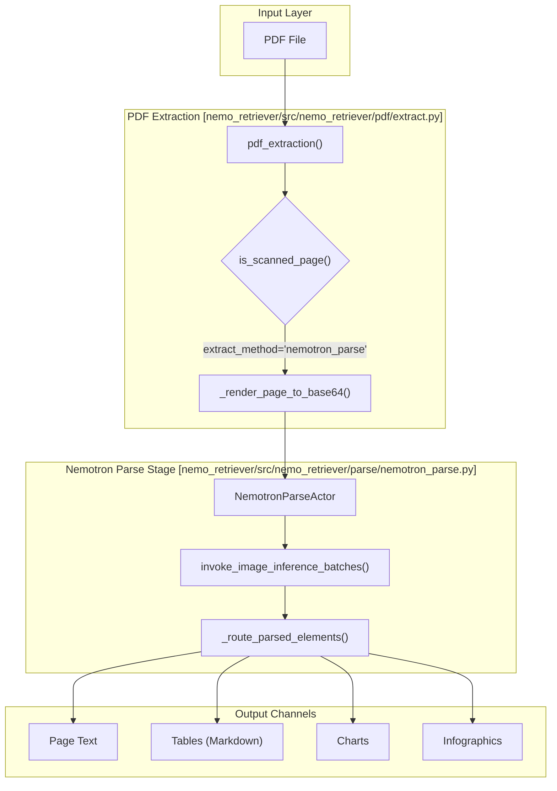
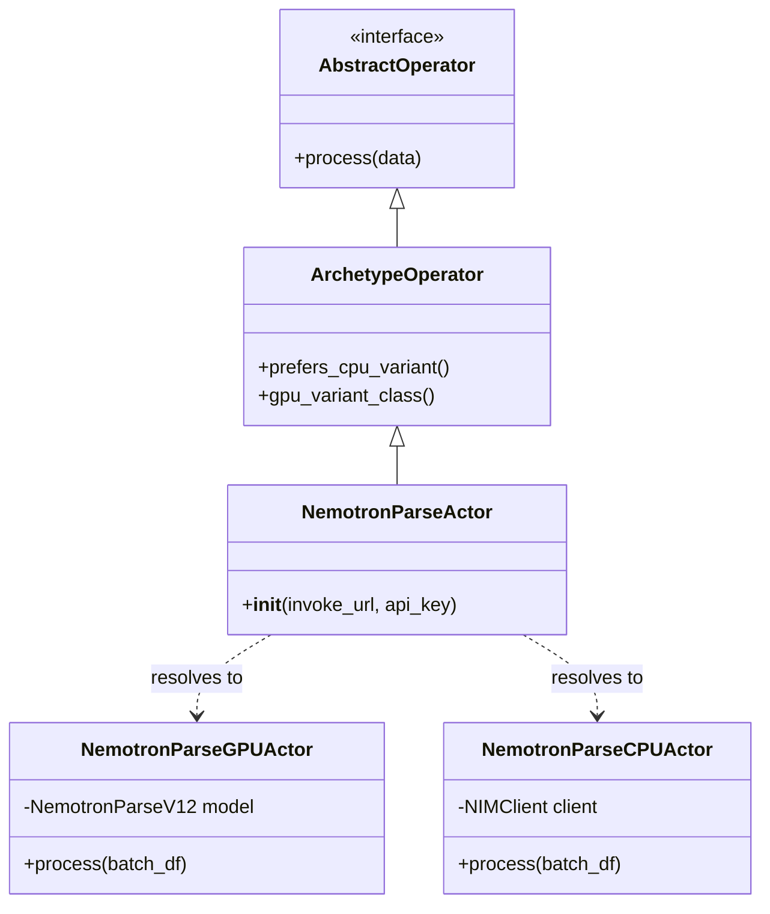

<!-- source: DeepWiki mcp.deepwiki.com · repo NVIDIA/NeMo-Retriever · extra page Advanced Parsing with nemotron-parse · fetched 2026-10-26 -->

# Advanced Parsing with nemotron-parse

Relevant source files

The following files were used as context for generating this wiki page:

- [docker/scripts/post_build_triggers.py](docker/scripts/post_build_triggers.py)
- [nemo_retriever/src/nemo_retriever/__init__.py](nemo_retriever/src/nemo_retriever/__init__.py)
- [nemo_retriever/src/nemo_retriever/chart/gpu_actor.py](nemo_retriever/src/nemo_retriever/chart/gpu_actor.py)
- [nemo_retriever/src/nemo_retriever/model/local/llama_nemotron_embed_1b_v2_embedder.py](nemo_retriever/src/nemo_retriever/model/local/llama_nemotron_embed_1b_v2_embedder.py)
- [nemo_retriever/src/nemo_retriever/model/local/nemotron_parse_v1_2.py](nemo_retriever/src/nemo_retriever/model/local/nemotron_parse_v1_2.py)
- [nemo_retriever/src/nemo_retriever/ocr/ocr.py](nemo_retriever/src/nemo_retriever/ocr/ocr.py)
- [nemo_retriever/src/nemo_retriever/parse/nemotron_parse.py](nemo_retriever/src/nemo_retriever/parse/nemotron_parse.py)
- [nemo_retriever/src/nemo_retriever/pdf/extract.py](nemo_retriever/src/nemo_retriever/pdf/extract.py)
- [nemo_retriever/src/nemo_retriever/pdf/split.py](nemo_retriever/src/nemo_retriever/pdf/split.py)
- [nemo_retriever/src/nemo_retriever/table/gpu_actor.py](nemo_retriever/src/nemo_retriever/table/gpu_actor.py)
- [nemo_retriever/src/nemo_retriever/text_embed/vllm.py](nemo_retriever/src/nemo_retriever/text_embed/vllm.py)
- [nemo_retriever/src/nemo_retriever/txt/split.py](nemo_retriever/src/nemo_retriever/txt/split.py)
- [nemo_retriever/src/nemo_retriever/utils/convert/to_pdf.py](nemo_retriever/src/nemo_retriever/utils/convert/to_pdf.py)
- [nemo_retriever/tests/test_actor_operators.py](nemo_retriever/tests/test_actor_operators.py)
- [nemo_retriever/tests/test_doc_to_pdf_actor.py](nemo_retriever/tests/test_doc_to_pdf_actor.py)
- [nemo_retriever/tests/test_pdf_render_scale.py](nemo_retriever/tests/test_pdf_render_scale.py)
- [nemo_retriever/tests/test_vllm_embed.py](nemo_retriever/tests/test_vllm_embed.py)

## Purpose and Scope

This page documents the `nemotron-parse` NIM and its local model implementation for advanced visual parsing of scanned documents and complex layouts. It covers the `NemotronParseV1_2` local model, the `pdfium_hybrid` extraction mode, and the transition from multi-stage detection/OCR to single-pass visual parsing.

## Overview

The `nemotron-parse` NIM provides state-of-the-art visual parsing capabilities for documents where standard text extraction methods fall short. It uses vision-language model (VLM) technology to understand document structure in a single pass.

### Key Capabilities
- **Scanned PDFs**: Processes physical page scans where text is embedded in images.
- **Complex Layouts**: Handles multi-column formats, mixed text-image compositions, and forms.
- **Unified Extraction**: Replaces the separate `page-elements` (detection) and `nemotron-ocr` (recognition) stages with a single vision-to-markdown pass [nemo_retriever/src/nemo_retriever/parse/nemotron_parse.py:5-11]().

## Extraction Pipeline Comparison

The system supports two primary paths for PDF processing. The choice is governed by the `extract_method` parameter.

| Feature | Standard (pdfium) | Advanced (nemotron-parse) |
| :--- | :--- | :--- |
| **Model** | `pdfium` + `nemotron-ocr` | `nvidia/nemotron-parse-v1.2` |
| **Input Type** | Born-digital PDFs / Text layer | Full page rasterization |
| **Processing** | Multi-stage (Detect -> Crop -> OCR) | Single-pass (Image -> Markdown) |
| **Local Wrapper** | `NemotronOCRV2` | `NemotronParseV12` |

### System Data Flow: Advanced Parsing

**Sources:** [nemo_retriever/src/nemo_retriever/pdf/extract.py:198-213](), [nemo_retriever/src/nemo_retriever/parse/nemotron_parse.py:109-147]()

## Local Model: NemotronParseV12

The `NemotronParseV12` class is a local wrapper for the `nvidia/NVIDIA-Nemotron-Parse-v1.2` model, backed by the **vLLM** engine [nemo_retriever/src/nemo_retriever/model/local/nemotron_parse_v1_2.py:59-68]().

### Implementation Details
- **Engine**: Uses vLLM's offline `LLM` engine to avoid `transformers` cache-API incompatibilities [nemo_retriever/src/nemo_retriever/model/local/nemotron_parse_v1_2.py:65-67]().
- **Task Prompt**: Uses a specialized prompt to trigger bbox detection, class prediction, and markdown output: `</s><s><predict_bbox><predict_classes><output_markdown><predict_no_text_in_pic>` [nemo_retriever/src/nemo_retriever/model/local/nemotron_parse_v1_2.py:70]().
- **Precision**: Defaults to `bfloat16` [nemo_retriever/src/nemo_retriever/model/local/nemotron_parse_v1_2.py:110]().
- **Batching**: Supports batched inference via `invoke_batch()` [nemo_retriever/src/nemo_retriever/model/local/nemotron_parse_v1_2.py:184]().

### Visual Element Routing
The model output is parsed and routed to specific pipeline channels based on class labels [nemo_retriever/src/nemo_retriever/parse/nemotron_parse.py:54-59]():
- `Table` -> `table` channel (converted to Markdown)
- `Chart` -> `chart` channel
- `Picture`/`Infographic` -> `infographic` channel
- Other classes (Title, Text, Formula) -> Concatenated into `page_text` [nemo_retriever/src/nemo_retriever/parse/nemotron_parse.py:142-146]().

**Sources:** [nemo_retriever/src/nemo_retriever/model/local/nemotron_parse_v1_2.py:59-122](), [nemo_retriever/src/nemo_retriever/parse/nemotron_parse.py:54-59]()

## pdfium_hybrid Mode

The `pdfium_hybrid` mode (default in `pdf_extraction`) provides a fallback mechanism [nemo_retriever/src/nemo_retriever/pdf/extract.py:209]().

### Behavior
1. **Text Check**: The system first attempts to extract native text using `pdfium`.
2. **Heuristic**: It checks if the page is "scanned" (e.g., contains a single large image covering the page) using `is_scanned_page` [nemo_retriever/src/nemo_retriever/pdf/extract.py:21]().
3. **Branching**:
    - If native text is found and the page is not scanned, it uses standard extraction.
    - If the page appears scanned or lacks a text layer, it triggers the visual parsing pipeline (OCR or Nemotron Parse) [nemo_retriever/src/nemo_retriever/pdf/extract.py:240-260]().

**Sources:** [nemo_retriever/src/nemo_retriever/pdf/extract.py:18-22](), [nemo_retriever/src/nemo_retriever/pdf/extract.py:198-213]()

## Advanced Parsing Actor Architecture

The `NemotronParseActor` implements the `ArchetypeOperator` pattern, allowing it to switch between local GPU inference and remote NIM calls.

### Variant Selection Logic
- **Remote (CPU Variant)**: Triggered if `invoke_url` or `nemotron_parse_invoke_url` is provided [nemo_retriever/src/nemo_retriever/ocr/ocr.py:73-75](). It uses `NIMClient` to perform HTTP/gRPC requests [nemo_retriever/src/nemo_retriever/parse/nemotron_parse.py:36]().
- **Local (GPU Variant)**: Loads the `NemotronParseV12` model into VRAM for in-process inference [nemo_retriever/src/nemo_retriever/model/local/nemotron_parse_v1_2.py:106-114]().

**Sources:** [nemo_retriever/src/nemo_retriever/ocr/ocr.py:67-141](), [nemo_retriever/src/nemo_retriever/parse/nemotron_parse.py:31-38]()

## Configuration and Tuning

### Resource Management
Advanced parsing is computationally expensive. The following parameters in `ExtractParams` or CLI flags control execution:

| Parameter | Code Reference | Description |
| :--- | :--- | :--- |
| `gpu_memory_utilization` | [nemotron_parse_v1_2.py:78]() | Fraction of GPU memory reserved by vLLM (Default: 0.8). |
| `max_tokens` | [nemotron_parse_v1_2.py:80]() | Maximum output length for the generated markdown (Default: 9000). |
| `render_mode` | [extract.py:49]() | `fit_to_model` (resizes to 1024x1024) or `full_dpi`. |
| `dpi` | [extract.py:206]() | Rasterization resolution (Default: 200). |

### Error Handling
If a page fails during parsing, the `NemotronParseActor` catches the exception and returns an error payload containing the stage name and traceback, preventing the entire batch job from failing [nemo_retriever/src/nemo_retriever/parse/nemotron_parse.py:67-76]().

**Sources:** [nemo_retriever/src/nemo_retriever/model/local/nemotron_parse_v1_2.py:72-81](), [nemo_retriever/src/nemo_retriever/parse/nemotron_parse.py:67-76](), [nemo_retriever/src/nemo_retriever/pdf/extract.py:49-50]()

---

