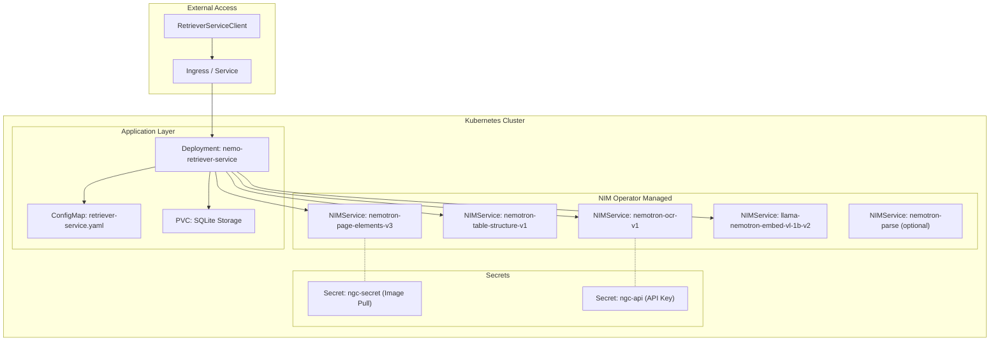
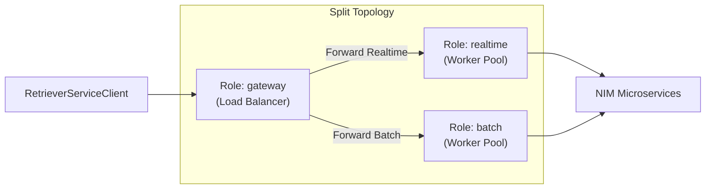

<!-- source: DeepWiki mcp.deepwiki.com · repo NVIDIA/NeMo-Retriever · extra page Helm/Kubernetes Deployment · fetched 2026-10-26 -->

# Helm/Kubernetes Deployment

<details>
<summary>Relevant source files</summary>

The following files were used as context for generating this wiki page:

- [docs/docs/extraction/deployment-options.md](docs/docs/extraction/deployment-options.md)
- [docs/docs/extraction/faq.md](docs/docs/extraction/faq.md)
- [docs/docs/extraction/multimodal-extraction.md](docs/docs/extraction/multimodal-extraction.md)
- [docs/docs/extraction/prerequisites-support-matrix.md](docs/docs/extraction/prerequisites-support-matrix.md)
- [docs/docs/extraction/troubleshoot.md](docs/docs/extraction/troubleshoot.md)
- [nemo_retriever/docs/cli/benchmarking.md](nemo_retriever/docs/cli/benchmarking.md)
- [nemo_retriever/helm/Chart.yaml](nemo_retriever/helm/Chart.yaml)
- [nemo_retriever/helm/README.md](nemo_retriever/helm/README.md)
- [nemo_retriever/helm/templates/NOTES.txt](nemo_retriever/helm/templates/NOTES.txt)
- [nemo_retriever/helm/templates/_helpers.tpl](nemo_retriever/helm/templates/_helpers.tpl)
- [nemo_retriever/helm/templates/configmap.yaml](nemo_retriever/helm/templates/configmap.yaml)
- [nemo_retriever/helm/templates/deployment.yaml](nemo_retriever/helm/templates/deployment.yaml)
- [nemo_retriever/helm/templates/hpa.yaml](nemo_retriever/helm/templates/hpa.yaml)
- [nemo_retriever/helm/templates/servicemonitor.yaml](nemo_retriever/helm/templates/servicemonitor.yaml)
- [nemo_retriever/helm/values.yaml](nemo_retriever/helm/values.yaml)
- [nemo_retriever/src/nemo_retriever/service/app.py](nemo_retriever/src/nemo_retriever/service/app.py)
- [nemo_retriever/src/nemo_retriever/service/client.py](nemo_retriever/src/nemo_retriever/service/client.py)
- [nemo_retriever/src/nemo_retriever/service/config.py](nemo_retriever/src/nemo_retriever/service/config.py)
- [nemo_retriever/src/nemo_retriever/service/models/requests.py](nemo_retriever/src/nemo_retriever/service/models/requests.py)
- [nemo_retriever/src/nemo_retriever/service/retriever-service.yaml](nemo_retriever/src/nemo_retriever/service/retriever-service.yaml)
- [nemo_retriever/src/nemo_retriever/service/routers/ingest.py](nemo_retriever/src/nemo_retriever/service/routers/ingest.py)
- [nemo_retriever/src/nemo_retriever/service/services/pipeline_executor.py](nemo_retriever/src/nemo_retriever/service/services/pipeline_executor.py)
- [nemo_retriever/src/nemo_retriever/service_ingestor.py](nemo_retriever/src/nemo_retriever/service_ingestor.py)

</details>


## Purpose and Scope

This page describes how to deploy the NeMo Retriever Library in **service mode** on Kubernetes using Helm charts and the NVIDIA NIM Operator. This deployment method is designed for production environments requiring scalability, high availability, and enterprise-grade orchestration.

For Docker-based local deployments, see [Docker Compose Deployment](2.1.1). For development and small-scale workloads, see [Library Mode](2.1.3). For comparing all deployment options, see [Deployment Options](2.1).

## Overview

The Helm-based Kubernetes deployment leverages the **NVIDIA NIM Operator** to manage NIM microservices as custom resources (`NIMCache` and `NIMService`). This approach provides:

- **Declarative NIM management**: NIMs are defined as Kubernetes custom resources from the `apps.nvidia.com/v1alpha1` API group [nemo_retriever/helm/values.yaml:5-10]().
- **Automatic model caching**: Managed `NIMCache` resources for model storage [nemo_retriever/helm/README.md:18-20]().
- **GPU resource isolation**: Support for time-slicing and MIG partitioning [docs/docs/extraction/deployment-options.md:74-75]().
- **Multi-pod topology**: Support for splitting the service into `gateway`, `realtime`, and `batch` roles for better resource isolation [nemo_retriever/helm/README.md:15-17]().

The Helm chart deploys:
- **The Service**: A FastAPI server built from the `service` target of the Dockerfile [nemo_retriever/helm/README.md:15-17]().
- **The NIMs**: Optional GPU-backed microservices (page-elements, table-structure, OCR, and VLM embed by default) [nemo_retriever/helm/README.md:5-7]().
- **Persistence**: SQLite on a single `ReadWriteOnce` PVC [nemo_retriever/helm/README.md:33-34]().

**Sources:** [nemo_retriever/helm/README.md:1-43](), [nemo_retriever/helm/values.yaml:1-11]()

## Deployment Architecture



**Title:** Helm Deployment Resource Architecture

The chart auto-wires operator-managed Service URLs into the `retriever-service.yaml` configuration when the operator CRDs are present [nemo_retriever/helm/README.md:20-23]().

**Sources:** [nemo_retriever/helm/README.md:15-32](), [nemo_retriever/helm/templates/configmap.yaml:1-16](), [nemo_retriever/helm/values.yaml:21-64]()

## Prerequisites

### Required Software
- **Linux OS**: Ubuntu 22.04 or later recommended [docs/docs/extraction/prerequisites-support-matrix.md:7]().
- **NVIDIA Driver**: >= 580 [docs/docs/extraction/prerequisites-support-matrix.md:8]().
- **NVIDIA NIM Operator**: Must be installed to reconcile `NIMService` templates [nemo_retriever/helm/README.md:24-27]().
- **FFmpeg**: Required for audio/video extraction. Can be installed at runtime by setting `service.installFfmpeg=true` [nemo_retriever/helm/README.md:104-114]().

### Hardware Requirements
- **System Memory**: At least 256 GB RAM [docs/docs/extraction/prerequisites-support-matrix.md:36]().
- **CPU Cores**: At least 32 cores [docs/docs/extraction/prerequisites-support-matrix.md:37]().
- **GPU**: NVIDIA GPU with at least 24 GB VRAM (A100, H100, L40S) [docs/docs/extraction/prerequisites-support-matrix.md:38]().

**Sources:** [docs/docs/extraction/prerequisites-support-matrix.md:5-40](), [nemo_retriever/helm/README.md:24-27]()

## Installation and Configuration

### 1. Secrets Management
The chart can provision or reference existing secrets for NGC access:
- `ngcImagePullSecret`: Used for pulling images from `nvcr.io` [nemo_retriever/helm/values.yaml:34-40]().
- `ngcApiSecret`: Source for `NGC_API_KEY` and `NVIDIA_API_KEY` [nemo_retriever/helm/values.yaml:50-54]().

### 2. Service Configuration (`retriever-service.yaml`)
The `ConfigMap` template renders the `retriever-service.yaml` file used by the FastAPI app [nemo_retriever/helm/templates/configmap.yaml:1-3]().

| Key | Mapping in `configmap.yaml` | Default NIM Service Name |
|-----|-----------------------------|--------------------------|
| `page_elements` | `page_elements_invoke_url` | `nemotron-page-elements-v3` |
| `table_structure` | `table_structure_invoke_url` | `nemotron-table-structure-v1` |
| `ocr` | `ocr_invoke_url` | `nemotron-ocr-v1` |
| `vlm_embed` | `embed_invoke_url` | `llama-nemotron-embed-vl-1b-v2` |

**Sources:** [nemo_retriever/helm/templates/configmap.yaml:1-22](), [nemo_retriever/helm/values.yaml:34-58]()

### 3. Split Topology Deployment
For high-volume production, the chart supports a split topology via `topology.mode: split`. This deploys three separate roles [nemo_retriever/helm/templates/configmap.yaml:105-112]():
- **Gateway**: Routes requests to realtime or batch pods [nemo_retriever/src/nemo_retriever/service/config.py:104-117]().
- **Realtime**: Optimized for low-latency page processing [nemo_retriever/src/nemo_retriever/service/config.py:129-130]().
- **Batch**: Optimized for bulk document processing [nemo_retriever/src/nemo_retriever/service/config.py:131-132]().



**Title:** Split Topology Data Flow

**Sources:** [nemo_retriever/helm/templates/configmap.yaml:105-131](), [nemo_retriever/src/nemo_retriever/service/config.py:18-117]()

## GPU Profile Selection and Management

### Time-Slicing vs MIG
- **Time-Slicing**: Allows multiple NIM workloads to share a single GPU. Recommended for development or when GPU resources are constrained [docs/docs/extraction/deployment-options.md:74-75]().
- **MIG (Multi-Instance GPU)**: Provides hardware-level isolation. Recommended for production to ensure deterministic performance [docs/docs/extraction/deployment-options.md:74-75]().

### Resource Requests
In `values.yaml`, resources are tuned based on worker counts. Each worker process consumes RAM proportional to the batch size [nemo_retriever/helm/values.yaml:123-132]().

```yaml
service:
  resources:
    requests:
      cpu: "16"
      memory: "16Gi"
    limits:
      cpu: "96"
      memory: "96Gi"
```

**Sources:** [nemo_retriever/helm/values.yaml:123-132](), [docs/docs/extraction/deployment-options.md:74-75]()

## Scaling and Autoscaling

### Horizontal Pod Autoscaler (HPA)
The chart includes HPA scaffolding (`hpa.yaml`). However, replicas must currently stay at **1** while the persistence layer uses SQLite (ReadWriteOnce PVC) [nemo_retriever/helm/README.md:33-36](). Multi-replica support is planned for the PostgreSQL backend migration [nemo_retriever/helm/README.md:33-36]().

### Worker Pool Tuning
Worker pools are configured in `retriever-service.yaml` under the `pipeline` section [nemo_retriever/helm/templates/configmap.yaml:59-63]():
- `realtime_workers`: Concurrent workers for low-latency tasks [nemo_retriever/src/nemo_retriever/service/config.py:129]().
- `batch_workers`: Concurrent workers for bulk processing [nemo_retriever/src/nemo_retriever/service/config.py:131]().

**Sources:** [nemo_retriever/helm/README.md:33-36](), [nemo_retriever/src/nemo_retriever/service/config.py:119-134]()

## Air-gapped Deployment

For disconnected environments:
1. Mirror images and models into a private registry [docs/docs/extraction/deployment-options.md:78-80]().
2. Set `service.installFfmpeg=false` (as it requires internet access for `apt-get`) [nemo_retriever/helm/README.md:145-148]().
3. Build a custom service image containing `ffmpeg` and `ffprobe` binaries [nemo_retriever/helm/README.md:149-156]().
4. Configure the NIM Operator for air-gap mode [docs/docs/extraction/deployment-options.md:78-80]().

**Sources:** [docs/docs/extraction/deployment-options.md:76-84](), [nemo_retriever/helm/README.md:145-156]()

---

