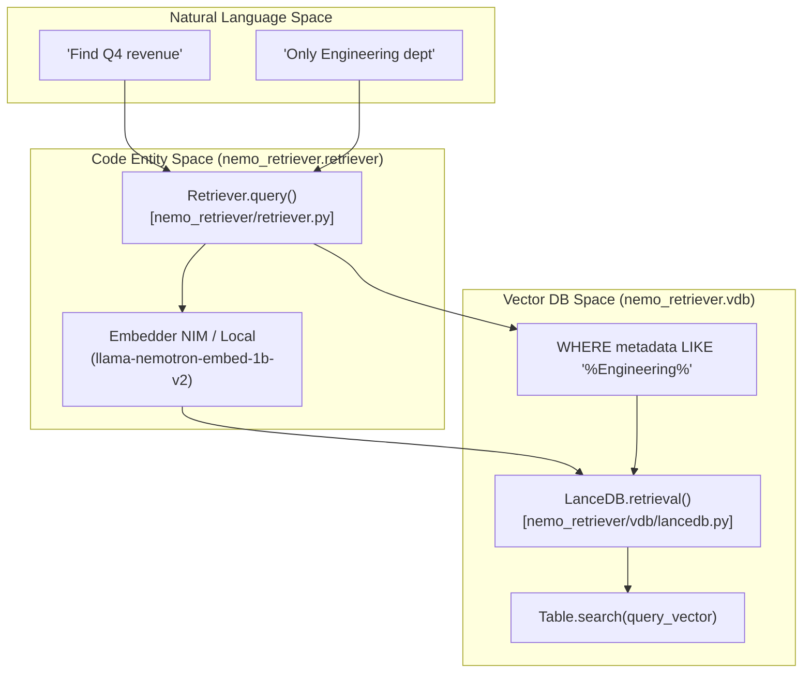
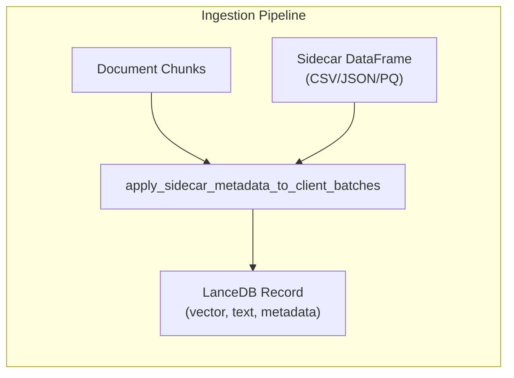

<!-- source: DeepWiki mcp.deepwiki.com · repo NVIDIA/NeMo-Retriever · extra page Hybrid Search and Filtered Retrieval · fetched 2026-10-26 -->

# Hybrid Search and Filtered Retrieval

<details>
<summary>Relevant source files</summary>

The following files were used as context for generating this wiki page:

- [docs/docs/extraction/agentic-retrieval-concept.md](docs/docs/extraction/agentic-retrieval-concept.md)
- [docs/docs/extraction/custom-metadata.md](docs/docs/extraction/custom-metadata.md)
- [docs/docs/extraction/releasenotes.md](docs/docs/extraction/releasenotes.md)
- [docs/docs/extraction/vdbs.md](docs/docs/extraction/vdbs.md)
- [docs/docs/extraction/workflow-agentic-retrieval.md](docs/docs/extraction/workflow-agentic-retrieval.md)
- [docs/docs/extraction/workflow-document-ingestion.md](docs/docs/extraction/workflow-document-ingestion.md)
- [examples/nemo_retriever_retriever_query_metadata_filter.ipynb](examples/nemo_retriever_retriever_query_metadata_filter.ipynb)
- [nemo_retriever/src/nemo_retriever/api/internal/primitives/tracing/tagging.py](nemo_retriever/src/nemo_retriever/api/internal/primitives/tracing/tagging.py)
- [nemo_retriever/src/nemo_retriever/api/internal/transform/embed_text.py](nemo_retriever/src/nemo_retriever/api/internal/transform/embed_text.py)
- [nemo_retriever/src/nemo_retriever/api/util/exception_handlers/converters.py](nemo_retriever/src/nemo_retriever/api/util/exception_handlers/converters.py)
- [nemo_retriever/src/nemo_retriever/api/util/exception_handlers/detectors.py](nemo_retriever/src/nemo_retriever/api/util/exception_handlers/detectors.py)
- [nemo_retriever/src/nemo_retriever/api/util/exception_handlers/pdf.py](nemo_retriever/src/nemo_retriever/api/util/exception_handlers/pdf.py)
- [nemo_retriever/src/nemo_retriever/api/util/image_processing/clustering.py](nemo_retriever/src/nemo_retriever/api/util/image_processing/clustering.py)
- [nemo_retriever/src/nemo_retriever/api/util/image_processing/transforms.py](nemo_retriever/src/nemo_retriever/api/util/image_processing/transforms.py)
- [nemo_retriever/src/nemo_retriever/evaluation/README.md](nemo_retriever/src/nemo_retriever/evaluation/README.md)
- [nemo_retriever/src/nemo_retriever/graph/README.md](nemo_retriever/src/nemo_retriever/graph/README.md)
- [nemo_retriever/src/nemo_retriever/params/chunk_bundle.py](nemo_retriever/src/nemo_retriever/params/chunk_bundle.py)
- [nemo_retriever/src/nemo_retriever/vdb/sidecar_metadata.py](nemo_retriever/src/nemo_retriever/vdb/sidecar_metadata.py)
- [nemo_retriever/tests/test_lancedb_ivf_partitions.py](nemo_retriever/tests/test_lancedb_ivf_partitions.py)
- [nemo_retriever/tests/test_lancedb_retrieval_where.py](nemo_retriever/tests/test_lancedb_retrieval_where.py)
- [nemo_retriever/tests/test_src_documentation_snippets.py](nemo_retriever/tests/test_src_documentation_snippets.py)

</details>


## Purpose and Scope

This page documents the hybrid search and metadata filtering capabilities within the NeMo Retriever Library, primarily focusing on the **LanceDB** integration. It explains how to combine semantic search with SQL-based predicate pushdown, join sidecar metadata during ingestion, and apply fine-grained filtering on retrieved results.

For collection management and schema details, see [Collection Management](4.2.1). For broader pipeline concepts, see [Key Concepts](3.1).

## Overview

NeMo Retriever uses **LanceDB** as its first-party vector database backend due to its low-latency characteristics and embedded (in-process) runtime [[docs/docs/extraction/vdbs.md:23-26](), [docs/docs/extraction/vdbs.md:40-48]()]. Hybrid search and filtered retrieval in this ecosystem leverage three main mechanisms:

| Mechanism | Implementation | Level | Purpose |
| :--- | :--- | :--- | :--- |
| **Hybrid Search** | Vector + FTS (BM25) | Database | Combines semantic meaning with keyword matching. |
| **Predicate Pushdown** | SQL `WHERE` clause | Database | Filters records *before* vector ranking using SQL predicates. |
| **Content Filtering** | `filter_hits_by_content_metadata` | Client-side | Post-retrieval filtering using arbitrary Python logic on parsed JSON. |

### Data Flow: Natural Language to Code Entity Space

The following diagram illustrates how a natural language query with filters is translated into code entities within the `nemo_retriever` library.


**Sources:** [docs/docs/extraction/custom-metadata.md:103-119](), [nemo_retriever/src/nemo_retriever/vdb/lancedb.py:382-415]()

## Sidecar Metadata Joins

During ingestion, users can attach external metadata (e.g., from a CSV or JSON) to documents. This is handled by the `vdb_upload` task using **sidecar metadata tables** [[docs/docs/extraction/custom-metadata.md:16-18]()].

### Metadata Merging Process
1. **Load**: The `load_meta_dataframe` function reads CSV, JSON, or Parquet files into a `pandas.DataFrame` [[nemo_retriever/src/nemo_retriever/vdb/sidecar_metadata.py:69-83]()].
2. **Lookup**: `build_sidecar_lookup` creates a mapping between a source identifier (path or basename) and the metadata row [[nemo_retriever/src/nemo_retriever/vdb/sidecar_metadata.py:115-121]()].
3. **Apply**: `apply_sidecar_metadata_to_client_batches` iterates through chunks and merges selected columns into the `content_metadata` field of each record [[nemo_retriever/src/nemo_retriever/vdb/sidecar_metadata.py:143-156]()].


**Sources:** [nemo_retriever/src/nemo_retriever/vdb/sidecar_metadata.py:143-187]()

## Hybrid Search (Dense + Sparse)

LanceDB supports hybrid search by combining vector similarity with Full-Text Search (FTS) using BM25. 

- **Ingestion**: Setting `hybrid=True` in `LanceDB.run()` triggers the creation of a Full-Text Search index on the `text` column [[nemo_retriever/tests/test_lancedb_retrieval_where.py:126-160]()].
- **Retrieval**: When `hybrid=True` is passed to `LanceDB.retrieval()`, the system requires `query_texts` alongside query vectors. It executes a reranked search combining both scores [[nemo_retriever/tests/test_lancedb_retrieval_where.py:108-120](), [nemo_retriever/tests/test_lancedb_retrieval_where.py:185-191]()].

## Filtered Retrieval

### 1. Predicate Pushdown (SQL WHERE)
LanceDB stores metadata as a compact JSON string in a column named `metadata`. Users can pass a SQL-like `where` clause to `Retriever.query` or `LanceDB.retrieval` to filter results at the database level [[docs/docs/extraction/custom-metadata.md:75-78](), [examples/nemo_retriever_retriever_query_metadata_filter.ipynb:14-15]()].

**Example Predicate:**
```python
hits = retriever.query(
    "quarterly revenue",
    vdb_kwargs={"where": "metadata LIKE '%\"department\":\"Finance\"%'"}
)
```
**Sources:** [docs/docs/extraction/custom-metadata.md:113-119]()

### 2. Client-Side Content Filtering
For complex logic that cannot be expressed in SQL, the library provides `filter_hits_by_content_metadata`. This function parses the JSON `metadata` column for each hit and applies a Python filter [[examples/nemo_retriever_retriever_query_metadata_filter.ipynb:15](), [nemo_retriever/src/nemo_retriever/vdb/helpers.py:21-35]()].

| Feature | SQL `where` (Pushdown) | Client-side `filter_hits` |
| :--- | :--- | :--- |
| **Performance** | High (reduces data scanned) | Lower (filters after retrieval) |
| **Complexity** | Limited to SQL syntax | Full Python power |
| **Recall Impact** | May reduce recall if top_k is small | Does not affect ANN ranking |

**Sources:** [docs/docs/extraction/custom-metadata.md:75-84]()

## Key Classes and Functions

- `LanceDB`: The main vector database operator. `retrieval()` handles both vector and hybrid search with `where` predicates [[nemo_retriever/src/nemo_retriever/vdb/lancedb.py:44](), [nemo_retriever/src/nemo_retriever/vdb/lancedb.py:382]()].
- `Retriever`: High-level interface that orchestrates embedding and querying [[nemo_retriever/src/nemo_retriever/retriever.py:34]()].
- `apply_sidecar_metadata_to_client_batches`: Merges external data into document chunks [[nemo_retriever/src/nemo_retriever/vdb/sidecar_metadata.py:143]()].
- `filter_hits_by_content_metadata`: Utility for post-retrieval filtering [[nemo_retriever/src/nemo_retriever/vdb/helpers.py:21]()].

**Sources:** [nemo_retriever/src/nemo_retriever/vdb/lancedb.py:44-415](), [nemo_retriever/src/nemo_retriever/vdb/sidecar_metadata.py:143-187]()

---

