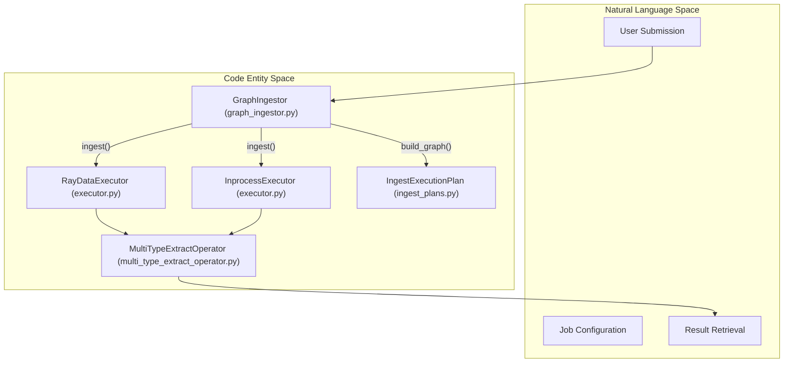
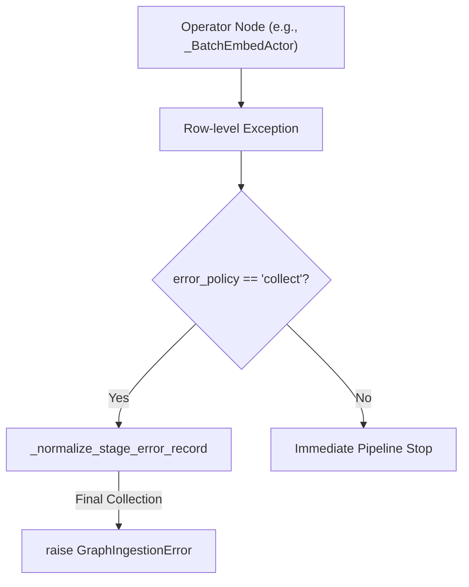
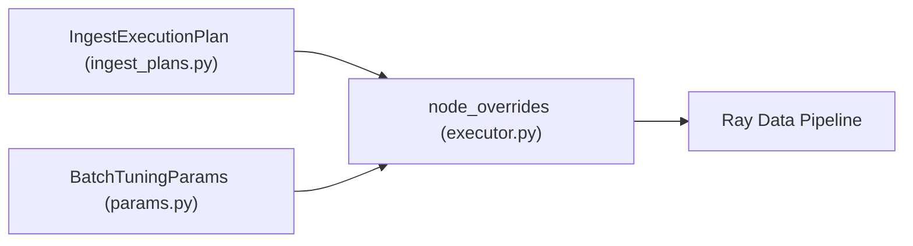

<!-- source: DeepWiki mcp.deepwiki.com · repo NVIDIA/NeMo-Retriever · extra page Job Management and Results · fetched 2026-10-26 -->

# Job Management and Results

<details>
<summary>Relevant source files</summary>

The following files were used as context for generating this wiki page:

- [nemo_retriever/src/nemo_retriever/graph/executor.py](nemo_retriever/src/nemo_retriever/graph/executor.py)
- [nemo_retriever/src/nemo_retriever/graph/ingestor_runtime.py](nemo_retriever/src/nemo_retriever/graph/ingestor_runtime.py)
- [nemo_retriever/src/nemo_retriever/graph/multi_type_extract_operator.py](nemo_retriever/src/nemo_retriever/graph/multi_type_extract_operator.py)
- [nemo_retriever/src/nemo_retriever/graph_ingestor.py](nemo_retriever/src/nemo_retriever/graph_ingestor.py)
- [nemo_retriever/src/nemo_retriever/io/dataframe.py](nemo_retriever/src/nemo_retriever/io/dataframe.py)
- [nemo_retriever/src/nemo_retriever/io/markdown.py](nemo_retriever/src/nemo_retriever/io/markdown.py)
- [nemo_retriever/src/nemo_retriever/utils/input_files.py](nemo_retriever/src/nemo_retriever/utils/input_files.py)
- [nemo_retriever/tests/test_ingest_interface.py](nemo_retriever/tests/test_ingest_interface.py)
- [nemo_retriever/tests/test_ingest_plans.py](nemo_retriever/tests/test_ingest_plans.py)
- [nemo_retriever/tests/test_io_dataframe.py](nemo_retriever/tests/test_io_dataframe.py)
- [nemo_retriever/tests/test_io_markdown.py](nemo_retriever/tests/test_io_markdown.py)
- [nemo_retriever/tests/test_pipeline_graph.py](nemo_retriever/tests/test_pipeline_graph.py)

</details>


This page documents how to submit, monitor, and retrieve results from ingestion jobs using the `GraphIngestor` and high-level `Ingestor` APIs. It covers execution modes, error policies, result persistence, and the structured handling of ingestion errors.

---

## Job Submission and Execution Modes

The `GraphIngestor` supports three primary execution modes defined by the `run_mode` parameter: `batch`, `inprocess`, and `service`.

### Execution Flow Overview

The following diagram maps the high-level job submission to the underlying code entities:


**Sources:** [nemo_retriever/src/nemo_retriever/graph_ingestor.py:18-36](), [nemo_retriever/src/nemo_retriever/graph/executor.py:42-194]()

### Synchronous Execution with `ingest()`

The `ingest()` method triggers the execution of the built graph against the provided input files or dataframes.

```python
results = (
    GraphIngestor(run_mode="batch")
    .files(["/data/*.pdf"])
    .extract()
    .ingest()
)
```

**Key Execution Behaviors:**
- **Batch Mode**: Uses `RayDataExecutor` to build a Ray Data pipeline. It leverages `map_batches` for parallel processing on Ray workers [nemo_retriever/src/nemo_retriever/graph/executor.py:161-194]().
- **In-process Mode**: Uses `InprocessExecutor` to run the graph sequentially on pandas DataFrames within the local process [nemo_retriever/src/nemo_retriever/graph/executor.py:60-126]().
- **Progress Monitoring**: Both executors support progress tracking via `tqdm` [nemo_retriever/src/nemo_retriever/graph/executor.py:132-140]().

---

## Error Management and Policies

The system provides structured error handling to manage row-level failures during large-scale ingestion.

### Error Policy: `collect`

When `error_policy='collect'` is set in the `GraphIngestor`, the pipeline does not immediately terminate on a row failure. Instead, it captures the error metadata and continues processing other rows.

**Key Error Structures:**
- **`GraphIngestionError`**: A specialized exception raised when ingestion stages report structured row-level errors [nemo_retriever/src/nemo_retriever/graph_ingestor.py:114-138]().
- **`_StageDiagnostic`**: Internal class used to attribute errors to specific NIM endpoints, status codes, and stage names [nemo_retriever/src/nemo_retriever/graph_ingestor.py:95-112]().

### Error Diagnostic Flow


**Sources:** [nemo_retriever/src/nemo_retriever/graph_ingestor.py:139-150](), [nemo_retriever/src/nemo_retriever/graph_ingestor.py:151-193]()

---

## Result Retrieval and Persistence

### Disk-Based Result Storage

To prevent memory exhaustion (OOM) during massive ingestion runs, the system supports saving intermediate or final results to disk.

- **`save_to_disk`**: When enabled, the `StoreOperator` writes data to local or object storage (S3/MinIO) [nemo_retriever/src/nemo_retriever/graph/ingestor_runtime.py:19-24]().
- **Format Support**: Results are typically stored as `.parquet`, `.jsonl`, or `.json` [nemo_retriever/src/nemo_retriever/io/dataframe.py:90-107]().

### Result Loading and Conversion

The `nemo_retriever.io` module provides utilities for reading and converting results:

| Function | Description | Source |
| :--- | :--- | :--- |
| `read_dataframe` | Loads Parquet or JSON results into a pandas DataFrame. | [io/dataframe.py:61-88]() |
| `to_markdown` | Renders document extraction results into a single Markdown string. | [io/markdown.py:65-70]() |
| `to_markdown_by_page` | Renders results grouped by page number. | [io/markdown.py:45-62]() |

**Sources:** [nemo_retriever/src/nemo_retriever/io/dataframe.py:61-88](), [nemo_retriever/src/nemo_retriever/io/markdown.py:45-70]()

---

## Job Tuning and Resource Management

Resource allocation for jobs is managed through `BatchTuningParams` and translated into executor-specific overrides.

### Heuristic Resource Allocation

The `batch_tuning_to_node_overrides` function translates high-level tuning parameters into specific Ray resource requirements:

1.  **GPU Fractions**: Allocates partial GPUs to actors (e.g., `gpu_ocr`, `gpu_embed`) to maximize throughput [nemo_retriever/src/nemo_retriever/graph/ingestor_runtime.py:122-130]().
2.  **Concurrency**: Caps extraction concurrency based on available cluster CPU/GPU budgets [nemo_retriever/src/nemo_retriever/graph/ingestor_runtime.py:92-95]().
3.  **Batch Sizes**: Configures `target_num_rows_per_block` for Ray Data to optimize GPU utilization [nemo_retriever/src/nemo_retriever/graph/ingestor_runtime.py:150-154]().

**Sources:** [nemo_retriever/src/nemo_retriever/graph/ingestor_runtime.py:75-165](), [nemo_retriever/src/nemo_retriever/utils/ray_resource_hueristics.py:26-31]()

### Execution Plan Mapping


**Sources:** [nemo_retriever/src/nemo_retriever/ingest_plans.py:43-55](), [nemo_retriever/src/nemo_retriever/graph/executor.py:186-194]()

---

