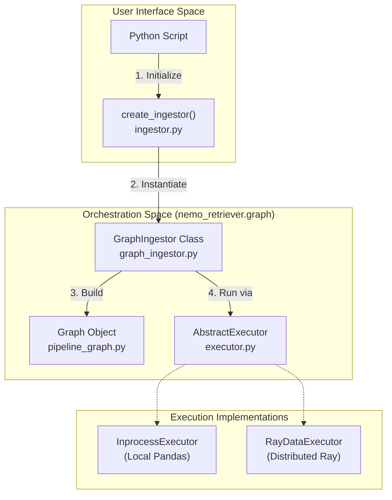
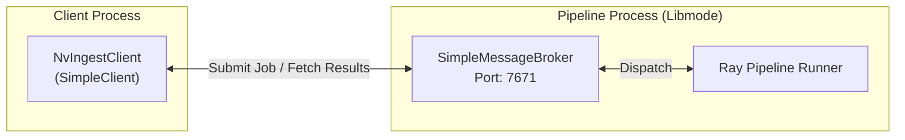

<!-- source: DeepWiki mcp.deepwiki.com · repo NVIDIA/NeMo-Retriever · extra page Library Mode · fetched 2026-10-26 -->

# Library Mode

<details>
<summary>Relevant source files</summary>

The following files were used as context for generating this wiki page:

- [examples/launch_libmode_and_run_ingestor.py](examples/launch_libmode_and_run_ingestor.py)
- [examples/launch_libmode_service.py](examples/launch_libmode_service.py)
- [nemo_retriever/src/nemo_retriever/examples/graph_pipeline.py](nemo_retriever/src/nemo_retriever/examples/graph_pipeline.py)
- [nemo_retriever/src/nemo_retriever/graph/__init__.py](nemo_retriever/src/nemo_retriever/graph/__init__.py)
- [nemo_retriever/src/nemo_retriever/graph/webhook_operator.py](nemo_retriever/src/nemo_retriever/graph/webhook_operator.py)
- [nemo_retriever/src/nemo_retriever/ingestor.py](nemo_retriever/src/nemo_retriever/ingestor.py)
- [nemo_retriever/src/nemo_retriever/params/__init__.py](nemo_retriever/src/nemo_retriever/params/__init__.py)
- [nemo_retriever/tests/test_webhook_operator.py](nemo_retriever/tests/test_webhook_operator.py)

</details>


Library Mode provides a lightweight deployment option for running the NeMo Retriever Library pipeline directly in a Python process. It is designed for local development, experimentation, and small-scale workloads processing document collections. This mode allows developers to build and execute ingestion pipelines without requiring full Docker container orchestration or local NIM infrastructure.

For production deployments or processing large document collections, see [Docker Compose Deployment](#2.1.1) or [Helm/Kubernetes Deployment](#2.1.2).

---

## Overview of Execution Modes

The NeMo Retriever library supports different execution modes through its `create_ingestor` factory. Library Mode specifically refers to the use of `inprocess` and `batch` run modes within a local Python environment.

| Run Mode | Class | Implementation Detail |
| :--- | :--- | :--- |
| `inprocess` | `GraphIngestor` | Executes the graph using the `InprocessExecutor`. Optimized for single-node, low-latency processing using standard Python/Pandas logic. |
| `batch` | `GraphIngestor` | Executes the graph using the `RayDataExecutor`. Leverages Ray Data for parallelizing tasks across available CPU/GPU resources on a local machine or cluster. |
| `service` | `ServiceIngestor` | Communicates with a remote ingestion service via REST API. |

**Sources:** [nemo_retriever/src/nemo_retriever/ingestor.py:43-83](), [nemo_retriever/src/nemo_retriever/graph/__init__.py:13-13]()

---

## Architecture and Data Flow

Library Mode operates by constructing a directed acyclic graph (DAG) of processing operators. The user interacts with the `Ingestor` interface to define the pipeline, which is then materialized into a `Graph` and executed by an `AbstractExecutor`.

### Code Entity Space Mapping

The following diagram bridges the high-level pipeline concepts to the specific classes and functions implemented in the codebase.



**Sources:** [nemo_retriever/src/nemo_retriever/ingestor.py:73-83](), [nemo_retriever/src/nemo_retriever/graph/__init__.py:9-17]()

---

## Running the Pipeline

Library Mode supports both synchronous and asynchronous execution patterns. It can be invoked via the Python API or through the `retriever pipeline run` CLI subcommand.

### Pattern 1: Python API (Fluent Interface)

The `Ingestor` class provides a fluent API for chaining tasks.

```python
from nemo_retriever.ingestor import create_ingestor

# 1. Create the ingestor instance
ingestor = create_ingestor(run_mode="inprocess")

# 2. Configure the pipeline (Fluent API)
ingestor.files("./data/sample.pdf") \
    .extract(extract_text=True, extract_tables=True) \
    .embed(model_name="nvidia/llama-nemotron-embed-1b-v2") \
    .vdb_upload(milvus_uri="milvus.db")

# 3. Execute synchronously
results = ingestor.ingest()
```

**Sources:** [nemo_retriever/src/nemo_retriever/ingestor.py:104-191](), [nemo_retriever/src/nemo_retriever/ingestor.py:73-83]()

### Pattern 2: Persistent Subprocess Service

For development environments where you want to keep a pipeline running to accept multiple requests, the library provides a utility to launch the pipeline in a separate subprocess.

```python
# Based on examples/launch_libmode_service.py
from nv_ingest.framework.orchestration.ray.util.pipeline.pipeline_runners import run_pipeline

# Start pipeline and block until interrupted
run_pipeline(
    block=True,
    disable_dynamic_scaling=True,
    run_in_subprocess=True,
)
```

**Sources:** [examples/launch_libmode_service.py:21-33](), [examples/launch_libmode_and_run_ingestor.py:61-87]()

---

## Message Broker and Clients

In Library Mode, the system often uses a `SimpleBroker` for communication between the client and the pipeline, typically listening on port `7671`.



**Sources:** [examples/launch_libmode_and_run_ingestor.py:30-32](), [examples/launch_libmode_and_run_ingestor.py:71-75]()

---

## Configuration and Parameters

Pipeline stages are configured using Pydantic models defined in `nemo_retriever.params`. These models ensure type safety and validation for extraction, embedding, and storage tasks.

| Parameter Class | Purpose | Key Fields |
| :--- | :--- | :--- |
| `ExtractParams` | Document parsing | `extract_method`, `extract_text`, `extract_tables` |
| `EmbedParams` | Vector generation | `model_name`, `embed_modality`, `batch_size` |
| `VdbUploadParams` | Vector DB storage | `collection_name`, `milvus_uri`, `dense_dim` |
| `WebhookParams` | External notification | `endpoint_url`, `headers`, `timeout_s` |

**Sources:** [nemo_retriever/src/nemo_retriever/params/models.py:1-77](), [nemo_retriever/src/nemo_retriever/graph/webhook_operator.py:68-74]()

---

## Advanced Library Features

### Webhook Notifications
The `WebhookNotifyOperator` allows the pipeline to POST results to an external HTTP endpoint as a side-effect. This is useful for integrating the library into larger event-driven architectures without requiring a full service deployment.

```python
# Example configuration via the ingestor
ingestor.webhook(
    endpoint_url="https://api.example.com/ingest-webhook",
    headers={"Authorization": "Bearer token"},
    columns=["content", "metadata"]
)
```

**Sources:** [nemo_retriever/src/nemo_retriever/graph/webhook_operator.py:58-74](), [nemo_retriever/src/nemo_retriever/graph/webhook_operator.py:108-134]()

### UDF (User Defined Functions)
Users can inject custom logic into the graph using the `udf` method, which instantiates a `UDFOperator`. This allows for custom filtering, metadata enrichment, or data transformation between standard stages.

**Sources:** [nemo_retriever/src/nemo_retriever/ingestor.py:176-186](), [nemo_retriever/src/nemo_retriever/graph/__init__.py:12-12]()

---

