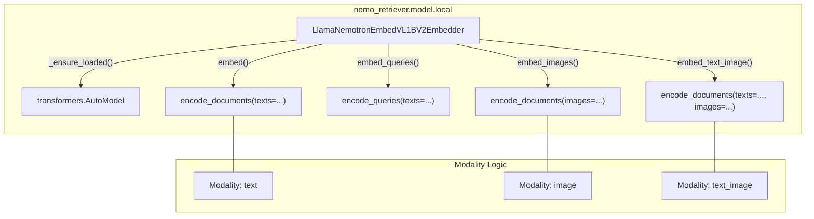
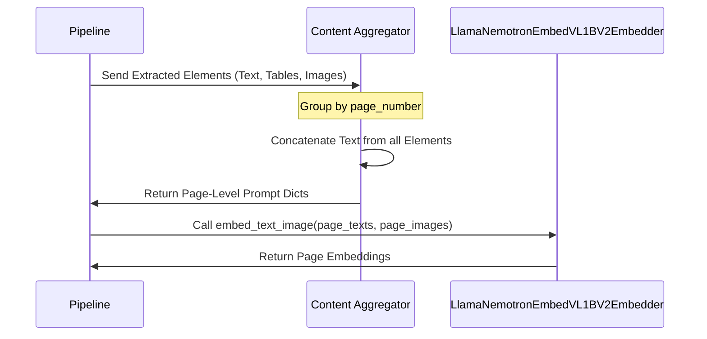

<!-- source: DeepWiki mcp.deepwiki.com · repo NVIDIA/NeMo-Retriever · extra page Multimodal Embeddings · fetched 2026-10-26 -->

# Multimodal Embeddings

Relevant source files

The following files were used as context for generating this wiki page:

- [docker/scripts/post_build_triggers.py](docker/scripts/post_build_triggers.py)
- [nemo_retriever/src/nemo_retriever/__init__.py](nemo_retriever/src/nemo_retriever/__init__.py)
- [nemo_retriever/src/nemo_retriever/audio/__init__.py](nemo_retriever/src/nemo_retriever/audio/__init__.py)
- [nemo_retriever/src/nemo_retriever/audio/asr_actor.py](nemo_retriever/src/nemo_retriever/audio/asr_actor.py)
- [nemo_retriever/src/nemo_retriever/audio/chunk_actor.py](nemo_retriever/src/nemo_retriever/audio/chunk_actor.py)
- [nemo_retriever/src/nemo_retriever/model/local/llama_nemotron_embed_1b_v2_embedder.py](nemo_retriever/src/nemo_retriever/model/local/llama_nemotron_embed_1b_v2_embedder.py)
- [nemo_retriever/src/nemo_retriever/model/local/llama_nemotron_embed_vl_1b_v2_embedder.py](nemo_retriever/src/nemo_retriever/model/local/llama_nemotron_embed_vl_1b_v2_embedder.py)
- [nemo_retriever/src/nemo_retriever/model/local/nemotron_parse_v1_2.py](nemo_retriever/src/nemo_retriever/model/local/nemotron_parse_v1_2.py)
- [nemo_retriever/src/nemo_retriever/model/local/parakeet_ctc_1_1b_asr.py](nemo_retriever/src/nemo_retriever/model/local/parakeet_ctc_1_1b_asr.py)
- [nemo_retriever/src/nemo_retriever/text_embed/vllm.py](nemo_retriever/src/nemo_retriever/text_embed/vllm.py)
- [nemo_retriever/src/nemo_retriever/txt/split.py](nemo_retriever/src/nemo_retriever/txt/split.py)
- [nemo_retriever/tests/test_audio_pipeline_batch.py](nemo_retriever/tests/test_audio_pipeline_batch.py)
- [nemo_retriever/tests/test_multimodal_embed.py](nemo_retriever/tests/test_multimodal_embed.py)
- [nemo_retriever/tests/test_vllm_embed.py](nemo_retriever/tests/test_vllm_embed.py)

This page documents the multimodal embedding capabilities in NeMo Retriever Library, specifically the support for embedding documents using text, image, or combined text+image modalities. This feature enables higher-quality retrieval by leveraging both semantic and visual information from extracted content.

## Overview

NeMo Retriever Library supports three distinct embedding modalities when using vision-language embedding models:

- **`text`** – Embeds content as plain text only, capturing semantic meaning.
- **`image`** – Embeds content as an image, preserving visual layout and spatial relationships.
- **`text_image`** – Embeds paired text and image together, combining semantic depth with visual context.

These modalities are applied on a per-element basis, allowing different content types (text paragraphs, tables, charts, images, audio transcriptions) to be embedded using the most appropriate representation. The system primarily uses the `llama-nemotron-embed-vl` model family for these operations [nemo_retriever/src/nemo_retriever/model/local/llama_nemotron_embed_vl_1b_v2_embedder.py:37-44]().

**Sources:** [nemo_retriever/src/nemo_retriever/model/local/llama_nemotron_embed_vl_1b_v2_embedder.py:37-44]()

---

## Embedding Modalities

### Text Modality
The `text` modality embeds content as plain text. In local execution mode, this is handled by the `LlamaNemotronEmbedVL1BV2Embedder.embed` method, which prepends a "passage: " prefix to document texts before encoding [nemo_retriever/src/nemo_retriever/model/local/llama_nemotron_embed_vl_1b_v2_embedder.py:107-121]().

### Image Modality
The `image` modality embeds content as an image. Images are typically passed as base64-encoded strings and converted to PIL images for processing [nemo_retriever/src/nemo_retriever/model/local/llama_nemotron_embed_vl_1b_v2_embedder.py:24-34](). The local embedder uses `encode_documents(images=...)` to generate these vectors [nemo_retriever/src/nemo_retriever/model/local/llama_nemotron_embed_vl_1b_v2_embedder.py:136-149]().

### Text+Image Modality
The `text_image` modality combines text and image representations. This is particularly effective for tables and charts where the visual layout is as important as the textual data. The local embedder manages this via `embed_text_image`, which pairs text sequences with corresponding base64 image sequences [nemo_retriever/src/nemo_retriever/model/local/llama_nemotron_embed_vl_1b_v2_embedder.py:151-171]().

**Sources:** [nemo_retriever/src/nemo_retriever/model/local/llama_nemotron_embed_vl_1b_v2_embedder.py:24-171]()

---

## VLM Embedder Implementation

The core implementation for local multimodal embeddings resides in the `LlamaNemotronEmbedVL1BV2Embedder` class. Unlike standard text-only embedders that use a simple forward pass, this VLM-based embedder leverages specific methods provided by the underlying model for different query and document types.

### Code Entity Space: Local VLM Embedder

**Key Implementation Details:**
- **Model Loading:** The model is loaded with `trust_remote_code=True` and `torch.bfloat16`. It attempts to use `flash_attention_2` if available on GPU [nemo_retriever/src/nemo_retriever/model/local/llama_nemotron_embed_vl_1b_v2_embedder.py:74-85]().
- **Normalization:** All output vectors are L2-normalized using `_l2_normalize` before being returned [nemo_retriever/src/nemo_retriever/model/local/llama_nemotron_embed_vl_1b_v2_embedder.py:18-21]().
- **Context Window:** The embedder adjusts `p_max_length` based on the modality (e.g., 8192 for text, 10240 for text+image) to optimize the context window [nemo_retriever/src/nemo_retriever/model/local/llama_nemotron_embed_vl_1b_v2_embedder.py:101-105]().

**Sources:** [nemo_retriever/src/nemo_retriever/model/local/llama_nemotron_embed_vl_1b_v2_embedder.py:18-105]()

---

## Page vs Element Granularity

Multimodal embedding can be performed at two levels of granularity:

1.  **Element Granularity:** Each individual element (a single table, a specific image, a paragraph) is embedded independently. This is the default behavior when processing extracted document elements.
2.  **Page Granularity:** The entire page is treated as a single multimodal unit. This often involves aggregating all text from a page and pairing it with a full-page image.

### Data Flow: Page Content Aggregation

**Sources:** [nemo_retriever/src/nemo_retriever/text_embed/vllm.py:151-166]()

---

## local vLLM Integration

For high-throughput embedding, the system integrates with **vLLM**'s pooling runner. This allows for batched inference without the overhead of an HTTP server.

### Code Entity Space: vLLM Embedding Flow

| Class/Function | File Path | Role |
| :--- | :--- | :--- |
| `create_vllm_llm` | [nemo_retriever/src/nemo_retriever/text_embed/vllm.py:27]() | Initializes vLLM engine with `runner="pooling"` and `attention_backend="FLASH_ATTN"`. |
| `embed_with_vllm_llm` | [nemo_retriever/src/nemo_retriever/text_embed/vllm.py:90]() | Handles batched text embedding with optional normalization and prefixing. |
| `embed_multimodal_with_vllm_llm` | [nemo_retriever/src/nemo_retriever/text_embed/vllm.py:151]() | Processes multimodal prompt dicts containing both text and PIL images. |
| `LlamaNemotronEmbed1BV2Embedder` | [nemo_retriever/src/nemo_retriever/model/local/llama_nemotron_embed_1b_v2_embedder.py:24]() | Local wrapper for text-only embedding via vLLM. |

**vLLM Configuration:**
- **Dtype:** `bfloat16` is used by default [nemo_retriever/src/nemo_retriever/text_embed/vllm.py:23]().
- **Memory:** `gpu_memory_utilization` defaults to 0.45 to allow co-location with other models [nemo_retriever/src/nemo_retriever/text_embed/vllm.py:35]().
- **Pooling:** Uses `MEAN` pooling type for sequence embeddings [nemo_retriever/src/nemo_retriever/text_embed/vllm.py:57-60]().

**Sources:** [nemo_retriever/src/nemo_retriever/text_embed/vllm.py:23-166](), [nemo_retriever/src/nemo_retriever/model/local/llama_nemotron_embed_1b_v2_embedder.py:24-45]()

---

## Audio and Text Granularity

While multimodal embeddings focus on Vision-Language, the system also handles other modalities like Audio via ASR (Automatic Speech Recognition).

- **Audio Granularity:** Audio can be embedded as a single transcription or fanned out into punctuation-delimited segments when `segment_audio=True` is configured in `ASRParams` [nemo_retriever/src/nemo_retriever/audio/asr_actor.py:17-22]().
- **Text Granularity:** Long text files are split into chunks using `split_text_by_tokens`. The default tokenizer is `nvidia/llama-nemotron-embed-1b-v2` with a max token limit of 1024 [nemo_retriever/src/nemo_retriever/txt/split.py:20-22]().

**Sources:** [nemo_retriever/src/nemo_retriever/audio/asr_actor.py:17-22](), [nemo_retriever/src/nemo_retriever/txt/split.py:20-22]()

---

