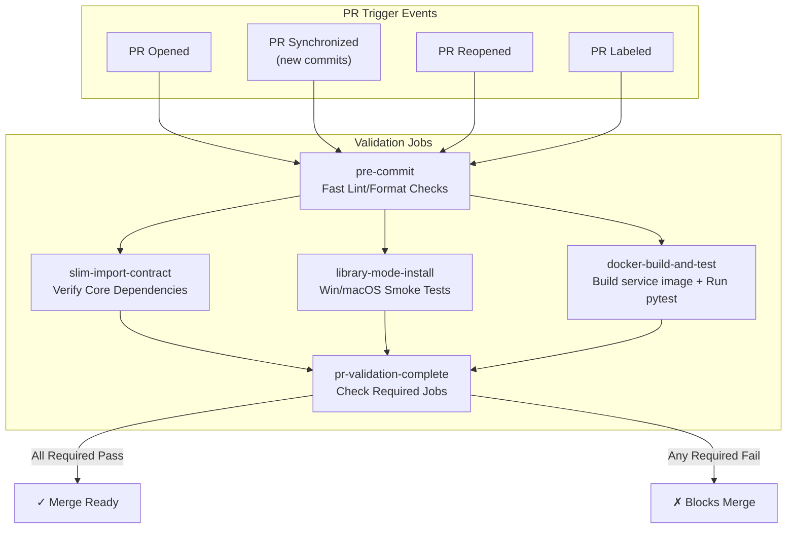
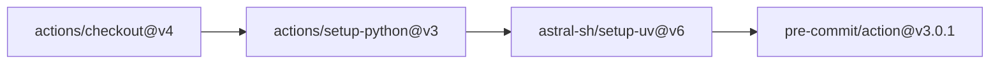
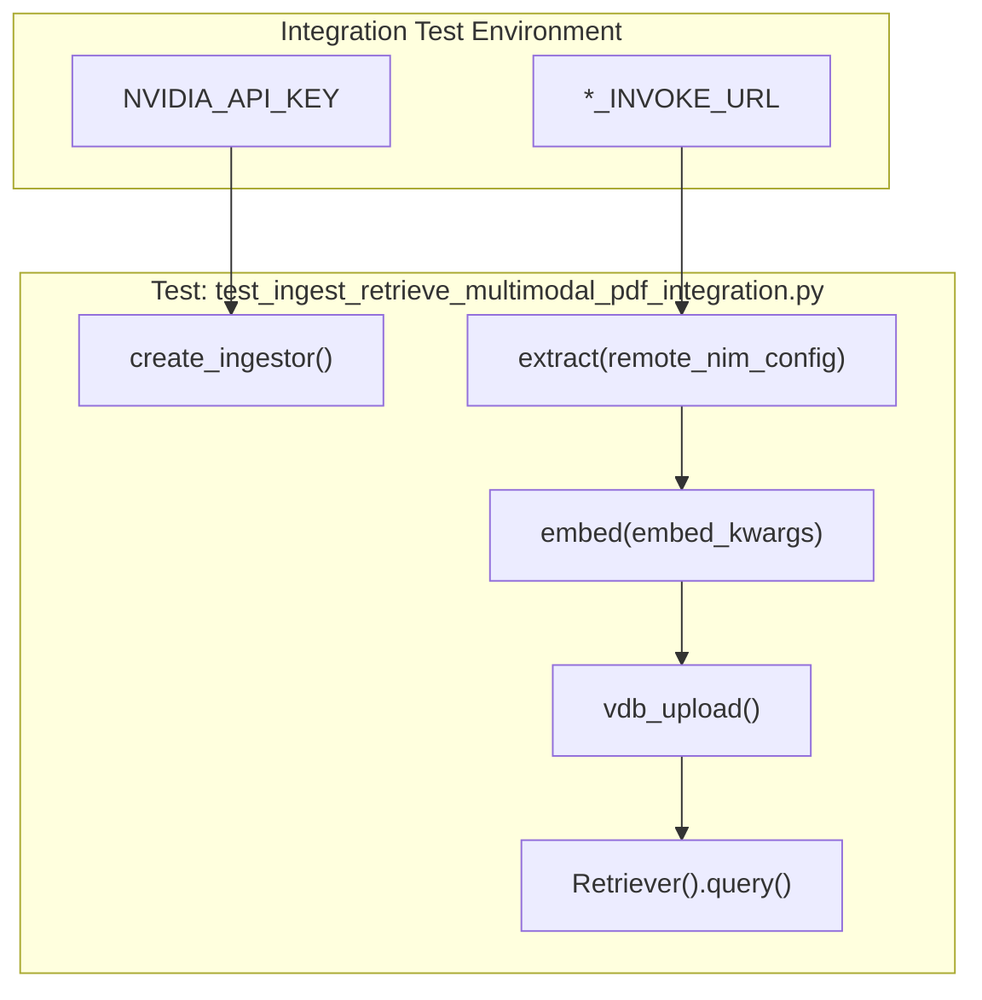

<!-- source: DeepWiki mcp.deepwiki.com · repo NVIDIA/NeMo-Retriever · extra page Pull Request Validation · fetched 2026-10-26 -->

# Pull Request Validation

<details>
<summary>Relevant source files</summary>

The following files were used as context for generating this wiki page:

- [.github/workflows/ci-main.yml](.github/workflows/ci-main.yml)
- [.github/workflows/ci-pull-request.yml](.github/workflows/ci-pull-request.yml)
- [.github/workflows/integration-test-library-mode.yml](.github/workflows/integration-test-library-mode.yml)
- [.github/workflows/retriever-unit-tests.yml](.github/workflows/retriever-unit-tests.yml)
- [.github/workflows/reusable-pre-commit.yml](.github/workflows/reusable-pre-commit.yml)
- [nemo_retriever/src/nemo_retriever/chart/cpu_actor.py](nemo_retriever/src/nemo_retriever/chart/cpu_actor.py)
- [nemo_retriever/src/nemo_retriever/nim/probe.py](nemo_retriever/src/nemo_retriever/nim/probe.py)
- [nemo_retriever/src/nemo_retriever/text_embed/cpu_operator.py](nemo_retriever/src/nemo_retriever/text_embed/cpu_operator.py)
- [nemo_retriever/tests/test_audio_benchmark.py](nemo_retriever/tests/test_audio_benchmark.py)
- [nemo_retriever/tests/test_ci_workflows.py](nemo_retriever/tests/test_ci_workflows.py)
- [nemo_retriever/tests/test_html_convert.py](nemo_retriever/tests/test_html_convert.py)
- [nemo_retriever/tests/test_ingest_retrieve_multimodal_pdf_integration.py](nemo_retriever/tests/test_ingest_retrieve_multimodal_pdf_integration.py)
- [nemo_retriever/tests/test_txt_split.py](nemo_retriever/tests/test_txt_split.py)

</details>


This page documents the automated validation workflow that runs on all pull requests to ensure code quality, build integrity, and test coverage before changes are merged into the main branch. The workflow consists of fast pre-commit checks, slim import contract validation, cross-platform installation smoke tests, and comprehensive Docker-based unit testing.

For information about the release process that publishes validated changes, see [Release Process](#6.4.2). For general CI/CD architecture and workflows on the main branch, see [CI/CD Workflows](#6.4).

---

## Workflow Overview

The pull request validation system is implemented in [.github/workflows/ci-pull-request.yml:1-122](). It utilizes the `pull_request` trigger for code pushes and label events.

### Validation Pipeline Architecture



**Sources:** [.github/workflows/ci-pull-request.yml:1-122]()

---

## Concurrency Control

The workflow implements concurrency control to prevent resource waste and ensure only the latest commit is validated:

```yaml
concurrency:
  group: ${{ github.workflow }}-pr-${{ github.event.pull_request.number }}
  cancel-in-progress: true
```

When new commits are pushed to a PR, any in-progress validation runs for that PR are automatically cancelled. The concurrency group is scoped to the PR number, so multiple PRs can run validation simultaneously without interference.

**Sources:** [.github/workflows/ci-pull-request.yml:11-13]()

---

## Stage 1: Pre-commit Checks

The `pre-commit` job runs lightweight code quality checks to catch simple issues before expensive Docker builds execute. This job uses a reusable workflow [.github/workflows/reusable-pre-commit.yml:1-18]() which executes hooks via the `uv` package manager.

### Pre-commit Implementation Details
The reusable workflow ensures `uv` is installed before executing the pre-commit action to speed up environment setup.



**Sources:** [.github/workflows/reusable-pre-commit.yml:7-18](), [nemo_retriever/tests/test_ci_workflows.py:87-96]()

---

## Stage 2: Slim Import Contract

The `slim-import-contract` job ensures that the core `nemo-retriever` package can be installed and imported without requiring heavy local-inference dependencies like `tritonclient`. This is critical for the "slim" API mode where inference is offloaded to remote NIMs.

### Validation Steps
1. Create a clean virtual environment using `uv venv` [.github/workflows/ci-pull-request.yml:39]().
2. Install the package with `[dev]` extras but without local inference extras [.github/workflows/ci-pull-request.yml:41]().
3. Explicitly uninstall `tritonclient` if present [.github/workflows/ci-pull-request.yml:42]().
4. Run `tests/test_slim_imports_no_triton.py` to assert that `tritonclient` is not in the import path [.github/workflows/ci-pull-request.yml:44]().

**Sources:** [.github/workflows/ci-pull-request.yml:22-45]()

---

## Stage 3: Cross-Platform Library Mode Install

To ensure the library remains portable, the `library-mode-install` job performs installation smoke tests on non-Linux platforms (Windows and macOS).

| Platform | Runner | Label |
|----------|--------|-------|
| Windows x64 | `windows-latest` | `windows-x64` |
| macOS Arm64 | `macos-26` | `macos-arm64` |
| macOS x64 | `macos-26-intel` | `macos-x64` |

The job performs a system-level install using `uv pip install -e "nemo_retriever"` and verifies the CLI by running `retriever --help` [.github/workflows/ci-pull-request.yml:76-84]().

**Sources:** [.github/workflows/ci-pull-request.yml:47-85]()

---

## Stage 4: Docker Build and Test

The `docker-build-and-test` job builds the `service` stage Docker image and runs the unit test suite inside the container. This ensures the code works in the production-like containerized environment.

### Build and Test Parameters
The PR validation workflow calls the reusable workflow with the following parameters:

| Parameter | Value | Purpose |
|-----------|-------|---------|
| `platform` | `linux/amd64` | Target architecture for build |
| `target` | `service` | Dockerfile stage (production service stage) |
| `tags` | `nrl-service:pr-${{ github.event.pull_request.number }}` | Unique tag for PR |
| `test-selection` | `full` | Run all unit tests |
| `pytest-markers` | `not integration` | Exclude heavy integration tests |
| `coverage` | `true` | Generate coverage reports |
| `runner` | `linux-large-disk` | High-performance runner for faster builds |

**Sources:** [.github/workflows/ci-pull-request.yml:87-100](), [nemo_retriever/tests/test_ci_workflows.py:106-119]()

---

## Integration Test Selection Strategies

While standard PR validation excludes integration tests to maintain speed, the repository provides specialized workflows for deeper validation.

### Library Mode Integration (Remote NIMs)
The `Library Mode Integration Tests` workflow [.github/workflows/integration-test-library-mode.yml:5-75]() runs daily or on-demand. It validates the full pipeline (extract → embed → VDB) using hosted NVIDIA NIM endpoints.



**Sources:** [.github/workflows/integration-test-library-mode.yml:36-45](), [nemo_retriever/tests/test_ingest_retrieve_multimodal_pdf_integration.py:64-100]()

### NIM Endpoint Probing
To prevent silent failures during integration tests, the system uses `probe_endpoint` [.nemo_retriever/src/nemo_retriever/nim/probe.py:43-198]().
- **Step 1**: Unauthenticated GET to `/v1/health/ready` for local NIMs [.nemo_retriever/src/nemo_retriever/nim/probe.py:71-86]().
- **Step 2**: Authenticated POST with empty body to the target URL for remote NIMs (ai.api.nvidia.com) [.nemo_retriever/src/nemo_retriever/nim/probe.py:128-160]().
- **Failure**: Raises `RuntimeError` on 401/403 to fail fast during operator initialization [.nemo_retriever/src/nemo_retriever/nim/probe.py:156-160]().

**Sources:** [nemo_retriever/src/nemo_retriever/nim/probe.py:43-198](), [nemo_retriever/src/nemo_retriever/text_embed/cpu_operator.py:42-49]()

---

## Validation Summary Job

The `pr-validation-complete` job serves as the final gateway. It aggregates the results of all required jobs using the `needs` keyword and an explicit check in the script block.

```bash
if [[ "${{ needs.pre-commit.result }}" != "success" ]] || \
   [[ "${{ needs.slim-import-contract.result }}" != "success" ]] || \
   [[ "${{ needs.library-mode-install.result }}" != "success" ]] || \
   [[ "${{ needs.docker-build-and-test.result }}" != "success" ]]; then
  echo "One or more required jobs failed"
  exit 1
fi
```

This job ensures that even if a job is skipped or cancelled, the PR cannot be merged unless all mandatory checks pass.

**Sources:** [.github/workflows/ci-pull-request.yml:102-122]()

---

