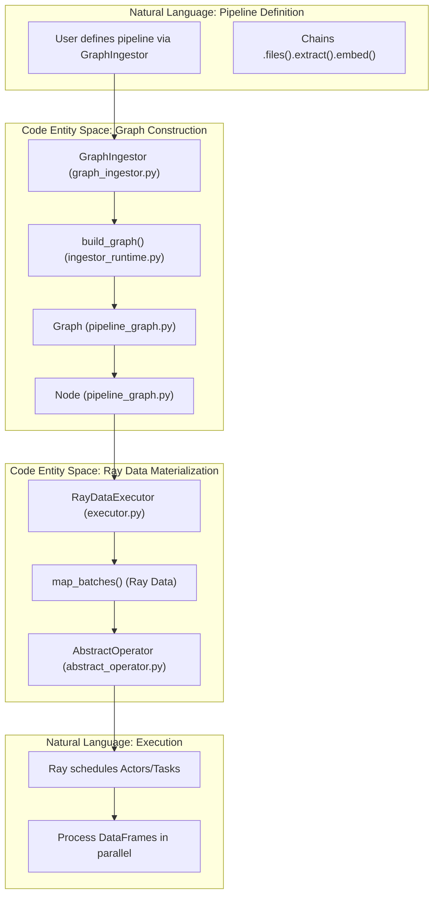
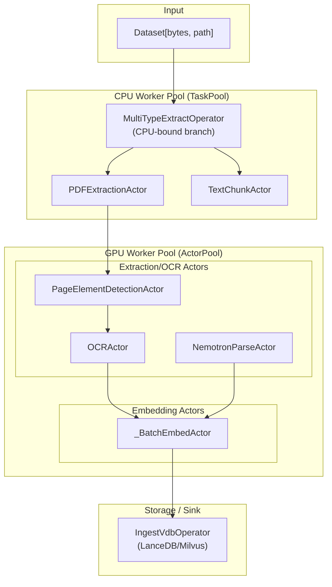

<!-- source: DeepWiki mcp.deepwiki.com · repo NVIDIA/NeMo-Retriever · extra page Ray Data Pipeline Architecture · fetched 2026-10-26 -->

# Ray Data Pipeline Architecture

Relevant source files

The following files were used as context for generating this wiki page:

- [nemo_retriever/src/nemo_retriever/graph/executor.py](nemo_retriever/src/nemo_retriever/graph/executor.py)
- [nemo_retriever/src/nemo_retriever/graph/ingestor_runtime.py](nemo_retriever/src/nemo_retriever/graph/ingestor_runtime.py)
- [nemo_retriever/src/nemo_retriever/graph/multi_type_extract_operator.py](nemo_retriever/src/nemo_retriever/graph/multi_type_extract_operator.py)
- [nemo_retriever/src/nemo_retriever/graph_ingestor.py](nemo_retriever/src/nemo_retriever/graph_ingestor.py)
- [nemo_retriever/src/nemo_retriever/utils/input_files.py](nemo_retriever/src/nemo_retriever/utils/input_files.py)
- [nemo_retriever/src/nemo_retriever/utils/ray_resource_hueristics.py](nemo_retriever/src/nemo_retriever/utils/ray_resource_hueristics.py)
- [nemo_retriever/tests/test_ingest_interface.py](nemo_retriever/tests/test_ingest_interface.py)
- [nemo_retriever/tests/test_ingest_plans.py](nemo_retriever/tests/test_ingest_plans.py)
- [nemo_retriever/tests/test_pipeline_graph.py](nemo_retriever/tests/test_pipeline_graph.py)
- [nemo_retriever/tests/test_resource_heuristics.py](nemo_retriever/tests/test_resource_heuristics.py)

## Purpose and Scope

This page documents the Ray Data pipeline architecture used by the **batch** execution mode in `nemo-retriever`. The batch mode orchestrates distributed document processing across multiple workers using [Ray Data](https://docs.ray.io/en/latest/data/data.html) for scalable parallel execution. The architecture manages CPU-intensive extraction stages and GPU-intensive model inference stages through a sequence of `map_batches()` transformations with explicit resource allocation, actor pools, and repartitioning.

The pipeline is primarily built using the `GraphIngestor` class [nemo_retriever/src/nemo_retriever/graph_ingestor.py:114-136](), which constructs a `Graph` [nemo_retriever/src/nemo_retriever/graph/pipeline_graph.py:16-116]() and executes it via the `RayDataExecutor` [nemo_retriever/src/nemo_retriever/graph/executor.py:161-195]().

## Ray Data Execution Model

The `RayDataExecutor` takes a directed acyclic graph (DAG) of operators and maps it to a Ray Data pipeline. Each `Node` in the graph corresponds to a `map_batches` stage in Ray Data [nemo_retriever/src/nemo_retriever/graph/executor.py:207-251]().

### Pipeline Execution Flow

The following diagram maps the high-level ingestion logic to specific code entities and Ray Data transformations:

**Natural Language to Code Entity Space: Ray Data Execution**

**Sources:** [nemo_retriever/src/nemo_retriever/graph_ingestor.py:18-24](), [nemo_retriever/src/nemo_retriever/graph/executor.py:207-251](), [nemo_retriever/src/nemo_retriever/graph/pipeline_graph.py:16-116]()

## Pipeline Stages and Distributed Processing

The batch pipeline is composed of several specialized operators. For multi-modal or mixed-file workloads, the `MultiTypeExtractOperator` acts as a central dispatcher [nemo_retriever/src/nemo_retriever/graph/multi_type_extract_operator.py:149-174]().

### The MultiTypeExtractOperator Dispatcher

The `MultiTypeExtractOperator` determines which specialized actor to use based on file extension [nemo_retriever/src/nemo_retriever/graph/multi_type_extract_operator.py:60-69]().

| File Type | Extension Mapping | Internal Actor |
| :--- | :--- | :--- |
| **PDF/DOC** | `.pdf`, `.docx`, `.pptx` | `PDFExtractionActor`, `DocToPdfConversionActor` |
| **Text** | `.txt` | `TextChunkActor` |
| **HTML** | `.html` | `HtmlSplitActor` |
| **Audio** | `.mp3`, `.wav`, `.m4a` | `ASRActor`, `MediaChunkActor` |
| **Video** | `.mp4`, `.mov`, `.mkv` | `VideoFrameActor`, `AudioVisualFuser` |

**Sources:** [nemo_retriever/src/nemo_retriever/graph/multi_type_extract_operator.py:60-69](), [nemo_retriever/src/nemo_retriever/graph/multi_type_extract_operator.py:18-53]()

### Distributed Architecture Diagram

This diagram illustrates how the `RayDataExecutor` distributes different processing stages across Ray worker pools.

**Sources:** [nemo_retriever/src/nemo_retriever/graph/executor.py:207-251](), [nemo_retriever/src/nemo_retriever/graph/ingestor_runtime.py:14-47](), [nemo_retriever/src/nemo_retriever/graph/multi_type_extract_operator.py:149-174]()

## Resource Heuristics and Node Overrides

The system automatically calculates optimal Ray resource requirements (CPUs, GPUs, batch sizes) based on the cluster's hardware.

### Resource Heuristics

The `nemo_retriever.utils.ray_resource_hueristics` module defines baseline constants for various actors:

*   **Embedding**: `EMBED_GPUS_PER_ACTOR = 0.5`, `EMBED_BATCH_SIZE = 256` [nemo_retriever/src/nemo_retriever/utils/ray_resource_hueristics.py:22-29]()
*   **OCR**: `OCR_GPUS_PER_ACTOR = 0.1`, `OCR_BATCH_SIZE = 32` [nemo_retriever/src/nemo_retriever/utils/ray_resource_hueristics.py:42-43]()
*   **Nemotron Parse**: `VLLM_GPUS_PER_ACTOR = 1.0`, `NEMOTRON_PARSE_BATCH_SIZE = 64` [nemo_retriever/src/nemo_retriever/utils/ray_resource_hueristics.py:35-36]()

### batch_tuning_to_node_overrides

The `batch_tuning_to_node_overrides` function [nemo_retriever/src/nemo_retriever/graph/ingestor_runtime.py:75-107]() translates user-provided `BatchTuningParams` into Ray-specific `node_overrides`. These overrides are passed to the `RayDataExecutor` to control:
1.  `num_cpus` / `num_gpus` per actor.
2.  `batch_size` for `map_batches`.
3.  Concurrency (number of actors in the pool).

For example, if a cluster has no GPUs, the system automatically detects this via `gather_cluster_resources` and adjusts the plan to allow CPU-only execution where possible [nemo_retriever/src/nemo_retriever/graph/ingestor_runtime.py:96-107]().

**Sources:** [nemo_retriever/src/nemo_retriever/utils/ray_resource_hueristics.py:18-73](), [nemo_retriever/src/nemo_retriever/graph/ingestor_runtime.py:75-130]()

## Repartitioning and Data Flow

Ray Data pipelines are optimized by repartitioning data blocks to match the expected batch size of downstream GPU models.

1.  **Block Management**: The `RayDataExecutor` sets `target_num_rows_per_block` in the `node_overrides` for stages like embedding [nemo_retriever/src/nemo_retriever/graph/ingestor_runtime.py:153-154]().
2.  **Content Reshaping**: Multimodal extraction often results in "nested" data (e.g., one page containing multiple tables and text blocks). The pipeline uses `explode_content_to_rows` [nemo_retriever/src/nemo_retriever/graph/content_transforms.py:23]() to flatten these into individual rows before embedding, ensuring each row corresponds to one vector [nemo_retriever/src/nemo_retriever/graph/ingestor_runtime.py:20-24]().

### Repartitioning Logic Table

| Stage | Batch Size Control | Resource Key |
| :--- | :--- | :--- |
| **PDF Extract** | `pdf_extract_batch_size` | `num_cpus` |
| **OCR / Detection** | `ocr_batch_size` | `num_gpus` (fractional) |
| **Embedding** | `embed_batch_size` | `num_gpus` (fractional) |
| **Nemotron Parse** | `nemotron_parse_batch_size`| `num_gpus` (dedicated 1.0) |

**Sources:** [nemo_retriever/src/nemo_retriever/graph/ingestor_runtime.py:148-154](), [nemo_retriever/src/nemo_retriever/utils/ray_resource_hueristics.py:18-73]()

## GPU Fraction Allocation

To maximize GPU utilization, multiple actors can share a single GPU by using fractional resource requests. This is particularly common for lightweight NIMs like OCR or Page Elements.

*   **Fractional Request**: The `OCR_GPUS_PER_ACTOR` is set to `0.1` by default [nemo_retriever/src/nemo_retriever/utils/ray_resource_hueristics.py:42](), allowing up to 10 OCR actors to reside on a single GPU.
*   **Dedicated Request**: Heavy models like Nemotron Parse (using vLLM) require `1.0` GPU to manage KV-caches and continuous batching [nemo_retriever/src/nemo_retriever/utils/ray_resource_hueristics.py:35]().

**Sources:** [nemo_retriever/src/nemo_retriever/utils/ray_resource_hueristics.py:31-52](), [nemo_retriever/src/nemo_retriever/graph/executor.py:37-39]()

---

