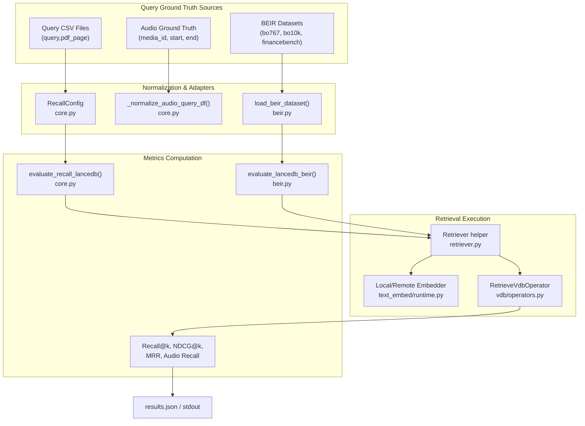

<!-- source: DeepWiki mcp.deepwiki.com · repo NVIDIA/NeMo-Retriever · extra page Recall Evaluation · fetched 2026-10-26 -->

# Recall Evaluation

<details>
<summary>Relevant source files</summary>

The following files were used as context for generating this wiki page:

- [data/bo767_query_gt.csv](data/bo767_query_gt.csv)
- [evaluation/bo10k_ids.txt](evaluation/bo10k_ids.txt)
- [evaluation/bo767_ids.txt](evaluation/bo767_ids.txt)
- [evaluation/bo767_recall.ipynb](evaluation/bo767_recall.ipynb)
- [evaluation/digital_corpora_download.ipynb](evaluation/digital_corpora_download.ipynb)
- [nemo_retriever/src/nemo_retriever/graph/beir_eval.py](nemo_retriever/src/nemo_retriever/graph/beir_eval.py)
- [nemo_retriever/src/nemo_retriever/graph/recall_eval.py](nemo_retriever/src/nemo_retriever/graph/recall_eval.py)
- [nemo_retriever/src/nemo_retriever/harness/history.py](nemo_retriever/src/nemo_retriever/harness/history.py)
- [nemo_retriever/src/nemo_retriever/harness/portal/app.py](nemo_retriever/src/nemo_retriever/harness/portal/app.py)
- [nemo_retriever/src/nemo_retriever/harness/portal/static/views/datasets.jsx](nemo_retriever/src/nemo_retriever/harness/portal/static/views/datasets.jsx)
- [nemo_retriever/src/nemo_retriever/model/__init__.py](nemo_retriever/src/nemo_retriever/model/__init__.py)
- [nemo_retriever/src/nemo_retriever/model/local/llama_nemotron_embed_1b_v2_hf_embedder.py](nemo_retriever/src/nemo_retriever/model/local/llama_nemotron_embed_1b_v2_hf_embedder.py)
- [nemo_retriever/src/nemo_retriever/recall/beir.py](nemo_retriever/src/nemo_retriever/recall/beir.py)
- [nemo_retriever/src/nemo_retriever/recall/core.py](nemo_retriever/src/nemo_retriever/recall/core.py)
- [nemo_retriever/src/nemo_retriever/retriever.py](nemo_retriever/src/nemo_retriever/retriever.py)
- [nemo_retriever/src/nemo_retriever/text_embed/gpu_operator.py](nemo_retriever/src/nemo_retriever/text_embed/gpu_operator.py)
- [nemo_retriever/src/nemo_retriever/text_embed/processor.py](nemo_retriever/src/nemo_retriever/text_embed/processor.py)
- [nemo_retriever/src/nemo_retriever/text_embed/runtime.py](nemo_retriever/src/nemo_retriever/text_embed/runtime.py)
- [nemo_retriever/tests/test_beir_evaluation.py](nemo_retriever/tests/test_beir_evaluation.py)
- [nemo_retriever/tests/test_create_local_embedder.py](nemo_retriever/tests/test_create_local_embedder.py)
- [nemo_retriever/tests/test_retriever_queries.py](nemo_retriever/tests/test_retriever_queries.py)

</details>


Recall evaluation measures the quality of retrieval in the NeMo Retriever Library by comparing search results against ground truth query-answer pairs. This system enables automated quality assessment during benchmarking and provides pass/fail gating for production pipelines.

For information about running benchmarks that use recall evaluation, see [Running Benchmarks](#5.3.1). For broader context on the benchmarking harness architecture, see [Benchmarking Harness](#5.3).

## Purpose and Scope

Recall evaluation in the harness validates that ingested documents can be successfully retrieved when queried. The system:

- Loads ground truth query-answer pairs from CSV, JSON, or BEIR-style datasets [nemo_retriever/src/nemo_retriever/recall/beir.py:45-71]().
- Executes searches against the populated LanceDB vector database using the `Retriever` helper [nemo_retriever/src/nemo_retriever/retriever.py:161-188]().
- Computes recall@k metrics (recall@1, recall@3, recall@5, recall@10) and NDCG@k [nemo_retriever/src/nemo_retriever/recall/core.py:34-34]().
- Normalizes different dataset formats via recall adapters and match modes [nemo_retriever/src/nemo_retriever/recall/core.py:44-48]().
- Supports multimodal recall (text, image, audio) and reranking validation [nemo_retriever/src/nemo_retriever/recall/core.py:50-55]().
- Enforces quality gates by failing runs when recall metrics are missing or below thresholds [nemo_retriever/src/nemo_retriever/harness/run.py:269-277]().

**Sources:** [nemo_retriever/src/nemo_retriever/recall/core.py:1-55](), [nemo_retriever/src/nemo_retriever/harness/run.py:269-277]()

## Recall Evaluation Architecture



**Sources:** [nemo_retriever/src/nemo_retriever/recall/core.py:24-55](), [nemo_retriever/src/nemo_retriever/recall/beir.py:149-181](), [nemo_retriever/src/nemo_retriever/retriever.py:161-188]()

## Recall Match Modes

The library supports multiple granularities for determining if a retrieval hit matches the ground truth.

| Match Mode | Granularity | Logic | File Reference |
|------------|-------------|-------|----------------|
| `pdf_page` | Page-level | Matches `{pdf_basename}_{page_number}` | [nemo_retriever/src/nemo_retriever/recall/core.py:48]() |
| `pdf_only` | Document-level | Matches `{pdf_basename}` only | [nemo_retriever/src/nemo_retriever/recall/core.py:46]() |
| `audio_segment` | Temporal | Matches `media_id` + time overlap within tolerance | [nemo_retriever/src/nemo_retriever/recall/core.py:47]() |

### Audio Recall Matching
For `audio_segment` mode, a hit is considered correct if the retrieved segment's `media_id` matches and its time range (start/end) is within `audio_match_tolerance_secs` (default 2.0s) of the golden segment [nemo_retriever/src/nemo_retriever/recall/core.py:18-18](). The system uses an encoded key format: `media_id\tstart\tend` [nemo_retriever/src/nemo_retriever/recall/core.py:96-97]().

**Sources:** [nemo_retriever/src/nemo_retriever/recall/core.py:18-105]()

## BEIR Evaluation Framework

The library includes a specialized BEIR (Benchmarking IR) implementation optimized for LanceDB. It supports several "first-class" datasets with pre-defined configurations [nemo_retriever/src/nemo_retriever/recall/beir.py:45-71]().

### Supported BEIR Datasets
- **bo767**: Business reports, page-level matching [nemo_retriever/src/nemo_retriever/recall/beir.py:46-50]().
- **bo10k**: Large scale digital corpora, page-level [nemo_retriever/src/nemo_retriever/recall/beir.py:51-55]().
- **financebench**: Financial questions, document-level matching [nemo_retriever/src/nemo_retriever/recall/beir.py:66-70]().
- **vidore_hf**: Visual document retrieval via HuggingFace [nemo_retriever/src/nemo_retriever/recall/beir.py:87-92]().

### BEIR Data Flow
The `evaluate_lancedb_beir` function performs the following steps:
1. Resolves dataset options (loader, path, doc_id field) [nemo_retriever/src/nemo_retriever/recall/beir.py:74-102]().
2. Loads queries and QRELs (query-relevance mappings) [nemo_retriever/src/nemo_retriever/recall/beir.py:17-17]().
3. Initializes a `Retriever` to execute batch queries against LanceDB [nemo_retriever/src/nemo_retriever/recall/beir.py:16-16]().
4. Computes metrics including `NDCG@k`, `Recall@k`, `Precision@k`, and `MAP` [nemo_retriever/src/nemo_retriever/recall/beir.py:15-15]().

**Sources:** [nemo_retriever/src/nemo_retriever/recall/beir.py:1-102](), [evaluation/bo767_recall.ipynb:82-94]()

## Core Implementation Details

### The Retriever Helper
The `Retriever` class in `nemo_retriever/src/nemo_retriever/retriever.py` is the primary interface for recall evaluation. It handles:
- **Embedding**: Converting text queries to vectors using local (HF/vLLM) or remote (NIM) models [nemo_retriever/src/nemo_retriever/retriever.py:193-205]().
- **VDB Search**: Executing the search via `RetrieveVdbOperator` [nemo_retriever/src/nemo_retriever/retriever.py:20-20]().
- **Reranking**: Optionally applying a second-stage reranker (e.g., Nemotron Rerank) to improve top-k quality [nemo_retriever/src/nemo_retriever/retriever.py:166-166]().
- **Deduplication**: Applying `page_dedup` to ensure unique pages are returned [nemo_retriever/src/nemo_retriever/retriever.py:110-110]().

### Metrics Computation Logic
Metrics are computed by comparing retrieved `RetrievalHit` objects against ground truth. 
- **Recall@k**: Is the golden document ID present in the top-k results?
- **Hit Shaping**: Before evaluation, hits are filtered by `content_types` and truncated to `top_k` [nemo_retriever/src/nemo_retriever/retriever.py:106-136]().

**Sources:** [nemo_retriever/src/nemo_retriever/retriever.py:106-188](), [nemo_retriever/src/nemo_retriever/recall/core.py:33-34]()

## Recall Evaluation in the CLI

Recall evaluation can be triggered via the `retriever pipeline run` command using the `--evaluation-mode` flag.

```bash
retriever pipeline run /path/to/docs \
  --vdb-kwargs-json '{"uri":"./lancedb","table_name":"eval_table"}' \
  --evaluation-mode beir \
  --beir-dataset-name bo767 \
  --quiet
```

This command automatically:
1. Ingests the documents into the specified LanceDB table.
2. Resolves the BEIR ground truth for "bo767".
3. Executes the retrieval and prints the recall metrics.

**Sources:** [evaluation/bo767_recall.ipynb:34-40](), [nemo_retriever/src/nemo_retriever/harness/portal/app.py:41-41]()

## Recall Configuration Schema

The `RecallConfig` class defines the parameters for a recall run:

| Parameter | Type | Default | Description |
|-----------|------|---------|-------------|
| `vdb_op` | `str` | `"lancedb"` | The vector database operator to use. |
| `match_mode` | `str` | `"pdf_page"` | Granularity: `pdf_page`, `pdf_only`, or `audio_segment`. |
| `ks` | `Sequence[int]` | `(1, 3, 5, 10)` | The 'k' values for recall computation. |
| `query_embedder` | `str` | `VL_EMBED_MODEL` | The model used for query embedding. |
| `reranker` | `Optional[str]` | `None` | Optional reranker model name. |
| `audio_match_tolerance_secs` | `float` | `2.0` | Tolerance for temporal audio matching. |

**Sources:** [nemo_retriever/src/nemo_retriever/recall/core.py:24-55]()

## Results and Metrics Extraction

Metrics are typically logged to stdout in a format that the benchmarking harness can parse:

```text
INFO:nemo_retriever.recall.beir:Metrics: {'NDCG@1': 0.82, 'Recall@5': 0.94, 'Recall@10': 0.96}
```

The harness parser extracts these values and stores them in the final `results.json` for performance tracking [nemo_retriever/src/nemo_retriever/harness/run.py:371-373]().

**Sources:** [nemo_retriever/src/nemo_retriever/harness/run.py:371-373](), [nemo_retriever/src/nemo_retriever/recall/beir.py:18-18]()

---

