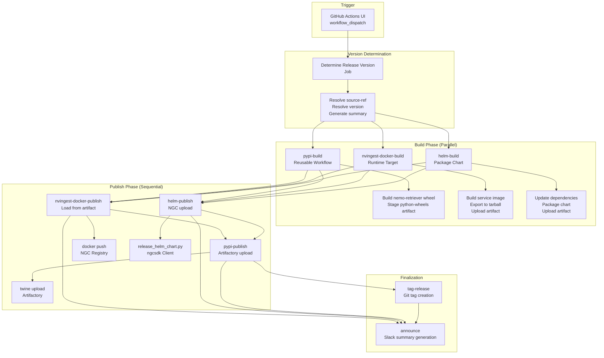
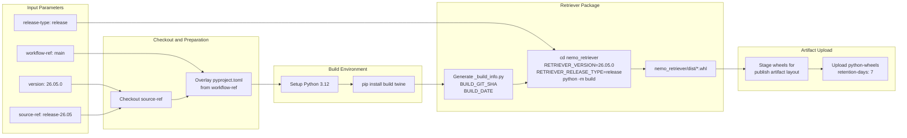
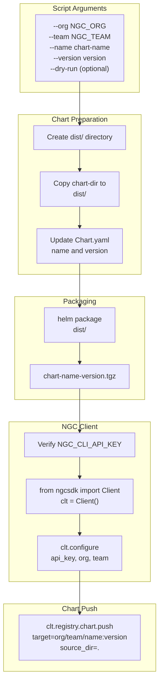
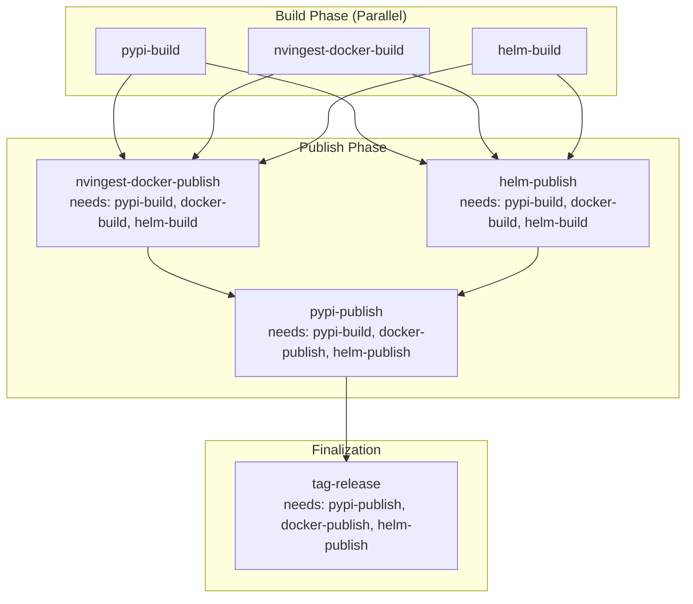

<!-- source: DeepWiki mcp.deepwiki.com · repo NVIDIA/NeMo-Retriever · extra page Release Process · fetched 2026-10-26 -->

# Release Process

<details>
<summary>Relevant source files</summary>

The following files were used as context for generating this wiki page:

- [.github/workflows/huggingface-nightly.yml](.github/workflows/huggingface-nightly.yml)
- [.github/workflows/perform-release.yml](.github/workflows/perform-release.yml)
- [.github/workflows/pypi-nightly-publish.yml](.github/workflows/pypi-nightly-publish.yml)
- [.github/workflows/release-helm.yml](.github/workflows/release-helm.yml)
- [.github/workflows/release-pypi.yml](.github/workflows/release-pypi.yml)
- [.github/workflows/reusable-docker-test.yml](.github/workflows/reusable-docker-test.yml)
- [.github/workflows/reusable-pypi-build.yml](.github/workflows/reusable-pypi-build.yml)
- [.github/workflows/reusable-pypi-publish.yml](.github/workflows/reusable-pypi-publish.yml)
- [.gitignore](.gitignore)
- [ci/scripts/nightly_build_publish.py](ci/scripts/nightly_build_publish.py)
- [ci/scripts/release_helm_chart.py](ci/scripts/release_helm_chart.py)
- [ci/tests/test_huggingface_release_workflow.py](ci/tests/test_huggingface_release_workflow.py)
- [nemo_retriever/LICENSE](nemo_retriever/LICENSE)
- [nemo_retriever/pyproject.toml](nemo_retriever/pyproject.toml)
- [nemo_retriever/src/nemo_retriever/model/local/nemotron_ocr_v2.py](nemo_retriever/src/nemo_retriever/model/local/nemotron_ocr_v2.py)
- [nemo_retriever/tests/test_nemotron_ocr_v2_nightly.py](nemo_retriever/tests/test_nemotron_ocr_v2_nightly.py)
- [nemo_retriever/uv.lock](nemo_retriever/uv.lock)

</details>


This page documents the release workflow for publishing NeMo Retriever artifacts to production registries. It covers the GitHub Actions workflows that build and publish Python wheels, Docker images, and Helm charts.

**Scope:** This page focuses on the coordinated release process triggered by maintainers. For pull request validation, see [Pull Request Validation](#6.4.1). For package build configuration details, see [Python Package Build System](#6.3).

---

## Overview

The NeMo Retriever release process produces multiple artifact types across several distribution channels. While the core system is distributed via NVIDIA-internal registries and NGC, the `nemo-retriever` library and its specialized model packages (like `nemotron-ocr`) are also published to PyPI and TestPyPI.

| Artifact Type | Packages/Images | Target Registry | Versioning |
|--------------|-----------------|-----------------|------------|
| Python Wheels | `nemo-retriever`, `nemotron-ocr-v2`, `nemotron-page-elements-v3`, etc. | Artifactory (internal), PyPI, TestPyPI | PEP 440 with build metadata |
| Docker Image | `nrl-service:version` | NGC Container Registry | Matches release version |
| Helm Chart | `nemo-retriever:version` | NGC Helm Registry | Independent version (e.g., `26.05`) |
| Git Tag | Repository tag | GitHub | Matches release version |

The release process implements **atomic publishing**: all artifacts are built and validated before any are published. A build failure in any component prevents all artifacts from being released.

**Sources:** [.github/workflows/perform-release.yml:1-516](), [nemo_retriever/pyproject.toml:18-33]()

---

## Release Workflows

The system provides three primary release mechanisms: manual coordinated releases, automated nightly library builds, and a specialized Hugging Face nightly pipeline for model packages.

### Manual Release Workflow

The primary release workflow is `perform-release.yml`, triggered manually via the GitHub Actions UI with configurable inputs:

```yaml
inputs:
  source-branch: Branch to build artifacts from (default: current branch)
  version: Override release version (default: derived from branch name)
  dry-run: Build and validate artifacts without publishing
  skip-docker: Disable Docker build and publish entirely
  skip-helm-chart: Disable Helm build and publish entirely
  release-type: 'release' or 'dev' (affects Python version suffix)
```

The workflow executes in two phases:

**Phase 1: Build** — All artifacts are built and validated in parallel. No publishing occurs until every build succeeds.

**Phase 2: Publish** — If all builds pass (and `dry-run=false`), artifacts are published atomically with coordinated dependency ordering.

**Sources:** [.github/workflows/perform-release.yml:4-40](), [.github/workflows/perform-release.yml:80-83](), [.github/workflows/perform-release.yml:225-229]()

#### Workflow Architecture



**Sources:** [.github/workflows/perform-release.yml:44-93](), [.github/workflows/perform-release.yml:231-353](), [.github/workflows/perform-release.yml:354-377]()

---

## Version Management

### Version Determination Logic

The `determine-version` job (and the `Determine Release Version` step) resolves the release version using this precedence:

1. **Explicit `version` input** — If provided, use as-is (e.g., `26.05-RC8`).
2. **RC Branch Logic** — If `version` matches `^(.+)-RC[0-9]+$`, it extracts the base branch (e.g., `26.05-RC8` builds from `26.05`).
3. **`source-branch` input** — Use branch name as version.
4. **Current workflow branch** — Use `github.ref_name` if no inputs provided.

**Sources:** [.github/workflows/perform-release.yml:45-79](), [.github/workflows/perform-release.yml:57-66]()

### Python Package Versioning

The `nemo-retriever` package uses a dynamic versioning scheme controlled by environment variables and build metadata.

| Environment Variable | Purpose | Default |
|---------------------|---------|---------|
| `RETRIEVER_VERSION` | Base version | `YYYY.MM.DD` |
| `RETRIEVER_RELEASE_TYPE` | Build type: `dev` or `release` | `dev` |
| `RETRIEVER_BUILD_NUMBER` | GitHub run number | `0` |
| `RETRIEVER_GIT_SHA` | Git commit hash | `unknown` |

Before packaging, a `_build_info.py` file is generated:

```python
# Generated file: nemo_retriever/src/nemo_retriever/_build_info.py
BUILD_GIT_SHA = "${{ github.sha }}"
BUILD_DATE = "2025-01-15T14:30:00Z"
```

**Sources:** [.github/workflows/reusable-pypi-build.yml:83-93](), [.github/workflows/pypi-nightly-publish.yml:108-118]()

---

## Python Wheel Build Process

### Reusable Build Workflow

The `reusable-pypi-build.yml` workflow builds the library wheel with coordinated versioning:



**Key Feature: Workflow-ref Overlay** — The workflow can overlay `pyproject.toml` from a different branch (the workflow branch) onto the source code. This enables testing updated build configurations against an older release branch without backporting changes.

**Sources:** [.github/workflows/reusable-pypi-build.yml:48-53](), [.github/workflows/reusable-pypi-build.yml:113-128]()

### Build Tool Configuration

The `nemo-retriever` package uses `uv` for dependency management and `setuptools` for the build backend.

```toml
[build-system]
requires = ["setuptools>=78.1.1", "wheel>=0.46.2"]
build-backend = "setuptools.build_meta"

[tool.setuptools.dynamic]
version = {attr = "nemo_retriever.version.get_build_version"}
```

**Sources:** [nemo_retriever/pyproject.toml:1-3](), [nemo_retriever/pyproject.toml:201-202]()

---

## Docker Image Release

### Build Process

The Docker build job creates the production service image:

- **Target Stage:** `service` (from multi-stage Dockerfile)
- **Platform:** `linux/amd64`
- **Build Arguments:**
  - `DOWNLOAD_LLAMA_TOKENIZER=True` — Download tokenizer assets.
  - `GIT_COMMIT=${{ github.sha }}` — Embed Git commit hash.
- **Secret Files:** `hf_token.txt` for Hugging Face model downloads during build.
- **Cache Strategy:** GitHub Actions cache with `scope=nvingest`.

The built image is exported to a compressed tarball (`nrl-service-docker-image.tar.gz`) and uploaded as an artifact for the publish phase.

**Sources:** [.github/workflows/perform-release.yml:144-160](), [.github/workflows/perform-release.yml:161-172]()

### Image Naming and Publishing

Image name format: `${DOCKER_REGISTRY}/nrl-service:${version}`

The publish job downloads the tarball, loads it into the local Docker daemon, and pushes to NGC:

```bash
docker save "${{ steps.meta.outputs.image }}" | gzip -1 > nrl-service-docker-image.tar.gz
# Later in publish job...
gunzip -c nrl-service-docker-image.tar.gz | docker load
docker push "${IMAGE}"
```

**Sources:** [.github/workflows/perform-release.yml:131-133](), [.github/workflows/perform-release.yml:162-164]()

---

## Helm Chart Release

### Chart Preparation

The Helm chart release process involves linting and packaging using a specialized Python script:

1. **Checkout** — Checkout code from the specified `source-ref`.
2. **Setup** — Install Helm, Python 3.12, and dependencies (`ngcsdk`, `pyyaml`).
3. **Lint** — `helm lint nemo_retriever/helm`.
4. **Package & Release** — Invoke `ci/scripts/release_helm_chart.py`.

**Sources:** [.github/workflows/release-helm.yml:39-70](), [.github/workflows/release-helm.yml:27-27]()

### NGC Publishing Script

The `release_helm_chart.py` script handles chart packaging and NGC upload:



**Sources:** [ci/scripts/release_helm_chart.py:1-154](), [ci/scripts/release_helm_chart.py:88-122](), [ci/scripts/release_helm_chart.py:128-149]()

---

## Hugging Face Nightly Pipeline

NeMo Retriever maintains a specialized pipeline for building and publishing nightly versions of model packages (e.g., `nemotron-ocr-v2`, `nemotron-page-elements-v3`) hosted on Hugging Face.

### Nightly Coordinate Job

To ensure parallel matrix legs (like OCR x86 and ARM builds) share the same version, a `nightly_coordinate` job generates a unique 14-digit UTC suffix (`YYYYMMDDHHmmss`).

**Sources:** [.github/workflows/huggingface-nightly.yml:52-80]()

### Build and Publish Script

The `ci/scripts/nightly_build_publish.py` script performs the following:

1. **Clone** — Clones the Hugging Face repository (with LFS smudge disabled).
2. **Patch** — Updates `pyproject.toml` or `setup.cfg` with the nightly dev version.
3. **Build** — Runs `python -m build` to create sdist and wheels.
4. **Repair (Optional)** — Uses `auditwheel` to rewrite `linux_*` wheels to `manylinux_*`.
5. **Upload** — Uses `twine` to upload to PyPI or TestPyPI.

**Sources:** [ci/scripts/nightly_build_publish.py:1-14](), [ci/scripts/nightly_build_publish.py:162-190](), [ci/scripts/nightly_build_publish.py:343-358]()

### OCR Extension Builds

The `nemotron-ocr-v2` package requires specialized build environments for its CUDA extensions:

- **Matrix:** Builds for both `x86_64` and `aarch64` (ARM).
- **Environment:** Uses `nvidia/cuda:13.0.0-devel-ubuntu24.04` container.
- **Python:** Built with Python 3.12 to match runtime constraints.

**Sources:** [.github/workflows/huggingface-nightly.yml:175-199](), [.github/workflows/huggingface-nightly.yml:211-231]()

---

## Coordinated Release Dependencies

The release workflow enforces strict dependency ordering to ensure atomicity:



**Sources:** [.github/workflows/perform-release.yml:231-239](), [.github/workflows/perform-release.yml:273-281](), [.github/workflows/perform-release.yml:341-353]()

---

## Dry-Run Mode

All release workflows support dry-run mode for validation:

- **perform-release.yml**: Input `dry-run: true`. Builds artifacts and uploads them to GitHub Actions for inspection, but skips `docker push`, `ngc registry chart push`, and PyPI publishing.
- **release-helm.yml**: Input `dry-run: true`. Packages the chart and uploads the `.tgz` as an artifact.
- **huggingface-nightly.yml**: Input `upload_to: none`. Builds wheels but skips `twine upload`.

**Sources:** [.github/workflows/perform-release.yml:17-21](), [.github/workflows/release-helm.yml:15-19](), [.github/workflows/huggingface-nightly.yml:123-128]()

---

