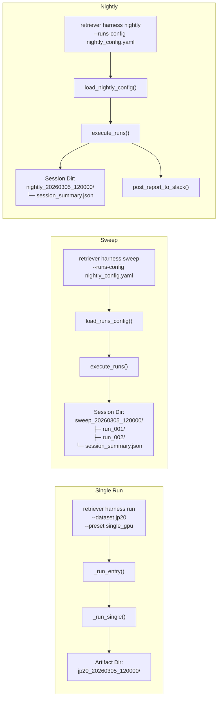
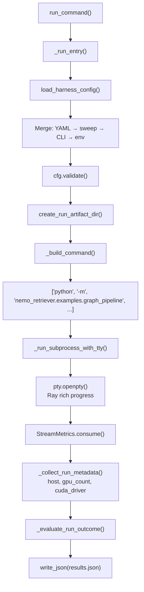
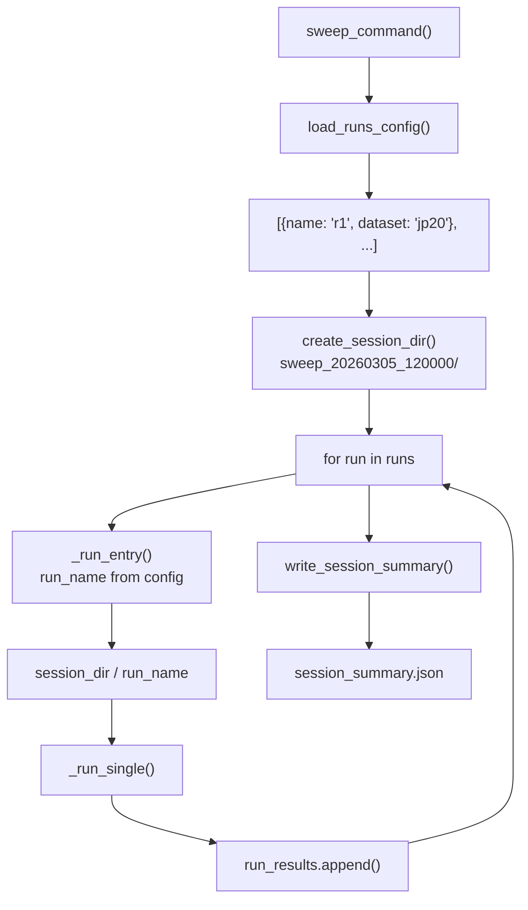
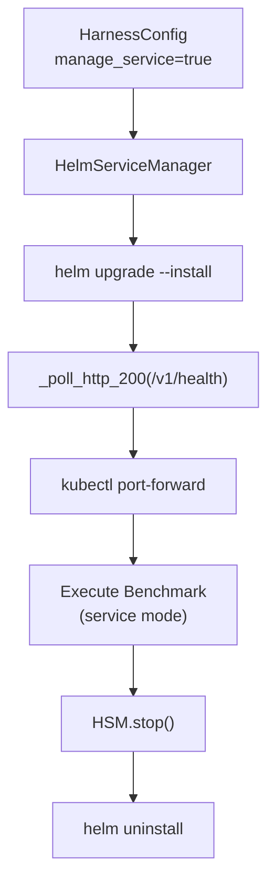
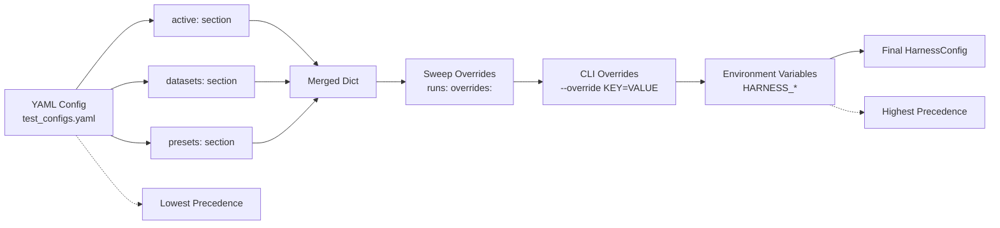
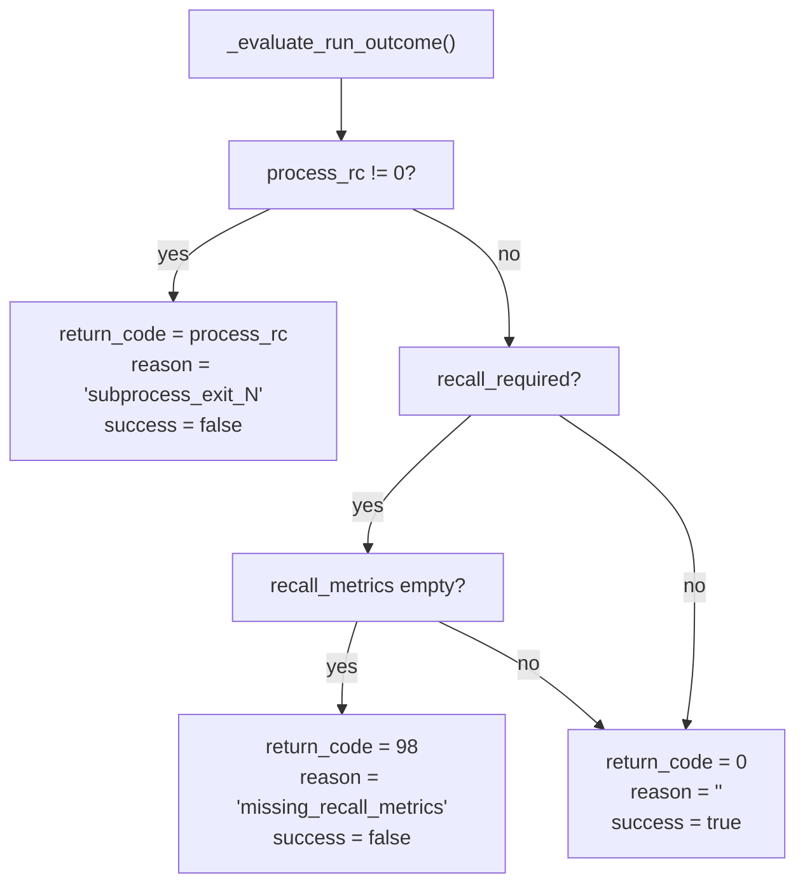

<!-- source: DeepWiki mcp.deepwiki.com · repo NVIDIA/NeMo-Retriever · extra page Running Benchmarks · fetched 2026-10-26 -->

# Running Benchmarks

<details>
<summary>Relevant source files</summary>

The following files were used as context for generating this wiki page:

- [nemo_retriever/harness/HANDOFF.md](nemo_retriever/harness/HANDOFF.md)
- [nemo_retriever/harness/examples/managed-helm-nrl-26.05.yaml](nemo_retriever/harness/examples/managed-helm-nrl-26.05.yaml)
- [nemo_retriever/harness/helm-profiles/all-optional.yaml](nemo_retriever/harness/helm-profiles/all-optional.yaml)
- [nemo_retriever/harness/helm-profiles/audio-video.yaml](nemo_retriever/harness/helm-profiles/audio-video.yaml)
- [nemo_retriever/harness/helm-profiles/core.yaml](nemo_retriever/harness/helm-profiles/core.yaml)
- [nemo_retriever/harness/helm-profiles/no-nims-external.yaml](nemo_retriever/harness/helm-profiles/no-nims-external.yaml)
- [nemo_retriever/harness/helm-profiles/split.yaml](nemo_retriever/harness/helm-profiles/split.yaml)
- [nemo_retriever/harness/test_configs.yaml](nemo_retriever/harness/test_configs.yaml)
- [nemo_retriever/harness/vidore_sweep.yaml](nemo_retriever/harness/vidore_sweep.yaml)
- [nemo_retriever/src/nemo_retriever/harness/artifacts.py](nemo_retriever/src/nemo_retriever/harness/artifacts.py)
- [nemo_retriever/src/nemo_retriever/harness/config.py](nemo_retriever/src/nemo_retriever/harness/config.py)
- [nemo_retriever/src/nemo_retriever/harness/helm_manager.py](nemo_retriever/src/nemo_retriever/harness/helm_manager.py)
- [nemo_retriever/src/nemo_retriever/harness/parsers.py](nemo_retriever/src/nemo_retriever/harness/parsers.py)
- [nemo_retriever/src/nemo_retriever/harness/run.py](nemo_retriever/src/nemo_retriever/harness/run.py)
- [nemo_retriever/src/nemo_retriever/utils/detection_summary.py](nemo_retriever/src/nemo_retriever/utils/detection_summary.py)
- [nemo_retriever/tests/test_detection_summary.py](nemo_retriever/tests/test_detection_summary.py)
- [nemo_retriever/tests/test_harness_config.py](nemo_retriever/tests/test_harness_config.py)
- [nemo_retriever/tests/test_harness_helm_manager.py](nemo_retriever/tests/test_harness_helm_manager.py)
- [nemo_retriever/tests/test_harness_run.py](nemo_retriever/tests/test_harness_run.py)

</details>


This page documents how to execute benchmark runs using the NeMo Retriever Library harness. The harness provides a CLI-driven workflow for running single benchmarks, sweeps (multiple runs in sequence), and nightly sessions with automated Slack reporting.

For information about recall evaluation metrics and adapters, see [Recall Evaluation](#5.3.2). For the overall harness architecture and artifact structure, see [Benchmarking Harness](#5.3).

## Benchmark Execution Modes

The harness supports three execution modes, each designed for different use cases:



**Sources:**
- [nemo_retriever/src/nemo_retriever/harness/run.py:515-582]()
- [nemo_retriever/harness/HANDOFF.md:40-49]()

## Single Run Command

Execute a single benchmark run with `retriever harness run`. This mode creates a standalone artifact directory and does not write session-level summaries.

### Basic Usage

```bash
# Run with preset dataset from test_configs.yaml
retriever harness run --dataset jp20 --preset single_gpu

# Run with direct dataset path
retriever harness run --dataset /datasets/nv-ingest/bo767 --preset single_gpu

# Add tags for tracking
retriever harness run --dataset jp20 --preset single_gpu --tag nightly --tag candidate

# Override specific tuning parameters
retriever harness run --dataset jp20 --preset single_gpu --override gpu_embed=0.5
```

**Sources:**
- [nemo_retriever/harness/HANDOFF.md:40-43]()
- [nemo_retriever/src/nemo_retriever/harness/run.py:515-541]()

### Command Options

The following table shows all available options for the `run` command:

| Option | Type | Description |
|--------|------|-------------|
| `--dataset` | string | Required. Dataset name from config or direct path |
| `--preset` | string | Preset name (e.g., `single_gpu`, `dgx_8gpu`) |
| `--config` | path | Path to harness test config YAML (default: `test_configs.yaml`) |
| `--run-name` | string | Optional label for the run artifact directory |
| `--override` | KEY=VALUE | Override tuning values. Repeatable |
| `--tag` | string | Run tag persisted in artifacts. Repeatable |
| `--recall-required` / `--no-recall-required` | flag | Override recall gating for this run |

**Sources:**
- [nemo_retriever/src/nemo_retriever/harness/run.py:515-541]()
- [nemo_retriever/tests/test_harness_run.py:155-171]()

### Run Execution Flow

The following diagram shows the internal flow when executing a single benchmark run:



**Sources:**
- [nemo_retriever/src/nemo_retriever/harness/run.py:440-484]()
- [nemo_retriever/src/nemo_retriever/harness/run.py:354-437]()
- [nemo_retriever/src/nemo_retriever/harness/run.py:300-352]()

## Sweep Command

Execute multiple benchmark runs in sequence with `retriever harness sweep`. This mode creates a session directory containing individual run directories and a consolidated `session_summary.json`.

### Basic Usage

```bash
# Run all benchmarks defined in nightly_config.yaml
retriever harness sweep --runs-config nemo_retriever/harness/nightly_config.yaml

# Force a preset for all runs in the sweep
retriever harness sweep --runs-config nightly_config.yaml --preset single_gpu

# Add session tags
retriever harness sweep --runs-config nightly_config.yaml --tag nightly

# Dry run to preview the execution plan
retriever harness sweep --runs-config nightly_config.yaml --dry-run
```

**Sources:**
- [nemo_retriever/harness/HANDOFF.md:44-45]()
- [nemo_retriever/src/nemo_retriever/harness/run.py:543-582]()

### Sweep Configuration File

The sweep runs are defined in a YAML file with the following structure:

```yaml
# nemo_retriever/harness/nightly_config.yaml
preset: dgx_8gpu

runs:
  - name: jp20_dgx_8gpu
    dataset: jp20
  
  - name: bo20_dgx_8gpu
    dataset: bo20
  
  - name: earnings_dgx_8gpu
    dataset: earnings
    overrides:
      gpu_embed: 0.5
```

Each run entry supports:
- `name`: Run identifier used for the artifact directory name
- `dataset`: Dataset name or path
- `preset`: Override the top-level preset for this run
- `overrides`: Dictionary of tuning parameter overrides
- `recall_required`: Override recall gating for this run

**Sources:**
- [nemo_retriever/src/nemo_retriever/harness/config.py:328-339]()

### Sweep Execution Flow



**Sources:**
- [nemo_retriever/src/nemo_retriever/harness/run.py:486-513]()
- [nemo_retriever/src/nemo_retriever/harness/run.py:543-582]()

## Helm Service Management

The harness includes a `HelmServiceManager` for benchmarks running in `service` mode where the harness manages the lifecycle of the NeMo Retriever service on Kubernetes.

### Managed Service Workflow

When `manage_service: true` and `run_mode: service` are configured, the harness performs the following steps:

1.  **Upgrade/Install**: Deploys the service using `helm upgrade --install` with the specified chart and values.
2.  **Service Discovery**: Resolves the main service name (falling back to a gateway if necessary).
3.  **Readiness Polling**: Polls the `/v1/health` endpoint until the service is ready.
4.  **Port Forwarding**: Establies a local port forward to the service.
5.  **Execution**: Executes the benchmark against the local forwarded port.
6.  **Teardown**: Stops port forwarding and uninstalls the Helm release (unless `keep_up: true`).



**Sources:**
- [nemo_retriever/src/nemo_retriever/harness/helm_manager.py:1-200]()
- [nemo_retriever/tests/test_harness_helm_manager.py:49-144]()

### Helm Configuration Parameters

Key fields in `HarnessConfig` for Helm management:

| Parameter | Default | Description |
|-----------|---------|-------------|
| `helm_chart` | None | Path or name of the Helm chart |
| `helm_release` | "nemo-retriever-harness" | Name of the Helm release |
| `helm_namespace` | None | Kubernetes namespace |
| `helm_values_file` | None | Path to a YAML values file |
| `helm_set` | {} | Dictionary of `--set` overrides |
| `helm_service_local_port` | 7670 | Local port for port-forwarding |

**Sources:**
- [nemo_retriever/src/nemo_retriever/harness/config.py:121-136]()
- [nemo_retriever/harness/examples/managed-helm-nrl-26.05.yaml:26-44]()

## Configuration System

The harness uses a multi-layer configuration system with a well-defined precedence order.

### Configuration Precedence



**Sources:**
- [nemo_retriever/src/nemo_retriever/harness/config.py:244-325]()
- [nemo_retriever/tests/test_harness_config.py:51-76]()

### Tuning Parameters

The following tuning parameters can be overridden in presets or via CLI:

| Parameter | Default | Description |
|-----------|---------|-------------|
| `pdf_extract_workers` | 8 | Number of parallel PDF extraction tasks |
| `page_elements_workers` | 3 | Number of page-elements actors |
| `ocr_workers` | 3 | Number of OCR actors |
| `embed_workers` | 3 | Number of embedding actors |
| `gpu_page_elements` | 0.1 | GPU fraction per page-elements actor |
| `gpu_ocr` | 0.1 | GPU fraction per OCR actor |
| `gpu_embed` | 0.25 | GPU fraction per embedding actor |

**Sources:**
- [nemo_retriever/src/nemo_retriever/harness/config.py:51-68]()
- [nemo_retriever/harness/test_configs.yaml:28-45]()

## Artifact Structure

The harness generates structured artifacts for every run and session.

### Run Artifacts (results.json)

The `results.json` file is the authoritative record of a benchmark run, containing:

- **test_config**: The resolved `HarnessConfig` used for the run.
- **metrics**: Comprehensive flat dictionary of all collected metrics.
- **summary_metrics**: A curated subset of metrics for high-level reporting (pages, ingest timing, recall).
- **run_metadata**: Host info, GPU count, CUDA driver, and library versions.
- **failure_reason**: If the run failed, a string identifier for the failure (e.g., `missing_recall_metrics`).

**Sources:**
- [nemo_retriever/harness/HANDOFF.md:52-67]()
- [nemo_retriever/src/nemo_retriever/harness/run.py:390-437]()
- [nemo_retriever/tests/test_harness_run.py:64-77]()

### Detection Summary

The harness computes a deduped detection summary by reading metadata from the resulting LanceDB table or DataFrame. This provides insights into the quantity of elements (tables, charts, infographics) extracted.

- **Implementation**: `compute_detection_summary` in `nemo_retriever.utils.detection_summary`.
- **Deduplication**: Uses `(source_id, page_number)` as a key to ensure exploded rows don't double-count detections.
- **Output**: Written to a detection summary file (often hidden or in the artifact dir) and printed to stdout.

**Sources:**
- [nemo_retriever/src/nemo_retriever/utils/detection_summary.py:32-100]()
- [nemo_retriever/src/nemo_retriever/utils/detection_summary.py:157-162]()

## Pass/Fail Gating

The harness enforces pass/fail gating based on subprocess exit codes and recall requirements.

### Outcome Evaluation



**Sources:**
- [nemo_retriever/src/nemo_retriever/harness/run.py:269-298]()
- [nemo_retriever/tests/test_harness_run.py:29-61]()

### Recall-Required Behavior

When `recall_required: true` is set for a dataset:
1. The run must complete successfully (exit code 0).
2. Recall metrics must be present in the output (parsed via `StreamMetrics` or read from a summary JSON).
3. If recall metrics are missing despite being required, the harness returns code `98` (`missing_recall_metrics`).
4. If BEIR metrics are required but missing, the harness returns code `97` (`missing_beir_metrics`).

**Sources:**
- [nemo_retriever/src/nemo_retriever/harness/run.py:280-290]()
- [nemo_retriever/tests/test_harness_run.py:36-49]()

---

