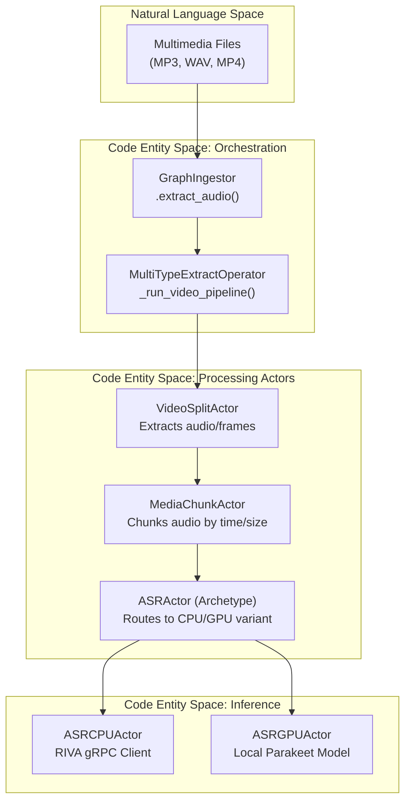

<!-- source: DeepWiki mcp.deepwiki.com · repo NVIDIA/NeMo-Retriever · extra page Audio Processing with RIVA ASR · fetched 2026-10-26 -->

# Audio Processing with RIVA ASR

<details>
<summary>Relevant source files</summary>

The following files were used as context for generating this wiki page:

- [docs/docs/extraction/audio-video.md](docs/docs/extraction/audio-video.md)
- [nemo_retriever/README.md](nemo_retriever/README.md)
- [nemo_retriever/docs/cli/README.md](nemo_retriever/docs/cli/README.md)
- [nemo_retriever/src/nemo_retriever/audio/__init__.py](nemo_retriever/src/nemo_retriever/audio/__init__.py)
- [nemo_retriever/src/nemo_retriever/audio/asr_actor.py](nemo_retriever/src/nemo_retriever/audio/asr_actor.py)
- [nemo_retriever/src/nemo_retriever/audio/chunk_actor.py](nemo_retriever/src/nemo_retriever/audio/chunk_actor.py)
- [nemo_retriever/src/nemo_retriever/audio/media_interface.py](nemo_retriever/src/nemo_retriever/audio/media_interface.py)
- [nemo_retriever/src/nemo_retriever/audio/stage.py](nemo_retriever/src/nemo_retriever/audio/stage.py)
- [nemo_retriever/src/nemo_retriever/model/local/llama_nemotron_embed_vl_1b_v2_embedder.py](nemo_retriever/src/nemo_retriever/model/local/llama_nemotron_embed_vl_1b_v2_embedder.py)
- [nemo_retriever/src/nemo_retriever/model/local/parakeet_ctc_1_1b_asr.py](nemo_retriever/src/nemo_retriever/model/local/parakeet_ctc_1_1b_asr.py)
- [nemo_retriever/src/nemo_retriever/video/frame_actor.py](nemo_retriever/src/nemo_retriever/video/frame_actor.py)
- [nemo_retriever/tests/__init__.py](nemo_retriever/tests/__init__.py)
- [nemo_retriever/tests/test_asr_actor.py](nemo_retriever/tests/test_asr_actor.py)
- [nemo_retriever/tests/test_audio_chunk_actor.py](nemo_retriever/tests/test_audio_chunk_actor.py)
- [nemo_retriever/tests/test_audio_pipeline_batch.py](nemo_retriever/tests/test_audio_pipeline_batch.py)
- [nemo_retriever/tests/test_audio_stage.py](nemo_retriever/tests/test_audio_stage.py)
- [nemo_retriever/tests/test_readme_video_pipeline_example.py](nemo_retriever/tests/test_readme_video_pipeline_example.py)
- [nemo_retriever/tests/test_video_frame_actor.py](nemo_retriever/tests/test_video_frame_actor.py)
- [nemo_retriever/tests/test_video_pipeline_batch.py](nemo_retriever/tests/test_video_pipeline_batch.py)

</details>


## Purpose and Scope

This document covers audio and video speech-to-text processing in the NeMo Retriever Library. It details the use of the NVIDIA RIVA ASR (Automatic Speech Recognition) NIM microservice and local Parakeet models. Key topics include configuration via `ASRParams`, audio chunking with `AudioChunkActor`, and the multimedia dependencies required for processing.

---

## Overview

NeMo Retriever Library supports extracting speech-to-text transcriptions from audio and video files. This enables Retrieval Augmented Generation (RAG) over spoken content by transcribing audio into text segments, which are then embedded and indexed.

**Supported File Types:**
- **Audio:** `mp3`, `wav` [docs/docs/extraction/audio-video.md:18-18]()
- **Video:** `mp4`, `mov`, `mkv`, `avi` (transcribes the audio track) [docs/docs/extraction/audio-video.md:19-19]()

The library provides two primary execution paths for ASR:
1.  **Remote NIM/NVCF:** Calls a RIVA/Parakeet NIM via gRPC (e.g., `parakeet-1-1b-ctc-en-us`). [nemo_retriever/src/nemo_retriever/audio/asr_actor.py:10-13]()
2.  **Local GPU Inference:** Loads `nvidia/parakeet-ctc-1.1b` locally via Hugging Face Transformers. [nemo_retriever/src/nemo_retriever/audio/asr_actor.py:14-15]()

**Sources:**
- [docs/docs/extraction/audio-video.md:1-21]()
- [nemo_retriever/src/nemo_retriever/audio/asr_actor.py:5-22]()

---

## System Architecture and Data Flow

Audio processing is orchestrated through a graph of operators. For multimedia files, the pipeline typically starts with a splitting stage before ASR transcription.

### Audio/Video Extraction Flow

The following diagram bridges the high-level multimedia ingestion concepts to the specific code entities that handle them.



**Sources:**
- [nemo_retriever/src/nemo_retriever/audio/asr_actor.py:5-22]()
- [nemo_retriever/tests/test_video_pipeline_batch.py:26-62]()
- [nemo_retriever/tests/test_readme_video_pipeline_example.py:92-120]()

---

## Core Components

### 1. ASRActor (Archetype)
The `ASRActor` is a `Ray Data` archetype that resolves to one of two hardware-specific variants:
- **`ASRCPUActor`**: Remote-only. It calls Parakeet/Riva via gRPC. It defaults to the public NVCF endpoint (`grpc.nvcf.nvidia.com:443`) if no endpoint is provided. [nemo_retriever/src/nemo_retriever/audio/asr_actor.py:10-13]()
- **`ASRGPUActor`**: Local-only. It loads the `nvidia/parakeet-ctc-1.1b` model using Hugging Face. [nemo_retriever/src/nemo_retriever/audio/asr_actor.py:14-15]()

### 2. ASRParams
Configuration for the ASR stage is handled by `ASRParams`. This includes endpoints, authentication tokens, and segmentation settings.

| Parameter | Purpose |
| :--- | :--- |
| `audio_endpoints` | Tuple of (gRPC, HTTP) endpoints. [nemo_retriever/src/nemo_retriever/audio/asr_actor.py:160-165]() |
| `segment_audio` | If `True`, enables punctuation-bounded (remote) or silence-gap (local) segmentation. [nemo_retriever/src/nemo_retriever/audio/asr_actor.py:18-21]() |
| `auth_token` | API key for hosted services (e.g., `NVIDIA_API_KEY`). [nemo_retriever/src/nemo_retriever/audio/asr_actor.py:148-150]() |
| `function_id` | NVCF function ID for hosted inference. [nemo_retriever/src/nemo_retriever/audio/asr_actor.py:149-150]() |

### 3. Audio Segmentation
When `segment_audio=True` is enabled, the pipeline produces one extracted element for each sentence-like segment.
- **Remote NIM:** Uses punctuation-bounded segments returned by the service. [nemo_retriever/src/nemo_retriever/audio/asr_actor.py:18-21]()
- **Local Model:** Uses silence-gap detection from CTC frame timestamps. [nemo_retriever/src/nemo_retriever/model/local/parakeet_ctc_1_1b_asr.py:8-10]()

**Sources:**
- [nemo_retriever/src/nemo_retriever/audio/asr_actor.py:5-22]()
- [nemo_retriever/src/nemo_retriever/model/local/parakeet_ctc_1_1b_asr.py:5-13]()
- [docs/docs/extraction/audio-video.md:93-95]()

---

## Multimedia Dependencies

Audio and video processing require specific system and Python dependencies.

### Installation
The `multimedia` extra is required for audio decoding and resampling.
```bash
pip install "nemo-retriever[multimedia]"
```
For local GPU inference, combine with the `local` extra:
```bash
pip install "nemo-retriever[local,multimedia]"
```
**Sources:**
- [nemo_retriever/README.md:120-125]()
- [docs/docs/extraction/audio-video.md:23-29]()

### System Requirements
The library uses `ffmpeg-python` as a wrapper but requires the system `ffmpeg` and `ffprobe` binaries to be on the `PATH`. [docs/docs/extraction/audio-video.md:31-35]()

| Dependency | Code Reference |
| :--- | :--- |
| `ffmpeg` | `is_ffmpeg_cli_available()` [nemo_retriever/src/nemo_retriever/audio/media_interface.py:47-49]() |
| `ffprobe` | `is_ffprobe_cli_available()` [nemo_retriever/src/nemo_retriever/audio/media_interface.py:52-54]() |
| `ffmpeg-python` | `is_ffmpeg_python_available()` [nemo_retriever/src/nemo_retriever/audio/media_interface.py:42-44]() |

**Sources:**
- [nemo_retriever/src/nemo_retriever/audio/media_interface.py:37-64]()
- [docs/docs/extraction/audio-video.md:37-39]()

---

## Local Model Implementation

The local ASR implementation uses `nvidia/parakeet-ctc-1.1b`.

### Technical Details
- **Sampling Rate:** 16,000 Hz mono. [nemo_retriever/src/nemo_retriever/model/local/parakeet_ctc_1_1b_asr.py:33-33]()
- **Decoding:** Greedy CTC decoding with word-level timestamps. [nemo_retriever/src/nemo_retriever/model/local/parakeet_ctc_1_1b_asr.py:8-10]()
- **Precision:** Uses `bfloat16` on GPU for ~2x faster forward passes and reduced memory usage. [nemo_retriever/src/nemo_retriever/model/local/parakeet_ctc_1_1b_asr.py:135-139]()
- **Chunking:** Internal time-windowed chunking (default 240s) keeps passes under the 400s ceiling of the encoder. [nemo_retriever/src/nemo_retriever/model/local/parakeet_ctc_1_1b_asr.py:10-11]() [nemo_retriever/src/nemo_retriever/model/local/parakeet_ctc_1_1b_asr.py:45-45]()

### Data Handling
If the input audio is not in a supported format (like MP3), the local model uses a subprocess to call `ffmpeg` and convert it to a 16k mono WAV file before processing. [nemo_retriever/src/nemo_retriever/model/local/parakeet_ctc_1_1b_asr.py:79-105]()

**Sources:**
- [nemo_retriever/src/nemo_retriever/model/local/parakeet_ctc_1_1b_asr.py:5-47]()
- [nemo_retriever/src/nemo_retriever/model/local/parakeet_ctc_1_1b_asr.py:120-139]()

---

## Python API Usage

### Remote NIM Example
```python
from nemo_retriever import create_ingestor
from nemo_retriever.params import ASRParams

ingestor = (
    create_ingestor(run_mode="batch")
    .files("./data/*.wav")
    .extract_audio(
        asr_params=ASRParams(segment_audio=True),
    )
)
```
**Sources:**
- [docs/docs/extraction/audio-video.md:83-89]()

### Local GPU Example
To use local inference, ensure `audio_endpoints` is empty and the `[local]` extra is installed.
```python
from nemo_retriever import create_ingestor
from nemo_retriever.params import ASRParams

ingestor = (
    create_ingestor(run_mode="batch")
    .files("./data/*.wav")
    .extract_audio(
        asr_params=ASRParams(audio_endpoints=(None, None)),
    )
)
```
**Sources:**
- [nemo_retriever/src/nemo_retriever/audio/asr_actor.py:151-155]()
- [nemo_retriever/tests/test_audio_pipeline_batch.py:138-145]()

---

## Video and Audio-Visual Fusion

For video files, the pipeline can extract both audio transcriptions and video frames (via OCR).

### Video Pipeline Components
- **`VideoSplitActor`**: Demuxes video into an audio track and individual frames. [nemo_retriever/src/nemo_retriever/video/frame_actor.py:32-32]() [nemo_retriever/tests/test_readme_video_pipeline_example.py:170-177]()
- **`AudioVisualFuser`**: Pairs audio utterances with the most representative concurrent video frame. [nemo_retriever/tests/test_readme_video_pipeline_example.py:117-117]() [nemo_retriever/tests/test_video_pipeline_batch.py:146-147]()

### Implementation Logic
The `MultiTypeExtractOperator` manages the video branch, ensuring that if `audio_only=True` is set in `AudioChunkParams`, the visual branch (OCR and fuser) is stripped from the graph. [nemo_retriever/tests/test_readme_video_pipeline_example.py:127-158]()

**Sources:**
- [nemo_retriever/tests/test_video_pipeline_batch.py:5-23]()
- [nemo_retriever/tests/test_readme_video_pipeline_example.py:5-37]()
- [nemo_retriever/src/nemo_retriever/video/frame_actor.py:5-33]()

---

